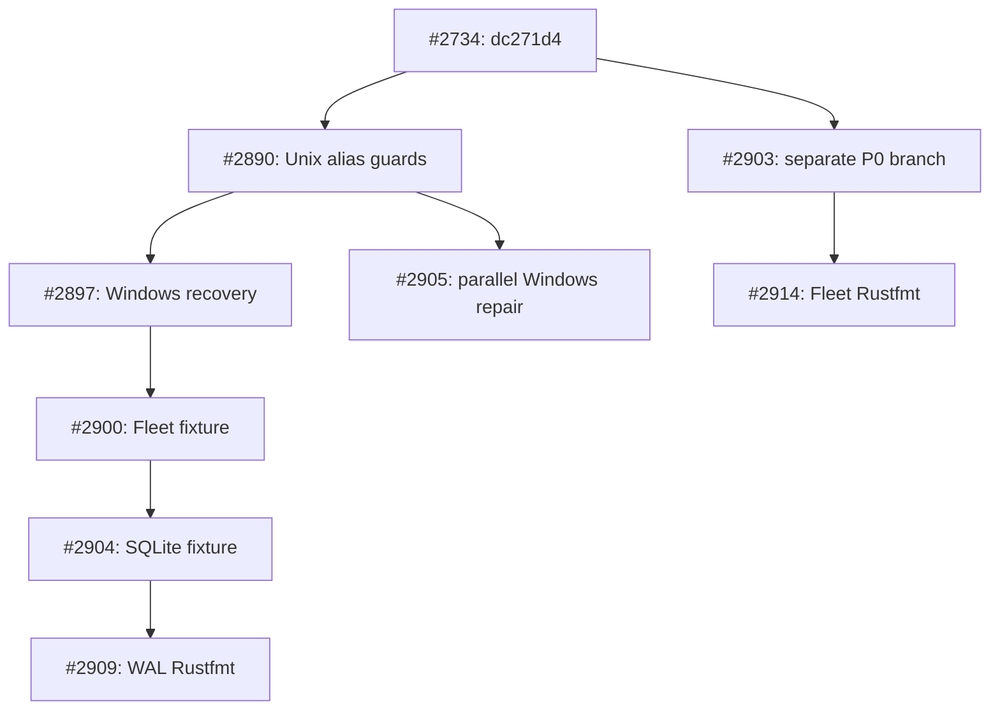

# Cell owner Scope WAL: exact successor and source projection

**Decision:** reuse existing [#2909](https://github.com/TrillionniumFoundation/hepta-private-ci/pull/2909), source `5993cb909547070e4b56ca9465996a5a946fafca`, full tree `dfa98997ef9f82773c4c9967ab3034d717961abb`. It is the audited complete WAL successor with Unix alias guards, Windows recovery, and the final formatted regression test. No synonymous Cell-owner PR was created.

The four-path source projection targets **#2734 / `dc271d4f47028e941decce70cc8ef81fb24d2141`**. It does not import an owner into #2917. All production worktrees, including the frozen Windows five-file patch, were untouched during this audit. State remains **DRAFT / DENY_ALL / HOLD_NO_GO**.

## Verified source projection

`cell-wal-four-paths.patch` contains **109 insertions, 7 deletions across four files**. Applying it to isolated copies of the exact base succeeds, and all resulting blobs equal the existing selected successor. No Cargo build or test was run locally.

| Path | Origin | Resulting Git blob |
|---|---|---|
| `codex-rs/Cargo.lock` | #2890 / `33e8302efd89a385c168199b4cba2c9c96d5708e` | `232fc40e53a20d597a5faa7b0737d642909d26ed` |
| `codex-rs/hepta-control-plane/Cargo.toml` | #2890 / `33e8302efd89a385c168199b4cba2c9c96d5708e` | `eac52190589d64a7b6809c313c044d28d70e1252` |
| `codex-rs/hepta-control-plane/src/scope_lane_wal.rs` | #2897 / `1689f7400b810ec2d56a6e4bc6763c1c28d678e0` | `39add8ab37a9d93f7502e8e8b3122eaba99aa4b6` |
| `codex-rs/hepta-control-plane/src/scope_lane_wal_tests.rs` | #2909 / `5993cb909547070e4b56ca9465996a5a946fafca` | `67a34edc7993dc33feb22c8f3bb45c1fbac428ae` |

Cargo.lock adds only the control-plane `libc` edge; Cargo.toml adds the corresponding workspace dependency. The source projection excludes the dedicated workflow, Fleet test fixture, and Automation migration fixture already present elsewhere in the complete #2909 history.

## Existing dependency chain and competing candidates

This diagram shows PR dependency branches. `github_snapshot.json` retains the complete actual 13-commit ancestry, including intermediate commits and earlier merge parents. The API compare proves #2909 is 13 commits ahead of the exact #2734 source with no missing baseline commits. #2905 and #2909 are divergent siblings with common ancestor `33e8302efd89a385c168199b4cba2c9c96d5708e`.

The #2905 Windows-only partial-body test is covered by #2909's platform-neutral torn-tail/reappend test, which additionally verifies both exact predecessor envelopes. #2903/#2914 fix the Windows handle but do not contain #2890's Unix O_NOFOLLOW, link-count, or creation-mode guards. Their WAL file must not replace the selected successor merely because their PR numbers are later.

## Original failures and real Windows success

Both the #2734 [Windows shard 1 job 117826243985](https://github.com/TrillionniumFoundation/hepta-private-ci/actions/runs/39178520192/job/117826243985) and #2890 [job 118041065193](https://github.com/TrillionniumFoundation/hepta-private-ci/actions/runs/39246872202/job/118041065193) failed these existing tests with `Io(PermissionDenied)`:

- `file_wal_repairs_incomplete_length_before_new_commits`
- `file_wal_syncs_frames_and_repairs_torn_tail`

Their raw checkout identities confirm the exact source/base synthetic merges; decoded log hashes and bounded excerpts are retained in `log_index.json` and `logs/`.

The selected #2909 [Windows job 118059888568](https://github.com/TrillionniumFoundation/hepta-private-ci/actions/runs/39252617291/job/118059888568), run `39252617291`, explicitly checked out **source head `5993cb9...`** and passed **7 tests, 0 failures, 0 ignored, 110 filtered**. The run was a pull_request event, attempt 1. Its immutable-checkout, locked Cargo graph, actual tests, Rustfmt and unchanged-worktree steps all succeeded. The exact output is in `windows_qualification.json`.

| Retained behavior | Test / evidence |
|---|---|
| Independent lanes, owner conflict, generation regression, authority-free receipt | `scope_lanes_are_independent_and_fenced`, passed on Windows |
| Corrupt frame and tampered entry-digest rejection | `export_reopen_roundtrip_and_bad_frame_rejection`, passed on Windows |
| Partial body and partial length repaired before acknowledgement | Existing two recovery tests, both passed on Windows |
| Sixty-four distinct durable records and duplicate idempotency | `incremental_scope_lanes_replay_many_distinct_committed_frames`, passed on Windows |
| Poisoned writer rejects new and old duplicate acknowledgement | `poisoned_scope_writer_cannot_acknowledge_even_an_old_duplicate`, passed on Windows |
| Fsynced crash tail, correct truncate, sequence 2 and both exact predecessor envelopes | New reappend regression, passed on Windows |
| Symlink/hardlink rejection before header write, target unchanged | Unix-only test retained; this Windows run does not execute it |
| Private mode for newly created WAL | Unix-only test retained; this Windows run does not execute it |

The #2897 dedicated Windows job had already passed the same 7 tests and then failed Rustfmt. #2909 closes that formatting gate. The #2909 required CI still fails: scoped-native job `118069853019` exhausted disk while compiling `codex-goal-extension` test `goal_extension_backend`. That failure is preserved and is not a WAL test failure or a required pass.

## Safety boundaries and validation limits

The original six baseline test functions are byte-preserved; three tests are added. Every WAL function outside the small open-handle/alias-guard block is byte-identical to the baseline. This preserves exclusive locked ownership, sync-before-projection, tail truncation followed by sync, corrupt-chain rejection, poison fencing, owner/generation checks, bounded framing and DENY_ALL receipts.

The preexisting caller contract requires a trusted parent directory and validated run-root lineage. The selected source adds Unix no-follow, link-count and new-file mode guards; it does not itself implement a full Windows DACL/reparse-point validator or validate permissions of every preexisting Unix file. Seven Windows tests cannot establish full cross-platform permission qualification.

Local checks: exact source blobs, patch apply/check and replayed output identities passed. Rustfmt 1.95.0 / edition 2024 check passed, with the known repository `imports_granularity=Item` nightly-only warning. No native compilation, full worktree clone, remote mutation or new CI was performed.

Next action: continue the **existing #2909 Cell owner** after the shared disk-profile work is qualified, and bind required/native and Unix alias/mode validation to its frozen source. The four-path patch is an audit/reconciliation artifact, not a new synonymous PR and not an independently tested full tree.
