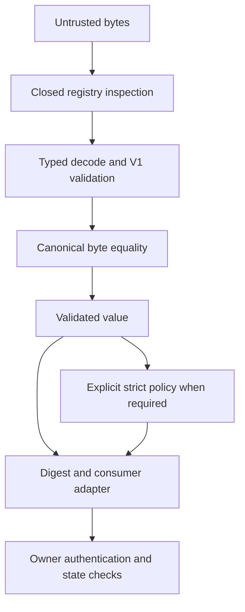

# cognitive.types architecture

**Status:** source hardening and canonical-consumer convergence candidate\
**Owner:** `cognitive-platform`\
**Deputy:** `kernel-contracts`\
**Authority posture:** pure contract library; no SQL, daemon, network, model, effect, promotion or release authority

## 1. Purpose

`cognitive.types` owns bounded, versioned Rust representations for cognitive records, HNMF assets, recall, plasticity, topology, forgetting, Lane C exchange and canonical wire envelopes. It does not own durable state. Durable owners remain responsible for authentication, authorization, freshness, revocation, transactions, fencing and recovery.

The module has four layers:

1. **Compatibility domain types** in `src/lib.rs`, `src/hnmf.rs`, `src/hnmf_learning.rs` and `src/lane_c.rs`.
2. **Explicit strict semantic validation** in `src/strict.rs`.
3. **Canonical transport and digesting** in `src/wire.rs`, `src/registry.rs` and `src/contract.rs`.
4. **Consumer profiles and digest-bound receipt metadata** in `src/consumer.rs` and `src/write_receipt.rs`.

## 2. Trust boundaries

The existing twelve Wire V1 contracts keep their established validators and digest bytes. `ValidateStrictV1` is an additional caller-selected policy; neither registered decode nor `Validated::from_cognitive_contract` automatically opts into it. A change that rejects formerly legitimate Wire V1 values requires an explicit version or migration decision.

`Validated<T>` means only that the current contract validator accepted the value. It does not grant access or establish external freshness. A durable owner must still bind the validated value to an authenticated principal, authority epoch, revocation frontier, snapshot, writer generation and transaction outcome.

## 3. Component ownership

| Component          | Owns                                                          | Explicitly does not own             |
| ------------------ | ------------------------------------------------------------- | ----------------------------------- |
| `lib.rs`           | compatibility records and deterministic snapshots             | durable history, authentication     |
| `hnmf.rs`          | multimodal assets, spans, events, provenance                  | asset storage, parser indexes       |
| `hnmf_learning.rs` | engrams, synapses, recall, learning proposals                 | learning policy activation          |
| `lane_c.rs`        | Lane C local exchange types                                   | product writer authority            |
| `strict.rs`        | cross-field invariants and selector-resolution checks         | fetching selector indexes           |
| `wire.rs`          | canonical JSON V1 codec                                       | schema negotiation                  |
| `registry.rs`      | closed schema/version/contract allow-list                     | dynamic plugin registration         |
| `contract.rs`      | structured violations, `Validated<T>`, digest-domain metadata | authorization                       |
| `write_receipt.rs` | tagged receipt fields and digest consistency                  | authenticating or executing a write |
| `consumer.rs`      | named consumer bindings, shadow and cutover accounting        | enabling cutover                    |

## 4. Memory-write path

The existing Lane C `MemoryWriteReceiptV1` remains a compatibility input. `write_receipt::MemoryWriteReceiptV1` adds a canonical representation without granting authority or replacing the state owner’s receipt validation.

The canonical receipt binds:

- intent identity and the digest of the five existing intent fields;
- candidate digest;
- authorization digest;
- writer-fence digest;
- expected snapshot digest and memory frontier;
- writer identity and issue time;
- committed record/snapshot outcome or structured rejection;
- a self digest bound to schema, version, canonicalization, Unicode policy and digest algorithm.

Rejection is a tagged outcome and cannot carry fabricated record identity.

`hepta-cognitive-store::CanonicalCognitiveStoreV1Ext` validates its added writer ID and issue time before invoking `AdmittedCognitiveStoreV2::append_admitted`. That existing in-memory writer performs its authority, fence and snapshot checks. The adapter converts the returned receipt, verifies a registered round trip, and binds the shadow comparison to the actual intent, consumer and pair of semantic digests. It adds no durable transaction or independently authenticated writer metadata.

Receipt validation recomputes both the outer receipt digest and the embedded intent digest. These checks establish internal consistency. Authenticity, the snapshot digest’s full preimage, and the truth of supplied writer/time metadata still require owner context.

## 5. Consumer architecture

The closed convergence registry names five consumers:

| Consumer               | Canonical role                                    | Current migration mechanism                                        |
| ---------------------- | ------------------------------------------------- | ------------------------------------------------------------------ |
| `cognitive.read`       | canonical event/binding/forget input              | registered decode adapter and compile contract                     |
| `cognitive.store`      | declared event input and canonical receipt output | in-memory admitted-writer adapter with a bound semantic comparison |
| `memory.retrieval`     | canonical cue input and recall output             | registered decode/encode binding                                   |
| `compact.engine`       | canonical event/forget input                      | registered input binding                                           |
| `intelligence.control` | canonical recall/outcome input                    | registered input binding                                           |

Each profile declares the owner, legacy surfaces, canonical schemas, metric name, gate name and rollback description. Five compile-contract tests check these declarations. They do not implement metric emission or switch production call sites. The store adapter has separate tests that exercise actual in-memory writes. Production cutover also requires consumer-owned call-site evidence, authentication and operational acceptance.

## 6. Selector resolution

Shape validation checks the declared selector bounds and syntax. `SelectorResolutionContextV1` checks manifest agreement and membership in caller-supplied AST, GUI and JSON Pointer sets. It stores a supplied index digest, but does not recompute that digest from the sets, fetch an index or authenticate its producer. The owner must establish that the manifest, digest and sets describe the same trusted asset before constructing this context.

No document or caller may claim that a bare `ModalitySpanRefV1::validate()` proves target existence.

## 7. Compatibility policy

Legacy digests remain byte-compatible. New integrations can explicitly select the domain-bound digest profile; that choice does not authenticate the value. Additive adapters may coexist during shadow migration, but authoritative consumers must not silently reinterpret a legacy local type as a canonical wire contract.

See `SCHEMA_EVOLUTION.md`, `MIGRATION.md` and `WIRE_CONTRACT.md`.
