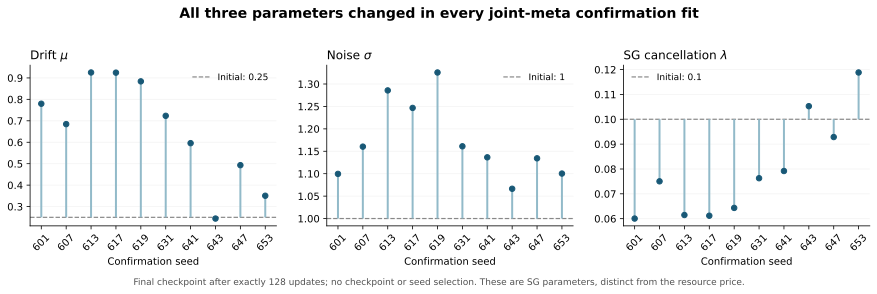
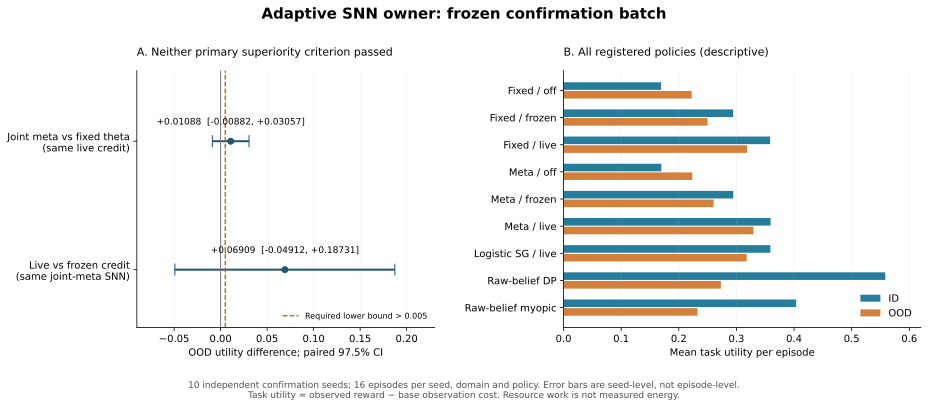

# Registered adaptive SNN owner results

The registered batch completed 45 training fits, 2,880 native-owner episodes,
and an independent cold replay of every episode. Both primary superiority
claims remain **unestablished**. Joint parameter learning and resource feedback
are operational, but this experiment does not establish a task-utility advantage
for either. The negative and inconclusive results are part of the deliverable.

This report concerns the frozen `adaptive_neuron_v2` study. The authenticated
LedgerWriter bridge is a separate versioned experiment. It must not be credited
retroactively to this study's research resource account.

## Identity and acceptance evidence

| Item                                       | Recorded result                                                       |
| ------------------------------------------ | --------------------------------------------------------------------- |
| Scientific source commit                   | `58c1f6caabd28ad99f2d425cfaa5c4e050f7a19a`                            |
| Source tree                                | `142ae37061052500fcb445a713d8fd141dc5e46b`                            |
| Registered inputs                          | 141 files, including original native modules and dependency lock      |
| Source seal SHA-256                        | `594b1180532dc32b7d659f6d1031fa4047c9c6446b393a17590d27eab484019f`    |
| Screening / confirmation                   | 5 / 10 independent seeds; 3 training arms                             |
| Optimizer schedule                         | Exactly 128 support and query updates per fit                         |
| Deployment                                 | 10 seeds × 2 domains × 9 policies × 16 episodes = 2,880               |
| Native executable                          | 1,101,544 bytes; two fresh builds are byte-identical                  |
| Executable SHA-256                         | `261c63bc5f3a8ca1940dac27424ef8740e03ddc918b12f29af7d44b4b4ad25e4`    |
| Registered unit of statistical replication | Independent seed, not episode or tick                                 |
| Independent training review                | All 45 fits and every 128-step optimizer history passed               |
| Independent event review                   | All 2,880 terminal outcomes and credit settlements reconstructed      |
| Portable replay                            | All 2,880 episodes passed in a new root; no new owner ticks or credit |

The small exact receipts and final checkpoints are in
[results/scientific001](results/scientific001). The complete per-step training
history, progress snapshots, original raw owner/journal/witness/account files,
all native audit records and exact executable are in the accompanying evidence
archive. [Independent review](results/independent_review001) recomputes the
training and statistical claims without trusting their summary pass flags.

## What actually ran

Six causal features drive eight bipolar integrate-and-fire cells and a trained
readout: 57 neural parameters. Forward inference uses hard comparisons and signed
spike accumulation. The native owner does not evaluate a surrogate CDF or sample
a soft neural probability as a substitute for those spikes. The three training
arms share initial neural weights, task streams, support/query observations,
supervision and both neural-weight updates. They differ in the backward rule:

| Training arm  | Backward rule                                         | Learned surrogate coordinates |
| ------------- | ----------------------------------------------------- | ----------------------------- |
| `standard`    | Fixed logistic surrogate                              | 0                             |
| `fixed_theta` | First-passage surrogate, fixed parameters             | 0                             |
| `meta_theta`  | First-passage surrogate, joint one-step hypergradient | 3                             |

The meta arm has 60 trainable scalars in total. It uses more mixed-derivative
algebra, which is measured, rather than receiving additional labels or future
observations. No seed or intermediate checkpoint was selected after scoring.
Screening did not revise the method or confirmation protocol.

The deployed hard-network readout enters the registered finite-grid Bellman
decision rule. Continue, positive, negative and abstain actions are applied by
the original `AgentdNeuronOwner`, with journal and witness persistence. Stopping
ends observation purchases. The raw-belief DP and myopic baselines receive the
same observations and context, calculate their analytic belief directly, and
execute zero neural cells. This is a Bernoulli evidence task; a Brownian
approximation is not treated as its exact transition kernel.

The task's finite-grid, discrete-epoch stopping boundary is distinct from the
continuous optimal-stopping oracle developed in
[the preceding study](../free_boundary_neuron/math/THEORY.md). Its threshold
adapts to remaining horizon, inference state, observation cost and resource
price. This deployment does not add a continuous smooth-fit condition to a
discrete neural event, or prove that arbitrary adaptive barriers inherit the
fixed-barrier closed form.

## Joint meta-training and its mathematical scope

For a threshold gap $d\geq0$, unit surrogate horizon, and the registered
positive cancellation rate, the killed Brownian first-passage primitive is

$$
\Delta=\sqrt{\mu^2+2\lambda\sigma^2},\qquad
\kappa=\frac{\Delta-\mu}{\sigma^2},\qquad
\gamma=\frac{\Delta+\mu}{\sigma^2},
$$

$$
P(d)=e^{-\kappa d}\Phi\!\left(\frac{\Delta-d}{\sigma}\right)
+e^{\gamma d}\Phi\!\left(-\frac{d+\Delta}{\sigma}\right),
\qquad g(d)=-P_d(d).
$$

The implementation uses a positive Mills-ratio decomposition for the slope and
its parameter derivatives. The root derivatives are

$$
\nabla_{(\mu,\sigma,\lambda)}\kappa
=\Delta^{-1}(-\kappa,-\sigma\kappa^2,1),\qquad
\nabla_{(\mu,\sigma,\lambda)}\gamma
=\Delta^{-1}(\gamma,-\sigma\gamma^2,1).
$$

The raw parameters are projected into $[-6,6]^3$ and transformed by

$$
\mu=1.25\tanh(a_1),\quad
\sigma=0.35+1.65\operatorname{sigmoid}(a_2),\quad
\lambda=0.01+0.99\operatorname{sigmoid}(a_3).
$$

Consequently $\sigma>0.35$, $\lambda>0.01$, and the conservative bound
$\Delta>\sqrt{2(0.01)(0.35)^2}\approx0.04950$ excludes root degeneracy in
this training domain. The raw box, bounded features, finite horizon, neural
weight projection and gradient clipping keep this finite computation bounded.
They do not prove global optimizer convergence. Clipping and projection have
explicit branch conventions at kinks; ordinary local derivatives apply away
from those kinks. The constant-step online Adam schedule is not a theorem of
convergence to an optimal policy.

At fixed current neural weights $W$, the actual support update is

$$
\phi=\Pi_{\mathcal W}\!\left[W-\alpha\,
\operatorname{clip}_c\bigl(G_{\mathrm{SG}}(W,a;S)\bigr)\right].
$$

The independent query objective is a fixed logistic-soft BCE,
$F(a;W,S,Q)=L_{\mathrm{query,soft}}(\phi;Q)$, with no direct dependence on
$a$. Its hypergradient is

$$
\nabla_a F=(D_a\phi)^\top\nabla_\phi L_{\mathrm{query,soft}},\qquad
D_a\phi=-\alpha D\Pi D\operatorname{clip}_c D_aG_{\mathrm{SG}}.
$$

The complete recurrent mixed derivative includes clipping and active projection.
It differentiates a specified surrogate update rule. It is not the ordinary
derivative of a hard-spike objective, or a gradient through the entire training
history. Both fixed-parameter controls receive the same subsequent query-label
weight update. The fixed soft query objective prevents improving the outer
loss merely by changing its own smoothing parameter.

Independent verification re-solved 270 support adaptations and query evaluations
at three finite-difference scales for all 15 final meta checkpoints. The largest
scaled error was **5.3175333e-11**, below the registered **2e-7** tolerance; the
normalization is the declared scaled-error metric, not relative error to a tiny
gradient component. Each coordinate changed in every meta fit. Across all 15,
the minimum absolute changes in $(\mu,\sigma,\lambda)$ were
$(0.00574794,0.01710668,0.00458130)$.

For the 10 confirmation fits, final $\mu$ ranged from 0.244252 to 0.925276,
$\sigma$ from 1.066418 to 1.325635, and $\lambda$ from 0.060044 to
0.118839, starting from $(0.25,1,0.1)$. These observed directions are task
outcomes, not universal claims that noise must increase or cancellation must
decrease. [Full derivative contract](learning/THEORY.md)

## Credit changes future decisions

The surrogate cancellation parameter $\lambda$ and the resource shadow price
$p$ have different roles. The former changes training gradients. The latter
prices execution in the task and is held constant within an episode. They are
not silently identified with one another.

Actual work for an observation tick is $1+\text{spikes}/8$. A non-neural
baseline is charged one work unit per tick and zero SNN spikes. Boundary and
solver operations, identity validation, replay and native CPU are separately
counted. None of these work units is a measurement of Joules.

The decision rule uses $c_{\mathrm{effective}}=c+2p$, with the registered
maximum per-observation work quote of two. After an observed terminal reward,

$$
p_{e+1}=\Pi_{[0,0.08]}
\left[p_e+0.005\left(w_e-B_e-0.5R_e\right)\right].
$$

The durable balance is debited by measured tick work and replenished only at
terminal settlement by $B_e+0.5R_e$, with cap 32 and explicit overflow.
All arms retain admission and accounting. The `off` condition ignores price in
the decision rule; it does not disable budget admission. The `frozen` condition
uses price 0.02. The `live` condition uses the current durable price.

This projected feedback law has bounded iterates by construction. This study
does not claim a stationary primal-dual convergence theorem under the changing
budget and reward sequence. The unchanged native credit finalizer checks organ
allocation conservation. The v2 resource ledger itself remains a local research
sidecar with DENY_ALL authority, distinct from an authenticated production writer.

Among 320 matched ID/OOD episode pairs, changing meta/live to meta/frozen changed
144 stopping times and 54 terminal actions. Changing meta/live to meta/off
changed 196 stopping times and 132 terminal actions. Changing meta/live to
fixed/live changed only 8 stopping times and 9 terminal actions. These are
causal execution differences under shared exogenous streams, not evidence that
every change improved utility. Later episodes can receive different balances
because the earlier policy actions consumed different work.

## Registered statistical results

The task score is terminal reward minus the base observation cost for all
purchased observations, including the first. Correct/wrong decisions receive
1/−1 and abstention receives 0.05. The virtual resource price is not inserted into
the score to manufacture a favorable comparison.

The two confirmatory OOD contrasts use paired independent-seed means, with two
Bonferroni-adjusted, two-sided 97.5% Student-t intervals. The lower bound must
exceed the predeclared practical effect of 0.005.

| Confirmatory contrast       | Mean utility difference | 97.5% interval         | Superiority     |
| --------------------------- | ----------------------: | ---------------------- | --------------- |
| Meta/live minus fixed/live  |               +0.010875 | [−0.008823, +0.030573] | Not established |
| Meta/live minus meta/frozen |               +0.069094 | [−0.049119, +0.187307] | Not established |

The estimate is positive in each case, but the intervals include negative
effects. More episodes within the same ten seed trajectories cannot be counted
as new independent replication. No test set was used to revise the protocol,
exclude seeds, change endpoints or choose a better checkpoint.

All policies remain visible in the descriptive comparison:

| Policy                   | ID utility | OOD utility | OOD observations | OOD spikes | OOD resource work |
| ------------------------ | ---------: | ----------: | ---------------: | ---------: | ----------------: |
| Fixed / off              |   0.169250 |    0.222344 |           3.2875 |    17.0938 |            5.4242 |
| Fixed / frozen           |   0.294250 |    0.249844 |           2.3750 |    13.0063 |            4.0008 |
| Fixed / live             |   0.358438 |    0.318687 |           2.6438 |    13.4813 |            4.3289 |
| Meta / off               |   0.169625 |    0.223344 |           3.2563 |    17.2625 |            5.4141 |
| Meta / frozen            |   0.294500 |    0.260469 |           2.3750 |    13.0813 |            4.0102 |
| Meta / live              |   0.359313 |    0.329562 |           2.6250 |    13.5125 |            4.3141 |
| Logistic SG / live       |   0.358938 |    0.317781 |           2.5875 |    13.4750 |            4.2719 |
| Raw-belief DP / live     |   0.558375 |    0.273062 |           2.8438 |          0 |            2.8438 |
| Raw-belief myopic / live |   0.403750 |    0.232500 |           1.0000 |          0 |            1.0000 |

These additional comparisons are descriptive. In particular, raw-belief DP has
a substantially higher ID point estimate and executes no SNN cells. The OOD
ordering does not establish SNN superiority over that baseline because it was
not one of the two registered superiority tests. The finite-grid belief DP also
does not solve the entire multi-episode budget-control problem globally.

The evidence supports prioritizing calibration and task-objective alignment
before increasing SNN complexity. Joint meta-training changed parameters much
more often than it changed hard decisions. That interpretation is an inference
from the parameter and trajectory evidence, not a separately tested mechanism.
Any revised query objective, larger network, changed budget dynamics or longer
training schedule needs a new protocol and new independent confirmation seeds.

## Execution, replay and costs

| Measured operation                                   |       Total |
| ---------------------------------------------------- | ----------: |
| Training support updates                             |       5,760 |
| Training query weight updates                        |       5,760 |
| Training neural cell updates                         |  69,967,872 |
| Declared surrogate scalar evaluations                | 139,935,744 |
| Actual native owner ticks                            |       8,312 |
| Actual native SNN cell updates                       |      53,616 |
| Actual native spikes                                 |      37,857 |
| Actual resource work                                 |  13,044.125 |
| Native deployment boundary-build terms               |  93,020,928 |
| Original independent replay owner ticks / new credit |       0 / 0 |
| Original independent replay boundary-build terms     |  57,016,960 |

The native accounting also records journal bytes, RPCs, model calls, validation
and replay kernels, original credit finalizations and allocation peaks. The
2,880 expected failed requests in deployment are deliberate post-terminal
rejection probes, not omitted failed episodes. Full ledgers preserve them.

Across the 15 fits per training arm, timed training-loop CPU totals were
20.953187 seconds for the logistic SG, 32.268017 seconds for the fixed
first-passage SG, and 45.063973 seconds for the joint-meta SG. Each arm performed
23,322,624 neural cell updates. The extra derivative algebra is therefore a real
cost despite an equal forward-update count. These are descriptive timings in
the recorded environment, not hardware-independent speed ratios.

The process-enclosing registered run took **509.413202 seconds wall** and
**496.209594 seconds CPU**, including startup/imports, two builds, training,
learning audits, execution, original cold replays and statistics. Its inner
509.323299-second receipt is a nested interval and must not be added again.
The additional independent training/event review and preservation measured
27.894279 seconds wall and 23.607500 seconds CPU. The complete portable replay
added 61.458878 seconds wall and 54.025489 seconds CPU, with no new owner ticks,
no new credit and identical scientific results.

Packaging, rendering, transfer and all preserved failed attempts have their own
receipts in [delivery001](results/delivery001). The source seal binds the original
toolchain/environment. Future dependency-policy fixes do not retroactively
change its lockfile or executable. Unmetered prior code authoring, interactive
inspection and previously installed toolchain/cache acquisition are explicitly
outside these runtime totals. No total project energy or production throughput
claim is made.

## Reproduction limits

The evidence archive contains the exact Linux x86_64 executable and a replay
entry point. It validates its full manifest and all 141 frozen inputs, makes a
new working copy, reissues only the path-bound local research permit, performs
all native cold replays and reconstructs the statistics. The original archive
must remain byte-identical. Original machine paths in receipts are retained as
historical evidence rather than rewritten to look portable.

Two-build identity applies to the declared compiler, target, source and vendor
cache. It is not a claim of identical binaries across architectures or compiler
versions. Product CI and the subsequent authenticated credit bridge have their
own source identities and validation evidence. This report does not convert a
local research permit into production credentials or deployment approval.
