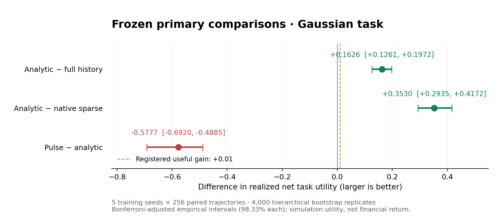

# 解析事件神经元：已执行的研究与验收

六个工作包已经实现并运行。**本轮结果支持保留连续解析预测候选；当前随机脉冲版本、额外解析反馈编码和保留能力均未获得生产晋级依据。最终决定为 `KEEP_RESEARCH`。**

代码、训练数据、模型、原生二进制、真实文件回读、原始逐回合记录和独立重放证据均保留。所有研究变更位于 `experiments/analytic_event_neuron`，没有替换生产 Hepta neuron，也没有重新标记原有 blockers。

## 1. 主要结果

净效用为 `1 − (实际交付预测 − 固定终点状态)^2 − 已付等待/修复费用`。这里的费用是预先注册的任务单位；CPU、文件交付、原生调用和训练耗时另行记录，没有兑换成货币。

主比较采用五个独立训练种子，每个种子 256 条配对确认轨迹。每次重采样先抽训练种子，再抽该种子内的完整轨迹；多个预测期限不作为独立样本。4,000 次 bootstrap，三个主要比较按 Bonferroni 分配 `α=0.05/3`。通过条件是经验区间下限大于 **0.01**，且五个种子的平均差异全部为正。五个训练种子仍然限制推断的可靠性；经验区间不是有限样本保证。

| 主要比较（高斯任务） | 平均净效用差 | 调整后的经验区间 | 注册门槛 |
| --- | ---: | ---: | --- |
| 连续解析模型 − 完整历史模型 | +0.162556 | [0.126131, 0.197198] | 通过，五种子全正 |
| 连续解析模型 − 本次原生 sparse 对照 | +0.353016 | [0.293480, 0.417220] | 通过，五种子全正 |
| 随机脉冲模型 − 连续解析模型 | −0.577669 | [−0.691993, −0.488517] | **失败，五种子全负** |



下表的 NLL/ECE 来自初始公开历史上 0.5、1、2 三个期限的预测；效用和费用来自固定终点 T+2 的序贯控制。

| 模型 | 平均净效用 | 平均行动费用 | 终点事件 NLL | Classwise ECE |
| --- | ---: | ---: | ---: | ---: |
| 连续解析模型 | 0.522437 | 0.108203 | 0.516754 | 0.021979 |
| 独立实现的等价高斯模型 | 0.522437 | 0.108203 | 0.516754 | 0.021979 |
| 完整历史模型 | 0.359881 | 0.179531 | 0.556415 | 0.037086 |
| 本次原生 sparse 对照 | 0.169422 | 0.212012 | 0.653744 | 0.028889 |
| 随机脉冲模型 | −0.055232 | 0.257109 | 0.678553 | 0.031981 |
| 确定性 mean-drive 对照 | 0.039359 | 0.237969 | 0.602640 | 0.028047 |
| 已知规律参考模型（特权信息） | 0.523193 | 0.114562 | 0.515569 | 0.020388 |

解析模型相对完整历史模型的收益可以拆成 **0.091227 的实际平方误差减少**和 **0.071328 的行动费用减少**。相对原生 sparse 对照，对应两项是 **0.249207** 和 **0.103809**。这些是实际后续任务回报，不仅是预测损失。

原生 sparse 结果限定于本次明确的公开输入编码、原始固定 kernel 和训练读出，不能推广为所有 Hepta sparse 架构的比较结论。已知规律模型仅作特权参考，不参与公平优势声明。

独立联合高斯条件化与递归解析实现的平均效用差只有约 `−4.77e−18`。因此本研究没有证明区别于高斯/probit 的新函数类。解析核提供的是明确的概率、时间传播和实现合同。

## 2. 数学与脉冲语义

共享条件分布 `X_target | public_history ~ Normal(m, v)` 的输出顺序为 `(put, neutral, call)`：

- put：`X_target <= lower`；
- neutral：`lower < X_target <= upper`；
- call：`X_target > upper`。

Call 与 put 是同一概率核的方向事件。相同阈值时两者互补；不同阈值时中间区间显式形成 neutral。它们不是两个任意独立的 Bernoulli 单元。脉冲版本每次从共享三类分布抽取一个类别，避免同时把互斥事件当成证据。

这些是条件终点概率，不是折现价格、首达概率、实际脉冲发放概率或 runtime confidence。输入噪声参数属于任务概率模型，不代表金融风险偏好。缺失观察、无新观察的传播、neutral 类别及未发放脉冲分别记录。脉冲的膜电位、eligibility、阈值、复位、计数和 refractory 都有显式配置或状态。

十组独立数学验证覆盖积分、解析梯度、极尾与窄区间、点质量、时间传播、连续半群、有限区间投影误差及 Q24 质量守恒。概率相对独立积分的最大误差为约 `2.22e−16`；端点概率 `0.158655` 与首达概率 `0.317311` 的反例阻止语义混用。有限区间投影不声称满足精确半群性质。

详细合同见 [SPEC.md](SPEC.md)、[MATH.md](MATH.md) 和 [数学原始验收](evidence/MATH_VALIDATION.json)。

## 3. 训练、机制与动作选择

主任务九个模型/参考臂为 `analytic`、`equivalent_gaussian`、`fixed`、`oracle`、`history`、`pulse`、`mean_drive`、`pulse_no_reset`、`native`。五个种子均训练成功。解析候选实际学习 drift、process variance 和 sensor-noise scale；其他读出实际拟合，并只使用开发集选择 ridge 和方差校准。

脉冲驱动分布及读出经过训练。膜电位泄漏、发放阈值、复位和 refractory 常数固定；没有声称完成穿过离散采样的端到端梯度训练，也没有声称训练了原 sparse kernel 参数。

任务在六个不规则、可能缺失的带噪观察后，选择停止、立即修复或等待后再选择。终点评分始终指向初始历史之后两个时间单位。公开费用倍率从 `[0.5, 1, 2, 4]` 独立抽取，并在动作前实际回读。该设置在确认前修订，解决了固定费用导致 oracle 总是等待后修复的退化。

高斯确认集上，解析策略产生 356 次停止、693 次等待后修复、231 次等待后停止。相同解析估计器的固定“等待后修复”策略净效用为 `0.431194`；自适应选择为 `0.522437`，次级差值 `+0.091243`，描述性 95% 区间 `[0.052774, 0.131351]`。

匹配机制对照给出：

| 次级比较 | 平均净效用差 | 描述性 95% 区间 |
| --- | ---: | ---: |
| pulse − mean_drive | −0.094591 | [−0.140058, −0.052188] |
| pulse − pulse_no_reset | −0.009741 | [−0.034042, 0.015716] |

在该设置下随机采样降低了表现；复位尚未显示收益。区间跨零不证明等价。这些是次级描述性比较，不能提升为通用脉冲机制定理。

完整任务、训练机会、信息边界和固定策略定义见 [TASK.md](TASK.md) 及 [PROTOCOL.json](PROTOCOL.json)。

## 4. 原 Hepta 的实际反馈链

另一个独立注册的研究复用了原有两个 `sparse_tick`：初稿实际交付/回读 → 带噪自评实际回读 → 残差实际交付/回读 → 原生两 tick 状态 → 训练的 21 系数读出 → 修复/停止 → 最终实际交付/回读 → 私有目标评分。第二 tick 的新 drive 精确为零，验证保留状态的作用。

五个臂为 numeric、analytic_probability、zero、state_reset 和同信息 matched_history。确认共 **6,400** 个控制回合；**10,240** 次原生 ticks 在独立审计中实际重放。

| 反馈编码/对照 | 平均净效用 |
| --- | ---: |
| numeric | 0.666968 |
| analytic_probability | 0.664684 |
| matched_history | 0.661565 |
| zero / state_reset | 0.642626 |

解析编码相对 numeric 使 1,280/1,280 个实际状态特征发生改变，并改变 79/1,280 次动作。然而其效用差为 `−0.002284`，描述性区间 `[−0.011402, 0.005212]`；相对 matched_history 为 `+0.003119`，区间 `[−0.001994, 0.010320]`。二者都没有建立额外收益。

相对 zero/reset 的差值为 `+0.022058`，说明实际保留反馈状态具有作用。它不证明解析重编码优于普通数值反馈。此链使用 lossless 数值文本/PNG transport，不代表自然语言或自然图像生成能力。

见 [FEEDBACK.md](FEEDBACK.md) 和 [反馈完整结果](evidence/run-20261027/FEEDBACK_RESULTS.json)。

## 5. 运行时、校准、泛化与保留

- 原始 83 个 Rust 源文件逐一匹配固定 Git blob，重新离线编译。原三 crate 测试 **170 通过、1 明确跳过**；跳过项是原有显式真实文件系统历史 benchmark。
- **147 项运行时检查通过**：实际 journal、独立 witness、进程恢复、丢失 ACK、重复幂等、旧 CAS、回滚、缺失/目标时间、量化等。
- 五个已训练模型经 `FrozenForecastAdapter` 执行 **60 个预测和 5 次新进程续接，81 项检查通过**，模型摘要与真实公开历史被绑定。
- 基础运行时资格集上，Native CDF 与独立参照最大误差约 `1.39e−16`，输出 Q24 最大误差约 `3.66e−8`；训练适配器验证集上对应为 `1.11e−16` 和 `3.70e−8`。输入参数量化误差和输出量化误差分别报告，不把数值精度当成校准。
- Native typed head 实际经过原 `NeuronModelPort → NeuronRuntime → SparseJournal → FileAnchorWitnessStore`，但属于本地研究 owner。legacy confidence 保持零、`abstain` 和 `DENY_ALL`；没有虚构生产校准，没有接管 Agentd dispatch。
- 两个 owner 的组合使用 pending 标记并失败关闭，需要显式 reconciliation；没有跨 owner 原子事务保证。

高斯确认集的解析模型 ECE 为 `0.021979`，95% 高斯区间实际覆盖率约 **94.38%**。漂移偏移后，ECE 上升到 `0.058033`、覆盖率约 **88.98%**，净效用降为 `0.310599`；已知规律参考为 `0.508812`。该错设环境中，固定等待后修复策略 `0.371919` 也高于当前解析自适应策略，因此不能声称对错设免疫。

Student-t(4) 的结果只作描述性压力证据。其第四矩不存在，平方损失可能没有有限方差，不能把普通 bootstrap 区间解释为严格总体非劣保证。

**三阶段保留门槛失败。** 同样的每窗 256 条训练预算下，纯在线使用 256 条新数据，replay 使用 128 条新数据加 128 条原训练数据。新 holdout 不进入拟合，旧 holdout 只评分。

| 量 | 结果 |
| --- | ---: |
| replay 最坏窗口的旧任务 Gaussian NLL 退化 | +0.080645 |
| 注册允许上限 | +0.020000 |
| 最后一窗新任务相对冻结模型的 NLL 变化 | −0.218928 |
| 联合保留门槛 | **失败** |

Replay 减轻了遗忘，但旧任务退化仍超过上限。该研究只覆盖三个监督适应窗口；4096 步纯递归检查也不等于多年知识保留或生产持续运行资格。

本轮高斯任务中端到端回合均值约为：解析模型 **6.36 ms**、脉冲版 **10.68 ms**，均含实际文件交付/回读。前三批使用 workspace，后续使用 `/tmp`，且为共享宿主环境；这些是描述性执行成本，不是隔离硬件、能耗或生产延迟胜出证据。最终 v6 构建/测试约 21.83 s，主模型五种子训练约 26.85 s，反馈训练约 28.65 s；嵌套计时不重复相加。

详见 [RUNTIME.md](RUNTIME.md)、[保留结果](evidence/run-20261027/RETENTION.json)、[训练成本](evidence/TRAINING_COSTS.json) 和 [执行成本](evidence/EXECUTION_COSTS.json)。

## 6. 冻结、审计与操作记录

被审源与训练产物提交：[`9b111ae`](https://github.com/TrillionniumFoundation/hepta-private-ci/commit/9b111ae4916cebbe2c6142aaa97c50235f8782e5)。冻结回执提交：[`b6ac314`](https://github.com/TrillionniumFoundation/hepta-private-ci/commit/b6ac31433c5744ae3421ed513d008f776177919e)。冻结记录包含 30 个源/协议文档条目和 57 个训练产物；确认在冻结后开始。

主研究共有 **49,920 个控制回合**、34,560 条模型×轨迹预测记录（三个期限相关）。所有 15 个批次均完成独立重推理、PNG 按位解码、费用/动作/终点/摘要检查，再逐成员核验归档。反馈研究另有 6,400 个控制回合。统计有效样本数没有按这些重复模型和期限扩增。

保留两个操作事件：

1. 一个已评分、已审计、已完整归档批次在删除临时目录时遇到 `ENOTEMPTY`。所有归档成员和分析数组重新校验后接续，没有重做该批评估，没有改变模型；该批完整包络 wall time 未保存，成本报告保留为未知。随后执行目录迁移到 `/tmp`。见 [操作恢复记录](evidence/run-20261027/OPERATIONAL_RECOVERY.json)。
2. 15 批完成后，NumPy 对 Boolean 严重损失指标做分位数时失败。新增 [summarize_compat.py](summarize_compat.py) 只在临时派生输入中将该指标等值转成 float64 的 0/1；其余数组逐字节不变，原始分析文件和全部冻结源文件不变。它调用原冻结统计函数，主 bootstrap、收益数组和门槛不变，并在首次生成主要比较之前持久化兼容声明。见 [兼容记录](evidence/run-20261027/REPORTING_COMPATIBILITY.json)。

独立最终复核的 1,511 项证据检查通过，但这不改变性能和保留门槛的失败。总验收见 [ACCEPTANCE.json](evidence/ACCEPTANCE.json)，科学复核见 [RESULTS_REVIEW.json](evidence/RESULTS_REVIEW.json)，完整统计见 [RESULTS.json](evidence/run-20261027/RESULTS.json)。

## 7. 复现和使用

Linux x86_64 原生二进制资格以保存的构建回执为准。Python 3.12 环境安装 `requirements.txt` 中的固定版本。反馈确认归档按字节分片保存，完整归档摘要不变；以下代码先核验分片并重建，再核验完整归档，使用 Python 3.12 的 data filter 解压：

```python
from pathlib import Path
import hashlib
import json
import tarfile

root = Path("experiments/analytic_event_neuron")
evidence = root / "evidence"
run = evidence / "run-20261027"
manifest = json.loads((evidence / "EVIDENCE_MANIFEST.json").read_text())
for filename, destination in [
    ("FROZEN_TRAINING.tar.gz", run),
    ("NATIVE_RUNTIME_EVIDENCE.tar.gz", evidence),
    ("TRAINED_RUNTIME_EVIDENCE.tar.gz", evidence),
    ("ANALYSIS_RETENTION_EVIDENCE.tar.gz", run),
    ("FEEDBACK_CONFIRMATION_EVIDENCE.tar.gz", run),
]:
    saved = evidence / filename
    descriptor = manifest["archives"][filename]
    if not saved.exists() and "parts" in descriptor:
        chunks = []
        for part in descriptor["parts"]:
            data = (evidence / part["path"]).read_bytes()
            assert len(data) == part["bytes"]
            assert hashlib.sha256(data).hexdigest() == part["sha256"]
            chunks.append(data)
        data = b"".join(chunks)
        assert hashlib.sha256(data).hexdigest() == descriptor["sha256"]
        saved.write_bytes(data)
    assert hashlib.sha256(saved.read_bytes()).hexdigest() == descriptor["sha256"]
    with tarfile.open(saved, "r:gz") as archive:
        archive.extractall(destination, filter="data")
```

使用报告兼容入口重算既有统计，不重新训练或重新选择模型：

```sh
python3 -m experiments.analytic_event_neuron.summarize_compat \
  experiments/analytic_event_neuron/evidence/run-20261027
```

完整单批重放通过 `audit_scope` API 注入已验证的真实 native bridge：

```python
import json
import hashlib
from pathlib import Path
import tarfile
import tempfile
from experiments.analytic_event_neuron.evidence_audit import audit_freeze, audit_scope
from experiments.analytic_event_neuron.native_adapter import Native

root = Path("experiments/analytic_event_neuron")
run = root / "evidence/run-20261027"
assert audit_freeze(run, Path.cwd())["passed"]
with tempfile.TemporaryDirectory() as directory:
    saved = run / "archives/seed_11_gaussian.tar.gz"
    index = json.loads((run / "RUN_INDEX.json").read_text())
    expected = next(row["archive"]["sha256"] for row in index["scopes"] if row["scope"] == "seed_11_gaussian")
    assert hashlib.sha256(saved.read_bytes()).hexdigest() == expected
    with tarfile.open(saved, "r:gz") as archive:
        archive.extractall(directory, filter="data")
    with Native(root / "evidence/native/analytic_event",
                root / "evidence/native/BUILD_RECEIPT.json") as native:
        result = audit_scope(directory, native)
        assert result["passed"], result
        print(json.dumps(result, indent=2))
```

新研究可使用 `run.py` 的训练/冻结/确认入口、`feedback_driver.py` 和 `trained_runtime.py`。本次冻结确认驱动的末尾报告存在上述已记录 Boolean 分位数兼容问题，应先确认 `RUN_INDEX.complete` 及批次审计均通过，再调用兼容汇总入口；不要吞掉其他异常。要改变模型、超参数或门槛，需要另立协议、冻结新的源与模型，并使用新的确认数据。

本轮没有训练 DQN，也没有证明其与硬脉冲递归之间的收敛转移。下一阶段应重点研究保留幅值/不确定性的状态、可识别的漂移适应和独立的新确认任务；现有生产 Hepta blockers 保持原验收要求。
