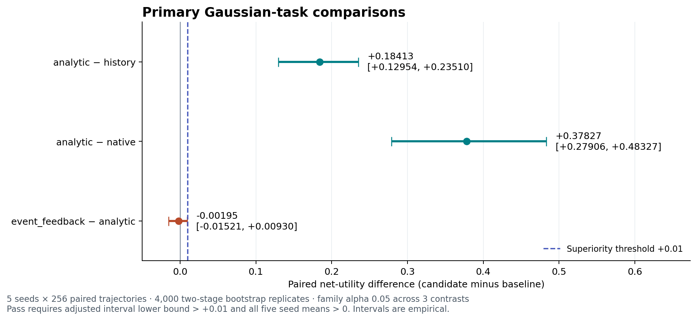
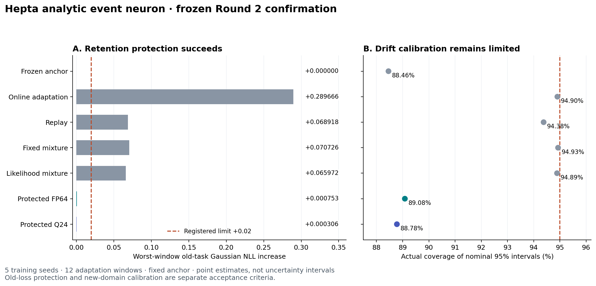

# 解析事件神经元：第二轮冻结确认

六个工作包已经实现、训练并执行确认。**本轮的决策仍为 `KEEP_RESEARCH`：保留连续解析预测候选、有符号事件编解码，以及带损失界的适应和量化保护；生产 Hepta neuron 不晋级。**

本轮保留了首轮的完整阴性结果。新增机制、训练种子、数据种子和适应窗口单独冻结；没有把首轮确认数据改作本轮开发数据。全部研究改动位于本目录，首轮源码和生产运行时保持原样。

## 1. 六项交付与验收

| 工作包 | 实际交付 | 验收结论 |
| --- | --- | --- |
| 数学与事件合同 | 条件终点分布、阈值、时间、观察类型、状态、复位和目标函数；概率事件与通信事件分别定义 | 已固定；call/put、首达、neutral、零计数和缺失观察没有合并 |
| 解析核与独立参照 | 稳定 CDF/尾概率/区间概率、解析梯度、时间传播；积分和高精度参照；Q24 整数质量保护 | 数值、梯度与保护界检查通过；量化前后的保证分别验证 |
| 可训练原型与机制对照 | 连续解析、旧随机脉冲、新有符号事件、直接量化、无残差、完整历史、原 sparse、独立 Gaussian/probit | 参数实际拟合；统计等价与机制局限明确报告，主比较见下表 |
| 有后续动作的新任务 | 带噪/缺失观察、固定隐藏终点、等待/修复/停止和公开随机费用；最终实际交付后评分 | 已测实际净效用，主任务包含 61,440 次控制执行 |
| 原 Hepta 反馈链 | 实际交付/回读 → 公开残差和噪声/成本 → 原生 sparse 状态 → 学习读出 → 修复/停止 → 最终评分与独立重放 | 11,520 次控制执行；额外解析/事件编码尚未胜过强基线 |
| 运行时与扩大研究 | 模型绑定、事件接收器持久化、原生 Q24 预测头、两个层次的保护、恢复与失败关闭；12 窗口保留和错设压力 | 受保护保留门槛通过；校准、一般化、硬件效率及生产资格分别保留限制 |

完整机器可读验收见 [ACCEPTANCE.json](evidence/ACCEPTANCE.json)，证据复核见 [RESULTS_REVIEW.json](evidence/RESULTS_REVIEW.json)。

## 2. 主确认：实际后续收益

净效用是 `1 − (实际交付预测 − 固定隐藏终点)^2 − 实际支付的任务费用`。费用是注册的任务单位，并非货币。训练、原生调用、文件交付、回读和审计成本另行测量。

主确认有五个独立训练种子，每种子每个规律 256 条配对轨迹；高斯匹配、漂移偏移和 Student-t(4) 三种规律均执行。12 个模型臂和 4 个固定策略共 61,440 次控制执行。46,080 条模型×轨迹预测记录各有三个相关时距；这些重复记录不算独立样本。

主比较使用 4,000 次配对两阶段 bootstrap，先抽训练种子，再抽整个轨迹。三项主比较分配 `α=0.05/3`，通过要求区间下限大于 **+0.01** 且五种子的平均差异全部为正。只有五个训练种子，经验区间不是有限样本保证。

| 主要比较（Gaussian） | 平均净效用差 | 家庭调整经验区间 | 原优势门槛 |
| --- | --- | --- | --- |
| analytic_vs_history | +0.184127 | [+0.129540, +0.235103] | 通过 |
| analytic_vs_native | +0.378267 | [+0.279065, +0.483265] | 通过 |
| event_vs_continuous | -0.001947 | [-0.015213, +0.009302] | **未通过** |

**新事件版的原优势门槛与新增 0.01 非劣性诊断均未通过。** 调整区间下限为 -0.015212611，seed 503 的平均差为 -0.016093573，两项都低于 −0.01。这里的非劣诊断检验实际净效用，不能用预测 NLL 接近替代。新事件版相对旧随机脉冲版有明显改善，但不能据此称事件精度或效用缺口已经关闭。

收益分解为实际终点平方误差减少 **0.006490624**，同时行动费用增加 **0.008437500**；相减得到净效用差 **-0.001946876**。模型改变动作后的成本足以抵消预测误差收益。



| 模型 | 净效用 | 行动费用 | 终点事件 NLL | Classwise ECE | 标称 95% 覆盖率 |
| --- | --- | --- | --- | --- | --- |
| analytic | 0.491873 | 0.122359 | 0.537710 | 0.011283 | 94.609% |
| equivalent_gaussian | 0.491873 | 0.122359 | 0.537710 | 0.011283 | 94.609% |
| event_feedback | 0.489926 | 0.130797 | 0.537824 | 0.012496 | 94.427% |
| event_direct | 0.489926 | 0.130797 | 0.537824 | 0.012496 | 94.427% |
| event_no_residual | 0.487645 | 0.132281 | 0.540025 | 0.011266 | 94.479% |
| history | 0.307745 | 0.190211 | 0.577446 | 0.027112 | 94.818% |
| native | 0.113606 | 0.241348 | 0.728368 | 0.022017 | 93.568% |
| pulse | -0.073459 | 0.284551 | 0.671353 | 0.032642 | 92.500% |
| oracle | 0.487983 | 0.117969 | 0.537114 | 0.009188 | 94.557% |

表中 NLL、ECE 和覆盖率来自动作前公开历史上的三个预测时距；费用与净效用来自行动后的固定终点实际交付，两种评分口径没有合并。

| 次级机制/策略比较 | 净效用差 | 描述性 95% 区间 |
| --- | --- | --- |
| event_feedback_vs_pulse | +0.563385 | [+0.488521, +0.649917] |
| event_feedback_vs_event_direct | +0.000000 | [+0.000000, +0.000000] |
| event_feedback_vs_event_no_residual | +0.002281 | [-0.010486, +0.013888] |
| analytic_vs_equivalent_gaussian | +1.422e-17 | [-1.718e-17, +4.779e-17] |
| analytic_vs_fixed | +0.044251 | [+0.013040, +0.073304] |
| analytic_vs_always_wait_repair | +0.074333 | [+0.039909, +0.109118] |

去掉残差会改变行为：在三种规律合计 3,840 条轨迹中，344 条动作路径、2,210 条最终交付预测改变；但本轮残差收益区间跨零，不能单独宣称收益已成立。

独立联合 Gaussian 条件化与连续解析模型具有相同统计内容；新事件模型与同网格的直接量化对照具有相同可恢复状态。相等结果不证明增加了函数类。原 sparse 对照限定于本次公开输入编码、固定原 kernel 和训练读出，不能推广为所有 Hepta sparse 架构的总体比较。已知真实规律的 oracle 只作特权参考。

完整结果见 [RESULTS.json](evidence/run-20261027-r2/RESULTS.json)、[原始批次索引](evidence/run-20261027-r2/RUN_INDEX.json) 和 [独立主确认复核](evidence/MAIN_CONFIRMATION_REVIEW.json)。

## 3. 概率核、call/put 与有符号通信事件

连续核预测条件终点状态：`X_target | public_history ~ Normal(m, v)`。在固定局部漂移和扩散模型中，向前传播为 `m ← m + drift × Δt`、`v ← v + process_variance × Δt`。不同的观察类型决定是否加入传感器似然。

输出顺序保持 `(put, neutral, call)`：`X <= lower`、`lower < X <= upper`、`X > upper`。相同阈值的 call/put 是共享条件分布的互补方向查询；两个不同阈值之间的质量显式形成 neutral。没有用两个无约束 Bernoulli 头分别拟合互斥事件。零方差边界依显式点质量和等号约定处理。

这些概率不是折现期权价格，不是首达概率，也不是事件传输率或 runtime confidence。借用二元期权解析形式的价值在于把事件语义、尾部数值稳定性、时间传播和可微参数绑定到同一模型。

新事件版本传输均值和对数方差的**有符号整数增量**，采用减去已发放量并保留残差的复位。接收器只从计数重建状态；推理不通过编码器残差或连续后验绕过接收器。报文保留逻辑序号、物理时间和观察类型，零计数仍可能是有效的时间传播或缺失观察更新。

正负通信脉冲不表示 call/put 事件已经发生，零计数也不表示 neutral。每个更新可以含多个单位事件，因此单位事件数、非零通道数、实际报文字节分别计量；没有声称当前 Python/文件传输实现已经消除了静默报文成本或取得能耗优势。

驱动的漂移、过程方差、噪声尺度经过监督拟合。均值/对数方差的 25 组网格只在开发集选择；同信息直接量化及增量舍入后丢弃残差分别作为等价对照和消融。这里没有宣称训练了穿过硬脉冲的端到端梯度，也没有宣称原 sparse kernel 参数被本轮改写。反馈 seed 211 的 zero/reset 常量控制头合法地保留了初值，优化记录显示零梯度；其他非恒定模型和驱动的实际训练另有收据。

详见 [CONTRACT.md](CONTRACT.md)、[PULSE.md](PULSE.md)、[首轮数学定义](../MATH.md)、[数学参照验收](evidence/MATH_REFERENCE.json) 和 [事件编解码验收](evidence/PULSE_VALIDATION.json)。

## 4. 真实反馈链：状态有作用，额外解析编码尚无优势

隐藏初稿误差为 `E`，公开自评有已知噪声方差，修复成本独立随机公开。若修复幅度为 `a`、费用为 `c`，正收益事件是 `2*a*E − a*a − c > 0`，并非单纯判断误差的正负。`a > 0` 使用右侧阈值，`a < 0` 使用左侧阈值，`a = 0` 单独处理。改善概率超过 1/2 与正期望增益相容，只限这一条件 Gaussian、线性增益的任务。

公开信息通过真实文本/PNG 文件交付并回读。原 Hepta sparse 链对三个通道分别执行原有两 tick，形成 63 维特征；学习读出选择修复或停止，再实际交付并回读最终结果后评分。Gaussian/probit、numeric、analytic、event、direct quantization、history、zero、reset 获得相同公开信息。

| 反馈模型/编码 | 净效用 | 任务费用 | 改善事件 Brier | 改善事件 ECE |
| --- | --- | --- | --- | --- |
| gaussian | 0.638722 | 0.079219 | 0.138945 | 0.019167 |
| probit | 0.638722 | 0.079219 | 0.138945 | 0.019167 |
| numeric | 0.625879 | 0.072563 | 0.170244 | 0.062673 |
| analytic | 0.621800 | 0.065836 | 0.142477 | 0.024470 |
| event | 0.620687 | 0.065367 | 0.142848 | 0.025427 |
| quantized | 0.620687 | 0.065367 | 0.142848 | 0.025427 |
| history | 0.620942 | 0.073688 | 0.168216 | 0.048622 |
| zero | 0.533130 | 0.225328 | 0.251042 | 0.014323 |
| reset | 0.533130 | 0.225328 | 0.251042 | 0.014323 |

| 配对比较 | 净效用差 | 描述性 95% 区间 |
| --- | --- | --- |
| analytic_vs_numeric | -0.004078 | [-0.040311, +0.030173] |
| event_vs_numeric | -0.005191 | [-0.040300, +0.026472] |
| analytic_vs_gaussian | -0.016921 | [-0.045338, +0.004899] |
| event_vs_gaussian | -0.018034 | [-0.045939, +0.003883] |
| event_vs_quantized | +0.000000 | [+0.000000, +0.000000] |
| event_vs_zero | +0.087557 | [+0.061505, +0.111179] |
| event_vs_reset | +0.087557 | [+0.062275, +0.110217] |

解析编码相对 numeric 改变了 231/1,280 次动作，事件编码改变了 229/1,280 次；event/直接量化以及 Gaussian/probit 的动作差异均为零。行为改变已经证实，额外解析/事件编码的收益优势尚未确立。

五个确认种子共 11,520 个回合，46,080 个原生 ticks 在原全量审计中重新执行。独立复核对全部行重新计算动作、误差、费用、校准和九个配对区间；所有归档文件核验摘要并解码文本/JSON，另独立解码预选的 270 个 PNG，原全量 replay 的覆盖另外保留。

两个限制不可忽略：zero/reset 仍能用公开残差计算修复幅度，且 event 与这些控制的幅度还有量化差异，因此它们的收益差不能全部归因于脉冲记忆；`score_started_ns` 的保存时点实际在评分计算之后，正确解释是评分记录时间。源码顺序仍是最终交付后才读取目标，但这不是进程内存隔离证明。该链是真实执行的受控数值任务，尚不是自然语言或自然图像质量研究。

详见 [FEEDBACK_RUNTIME.md](FEEDBACK_RUNTIME.md)、[反馈结果](evidence/run-20261027-r2/FEEDBACK_RESULTS.json) 和 [反馈独立复核](evidence/run-20261027-r2/reviews/FEEDBACK_INDEPENDENT_REVIEW.json)。改善事件 NLL 使用 `[1e-12, 1-1e-12]` 的显式概率截断，不声称无截断极尾 logscore。

## 5. 保留：旧损失受控，同时仍有有限适应收益

本轮在确认数据生成前完成全部五种子、12 窗口的模型准备并冻结。在线臂每窗用 256 条新训练数据，replay 用 128 条新数据加 128 条原训练数据；所有臂都能访问同一冻结 anchor。真实磁盘 checkpoint 回读进入下一窗训练。路由只使用公开传感器创新似然，不读取隐藏环境标签、窗口编号或评分目标。

FP64 保护把候选均值相对 anchor 的标准化位移截断为 `|d| <= ε`，并令方差倍率 `c = 1 + |d|`。Gaussian 负对数似然相对 anchor 的全实数最坏增量为 `0.5*log(c) + d*d/(2*(c-1))`，这里不超过 `0.5*(log(1+ε)+ε) <= ε`；`d=0` 单独返回 anchor。原 `ε=0.02` 门槛保持不变。

| 指标 | FP64 protected | protected Q24 |
| --- | --- | --- |
| 最坏窗口旧 Gaussian NLL 增量 | +0.000753 | +0.000306 |
| 注册允许上限 | +0.020000 | +0.020000 |
| 最后漂移窗口新 NLL 相对 frozen | -0.019911 | -0.010128 |
| 六个漂移窗口平均新 NLL 差 | -0.019549 | -0.009945 |
| 描述性 95% 区间 | [-0.021749, -0.017479] | [-0.011056, -0.008900] |
| 原保留门槛 / 额外适应门槛 | 通过 / 通过 | 通过 / 通过 |

五种子均改善；两种保护臂既通过原保留门槛，也通过额外的平均漂移 NLL 改善至少 0.005、描述性 95% 区间上限小于零的门槛。纯冻结模型没有被当成适应成功。

但保护与校准之间仍有实际权衡：

| 模型 | 最坏旧 NLL 增量 | 漂移 ECE | 漂移标称 95% 覆盖率 |
| --- | --- | --- | --- |
| frozen | +0.000000 | 0.063732 | 88.459% |
| online | +0.289666 | 0.019312 | 94.905% |
| replay | +0.068918 | 0.035910 | 94.379% |
| fixed_mixture | +0.070726 | 0.036941 | 94.931% |
| likelihood_mixture | +0.065972 | 0.037636 | 94.891% |
| protected | +0.000753 | 0.062240 | 89.084% |
| protected_quantized | +0.000306 | 0.063028 | 88.780% |



保护相对同一个初始 anchor，不能推论同时保留无限增长的任务集合或多年语义记忆。FP64 与独立 classical 对照的最大矩差为 `2.66e-15`，Q24 矩和计数差为零。该结果支持可检验的保护机制，没有证明新的函数类。

确认包含 1,280 条独立旧 holdout 轨迹及 15,360 条新 holdout，旧轨迹在不同窗口重复评分；276,480 条模型×域×轨迹行和 829,440 个相关时距预测不是独立训练重复。120 次优化成功，60 次实际 checkpoint 回读。保留研究本身不执行 native；它与下节运行时资格分开。

详见 [RETENTION.md](RETENTION.md)、[保留原始结果](evidence/run-20261027-r2/retention_confirmation/RESULTS.json)、[全部模型及成本摘要](evidence/run-20261027-r2/retention_confirmation/BRIEF.json) 和 [独立保留复核](evidence/RETENTION_CONFIRMATION_REVIEW.json)。

## 6. Q24 与运行时：浮点保护不会自动穿过量化

输入 Gaussian 参数量化和输出三类概率量化是两个不同问题。本轮先给均值位移留出余量，再以 Q24 整数格点向上调整方差并检查实际参数的最坏 NLL 界；之后对类别整数质量施加 anchor 下界，分配精确总质量 `2^24`。有限但极小的 Gaussian 事件不会因为简单舍入而永久变成零概率。

修正后的类别概率属于研究适配器，可能不再是报告 Gaussian 均值/方差的精确 CDF。因此连续密度头与修正类别头分别评分，不能合称为一个精确 Gaussian 联合分布、相互作为独立证据，或继承未投影传播的精确半群。

真实原生资格有五种子×三个配置、180 个预测、1,100 项检查、30 个新 Python 进程和五个确定性极尾案例。按原 helper 的固定选择，80 条新历史中实际使用每种子的前四条，共 **20 条不同历史**；不能写成 80 条都测试过。

| 运行配置 | 普通预测 | Gaussian 最坏界超过 0.02 | 普通预测最大界 | 保护验收 |
| --- | --- | --- | --- | --- |
| analytic_count_only | 60 | 不适用 | null（未声明 anchor 保护） | 只检查工程/数值资格 |
| protected_count_only | 60 | **27** | 0.041649638 | **失败；本批无无穷界案例** |
| protected_anchor_guarded | 60 | 0 | 0.009975207 | Gaussian 与单独类别保护均通过 |

上表 27/60 指头分布的全实数最坏情形证书超限，并非观察到 27 次目标损失超限。这个阴性对照完整保留。受保护配置的界在实际 native Q24 参数和最终交付的整数概率上分别计算；包括极尾案例时最大 Gaussian 界约 `0.0099753065`，最大类别界约 `0.0092068307`，均低于 0.02。普通预测有两次输出整数投影发生改变，五个极尾案例也都实际改变输出。

原 Rust witness 只证明原生输出；投影后的最终输出由单独的研究适配器 witness 绑定。两个 owner 使用 pending 状态和失败关闭，仍没有跨 owner 原子事务保证。旧 CAS、重复请求、丢失 ACK、部分提交、篡改、缺失与时间传播都执行资格检查。按成功 receipt 去重共有 320 次 native ticks，15 次新进程重复回读没有新增 tick；另有 15 次 native rollback 拒绝检查。

本轮复用并逐字节核验首轮的原始 83 源文件构建产物，没有声称重新编译 Rust 或重新运行首轮的 170 个 Rust 测试。数值 CDF 精度不是经验校准；本轮 runtime 多了一层事件编解码，也不能直接继承纯保留头的效用或校准估计。`confidence=0`、`abstain`、`DENY_ALL` 保持不变，研究 owner 未接管生产 Agentd dispatch。

详见 [QUANTIZED_GUARD.md](QUANTIZED_GUARD.md)、[独立高精度与 native 验证](evidence/QUANTIZED_GUARD_VALIDATION.json)、[运行时结果](evidence/run-20261027-r2/RUNTIME_RESULTS.json)、[运行时计数和成本](evidence/run-20261027-r2/RUNTIME_ACCOUNTING.json)、[运行时独立复核](evidence/run-20261027-r2/reviews/RUNTIME_INDEPENDENT_REVIEW.json)。

## 7. 错设、成本与仍未关闭的目标

| 规律 | 解析净效用 | 事件净效用 | oracle 净效用（特权） | 解析 ECE | 解析 95% 覆盖率 |
| --- | --- | --- | --- | --- | --- |
| gaussian | 0.491873 | 0.489926 | 0.487983 | 0.011283 | 94.609% |
| drift_shift | 0.351935 | 0.357705 | 0.540676 | 0.060942 | 89.583% |
| student_t | 0.523530 | 0.527311 | 0.524068 | 0.020811 | 95.182% |

六项注册的错设比较描述性区间下限均高于 −0.02，但所有 `population_noninferiority_established` 均为 false。漂移下固定“等待后修复”策略净效用 0.384316，高于当前解析自适应策略 0.351935；不能据此声称对错设免疫。

漂移压力继续暴露模型错设。Student-t(4) 没有四阶矩，平方损失的普通 bootstrap 总体覆盖不能保证；压力区间只作描述性证据。原错设非劣参考界仍为 0.02。没有把本轮在这两个已注册规律上的结果外推成开放世界泛化。

| 阶段 | 记录的 wall 秒数 | 计时口径 |
| --- | --- | --- |
| 主训练与开发选择 | 91.211 | 包含 native/事件网格选择 |
| 反馈训练 | 129.932 | 五个训练种子 |
| 保留准备 | 9.786 | 120 次优化，全部在确认前完成 |
| 主确认外层 | 1477.029 | 含评估 790.046 秒、审计 458.617 秒及持久化/归档 |
| 反馈确认 | 226.171 | 包含归档 75.161 秒 |
| 反馈独立重放 | 82.721 | 另计；不是确认内层计时 |
| 保留确认 | 57.466 | 含原始 NPZ 写入 |
| 运行时资格 | 28.545 | 含恢复、负例和新进程 |

所有 wall/CPU/IPC/文件计数都是共享宿主上的描述性成本。native 的 head、tick 和 IPC 计时相互嵌套，不能相加再并入外层总时长。最终文件占用不等于总写放大，采样 RSS 不等于系统峰值；未单独测量的失败请求延迟、全部子进程 CPU 和总适配器写放大明确为未知。没有将单位事件数直接换算成硬件能耗。

最终研究边界是：继续保留有用的概率与保护机制；校准改善、强基线上的额外收益、真正的事件硬件效率、跨任务持续保留和生产晋级仍需各自的新注册实验。详见 [EXECUTION_COSTS.json](evidence/EXECUTION_COSTS.json)。

## 8. 与期权、Hölder 算子研究和已有事件编码的关系

本实现利用终点指标的条件期望作为概率算子，并把它与状态估计、传播、决策和事件传输组合。金融中的折现及风险中性测度并未自动转化为这里的任务概率；本实验的漂移与噪声属于显式拟合的观测模型。

[Deep Q-Learning on Hölder Spaces](https://arxiv.org/abs/2606.16846) 研究扩散控制中 Bellman 目标的正则性与逼近复杂度，在一致椭圆性和 Hölder 系数条件下区分状态与动作方向的正则性。论文也明确不提供实际探索、replay、随机梯度采样 Q-learning 的完整收敛定理。与本研究的联系是条件期望/扩散平滑的算子视角；从该论文到本实现的硬事件、复位、隐藏状态和量化递归，还缺少适用条件与误差传播证明。本轮没有训练 DQN，也没有声称该理论迁移成立。

残差保留和差分事件传输已有 [Sigma Delta Quantized Networks](https://arxiv.org/abs/1611.02024) 等先行工作。当前可主张的是一个语义明确、能训练和复核、接入 Hepta 实际研究链路的组合实现；不能只凭二元期权闭式或有符号编码命名为全新神经元理论。

## 9. 冻结、操作修订与复现

源码及全部训练产物先发布到 `9c27481fcd6c2d1861a048ded9a11f988afd521f`，主冻结回执提交为 `540d02b2ee486b41c5925ea74aff72b4f4de3412`。冻结绑定 **56 个源文件与 194 个训练产物**；确认前后逐项摘要不变。首轮 49 个已有文件也保持原 Git 身份。确认数据、多个评估臂和多个时距未用于扩增独立样本数。

运行时资格发生一项透明的操作修订：冻结 helper 只接受 `development`，而协议注册了新 `runtime_confirmation` 分组。这个不匹配在生成任何正式 runtime 历史前发现。原 helper 不改；新 driver 仅扩展显式分组准入和来源记录，仍调用冻结的模型、guard、worker 和 native 推理。旧开发数据上两 helper 的 92 项检查及 3,898 个规范化结果节点一致，数值差为零。源码/AST/差异/原拒绝证据于 `ca09bb02fdb7e79aad4cb16c86dad7485c1b8fc0` 发布，独立冻结回执 `43a248ae58c5bbe16a40ab3f0d0310592c908e59` 回读后才创建新 runtime 数据；没有更改数据标签或科学门槛。详见 [RUNTIME_HARNESS_AMENDMENT.md](RUNTIME_HARNESS_AMENDMENT.md)。

预冻结独立审查还发现过错设参考界被误抄成 0.05，已在任何确认开始前恢复为原 0.02；修订记录留在协议。所有确认结果、开发失败、量化反例、真实 readback 和 native journals 都保留。后生成的审计、恢复工具和本报告不冒充预冻结的科学源文件。

归档采用内部逐成员 SHA-256 清单；较大的归档按原始字节分片，完整归档摘要不变。索引见 [EVIDENCE_MANIFEST.json](evidence/EVIDENCE_MANIFEST.json)。以下命令核验分片、归档、每个成员，并恢复到新目录；不会训练、改模型或生成科学数据：

```sh
python3 -m experiments.analytic_event_neuron.round2.restore_evidence \
  --destination /tmp/hepta-round2-restored
```

可用重复的 `--archive NAME` 选择逻辑归档，例如 `CORE_TRAINING`、`RETENTION_PREPARED`、`RUNTIME_CONFIRMATION` 或 `MAIN_seed_101_gaussian`；`--verify-only` 只核验不解压。目标目录已有不同内容时工具拒绝覆盖。九个关键包（含统计与分析包）的实际独立目录恢复已完成，1,777 个归档数据成员逐项核验，全部 194 个训练产物及 native 可执行位保持一致，见 [RESTORATION_REVIEW.json](evidence/RESTORATION_REVIEW.json)。恢复后的冻结统计代码重算与原 RESULTS 每个字段精确相等，见 [RESTORED_STATISTICS_REVIEW.json](evidence/RESTORED_STATISTICS_REVIEW.json)。这项检查证明证据可恢复，不宣称完成 owner 状态迁移。

在完整证据恢复后，仅重算已保存的主统计：

```python
import json
from pathlib import Path
from experiments.analytic_event_neuron.round2 import run, statistics

restored = Path('/tmp/hepta-round2-restored/run')
run.verify_freeze(restored)
protocol = json.loads(Path('experiments/analytic_event_neuron/round2/PROTOCOL.json').read_text())
recomputed = statistics.summarize(restored, protocol)
assert recomputed == json.loads((restored / 'RESULTS.json').read_text())
```

Python 运行版本和依赖摘要保留于冻结文件；原生二进制适用平台以原构建回执为准。本轮运行环境没有可用的完整 Rust checkout/`just` 工具链，所以没有把仓库 `just fmt` 或新 Rust 测试标记为通过。研究 Python 的实际训练、数值验证、确认执行、独立复核及恢复检查都有各自保存的证据。
