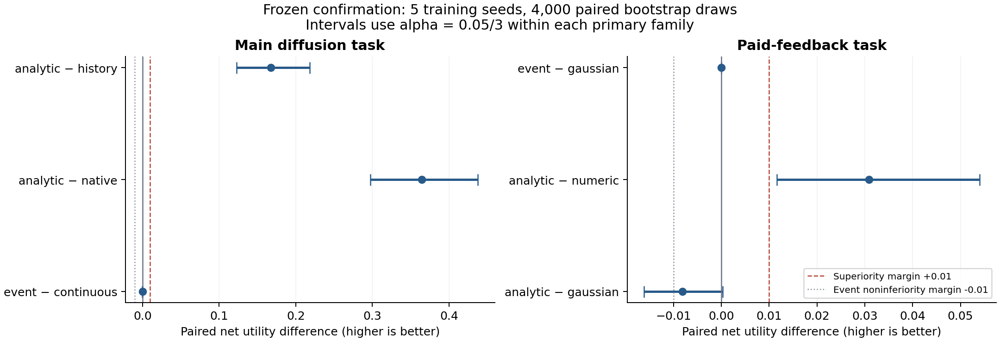
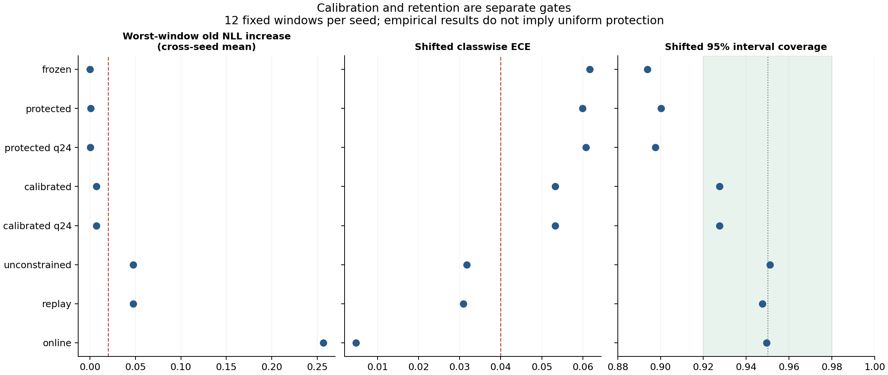

# Analytic Event Neuron — Round 3 冻结确认与运行时验收

本轮把受控隐藏状态任务与实际 native 计算、文件交付／回读链结合，完成数学合同、可训练原型、动作证书、付费反馈、实际 Hepta 运行时及保留／校准确认。研究结论为 **KEEP_RESEARCH**，生产升级字段保持 `false`。

最明确的新收益出现在实际反馈执行链：在相同 sparse 结构、读出维数、训练预算、修复幅度和公开信息下，解析概率表示相对数值输入的平均净效用提高 **0.03087434**，三重比较校正区间为 **[0.01165503, 0.05403424]**，通过事前冻结的 +0.01 优效门槛。直接 Gaussian 规划的样本平均效用更高，analytic 相对它的优效与非劣均未成立；事件通信与同网格直接量化保持表示等价。校准头改善了漂移覆盖率并守住旧任务经验损失门槛，但 ECE 仍未达标，没有任何校准 arm 同时通过全部联合门槛。

机器可读结论见 [ACCEPTANCE.json](evidence/ACCEPTANCE.json)。所有统计结论对应本轮冻结任务、五个拟合种子和实际执行范围。

## 1. 发布身份与确认范围

| 项目 | 固定身份／范围 |
| --- | --- |
| 研究分支 | `research/analytic-event-neuron-20261027` |
| 旧研究基线 | `ecbfadf12a0347919553220fc0684b16e088347b` |
| 本轮科学源与完整准备产物发布提交 | `29174619dfc56cef1c16b34fbf98f85a1cd2e4c3` |
| 冻结收据发布提交 | `ed6f8c6645c927249cec0d3395f6bae21f278739` |
| 冻结时间 | `2026-10-28T04:54:38.596622+00:00`（UTC） |
| 冻结对象 | 83 个科学源文件、329 个准备产物、完整协议 |
| 新训练种子 | 607、701、809、907、1009 |
| 主任务 | 5 种子 × 3 定律 × 384 轨迹 = **5,760 条独立轨迹** |
| 主任务的相关测量 | 63,360 个预测行、190,080 个期限测量、86,400 次完成的注册控制执行 |
| 付费反馈 | **1,920 条独立轨迹**，9 arms，共 17,280 次控制执行 |
| 保留／校准 | 60 个窗口；1,280 条旧轨迹在各自 12 窗口复用，15,360 条不同的新轨迹 |
| 独立运行时资格 | 160 条新历史、320 个普通条件预测、10 个新进程 |

完整规则在 [PROTOCOL.json](PROTOCOL.json)、[CONTRACT.md](CONTRACT.md)、[EVENT_CONTRACT.md](EVENT_CONTRACT.md)、[CALIBRATION_CONTRACT.md](CALIBRATION_CONTRACT.md) 和 [FEEDBACK_RUNTIME.md](FEEDBACK_RUNTIME.md)。所有确认数据在模型、开发集选型和全部 12 窗口检查点冻结并发布之后生成。报告、绘图和独立复核工具位于 `evidence/`，不参与模型拟合或确认执行。

同一轨迹的多个期限、阶段和模型输出是相关测量。它们没有增加独立样本数。每个主比较使用 4,000 次配对两层 bootstrap：先重采样训练种子，再重采样整条轨迹；三个主比较按 family alpha `0.05/3` 调整，因此表中的主区间为 98.333% 经验百分位区间。五个拟合种子所支持的区间不构成总体覆盖或生产保证。

## 2. 六包交付与验收状态

| 工作包 | 已完成交付 | 本轮验收结果 |
| --- | --- | --- |
| 1．数学与事件合同 | 条件状态、物理时间、观察阶段、阈值、终点标签、首达诊断、静默／缺失、复位与有效域 | 合同固定；相同阈值 call／put 共享分布，所有 profile 明确边界 |
| 2．解析核与独立参照 | CDF／survival／log-tail、窄区间质量、解析梯度、传播、独立积分与退化分布 | 10/10 检查组通过；有限区间投影误差单列 |
| 3．可训练原型及机制对照 | 连续参数拟合、整数事件、probit／Gaussian、历史、原 sparse、直接量化及消融 | 参数确实改变；continuous 优于历史／原 sparse；event 非劣通过，优效未通过，匹配直接量化等价 |
| 4．带实际后续动作的任务 | 隐藏状态、噪声传感器、付费等待／修复／停止及最终交付评分 | 15 个主场景完整；反馈 analytic−numeric 的 +0.01 优效通过 |
| 5．实际 Hepta 反馈链 | 原 native binary、版本化 owner、text／PNG 交付回读、状态更新、动作与最终评分、原生重放 | 17,280 次反馈控制完整；实际损失、费用、请求、tick 和文件成本分项记录；未测成本明确为空 |
| 6．运行时与扩大研究 | Q24 预测头、状态恢复、跨进程延续、校准、12 窗口保留、漂移及重尾 | 五种子运行时资格全部通过；校准与保留联合门槛未通过；没有生产升级 |

实现与登记试验完成、数值或运行时检查通过、某个科学优效假设通过，是三个不同状态。`ACCEPTANCE.json` 分别保留这些状态及所有未通过项；报告中的综合布尔值只汇总既有判据，不是确认后新增的科学门槛。

## 3. 数学合同：一个条件分布，两个方向

核心状态为

\[
dX_t=b\,dt+\sqrt q\,dW_t,\quad
X_t\mid\mathcal F_t\sim N(m_t,v_t).
\]

传播到物理期限 \(h\) 后，\(m=m_t+bh\)，\(v=v_t+qh\)。对阈值 \(l\le u\)，输出顺序始终为

\[
\begin{aligned}
p_-&=P(X_{t+h}\le l\mid\mathcal F_t),\\
p_0&=P(l<X_{t+h}\le u\mid\mathcal F_t),\\
p_+&=P(X_{t+h}>u\mid\mathcal F_t).
\end{aligned}
\]

正方差时，三项来自同一 Gaussian CDF、稳定区间质量和尾概率。**call 与 put 是共享状态、阈值和时间参数的两个方向算子。** 同阈值时它们互补；不同阈值时必须保留中间质量。把两个方向的概率各自训练成互不约束的分布，会破坏这份概率合同。

零方差按上述不等号处理原子和阈值相等情形。缺失观察只传播时间；实际获得的观察才添加似然。中性是终点区间事件，静默是通信通道未发送非零计数，正／负计数是状态增量。它们有不同语义。

本任务直接估计任务条件概率。现金二元期权的金融价格还涉及风险中性测度和贴现；将其解析形式作为研究核，并不意味着把价格直接当成当前任务概率。在对数正态模型下可对状态取对数得到相应核，本轮实测的隐状态采用注册 Gaussian 扩散。

首达使用独立事件定义。例如无漂移、单位方差 Brownian 从 0 出发，在时间 1 的终点超过 1 的概率为 0.15865525，而此前曾达到 1 的概率为 0.31731051。本实验没有把首达标签、终点标签和脉冲发射混用。

### 解析核与独立数值参照

复用并重新绑定原解析核。CDF、survival、窄区间 log mass、解析梯度、退化分布、无效域拒绝和传播分别检验。详见 [MATH_REFERENCE.json](evidence/MATH_REFERENCE.json)。

| 独立检查 | 实测最大误差／结果 |
| --- | --- |
| 64 个密度积分参照 | 绝对误差 `2.22e-16` |
| 80 个解析梯度案例 | 均值 `8.09e-11`，方差 `2.67e-10` |
| 尾部 log 概率（z 至 40） | `1.14e-13`；普通概率下溢后保留有限 log 概率 |
| 窄区间 log 概率 | `7.11e-15` |
| 连续传播积分 | `1.11e-16` |
| 400 个概率划分 | 归一化误差 `2.22e-16` |
| Q24 类别分量 | 最大误差 `3.88e-8` |
| 全部登记检查组 | 10/10 通过 |

连续 Gaussian 传播满足其半群结构；有限区间概率向量经过投影会产生额外误差。空间间隔从 0.5、0.25 缩小到 0.125 时，参照投影误差依次约为 0.004977、0.001278、0.000321。新校准层分别修改期限边际方差，也没有声称这些边际构成一个新的相容路径定律。

## 4. 参数确实训练，机制有匹配对照

基础滤波器每种子用 512 条训练轨迹和 256 条开发轨迹拟合。五次优化均成功，参数变化 L2 范数为 `0.870985 / 0.808448 / 0.803256 / 0.892020 / 0.927149`。原 sparse 二进制实际产生特征，再拟合读出；原 sparse 内核保持研究基线实现。

主实验含 continuous analytic、等价 Gaussian、历史模型、原 sparse、旧随机脉冲、已知参数参照、新自适应事件、固定精度、直接量化、丢弃残差以及重新训练的 Round 2 编码对照。后者使用本轮新训练／确认数据，旧轮结果没有被当成同一组配对样本。

### 动作边界驱动的整数事件

编码器发送均值和 log 方差的有符号整数增量。解码器只读取包中的版本、配置摘要、时间、序号、类型、精度和计数；残差留在发送端。新获取的公开槽只发送一次，等待之后沿同一回合的状态继续更新。

动作值以预期终点平方误差加实际费用定义。在当前量化方差格的两个端点计算动作值范围；只有选中动作的最坏值严格优于其它动作的最好值并覆盖 FP64 数值余量，才记为已认证。否则逐次增加 log 方差精度，最大 24 bit；仍不分离就明确记录未认证。

这个证书对应“在量化格内与同一个拟合连续模型选相同动作”。它并不证明该拟合模型相对真实环境最优。通信统计区分单位事件、包、序列化字节、精度重标定和 wall time。

21 个事前候选在开发集比较完整后续效用、Gaussian NLL 和包字节。五个种子均选中 mean 6 bit、initial log-variance 6 bit、max 24 bit 的自适应配置，且符合原开发筛选条件。实际训练包括连续参数优化及有限编码配置选型，没有通过硬脉冲执行端到端反向传播。

反馈学习另有五个 63 维决策读出，每个 L2 候选真实更新 600 步，每 arm 15 个开发候选；25 个读出的参数均改变，全部 375 个候选权重及评分保留。历史对照具有同维数和同选型机会。

## 5. 主任务：隐藏状态、带噪观察与实际后续动作

任务允许等待、修复、停止。初次和最终结果实际写入数值 text 与无损数值 PNG，并从文件回读。PNG 是可验证的数值传输工件。策略使用已取得的公开历史更新状态，最终交付之后再读取目标评分：

\[
U=1-(\widehat X-X)^2-\text{实际支付的等待／修复费用}.
\]

Gaussian 确认包含 1,920 条独立轨迹。主统计以最终回读的实际误差和支付费用为准：

| 注册主比较 | 平均净效用差 | 98.333% 校正区间 | +0.01 优效 |
| --- | ---: | --- | --- |
| analytic − history | **+0.16740443** | **[+0.12264185, +0.21804070]** | **通过** |
| analytic − native | **+0.36430730** | **[+0.29757732, +0.43774180]** | **通过** |
| event_adaptive − analytic | −0.00010928 | [−0.00053775, +0.00028631] | 未通过 |

事件非劣是单列的事前判据：校正区间下界必须大于 −0.01，五个 seed 的均值也分别大于 −0.01。本轮两项均满足，因此 **event_adaptive 通过非劣**。它没有通过相对连续模型的优效门槛。

| 主任务策略 | 平均净效用 | 平均平方误差 | 平均实付费用 |
| --- | ---: | ---: | ---: |
| continuous analytic | 0.52602160 | 0.35644454 | 0.11753385 |
| adaptive event | 0.52591232 | 0.35655382 | 0.11753385 |
| fixed event | 0.52582474 | 0.35991223 | 0.11426302 |
| event without residual | 0.52752147 | 0.35537176 | 0.11710677 |
| retrained Round 2 event | 0.52696989 | 0.34819417 | 0.12483594 |
| history | 0.35861717 | 0.46139325 | 0.17998958 |
| original sparse | 0.16171430 | 0.62069716 | 0.21758854 |
| earlier stochastic pulse | −0.06391842 | 0.77852519 | 0.28539323 |

机制核验覆盖三种定律：adaptive 与 continuous **动作分歧为 0、额外实付费用为 0、未认证决策为 0**；残余效用差来自量化交付误差。adaptive 与同网格 `event_direct` 的概率、动作、误差、费用及效用逐项精确相同。analytic 与等价 Gaussian 对照动作完全一致，最大数值差约 `1.07e-14`。

Gaussian 条件下，adaptive 相对本轮重新训练的 Round 2 编码，均值差为 −0.00105757，描述性 95% 区间为 [−0.01136187, +0.00721869]；相对 fixed 为 +0.00008758，区间 [−0.00285830, +0.00405940]；相对去残差版为 −0.00160915，区间 [−0.00598567, +0.00166411]。这些消融没有建立 adaptive 的效用优势。相对旧随机 pulse 的差为 +0.58983074，区间 [0.50675589, 0.69280834]，保留为次要描述结果。

Gaussian adaptive 共发送 **14,108 个包、2,868,039 个序列化字节、774,559 个逻辑单位事件**，平均每轨迹 7.3479 包、1,493.7703 字节、403.4161 单位事件；88 个 refinement 包，109 次精度重标定。跨三种定律合计 42,283 包、8,595,047 字节、2,331,691 单位事件、267 个 refinement 包和 335 次精度重标定。fixed 有 562 个未认证决策，去残差版有 10,003 个；未认证本身不等同于选择错误。

| 分布偏移（描述性） | analytic−history | analytic−native | adaptive−analytic |
| --- | --- | --- | --- |
| drift shift | +0.19758033；[0.16245827, 0.23438281] | +0.60922793；[0.50577160, 0.73833808] | −0.00004959；[−0.00045281, 0.00033614] |
| Student-t(4) | +0.19630414；[0.15431359, 0.23924441] | +0.36328900；[0.29519768, 0.44310621] | −0.00013801；[−0.00055611, 0.00023521] |

以上偏移区间为未经主比较家族调整的 95% 描述区间，没有据此宣布总体非劣。analytic 的初始 classwise ECE／95% coverage 在 Gaussian 为 0.01536／94.90%，漂移为 0.05973／89.32%，Student-t 为 0.01678／93.91%；动作收益与概率校准分别验收。

漂移与 Student-t(4) 条件按完整注册范围执行，完整结果在 [MAIN_RESULTS.json](evidence/results/MAIN_RESULTS.json)。Student-t(4) 的四阶矩不存在，所以平方损失的 bootstrap 区间在此只作描述。有限分布测试和动作证书都不构成分布外总体保证。



## 6. 实际 Hepta 反馈链：解析表示改善后续净效用

这部分的状态为短回合内固定的隐藏剩余误差。实际输出、带噪自评、成本信息、一次可付费的独立第二传感器、状态更新、后续选择、最终交付和评分都经过实际执行链。独立策略进程只加载严格的 target-free public schema；正常执行路径在全部最终回读后才评分。其范围是代码路径和工件证据，没有建立同 UID 进程之间的敌对文件系统访问隔离。

运行时概率预测的是剩余误差在实际 Q24 阈值 \((-\sqrt c,\sqrt c]\) 周围的 put／区间／call 事件。修复收益通过实际修复幅度 \(a\) 计算为 \(2am-a^2-c\)，等待参考值为 \(E[(M'^2-c)_+]-w\)。该参考等待式采用未来连续最优幅度；learned readout 的实际后续动作仍按最终交付评分。

| 注册主比较 | 平均净效用差 | 98.333% 校正区间 | +0.01 优效 | 0.01 非劣诊断 |
| --- | ---: | --- | --- | --- |
| event − Gaussian | −0.0000006962 | [−0.0000029457, +0.0000013361] | 未通过 | 通过 |
| analytic − numeric | **+0.03087434** | **[+0.01165503, +0.05403424]** | **通过** | 通过 |
| analytic − Gaussian | −0.00812016 | [−0.01617582, +0.00030141] | 未通过 | 未通过 |

非劣另列，不替换优效门槛。`analytic − numeric` 五个种子的均值都为正，依次为 `0.021782 / 0.008043 / 0.039859 / 0.033200 / 0.051488`。改善可分解为：平方误差减少 **0.01275455**，实际费用减少 **0.01811979**，合计净效用增加 **0.03087434**。

| 反馈策略 | 平均净效用 | 平均平方误差 | 平均实际费用 |
| --- | ---: | ---: | ---: |
| Gaussian / probit | 0.74133401 | 0.13984828 | 0.11881771 |
| event / 同网格直接量化 | 0.74133332 | 0.13984897 | 0.11881771 |
| analytic → sparse 读出 | 0.73321385 | 0.15595803 | 0.11082813 |
| 历史模型 | 0.73041205 | 0.15067129 | 0.11891667 |
| numeric → sparse 读出 | 0.70233951 | 0.16871258 | 0.12894792 |
| zero / reset 读出 | 0.62850299 | 0.13269493 | 0.23880208 |

Gaussian 与 probit 的最终效用逐轨迹完全相同；event 与同网格直接量化也完全相同。零输入和复位消融保留了共同的后验、修复幅度及等待规划渠道，并分别重新训练读出。这些结果支持具体决策表示的作用，不能解释为删除了整个系统全部反馈或记忆的单一因果实验。analytic 相对历史模型的次要区间跨零，完整次要结果也保留。

七个使用 native Q24 law 的 arm，其首次终点 classwise ECE 为 0.01969218，top-label ECE 为 0.01765679，95% Gaussian 区间覆盖率为 0.95。这七个 arm 使用不同后续动作，但首次预测共享同一条件状态，所以相同的首次校准统计可以对应不同的后续决策效用。Gaussian／probit 连续头的 classwise ECE 为 0.01951783、top-label ECE 为 0.01682234，覆盖率同为 0.95。

量化边界明确存在：每个实际 native 头 arm 的 1,920 个初始预测中，**270 个至少有一个类别质量被 Q24 舍入为零**；本样本真实事件命中零质量次数为 0，未裁剪事件 NLL 为 0.63467137。有限的样本 NLL 不提供全域尾部 log-loss 保证。此反馈 profile 没有启用另一保留 profile 的锚定类别质量保护。

详见 [FEEDBACK_RESULTS.json](evidence/results/FEEDBACK_RESULTS.json) 和 [FEEDBACK_STATISTICS_INDEPENDENT.json](evidence/results/reviews/FEEDBACK_STATISTICS_INDEPENDENT.json)。所有实际 typed 输出都参与了这些动作及效用结果，没有把另一模型的效果移植到运行时结论上。

## 7. 校准、量化与保留：收益与未通过项都保留

新增校准头含 6 个学习参数：2 个公开观察似然路由参数、4 个期限边际方差修正参数；训练后在开发集选取混合强度和方差膨胀。55 个候选／窗口、60 个窗口共 3,300 个候选全保留。180 次拟合成功，60 次 JSON 重载逐项核验。

训练标签预算按每窗口的带标签轨迹计：replay 与 calibration 各用 512 条拟合轨迹；calibration 额外用了 256 条开发轨迹做选择，replay 没有这项选择。评分包含 0.5／1／2 三个相关期限，未将其展开为独立轨迹。因此两者不是总标签预算完全相同的结构消融。完全匹配的 classical 校准对照单列。

| arm | 最差窗口旧 NLL 增幅（先跨 5 seed 平均） | 漂移 NLL 平均变化 | 漂移 classwise ECE | 95% 覆盖率 | 旧任务门槛 | 联合门槛 |
| --- | ---: | ---: | ---: | ---: | --- | --- |
| frozen | 0 | 0 | 0.06164 | 89.38% | 通过 | 未通过 |
| protected FP64 | 0.000611 | −0.017611 | 0.05996 | 90.03% | 通过 | 未通过 |
| protected Q24 | 0.000346 | −0.008967 | 0.06080 | 89.75% | 通过 | 未通过 |
| **calibrated** | **0.007048** | **−0.083176** | **0.05326** | **92.75%** | **通过** | **未通过** |
| calibrated Q24 | 0.007048 | −0.083176 | 0.05326 | 92.75% | 通过 | 未通过 |
| unconstrained | 0.047337 | −0.186184 | 0.03174 | 95.12% | 未通过 | 未通过 |
| replay | 0.047418 | −0.187627 | 0.03091 | 94.76% | 未通过 | 未通过 |
| online | 0.256852 | −0.235057 | 0.00476 | 94.95% | 未通过 | 未通过 |

原经验旧任务门槛为最差窗口的跨种子平均 NLL 增幅不超过 0.02，另要求最终新任务不劣于原锚点。calibrated 的最终新任务差为 −0.07292163，95% 经验区间 **[−0.09524463, −0.05128430]**；新 NLL 效力门槛通过。其最差单种子／窗口旧 NLL 增幅为 0.01904416，作为附加诊断保留。

覆盖率门槛 [0.92, 0.98] 已通过，ECE 门槛 ≤0.04 仍未通过。unconstrained、replay、online 的新分布 NLL 和校准改善是真实记录，但旧任务退化使注册联合验收失败。没有通过重命名指标或降低门槛将它们改判为通过。

新 calibrated 层提供经验保留结果；原 protected 层另有明确适用域下的逐点密度损失约束，两者的保证不同。参数 Q24 舍入、终端类别概率量化和持久运行时又是不同层次，保证没有自动跨层传递。classical 对照与新校准头的最大数值差为 `2.22e-15`，Q24 classical 对照为精确相同，支持实现等价判断。



数据与独立复核见 [CALIBRATION_RESULTS.json](evidence/results/CALIBRATION_RESULTS.json)、[CALIBRATION_CONFIRMATION_REVIEW.json](evidence/results/reviews/CALIBRATION_CONFIRMATION_REVIEW.json)。12 个窗口没有被外推成无限任务或多年知识保留。

## 8. 运行时适配与恢复

`FeedbackOwner` 管理版本化事件编码器、独立 decoder、序号、公开历史摘要、native checkpoint 和独立交付见证。反馈误差在短回合内固定，包的 `time=len(public.residuals)` 为 1 或 2，表示已取得的观察阶段；`sequence` 是单调请求序号。fresh continuation 实际包含 `sequence=3, time=2, counts=[0,0]`。主扩散任务的编码时间仍是物理时间，字段语义在合同中分别定义。

反馈 runtime 使用固定 `2^-12` 的均值／log 方差计数网格及实际 typed Q24 头；主任务的自适应动作证书是另一个研究 profile。运行时的效用验收对应前者，保留实验的证书对应其各自预测头。报告没有把这三者的性质交叉继承。

五个 seed 的资格检查全部通过：**160 条独立新历史、320 个普通条件预测、10 个全新 Python 进程、345 个实际 native tick**。其中 in-process 340 个，包括 5 个 native 已提交但 Python owner 尚未完成提交的案例；恢复 continuation 5 个；cached duplicate 没有增加 native tick。

检查涵盖同一请求精确重放、旧 CAS、变化后的重复请求、状态损坏、回滚、pending 后中断、native 提交后中断、丢失确认回执与跨进程继续。1340 个登记检查通过；独立证据审查另外检查了 17,130 个断言。持久化行为是分开的 owner 和见证，部分提交状态停止推进；没有跨 owner 原子事务承诺。

有效域取 owner 源预测域与 typed native 输入域的交集：最多 16 次 owner 更新，源均值绝对值及方差不超过 8，源方差严格为正；实际送入 typed head 的四个参数（均值、方差、下阈值、上阈值）都必须有限且绝对值不超过 8，正方差至少为 `2^-24`，上下阈值在源值及 Q24 舍入后都必须严格分离。原生控制字段保持 `confidence=0`、`abstain`、`DENY_ALL`。运行时资格不授予 Agentd 生产执行权限。

详见 [RUNTIME_RESULTS.json](evidence/results/RUNTIME_RESULTS.json) 及逐 seed 的独立复核。

## 9. 实际成本与审计范围

| 已完成流程的测量范围 | wall time | 已观测 CPU／native 工作量 |
| --- | ---: | --- |
| 主任务 15 scope 外层，含评价／重放／封存 | 2,622.518565 s | 成功评价与审计共 333,870 sparse ticks |
| 主任务 evaluation（嵌套） | 1,008.946063 s | parent CPU 972.286993 s；26,517 requests／172,590 ticks |
| 主任务 audit（嵌套） | 917.683909 s | 23,040 native requests／161,280 ticks |
| 反馈训练与开发 | 294.819240 s | parent CPU 206.496015 s；99,840 requests／192,000 ticks |
| 反馈确认 phase，含正式评价及重放 | 1,374.976404 s | controller CPU 238.387101 s；正式执行 93,633 ticks，重放同量 |
| 独立运行时资格 phase | 14.231647 s | controller CPU 4.427341 s；345 实际 native ticks |
| 主统计 CLI | 2.668662 s | 独立记录，未重新生成科学数据 |
| 反馈统计 CLI | 10.007976 s | 独立记录，未重新生成科学数据 |

反馈训练、正式执行和重放已覆盖 214,842 次成功请求、379,266 ticks，另有运行时资格 345 ticks。正式反馈的 93,633 ticks 分为 21,369 typed 与 72,264 sparse。policy worker 的 964.508991 s wall／567.491110 s CPU、反馈 audit 的 356.264438 s，以及 runtime native IPC 的 1.618615 s 都是各自外层过程内的嵌套测量。

主任务实际重开 284,084 次观察、产生 629,684 个传输文件；主确认归档共 211,270,461 bytes、652,874 个成员（包含 15 个成员清单）。运行时 journal 写入的记录字节为 160,080，885 个 owner 证据文件压缩为 504,363 bytes；底层存储写放大未测。

初始 MAIN 失败尝试和开发反馈 seed701 失败尝试的完整 wall／CPU／native 调用数未能记录，均保留 `null`，不是零。**86,400 是完成的注册主控制执行数；全部尝试的额外执行总数未知。** MAIN 恢复调用外层 507.519157 s 与最后三个成功 scope 的 498.018047 s 重叠，不另加到 2,622.518565 s。恢复过程树的 Linux `RUSAGE_CHILDREN` 为 user 368.910295 s、system 106.799103 s，不能解释为原 native 单独 CPU。

完整账本见 [MAIN_EXECUTION_COSTS.json](evidence/results/MAIN_EXECUTION_COSTS.json)、[FEEDBACK_RUNTIME_ACCOUNTING.json](evidence/results/FEEDBACK_RUNTIME_ACCOUNTING.json)、[FEEDBACK_EXECUTION_COSTS.json](evidence/results/FEEDBACK_EXECUTION_COSTS.json)、[RUNTIME_EXECUTION_COSTS.json](evidence/results/RUNTIME_EXECUTION_COSTS.json)。

任务费用以效用单位扣除；整数单位事件、包字节、文件、native 请求、tick、CPU 与墙钟分别记录。当前反馈实现中，event 的平均回合 wall time 约 40.02 ms，Gaussian 约 13.24 ms。这是在共享主机、包含 Python 与文件持久化的固定研究流程中测得，不能作为独立硬件吞吐或神经形态能耗结论。

主 scope 的外层时间包括执行、原生回放和归档，计时起点在数据及模型预写之后。phase 时间、内部 evaluation、audit、native IPC 和 archive 互有包含关系，不能全部相加。父进程 CPU 不等于 native 子进程 CPU；未测的子 CPU、能耗和金钱保留为未测。底层 binary 复用已校验产物，本轮没有重新编译 Rust；局部 checkout 没有 `codex-rs` 且 `just` 不可用，`just fmt` 记为 NOT_RUN。

执行审计重新打开全部数值 text／PNG、重建事件、验证取得观察和最终评分顺序、重算动作与费用，并真实重放 native typed 头和原 sparse tick。独立复核再用独立公式与读取路径检查档案、所有 PNG、模型绑定、Q24 状态、选择及 bootstrap；它没有通过重复调用同一统计实现来证明自身正确。

| 独立复核 | 成功断言／核验范围 | 结果 |
| --- | --- | --- |
| 主任务 | 6,310,624 个断言；15 场景；172,800 个 PNG 独立解码；全部主／次／OOD 统计重算 | 通过；最大统计差 `1.11e-16` |
| 反馈／运行时／成本 | 4,540,562 个断言；315,155 个反馈归档成员；62,165 次 PNG 交付；885 个 runtime 成员；3,357 个失败开发成员 | 通过；8 组各 4,000 次 bootstrap 独立复算，最大差 `1.39e-17` |
| 校准／保留 | 25,946 个断言；60 窗口；20 组 bootstrap 重算；最大均值差 `2.66e-15` | 通过；统计最大差 `9.71e-17` |

独立主复核见 [MAIN_CONFIRMATION_REVIEW.json](evidence/MAIN_CONFIRMATION_REVIEW.json)，反馈／运行时复核见 [FEEDBACK_RUNTIME_INDEPENDENT_REVIEW.json](evidence/results/reviews/FEEDBACK_RUNTIME_INDEPENDENT_REVIEW.json)。独立 reviewer 读取并重建全部交付证据；真实 native 推理重放由冻结执行审计完成，两层各有独立收据。

这些检查数是工程断言数，不能解释为独立统计样本量。

## 10. 工件恢复、重算与操作记录

完整发布清单在 [EVIDENCE_MANIFEST.json](evidence/EVIDENCE_MANIFEST.json)。大归档按 8 MiB 字节分块，每个块、完整 gzip、全部 tar 成员和科学源／模型都有摘要。恢复器拒绝路径逃逸、链接、重复成员及不同内容覆盖。

本轮已在单独目录实际恢复全部 329 个冻结准备产物，并重新核对 83 个科学源；五份校准确认归档的 185 个数据成员也实际提取并逐字节核验。这些归档恢复没有重新生成科学数据。后续为缓解共享磁盘压力，测试恢复目录中的相同冻结准备文件作了硬链接去重，原文件不变，时间顺序和精确文件身份另有收据。

完整证据包括 **37 个逻辑归档**：7 个冻结准备包、5 个校准确认包、6 个反馈／运行时确认包、15 个完整主场景、1 个主任务失败尝试、1 个 `MAIN_ANALYSIS`、1 个开发／失败尝试包和 1 个 `RUN_REPORTS`。具体字节数及成员数以清单为准；嵌套归档的成员数不作为独立实验样本量。

实际提取验证覆盖所有准备、五个校准包、六个反馈／运行时包、主分析、开发证据和报告快照。六个反馈／运行时包的85个外层数据成员全部恢复；其中内部交付／owner归档另由完整独立复核逐成员读取。`RUN_REPORTS`保存194个报告／日志／操作源快照文件，其恢复收据及随后生成的总清单QA与最终发布回读收据另行发布，避免归档引用自身。

`MAIN_ANALYSIS`的16个文件在独立目录实际提取后，用同一冻结statistics CLI重新计算。生成的`MAIN_RESULTS.json`与原件**内容及字节完全一致**，共同SHA256为`f3a88a8bb8c5f8b8db6323394056fdb170470d966fd5f417c86cab0392ab4ccc`；没有执行数据生成、拟合或native推理。

另对15个主场景中的`seed_607_gaussian`做了完整目录实际提取：43,614个数据文件加1个manifest，全部43,615文件的内容和mode一致。实际文件与目录共分配356,114,432bytes，验证耗时42.033557s。这是**一个代表性完整scope的实际提取测试**；全部15个scope的完整成员哈希、172,800个PNG独立解码及冻结执行审计的真实native replay仍分别有完整证据，不把二者混称为15次完整目录恢复。

证明见[主分析恢复与统计重算](evidence/results/restoration/MAIN_ANALYSIS_RESTORE_AND_RECOMPUTE.json)、[完整主场景恢复](evidence/results/restoration/MAIN_FULL_SCOPE_RESTORE.json)、[反馈与运行时恢复汇总](evidence/results/restoration/FEEDBACK_RUNTIME_RESTORATION.json)、[报告快照恢复](evidence/results/restoration/RUN_REPORTS_RESTORE.json)。

从 repository checkout 恢复任意一个包，例如：

```bash
python -m experiments.analytic_event_neuron.round2.restore_evidence \
  --manifest experiments/analytic_event_neuron/round3/evidence/EVIDENCE_MANIFEST.json \
  --repo . --destination /tmp/aen-r3-replay \
  --archive CORE_PREPARED
```

省略 `--archive` 会校验并提取清单中所有包。只重算主统计时，恢复七个准备包、`MAIN_ANALYSIS` 与 `RUN_REPORTS` 即可；完整原始交付按 `MAIN_seed_<seed>_<law>` 另选。准备文件与 `FREEZE.json` 必须齐全，以执行同一源／模型绑定检查：

```bash
python -m experiments.analytic_event_neuron.round3.statistics \
  --run-dir /tmp/aen-r3-replay/run
```

这里是从已发布观察和模型重算统计。重新训练或重新生成数据属于另一项实验，应使用新的目录及冻结身份，不能覆盖本轮确认。

MAIN 操作中断单独保留：第一次 `seed_1009_gaussian` 在共享磁盘耗尽期间退出；原日志在异常堆栈中截断，具体异常类型及 errno 没有记录。失败尝试的 **43,132 个原文件**、原始日志及身份清单完整封存。完成封存后使用原冻结 CLI 在同一个 seed 下恢复，前 12 个完成 scope 不重跑。恢复执行重新调用确定性数据生成器，但最终 `DATA.npz`、`DATASET.json`、全部轨迹 ID、dataset digest 和 `MODELS.json` 与失败尝试逐字节一致；独立复核又从最终完成归档验证了这些身份。失败尝试不计入效用估计，也不增加独立样本量；额外未测成本单列。

资源与复核问题全部留痕：开发阶段 seed701 首次反馈训练遭遇共享磁盘 ENOSPC，失败工件已逐成员归档后用同一事前种子重试，当时尚未生成确认数据；独立积分参照曾因积分区间漏掉 Gaussian 峰修正了参照划分；反馈独立审查曾要求 Python 与 Rust 的中间十进制输入 bit-exact，发现 1 ULP 差后改为 ≤2 ULP，同时继续要求最终 Q24 输入、持久状态和评分满足精确约束。上述修正没有更改确认科学源、模型或统计门槛。

已发布且摘要相同的本地重复归档，在验证远端 Git blob 和必要的实际提取之后用于释放磁盘。未归档确认数据及本轮冻结准备数据没有被此清理删除。操作收据、失败尝试、review 调用和成本账本均随报告包保留。

## 11. 对 Hepta neuron 和 Hölder-space 思路的影响

固定方差和期限的 Gaussian 二元事件核可写成 probit／erf 重参数化。新的经验收益必须归因于可验证的结构：条件状态、传播、参数学习、事件通信、概率特征、后续动作和实际成本，而不能仅由把激活函数称为“期权算子”来建立新函数类。现有等价 Gaussian、classical 校准和直接量化对照正是这一判断所需的强参照。

[Deep Q-Learning on Hölder Spaces](https://arxiv.org/abs/2606.16846) 研究扩散 Bellman 目标的正则性与逼近复杂度。这里的解析核提供了一个能精确计算、求导和检验的扩散传播实例。正期限且噪声非退化时，它可以平滑终点阶跃事件；期限趋近零或扩散退化时，导数界与正则性条件需要重新检查。本轮训练采用监督拟合与开发集选型，没有执行 DQN 更新。论文也没有给实际采样 Q-learning／DQN 的探索、replay 和随机梯度提供完整收敛定理。

[Sigma Delta Quantized Networks](https://arxiv.org/abs/1611.02024) 已研究以量化激活变化通信，因此残差减法和有符号计数本身有明确先例。本轮提供的具体研究产物是动作边界的精度细化、成本明确的反馈比较、完整回放及版本化运行时，而不是无条件的新网络类别声明。

对 Hepta 的当前可实施结论是：保留解析概率接口和可训练读出，把实际反馈中的 +0.03087434 增益作为受控任务的结果；事件表示按通信和状态机制评价；原 sparse 与直接 Gaussian／历史强基线继续保留。生产默认替换仍需同一运行时 profile 同时通过尾部量化、校准、保留和实际成本验收。

下一轮若继续，应先登记一个统一 profile：把类别尾部保护、可校准边际与实际 typed 输出放在同一条决策链上，使用新的开发和确认数据，继续匹配全部标签预算，并分别测试漂移、重尾、长期窗口与真实硬件成本。本轮确认集保持冻结，作为既有证据保存。
