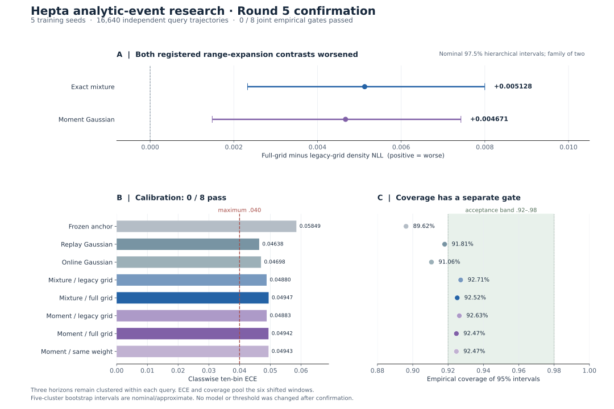

# Round5 研究验收报告：等信息条件下的候选范围实验

日期：2026-10-29（UTC）  
范围：`research/analytic-event-neuron-20261027` 的研究证据；不授予生产权限。  
状态：正式确认、独立计算复核及训练预测头研究级接口验收已完成；完整研究证据已发布并完成远端逐项回读。科学联合门失败，生产不晋级。

## 1. 验收结论

**本轮已经完成一项可训练、可冻结、可回读、可独立核算的条件分布预测研究。预注册的“扩大候选范围改善预测”假设没有通过：两个主比较均变差，全部八个模型的联合验收门均失败。决定保留研究状态，不推进生产替换。**

主比较定义为“全范围选择器减去原范围选择器”的新域密度负对数似然差，越小越好。精确混合模型的平均差为 **+0.00512812**，矩匹配高斯模型为 **+0.00467079**；两者的预注册 97.5% 区间都严格位于零以上。独立复核重算了全部结果，支持这一负面结论。它验证了计算结果的可信度，不会改变科学验收的失败。[正式结果](evidence/selection_registered_001/RESULTS.json) · [独立确认复核](evidence/review_confirmation_002/REVIEW.json)

同时，若干自适应模型在最终新域上确实优于冻结 anchor。需要同时保留这两条事实：模型发生了有效训练；本轮候选范围干预及联合校准要求没有获得支持。不能仅凭相对 anchor 的改善，忽略更强的原范围对照、旧域退化或校准失配。[选择合同](SELECTION_CONTRACT.md)

图中上方为两个主比较及名义 97.5% 区间，下方分别显示 ECE 与覆盖率的独立门槛；数据对应同一冻结结果。可缩放版本见 [selection_results.svg](figures/selection_results.svg)。

## 2. 六条工作线的实际验收状态

| 工作线 | 当前可核验交付 | 验收状态与尚缺证据 |
| --- | --- | --- |
| 1．数学与事件合同 | 冻结的终点条件分布定义；call／put／区间事件；信息、时钟、缺失观察、通信与复位边界；跨分支类型接口 | **合同已固定。** 当前预测研究只验收终点分布；首达、存活和再生复位保持各自语义，不能借用终点结果取得验收。 |
| 2．解析核与独立参照 | 继承的稳定概率／对数概率与条件分布核；本轮 prior 目标／梯度、候选评分核查；全量稠密 Cholesky 条件化、混合评分及分位数独立复核 | **本轮计算正确性复核通过。** 不据此重发失去原始材料的 Round4 原生运行时验收，也不把矩投影视为精确混合扩散半群。 |
| 3．可训练原型与机制对照 | 245 次实际拟合、360 个选择器、7,560 个候选；八个等查询信息的预测头及同权重矩投影对照 | **训练与对照执行通过，候选范围收益和联合科学门失败。** 本轮八个预测头不是对历史连续概率／脉冲／probit／历史特征／原 sparse 全部机制的重新确认。 |
| 4．有后续动作的新任务 | 历史等待／修复／停止任务与成本合同、代码仍可追溯；本轮原始数据保留潜在动作观察但预测不读取未取得信息 | **本轮没有新的后续动作收益验收。** 本轮终点 NLL、ECE 和覆盖率不能替代真实成本下的最终任务收益。 |
| 5．Hepta 真实反馈链路 | 原有交付、回读、状态与原生执行源代码及部分发布收据恢复；通信解码和首达分支类型复用边界明确 | **原始 Round4 最终运行时证据仍不完整。** 本轮未补齐缺失原生二进制和最终原始执行档案，不能宣称完整反馈链路已重新验收。 |
| 6．运行时与扩大研究 | 已完成研究级类型互操作及训练预测头适配器；真实已选模型、公共信息边界、终点选择、原 Q24 发布与身份恢复通过 7 项 conformance 测试 | **研究级接口验收通过；校准门失败，生产不晋级。** 原生量化、原生恢复、延迟、长期保留和跨任务泛化继续按独立门验收。 |

依据：[终点合同](../round4/CONTRACT.md)、[选择合同](SELECTION_CONTRACT.md)、[互操作合同](INTEROP_CONTRACT.md)、[准备审计](evidence/reviews/PREPARED_REVIEW.json)、[确认复核](evidence/review_confirmation_002/REVIEW.json)、[原始材料恢复清单](evidence/recovery/REMOTE_RECOVERY_INVENTORY.json)。

## 3. 每个概率的含义与有效域

### 3.1 call 与 put 共享同一条件定律

分量状态满足 $dX_t=b\,dt+\sqrt q\,dW_t$。给定已经获得的公共传感器历史，分量后验为 $N(m,v)$；预测至物理时间 $t+h$ 时，均值和方差分别为 $M=m+bh$、$V=v+qh$。混合预测保留每个分量及其条件权重。共同阈值 $K$ 的两个方向接口为：

$$
p_{\mathrm{put}}(K)=P(X_{t+h}\le K\mid\mathcal F_t),\qquad
p_{\mathrm{call}}(K)=P(X_{t+h}>K\mid\mathcal F_t).
$$

它们互补，训练时不作为两个可以任意冲突的独立分布。对于严格不同的阈值 $l<u$，当前三通道接口输出：

$$
P(X_{t+h}\le l\mid\mathcal F_t),\quad
P(l<X_{t+h}\le u\mid\mathcal F_t),\quad
P(X_{t+h}>u\mid\mathcal F_t).
$$

这些是物理任务概率。当前研究没有将它们解释为风险中性测度下的贴现期权价格。高斯 CDF 与 probit 的等价也意味着：调用一个期权启发的解析公式，本身不建立新的函数类或对等信息高斯基线的优势。[终点合同，第 1—2 节](../round4/CONTRACT.md)

数学核和接口的有效域还需区分。通用数学合同可以声明确定性原子及共同阈值；当前互操作的正权重终点 schema 要求一或两个正方差高斯分量、严格正权重及有限严格有序阈值。共同阈值的 call／put 恒等式不表示该三通道 API 接受空中间区间。结构性零权重可以按原规则省略；有限对数权重对应的浮点下溢成分不能悄悄丢弃。[互操作合同](INTEROP_CONTRACT.md)

### 3.2 终点、首达、静默、缺失与复位

| 量或事件 | 本报告采用的定义 |
| --- | --- |
| 终点事件 | 指定未来物理时刻的状态是否处于阈值一侧或区间内。 |
| 单边首达 | 一条未复位 Brownian 周期中的路径，在截止时间前是否达到指定边界。需要初始位置、漂移、扩散及边界，终点混合定律不足以提供这些路径信息。 |
| 存活观察 | 实际观察到该吸收周期尚未触边，才允许对“未发生事件”条件化。 |
| 缺失观察 | 没有新的似然证据；有占用的计划时隙仍推进物理时间。空时隙既不推进该观察时钟，也不贡献证据。 |
| 零增量通信 | 量化状态在该通信分辨率下没有变化。包仍可声明 observed、missing 或 propagation；零增量不等于物理未触边。 |
| 物理复位 | 首达再生 cell 的位置、事件计数、不应期及 RNG 状态转换，与终点通信编码器的状态变化分开。 |

一个单边首达概率与该边界的存活概率互补；分别计算的上、下两侧首达事件可能重叠，不能当作互补 call／put。首达密度具有“每单位时间”的量纲；带折现的首达权重也需要单独标签。缺包、零包和传感器缺失均不自动产生存活标签。[互操作合同](INTEROP_CONTRACT.md)

本轮复用已存在的首达分支，源固定于 [`2abafe82a99d6def2132e605e57af183e3080194`](https://github.com/TrillionniumFoundation/hepta-private-ci/tree/2abafe82a99d6def2132e605e57af183e3080194)。四个依赖文件的原路径、Git blob 与 SHA256 见 [DEPENDENCIES.json](DEPENDENCIES.json)。复用其公式、吸收滤波和原 cell 不会转移该分支的训练、效用或生产验收，也没有产生本轮新训练的首达神经元。

## 4. 冻结实验、信息公平与实际训练

### 4.1 检验的干预

原选择器使用 21 个 prior 候选 $s\pi_{\mathrm{fit}}$，其中 $s\in\{0,.05,\ldots,1\}$；全范围选择器使用同样数量的候选 $\{0,.05,\ldots,1\}$。每个精确／矩投影家族内部共享已拟合的分量及 prior 准备过程。改变上限也改变了网格间距，两个集合不保证嵌套，因此没有预设单调收益。[选择合同](SELECTION_CONTRACT.md)

| Arm | 分量或选择方式 | 可识别的比较范围 |
| --- | --- | --- |
| `frozen` | 旧环境新拟合 anchor，保持冻结 | 共同参照 |
| `replay_legacy` | anchor 至平衡重放高斯，21 个物理参数插值 | 强重放基线 |
| `gaussian_full_range` | anchor 至当前数据在线高斯，21 个插值 | 同时改变插值终点的次要比较 |
| `mixture_legacy` / `mixture_full_range` | 同一精确混合分量与 prior 拟合，两个候选网格 | 第一项主比较 |
| `moment_legacy` / `moment_full_range` | 同一矩投影家族的分量与 prior 拟合，两个候选网格 | 第二项主比较 |
| `same_weight_moment_full` | 对已选中的精确 full-range 模型，保持同一权重再做矩投影 | 不新增选择器的形状对照 |

所有预测使用同一查询的六个计划传感器时隙、实际物理时间、观察掩码和方差；额外公共历史为 **0**。模型不读取隐藏 regime、窗口编号、查询 ID、未来目标或尚未取得的动作观察。相同信息不等于相同算术成本、参数个数或架构。组件训练使用原有四种相关采集阶段；它们不增加独立轨迹数。每个选择器以旧域开发 NLL 增量加 $1.645$ 倍配对标准误不超过 $.02$ 为筛选条件，然后最小化新域开发 NLL，按索引打破平局。该 guard 是开发选择启发式，不是总体或逐点保留定理。[源码评审](evidence/reviews/SELECTION_SOURCE_REVIEW.json)

### 4.2 实际执行规模与身份

| 项目 | 实际完成 |
| --- | ---: |
| 训练种子 | 5：2131、2377、2539、2791、3011 |
| 每种子窗口 | 12，gaussian 与 drift_shift 交替 |
| 独立准备查询 | 48,640，其中训练 17,920、开发 30,720 |
| 原始准备数据／模型 JSON | 185／65；共 250 个准备产物 |
| 优化拟合 | 245：125 个分量拟合、120 个 prior 拟合 |
| 优化失败 | 0 |
| 达到继承 prior-logit 边界的解 | 17，边界为 $[-6,6]$，原样保留 |
| 选择器／候选评估 | 360／7,560 |
| 检查点／arm-window 重载 | 60／480 |
| 正式确认独立查询 | 16,640 |

所有拟合都有实际参数或 logit 变化，最小 prior-logit 变化约为 $8.85\times10^{-7}$。独立准备审计完成 53,641 项检查；全部分量目标端点误差为零，独立候选评分与 prior 目标核算最大误差为 $4.44\times10^{-16}$。审计没有重新生成数据或重新优化。分量轨迹保存的是目标求值和初始／最终参数，不包含每次求值的完整参数向量，故不能把求值次数写成优化迭代次数。[准备审计](evidence/reviews/PREPARED_REVIEW.json) · [冻结前准备审计代码](evidence/reviews/review_prepared.py)

正式确认仅执行一次。每种子 256 条旧域查询在其 12 个窗口重复使用，另有每窗口 256 条新域查询，总计 $5\times(1+12)\times256=16,640$ 条独立查询。三个未来 horizon `.5,1,2` 保持在同一查询内，重复旧域行和八个 arm 均不扩大独立样本量。[确认索引](evidence/selection_registered_001/CONFIRMATION_INDEX.json) · [正式执行收据](evidence/selection_registered_001/execution/selection_registered_confirm_001_COMPLETED.json)

## 5. 正式结果：主假设失败，保留完整负面证据

### 5.1 两项预注册主比较

以下均为六个固定漂移窗口上的平均新域密度 NLL 差；正值表示 full-range 较差。每项使用 4,000 次层级 bootstrap，先重采样训练种子，再在固定窗口内重采样完整查询。两个主比较采用 97.5% 双侧区间组成 Bonferroni 家族。只有五个独立训练种子，覆盖率是名义近似；没有精确有限样本或通用性能保证。[选择合同](SELECTION_CONTRACT.md)

| 主比较 | 平均差 | 97.5% 区间 | 预注册收益判定 |
| --- | ---: | --- | --- |
| `mixture_full_range − mixture_legacy` | **+0.00512812** | **[+0.00232892, +0.00799844]** | 未通过；结果支持本任务上的劣化方向 |
| `moment_full_range − moment_legacy` | **+0.00467079** | **[+0.00148451, +0.00742804]** | 未通过；结果支持本任务上的劣化方向 |

精确混合的五个种子平均差均为正；矩投影有四个为正、一个略为负。注册指标检验差值符号，没有预设最小实用范围效应。以上差值是该任务的 NLL，不是百分比准确率、真实收益或货币成本。[正式比较记录](evidence/selection_registered_001/RESULTS.json)

### 5.2 八个模型的联合门

保留门要求跨种子平均的最坏旧域窗口 NLL 增量不超过 `.02`，且最终新域不劣于 anchor。NLL 效能门还要求最终新域至少改善 `.005`、每个种子都改善、描述性 95% 区间上端低于零。校准门要求漂移窗口十箱 classwise ECE 不超过 `.04`，95% 区间覆盖率在 `[.92,.98]`。三部分的合取是经验验收门，不是一个同时置信证书。[选择合同](SELECTION_CONTRACT.md)

| Arm | 最终新域 ΔNLL | 最坏旧域跨种子均值 | 最坏单种子／窗口 | ECE | 95% 覆盖率 | 保留门 | 联合门 |
| --- | ---: | ---: | ---: | ---: | ---: | --- | --- |
| `frozen` | 0.000000 | 0.000000 | 0.000000 | 0.058489 | 89.6181% | 通过 | 失败 |
| `replay_legacy` | −0.072930 | 0.019443 | 0.075885 | 0.046384 | 91.8056% | 通过 | 失败 |
| `gaussian_full_range` | −0.059991 | 0.018868 | 0.066799 | 0.046976 | 91.0590% | 通过 | 失败 |
| `mixture_legacy` | −0.080935 | **0.020321** | 0.086204 | 0.048801 | 92.7127% | **失败** | 失败 |
| `mixture_full_range` | −0.076388 | **0.020228** | 0.089230 | 0.049467 | 92.5174% | **失败** | 失败 |
| `moment_legacy` | −0.082918 | 0.019940 | 0.086600 | 0.048831 | 92.6345% | 通过 | 失败 |
| `moment_full_range` | −0.080034 | 0.019784 | 0.088682 | 0.049422 | 92.4696% | 通过 | 失败 |
| `same_weight_moment_full` | −0.076511 | 0.019784 | 0.088682 | 0.049431 | 92.4696% | 通过 | 失败 |

最终新域 ΔNLL 相对同种子 anchor 计算。全部八个 ECE 均高于 `.04`，所以即使覆盖率合格，校准门仍失败；联合门因此全部失败。`mixture_full_range` 的旧域最坏跨种子平均增量精确值为 **0.02022786191690131**，已经高于 `.02`，不能通过四舍五入或强调开发 guard 将其改判。`mixture_legacy` 同样超限。单种子／窗口最坏退化另行列出，避免用跨种子平均掩盖局部退化。[全部 profile 与逐窗口值](evidence/selection_registered_001/RESULTS.json)

`replay_legacy`、`gaussian_full_range`、两个 moment arm 和同权重投影通过了组合的 NLL 效能门；这没有修复其校准失败。两个 mixture arm 虽然最终新域改善，但因保留门失败，组合的 NLL 效能门也失败。

### 5.3 描述性机制比较

| 比较 | 平均 ΔNLL | 描述性 95% 区间 | 可支持的解释 |
| --- | ---: | --- | --- |
| 精确 full-range − 独立拟合 moment full-range | +0.00002805 | [−0.00033577, +0.00040606] | 未检出精确混合优于矩投影的证据，也不是等效性证明 |
| 精确 full-range − 同权重 moment | −0.00008377 | [−0.00044063, +0.00026471] | 隔离权重后，形状差异的区间跨零 |
| 精确 full-range − 当前在线高斯 full-range | −0.02300905 | [−0.03337864, −0.00959275] | 描述性优于该高斯对照，不能归因于候选范围扩大 |
| 当前在线高斯 full-range − 平衡 replay | +0.01510801 | [+0.00978338, +0.02017859] | 改变插值终点的高斯方案较差；不是纯 prior 范围干预 |

这些是预先声明的描述性比较，没有新增 superiority 门。不能在两个主比较失败后，把其中一项次要比较改成主结论，也不能从“区间跨零”推出两种模型普遍等价。[完整比较记录](evidence/selection_registered_001/RESULTS.json)

## 6. 独立确认复核与实际失败尝试

独立复核使用稠密 Cholesky 条件化与公共历史似然、独立混合评分和分位数求逆、私有字段扰动，以及独立 ECE／层级重采样汇总。它覆盖全部 **60** 个 seed/window、**960** 个 model/domain、**245,760** 次含重复旧域行的预测核算、**960** 次信息边界挑战和 **14** 个区间；独立查询仍为 **16,640**。记录中的最大数值差为 **2.842170943040401×10⁻¹⁴**，复核通过，未训练或生成数据。[成功复核原始收据](evidence/review_confirmation_002/REVIEW.json)

第一次独立复核确实失败，目录和收据完整保留。它以 `python3` 路径启动，而冻结环境记录的是 `python` 路径；虽然解析到同一可执行文件，严格环境身份仍在数值重算前拒绝了它。该次已重算 model/domain 数为 **0**。诊断确认全部 107 个科学源、计划身份及其他环境字段一致，第二次使用冻结的精确解释器路径、相同 reviewer、相同输入；环境门没有放宽，科学源、模型、数据和结果没有修改。[失败收据](evidence/review_confirmation_001/REVIEW.json) · [启动恢复说明](evidence/reviews/CONFIRMATION_AUDIT_LAUNCH_RECOVERY.json)

这里的“两次”是独立复核尝试次数；正式 confirmation 没有重跑、补抽或挑选较好的结果。

## 7. 成本与可复现范围

| 实际范围 | Wall 秒 | CPU 秒 | 解释 |
| --- | ---: | ---: | --- |
| 准备完整进程调用 | 19.904644 | 64.661709 | 含解释器启动；245 个共享拟合各计一次 |
| 准备内部计时 | 18.990793 | 63.277747 | 嵌套于上一行 |
| 准备独立审计 | 16.084322 | 14.339269 | 含导入和 53,641 项检查，排除解释器启动及最终 JSON 写入 |
| 冻结完整调用 | 1.017917 | 1.417490 | 验证并写入本地冻结记录 |
| 正式确认完整调用 | 27.501582 | 22.374235 | 包含生成、评分和结果汇总 |
| 确认生成／评分内部计时 | 20.157006 | 16.336429 | 嵌套于正式确认调用 |
| 确认汇总内部计时 | 5.382792 | 4.431357 | 源／环境／产物验证、指标与 bootstrap，排除最终 JSON 写入 |
| 独立复核失败尝试完整调用 | 1.161820 | 1.611474 | 评分前的解释器身份拒绝 |
| 独立复核成功尝试完整调用 | 26.903964 | 22.854377 | 全量稠密参照、信息挑战和统计复核 |
| 预测头测试首次失败完整调用 | 1.798463 | 2.245939 | 测试框架入口被 fixture 属性遮蔽，测试体未执行 |
| 预测头测试第二次完整调用 | 2.827379 | 2.010559 | 7 项研究级接口测试通过 |
| 准备／确认封装实际恢复核验 | 2.389023 | 1.420916 | 独立新目录，核对 v1 准备与 v2 xz 确认原字节 |

来源：[准备调用](evidence/selection_registered_001/execution/selection_registered_prepare_001_COMPLETED.json)、[准备审计](evidence/reviews/PREPARED_REVIEW.json)、[冻结调用](evidence/selection_registered_001/execution/selection_registered_freeze_001_COMPLETED.json)、[确认调用](evidence/selection_registered_001/execution/selection_registered_confirm_001_COMPLETED.json)、[确认索引](evidence/selection_registered_001/CONFIRMATION_INDEX.json)、[结果汇总](evidence/selection_registered_001/RESULTS.json)、[失败复核调用](evidence/review_confirmation_001/execution/independent_confirmation_review_COMPLETED.json)、[成功复核调用](evidence/review_confirmation_002/execution/independent_confirmation_review_COMPLETED.json)。

预测头测试成本另见 [第一次执行收据](evidence/prediction_head_validation_001/execution/prediction_head_conformance_001_COMPLETED.json)、[第二次执行收据](evidence/prediction_head_validation_002/execution/prediction_head_conformance_002_COMPLETED.json)。

恢复成本见 [实际恢复收据](evidence/transport_validation_001/RESTORATION.json)。

嵌套行不能相加成总成本。CPU 大于 wall 可以来自数值库线程；记录的线程环境变量为空，不等于只有一个有效线程。完整分量拟合计时包含训练历史组装；继承 prior 拟合的内层计时在分量 cache 构建后开始，完整调用计时才覆盖整个准备过程。这些是共享宿主上的 Python 研究测量，没有硬件能耗、金融费用或原生神经元延迟结论。打包、传输、恢复和发布的执行开销还需要各自收据，不把这张表称为全项目总成本。

## 8. Hepta 集成与原始 Round4 材料的边界

恢复清单确认了 **102** 个冻结科学源码、**83** 个原生相关源码、**85** 个已发布 Round4 UTF-8 文件，以及 **19** 个档案描述符。旧远端树存在 **38** 个物理档案分片，合计 **269,776,516** 字节，但清单明确记录本次没有下载／复核这些原始二进制档案；旧冻结声明的 **489** 个准备产物也没有在本次恢复环境逐字节重验。[精确恢复清单](evidence/recovery/REMOTE_RECOVERY_INVENTORY.json)

原 Round4 最终 `RUNTIME_RESULTS.json`、最终独立审计、部分种子的完整运行档案、最终验收报告／发布收据及原交付包仍有缺失。原生可执行物没有恢复或重新编译。一次有界 CI artifact 寻找取得了提供方文件引用，但本地材料化失败，未得到可检查、可执行的字节；那个候选本身也不等于 Round4 绑定的原生程序。[缺失项与恢复状态](evidence/recovery/REMOTE_RECOVERY_INVENTORY.json) · [原生材料寻找收据](evidence/recovery/WORKFLOW_NATIVE_SOURCE_DISCOVERY.json)

因此，本报告没有把历史任务合同写成当前执行完成。原 [运行时合同](../round4/RUNTIME_CONTRACT.md) 要求真实输出交付与回读、带噪反馈、收到的状态、等待／修复／停止、最终效用、原生请求和完整重放；这些要求仍然有效。当前预测实验没有重新交付这套证据，不能用终点预测损失填补它。 本环境的 `just fmt` 也因缺少 `just` 而未启动，退出码为 127；没有 Rust 源码改动或原生构建通过的声明。[格式命令实际记录](evidence/FORMAT_CHECK.json)

### 8.1 已训练预测头适配器：研究级接口验收通过

独立开发的 [prediction_head.py](prediction_head.py) 已从冻结训练检查点装载实际选定的模型，并通过 **7 项** conformance 测试。测试覆盖全部 **8 个已选 arm × 4 个注册 horizon**，使用独立单元测试 namespace 及保存的 `seed2131/window11` 开发历史；没有读取注册 confirmation 数据、增加训练或修改 107 个冻结科学源。另有独立只读源码评审通过。[验收收据](evidence/prediction_head_validation_002/CONFORMANCE.json) · [测试源码](test_prediction_head.py)

接口通过冻结验证绑定 source、环境、prepared、检查点字节及模型选择。类型化 `PublicHistory` 只接收公共观察、物理时间、观察／占用掩码和方差，不提供 ID、target、隐藏 law 或未取得动作观察入口。输出从原条件分布已经传播出的四个 horizon 选择 `TerminalForecast`，不再次传播。只允许裁去对数权重为负无穷的结构性零；有限 log-weight 的浮点下溢转换被拒绝。Q24 release 独立调用原 Python 发布操作，身份恢复绑定适配器、互操作和模型身份，不恢复物理膜、复位或 RNG 状态。[预测头合同](PREDICTION_HEAD_CONTRACT.md)

第一次测试调用发生了真实框架错误：fixture 属性名 `run` 遮蔽 `unittest.TestCase.run`，在测试体执行前失败。旧源快照、日志与成本保存在 `prediction_head_validation_001`；只将新测试 fixture 名改为 `artifact_root` 后，第二次通过，未修改科学模型或确认结果。[失败源快照](evidence/prediction_head_validation_001/SOURCE_SNAPSHOT/MANIFEST.json) · [失败日志](evidence/prediction_head_validation_001/execution/prediction_head_conformance_001.log)

该适配器限于研究／影子用途，`production_activation=false`。这项接口验收不会使失败的 ECE／联合门变成通过，也没有增加原生 Q24 执行、后续动作收益、能耗或延迟优势声明。验收收据 SHA256 为 `7b94449d38e550f3b98f38d1933b3564b9fabd25fb107df63e009bcab510a606`。

## 9. 冻结、远端发布与证据入口

本报告的网页可读 [结果镜像](evidence/selection_registered_001/RESULTS.json)、[确认索引镜像](evidence/selection_registered_001/CONFIRMATION_INDEX.json)、[准备索引镜像](evidence/selection_registered_001/PREPARED_INDEX.json) 与原文件字节一致。科学原路径仍为 `prepared/PREPARED.json`、`confirmation/INDEX.json` 和 `confirmation/RESULTS.json`，由对应证据封装恢复；镜像不构成新一次执行。

正式确认前已核验的远端冻结点是 [`21c896c60ce8a2abfc95d5509137204b0763c66f`](https://github.com/TrillionniumFoundation/hepta-private-ci/tree/21c896c60ce8a2abfc95d5509137204b0763c66f)，树为 `946d71bba38fb65f404a6d0f2248cf079ed4517b`。实际树核对了 **91** 个新增或更新文件，其中包含 **36** 个准备数据编码分片；此时 confirmation 尚未开始。[发布核验收据](evidence/selection_registered_001/PRECONFIRMATION_PUBLICATION.json)

可固定引用的远端入口：

- [冻结选择合同](https://github.com/TrillionniumFoundation/hepta-private-ci/blob/21c896c60ce8a2abfc95d5509137204b0763c66f/experiments/analytic_event_neuron/round5/SELECTION_CONTRACT.md)
- [源／模型／数据冻结记录](https://github.com/TrillionniumFoundation/hepta-private-ci/blob/21c896c60ce8a2abfc95d5509137204b0763c66f/experiments/analytic_event_neuron/round5/evidence/selection_registered_001/FREEZE.json)
- [准备证据封装清单](https://github.com/TrillionniumFoundation/hepta-private-ci/blob/21c896c60ce8a2abfc95d5509137204b0763c66f/experiments/analytic_event_neuron/round5/evidence/envelopes/selection_prepared_001/MANIFEST.json)

准备封装已实际恢复并核对 **251** 个文件、**10,372,700** 个原始字节，全部匹配。[恢复收据](evidence/PREPARED_RESTORATION.json)

| 已发布研究对象的固定身份 | SHA256 |
| --- | --- |
| 注册协议规范化 JSON | `ec3c907a0d016ba7bad960d69e76a0571af1eec14bb9e24a8ded202179a0defc` |
| `PREPARED.json` | `077a8fc372ba603da451ed6118fd99343d924524c5fd7cd2e0b6ef10b6432bf6` |
| `FREEZE.json` | `1e5676bd481ef5a3d13e63a5de8eb90223e9abf55bb918721b28ab32e1f5ba16` |
| 确认 `INDEX.json` | `7de85b15d658d34cef74a3b7ebeb7e9ac19d9fcef446c056f4566c15b0fe7636` |
| 确认 `RESULTS.json` | `3a7d02813f2c0d7338c9e1d9d344f4406c13a0e4b01900c659911bbe371005bd` |
| 成功独立确认复核 | `26fb6228076b5e14a1a1cd0ab99ded8c2fa418563ffdeccaca4b632adfb2fd86` |

确认产物已形成封装：187 个文件、56,646,467 原始字节，xz 压缩档案 33,866,104 字节，173 个编码分片。已在新的目录实际恢复并逐字节核对，全部匹配；同时复核了旧 v1 准备封装的兼容恢复。这些本地恢复收据仍不代替最终远端回读。[确认封装清单](evidence/envelopes/selection_confirmation_001/MANIFEST.json) · [实际恢复收据](evidence/transport_validation_001/RESTORATION.json)

**完整研究证据已经发布并逐项回读。** 固定数据提交为 [`6c4d3b8ee40a4a1d8d4b7f09410a07c1b5017163`](https://github.com/TrillionniumFoundation/hepta-private-ci/tree/6c4d3b8ee40a4a1d8d4b7f09410a07c1b5017163)：实际校验 **323 个 Round5 文件**，其中包括全部 **212 个编码分片**。四份封装共恢复核对 **456 个成员、67,725,726 个原始字节**，覆盖开发 smoke、完整准备、完整确认和图形。原研究分支的 **11,553 个既有 blob 全部保持不变**，通过有界 Git 子树回读和完整 Merkle 差异遍历核验。[完整发布收据](evidence/publication/COMPLETE_EVIDENCE.json) · [原树保留证明](evidence/publication/TREE_PRESERVATION.json)

本报告与下载包使用各自后续版本记录；上述数据提交是已经核验的完整科学证据点，不是尚未生成的自引用提交。操作方式见 [REPRODUCTION.md](REPRODUCTION.md)。

## 10. 下一步与研究决策

1. **封存已完成的证据与接口交付。** 原始确认数据、模型身份、成功与失败复核、审计代码、全部编码分片已经发布并回读；原字节恢复也已完成。后续引用固定数据提交与下载包摘要，保留负面结果、旧 smoke 源快照和全部失败启动记录。
2. **维持研究级预测头的明确边界。** 已选模型、适配器、两次测试尝试及源码审查均已发布。后续若增加有状态后端、物理复位或原生数值转换，应新增明确版本和对应验收，继续保持接口正确性与科学效果的独立门。
3. **为校准失配建立下一轮独立问题。** 当前所有 ECE 门失败、部分覆盖率不足，并出现旧域退化。任何校准、训练目标、候选网格或 guard 的调整都应形成新协议，使用新的准备与确认身份；本轮 confirmation 可以作为已公开诊断材料，不能继续作为新方法的未见验收集。尚未执行这项调参或新训练。
4. **恢复真实后续动作的比较。** 若继续推进首达 cell、终点分布头与 sparse 的统一研究，应先注册相同可见信息、实际传感器取得、等待／修复／停止成本、最终交付评分和独立重放。终点与路径模型保留各自有效域；同一任务中的效用改善才支持后续收益结论。该新任务尚未在本轮执行。
5. **原生运行时恢复后分别验收。** 取得与绑定摘要一致的可执行物和原始链路材料，或创建明确标为新执行的受控研究；分别验收量化误差、恢复一致性、实际延迟、长期保留与域外泛化。不得把新执行包装成已经失去的 Round4 原始证据。

当前决策保持为：**接受本轮可追溯的研究执行与独立计算复核；记录候选范围扩大和联合验收失败；保留研究分支，不进行生产晋级。**
