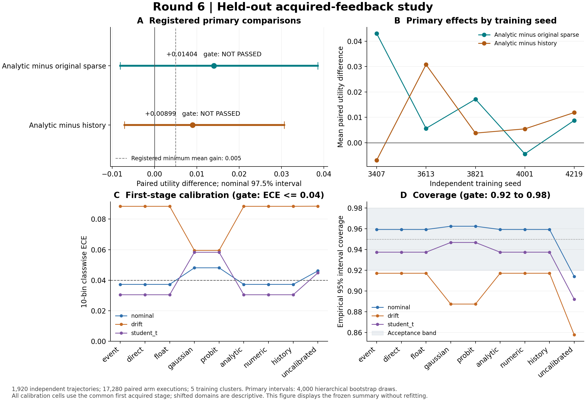

# Hepta 解析事件神经元 Round6 验收报告

**本轮已完成真实训练、全部 15 个正式确认范围、原生执行及完整独立审计；两项预登记的主要收益优越性门槛均未通过。** 这支持“研究原型已经可训练、可执行、可回放”的结论，同时要求保留“新特征结构尚未达到预设收益证据标准”的结论。两项平均收益差均为正，不能据此把未通过表述为已经证明解析结构更差。[冻结结果][results]、[完整独立审计][audit]

本报告以不可变 `RESULTS.json` 为科学结果依据，其 SHA256 为 `303e98b4c6679f7dd827bb2c3a7083d96010984adbba43e1c6548b7930f53a69`。独立确认审计已于 2026-10-30 完成，`REVIEW.json` SHA256 为 `ef2ef939432eaa457b97def830f8719030e5050afa79457e4c663d33e5f977f2`。表格由现有结果机械摘录，未重新拟合、重跑确认或修改门槛；显示值按列舍入，判定使用原始浮点值。[结果][results]、[审计调用记录][audit_outer]

联合研究门槛 `joint_research_gate_pass=false`；`production_promotion=false`。名义分布的 analytic 校准通过，不能覆盖两项主要收益门槛的失败。27 个“分布 × 模型臂”校准单元中仅 12 个通过：nominal 为 6/9，Student-t 为 6/9，drift 为 0/9。[结果][results]、[预登记规则][registration]

## 1. 六项交付的验收状态

这里分别报告交付完成情况、实际验收结果和有效范围。某一工程检查通过不会自动使收益、校准、长期保留或生产部署通过。[合同][contract]、[结果][results]、[运行时资格记录][qualification]

| 交付项 | 已交付与已观察证据 | 本轮验收状态与边界 |
| --- | --- | --- |
| 1．固定数学与事件合同 | 状态、已获取信息、三类终点事件、阈值、阶段、训练目标、动作与成本已登记；call/put 共用条件分布。 | 当前静态残差任务的合同已落实。物理首达、缺失观察与复位的实证验收仍属独立问题。 |
| 2．解析核与独立参照 | 稳定尾概率与对数概率、梯度/传播核、密集后验、独立积分参照；新等待价值使用分段自适应积分。 | 29 项组合预检及训练/确认独立数值复核通过；积分误差估计不等于严格区间证书。 |
| 3．可训练原型与机制对照 | 9 臂；真实拟合先验、噪声及三类 63 维读出；45 条梯度下降轨迹、225 次候选评价、15 个选定读出。 | 训练真实发生，机制对照完成；两项主要优越性门槛未通过。原 sparse 探针未被训练成新内核。 |
| 4．有后续动作的新任务 | 隐藏残差、带噪传感、付费等待、修复或停止；从实际最终回读计分。 | 1,920 条独立确认轨迹、17,280 次臂执行完成。没有达到预设主要收益优势证据。 |
| 5．复用 Hepta 反馈链路 | 实际原生二进制、Owner、文本/PNG 交付回读、状态更新、选择、评分与完整回放。 | 15 范围执行及独立审计通过。属于本地研究执行链，未激活生产 Agentd。 |
| 6．运行时适配与扩展研究 | 预测头、本地版本化/校验状态、event/direct/float、拒绝与恢复资格验证。 | 284 项有界检查通过；最多 16 帧、6 次新进程延续。跨 owner 原子性、断电耐久性、长期无界保留和生产接入尚未验收。 |

证据入口：[数学预检][preflight]、[训练独立审计][prepare_review]、[确认独立审计][audit]、[本地 Owner][owner]、[资格测试实现][qualifier]。

## 2. 数学对象、事件与信息边界

本轮是**受控合成数值任务**：隐藏残差与传感观测由登记的数据生成器构造。“真实执行”指实际运行原生程序，并实际进行本地文本/PNG 的交付、回读、状态更新与后续动作；本轮没有执行生产业务任务，也未激活生产 Agentd。[数据生成器][data]、[执行实现][study]、[理论与训练范围][theory]

每条轨迹具有已交付初值 $A$、在该轨迹内固定的私有残差 $E$，以及目标 $Y=A+E$。第一阶段获取一次带噪观测；选择付费等待后，才获取第二次独立传感观测。阶段编号表示已经获取的观察次数，$E$ 不在两阶段之间扩散。因此，本轮的终点概率、通信事件增量和物理首次越阈时间分别有不同语义。[合同][contract]、[数据生成器][data]

在已获取历史 $\mathcal F_k$ 下，模型用一或两个正方差高斯分量表示条件残差分布：

$$\widehat F_E(a\mid\mathcal F_k)=\sum_j\pi_j\Phi\!\left(\frac{a-m_j}{\sqrt{v_j}}\right),\qquad v_j>0.$$

该式是拟合模型的条件预测，不宣称每个确认域的真实条件分布都恰好属于该模型族；Student-t 域有意引入分布失配。本轮复用现金或无支付二元期权中的高斯尾概率解析结构，但这里的概率来自学习的残差分布，不是折现后的风险中性期权价格。[继承数学定义][old_math]、[理论与训练范围][theory]

以公开修复成本 $c$ 为阈值来源，实际预测的三类事件是 $E\le-\sqrt c$、$-\sqrt c<E\le\sqrt c$、$E>\sqrt c$。同一条件分布上的 put 方向为下尾、call 方向为上尾；在当前连续正方差域，$P(E\le a)+P(E>a)=1$。应把方向、阈值和边界约定纳入算子合同，共享分布参数及条件信息。本轮没有把 call/put 当成两个相互无关的模型来拟合。任务的两个阈值分别是 $-\sqrt c$ 与 $+\sqrt c$，所以这两条尾概率之和为 $1-p_{\mathrm{neutral}}$；只有同一阈值上的上下尾直接互补。[合同][contract]、[继承数学定义][old_math]、[解析实现][old_analytic]

策略模型只接收 `initial`、`residuals`、`variances`、`repair_cost`、`wait_cost`、`wait_variance` 六个公开字段。目标、潜在的未购第二观察、分布标签和轨迹 ID 不进入数值特征。独立 broker 进程持有私有数组，策略 worker 禁止直接 `np.load`；最后交付回读结束且 worker 终止后，另一个 scorer 进程读取目标计分。这是程序信息分离，未宣称抵抗同一 UID 下的恶意攻击者。[Broker 合同][broker_contract]、[执行实现][study]、[完整独立审计][audit]

本轮没有缺失传感器抽样，不能用“未购买观察”替代“本应存在但缺失的观察”；零通信增量也不是生存概率或复位证据。`event` 传输的是相邻量化条件分布坐标之差，没有从 call/put 概率采样 Bernoulli 脉冲。物理首达、缺失观察、复位与长时间状态演化接口虽有继承定义，当前两阶段静态残差任务没有实证覆盖它们。[合同][contract]、[预登记][registration]

### 等待与修复的实际作用

修复量为接收后验均值的 Q24 舍入，修复条件收益为 $2a\,\mathbb E[E\mid\mathcal F]-a^2-c$。等待价值计算未来传感后可选择修复的期望增益，再扣除等待成本 $w$。单高斯有闭式正部二次矩；双分量模型按后验均值越过 $\pm\sqrt c$ 的两个根分段，并在标准化传感坐标 $[-12,12]$ 上自适应积分。[连续决策核][continuation]、[独立参照][reference]

高斯截尾上界、SciPy 积分误差估计、Q24 修复舍入损失分别记录；后者上界为 $1/(4\cdot2^{48})$。该上界没有包含未来条件分布传输量化、学习读出的策略偏差，也不覆盖有限 native/repair 域的裁剪或拒绝损失。共享等待规划没有精确纳入这些约束，不能作为所实现有界运行时的受限 Bellman 最优性证书。[有限执行域解释][interpretation]最终效用始终从实际动作和交付回读计算：

$$U=1-(\mathrm{delivered}-Y)^2-c\,\mathbf 1_{\mathrm{repair}}-w\,\mathbf 1_{\mathrm{wait}}.$$

任务成本属于效用单位；CPU、墙钟、请求次数、字节、能量和货币并未被假定换算成该效用。解析概率进入实际动作选择，不仅用于一个离线预测损失。[合同][contract]、[执行与计分][study]

## 3. 数据、训练及对照究竟改变了什么

正式训练种子固定为 3407、3613、3821、4001、4219。每种子 256 条 nominal 训练轨迹和 128 条开发轨迹；每个确认分布每种子 128 条。总计训练 1,280、开发 640、确认 1,920 条轨迹，9 臂共执行 17,280 次。模型在三种确认分布间冻结，不以分布标签调参。[预登记][registration]、[准备总账][prepare_ledger]、[确认总账][confirm_ledger]

| 分布 | 隐藏残差分布 | 传感噪声 | 用途 |
| --- | --- | --- | --- |
| nominal | 双高斯：权重 (0.65, 0.35)，均值 (-0.45, 0.85)，方差 (0.09, 0.36) | 高斯；实际方差 = 1.75 × 公开方差 | 训练、开发与主要确认 |
| drift | 双高斯：权重 (0.40, 0.60)，均值 (-0.15, 1.05)，方差 (0.12, 0.48) | 同上 | 冻结模型下的描述性分布偏移确认 |
| student_t | 各分量使用标准化 t5；分量均值/方差与 nominal 匹配 | 同上 | 冻结模型下的描述性尾部分布确认 |

公开初始方差取 `{0.04, 0.36, 1.44}`，等待方差取 `{0.04, 0.16, 0.64}`，修复成本取 `{0.03, 0.12, 0.48}`，等待成本取 `{0.01, 0.04, 0.12}`。正式数据种子规则为 `660000000 + 1000*seed + 100*domain_index + split_code`，训练/开发/确认代码分别为 1/2/3；开发 smoke 使用独立命名空间。[生成器][data]、[预登记][registration]

| 模型臂 | 先验与噪声 | 条件分布传输 | 修复动作分数 |
| --- | --- | --- | --- |
| event | 拟合 K2 先验 + 学习噪声 | 有符号事件增量 | 共同解析价值 |
| direct | 同 event | 直接量化坐标 | 同 event |
| float | 同 event | FP64 | 同 event |
| gaussian | 同一训练残差拟合 K1 + 学习噪声 | FP64；精度更新 | 共同解析价值 |
| probit | 与 gaussian 同一 K1 参数和噪声 | FP64；独立密集条件化 | 与 gaussian 同义的解析价值 |
| analytic | 同 event | 事件增量 | CDF 衍生驱动 → 原 sparse 特征 → 训练的 63 维读出 |
| numeric | 同 event | 事件增量 | 公开数值驱动 → 同一原 sparse 特征 → 训练的 63 维读出 |
| history | 同 event | 事件增量 | 公开历史的多项式/RBF 63 维表示 → 训练的读出 |
| uncalibrated | 同一拟合 K2 先验；噪声倍率固定 1 | FP64 | 共同解析价值 |

`numeric` 是原 sparse 的公开数值特征对照，不是“用数值积分计算 CDF”的对照。三个学习臂共享条件分布、修复量、等待规划和候选预算，主要比较因而检验这套共同结构中的特征变换。九臂并非相同架构、参数量或算术成本；结果不支持跨任意网络架构的普遍优越性推论。[合同][contract]、[继承特征实现][feedback]、[本轮学习实现][learning]

解析驱动的三个通道使用尾概率差、中心区间概率与公开成本变换；原生 sparse 探针与执行内核固定。实际训练的是混合先验参数、噪声尺度和线性读出，不是通过离散脉冲及原 sparse 内核完成端到端权重反向传播。本轮不应被描述成“已证明一个全新 SNN 架构端到端训练成功”。[特征及梯度下降实现][feedback]、[固定原生头][native_head]、[学习实现][learning]

### 实际优化工作量

每种子的 K2 先验进行了 80 次实际 EM 更新，5 个种子合计 **400 次 EM 更新**。每个种子、每类学习读出执行 3 个正则强度的 600 步梯度下降：共 **45 条真实优化轨迹、27,000 次梯度更新**。每条优化轨迹用 5 个偏置在开发集上评价，形成 **225 次候选评价**，最后得到 **15 个选定读出头**。偏置评价共享已经拟合的权重，不能把 225 次候选评价误记为 225 次独立训练。单高斯先验、K2 先验、噪声和共享潜在结果生成的成本也没有按九臂重复计费。[训练实现][feedback]、[准备总账][prepare_ledger]、[独立训练重建][prepare_review]

| 种子 | 学习噪声倍率 | analytic 权重变化 L2 | numeric 权重变化 L2 | history 权重变化 L2 |
| --- | --- | --- | --- | --- |
| 3407 | 1.715604036 | 3.716590480 | 5.597053162 | 3.742824884 |
| 3613 | 1.648075170 | 2.417096647 | 11.265048545 | 2.475840559 |
| 3821 | 1.554587832 | 2.473626991 | 6.923174551 | 3.664958534 |
| 4001 | 1.674145359 | 2.986278615 | 7.237663518 | 2.287037089 |
| 4219 | 1.787550343 | 3.645754566 | 6.477348738 | 3.152511836 |

五个种子的原始收据分别为：[3407][train3407]、[3613][train3613]、[3821][train3821]、[4001][train4001]、[4219][train4219]。噪声初值均为 1，所有选定读出从零权重产生非零变化；独立审计重建了 EM 与梯度下降轨迹及候选选择，没有进行新的主训练。[训练独立审计][prepare_review]

## 4. 两项主要收益检验

主要域为 nominal。每项都必须同时满足：平均收益差至少 0.005、97.5% 两侧分层百分位区间下端严格大于 0、五个训练种子的平均差全部大于 0。区间使用 4,000 次“先抽训练种子，再抽整条配对轨迹”的 bootstrap；两个主要比较属于登记的同一检验族。只有五个训练簇，因此这里的名义区间不附带有限样本覆盖率保证。[预登记][registration]、[冻结汇总实现][summary]

| 主要比较 | 平均效用差 | 97.5% 区间 | 正均值种子 | 预登记判定 |
| --- | --- | --- | --- | --- |
| analytic-numeric | +0.014040139138 | [-0.008071202641, 0.038578935696] | 4/5 | 未通过 |
| analytic-history | +0.008988934120 | [-0.007095598032, 0.030623072846] | 4/5 | 未通过 |

来源：[RESULTS.json 的 primary][results]。两项平均差都超过 0.005，但两项区间均跨零，且各有一个负向种子；因此均不满足预先规定的联合条件。这个结果没有证明 analytic 劣于其对照，也不足以宣布其主要收益优越性已被证实。

| 种子 | analytic − numeric | analytic − history |
| --- | --- | --- |
| 3407 | +0.043083353445 | -0.006936200071 |
| 3613 | +0.005632019338 | +0.030794169402 |
| 3821 | +0.017138645093 | +0.003767633155 |
| 4001 | -0.004435255304 | +0.005437495752 |
| 4219 | +0.008781933117 | +0.011881572364 |

来源：[逐种子配对差][results]。`analytic−numeric` 的负向种子是 4001；`analytic−history` 的负向种子是 3407。确认数据未用于更换种子、重选头或修改门槛。[确认总账][confirm_ledger]、[完整独立审计][audit]

图仅呈现冻结结果；来源与图像身份见 [FIGURE_SOURCE.json][figure_source]。

## 5. nominal 的九臂效用、校准与任务成本

各行均为 5 个种子 × 128 条首阶段相同轨迹，共 640 条；效用和成本则按每条轨迹的完整后续动作计分。下面给出描述性均值，未把九臂排序另立为新的显著性检验。[结果][results]、[统计口径][summary]

| 臂 | 平均效用 | 最终 MSE | 平均已付任务成本 | 首阶段 ECE | 95% 区间覆盖率 | 校准门槛 |
| --- | --- | --- | --- | --- | --- | --- |
| event | 0.736496888 | 0.171253112 | 0.092250000 | 0.037230623 | 95.937500% | 通过 |
| direct | 0.736496888 | 0.171253112 | 0.092250000 | 0.037230623 | 95.937500% | 通过 |
| float | 0.736494641 | 0.171255359 | 0.092250000 | 0.037230423 | 95.937500% | 通过 |
| gaussian | 0.725437014 | 0.175109861 | 0.099453125 | 0.048101732 | 96.250000% | 未通过 |
| probit | 0.725437014 | 0.175109861 | 0.099453125 | 0.048101732 | 96.250000% | 未通过 |
| analytic | 0.728739785 | 0.177682090 | 0.093578125 | 0.037230623 | 95.937500% | 通过 |
| numeric | 0.714699645 | 0.183378480 | 0.101921875 | 0.037230623 | 95.937500% | 通过 |
| history | 0.719750850 | 0.183436650 | 0.096812500 | 0.037230623 | 95.937500% | 通过 |
| uncalibrated | 0.737199031 | 0.166394719 | 0.096406250 | 0.046085825 | 91.406250% | 未通过 |

来源：[nominal 九臂明细][results]。`event/direct/analytic/numeric/history` 在共同首阶段使用同一已学习混合分布，其校准数字相同属于共享预测结构的结果，不是五份独立的校准证据。三种学习读出改变的是后续动作分数，收益不能从首阶段校准数字直接推出。[合同][contract]、[执行实现][study]

### 每次完整策略轨迹的计算与证据成本

以下全部为 nominal 每条臂执行的均值。`决策/交付 wall` 从开始获取公开信息计至实际最终交付回读，**不含随后 ZIP 证据归档**；`worker CPU` 只统计策略进程自身，不含 broker/native 子进程 CPU。原生往返时间已嵌套在运行过程，不能再加到完整 batch wall；packet 字节仅指分布传输包，不是全部 PNG/文本/日志体积。[执行测量位置][study]、[结果][results]

| 臂 | 决策/交付 wall ms | worker CPU ms | 另计归档 wall ms | 原生请求 | sparse ticks | 包字节 |
| --- | --- | --- | --- | --- | --- | --- |
| event | 23.007 | 8.431 | 204.531 | 3.059375 | 3.059375 | 56.071875 |
| direct | 22.274 | 8.365 | 205.918 | 3.059375 | 3.059375 | 56.934375 |
| float | 22.740 | 8.420 | 203.983 | 3.059375 | 3.059375 | 97.900000 |
| gaussian | 19.791 | 5.895 | 202.350 | 1.592188 | 1.592188 | 63.687500 |
| probit | 19.691 | 5.705 | 207.171 | 1.592188 | 1.592188 | 63.687500 |
| analytic | 23.194 | 8.953 | 204.211 | 7.664062 | 12.262500 | 56.109375 |
| numeric | 23.952 | 9.124 | 201.492 | 7.671875 | 12.275000 | 56.107813 |
| history | 22.025 | 8.143 | 208.905 | 2.831250 | 2.831250 | 52.004688 |
| uncalibrated | 22.178 | 8.080 | 204.397 | 3.018750 | 3.018750 | 96.600000 |

来源：[成本明细][results]。决策/交付均值约 19.7–24.0 ms，而单独证据归档均值约 201–209 ms；完整研究执行架构的主要开销来自归档，不能把较短那一列称为全部端到端成本或神经元本体延迟。三路并发的墙钟与 CPU 也不具可直接相加关系。实际物理能耗没有测量。[完整批次总账][confirm_ledger]

## 6. 次要对照与分布偏移结果

以下为登记的描述性 95% 区间；没有替换主要域与主要比较。[预登记][registration]、[结果][results]

| nominal 次要比较 | 平均效用差 | 95% 区间 |
| --- | --- | --- |
| float-uncalibrated | -0.000704390015 | [-0.010484478793, 0.007259638753] |
| event-gaussian | +0.011059874507 | [-0.009541150418, 0.029613946289] |
| gaussian-probit | +0.000000000000 | [0.000000000000, 0.000000000000] |

`float−uncalibrated` 保持 K2 先验及 FP64 传输一致，比较学习噪声倍率与固定倍率 1。学习噪声后，nominal 的 ECE 从 0.046085825 降至 0.037230423，95% 区间覆盖率从 91.406250% 提升至 95.937500%；但平均效用差为 −0.000704390015，95% 区间跨零。这直接显示：本轮观察到更好的预测校准，没有同时建立更高后续收益的证据。不能据该负均值再声称学习噪声已被证明有害。[次要比较与校准][results]

`event−gaussian` 的描述性区间同样跨零。`gaussian−probit` 在实际发布概率、动作和交付上相同，效用差及其区间均为零；内部坐标是否逐位相同另见第 8 节。[结果][results]

| 分布偏移比较 | 平均效用差 | 描述性 95% 区间 | 正均值种子 |
| --- | --- | --- | --- |
| drift:analytic-numeric | +0.058222169113 | [0.026458036847, 0.096868781826] | 5/5 |
| drift:analytic-history | +0.034290459222 | [-0.003404406209, 0.079777018907] | 3/5 |
| student_t:analytic-numeric | +0.043792677889 | [0.012126078645, 0.086256449964] | 5/5 |
| student_t:analytic-history | +0.012721251422 | [-0.003320284948, 0.029616417145] | 5/5 |

来源：[OOD 结果][results]。在两个偏移域中，analytic−numeric 的描述性区间均在零以上；analytic−history 的区间仍跨零。这些是值得下一轮独立设计验证的观察，不能重新命名为已经通过的主要检验。尤其 drift 中九臂校准全部未通过，效用差的改善不等于分布预测已经校准。[全部校准结果][results]

## 7. 全部 27 个校准单元

每格使用该臂、该域的 640 条共同首阶段观察，不把只有选择等待才出现的第二阶段混入同一校准样本。验收要求 **三类 10 箱 ECE 的均值 ≤0.04** 且 **95% 残差区间经验覆盖率落在 [0.92,0.98]**。这里不是要求三类各自 ECE 都 ≤0.04，也不是对 27 格同时成立的总体覆盖率保证。NLL 为发布的三类事件概率对数损失；Brier 为三类概率平方误差之和的均值，两者列作诊断，不是新增门槛。[校准实现][summary]、[基础统计实现][stats]、[预登记][registration]

| 分布 | 臂 | ECE | 95% 覆盖率 | 发布事件 NLL | Brier | ECE / 覆盖 / 联合 |
| --- | --- | --- | --- | --- | --- | --- |
| nominal | event | 0.037230623 | 95.937500% | 0.638144324 | 0.378995161 | 通过 / 通过 / 通过 |
| nominal | direct | 0.037230623 | 95.937500% | 0.638144324 | 0.378995161 | 通过 / 通过 / 通过 |
| nominal | float | 0.037230423 | 95.937500% | 0.638132878 | 0.378989910 | 通过 / 通过 / 通过 |
| nominal | gaussian | 0.048101732 | 96.250000% | 0.666865720 | 0.401757555 | 未通过 / 通过 / 未通过 |
| nominal | probit | 0.048101732 | 96.250000% | 0.666865720 | 0.401757555 | 未通过 / 通过 / 未通过 |
| nominal | analytic | 0.037230623 | 95.937500% | 0.638144324 | 0.378995161 | 通过 / 通过 / 通过 |
| nominal | numeric | 0.037230623 | 95.937500% | 0.638144324 | 0.378995161 | 通过 / 通过 / 通过 |
| nominal | history | 0.037230623 | 95.937500% | 0.638144324 | 0.378995161 | 通过 / 通过 / 通过 |
| nominal | uncalibrated | 0.046085825 | 91.406250% | 0.653116875 | 0.384025179 | 未通过 / 未通过 / 未通过 |
| drift | event | 0.088384156 | 91.718750% | 0.688500997 | 0.413584573 | 未通过 / 未通过 / 未通过 |
| drift | direct | 0.088384156 | 91.718750% | 0.688500997 | 0.413584573 | 未通过 / 未通过 / 未通过 |
| drift | float | 0.088384852 | 91.718750% | 0.688497603 | 0.413582460 | 未通过 / 未通过 / 未通过 |
| drift | gaussian | 0.059505479 | 88.750000% | 0.656010137 | 0.395992819 | 未通过 / 未通过 / 未通过 |
| drift | probit | 0.059505479 | 88.750000% | 0.656010137 | 0.395992819 | 未通过 / 未通过 / 未通过 |
| drift | analytic | 0.088384156 | 91.718750% | 0.688500997 | 0.413584573 | 未通过 / 未通过 / 未通过 |
| drift | numeric | 0.088384156 | 91.718750% | 0.688500997 | 0.413584573 | 未通过 / 未通过 / 未通过 |
| drift | history | 0.088384156 | 91.718750% | 0.688500997 | 0.413584573 | 未通过 / 未通过 / 未通过 |
| drift | uncalibrated | 0.088476588 | 85.781250% | 0.719632879 | 0.420971818 | 未通过 / 未通过 / 未通过 |
| student_t | event | 0.030442154 | 93.750000% | 0.659730213 | 0.385648665 | 通过 / 通过 / 通过 |
| student_t | direct | 0.030442154 | 93.750000% | 0.659730213 | 0.385648665 | 通过 / 通过 / 通过 |
| student_t | float | 0.030443001 | 93.750000% | 0.659737162 | 0.385653246 | 通过 / 通过 / 通过 |
| student_t | gaussian | 0.058270684 | 94.687500% | 0.690684655 | 0.406631255 | 未通过 / 通过 / 未通过 |
| student_t | probit | 0.058270684 | 94.687500% | 0.690684655 | 0.406631255 | 未通过 / 通过 / 未通过 |
| student_t | analytic | 0.030442154 | 93.750000% | 0.659730213 | 0.385648665 | 通过 / 通过 / 通过 |
| student_t | numeric | 0.030442154 | 93.750000% | 0.659730213 | 0.385648665 | 通过 / 通过 / 通过 |
| student_t | history | 0.030442154 | 93.750000% | 0.659730213 | 0.385648665 | 通过 / 通过 / 通过 |
| student_t | uncalibrated | 0.044783028 | 89.218750% | 0.696132731 | 0.394826834 | 未通过 / 未通过 / 未通过 |

全部单元来源：[RESULTS.json][results]；独立审计重新计算了 27 格及分箱结果。[独立统计复核][audit]

nominal 与 Student-t 各有六臂联合通过；gaussian/probit 在这两个域的区间覆盖率通过，但 ECE 未通过，uncalibrated 两项均未通过。drift 所有臂的 ECE 与区间覆盖率都未达门槛。当前结果因此不能支持“总体已经完成泛化与校准验收”。[结果][results]

## 8. 编码、等价性与量化范围

编码非劣比较仅在 nominal 进行，使用 97.5% 区间、−0.01 的非劣界，并要求每个种子的平均差也大于 −0.01。[预登记][registration]

| 编码比较 | 平均效用差 | 97.5% 区间 | 非劣门槛 |
| --- | --- | --- | --- |
| event-direct | +0.000000000000000 | [0.000000000000000, 0.000000000000000] | 通过 |
| event-float | +0.000002247106989 | [-0.000001093727527, 0.000005462468174] | 通过 |

| 跨全部确认域的等价检查 | 动作不一致 | 最大交付误差 | 最大发布概率误差 | 解码坐标组不一致 | 冻结规则判定 |
| --- | --- | --- | --- | --- | --- |
| event-direct | 0 | 0.000000000000 | 0.000000000000 | 0 | 通过 |
| gaussian-probit | 0 | 0.000000000000 | 0.000000000000 | 2164 | 通过 |

来源：[编码与等价结果][results]、[等价比较的确切字段][summary]。event/direct 的 `components/values/sequence/time` 解码坐标组、动作、发布概率和交付输出均严格相同；这是本轮跨三域的观察范围。

Gaussian/probit 的动作、交付及发布概率误差均为零，满足登记的 $2\times10^{-12}$ 容差；但有 **2,164 个阶段配对的解码坐标组不一致**。其冻结规则没有要求内部坐标逐位相同，因此只能报告所检查行为与概率的一致性，不能称这两种实现内部 bitwise 相同。已完成的只读诊断进一步确认：3,076 个已获取阶段坐标组中有 2,164 个不同；最大 log-variance 坐标差为 $2.220446049250313\times10^{-15}$，最大均值坐标差为 $4.440892098500626\times10^{-16}$；component、sequence、time 一致，全部 1,920 对轨迹的动作、输出与发布概率保持相同。这是描述性坐标诊断，没有改变任何门槛。[坐标诊断][diagnostics]event/direct 的严格坐标要求没有被放宽。[冻结实现][summary]

独立确认复核的原生 CDF 最大绝对误差为 $4.440892098500626\times10^{-16}$，物理对数概率最大误差为 $1.0764722446765518\times10^{-12}$，等待价值与独立参照最大差为 $5.171280070825901\times10^{-12}$。这些是实际验证样本上的误差；它们分别比较接收的条件分布、物理概率与积分参照，不能合并成对未量化原模型、任意尾部或未来轨迹的统一严格误差上界。发布概率量化与阈值舍入另有记录。[完整独立审计][audit]、[连续决策核][continuation]

## 9. 执行闭环、独立回放与成本总账

确认阶段遵循“冻结与远端字节回读完成后才构造确认数据”的顺序。准备原始归档 39,854,687 字节、51 分块，以及 18 个可读文件均经远端取回逐字节核对。这 18 个文件包括运行目录内的 17 个文件与一个单独的 `BUNDLE.json`；后续发布的 `PRECONFIRM_PUBLICATION.json` 自身不计入这 18 个条目。15 个范围由五组三路并发执行，每范围 128 条轨迹 × 9 臂；失败规则为停止后续启动、保留失败证据，实际没有失败或重跑。按完整实际动作记录汇总，付费等待发生 9,516 次，最终修复发生 10,436 次；等待后修复同时计入两者，二者不是互斥轨迹类别。[结果][results]、[预确认发布凭据][publication]、[确认总账][confirm_ledger]

| 阶段 | 轨迹/执行 | 原生请求 | 原 sparse ticks | 已验证归档成员 |
| --- | --- | --- | --- | --- |
| 训练及开发准备 | 1,280 训练 + 640 开发 | 30720 | 53760 | 49920 |
| 正式确认 | 1,920 独立轨迹 / 17,280 臂执行 | 65344 | 83248 | 393264 |
| 独立准备回放 | 1,920 案例 / 3,840 Owner 阶段 | 30720 | 53760 | 49,920 重新读取核对 |
| 独立确认回放 | 17,280 案例 / 26,796 Owner 阶段 | 65344 | 83248 | 393,264 重新读取核对 |

来源：[准备总账][prepare_ledger]、[确认总账][confirm_ledger]、[准备审计][prepare_review]、[确认审计][audit]。回放列是真实新增执行成本，不能既作为主确认成本的组成部分计入，又额外累加一次。正式确认的 execution ZIP 合计 255,604,692 字节；归档逐成员回读验证后才移除原工作副本。[确认总账][confirm_ledger]

完整确认审计通过 **6,733,225 项检查**，覆盖全部范围、所有归档成员、实际文本/PNG 数值、已获取信息顺序、原生调用、动作与实际效用，并独立重算 27 个校准格和 11 个 bootstrap 比较。实际逐例效用、已付成本和三个学习臂的特征重建误差均为零；聚合中的浮点重排容差有逐项记录。审计独立确认联合研究门槛仍为 false。延迟、RSS 与包含它们的运行时 digest 不在逐位相等重放声明内。[确认审计][audit]

### 已完成调用的测量口径

`CPU` 是各完整调用包装器记录的子进程树 user+system 时间；除特别标注外，wall 是该调用自身的实测经过时间。表中的准备 wall 总和不代表并行日历耗时。子进程、原生 IPC、归档等嵌套时间已经包含在所属完整调用中，不能重复相加。[准备总账][prepare_ledger]、[确认总账][confirm_ledger]

| 阶段 | wall 秒 | CPU 秒 | 状态 | 来源 |
| --- | --- | --- | --- | --- |
| 五个正式准备调用 | 154.128700883（调用 wall 之和） | 142.598244 | 5 次成功；最多 2 并发 | [准备总账][prepare_ledger] |
| 组合预检（29 项） | 10.915335650 | 28.108633 | 退出码 0 | [完整收据][preflight_outer] |
| 本地运行时资格 | 5.542904770 | 13.241746 | 退出码 0 | [完整收据][qualification_outer] |
| 准备清单第一次（失败已保留） | 0.559246694 | 1.230566 | 退出码 1 | [完整收据][manifest_fail] |
| 准备清单第二次 | 0.638340385 | 1.683374 | 退出码 0 | [完整收据][manifest_success] |
| 独立准备审计 | 82.783733027 | 85.754368 | 退出码 0 | [完整收据][prepare_review_outer] |
| 冻结调用 | 0.658148449 | 2.051151 | 退出码 0 | [完整收据][freeze_outer] |
| 正式确认完整批次 | 1375.138000109 | 4043.768850 | 退出码 0 | [完整收据][confirm_outer] |
| 冻结统计汇总 | 8.757930121 | 9.608023 | 退出码 0 | [完整收据][summary_outer] |
| 完整独立确认审计 | 351.257091313 | 351.344156 | 退出码 0 | [完整收据][audit_outer] |
| 冻结图表生成 | 3.060780196 | 3.584350 | 退出码 0 | [完整收据][figure_outer] |

正式确认的完整 batch wall 为 **1,375.138000109 秒**，子进程树 CPU 为 **4,043.768850 秒**；这包含三路并发范围、其 broker/native/scorer 及控制器的实际运行。完整独立确认审计另花费 **351.257091313 秒 wall、351.344156 秒 CPU**。这些数值不包含外层监督包装器自身 CPU、助理/工具服务时间、外部只读进度查询和后续发布成本。没有给出“整个项目总成本已完全计量”的声明；能量与财务成本仍为 null。[确认总账][confirm_ledger]、[独立审计完整调用][audit_outer]

早期磁盘容量不足导致的预检失败、准备中途容量暂停和 tmpfs 迁移记录均保留。第一次准备清单失败发现一个尚存的工作目录文件：它与已有归档成员逐字节相同；经记录原路径、哈希和对应成员后保存到独立操作证据目录，原始字节保留，原因未建立。此后清单通过；模型、数据、归档和科学源码未改。没有把失败或未计量的迁移/诊断工作写成零成本。[失败预检][failed_preflight]、[容量暂停][pause]、[迁移][migration]、[残留诊断][residue]、[保存凭据][preserve]、[准备总账][prepare_ledger]

## 10. 与当前 Hepta 的关系及运行时限制

本轮使用原 `NeuronModelPort/NeuronRuntime/SparseJournal` 机制和研究本地 Owner，不授予新 authority，也未激活 Agentd。原有 confidence、abstention 与 DENY_ALL 姿态保留。本地 typed/signed prediction head 可承载解析条件分布与事件编码；这并不意味着生产推理控制链已切换到该模型。[合同][contract]、[原生头][native_head]、[当前主线核对][main]

本地资格记录通过 284 项检查，产生 135 个 Owner 收据、24 个中断注入案例及 6 次真实新进程延续。原生请求合计 221 次成功、223 次尝试，其中两次是故意触发的过时状态拒绝。资格归档含 424 个经验证成员。event/direct/float 与 K1/K2 均覆盖；已提交但响应丢失可返回缓存收据，部分事务的重试按关闭失败处理并要求协调恢复。[资格结果][qualification]、[资格一致性复核][qualification_conformance]

解码后的均值须在 `[-8,8]`，方差须在 `[2^-24,8]`，broker 修复量须为 `[-8,8]` 内有限值；违反域约束时拒绝执行，不作静默裁剪。它们是接受实际执行的条件，没有把规划中的高斯分布截断成有限支持。超域的未来观察仍可能出现，任何实际拒绝必须保留为失败，不能丢弃或替换样本。[有限执行域解释][interpretation]

**此资格测试仅覆盖 1–16 帧；第 17 帧被拒绝。** 它没有完成无限历史、长期记忆保持、跨 owner 原子提交或任意物理故障恢复的验收。确认执行使用获准的隔离 tmpfs；文件 flush、fsync 与哈希回读能支持本次进程/文件操作的证据，但 tmpfs 会随供电丢失而消失，不能据此宣称断电耐久性。运行时资格测量发生于迁移前的原 overlay，正式确认测量发生于迁移后的 tmpfs；表中延迟不可直接推广到持久介质、目标设备或生产负载。[Owner 实现][owner]、[资格结果][qualification]、[迁移记录][migration]、[存储探测][storage_probe]

### 固定身份与主线差异

本轮是新的执行，复用历史原生构建；**没有新的 Rust 构建，也没有宣称历史全部构建源码与当前 main 完全相同。** 当前主线审计在 2026-10-30 13:21:21 UTC 重新观察 main，81 个相关 blob 与本轮最初审计一致：hepta-neuron 32、hepta-types 37、hepta-infer-core 12。相对历史原生构建的 83 个清单项，80 个 blob 相同；infer-core 的 `lib.rs` 变化，两个 `generation_step` 文件不在当前比较树内。全部已审计的 neuron/types blob 保留历史身份。[当前主线刷新][main]、[历史原生对照][native_comparison]

| 身份 | 固定值 | 证据 |
| --- | --- | --- |
| 研究父提交 | d6a828eac92cc8df03f3ccce0a6d2fc04c7ce9f6 | [预登记][registration] |
| 本轮已发布源码提交 | 84ff3685373bc1f512342414dd78dda9ecad3cda | [源码发布绑定][source_binding] |
| 观测到的当前 main | 732e934ba496d90fbe042b8d41d479ef901643e5 | [主线刷新][main] |
| 历史原生构建源码 | 0acfd9b27db910c180b0d8911f39aea469b7f864 | [历史构建收据][build_receipt] |
| 实际原生二进制 SHA256 | b519cae26325f818d9596aab34504490a0b5355b9eb633369878e6f07a50e179 | [复用收据][reuse] |
| 118 文件科学源码映射 SHA256 | 97498d20363ac0648e662b086418776a9c49ac7db8d2bfc55cd4bddada5e5346 | [确认前后源码身份][confirm_ledger] |
| PREPARED SHA256 | 01cd90245b3d024d5be8676a684266c44a2e8e608fd9d175625db979d48d688a | [准备清单][prepared] |
| FREEZE SHA256 | 1f4d994da28d3bd61853a904d3e9da03b6ea6c90fe9d680e217f976656450ca1 | [冻结清单][freeze] |
| 确认前原始证据提交 | 05bac5c1aade96a0520e1f4b9a94276c60fa025e | [远端字节回读凭据][publication] |
| RESULTS SHA256 | 303e98b4c6679f7dd827bb2c3a7083d96010984adbba43e1c6548b7930f53a69 | [不可变结果][results] |
| 完整独立确认审计 SHA256 | ef2ef939432eaa457b97def830f8719030e5050afa79457e4c663d33e5f977f2 | [独立审计][audit] |

## 11. 与《Deep Q-Learning on Hölder Spaces》的理论关系

按 Qian Qi 的 [PMLR 发表摘要](https://proceedings.mlr.press/v336/qi26a.html)，论文在均匀椭圆扩散与 Hölder 系数的假设下研究 Bellman 最优目标的正则性与近似复杂度：状态维出现抛物平滑，动作维保留 Lipschitz 依赖，并讨论时间步变小时的资源折衷。该范围是 Bellman 算子分析，没有给出现实采样 DQN 训练的收敛保证；[arXiv 记录](https://arxiv.org/abs/2606.16846)提供另一原始入口。本报告的论文概括依据发表摘要，不宣称独立验证了全文所有定理。[理论范围说明][theory]

这里的概念联系是利用具有解析结构的条件期望或概率算子。另在常系数扩散 $X_{t+h}=x+bh+\sigma\sqrt h\,Z$、$h>0,\sigma>0$ 下，二元尾概率是高斯对指示函数的平滑，状态导数最大尺度为 $1/(\sqrt{2\pi}\,\sigma\sqrt h)$；噪声或时间步趋零时该尺度变差。这是独立模型下的数学说明。本轮残差在轨迹内静止，新增传感信息通过贝叶斯条件化更新信念，且具有硬动作选择、量化与有限执行域；这些设置没有自行满足论文定理的全部前提。若要转用 Bellman 正则性结果，需要另行指定受控 Markov/信念状态过程并验证系数、椭圆性、动作、收益与函数空间假设。本轮没有把论文定理转移成新脉冲架构优越性或训练收敛证明。[理论范围说明][theory]、[任务合同][contract]

## 12. 验收决定与后续工作边界

本轮可以验收为：**合同与实现已形成，训练真实发生，实际本地反馈链完成，原始证据完整，独立训练与确认审计通过；两项主要收益优越性未获预登记标准支持，联合研究门槛未通过，生产推广关闭。** 校准、编码非劣和本地恢复的各自结果按前述范围保留，不折算为主要收益成功。[结果][results]、[准备审计][prepare_review]、[确认审计][audit]、[资格结果][qualification]

下一轮研究可围绕三个未解决问题单独预登记：训练种子数对主要收益区间稳定性的影响；drift 下的条件分布失配与校准修复是否能转化为实际收益；物理首达、缺失观察和复位任务的明确状态过程与观察合同。运行时推进另需持久介质上的恢复/断电测试、超过 16 帧的版本化状态与保留资格、跨 owner 协调合同，以及独立的 Agentd 接入验收。上述是后续工作的建议，不属于本轮已完成证据；本轮确认结果及失败门槛应保持不变。

### 复现入口

完整的字节验证、恢复、环境身份核验、原生二进制复用、已有证据回放与新实验边界见 [REPRODUCE.md][reproduction]。应先验证提供的清单及哈希，再恢复到新的目录；新的计时、内存或训练实验需要独立身份，不能覆盖本轮冻结记录。最终原始证据归档及其发布身份由外部发布索引提供，本报告不包含自引用的最终打包哈希。

## 附录 A：全部配对比较的逐种子平均差

种子顺序固定为 3407、3613、3821、4001、4219。主要比较使用 97.5% 区间，次要与 OOD 使用描述性 95% 区间，编码非劣使用独立的 97.5% 区间；本表只列完整种子差，全部原始精度见 [RESULTS.json][results]。

| 比较 | 3407 | 3613 | 3821 | 4001 | 4219 |
| --- | --- | --- | --- | --- | --- |
| primary / analytic-history | -0.006936200071 | +0.030794169402 | +0.003767633155 | +0.005437495752 | +0.011881572364 |
| primary / analytic-numeric | +0.043083353445 | +0.005632019338 | +0.017138645093 | -0.004435255304 | +0.008781933117 |
| secondary / event-gaussian | +0.003342769442 | +0.022867747477 | +0.002273398412 | -0.009476601210 | +0.036292058412 |
| secondary / float-uncalibrated | -0.001098380117 | -0.005350316370 | +0.001508310142 | +0.000468905305 | +0.000949530967 |
| secondary / gaussian-probit | +0.000000000000 | +0.000000000000 | +0.000000000000 | +0.000000000000 | +0.000000000000 |
| ood / drift:analytic-history | -0.009678468211 | +0.085630541986 | +0.056311783558 | +0.044157186227 | -0.004968747451 |
| ood / drift:analytic-numeric | +0.034702771446 | +0.038500443309 | +0.093701075467 | +0.057190234698 | +0.067016320644 |
| ood / student_t:analytic-history | +0.001666808882 | +0.006689203073 | +0.015681063575 | +0.017782757633 | +0.021786423945 |
| ood / student_t:analytic-numeric | +0.083450345429 | +0.008548168220 | +0.032801705197 | +0.033170228341 | +0.060992942256 |
| codec_noninferiority / event-direct | +0.000000000000 | +0.000000000000 | +0.000000000000 | +0.000000000000 | +0.000000000000 |
| codec_noninferiority / event-float | +0.000003590341 | +0.000000896502 | +0.000002917757 | +0.000000727969 | +0.000003102966 |

## 附录 B：15 个选定读出的超参数

每个读出为 63 个权重；下表选择来自开发集完整后续效用，确认集未参与。三种正则强度对应三条独立 600 步梯度下降轨迹，五个偏置在同一权重上评价。[选择实现][feedback]、[独立训练审计][prepare_review]

| 种子 | 读出 | 选择的 L2 正则 | 偏置 | 选定权重相对零初值的 L2 变化 | 收据 |
| --- | --- | --- | --- | --- | --- |
| 3407 | analytic | 0.001 | 0.1 | 3.716590480 | [原始记录][train3407] |
| 3407 | numeric | 0.1 | -0.05 | 5.597053162 | [原始记录][train3407] |
| 3407 | history | 0.01 | 0.05 | 3.742824884 | [原始记录][train3407] |
| 3613 | analytic | 0.1 | 0.0 | 2.417096647 | [原始记录][train3613] |
| 3613 | numeric | 0.001 | -0.1 | 11.265048545 | [原始记录][train3613] |
| 3613 | history | 0.001 | 0.1 | 2.475840559 | [原始记录][train3613] |
| 3821 | analytic | 0.1 | -0.1 | 2.473626991 | [原始记录][train3821] |
| 3821 | numeric | 0.001 | -0.05 | 6.923174551 | [原始记录][train3821] |
| 3821 | history | 0.001 | 0.05 | 3.664958534 | [原始记录][train3821] |
| 4001 | analytic | 0.1 | 0.0 | 2.986278615 | [原始记录][train4001] |
| 4001 | numeric | 0.1 | -0.1 | 7.237663518 | [原始记录][train4001] |
| 4001 | history | 0.1 | 0.1 | 2.287037089 | [原始记录][train4001] |
| 4219 | analytic | 0.01 | 0.0 | 3.645754566 | [原始记录][train4219] |
| 4219 | numeric | 0.01 | -0.05 | 6.477348738 | [原始记录][train4219] |
| 4219 | history | 0.001 | 0.0 | 3.152511836 | [原始记录][train4219] |

---

本报告的本地证据链接均相对于本文件所在的 `round6` 目录。完整候选权重、逐例动作、原始归档与回放细节保留在相应证据文件中；正文没有以少量成功示例替代完整矩阵。

[results]: evidence/registered_001/RESULTS.json
[contract]: CONTRACT.md
[registration]: registration.py
[data]: data.py
[learning]: learning.py
[study]: study.py
[summary]: summary.py
[broker]: broker.py
[broker_contract]: BROKER_CONTRACT.md
[continuation]: continuation.py
[reference]: reference.py
[math_tests]: test_math.py
[old_math]: ../MATH.md
[old_analytic]: ../analytic.py
[feedback]: ../round3/feedback.py
[native_head]: ../native_head.rs
[owner]: ../round4/runtime_owner.py
[codec]: ../round4/runtime_codec.py
[transport]: ../transport.py
[stats]: ../statistics.py
[prepare_ledger]: evidence/registered_001/execution/PREPARATION_BATCH_COMPLETED.json
[confirm_ledger]: evidence/registered_001/execution/CONFIRMATION_BATCH_COMPLETED.json
[confirm_outer]: evidence/registered_001/execution/confirmation_batch_001_COMPLETED.json
[summary_outer]: evidence/registered_001/execution/summary_001_COMPLETED.json
[freeze]: evidence/registered_001/FREEZE.json
[prepared]: evidence/registered_001/PREPARED.json
[preparing]: evidence/registered_001/PREPARING.json
[source_binding]: evidence/registered_001/SOURCE_PUBLICATION_BINDING.json
[publication]: evidence/registered_001/PRECONFIRM_PUBLICATION.json
[reuse]: evidence/registered_001/native/REUSE.json
[build_receipt]: evidence/registered_001/native/BUILD_RECEIPT.json
[main]: evidence/recovery/CURRENT_MAIN_REFRESH_001.json
[native_comparison]: evidence/recovery/CURRENT_NATIVE_COMPARISON.json
[preflight]: evidence/validation_preflight_002/PREFLIGHT.json
[preflight_outer]: evidence/validation_preflight_002/execution/combined_preflight_002_COMPLETED.json
[failed_preflight]: evidence/validation_preflight_001/FAILURE.json
[layout_review]: evidence/recovery/prepared_layout_validation_002/execution/prepared_layout_review_002_COMPLETED.json
[source_review]: evidence/recovery/SOURCE_REVIEW_002.json
[prepare_review]: evidence/review_prepared_registered_001/REVIEW.json
[prepare_review_outer]: evidence/review_prepared_registered_001_execution/execution/full_independent_preparation_COMPLETED.json
[audit]: evidence/review_confirmation_registered_001/REVIEW.json
[audit_outer]: evidence/review_confirmation_registered_001_execution/execution/full_independent_confirmation_COMPLETED.json
[qualifier]: qualifier.py
[qualification]: evidence/native_qualification_001/results/RESULT.json
[qualification_outer]: evidence/native_qualification_001/execution/native_qualification_001_COMPLETED.json
[qualification_conformance]: evidence/native_qualification_001/CONFORMANCE.json
[migration]: evidence/registered_001/STORAGE_MIGRATION.json
[storage_probe]: evidence/registered_001/STORAGE_EXECUTION_PROBE.json
[pause]: evidence/registered_001/execution/PREPARATION_CAPACITY_PAUSE_001.json
[residue]: evidence/registered_001/execution/WORKING_RESIDUE_DIAGNOSIS_001.json
[preserve]: evidence/registered_001/execution/preserved_working_residue_001/MOVE_COMPLETED.json
[manifest_fail]: evidence/registered_001/execution/prepare_manifest_001_COMPLETED.json
[manifest_success]: evidence/registered_001/execution/prepare_manifest_002_COMPLETED.json
[freeze_outer]: evidence/registered_001/execution/freeze_001_COMPLETED.json
[figure]: evidence/figures_registered_001/utility_and_calibration.png
[figure_source]: evidence/figures_registered_001/FIGURE_SOURCE.json
[figure_outer]: evidence/figures_registered_001_execution/execution/frozen_figures_001_COMPLETED.json
[train3407]: evidence/registered_001/prepared/seed_3407/TRAINING_RECEIPT.json
[train3613]: evidence/registered_001/prepared/seed_3613/TRAINING_RECEIPT.json
[train3821]: evidence/registered_001/prepared/seed_3821/TRAINING_RECEIPT.json
[train4001]: evidence/registered_001/prepared/seed_4001/TRAINING_RECEIPT.json
[train4219]: evidence/registered_001/prepared/seed_4219/TRAINING_RECEIPT.json

[diagnostics]: evidence/review_confirmation_diagnostics_001/DIAGNOSTICS.json
[interpretation]: evidence/review_interpretation_001/INTERPRETATION.md
[theory]: THEORY_SCOPE.md
[reproduction]: REPRODUCE.md
