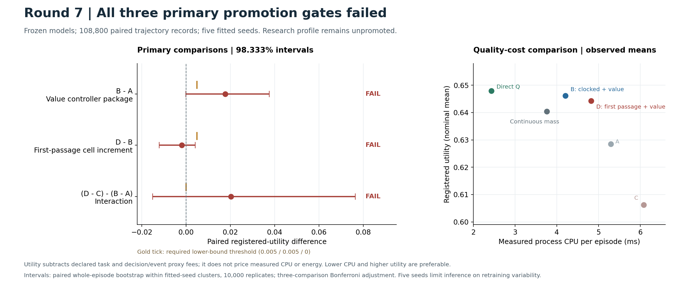

# Hepta Round 7：联合训练、价值控制与完整成本确认报告

**结论：研究实现及本轮确认实验已经完成；本轮不进入 Hepta 主干。** 三种事件合同、联合训练、独立价值参照、配对比较、实际文件执行和证据恢复均形成了可检查的交付。预先规定的三项主要收益门槛全部未通过，首达 cell 的额外收益、数值精度和实际资源优势仍未成立。负结果保留，不根据确认结果更换 checkpoint、删去 seeds 或追加有利样本。

本报告记录 2026-10-31 完成的 Round 7。基础版本为 Round 6 commit `bf88335edc41d40d57d8e84716dd1d2e8cd13a68`。研究分支为 `research/analytic-event-joint-value-20261030-r7`。执行命令见 [REPRODUCE.md](REPRODUCE.md)，独立复核见 [RESULT_REVIEW.md](RESULT_REVIEW.md)，完整证据由 [evidence_bundle](evidence_bundle/) 恢复。



## 1. 五项交付与实际完成范围

| 用户提出的交付 | 已完成的具体内容 | 尚不能据此宣称的结果 |
| --- | --- | --- |
| 三种共同基础、不同事件合同 | 连续投影分布、tick 末阈值发放、有限 CTMC 首达发放；明确 reset、recovery 和重复发放合同 | 连续 OU 首达全过程的精确解、任意步长等价或异步硬件实现 |
| 贯穿内容、动力学和后继的训练 | 60 个注册 fits，内容、漂移/噪声、边界、双侧复位和恢复概率接入训练；每个指定参数组有冻结消融 | 每个可学习组件都有独立任务收益；多层 SNN 已得到验证 |
| 任务价值决定动作边界 | READ / WAIT / REPAIR / STOP 任务；独立 task DP、条件 Qπ 审计、冻结后独立 joint Q* 参考与全部 A_act 表 | 学得 Q 已准确校准；神经电压边界或连续 QVI 已全局最优 |
| 2×2 分离 cell 与控制 | A/B/C/D 同信息配对；连续、直接 Q、温度、硬状态、软动作与 Q24 对照 | 单独识别“规划长度”这一因果因素；所有组训练 CPU 预算相同 |
| 完整质量—成本准入 | 实际答案、动作费用、CPU、事件、字节、短窗口恢复、数值与外部分布变化审计 | 能耗降低、生产优势或主干准入 |

实现是**一个有限状态随机 cell，配合稠密内容 encoder 和动作价值 readout**。15 个电压网格点不是 15 个脉冲神经元；另外有两个不应期状态。训练传播完整的离散概率质量，保留可表示的幅值与不确定性。主要部署从该分布抽取一个幅值/不应期状态后选择动作；完整质量部署是单列的机制对照，不能说所有部署都保留完整分布。

每个 tick 仍执行稠密内容编码与 readout；内部脉冲目前不控制所有计算或工具调用。控制器在 cell 不应期仍可选择外部动作。本轮验证的是有限随机状态与任务控制的结合，不是仅由脉冲驱动的整套 Hepta 运行时。[范围依据：CONTRACT.md](CONTRACT.md)

## 2. 冻结、样本与可复核性

科学输入于 `2026-10-31T02:23:47.523187+00:00` 封存；[FROZEN_MANIFEST.json](FROZEN_MANIFEST.json) 的 SHA256 为：

```text
3cda25b5fc17774e624d590679267066b51a9246072801c53453ee964b2202f0
```

该清单绑定 **108 个输入**，包括源码、协议、依赖的父层模块和 **60 个注册 checkpoints**。冻结协议及全部权重先于确认执行持久化到 commit `e5202c923bbd4dc9f4879d6a95f2baec788eebdf`。确认从 02:28:11 UTC 开始，02:36:43 UTC 完成。后续报告及独立诊断没有修改这些输入。

| 项目 | 本轮记录 |
| --- | ---: |
| 注册训练 seeds | 11、12、13、14、15，共 5 个 |
| 注册模型/消融组合 | 12 种 × 5 seeds = 60 fits |
| 正式成功训练尝试 | 65；其中旧温度实现的 5 个 fits 在确认前排除并保留 |
| 冻结前实现测试 | 45 通过，0 失败、0 错误、0 跳过 |
| Nominal 轨迹记录 | 26 arms × 5 fits × 512 = 66,560 |
| 三种 stress 轨迹记录 | 11 arms × 5 fits × 256 × 3 = 42,240 |
| 合计 | 108,800；运行失败和 guard fallback 均为 0 |
| 独立外部 fixtures | 6,400；各 arm 使用配对后续轨迹 |
| 冻结后独立最优控制测试 | 另计 4 个通过，不追加入原 45 个冻结测试 |

独立复核逐条检查全部原始轨迹的身份、seed、费用和终止合同，并重新计算 59 个 arm 汇总及 23 个 contrasts；与正式统计一致。最大费用核算残差为 `4.44e-16`。108,800 是配对执行记录数，不是独立模型数量；推断保留五个拟合 seed 的簇结构。[统计原始汇总](evidence/confirmation_001/SUMMARY.json)、[确认复核](evidence/audits/INDEPENDENT_CONFIRMATION_REVIEW.json)

## 3. 概率算子、事件定义与 parity

共同连续参考过程为 tick 内冻结输入的 OU 模型：

$$
dX_t=(u-\kappa X_t)dt+\sigma dW_t.
$$

连续与 clocked 模式使用其解析高斯端点分布。clocked 模式将区间外质量映射到对应有符号事件；连续模式将尾部折入最外网格 bin。first-passage 模式对吸收的有限状态上风 CTMC 计算矩阵指数。这对所定义的有限 CTMC 是精确转移运算，对连续 OU 是空间离散近似。[DYNAMICS.md](DYNAMICS.md)

| 合同 | 发放事件 | 发放后的处理 |
| --- | --- | --- |
| 连续分布 | 无事件 | 概率质量在有限幅值网格传播 |
| Clocked | tick 末端点超过上/下边界 | 进入对应不应期状态 |
| First passage | tick 内该 CTMC 首次到达上/下吸收边界 | 留在对应不应期至 tick 末；不导出亚 tick 发放时间 |

tick 开始已处于不应期的质量，以学习到的恢复概率 q 在 tick 末释放到可微的复位分布；本 tick 不能再次发放。新发放质量本 tick 不释放。因此每条路径每 tick 至多一个事件，可跨 tick 重复发放。固定 q 而改变 tick 长度会改变物理恢复时间，不能视为同一物理过程的步长收敛。

对同一到期事件、同一阈值和一致的等号约定，call/put 的归一化二元概率互补。双边界或首达事件需要保留未发放质量：

$$
p_++p_0+p_-=1,\qquad F_+(t)+F_-(t)+S(t)=1.
$$

它们作为同一个状态转移的耦合输出，不使用两个独立 Bernoulli 来假装一个分类分割。概率也不等同于折现价格或任务价值。对互补二元事件，p_call − p_put = 0 只给出概率中点；本轮的动作判据使用包含费用与后续价值的 Q 比较。

本轮没有为 arXiv:2606.16846 增加或复现定理。与抽象函数空间中的 Q 学习能建立何种理论联系，仍需单独说明状态空间、算子正则性、近似误差及事件/复位造成的边界。这里的 Bellman 计算只证明所声明有限模型内的数值关系；它不把标量闭式推广为整个网络的解析解。

## 4. 联合训练实际优化了什么

第一阶段在 256 条公共训练轨迹、64 条开发轨迹上，按内部质量计算逐状态平方预测误差的条件期望，联合学习内容 encoder、drive、活跃动力学参数及两个价值 readout。使用 100 个 Adam epochs，学习率 0.02；仅用开发集选择这一阶段的 checkpoint。

第二阶段枚举全部 8 个 nominal 参数配置的 **738 个公开状态**，与 17 个内部状态构成联合图，进行 30 个固定 Adam epochs，学习率 0.003。返回目标是软动作策略在该有限模型上的精确期望，动作温度固定 0.12；它通过未来状态、复位、恢复和后续动作反向传播。附加 critic 与一步价值目标采用 detached targets，属于半梯度更新。不能把整个复合目标都称为精确 Bellman 梯度。[learning.py](learning.py)、[joint_control.py](joint_control.py)

最终 full head 从 task Q* 蒸馏起步，再朝当前软策略的联合 Qπ 细化；它不是一个已证明精确的 Q* 输出。公开输入中已经包含按已知任务模型计算的贝叶斯后验、期限、预算和成本。此处内容学习是控制特征学习，不是从原始文档学习理解；nominal 新轨迹也不代表未见过的公开状态或未知环境模型。

独立参数审计重建随机初始化，核对所有 60 个 checkpoint。指定冻结组的实际元素变化均为零。60/60 个模型的最终控制阶段软 return 高于开始值，但 41/60 条曲线并非单调；执行既定末 epoch，没有事后挑选控制阶段最好点。首达主模型训练图 soft return 均值从 0.595292 到 0.618138。这证明可训练，不证明部署优势。[TRAINING_AUDIT.md](TRAINING_AUDIT.md)

主事件模型有 823 个可训练标量；温度控制有 824 个存储标量、823 个活跃标量。直接 Q 控制的实际有效容量更小。连续基线的恢复参数在可达状态动力学中不起作用；复位中心仍可能通过不可达不应期槽位的辅助 readout 特征获得梯度。因此，边界/复位冻结测的是参数的总贡献，不能直接拆成单一物理通路的因果贡献。

## 5. 2×2 主要结果：三个门槛均未通过

| | 一步价值 head | 完整价值 head |
| --- | --- | --- |
| Gaussian/probit clocked cell | A | B |
| 有限 CTMC first-passage cell | C | D |

A/B 共用 clocked checkpoint；C/D 共用 first-passage checkpoint。它们是不同部署 head，非四组独立训练模型。full head 直接参与联合回报优化，一步 head 是共享 core 上的辅助任务，因此 B−A 反映这个明确的控制与训练组合，不单独识别“规划长度”。公共信息、训练数据、优化步数和任务合同保持一致；实测训练 CPU 不相同。

注册效用是：

$$
U=\text{终局质量}-\text{任务动作与延迟费用}
-0.0005\,N_{\rm decisions}-0.0002\,N_{\rm events}.
$$

正确答案质量 +1、错误 −1。后两项为预声明的效用代理费用，不是实测 CPU 或能耗价格。主要比较使用 10,000 次拟合 seed/整段轨迹配对 bootstrap，三个比较 Bonferroni 调整后的双侧区间为 **98.333%**。

| 主要 contrast | U 均值差 | 98.333% 区间 | 正向 fit 数 | 注册区间下界门槛 | 结论 |
| --- | ---: | --- | ---: | ---: | --- |
| B−A：clocked 下价值控制组合 | +0.017705 | [−0.000029, +0.037513] | 4/5 | > 0.005 | 未通过 |
| D−B：同一 full 控制下 cell 增量 | −0.001919 | [−0.012061, +0.004177] | 3/5 | > 0.005 | 未通过 |
| (D−C)−(B−A)：交互 | +0.020317 | [−0.015013, +0.076335] | 3/5 | > 0 | 未通过 |

五个 seed 的 t 区间敏感性分析也未通过。交互项受 seed 14 的 +0.107597 拉动，其余四个 seeds 平均为 −0.001503，不能解释为稳定协同。

| Arm | 注册 U | 原任务 return | 答案准确率 | 决策数/episode | 事件数/episode | 实测 CPU ms/episode |
| --- | ---: | ---: | ---: | ---: | ---: | ---: |
| A | 0.628469 | 0.630705 | 84.4141% | 4.0270 | 1.1125 | 5.292 |
| B | 0.646174 | 0.647945 | 84.1797% | 3.1867 | 0.8898 | 4.208 |
| C | 0.606234 | 0.608451 | 83.3594% | 4.0078 | 1.0664 | 6.080 |
| D | 0.644255 | 0.646000 | 84.0625% | 3.1367 | 0.8828 | 4.821 |
| 连续完整质量 | 0.640431 | 0.642114 | 84.1016% | 3.3660 | 0 | 3.757 |
| 直接 Q | 0.647897 | 0.649464 | 84.2188% | 3.1336 | 0 | 2.432 |

B−A 的有利点估计主要来自减少动作与费用，平均答案准确率反而下降约 0.2344 个百分点。D 比 B 的事件和决策略少，但 CPU **高约 14.6%**，U 略低。D 对直接 Q 的在线 CPU 约 **1.98 倍**；因此事件数不构成成本优势的证据。[完整统计](evidence/confirmation_001/SUMMARY.json)

## 6. 消融、部署与 stress：可见信号和未解问题

以下均为**未经主要家族多重比较校正的描述性 95% 区间**，不得升级为确认性发现。

| Contrast | U 均值差 | 描述性 95% 区间 | 可支持的解释 |
| --- | ---: | --- | --- |
| D−直接 Q | −0.003642 | [−0.012319, −0.000137] | 五个 fit 均负，未证明 cell 增益；seed-t 区间仍跨零 |
| D−连续 hard 状态 | +0.005288 | [−0.010030, +0.024624] | 在匹配 hard 部署下事件律增益仍不确定 |
| D_mean−连续完整质量 | +0.004139 | [−0.009764, +0.020481] | 在匹配完整质量部署下仍不确定 |
| D−事件温度控制 | −0.000567 | [−0.002992, +0.000396] | 没有超越匹配参数数量温度控制的稳定证据 |
| D−冻结内容 | +0.015342 | [+0.006629, +0.024242] | 五个 fit 均正，主要涉及策略费用 |
| D−冻结动力学 | +0.003254 | [−0.006199, +0.014939] | 未建立稳定贡献 |
| D−D_mean | −0.000315 | [−0.000585, −0.000101] | hard 抽样状态与完整质量部署略有差异 |
| D−D_soft | +0.021871 | [+0.010922, +0.032732] | 保持 hard 内部状态时，greedy 动作优于本轮软动作 |

噪声、边界、复位、恢复冻结的差值分别约 −0.000042、−0.000014、−0.000738、+0.000033，区间均跨零。不能因它们收到梯度就认定它们提高了任务效果。D 与冻结内容模型的总体答案准确率同为 **84.0625%**；内容的较清晰信号来自动作选择和费用，而非平均准确率上升。

D−D_mean 与 D−D_soft 改变的是不同机制，前者改变内部状态表示/部署，后者改变动作随机性。应分别审计，不能统称一个连续训练到硬部署误差。外部 drift、missing、cost shift 下 D−B 分别为 −0.003023、−0.001753、−0.001780，描述性区间均跨零。[RESULT_REVIEW.md](RESULT_REVIEW.md)

## 7. 价值边界：独立参照已经建立，控制缺陷也被定位

### 7.1 条件 Qπ 审计

5 个 fits × 8 个预声明公开前缀共 40 个状态；119 个合法状态—动作格，每格 64 次条件后续，合计 7,616 次。后续隐藏真值从公开后验重采样，已知证据保持不变，未来证据和内部随机数重新生成，同一前缀的动作比较配对；没有用固定的私有真值冒充条件期望。

learned head 对独立有限图 greedy Qπ 的 RMSE 为 **0.145696**，MAE 0.127377；35/40 个前缀选择的一步动作 regret 为零，平均 regret 0.001194。其余 5 个都在廉价 READ 的 preset 6 初态：所有 fits 选 WAIT，但在相同后续策略下 READ 更有价值。64 次条件抽样的精度有限，不能把它称为高精度 Monte Carlo oracle。[条件审计](evidence/audits/conditional_qpi.json)

冻结后的确定性诊断发现，learned 对 soft Qπ 的 RMSE 仍为 **0.144984**，而 soft 与 greedy 真值之差 RMSE 只有 0.013276。价值数值误差不能主要归因于软训练转 greedy 部署。[校准诊断](evidence/audits/SOFT_GREEDY_CALIBRATION_DIAGNOSTIC.json)

### 7.2 固定 cell 的完整最优控制参照

独立实现另外覆盖 **五种模型各 5 个 checkpoints × 8 配置**，其中包括连续、直接 Q 和温度等次要对照；保存全部 **1,254,600 个 Q 数组槽位**、合法动作 mask、最优动作、A_act 和当前策略占用分布。该计算在确认后执行，明确属于 post-freeze 诊断；没有新训练、模型选择或新增主要假设。

它固定内容/动力学/复位/恢复参数，在同一有限状态过程上优化外部动作，且最优递推**不读取 network Q head**：

$$
Q^*_{\rm after}(s,z,a)=R_{\rm task}(s,a)-c_{\rm compute}
+\sum_{s'}P(s'\mid s,a)V^*_{\rm before}(s',z),
$$

$$
V^*_{\rm before}(s,z_0)=\sum_z T_s(z_0,z)
\max_{a\in\mathcal A(s)}Q^*_{\rm after}(s,z,a)
-c_{\rm event}E_s(z_0).
$$

动作发生在内部状态转移并被观察之后，必须使用 T max Q 的顺序。当前事件费用在 before 阶段支付，after 阶段已是沉没费用；所有未来复位、恢复和事件费用仍进入 Q。

$$
A_{\rm act}=\max_{a\in\{\mathrm{REPAIR,STOP}\}\cap\mathcal A(s)}Q^*(a)
-\max_{a\in\{\mathrm{READ,WAIT}\}\cap\mathcal A(s)}Q^*(a).
$$

该差值只在两组均有合法动作时定义；READ/WAIT 均不可用的状态单列为 forced act，表中 margin 为 null，不纳入二分边界比较；绝对优势不超过 `1e-10` 的 ties 另列。REPAIR 本身也可能揭示信息，因此这只是声明的动作分组，不是互斥的“获取信息/不获取信息”分类。

| 固定 cell | 最优期望 U | learned greedy 期望 U | 最优差距 |
| --- | ---: | ---: | ---: |
| Clocked | 0.653599 | 0.633042 | 0.020557 |
| First passage | 0.653604 | 0.629975 | 0.023629 |
| 连续 hard 状态 | 0.653767 | 0.630536 | 0.023231 |
| 直接 Q | 0.653767 | 0.633481 | 0.020286 |
| 事件温度 | 0.653595 | 0.630170 | 0.023425 |

这里是全部 8 配置等权的精确有限模型期望，不是上表 Monte Carlo 确认均值，不替换冻结主要检验。差距既可能含函数类/表示限制，也可能含训练与近似问题；尚未单独识别原因。

最清楚的失败是 preset 4：期限仅 2 ticks、无 READ 预算、延迟证据到 tick 2 才抵达。STOP 使用提交前已知证据，等待不能提高答案；最优初态应 STOP。**全部 25 个 checkpoints 在可达初始内部状态上均选择 WAIT**，白付等待费用。preset 7 则常在延迟证据到达后过早 STOP，忽略仍有价值的后续 READ。还有 READ/WAIT 同组内浪费预算的错误，所以仅检验 act/continue 的二分类边界不足。

独立四项测试覆盖显式隐藏世界枚举、STOP 费用和因果顺序、readout 独立性、重复事件以及 reset/recovery 的未来影响。200 个配置单元的占用分布 regret 总和与初态最优差距恒等式误差，以及另一独立复核的重算误差，均低于 `3e-16`。这解决了“有何独立价值参照”的问题，但没有证明 learned 边界正确，更没有求得连续扩散 QVI 或最优神经电压边界。[独立源码](posthoc/independent_joint_optimal.py)、[全部摘要](evidence/JOINT_OPTIMAL_DIAGNOSTIC.json)、[独立复核](evidence/audits/INDEPENDENT_JOINT_OPTIMAL_REVIEW.json)

## 8. 数值精度：概率质量正确不等于连续模型正确

11 个数值诊断门槛中 **4 个通过、7 个失败**。这些阈值在探索角落案例后声明，是诊断而非预注册统计检验；失败原样保留。[numerical_audit.json](evidence/numerical_audit.json)

首达上风 CTMC 的局部有效方差率为：

$$
\sigma^2_{\rm eff}=\sigma^2+|\mu|h.
$$

额外项是空间离散引入的数值扩散。学习后 checkpoints 在所测公共 replay 上，N=15 时额外方差/学习噪声方差的平均比约 **0.829**，N=63 仍约 **0.206**。保持学习参数不变，从 N=15 加密到 N=63，在两个短配置的公开 DAG 上、从零电压出发的单步正/负事件概率，最大绝对改变 **0.09567**；N=63 也不是连续真值。这显示事件动力学对网格分辨率有实质敏感性，不能用短任务 return 稳定来掩盖。

低噪声 Brownian 子例中，真实单上界命中概率约 `4.32e-6`，N=63 的首达近似仍约 0.133。固定网格下将 dt 变小，端点投影还可几乎冻结方差；固定恢复 q 则改变物理恢复时长。当前 `torch.special.ndtr` 在极小尾部有取消误差；非高斯内部噪声只匹配一二阶矩不足以保留尾概率。确认过程中没有替换数值实现以隐藏这些失败。

连续基线也有实质近似：所测 replay 的端点尾部折入边缘 bin 的概率平均约 **42%**，不能当作无约束连续高斯状态。网格迁移诊断仅覆盖两个短配置与共同公开 replay；虽然回报差异小，不能据此宣称所有任务收敛。[学习后网格诊断](evidence/checkpoint_resolution_summary.json)

## 9. 实际成本、量化、恢复与 native 边界

正式 65 次训练的 inclusive batch CPU 合计 **2,126.195 秒**，包含被排除的五次旧温度训练；wall job-seconds 合计 3,622.734，因为并发执行，不能当作 elapsed makespan。单 fit epoch CPU 只是其中的部分，D 均值约 44.480 秒，B 约 6.158 秒，不能重复加到 batch 总数。早期六次 smoke 和前置失败缺完整进程计时，成本未知而非零；解释器启动、历史 native 编译也单列排除。[开发账本](evidence/DEVELOPMENT_LEDGER.json)、[训练审计](TRAINING_AUDIT.md)

主要确认执行 wall 511.301 秒。每 episode 的在线 timing 包含实际路径上的预测与决策，不包含外层 fixture 生成、Policy 构造与 checkpoint 载入；这些计入 whole-run receipt。另有 CDF、矩阵指数、编码、readout 微基准，嵌套计时不能相加。没有测量能耗，效用代理也没有将 CPU 时间自动换算成货币成本。[COMPONENT_PROFILE.json](evidence/COMPONENT_PROFILE.json)

| 工程检查 | 实际结果 | 解释边界 |
| --- | --- | --- |
| Q24 对完整浮点质量部署 | nominal B/D 各 2,560/2,560 条完整动作序列、答案、终态相同；D 三个 stress 各 1,280/1,280 相同 | 浮点执行中的 Q24 投影，不是 native 整数实现；质量向量不逐 bit 相同 |
| 实际 broker 执行 | 16 episodes、51 动作：READ 6、WAIT 25、REPAIR 4、STOP 16；0 fallback | 有限证据任务的实际文件操作，不是开放域代码修复 |
| 终局文件独立读回 | 16/16 SHA 一致 | 验证写入/读回，不向 native 暴露隐藏真值 |
| 短窗口策略恢复 | 35/35 动作、mass、Q 和状态 hash 完全一致 | 冻结权重的短期策略状态，不包括 optimizer/整个 worker 恢复 |
| 实际 JSONL 运输 | 请求 8,155 bytes，响应 95,995 bytes | 不等于仅内存编码的 policy packet 指标 |
| 实际 native bridge | 48 子进程调用、80 个原 sparse ticks；声明检查全部通过 | 复用历史 binary，没有安装 Round 7 动力学或权重 |

Q24 全域最大 U 差仅 `2.04e-11`，来自期望事件费舍入，最大同阶段 mass 差约 `1.04e-7`。35 个 snapshots 共 5,950 bytes，读取/恢复累计约 2.603 ms。这些是已测路径上的工程结果，不是任意长期运行保证。

native bridge 使用 SHA256 `b519cae26325f818d9596aab34504490a0b5355b9eb633369878e6f07a50e179` 的历史可执行文件。输入是明确声明的公开后验高斯代理，不是 learned Round 7 分布。typed 输出全部保持 `DENY_ALL`、abstain、未校准状态。typed journal 与后续 sparse feedback pair 是不同状态路径，后者没有更新前者的持久 owner。bridge wall 109.796 ms；父/子进程 CPU 分别 33.494/30.350 ms。

本轮没有修改 Rust，没有 fresh build；`just fmt` 因 `just` 不可用返回 127，未运行新 Rust tests。Python 实现测试不替代 native 构建资格。[native 汇总](evidence/native_bridge/SUMMARY.json)、[native 独立复核](evidence/audits/INDEPENDENT_NATIVE_REVIEW.json)、[环境记录](evidence/ENVIRONMENT.json)

## 10. 下一轮应怎样推进

**优先修复价值判断和数值合同，再扩大 neuron 架构。** 以下是下一轮建议，不属于本轮已验证结果，也不回写已封存的研究。

1. **把独立 joint Q* 的失败状态变成控制器开发集。** 优先覆盖“证据来不及用于提交”“等待与读取的相对成本”“为后续修复保留预算”“延迟证据到达后继续取证”四类。分别量化完整动作 regret、act/continue regret、合法动作优势误差与占用加权误差。先修普通/直接 Q 控制器，再与 cell 版本比较；不能只修二分类边界而保留 READ/WAIT 的同组错误。
2. **建立满足明确误差目标的事件与后继实现。** 对低噪声和非零漂移选用可验证的吸收转移近似，分别控制概率、条件后继矩和梯度误差；空间与时间联合加密。以物理恢复率或恢复时间定义恢复合同，再做 dt 比较。修复尾部数值稳定性，并给连续状态的边界截断制定独立误差预算。新实现要新版本、新协议，不能替换本轮失败记录。
3. **匹配优化机会与完整资源预算重做强对照。** 保留直接 Q、连续完整质量、Gaussian/probit clocked、首达及温度控制；增加分别优化的一步/完整控制组，使 2×2 更清楚地区分策略与共享训练因素。除相同数据/步数外，增加相同 CPU 预算与容量控制，预先声明质量非劣界和成本收益门槛。
4. **再迁移到真实 Hepta 多窗口任务。** 用实际证据内容、工具返回、修复结果及跨窗口状态取代已知有限任务的充分后验特征；冻结公共前缀，构造可审计的配对后续。扩大保留与恢复窗口，验证实际部署的事件后继。若要宣称脉冲省计算，必须让事件确实跳过编码/readout/通信并测出其成本，而非仅计事件数。
5. **通过新的独立确认后才考虑 multicell/native 主干接口。** 先封存新协议、全部 checkpoints 和样本数，再生成全新的确认随机命名空间。以相同信息强对照下的稳定净收益、连续/离散合同误差、硬部署退化和资源账为准入依据；不能靠更多 seeds 追到某个显著结果或事后调整主要 comparison。

## 11. 发布与复现索引

- [README.md](README.md)：入口、范围和源码地图。
- [REPRODUCE.md](REPRODUCE.md)：从分片恢复、验证 seal、重放、审计及新研究的区别。
- [FROZEN_MANIFEST.json](FROZEN_MANIFEST.json)、[PROTOCOL.json](PROTOCOL.json)：冻结输入与注册比较。
- [TRAINING_AUDIT.md](TRAINING_AUDIT.md)、[RESULT_REVIEW.md](RESULT_REVIEW.md)：训练参数与独立结果复核。
- [confirmation summary](evidence/confirmation_001/SUMMARY.json)：完整 arm、contrast、费用和计时汇总。
- [joint optimal diagnostic](evidence/JOINT_OPTIMAL_DIAGNOSTIC.json)：固定 cell 最优控制与全部表的哈希索引。
- [evidence_bundle](evidence_bundle/)：完整原始轨迹、失败记录、checkpoints、文件/native 轨迹及历史可执行文件的分片归档。
- [BUNDLE_VERIFICATION.json](BUNDLE_VERIFICATION.json)：离线完整恢复检查。
- [EVIDENCE_PUBLICATION.json](EVIDENCE_PUBLICATION.json)：远端发布完整性检查。

**本轮的完成标准是把假设变成可训练、可比较、可反驳、可恢复的研究结果。结果没有达到主干收益门槛，因此交付研究分支并保留全部负证据；不激活生产 Hepta neuron。**
