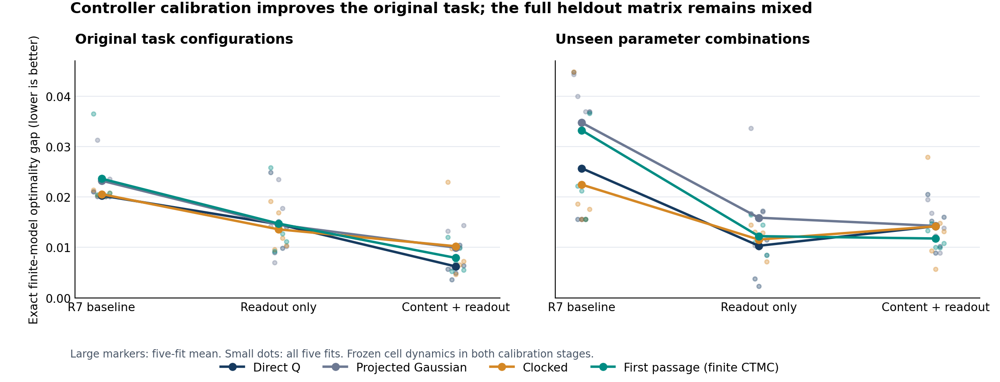
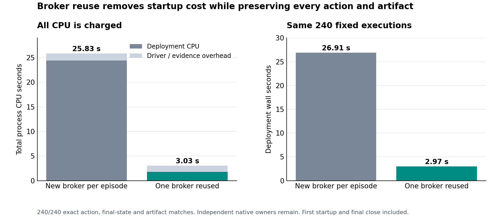

# Hepta 解析事件神经元：五项执行结果

本轮完成了共同内容下的事件合同交换、固定 cell 的控制校准、完整 cell 联合学习、独立数学与部署核验、真实 Rust owner 执行，以及按实际瓶颈得到的成本改进。**主确认尚未建立首达 cell 超过强普通策略的额外净收益；追加的完整联合训练提高了训练回报，但新留出上的平均回报下降。** 数学核、训练过程、任务收益和工程资格分别记录，避免由其中一项通过推断其余各项也已成立。

原始 R7 输入固定于 `1bbf9712140ec388f7fb7967fa7b22244386441d`，原文件和检查点保持原样。本轮主协议、全部候选与实际执行的身份由 [PROTOCOL.json](PROTOCOL.json)、[FREEZE.json](FREEZE.json) 和 [BASELINE.json](BASELINE.json) 绑定。主冻结已在远端 commit `96270fb1c3d153f0fe48c996d6f7b0b4cede34ef` 发布，随后才执行新的确认世界。

## 1. 统一合同、内容、时钟与预算

对三种来源的原始模型、每种五个 fit，固定编码器、drive、读出及共同物理参数，只交换终点投影、时钟越界和区间首达合同。原 R7 有限过程与新的共同 Brownian 过程各运行 45 个案例，共 **90 个精确有限模型比较**。每个案例穷举同一任务的 738 个公开状态及全部潜在状态。

新的 Brownian 三臂共同采用 leak=0；它们与原 R7 的 OU 参数模型之间包含过程模型变化。跨这两组的差异不能全部算作数值修复收益。

固定读出后的 FPT − clocked 平均任务效用差如下，每格平均五个 fit：

| 固定 anchor 来源 | 原 R7 finite law | 共同 Brownian law |
| --- | ---: | ---: |
| Continuous | −0.000454 | −0.000158 |
| Clocked | −0.000204 | +0.000023 |
| First passage | +0.000158 | −0.000035 |

差异很小，方向随 anchor 改变。较大的 clocked − continuous 差异也依赖训练该读出的原机制：clocked anchor 约为 +0.0056，continuous anchor 约为 −0.0018。这支持读出与机制的适配效应，尚不支持普适首达优势。所有 raw occupancy × action regret 已独立复算，最大不一致约为 $10^{-16}$。[完整交换结果](evidence/contract_exchange_v1/summary.json)、[独立复核](FINAL_INDEPENDENT_REVIEW.md)。

另加真正无界的 Gaussian 状态传播，使用同一内容网络和在实际电压、原始二阶矩处的读出，不把电压裁回格点。mean 读出采用 48 阶 Gauss–Hermite 求积；独立开发数据上与 96 阶比较，693 个共同前缀的最大 Q 差为 $4.44\times10^{-16}$，160 条动作序列相同。该控制是共同读出的机制干预，没有单独训练一个最优无界 Gaussian 模型。

Gaussian 与 probit 对照保持严格等价：主确认的 **2,560 对完整轨迹**在 Q、动作、状态矩、终点概率和回报上全部一致，最大 Q/回报差均为零。不能将这两个名称当成两个独立架构来累积样本量。[求积核验](evidence/calibration_gaussian_quadrature.json)、[主确认分析](evidence/confirmation_analysis.json)。

## 2. 内容信息、读出与优化分别在哪里

当前任务公开输入已经包含精确贝叶斯后验、剩余时限、预算、可靠性和费用。内部随机 cell 的转移只依赖这些公开输入与独立随机数。在这一任务中，cell 不会凭空产生额外外部内容信息。

这一判断可以写成有限任务的结构结论。设无事件费用的最优外部价值为 $v^*(s)$。因为公开状态充分，而内部转移行和为一，倒推可得

\[
Q^*(s,z,a)=q^*(s,a),\qquad V^*(s,z)=v^*(s).
\]

实际把 event price 置零后，90 个交换模型的最优期望最大差为 **$5.44\times10^{-15}$**。本任务最长 6 tick、每 tick 最多一次事件，事件费为 0.0002，因此不同 cell 对最优值的收费影响上界为 **0.0012**。更大的已训练策略差异包含表示、拟合或优化误差，不能解释为新增内容信息。[结构审计与训练合同](CONTROL_CONTRACT.md)、[控制审计源码](calibration_audit.py)。

### 固定 cell 后，同等修复四类控制器

为每个固定 cell 独立求完整四动作 $Q^*$，先训练 readout 400 步，再训练 content/readout 400 步；四类模型、五个 seed 完全同程，保存固定最后一步，没有按留出结果选择模型。

R7 的 content 同时进入 drive 和读出，所以第二阶段增加独立冻结的 `kernel_content` 分支。传播 encoder、drive 和 core 始终保持原样，Q* targets 因而不会在训练中失效。它的名称是 content/readout 联合校准，完整开放 cell 参数的训练另见第 8 节。

原八种配置的精确有限模型最优性差距如下，越小越好：

| 模型 | 原 baseline | 只训练读出 | Content/readout |
| --- | ---: | ---: | ---: |
| Direct Q | 0.020286 | 0.014599 | **0.006234** |
| Projected Gaussian | 0.023231 | 0.014516 | 0.009959 |
| Clocked | 0.020557 | 0.013581 | 0.010236 |
| First passage，R7 CTMC | 0.023629 | 0.014727 | 0.007927 |

20 个 fit 共耗用约 100.016 进程 CPU 秒，保存 60 个阶段检查点、全部目标数组、训练曲线与独立 DP 审计。60 份检查点从保存字节重新加载复算全部通过。原 R7 权重完全保持。[训练汇总](evidence/calibration_summary.json)、[保存后复算](evidence/calibration_replay_audit.json)。

收益不是单调的：direct seed 11 的 weighted RMSE 从 0.15731 降至 0.07281，实际 greedy gap 却从 0.02109 上升到 0.02490；clocked seed 11 的最终 gap 也差于 baseline。Preset 4 的立即 STOP 在最终 direct 五个 seed 上全部修复，其余家族仍有残余 WAIT；preset 7 的差距缩小但没有消失。

因此，原有差距包含能修复的优化问题；降低预测 MSE 本身不保证改善动作。原始长文本的内容寻址能力仍需要不同任务验证，因为这里的输入已经提供了充分后验。mean 与 hard 的比较也涉及策略变化和非线性期望，不能仅凭回报差断定是哪一个信息通道丢失。

## 3. 完整后继、独立积分和梯度

新 `r8-brownian-images-v1` 使用双吸收边界的 Brownian killed-density image sum，保留所有 surviving bins、两侧事件、reset jitter 和恢复后继。Gaussian 尾部使用稳定区间运算；同 strike 的两侧概率互补，双阈值则保留 idle。

| 数学核验 | 结果 |
| --- | ---: |
| Killed-bin 概率与独立谱密度积分 | 最大误差 $4.03\times10^{-16}$ |
| 首达概率与独立边界通量 | 最大误差 $2.23\times10^{-16}$ |
| 低噪声角落：\(\mu=1,\sigma=.05,b=1,t=.8\) | $4.3218260067306315\times10^{-6}$ |
| 低噪声角落对独立参照的误差 | $5.93\times10^{-21}$ |
| 三步、每模式 343 完整叶路径的期望核对 | 误差不超过 $5.56\times10^{-17}$ |
| 完整非线性路径损失的自动梯度与有限差分 | 最大差 $5.12\times10^{-10}$ |
| Gaussian/probit、同 strike 互补、极尾、恢复 cohort 等数学 gates | 9/9 通过 |

[完整数学审计](evidence/kernel_audit.json)、[公式与过程合同](KERNEL_CONTRACT.md)。初次审计 payoff 曾隐式经过 FP32，已修为 FP64，并保留 [初始记录](evidence/kernel_initial_audit.json)。概率核公式没有为追赶审计而改动。

冻结后的范围诊断又覆盖 **166,050 个完整活跃后继行**：image order 12 与 24 在 FP64 中 entry 差为零；45 个选定条件与 80 位算术的最大差为 $6.66\times10^{-16}$。这核查了实际 anchor 范围的级数截断，不能替代投影误差分析。[范围审计](evidence/kernel_range_audit.json)。

投影负诊断仍然存在。四个子步下，N=15→127 的事件误差从 $5.60\times10^{-4}$ 降至 $4.24\times10^{-5}$；固定 N=31 而细分到 16 步时，反复投影使误差增到约 $1.70\times10^{-3}$。减小步长本身不保证正确。

恢复采用 \(q(\Delta t)=1-e^{-\lambda\Delta t}\)，保持原始 refractory cohort 的物理存活率一致。释放仍在 tick 末发生，rounded release delay 随 tick 改变；新事件本 tick 冻结，每 tick 最多一次。这是明确的离散合同，连续 OU 首达和连续再生多次发放仍需另行实现。

## 4. 新确认、精确期望与强普通策略

主确认执行 **36 arms × 5 fits × 2 regimes × 128 worlds = 46,080 条记录**，零运行失败，零 guard fallback。每个 regime 的实际独立外部世界是 **640 个**，各 arm 配对复用。确认约用 205.66 进程 CPU 秒。

同一固定模型在新的八种留出参数组合上，精确有限模型回报如下，越大越好：

| 模型 | Baseline | Readout only | Content/readout |
| --- | ---: | ---: | ---: |
| Direct Q | 0.637882 | **0.653249** | 0.649370 |
| Projected Gaussian | 0.628843 | 0.647687 | 0.649304 |
| Clocked | 0.640963 | 0.651860 | 0.649227 |
| First passage | 0.630198 | 0.651187 | 0.651648 |

FPT 最终阶段比 direct 最终阶段高约 0.00228，但预先注册完整矩阵中的 direct readout-only 仍更高。不能只展示有利的阶段切片，也没有据此重新选择权重。[精确留出表](evidence/heldout_exact.json)。

### 抽样结果与精确期望的反号被保留并检查

| 留出对比 | 注册 MC 均值 | 同一模型精确期望 | 条件配对世界 MC SE | 偏离 / SE |
| --- | ---: | ---: | ---: | ---: |
| FPT final − direct final | −0.015766 | +0.002278 | 0.011338 | −1.59 |
| FPT final − clocked final | −0.004867 | +0.002421 | 0.014449 | −0.50 |
| FPT final − FPT baseline | −0.011853 | +0.021451 | 0.016398 | −2.03 |

注册的六个 primary interval 没有建立正向优势。FPT/direct 留出对比的五个观测 block 都为负，因此只重采样这五个数得到的 99.166667% 区间也全为负：约 [−0.026354, −0.004580]。该 block SE 仅 0.004608，明显小于条件配对世界 SE 0.011338。增加 bootstrap 次数无法补足五个已观察 block 的支持范围。

上述反号不能被删除，也不能直接外推成架构定论。条件世界 SE 是冻结模型下的抽样诊断，不是新的主检验，也不代表训练 seed 不确定性。所有注册结果、五个 fit 差值和后续诊断共同保留。[主分析](evidence/confirmation_analysis.json)、[MC 分解](evidence/final_mc_decomposition.json)。

为排除实现错配，独立重放了 **159,462 次外部任务转移**，并核对全部 60 模型、7,680 条留出 hard 轨迹中的 **25,877 次内部转移**。用 DP 矩阵和独立重构的 SHA/inverse-CDF 随机键得到的潜态、动作、事件费用和下一状态全部相符；独立策略递推与全部 60 个 exact return 的差为零。最大 Q 差 $8.05\times10^{-16}$，最大事件概率差 $2.11\times10^{-15}$。[逐步独立核验](evidence/final_independent_audit.json)、[实际策略与 DP 对应](evidence/final_policy_dp_parity.json)。

## 5. Rust 接入与真正的恢复边界

Rust 在真实 `NeuronModelPort::execute` 中运行内容网络、drive、完整 R7 finite kernel、状态采样及 learned readout，使用原 `NeuronRuntime` 的 sparse tick、journal 与 witness。原 R7 Broker 执行 Rust 选出的 READ/WAIT/REPAIR/STOP，读取和修复实际文件，提交并独立读回终端产物。

| 工程资格 | 结果 |
| --- | ---: |
| 原 `just test` → nextest | 4/4 Rust tests 通过 |
| 原始及校准候选 | 60 |
| 配对资格案例 / 实际 Broker 执行 | 240 / 480 |
| 真正冷进程恢复 | 225/225 |
| 最大 Rust/Python Q 差 | $9.44\times10^{-15}$ |
| 最大 mass / moments 差 | $6.88\times10^{-15}$ |
| 身份、版本和恢复拒绝检查 | 11/11 |

其余 15 个案例第一次动作就是 STOP，没有计作恢复。冷恢复不仅动作相同，浮点状态、native checkpoint 和 paired digest 也一致。恢复范围是已确认的策略决定边界，原 Broker 继续存活；完整业务 owner 的任意崩溃原子恢复尚不在此资格中。

严格区分 checkpoint schema 和 kernel version，未知版本、缺失传播 encoder、额外 tensor 等均拒绝。新 Brownian/checkpoint 不能被静默当作旧 R7 kernel 加载。原生资格为 **`r7-finite-v1`**，其有限 CTMC 正确性不等于连续 OU 精度已经解决。[Native 合同](NATIVE_CONTRACT.md)、[资格报告](evidence/native_validation01/REPORT.json)、[独立核审查](KERNEL_NATIVE_REVIEW.md)。

本轮新 Rust application 实际编译，链接经过身份记录的已有原 Hepta 静态库；这属于 cached-artifact rustc build。原库 source identity、依赖 artifacts、编译器、命令、最终 source/binary hashes 均有记录。最终 `NEXTEST_FINAL.json` 对应 build03；历史 build02/初次失败记录保持原样。

## 6. 依据实测瓶颈缩减真实成本

先运行 240 次不带逐步 PyTorch comparator 的真实部署，分列 encode、CDF/CTMC、propagate、sampling、readout、native runtime、paired persistence、IPC、startup/recovery、Broker 文件读写和总 CPU。

每任务重新创建 Python Broker 是主要成本，模型内部运算只占小部分。单个不重启执行中，native 通常用约 3.1–4.9 ms CPU；每次 Broker 启动约 86–102 ms CPU。模型内阶段的 wall 时间典型量级为 direct 10–25 μs、Gaussian 50–98 μs、FPT 336–515 μs。

因此只复用原 Broker 进程，保持原 240 项顺序、世界、模型、native 重启安排；每个 episode 的 native owner 仍独立：

| 成本口径，240 次执行 | 每任务新建 Broker | 复用一个 Broker | 变化 |
| --- | ---: | ---: | ---: |
| 部署 parent + native + broker CPU | 24.389180 s | **1.752554 s** | **−92.814%** |
| 部署 wall | 26.909963 s | **2.973717 s** | **−88.949%** |
| 含 driver/检查/证据序列化的 campaign CPU | 25.833095 s | **3.029266 s** | **−88.274%** |
| Broker 进程数 | 240 | 1 | 避免重复启动 |
| Native 进程数 | 345 | 345 | 保持任务与恢复合同 |
| 动作、最终状态、终端内容及 SHA 相同 | 基线 | **240/240** | 质量、预算和收费一致 |

首次真实任务承担 68.56 ms Broker 启动等待，最终 close 也计账，没有丢弃 warmup。该收益来自进程生命周期改进，不能解释成脉冲更少、核更快或能耗降低；对于本来就长期复用进程的系统，也不能直接外推同一百分比。重叠的 wall 阶段没有被相加冒充 CPU。[冷运行成本](evidence/native_cost01/REPORT.json)、[复用成本与一致性](evidence/native_reuse_cost01/REPORT.json)。

## 7. 对数字期权、call/put 与 Hepta 的影响

同一 strike、同一条件 Gaussian 状态下，call 与 put 应共享参数，并作为同一个概率分割的两个互补输出：\(p_{call}+p_{put}=1\)。金融价格形式再乘贴现因子；神经元的概率与任务效用各自保持自己的单位。

两个阈值之间有 idle，应满足 put + idle + call = 1；双边首达则有 survival，应满足 upper-hit + lower-hit + survival = 1。后两者不能套用同 strike 的二元互补式。实现已经保留这些分割，不需要用两套独立可训练网络去重新学习互补关系。

因此，欧式数字期权解析式可作为可微概率算子；Gaussian 终点下它与 probit 严格等价。需要研究的增量来自它与时间、完整条件后继、首达、复位、恢复、控制和成本的组合。

当前实现规模是一颗分布状态 cell 加小型内容编码器和四动作控制器。15 个活跃网格点是这颗 cell 的状态离散，不是 15 颗独立神经元。多层、多 cell 大型 SNN 与原始长文本内容寻址尚需新证据。

关于最初提到的 Hölder 空间 Q-learning 思路，本轮提供的是有限任务的算子、正则化参数域、完整后继微分和部署证据。把相关收敛理论迁移到新状态空间、吸收边界、reset 原子及训练算法，仍须逐项核对假设。第 8 节的完整期望策略优化也不被命名成 DQL 收敛验证。

## 8. 完整开放 cell 参数的独立联合训练

该实验在主确认已被检查之后单独注册，使用原 R7 的固定 30 步预算、四组新的留出配置与独立世界种子。它不会改写前述主终点或选择主确认中的候选。

它开放所有有效的 content、drive、diffusion、boundary、reset、recovery 和 readout 参数，只优化与实际 `hard_soft` 部署相同的完整随机动作策略期望回报。没有静态 Q* 回归、straight-through 梯度或辅助 critic 损失。原始 Q 头输出此时作为 policy scores，不再宣称是已校准 Q 值。

协议和完整源码先发布于 `385a9621410e4d6dea4214510db804ae6bcba2b3`。所有 20 个固定预算 fit 的 40 份 initial/final 权重及训练报告在 `f53e4891b0a66f831c32b6b989367c73f715a62a` 冻结，之后才评价新留出。四类模型各五个 seed、每个 30 次 Adam 更新，维持 N=15；600 次相邻训练更新均提高注册目标。

下表都是五个 fit 的精确有限过程均值，soft 与 greedy 分别计算：

| 模型 | 训练 soft 回报变化 | 新留出 soft 回报变化 | 新留出最终 soft | 新留出最终 greedy |
| --- | ---: | ---: | ---: | ---: |
| Direct | +0.014478 | −0.001328 | **0.706464** | **0.706717** |
| Projected Gaussian | +0.014282 | −0.001978 | 0.706273 | 0.706516 |
| Clocked | +0.013808 | −0.001095 | 0.705989 | 0.706155 |
| First passage，Brownian | +0.014032 | −0.001478 | 0.706184 | 0.705746 |

FPT − direct 的最终留出 soft 差为 −0.000279835；greedy 差为 −0.000971019，五个 fit 都为负。FPT − clocked 的 soft 差为 +0.000195490、seed 方向混合，greedy 差则为 −0.000409062。这些是追加实验的描述性结果，没有重新定义主检验或挑选有利部署策略。四类模型的训练预算相同，不代表已经穷尽超参数或可达性能。

完整训练留下 600 个梯度向量。独立审计核对 490,650 个有限梯度标量，并仅凭这些梯度重新执行 Adam 代数，将最终参数重建到最大误差 $3.33\times10^{-16}$。未参与计算的参数、buffers 和 head 0 输出层参数行保持原字节；共享 hidden readout 会变化，因此 head 0 的实际前向分数可能改变。个别 clocked reset 梯度只有约 $10^{-21}$ 或 $10^{-17}$，不能因梯度路径存在就声称这些分支实质上学到了有用行为。

另执行 2,560 条配对 Python `hard_soft` 轨迹，零运行失败，四类模型的世界、latent seed 和配置配对全部一致。每 fit/regime 仅 32 个世界，这是实现核验规模；其小样本回报与精确期望可反号，不用于替代精确留出结果或宣布优势。独立抽取预先指定的 64 条新留出路径、210 个步骤重放，score 与最终效用误差均为零；覆盖 39 次事件、23 次恢复释放、4 次不应期保持和 14 次事件后立即 STOP 的收费。[联合部署独立审查](JOINT_DEPLOYMENT_REVIEW.md)。

训练全过程 CPU 分别为 direct 6.207 s、Gaussian 13.164 s、clocked 15.843 s、FPT 132.701 s。FPT 进程内部峰值 RSS 约 1.78 GiB。首个完整图更新 wall 为 1.748 s，独立丢弃模型重放得到相同 update-1 utility；外层 namespace PID 的 `/proc` 内存观察被明确标为无效，采用进程内部 RUSAGE 记录。各进程 wall 不能相加当作并行 makespan。

这一步确认了完整目标的可训练性，并暴露了固定 nominal 预算下的泛化问题。它没有给出推动新 Brownian kernel 默认原生部署的收益依据；新 schema 与已经合格的 `r7-finite-v1` 继续分开，旧 Rust 加载器明确拒绝新 schema。[JOINT_PROTOCOL.json](JOINT_PROTOCOL.json)、[JOINT_REPORT.md](JOINT_REPORT.md) 和 [全部描述性结果](evidence/full_joint_v1/SUMMARY.json) 给出完整执行记录与独立身份。

## 9. 可审查交付与决策

主确认原始数据采用无损分片，恢复验证重建了 8,724 个原始文件；所有检查点、详细训练曲线、完整轨迹、owner journals、真实 Broker 文件和失败开发记录均保留。Native executable 另有验证过的 Linux x86-64 bundle，clone 后可按 [恢复入口](native/README.md) 执行，无需旧 scratch 绝对路径。完整命令见 [REPRODUCE.md](REPRODUCE.md)。

本轮可直接采用的工程改进是严格的算子/参数版本、完整概率后继、部署与训练一致性核验、真实 owner checkpoint，以及保持行为一致的 Broker 生命周期复用。首达 cell 保持研究候选；下一阶段辨别其额外价值，需要去掉直接供应精确后验的捷径，在原始内容、受限记忆和真实预算任务中与同等资源的强普通策略比较。数学核通过、训练可行与实际任务优势是三项独立证据。
