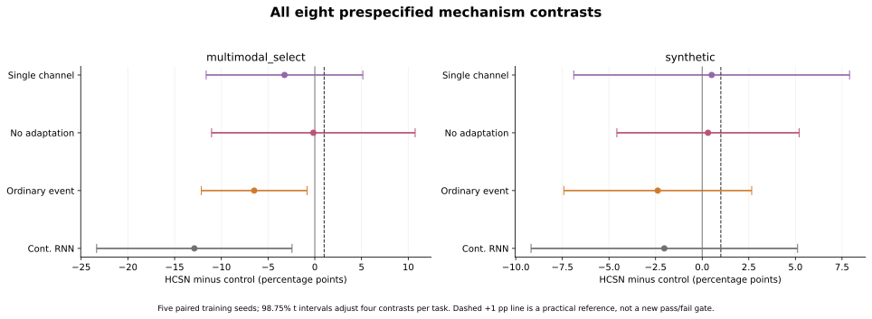
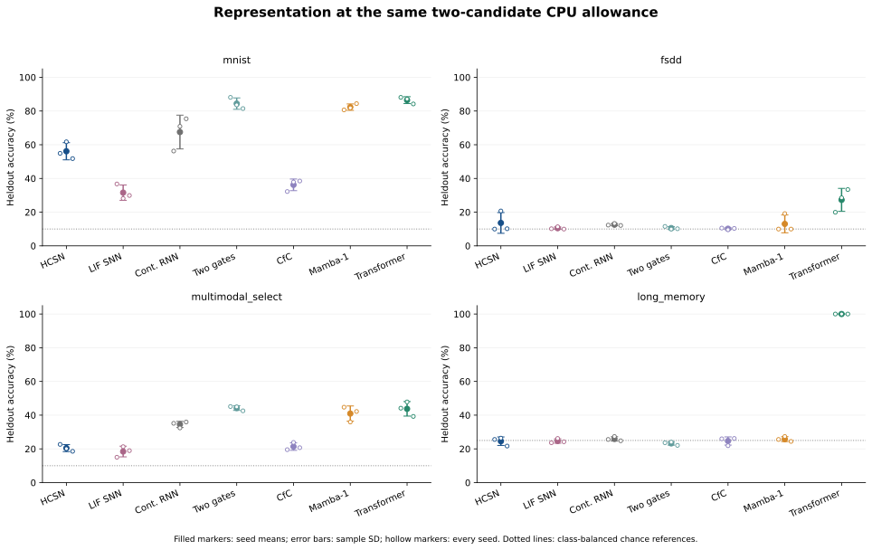
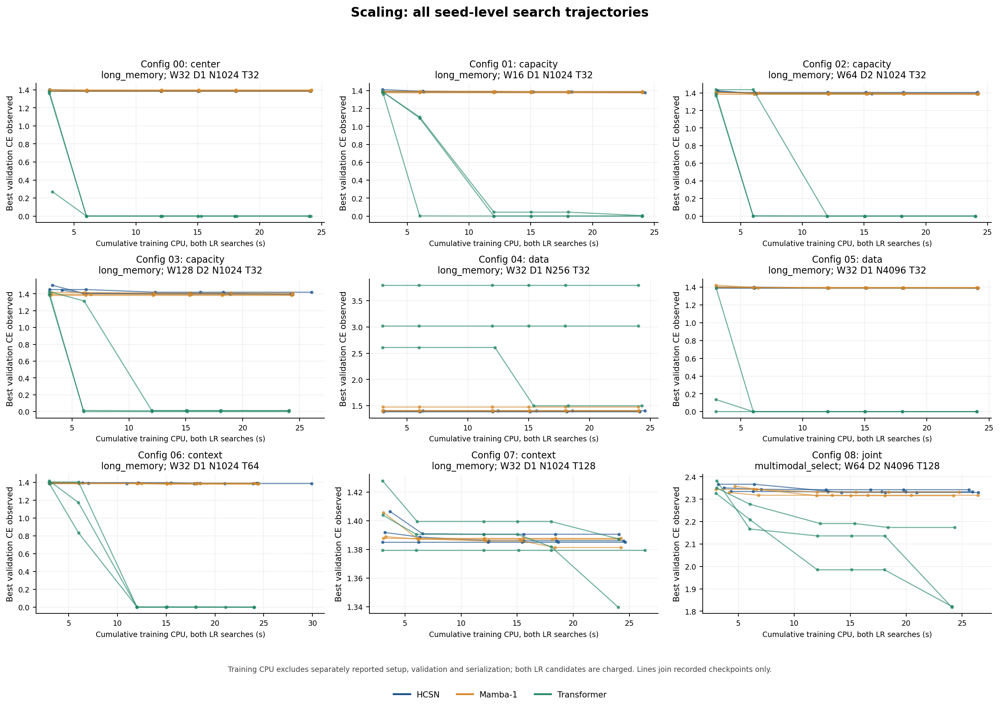

# HCSN study002：计算预算、真实早停与流式执行的完整比较

本轮已完成 **215 项训练搜索、430 个学习率候选、5 组边界实验、55 组流式测量**。完整执行和独立核验支持三个判断：当前 HCSN 可以训练、可以逐步执行、可以把连续决策量交给 Hepta 原生 owner 实际消费；在本轮短 CPU 预算内，它没有显示出相对普通门控、参数接近的连续 RNN 或优化 Transformer 的综合优势；任务价值边界也没有显示出相对固定或直接学习阈值的统计优势。

这是一组小型分类与时序控制实验。最大 HCSN 为 **274,820 参数**，全部模型中的最大值为 **405,892 参数**，最长序列为 **128 步**，训练集最大为 **4,096 个 episode**。它尚未检验全模态基础模型、语言生成、GPU 融合内核或神经形态能耗。

模型定义与数据生成器来自不可变的 study001 提交 `23c98e77e4d2cc98e8c32caf7db763bc85c6794b`；本轮用新种子重新生成 episode，并复用相同的原始数据总体。新的计算预算、在线执行与审计独立保存于本目录。全部结果表见 [COMPARISON_TABLES.md](results/study002/analysis/COMPARISON_TABLES.md) 和 [ONLINE_TABLES.md](results/study002/analysis/ONLINE_TABLES.md)。大文件的原始字节及恢复方式见 [审计归档说明](results/study002/analysis/audit_archives/README.md)。

## 1. 四层工作完成了什么

| 层次 | 正式执行 | 可以回答的问题 |
|---|---|---|
| 双通道机制 | 2 个任务 × 5 种结构 × 5 个训练种子，共 50 项搜索 | 恢复、再生、适应与内容共同训练后，是否优于单通道、无适应、普通事件门控和参数接近的连续 RNN |
| 边界贡献 | 5 个冻结 actor，共 640 条 heldout 轨迹，4 种策略共 2,560 个 episode | 在相同在线观察、SNR、费用、时限和正确奖励下，固定、直接学习和模型价值边界怎样分配真实读取 |
| 表示能力 | 4 个任务 × 7 种结构 × 3 个训练种子，共 84 项搜索 | 同前端、同源数据、同输出头及相同外部宽度下，替换时序模块后的质量与成本 |
| 规模化 | 9 个配置 × HCSN/Mamba-1/Transformer × 3 个种子，共 81 项搜索 | 增加容量、样本数和真实历史长度后，在共同短计算额度内的质量、训练暴露量和实际推理成本 |

另有 **96 个预选 native episode**、**6 次 native 冷恢复**和 **7 次独立 Python 进程恢复**。这些是执行与持久化验证，不能作为额外独立训练种子计入统计。

## 2. 当前实现与原始自由边界设想的关系

### 2.1 已实现的神经元动力学

每层保留四个向量状态：内容 $c_t$、压力坐标 $v_t$、适应量 $a_t$ 和上一步区间首达概率 $p_{t-1}$。恢复与再生强度由输入和内容状态产生的门控控制；局部漂移为

$$
\mu_t=b+\tanh(Ws_t)-r_t v_t+g_t p_{t-1}-a_t.
$$

恢复、再生、扩散、适应、内容更新及自然阈值参数共同接受任务损失训练。对于区间内冻结的漂移与扩散、固定上边界 $B$，在 $d=B-v>0$、$\sigma>0$、$\Delta t>0$ 时使用下式；零时长及已触边情形由实现中的独立分支处理。

$$
p=\Phi\!\left(\frac{\mu\Delta t-d}{\sigma\sqrt{\Delta t}}\right)
+\exp\!\left(\frac{2\mu d}{\sigma^2}\right)
\Phi\!\left(\frac{-\mu\Delta t-d}{\sigma\sqrt{\Delta t}}\right).
$$

这个 $p$ 是区间首达概率，不是瞬时 hazard，也不是区间内事件次数。电压更新使用被吸收过程的一阶矩和区间末复位；把均值再送入递归反馈属于 mean-field 近似，不能据此声称整个耦合网络具有精确闭式时间流。

跨层表示实际通过高维内容残差传递：

$$
x^{\ell+1}_t=x^{\ell}_t+W_o c^{\ell}_t.
$$

自然裕度 $B-v$ 是辅助量。自然边界 $B_i=\operatorname{softplus}(\theta_i)+10^{-4}$ 按层、按单元学习，在推理时保持常量；它没有根据当前任务价值逐 token 求解。这里的 $v$ 是向上触边的压力坐标，不能直接当作金融模型中的资产价值 $V$。实现细节见 [原始 cell.py](../continuous_spiking_network/cell.py) 和 [STREAMING.md](STREAMING.md)。

### 2.2 尚未实现的数学部分

He 与 Xiong 的价值函数、边界条件和均衡条件来自明确的现金流、债务期限、违约或挤兑机制。一般形式的 value matching 与 smooth pasting 为 $U(B)=G(B)$、$U'(B)=G'(B)$；它们本身不自动定义神经网络的状态流或学习规则。相关原始论文见 [Rollover Risk and Credit Risk](https://www.princeton.edu/~wxiong/papers/rollover.pdf) 与 [Dynamic Debt Runs](https://www.princeton.edu/~wxiong/papers/dynamic.pdf)。

本轮实现没有把金融 Call/Put 价值直接当作两路神经元力，也没有求解满足上述条件的任务内生神经元自然边界。任务层的 Bellman 停止策略独立于神经元自然阈值。模型还包含域条件、掩码和最终硬 STOP，因此也没有全局光滑性证明。这些限制决定了本报告的结论适用于当前封存候选实现，不能用于否定所有可能的自由边界神经架构。

## 3. 训练预算、选模与公平性

每项搜索比较学习率 **0.001、0.003**。每个候选有 **12 个 process-CPU 秒**的训练额度；在首次跨过 25%、50%、100% 额度的完整更新后进行验证。两个学习率使用相同初始化和小批次随机序列前缀，验证集交叉熵选择检查点；只有保存选模记录并重新加载赢家之后才计算测试结果。

共同额度不等于逐项完全相同的实际 CPU。最后一次梯度更新不能在中间截断，实际总训练 CPU 为 **5,201.726787 秒**，比标称 5,160 秒多 **41.726787 秒**。7 个候选超出额度超过 1 秒；最大者是 `scaling/config06/hcsn/seed7301`、LR=0.001，实际训练 **17.856751 秒**，超出 **5.856751 秒**，包含在最后一次 **6.920549 秒**的更新内。所有实际成本均保留在曲线和记录中。

全部 430 个候选用完了训练额度，没有触发 4,096 更新上限。80 个最终赢家来自较早的检查点；之后已经进行的训练和另一个学习率候选的成本仍全部计费。初始化、数据重建、验证、检查点与测试阶段分别记录；包含解释器、导入等额外开销的完整 worker 成本另用 `wait4` 记录。

机制层的连续 RNN 对照使用近似活动参数匹配：多模态任务 HCSN 为 11,146 参数，对照为 11,189；合成任务分别为 10,948 和 10,991。表示层与规模化层保持外部宽度和共同前后端，参数量存在差异。相同训练数据指相同数据总体与身份，不代表不同计算速度的模型处理了同样多的小批次。完整协议见 [PROTOCOL.json](PROTOCOL.json)。

## 4. 双通道机制：没有获得独特增益的证据

下表是 **HCSN 准确率减去对照准确率**，单位为百分点。每行有 5 个配对训练种子；98.75% Student-t 区间对每个任务内部的四个比较进行校正。两个任务各构成一个比较族，不能合并宣称全部八项具有单一 95% 家族覆盖保证。

| 任务 | 对照 | 均值差，百分点 | 98.75% 配对区间 |
|---|---|---:|---:|
| 合成序列 | 单通道 | +0.508 | [−6.890, +7.905] |
| 合成序列 | 去除适应 | +0.312 | [−4.577, +5.202] |
| 合成序列 | 普通事件门控 | −2.383 | [−7.421, +2.655] |
| 合成序列 | 参数接近的连续 RNN | −2.031 | [−9.180, +5.117] |
| 多模态选择 | 单通道 | −3.242 | [−11.625, +5.141] |
| 多模态选择 | 去除适应 | −0.156 | [−11.051, +10.738] |
| 多模态选择 | 普通事件门控 | **−6.484** | **[−12.146, −0.823]** |
| 多模态选择 | 参数接近的连续 RNN | **−12.891** | **[−23.345, −2.436]** |

合成任务中的小幅正均值没有排除零；多模态选择中，HCSN 低于普通事件门控和参数接近的连续 RNN。这个结果不支持“增加再生和适应就产生更强表示”或“首达算子优于普通门控”的主张。较宽的区间也不等于证明某个通道永远无效。

这里的 `ordinary` 是保留 HCSN 状态结构、替换为普通事件函数的消融；下一节的 `two_gates` 是独立的普通保留/输入双门控 RNN，二者不能混为同一个对照。

图中的 +1 个百分点虚线只是描述性参考，没有事后转换成新的通过门槛。所有种子、学习率和验证检查点均保留，详见 [训练比较附表](results/study002/analysis/COMPARISON_TABLES.md)。

## 5. 表示能力：局部胜过 LIF，整体落后于强基线

以下为准确率百分比，**均值 ± 样本标准差，n=3**。每个任务内，各时序模块使用相同前端、源数据、输出头及共同两学习率搜索机会。骨干参数不包含共享前端和分类头；长期记忆是四分类，其他三项是十分类，因此不能把一个总参数数值直接套给所有任务。

| 时序模块 | 骨干活动参数 | MNIST | FSDD | 多模态选择 | 长期记忆 |
|---|---:|---:|---:|---:|---:|
| HCSN | 8,608 | 56.12 ± 5.09 | 13.61 ± 6.15 | 20.44 ± 2.07 | 24.54 ± 2.51 |
| LIF SNN | 2,144 | 31.58 ± 4.54 | 10.48 ± 0.74 | 18.42 ± 3.16 | 24.67 ± 1.33 |
| Continuous RNN | 2,112 | 67.51 ± 10.01 | 12.57 ± 0.63 | 34.51 ± 1.85 | 25.91 ± 1.30 |
| Two gates | 6,240 | 84.38 ± 3.39 | 10.55 ± 0.85 | 44.21 ± 1.41 | 23.24 ± 1.03 |
| CfC | 6,304 | 36.20 ± 3.45 | 10.16 ± 0.52 | 21.35 ± 2.22 | 24.67 ± 2.43 |
| Mamba-1 CPU reference | 9,952 | 82.29 ± 1.90 | 13.02 ± 5.30 | 40.95 ± 4.52 | 25.78 ± 1.47 |
| Transformer / CPU SDPA | 12,704 | 86.46 ± 2.03 | 27.28 ± 6.82 | 43.75 ± 4.31 | 100.00 ± 0.00 |

HCSN 在 MNIST 上比本次 LIF 实现高约 24.54 个百分点，是一个局部观察；普通双门控、Mamba-1 和 Transformer 的均值更高。表示层只有三个种子，以上表格是描述性比较，没有为每一个两两差异附加显著性结论。

共同 CPU 额度下，HCSN 的训练暴露量较低。例如 MNIST 两学习率合计平均处理 **7,968** 个样本，Transformer 为 **82,997.3**。这说明当前算子和执行实现的计算成本具有实际影响；它不能单独决定充分训练后的能力上限。

多模态结果尤其需要限定解释。HCSN 的图像查询子集为 **30.59%**，语音查询子集为 **10.38%**；普通双门控为 79.48% 和 9.21%，Transformer 为 68.63% 和 19.07%。总体分数可以掩盖语音支路接近随机猜测的事实。这里使用四种固定查询 token，没有训练自然语言理解能力。

FSDD 前端使用完整语音的离线特征准备；图像扫描时间也是构造的时间轴。因此逐步执行验证发生在特征序列层，不能据此声称原始麦克风或视频输入已实现完全因果的实时前端。新 episode 种子仍然复用原有 MNIST/FSDD 源数据总体。数据约定见 [DATA.md](../continuous_spiking_network/DATA.md)。

## 6. 边界贡献：早停有实际作用，value 没有胜出

五个 actor 来自冻结的 study001 检查点，本轮不重新训练这些 actor。为每个 actor 生成新的训练、验证、ID 和 OOD 轨迹；三种主要策略共享一个在训练前缀上拟合的正温度。每次正确判断奖励 1，每次购买观察都支付费用，包括第一次观察。STOP 后迭代器与神经更新真实停止。

固定阈值使用验证集效用选择；直接阈值使用四参数、100 次训练更新；value 使用 257 点、有限时限的 Gaussian Bellman 网格。各策略获得相同的在线 actor 分数、SNR、费用与剩余时限，但 value 还使用已知 Gaussian 生成模型的结构先验。神经分数经过温度拟合，不代表其转移已经成为该模型假设的 Bayesian 状态。因此该策略应称为“模型辅助的任务价值停止”，不能称为已经证明最优的神经元内生边界。

每个 split/策略共 320 个 episode；下表为五个 actor seeds 的均值 ± SD。净效用为正确奖励减去全部读取费用。

| Split | 策略 | 准确率 % | 读取数/episode | 费用/episode | 净效用 |
|---|---|---:|---:|---:|---:|
| ID | Fixed | 86.88 ± 3.05 | 3.016 ± 0.489 | 0.1083 ± 0.0244 | 0.7605 ± 0.0255 |
| ID | Direct | 90.31 ± 4.47 | 4.606 ± 0.759 | 0.1024 ± 0.0097 | **0.8007 ± 0.0391** |
| ID | Value | 88.44 ± 5.48 | 4.853 ± 0.248 | 0.0976 ± 0.0051 | 0.7868 ± 0.0536 |
| ID | 完整读取 | 94.69 ± 3.60 | 16.000 | 0.5787 | 0.3681 ± 0.0360 |
| OOD | Fixed | 82.19 ± 3.92 | 3.619 ± 0.502 | 0.2003 ± 0.0218 | 0.6216 ± 0.0556 |
| OOD | Direct | 78.44 ± 4.04 | 3.278 ± 0.611 | 0.1149 ± 0.0187 | 0.6694 ± 0.0364 |
| OOD | Value | 80.00 ± 4.34 | 4.219 ± 0.416 | 0.1294 ± 0.0209 | **0.6706 ± 0.0382** |
| OOD | 完整读取 | 90.31 ± 3.56 | 24.000 | 1.3425 | −0.4394 ± 0.0356 |

不同 episode 的读取单价不同，因此更多读取与更低平均费用可以同时出现。完整读取的准确率更高，早停通过接受部分准确率损失节省成本；其价值需要看净效用，不能只看读取数。

| 预设比较 | 净效用均值差 | 98.75% 配对区间，n=5 |
|---|---:|---:|
| ID：Value − Fixed | +0.026359 | [−0.047839, +0.100558] |
| ID：Value − Direct | −0.013922 | [−0.057458, +0.029614] |
| OOD：Value − Fixed | +0.049062 | [−0.039090, +0.137215] |
| OOD：Value − Direct | +0.001188 | [−0.085356, +0.087731] |

四个区间全部包含零。本轮不支持 value 边界优于 fixed 或 direct，也不能把同一 HCSN actor 上的停止策略收益归因为 HCSN 特有能力。未来若比较机制独特性，应给其他 encoder 同样的停止控制层和生成模型信息。

Value 在 ID 实际执行 1,553 步、避免 3,567 步，在 OOD 执行 1,350 步、避免 6,330 步；相对于各自完整读取，减少 **69.67%** 和 **82.42%** 的模型步骤。这些是内存中 source 的实际读取与神经更新，不是传感器、网络传输或焦耳能耗测量。共享温度只轻微降低了前缀 CE，Brier 略升，不能笼统宣称校准改善了所有指标。

## 7. 规模化：当前计算范围没有出现 HCSN 的优势趋势

下表为准确率百分比，三个种子的均值 ± SD。W/D/N/T 分别为宽度、深度、训练 episode 数和序列长度。容量轴在较大配置同时改变宽度与深度；长期记忆的上下文轴增加真实干扰与物理时长；联合多模态配置的 T128 是保留证据和时长的空步压力测试。这些干预不能混合拟合成一个 scaling law。

| 配置 | 轴/任务 | W/D/N/T | HCSN | Mamba-1 | Transformer |
|---:|---|---|---:|---:|---:|
| 0 | 中心/长期记忆 | 32/1/1024/32 | 21.29 ± 1.09 | 23.63 ± 1.47 | 100.00 ± 0.00 |
| 1 | 容量/长期记忆 | 16/1/1024/32 | 22.59 ± 2.16 | 24.41 ± 1.70 | 99.87 ± 0.23 |
| 2 | 容量/长期记忆 | 64/2/1024/32 | 24.15 ± 1.93 | 24.54 ± 2.78 | 100.00 ± 0.00 |
| 3 | 容量/长期记忆 | 128/2/1024/32 | 24.02 ± 1.70 | 23.83 ± 3.05 | 99.54 ± 0.79 |
| 4 | 数据/长期记忆 | 32/1/256/32 | 24.41 ± 2.06 | 24.48 ± 0.74 | 33.53 ± 2.79 |
| 5 | 数据/长期记忆 | 32/1/4096/32 | 22.92 ± 1.64 | 27.02 ± 3.32 | 100.00 ± 0.00 |
| 6 | 上下文/长期记忆 | 32/1/1024/64 | 25.00 ± 1.67 | 23.96 ± 0.98 | 99.93 ± 0.11 |
| 7 | 上下文/长期记忆 | 32/1/1024/128 | 24.61 ± 0.34 | 24.22 ± 1.01 | 27.54 ± 4.77 |
| 8 | 联合/多模态选择 | 64/2/4096/128 | 10.22 ± 0.45 | 9.96 ± 0.00 | 34.44 ± 11.56 |

HCSN 的长期记忆结果主要接近四分类随机水平。增加容量、数据和上下文，没有在这组短额度实验中形成稳定增益。Transformer 在 T32/T64 表现强，但 T128 也降至接近随机水平，不能把较短序列的 100% 外推到任意长上下文。

固定计算额度下，更大的模型和更长序列完成更少更新。联合配置中，HCSN 两个学习率合计平均仅完成 **18.3 次更新、586.7 个训练样本**；Transformer 为 304.3 次、9,738.7 个样本。因此这些是当前实现的成本—质量结果，不是充分收敛质量，也不是基础模型的参数/数据幂律估计。

图中累计训练 CPU 包含两个学习率以及没有成为最终赢家的训练；验证集用于选模，测试集没有参与轨迹上的检查点选择。所有候选、所有种子和三档预设里程碑的实际验证记录另有 PNG/SVG 图与 [机器可读汇总（无损压缩）](results/study002/analysis/packed/COMPARISON_SUMMARY.json.gz)。同一完整更新跨过多个里程碑时合并验证：429 个候选各有三条记录，另一个候选有两条。大型原始文件可按归档说明恢复。

## 8. 实际推理：小状态没有转化成普遍速度优势

正式测量使用 CPU float32、单 PyTorch 线程、B16；每种模式两次 warmup、七次重复，逐例串行运行在训练结束之后。Batch 是完整序列的一次 final-logit forward；stream 是真正逐 token 推进、保留递归状态或 KV cache，没有以重复计算完整前缀冒充 streaming。下表是 MNIST、seed6201、W32/D1/T32 的预选截面，单位为完整 B16 序列的 wall 毫秒中位数。

| 模型 | Batch ms | Stream ms | 持续状态 KiB |
|---|---:|---:|---:|
| HCSN | 37.937 | 54.268 | 8.125 |
| LIF SNN | 8.029 | 45.092 | 4.125 |
| Continuous RNN | 1.247 | 5.937 | 2.125 |
| Two gates | 2.112 | 10.958 | 2.125 |
| CfC | 4.200 | 10.400 | 2.125 |
| Mamba-1 CPU reference | 5.881 | 49.318 | 76.125 |
| Transformer / CPU SDPA | 1.423 | 27.637 | 128.125 |

在长期记忆任务的 `scaling/config07/*/seed7301` 预选上下文配置中，W32/D1/T128 的 HCSN、Mamba-1、Transformer 状态分别为 **8.125、76.125、512.125 KiB**，stream 中位数分别为 **140.013、106.600、88.915 ms**。HCSN 的状态不随 T 增长，但本例中更慢；简单 RNN/CfC 也具有固定大小状态，且当前状态负载更小。

持续状态只计算张量负载，排除权重、Python 对象和临时分配。Stream forward 不含 reset 与模型摘要计算，这些成本及 reset+forward 包络另有记录；不能把其定义与 batch 内部的初始化完全等同。七次重复的分位数是共享主机上的描述性样本，不是高置信度生产尾延迟。固定推理状态也不意味着反向传播训练内存是常数。

当前 HCSN 使用稠密 PyTorch 和特殊函数，没有自动事件稀疏执行，因此这里不能推出 SNN 式硬件节能。Mamba 使用本轮验证的 CPU Mamba-1 实现，Transformer 使用实际 PyTorch CPU SDPA；这些结果没有比较最新 Mamba 变体、FlashAttention GPU 或专门融合的 HCSN kernel。

### 8.1 数值一致性与冷恢复

55 个案例中 **54 个**满足固定 `rtol=3e-5, atol=3e-6` 标准；全部案例均没有 prefix 或 final 预测类别变化。唯一例外是 `scaling/config00/transformer/seed7301`：一个前缀 logit 元素的绝对差为 **3.4272670746e−6**，预设上限为 **3.3763559461e−6**；该案例最终 logits 最大误差为 1.9073486328e−6。没有调整容差或删除案例。详见 [数值例外记录](results/study002/analysis/PARITY_EXCEPTION_DETAIL.json)。

全局最大 logit 绝对差为 3.76701355e−5；是否通过取决于相对项和绝对项共同形成的容差，不能只拿这个最大值与 atol 比较。证据审计通过与数值标准通过分别报告。

七个预选的 MNIST、seed6201 检查点覆盖七种架构，均进行了真正新 Python 进程中的中途恢复；剩余 logits 和最终状态摘要 **7/7 逐位一致**。HCSN 的该次外部进程 wall 为 5.122751 秒，其中 stream 状态恢复为 0.009844 秒、剩余序列计算为 0.019628 秒。外部进程时间包含启动、导入与退出，不能把单个恢复阶段当成全部重启延迟。

## 9. 与 hepta-private-ci 的实际连接范围

本轮调用固定版本的原始 native sparse transition、owner 与 NDU；Python 提供连续、带类型的自然裕度、预测风险、首达活动和决策分数，**native 返回的动作实际决定下一次是否读取观察**。神经元训练和张量递归仍在 PyTorch 中，native head 将声明的决策分数确定性编译到原有稀疏读出。辅助坐标进入状态与记录，但其独立动作收益没有被隔离验证。

固定原生子集为 seed4403、每个 split 前 16 条轨迹、三种主要策略：

| 原生证据 | 实测结果 |
|---|---:|
| Episode | 96 |
| 实际付费读取 / owner tick | 370 |
| Native 进程 | 102 |
| 冷 native 恢复 | 6 |
| 观察到的 Q24 动作分歧 | 0 |
| 与对应 Python 策略相同步数停止 | 96/96 |
| 总 kernel / NDU 调用 | 382 / 376 |
| 精确 native 子进程 CPU | 0.590080 秒 |

`native_errors=96` 是每个 episode 故意进行一次 STOP 后探测产生的拒绝；这些探测全部被拒绝，终止 frontier 没有推进。没有把这些拒绝记为成功的观察读取。零个观察到的量化动作分歧也不证明所有可能输入都不会分歧。

六次 native 冷恢复启动了新 native 进程，Python 在原进程中恢复神经状态和任务 cursor；这与前述七次新 Python 进程恢复是不同证据。当前接入验证的是固定 Linux 研究执行文件，原有 authority 保持 `DENY_ALL`；没有实现完整原生 HCSN 张量 kernel，也没有部署新的生产 daemon。固定提交、二进制哈希和复现命令见 [NATIVE_BRIDGE.md](NATIVE_BRIDGE.md)。

## 10. 完整成本与核验

| 阶段 | 搜索 / LR 候选 | 训练 CPU 秒 | 完整搜索 CPU 秒 | 更新数 | 训练样本处理数 |
|---|---:|---:|---:|---:|---:|
| 机制 | 50 / 100 | 1,207.932 | 1,562.810 | 28,171 | 901,472 |
| 表示 | 84 / 168 | 2,020.179 | 2,435.026 | 112,982 | 3,615,424 |
| 规模化 | 81 / 162 | 1,973.616 | 2,585.635 | 65,699 | 2,102,368 |
| 合计 | 215 / 430 | **5,201.727** | **6,583.471** | **206,852** | **6,619,264** |

完整训练 worker 的外部 CPU 为 **7,475.860472 秒**，包含完整搜索及解释器/导入等成本。训练 CPU 包含于完整搜索 CPU，后者又包含于外部 worker CPU，三列不能相加。两个 worker 的 wall 时间可能重叠，不能把每项 wall 总和当作日历耗时。Controller 自身 CPU 没有测量，不能记为零。

5 个边界任务和 55 个测量任务的外部 CPU 合计 **460.727359 秒**，串行 launch-to-reap wall 合计 **462.255244 秒**，60 次尝试全部退出 0。其 `wait4` 可能已包含子进程回收的后代，因此不能再重复加上 native 与独立 Python 恢复 CPU。沿用的历史 actor 训练 CPU **53.953121 秒**作为历史成本单独保留。

训练审计核验了全部 **215/215 任务与 430/430 候选**。预选的 **28 个检查点、14,336 个测试样本**完整重放，logits 逐位相等，最大误差 0。原始完整初始张量没有单独保存；初始化及完整输入由固定源码、种子和缓存重建，实际保留的 source IDs、小批次索引、参数与预测则直接按字节/哈希核对。

在线审计核验了 **2,560 个 Python 策略 episode、96 个 native episode、55 个测量案例及 7 个独立进程恢复**，并重放 **640 条完整 actor 轨迹、12,800 个神经步骤**。独立重算 Gaussian 继续价值的最大误差约为 1.277e−14。训练和续跑均无失败科学任务。

### 10.1 保留的审计与绘图修正

原始 20 个分析 Python 文件及其封存摘要保持原样。首次训练审计把保存为 JSON 的 `speaker_splits` 列表与内存中的元组直接比较，误拒了 97 个真实模态任务；逐字段诊断确认键、值、顺序和规范化摘要一致。新增 `audit_training_v2.py` 只在该比较处进行 JSON 规范化，保留全部数值、来源与哈希检查。五个回归检查包含一个元组/列表等价接受案例，以及真实值、顺序、缺失键、来源摘要变动的四个拒绝案例。完整 v2 重审通过，首次失败输出、最小差异、AST 验证与当前结果映射均保留。

原始图中发现一个图例/脚注重叠和 100% 标记被上边界裁切。新增 `plot_training_v2.py` 仅调整显示间距及顶部留白；所有数据、系列、区间与选择保持一致，六张未受影响的 PNG 哈希完全相同。原始图和修正图均保存。本报告使用 v2 图。说明见 [审计修正](results/study002/analysis/ANALYSIS_CORRECTION_01.json) 与 [绘图修正](results/study002/analysis/ANALYSIS_CORRECTION_02.json)。

预检有 **78 项测试通过**；额外保留的重放复查及五项分析修正回归分别记录，没有累计冒充新的独立主测试数。正式训练前的资源门控修正仅改变可回收内存的计量，差异和原始封存摘要有独立记录，模型、数据与实验规格没有因此改变。

## 11. 可复现入口与证据身份

| 对象 | 不可变身份 |
|---|---|
| 基础研究提交 | `23c98e77e4d2cc98e8c32caf7db763bc85c6794b` |
| 本轮封存科学源码提交 | `d17fcf17d0a9fd8b50ae3c29205a02de82775033` |
| 本轮科学源码摘要 | `52ce70744a2659e6f2690fc24e68f651d48f57d4a5064680e71d2694b0a2f673` |
| 原始 20 文件分析摘要 | `8175d2a986a85c633b5a5af1aab502e0e23359a74980eb8b1e30246b5d9961ad` |
| 训练审计 v2 输出摘要 | `ef5d971948cd708721b668713993e0d3129db32beba66607b4091803c05ee9ad` |
| 在线审计输出摘要 | `28b5288ee617fb62c090af145d780e4edf4271711b9e5f6e4ece13886370f017` |
| 本报告采用的 v2 图清单摘要 | `484d3efdcae2a3938a353cfee4ce2ace939a3cd0439cb239af2dcaed09b83204` |

环境为 Python 3.12.14、PyTorch 2.8.0+cpu、NumPy 2.3.5，无 GPU。科学协议与完整候选清单分别在 [PROTOCOL.json](PROTOCOL.json)、[RUNS.json](RUNS.json)；训练、流式和原生复现入口在 [README.md](README.md)、[MEASUREMENT.md](MEASUREMENT.md)、[NATIVE_BRIDGE.md](NATIVE_BRIDGE.md)。复现实验应使用新的输出目录，不覆盖已经完成的证据。

较大的完整审计、汇总和图文件以无损压缩形式保存，归档映射记录每个原始路径、字节数与 SHA-256。恢复工具逐文件核对原始字节，拒绝不同内容的覆盖。先按 [审计归档说明](results/study002/analysis/audit_archives/README.md) 恢复，再运行需读取完整 JSON 的分析命令。所有表格、原始执行记录、失败审计及修正版本均纳入交付。

## 12. 对后续路线的判断

**当前证据支持继续把 HCSN 作为研究模块，而不支持直接据此替换大模型主干。** 它已经具备可训练的连续状态、可核验的增量执行和与 Hepta owner 的实际接口；这些是实现能力。双通道独特收益、任务价值边界的优越性、更好的成本—质量曲线及硬件能效仍未得到本轮证据支持。

若继续推进，下一步需要分别解决三个实际缺口：先定义并验证真正由任务价值产生的神经元内生边界，使 Call/Put、matching/pasting 与状态更新存在可检验的数学对应；再用相同模型先验、收益和成本给多个 encoder 配置同样的停止层，隔离边界算法与 actor 表示的贡献；最后在更充分的训练额度、更多独立数据和真实因果模态前端上验证质量，再投入融合 kernel 与更大参数规模。每一步都需要保留普通门控、连续 RNN、CfC、Mamba 与优化注意力对照。

相关技术原始资料：[CfC](https://www.nature.com/articles/s42256-022-00556-7)、[Mamba](https://arxiv.org/abs/2312.00752)、[FlashAttention](https://arxiv.org/abs/2205.14135)、[SNN surrogate gradients](https://arxiv.org/abs/1901.09948)。这些论文提供方法背景；本报告中的性能判断来自上述实际执行记录。
