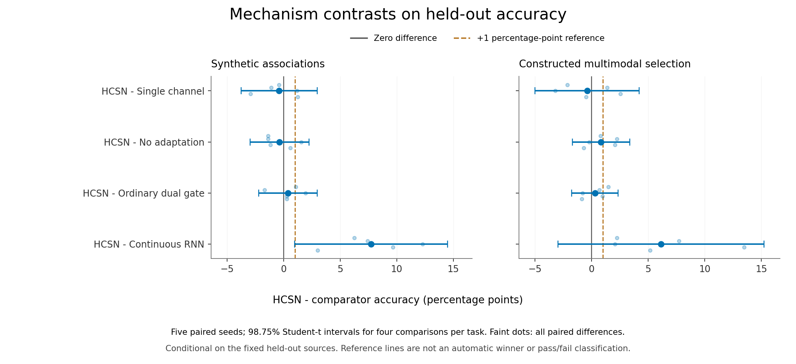

# Hepta Continuous Spiking Network：四层实证研究

**研究编号：study001。最终状态：完成——229/229 项计划任务、58/58 项预选推理测量。** 机制 50 项、表示 84 项、规模 90 项、边界 5 项均完成；3 次 SIGKILL 后按同一规格串行恢复，全部 232 次尝试保留。主审计通过且无 issues，补充数据与模型重放及 58 项性能算术检查完成。事实与数字分别来自[冻结协议](PROTOCOL.json)、[运行清单](results/study001/RUNS.json)、[比较表](results/study001/analysis/COMPARISON_TABLES.md)、[机器可读汇总](results/study001/analysis/COMPARISON_SUMMARY.json)及[边界独立复核](results/study001/analysis/BOUNDARY_INDEPENDENT_REVIEW.md)。

## 1. 已有证据支持什么

这套构想可以实现为可训练的连续递归模块：恢复、再生、适应、内容状态、扩散尺度和自然阈值均进入任务训练，首次穿越概率能够替代硬脉冲参与反向传播；模型、数据来源、选模过程和测试预测均有可复核记录。实现与原生 Hepta 状态转移之间仍有明确的集成边界。

**当前结果没有识别出双通道的独有优势。** 在两个机制任务中，HCSN 相对单通道、去适应和普通事件门的六项配对差异区间全部包含零。HCSN 在合成任务上高于参数近似匹配的连续 RNN，但这不能把增益单独归因于双通道或首次穿越公式。真实表示任务中，HCSN 的图像与组合任务均值高于部分小型递归基线，低于本次 Mamba-1 与 Transformer；音频较弱，真实长历史任务在本次最高 1,601,540 参数配置中仍近随机。独立 CPU 推理也未显示其速度优势。

**模型知情的价值停止具有实用性，但其优势依赖比较对象。** 在共享同一已训练 actor 的实验中，value 相对 fixed 提高了净效用；相对可训练的 direct 阈值，尚无正增益证据。此结果支持研究“何时停止收集证据”，不能证明自然神经元阈值已经由价值函数内生求解，更不能证明 HCSN 适合作为全模态大模型的通用替代。上述结论均限于本研究的固定数据、训练配方和 CPU 实现。[机制与表示数据](results/study001/analysis/COMPARISON_TABLES.md)；[边界复核](results/study001/analysis/BOUNDARY_INDEPENDENT_REVIEW.md)。

## 2. 数学与实现合同

### 2.1 从金融边界思想到明确的神经动力学

He 与 Xiong 的工作提供了价值、反馈与内生边界的启发；金融价值函数本身不是神经元的力场。本实现没有把 Call/Put 数值直接改名为电流，而是明确写出两个可学习通道的作用。每个单元保留压力 \(v_t\)、适应状态 \(a_t\)、高维内容 \(h_t\) 和上一时间段的事件概率 \(p_t\)。在一个时间段内冻结漂移、扩散及边界，漂移为

\[
\mu_t=b+\tanh(Wx_t)-r_t v_t+g_t p_{t-1}-a_t,
\qquad r_t,g_t\geq0.
\]

其中恢复通道抑制压力，再生通道由前次事件提供正反馈；两个门共同读取当前输入与已有内容。适应状态作指数衰减并接收事件增量，形成延迟负反馈。自然阈值 \(B>0\)、扩散尺度及通道强度通过正值参数化训练。正式分类模型使用直接训练的自然阈值；API 另支持固定阈值。[实现](cell.py)；[模型装配](models.py)。

令 \(d=B-v_t>0\)、时间段为 \(\Delta>0\)，对常系数过程 \(dV=\mu\,dt+\sigma\,dW\)，上边界首次穿越概率为

\[
p_t=\Phi\!\left(\frac{\mu\Delta-d}{\sigma\sqrt\Delta}\right)
 +\exp\!\left(\frac{2\mu d}{\sigma^2}\right)
  \Phi\!\left(\frac{-\mu\Delta-d}{\sigma\sqrt\Delta}\right).
\]

第二项保留了穿越后回落的路径贡献，所以它不同于“区间末状态超过阈值”的高斯尾概率。实现使用稳定的对数与特殊函数计算，并以吸收过程的精确一阶矩，加上在区间末重置的事件质量，更新压力。高维内容另行保留；仅传递一个边界值或安全裕度不足以编码任意语义关系。层间输出是带内容状态的连续表示，边界与事件统计是内部动力学量。[核函数与适用域](kernels.py)；[数值测试](tests/test_kernels.py)。

### 2.2 闭式解的适用范围

闭式性成立于单个常系数区间。把均值送入下一段非线性门时，一般有 \(\mathbb E[f(V)]\ne f(\mathbb E[V])\)，所以整网采用明确的均值场闭合；它不是完整随机网络分布的精确传播，也不包含区间内反复穿越、重置后的继续演化。连续反馈、移动边界、任意非线性漂移不能自动继承这条闭式公式。

平滑事件概率改善了梯度接口，但不自动保证长程梯度、稳定性、迟滞或生物兴奋性；再生与适应的存在也不是多稳态的证明。训练得到的扩散参数尚不是经过独立校准的认知不确定性。自然阈值目前没有通过 value-matching 与 smooth-pasting 方程内生求解；有限期任务停止另行采用 Bellman 网格。这不是原金融 Call/Put 闭式算子的完整移植。因而本研究把数学可实现性、任务学习能力、机制贡献和工程成本分开验证。[数学合同](README.md#mathematical-contract)。

## 3. 数据、训练与统计口径

### 3.1 五个任务各自回答不同问题

| 任务 | 内容与目标 | 解释范围 |
|---|---|---|
| synthetic | 四个随机键值关联，每个有七次带噪观测，末尾按键查询，四分类 | 因果证据整合与机制比较 |
| mnist | 真实 MNIST 图像按 28 行输入，预测数字 | 离线图像序列编码 |
| fsdd | 真实 FSDD 录音的固定 20 维 log-mel 特征，重采样到 28 帧 | 留出说话人的离线音频编码 |
| multimodal_select | 独立选择图像、录音，允许类别不同；四个固定词元查询图像或语音数字 | 受控模态选择；不是自然同步视听或一般语言理解 |
| long_memory | 开头四个键值关联，中间新增无关键观测，末尾查询初始键，四分类 | 固定关联在更长干扰历史中的保留 |

所有模型接受相同的 `[N,T,64]` 特征及时间增量。共享前端额外提供时间增量和累计时间，经线性层、LayerNorm、Tanh 后进入主干，共享末步线性读出。查询不包含答案数字。特征归一化规则固定，不在测试集拟合统计量；音频重采样使用完整录音时长，因此“主干因果”不等于整个音频管线已经实现实时流式输入。[数据合同](DATA.md)；[共享模型](models.py)。

MNIST 保持官方训练/测试来源分离，验证图像从训练来源固定留出。FSDD 训练说话人为 george、jackson、nicolas，验证为 theo，测试为 lucas、yweweler；可用独立录音分别为 1,500、500、1,000。超过来源数量的 episode 在同一 split 内复用，不能当作新增独立样本。只有两个测试说话人，不能据此估计广泛人群泛化；MNIST 本来源没有作者身份，也不主张作者独立泛化。授权、下载哈希及缓存规则见[数据来源](DATA.md#sources-attribution-and-licenses)。

`long_memory` 的 T=32/64/128 分别包含 27/59/123 次新的干扰观测，全部时间步承载观测，平均时间增量约为 1；同一 episode 的初始四个关联、查询及共享干扰前缀保持一致。增加长度是在测试真实历史增长，但目标关联数仍固定为四。真实多模态任务的 32→64→128 则保持证据和发生时刻不变，仅插入空观测并细分时间，两种轴不能合并解释为长上下文能力。[生成与测试合同](DATA.md#genuine-history-growth-long_memory)。

### 3.2 预先固定的比较

| 层次 | 配置 | 独立训练种子 | 计划次数 |
|---|---|---:|---:|
| 机制 | 2 任务 × 5 结构；W32、D1、N2048、T32；160 updates | 5 | 50 |
| 表示 | 4 任务 × 7 结构；W32、D1、N2048、T32；240 updates | 3 | 84 |
| 规模 | 10 配置 × HCSN/Mamba-1/Transformer；160 updates | 3 | 90 |
| 边界 | 每种子训练一个 actor，比较三种停止规则及独立 oracle | 5 | 5 |

分类统一 batch=32、AdamW 学习率 0.003；矩阵权重衰减为 0.0001，向量及声明免衰减参数排除。三个固定检查点按验证 CE 最小值选模，随后重载模型并评估固定测试集。验证 512、测试 1,024；分类数据种子为 7123，架构配对使用相同数据和 minibatch 抽样流。相同 seed 不代表不同形状网络具有相同初始权重。机制中的连续 RNN 额外近似匹配实际参数量；表示比较统一外部宽度，参数量与计算量并不相等。[协议](PROTOCOL.json)；[训练逻辑](train.py)；[基线合同](BASELINES.md)。

均值和样本标准差以训练种子为单位。机制主指标为准确率、CE 为次指标；每个任务四项配对差异采用 Bonferroni 调整后的 98.75% Student-t 区间。区间条件于固定 heldout 来源及本次训练随机性，不是说话人、数据集或任务总体的置信区间。协议记录的 1 个百分点实用效果仅作参照，没有事后添加成功/失败公式。五个或三个种子的精度有限；区间包含零也不能推出等效。[冻结统计计划](PROTOCOL.json)；[汇总器](audit.py)。

## 4. 机制：双通道贡献是否独立存在

准确率单位为 %，以下为五种子均值 ± SD。`single` 去掉再生通道，`no_adaptation` 去掉适应反馈，`ordinary` 保留通道与内容结构，用普通 sigmoid 事件门，并将压力更新为未重置均值乘以未触发概率；它同时替换了首次穿越概率与吸收矩重置规则。连续 RNN 使用真实有效参数匹配，不通过闲置张量补足容量。[实现分支](cell.py)；[完整结果](results/study001/analysis/COMPARISON_TABLES.md#mechanism)。

| 结构 | synthetic 准确率 | synthetic CE | multimodal_select 准确率 | multimodal_select CE |
|---|---:|---:|---:|---:|
| HCSN | 49.082 ± 0.997 | 1.086 ± 0.019 | 23.125 ± 3.474 | 2.168 ± 0.047 |
| single | 49.473 ± 0.836 | 1.090 ± 0.029 | 23.516 ± 1.870 | 2.161 ± 0.026 |
| no_adaptation | 49.434 ± 0.994 | 1.094 ± 0.028 | 22.285 ± 2.916 | 2.171 ± 0.022 |
| ordinary | 48.691 ± 1.273 | 1.099 ± 0.027 | 22.832 ± 3.623 | 2.164 ± 0.062 |
| 连续 RNN，参数匹配 | 41.348 ± 4.033 | 1.231 ± 0.045 | 16.992 ± 2.113 | 2.246 ± 0.028 |

以下差异一律为 **HCSN 减对照**，单位为百分点；全部八项均列出，不以点估计筛选。

| 任务 | 对照 | 配对均值差 | 98.75% CI |
|---|---|---:|---:|
| synthetic | single | −0.391 | [−3.748, 2.967] |
| synthetic | no_adaptation | −0.352 | [−2.954, 2.251] |
| synthetic | ordinary | +0.391 | [−2.186, 2.967] |
| synthetic | 参数匹配连续 RNN | +7.734 | [0.975, 14.494] |
| multimodal_select | single | −0.391 | [−4.997, 4.215] |
| multimodal_select | no_adaptation | +0.840 | [−1.683, 3.363] |
| multimodal_select | ordinary | +0.293 | [−1.758, 2.344] |
| multimodal_select | 参数匹配连续 RNN | +6.133 | [−2.975, 15.241] |

最直接的机制对照均未分离出正增益，因此现有证据无法把“能训练”升级为“双通道不可替代”。合成任务相对连续 RNN 的区间不含零，其下限 0.975 个百分点仍略低于 1 个百分点参照；多模态对应区间较宽。消融同时改变部分参数数量，普通事件门才是其中参数量相同的核函数对照。合成任务 HCSN/普通门均为 10,948 参数，匹配 RNN 为 10,991；多模态对应为 11,146/11,189。这个结果要求后续新研究对机制有更强的可证伪预测，而不是依据本次测试分数重新选择叙事。[八项配对统计](results/study001/analysis/COMPARISON_TABLES.md#all-four-prespecified-mechanism-contrasts-per-task)。



图 1 的 1 个百分点线是协议中的实用效果参照，并非事后成功门槛；[矢量版](results/study001/analysis/figures/mechanism_paired_intervals.svg)可用于放大审阅。

## 5. 表示：七种主干、四个任务

基线包括硬脉冲前向加替代梯度的 LIF、连续 RNN、双普通门、官方 `ncps` CfC、按官方方程验证的串行 CPU Mamba-1，以及实际调用 PyTorch SDPA 的因果 Transformer。LIF 不是所有 SNN 的代表，Mamba 也没有使用优化 CUDA scan；各基线输出与梯度的来源核对见[基线说明](BASELINES.md)。

### 5.1 准确率与交叉熵

每项为三种子均值 ± SD，准确率单位为 %。MNIST、FSDD 和组合任务为十分类；long_memory 为四分类。以下是在共同训练配方下的描述性比较，没有逐架构搜索其最佳优化器、学习率或训练时长。[原始汇总](results/study001/analysis/COMPARISON_TABLES.md#representation)。

| 主干 | MNIST | FSDD | multimodal_select | long_memory |
|---|---:|---:|---:|---:|
| HCSN | 66.406 ± 3.472 | 11.914 ± 1.367 | 25.716 ± 2.728 | 24.023 ± 2.658 |
| LIF SNN | 27.148 ± 0.763 | 9.863 ± 0.352 | 10.677 ± 0.620 | 24.902 ± 0.544 |
| 连续 RNN | 46.517 ± 16.729 | 9.961 ± 0.098 | 18.815 ± 2.100 | 25.358 ± 0.746 |
| 双普通门 | 56.380 ± 9.114 | 10.938 ± 1.608 | 24.902 ± 2.882 | 24.870 ± 2.652 |
| CfC | 28.060 ± 4.203 | 10.091 ± 0.314 | 15.202 ± 2.932 | 25.521 ± 0.886 |
| Mamba-1 | 83.301 ± 0.962 | 9.993 ± 0.056 | 38.053 ± 5.602 | 24.121 ± 1.599 |
| Transformer | 80.859 ± 1.572 | 25.488 ± 6.475 | 36.686 ± 2.594 | 26.237 ± 3.677 |

| 主干 | MNIST CE | FSDD CE | multimodal_select CE | long_memory CE |
|---|---:|---:|---:|---:|
| HCSN | 0.989 ± 0.068 | 2.312 ± 0.006 | 2.069 ± 0.090 | 1.401 ± 0.003 |
| LIF SNN | 1.876 ± 0.053 | 2.306 ± 0.003 | 2.304 ± 0.001 | 1.390 ± 0.001 |
| 连续 RNN | 1.447 ± 0.350 | 2.306 ± 0.000 | 2.185 ± 0.006 | 1.393 ± 0.010 |
| 双普通门 | 1.199 ± 0.230 | 2.305 ± 0.001 | 1.950 ± 0.077 | 1.396 ± 0.007 |
| CfC | 1.921 ± 0.129 | 2.307 ± 0.002 | 2.219 ± 0.073 | 1.398 ± 0.009 |
| Mamba-1 | 0.536 ± 0.040 | 2.313 ± 0.006 | 1.712 ± 0.191 | 1.403 ± 0.012 |
| Transformer | 0.573 ± 0.063 | 1.932 ± 0.128 | 1.827 ± 0.121 | 1.391 ± 0.015 |

HCSN 在 MNIST 上已经获得有效表示，但没有超过这里的 Mamba-1 或 Transformer。FSDD 的 HCSN 均值仅略高于 10% 随机参照，CE 亦未显示可靠的音频概率预测优势。全部小宽度 long_memory 结果围绕 25%，意味着此配置尚未学会所要求的键值保留；这不证明该任务不可学习，也不允许以近随机水平下的微小排序推导记忆能力高低。组合任务 HCSN 的准确率均值略高于双普通门，但 CE 反而更高，两个指标不能互相代替。

[图 2：四个任务的全部七种架构与逐种子结果](results/study001/analysis/figures/representation_all_tasks.png)保留了所有表示配置，误差条表示种子 SD；[矢量版](results/study001/analysis/figures/representation_all_tasks.svg)。

### 5.2 模态分项防止整体分数掩盖短板

下面是在组合测试集上按查询模态或类别冲突条件分组的目标准确率，仍为三种子均值 ± SD。它们不是另训练的线性探针，也不是遮蔽输入后的因果消融。冲突项只包含图像与语音类别不同且两种模态均存在的 episode。[分项汇总](results/study001/analysis/COMPARISON_TABLES.md#multimodal-query-and-conflicting-label-subsets)。

| 主干 | 查询图像 % | 查询语音 % | 图声类别冲突 % |
|---|---:|---:|---:|
| HCSN | 38.697 ± 5.757 | 12.218 ± 0.941 | 23.593 ± 2.667 |
| LIF SNN | 11.175 ± 0.553 | 10.159 ± 1.631 | 10.778 ± 0.770 |
| 连续 RNN | 27.650 ± 3.450 | 9.628 ± 1.003 | 17.037 ± 1.561 |
| 双普通门 | 38.953 ± 5.102 | 10.292 ± 1.201 | 23.704 ± 2.885 |
| CfC | 19.604 ± 6.194 | 10.624 ± 0.460 | 14.926 ± 2.924 |
| Mamba-1 | 63.857 ± 11.276 | 11.222 ± 0.304 | 36.889 ± 6.093 |
| Transformer | 57.280 ± 4.000 | 15.272 ± 1.217 | 34.148 ± 3.518 |

组合任务的学习效果主要来自图像查询；HCSN 的语音查询仍接近随机参照。四个字面查询词只能检验有限指令路由，不能代表语言语义，也不能代表真实跨模态对齐。真实的单模态数据使结果超出纯玩具任务，但人工配对、固定特征以及很少的说话人仍限制其外推。

### 5.3 在固定配方下的训练成本

下表 CPU 秒为每架构四任务 × 三种子，共 12 次训练的训练段总和；参数包含共享前端与读出。十分类参数用于三个真实任务，四分类用于 long_memory。它回答“本实现完成这些固定更新花了多少 CPU”，不回答达到相同质量的最低成本。[成本账目](results/study001/analysis/COMPARISON_SUMMARY.json)。

| 主干 | 十分类参数 | 四分类参数 | 12 次训练 CPU 秒 |
|---|---:|---:|---:|
| HCSN | 11,146 | 10,948 | 335.015 |
| LIF SNN | 4,682 | 4,484 | 58.566 |
| 连续 RNN | 4,650 | 4,452 | 41.450 |
| 双普通门 | 8,778 | 8,580 | 53.661 |
| CfC | 8,842 | 8,644 | 67.673 |
| Mamba-1 | 12,490 | 12,292 | 130.663 |
| Transformer | 15,242 | 15,044 | 22.031 |

HCSN 的首次穿越特殊函数与逐步反馈在此 CPU 实现中没有体现训练成本优势。Transformer 使用实际优化的 CPU SDPA，而 Mamba 为串行参考 scan；这种实现差异是账目解释的一部分。所有计算均未测 Joule，不能外推 GPU、神经形态硬件能耗或部署吞吐。更公平的质量—计算前沿还需要独立预设的调参与收敛预算。

## 6. 边界：共享 actor 上的停止贡献

### 6.1 任务阈值与自然阈值是两个对象

边界任务的隐藏标签为二分类，条件观测独立服从 \(N(\pm\mathrm{SNR},1)\)。每种子先训练一个宽 24、深 1 的 HCSN actor，用每个前缀的分类 CE 监督；没有贝叶斯教师或 LLR 蒸馏。fixed、direct、value 消费同一已选 actor 的因果 log odds 和同一轨迹。fixed 在验证集选一个固定阈值；direct 用四个参数随剩余时长、SNR 和成本调节阈值；value 把 actor 分数当作当前信念，使用已知高斯生成模型计算 257 点网格的有限期 Bellman 停止价值。另列 oracle 使用原始观测的精确贝叶斯 LLR。[边界设计](BOUNDARY.md)；[策略实现](boundary.py)。

所有策略强制至少购买一次观测，目标为“分类正确得 1，减去已购买观测总成本”。ID/OOD 每个种子各 512 episode，最大时长分别为 16/24；OOD 同时改变 SNR、成本与时长。direct 以温度 0.02 的连续生存分布训练 100 次，评价时执行硬停止。边界 actor 的 AdamW 对全部参数使用 0.0001 衰减，与分类管线的向量排除规则不同；共享 actor 保证三个学习分数策略使用相同的表示。value 的阈值由任务奖励和继续观察的价值决定；它没有反过来求解 cell 内部的自然首次穿越边界。[完整协议与收费规则](BOUNDARY.md#frozen-protocol)。

### 6.2 ID/OOD 四策略结果

下表为五个种子均值的均值；准确率单位为 %，成本及效用与奖励 1 同单位。种子 SD 与描述性 95% 区间保留在[复核 JSON](results/study001/analysis/BOUNDARY_INDEPENDENT_REVIEW.json)。

| 分布 | 策略 | 准确率 % | 观测次数 | 观测成本 | 净效用 |
|---|---|---:|---:|---:|---:|
| ID | fixed | 82.8125 | 3.1426 | 0.113830 | 0.714295 |
| ID | direct | 86.0938 | 4.8258 | 0.099545 | 0.761393 |
| ID | value | 86.0547 | 5.1195 | 0.103857 | 0.756689 |
| ID | oracle，原始贝叶斯证据 | 86.1719 | 4.5043 | 0.091910 | 0.769809 |
| OOD | fixed | 85.6250 | 4.0043 | 0.226660 | 0.629590 |
| OOD | direct | 82.6172 | 3.1941 | 0.110332 | 0.715840 |
| OOD | value | 83.8672 | 4.0746 | 0.128012 | 0.710660 |
| OOD | oracle，原始贝叶斯证据 | 83.0469 | 3.4734 | 0.104738 | 0.725730 |

| 分布 | 净效用配对差 | 均值 | 种子 SD | 98.75% CI | 正差种子 |
|---|---|---:|---:|---:|---:|
| ID | value − direct | −0.004703 | 0.015108 | [−0.033856, 0.024450] | 3/5 |
| ID | value − fixed | +0.042395 | 0.009858 | [0.023372, 0.061417] | 5/5 |
| OOD | value − direct | −0.005180 | 0.004588 | [−0.014032, 0.003672] | 0/5 |
| OOD | value − fixed | +0.081070 | 0.030511 | [0.022198, 0.139943] | 5/5 |

这四项效用比较在研究启动后、查看边界结果值前确定，属于有时间记录的后续分析，不是原预登记的成功门槛；四项一起使用 Bonferroni 调整。独立复核逐 episode 重算分片哈希、贝叶斯 LLR、首次停止、判类、付费次数、成本和效用，并核对 fixed/direct 阈值。追加的独立 NumPy/Gauss-Hermite Bellman 参考检查了 8,220 个抽样前缀：仅有 4 项位于参考优势绝对值小于 0.001 的近边界处存在决策差异，超过该容差的分歧为零。这是数值交叉核验，不是逐 episode 全枚举或连续空间精确最优性的证明。[复核范围与结果](results/study001/analysis/BOUNDARY_INDEPENDENT_REVIEW.md)。

### 6.3 为什么 value 没有自动超过 direct

value 相对 fixed 在 ID/OOD 的净效用差均为正，区间不含零；但相对 direct 的两项区间均包含零，OOD 五个种子还全部为负差。这不否定动态规划：actor 的未来分数变化未必服从贝叶斯 LLR 转移，把其当前 log odds 代入已知模型只构成模型知情的近似策略，不具有“对该 actor 的 Bellman 最优”保证。direct 可以直接适应 actor 的评分与校准偏差；两者又使用不同的结构先验、函数类及训练计算预算，无法把差异仅归于有没有闭式价值公式。

准确率也不等同于效用。OOD 中 value 比 direct 准确，但购买更多观测，其成本抵消了这部分收益；fixed 的准确率比 oracle 高也不矛盾，因为 oracle 优化的是预期净效用。成本随 episode 变化，较多平均观测可以同时对应较低平均成本。oracle 额外拥有原始证据的正确贝叶斯表示，其优势不能记在停止边界名下；它的最优性解释还受有限网格、模型正确性与强制首观测约束。四策略都离线计算全部 actor 前缀，再模拟停止，所以观测节省尚未转化为实测提前取消、时间或能耗收益。

## 7. 规模、推理和研究成本

### 7.1 真实增长的三条轴

规模主任务是 long_memory：容量轴覆盖 W16/D1、W32/D1、W64/D2、W128/D2、W256/D3；数据轴为 N256/1024/4096；上下文轴为 T32/64/128。所有架构每项使用 160 × 32 = 5,120 次有放回 episode 抽样，训练集大小增加并不增加总抽样预算，也不等于相同训练轮数。容量轴同时改变宽度和深度，无法单独识别深度作用；历史变长同时增加物理时长与计算量，亦非等算力比较。额外 W64/D2、N4096、T128 的多模态配置属于联合压力测试，其中长度变化是插空步。[规模清单](PROTOCOL.json)。

全部 90 项已完成。下表列出完整十个配置的准确率 % 均值 ± SD，每格三个种子；除最后一行外均为四分类 long_memory。参数、CE 和训练成本完整列于[规模全表](results/study001/analysis/COMPARISON_TABLES.md#scaling)。

| 配置与轴 | W / D / N / T | HCSN | Mamba-1 | Transformer |
|---|---|---:|---:|---:|
| 00 中心 | 32 / 1 / 1024 / 32 | 26.432 ± 0.149 | 26.823 ± 1.053 | 27.181 ± 2.344 |
| 01 容量 | 16 / 1 / 1024 / 32 | 26.335 ± 1.869 | 25.358 ± 0.720 | 25.911 ± 0.948 |
| 02 容量 | 64 / 2 / 1024 / 32 | 25.358 ± 1.080 | 26.660 ± 0.258 | 55.371 ± 39.504 |
| 03 容量 | 128 / 2 / 1024 / 32 | 25.781 ± 0.737 | 25.488 ± 2.233 | 76.725 ± 28.375 |
| 04 容量 | 256 / 3 / 1024 / 32 | 24.577 ± 0.997 | 25.651 ± 0.907 | 26.725 ± 1.545 |
| 05 数据 | 32 / 1 / 256 / 32 | 24.056 ± 0.819 | 25.391 ± 1.378 | 32.520 ± 14.971 |
| 06 数据 | 32 / 1 / 4096 / 32 | 25.033 ± 0.923 | 25.326 ± 2.643 | 26.400 ± 1.300 |
| 07 上下文 | 32 / 1 / 1024 / 64 | 25.033 ± 0.440 | 26.497 ± 0.988 | 25.163 ± 2.059 |
| 08 上下文 | 32 / 1 / 1024 / 128 | 25.033 ± 0.298 | 25.098 ± 0.000 | 26.237 ± 0.948 |
| 09 多模态联合 | 64 / 2 / 4096 / 128 | 16.048 ± 0.451 | 11.230 ± 2.201 | 36.361 ± 6.392 |

HCSN 的容量从 3,428 增至 1,601,540 参数，最高配置仍为 24.577%，没有显示固定配方下的容量收益；增加数据或真实历史长度也未解决记忆任务。Transformer 在中等容量上部分种子学会，SD 很大，最高 2,387,972 参数配置又接近随机；这显示优化与配置敏感性，不能当成单调规模规律。Mamba-1 最高为 1,332,740 参数，长记忆结果亦接近随机。多模态联合行同时改变多个因素，其长度包含空观测；不能由该行推导真实新增上下文的收益或退化。

[图 3：所有十个规模配置的逐种子验证 CE—累计训练 CPU 曲线](results/study001/analysis/figures/validation_cpu_all_configs.png)及[矢量版](results/study001/analysis/figures/validation_cpu_all_configs.svg)保留全部配置和三次固定检查点。连线只帮助辨认训练进展；三个点不是完整收敛轨迹，也不足以拟合大模型 scaling law。三次恢复只改变执行并发，不改变样本、模型、更新预算或选模规则。

### 7.2 串行推理测量

全部 58 个预选 checkpoint 已在其他研究计算停止后串行测量：表示层使用 seed2201 的 28 项，规模层使用 seed3301 的 30 项；各取固定测试集前 16 个样本，预热两次、测量七次，PyTorch 单线程 CPU。主机仍共享，未主张独占机器。下面给出 MNIST、T32、W32/D1 的七种架构；其余全部测量与来源哈希见[性能全表](results/study001/analysis/COMPARISON_TABLES.md#every-preselected-inference-measurement)。

| 主干 | Wall 中位数 ms | Wall p95 ms | CPU 中位数 ms | 部分 MFLOPs | 峰值新增张量 MiB |
|---|---:|---:|---:|---:|---:|
| HCSN | 16.596 | 18.370 | 16.601 | 11.328 | 1.334 |
| LIF SNN | 2.606 | 3.463 | 2.609 | 4.672 | 0.320 |
| 连续 RNN | 1.424 | 2.028 | 1.427 | 4.622 | 0.318 |
| 双普通门 | 2.354 | 2.780 | 2.357 | 8.848 | 0.318 |
| CfC | 3.007 | 4.682 | 3.010 | 8.897 | 0.318 |
| Mamba-1 | 3.120 | 3.655 | 3.123 | 13.485 | 1.639 |
| Transformer | 0.984 | 1.139 | 0.987 | 15.123 | 1.131 |

时间覆盖本实现完整的无梯度前向，包括辅助张量创建，排除数据准备、重载、预热、profiler 和输出释放/验证。七次重复的 p95 是描述性分位数，不是跨样本、机器或硬件总体的置信区间；短序列、共享主机的非单调延迟不能用于拟合复杂度指数。HCSN 在这个具体配置中比 Mamba-1 和 Transformer 慢，但不据此外推优化 GPU 内核。FLOPs 仅含工具支持的算子公式，融合 attention、erfcx 等存在未计部分，不能把表中部分数值当作完整算法算力；张量分配含 UNKNOWN 类别，也不等于进程 RSS 或保留显存。[测量程序](measure_study.py)；[性能口径](performance.py)。

### 7.3 完成、恢复与成本账目

| 阶段 | 完成数 | 记录训练 CPU 秒 | RESULT 总 CPU 秒 |
|---|---:|---:|---:|
| 机制 | 50 | 672.158 | 916.857 |
| 表示 | 84 | 709.059 | 967.463 |
| 规模 | 90 | 4,269.634 | 4,950.324 |
| 边界 | 5 | 53.953 | 71.000 |
| 合计 | 229 | 5,704.804 | 6,905.644 |

**训练 CPU 已包含在 RESULT 总 CPU 内，两列不能相加。** 外部执行共 232 次：229 次成功累计 job wall 为 7,991.759 秒，3 次 SIGKILL 失败累计为 399.874 秒；失败的进程 CPU 未记录，保持未知而非填零。失败均为 Mamba-1 的 config04/seed3302、config09/seed3301、config09/seed3302，随后同规格串行完成。累计 job wall 可重叠，不是研究日历用时；RESULT CPU 不含解释器/import 与计时器启动前开销。[完整账目与失败记录](results/study001/analysis/COMPARISON_TABLES.md#cost-ledger)。

独立性能测量进程另用 364.194 子进程 CPU 秒、365.386 wall 秒，包含数据准备、重载、预热和 profiler；其中 58 项记录内部的合计为 356.006 CPU 秒、357.169 wall 秒，不能与外层再相加。补充审计另记 13.326 CPU 秒；审计、绘图等分析开销由各自产物单列。边界 actor 被策略共享，嵌套计时同样不可重复记账。主审计通过 229 项且 issues=0，补充审计全部 224 项分类重建及预选模型重放通过，性能算术审计 58/58 通过；这些核查保证记录可复核，不替代对方法优劣的统计判断。

## 8. 对 Hepta 与后续工作的实际含义

当前交付是 `experiments/continuous_spiking_network` 内独立、可训练、可重载的 tensor 研究包。它基于主仓库 commit `f8c9419df6ddeb36ff8b522a50219981fb8d9345`；数学参考固定为 `c32392367b7587d09806ca5cbc74678a168b4e16` 的五文件片段。原生 Neuron 的 Q24 稀疏状态核、owner、authority 与 journal 未被这个 Python block 替代。接入 `neuron.runtime`/`inference.control` 时，需要显式规定压力、适应、内容、阈值和模型身份的持久状态；任务效用与继续策略对应 `utility.ndu`/`learning.operator`，不可变 checkpoint 对应 `learning.artifacts`。[集成边界](README.md#placement-in-hepta)；[参考来源](reference/SOURCE.json)。

现阶段合理的工程用途是受控 encoder 与停止控制实验：它把可微首次穿越、显式恢复/再生和任务效用接到一个可审核的训练管线中。对传统硬脉冲 SNN，已实现的区别是事件概率可直接参与梯度，并保留连续内容；没有测到事件稀疏硬件的节能收益。对 Transformer，固定大小递归状态提供一种潜在的状态存储取舍，但本次模型接口仍处理完整序列，尚未验证流式 cache、等质量效率或长程语义保留优势。

后续实验应由当前短板决定：先在独立新协议中改善音频编码与跨说话人验证，检验双通道在可预测的干扰、恢复或代价变化条件下是否产生机制特异收益；再评估保持完整分布或更细时间步能否减小均值场误差。模型校准、同 actor 的直接停止对照和实际提前取消应一起验证。升级到自然同步数据、多任务预训练或大模型规模之前，还需要更广的任务、调参和计算预算证据。当前结果没有支持跳过这些阶段直接宣称全模态大模型优势。

## 9. 可复现性与审计边界

冻结源封印为 `bb0d2eda33c34785da9563a84a06ed4c5d2391826e52173452ee43924723de02`。封印覆盖科学 Python 源、协议和依赖，排除 results 与报告文档；协议另哈希绑定实际运行清单。训练前全包 71 项测试通过，涵盖因果性、梯度、数值参考、数据来源、checkpoint 和审计逻辑；通过测试不等于实证优势。[封印](SOURCE_SEAL.json)；[测试记录](results/preflight/pytest_final.xml)。

每个分类 run 保存规格、split 来源、minibatch 索引、首次更新梯度、三次验证记录、选中模型、测试 logits 与标签、环境和分段成本。checkpoint 拼接所有 state tensor 后分块无损压缩，保留每块与每 tensor 的 SHA，支持推理重载；未保存 optimizer/RNG 全状态，不能声称逐位恢复中断训练。[记录格式](records.py)。

主审计重新计算 accuracy/CE/Brier，核对来源交集、数据哈希、参数及 checkpoint 哈希、实际样本暴露和计划完整性，最终 229 项全部通过、issues=0。[主审计结果](results/study001/AUDIT.json)；[逐项检查实现](audit_checks.py)。

封印后独立编写的补充审计重建了全部 224 项分类结果的测试标签/ID 与逐 run minibatch 抽样流，扫描了全部 232 次执行历史并保留失败；预选 representation 的 seed2201、七架构 × 四任务共 28 个 checkpoint，各重放完整 1,024 测试样本，共 28,672 例，全部 logits 逐位一致、最大绝对误差为 0。选择规则与最终成绩无关，审计后科学源码封印未改变。它检查冻结代码下的数值复现，并非第二套独立数据生成器或神经模型实现；也不覆盖全部 224 个 checkpoint 的完整重放。[补充结果](results/study001/SUPPLEMENTARY_AUDIT.json)；[补充脚本](results/study001/analysis/supplementary_audit.py)；[预选记录](results/study001/SUPPLEMENTARY_AUDIT_PRESELECTION.json)。

在仓库根目录，使用隔离 Python 3.12 环境及 [requirements.txt](requirements.txt)，安装 CPU PyTorch 2.8 后可执行：

```bash
python -m experiments.continuous_spiking_network.prepare_data \
  --cache-dir /path/outside/repo/hcsn-data
python -m pytest experiments/continuous_spiking_network/tests -q
python -m experiments.continuous_spiking_network.run_study \
  --output experiments/continuous_spiking_network/results/study001 \
  --cache-dir /path/outside/repo/hcsn-data --workers 4
python -m experiments.continuous_spiking_network.measure_study \
  --results experiments/continuous_spiking_network/results/study001 \
  --cache-dir /path/outside/repo/hcsn-data
python -m experiments.continuous_spiking_network.audit \
  --results experiments/continuous_spiking_network/results/study001 \
  --output experiments/continuous_spiking_network/results/study001/AUDIT.json
python experiments/continuous_spiking_network/results/study001/analysis/supplementary_audit.py \
  --package experiments/continuous_spiking_network \
  --results experiments/continuous_spiking_network/results/study001 \
  --cache-dir /path/outside/repo/hcsn-data --replay prespecified \
  --output experiments/continuous_spiking_network/results/study001/SUPPLEMENTARY_AUDIT.json
```

恢复运行会跳过已有完整结果，并核对清单和封印；调整 worker 数量属于执行资源安排，不能修改模型规格。新的科学源或训练协议必须创建新封印和新研究目录。完整逐种子结果与三次验证检查点保存在[比较表](results/study001/analysis/COMPARISON_TABLES.md)，阅读本报告时应同时保留固定配方、有限来源及小种子数这些推断条件。
