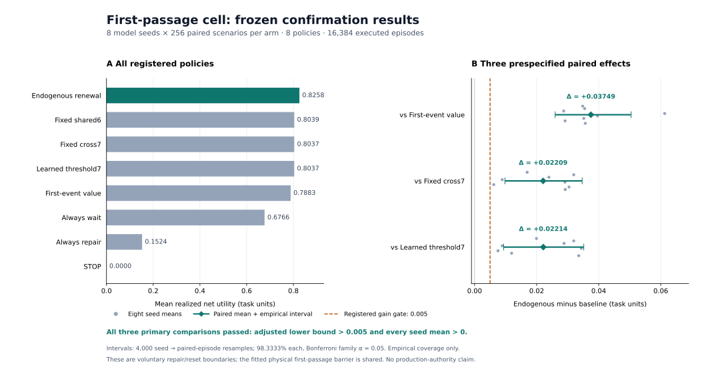

# First-passage cell: frozen implementation and confirmation results

## Outcome and scope

All five research work packages have an implemented, trained, and independently checked deliverable. In the registered synthetic maintenance task, the complete renewal-value policy passed **all three prespecified confirmation comparisons** against the first-event value approximation, the seven-parameter fixed-boundary reference, and the ordinary learned distance threshold. The gains use executed actions and actual subsequent net utility. They are not inferred from kernel accuracy, training loss, predicted value, or native-interface conformance.

The completed object is a regenerative first-passage cell with explicit state and event contracts, likelihood training of its physical coefficients, and a value-informed maintenance/reset controller connected to the original native NDU algorithms. The experimental boundary comparison concerns **voluntary repair/reset decisions**. The physical first-passage barrier is a shared fitted parameter. This report does not identify that barrier with a jointly solved optimal-stopping free boundary, prove a general SNN advantage, or claim production owner activation. [Contract](CONTRACT.md), [registered protocol](PROTOCOL.json), [confirmation audit](evidence/CONFIRMATION_AUDIT.json).



### Immutable identities

| Identity | Value |
| --- | --- |
| Frozen source commit | `507bfcc131f30c88c5931f6101c45afdd5c71887` |
| Published freeze commit | `8ada7c46a23063722ee9b7089be608d4ab1c2fed` |
| `FREEZE.json` SHA-256 | `57858ef88f9a1ef03a9ade666a35fdbe7faafef651bdca8eee3514feb99b7fdd` |
| Original native owner commit | `ed6f8c6645c927249cec0d3395f6bae21f278739` |
| Native binary SHA-256 | `83326cf07a435ab3bb5b72075feedf38237d90bcaac80a60d44337c7a9fdf5bf` |
| Native source-manifest SHA-256 | `4c2df16a69c6579ae8b5bc2683acc1060bc31c7c5790e70e3161b9dd6fc89a0d` |

The pre-confirmation freeze binds **79 files**. The remote source check matched **73 published source and metadata files** to their local Git blob bytes before confirmation. The source commit includes the fitted models, selected policy parameters, protocol, and preparation manifest; that manifest binds the large raw preparation artifacts by byte count and SHA-256. The scientific identities are unchanged by later evidence publication. [Freeze](FREEZE.json), [remote source verification](evidence/REMOTE_SOURCE_VERIFICATION.json), [prepared manifest](prepared/prepared_manifest.json).

## Work-package disposition

| Work package | Implemented deliverable and decisive evidence | Disposition and limit |
| --- | --- | --- |
| First-passage and reset contract | Typed survival, event, censoring, missing observation and communication meanings; killed-state filtering; exact event clock; repeated reset, refractory carry and remaining time; externally bound replayable checkpoints; transactional actions and fees | Implemented and checked. Grid filtering has disclosed projection/tail error; missing observations retain the absorbing atom and are not fabricated survival evidence. |
| Analytic propagation | Stable `F`, `S`, `f`, discounted `H`, killed density/CDF and analytic interior gradients; independent integration, mass, continuous composition, tails and gradient references | 294 numeric/contract checks passed. This is verification on declared domains, not a universal floating-point error theorem. The killed CDF has a disclosed quadrature fallback for severe cancellation. |
| Trainable cell | Joint trajectory likelihood for two input weights, drift intercept, diffusion, physical barrier and reset distance; right-censoring and later reset intervals enter the same likelihood | All 16 registered six-/seven-parameter fits succeeded and all claimed active coefficients changed. This establishes physical-parameter training, not end-to-end hard-spike backpropagation through a general SNN. |
| Cost and deadline feedback | Fixed, ordinary learned, first-event value and full-renewal value repair boundaries; common observations and external cost ledger; frozen policy development and three primary comparisons | All three confirmation gates passed for these specified controller classes. The matched-count fixed-cross7 arm allocates its extra parameter to drift, so it is not a pure boundary-only ablation. |
| Hepta value interface | Event forecasts, continuation/action values and actual subsequent returns through original `evaluate_recursive_utility` and `evaluate_candidates_with_policy`, with source/binary and receipt binding | Native execution and independent arithmetic/replay passed. The registered scalar additive signed-Q32 profile is preserved; `DENY_ALL` and `safety_certificate=false` remain explicit. This is an executable research adapter, not production authority. |

The complete Python package suite passed **65 tests**, with zero failures, errors or skips; the original `just test`/nextest scoped adapter gate passed **6 tests**, with zero failures or skips. These are package and adapter checks, not the full repository CI suite. The 11 NDU Python tests are already included in the 65 and are not added a second time. [Python validation](evidence/PYTHON_VALIDATION.json), [native validation](evidence/NDU_VALIDATION.json).

## Registered task and experimental separation

The task has a two-unit horizon and decisions every 0.5 units. Each episode supplies the same public initial level, two inputs, maintenance price, legal actions and remaining time to every arm. Inputs and price remain constant within an episode. Natural first passages incur a failure cost, reset to the physical reset level, spend the refractory time, and resume for the remaining physical time. A voluntary repair pays its public price once, resets and spends the same refractory time. `STOP` terminates future operation and exposure.

Actual episode utility is

\[
R=0.6 A-0.5 N-C_{\mathrm{repair}},
\]

where \(A\) is actual active time, \(N\) is the actual number of natural first passages, and \(C_{\mathrm{repair}}\) is the sum of executed maintenance fees. All values are registered **task units**, not currency.

The nominal simulator uses drift \(-0.55-0.18u_1+0.16u_2\), diffusion standard deviation 0.32, physical barrier 0.12, reset distance 0.9 and refractory time 0.06. Inputs are uniform on \([-1,1]^2\), initial distance is uniform on \([0.08,1.4]\), and maintenance price is uniform on \([0.05,0.4]\). Policies receive fitted physical models rather than the true simulator law. The evaluation is a controlled, fully observed synthetic task; it does not establish efficacy on hidden-state, biological, language or production workloads. [Task and protocol](PROTOCOL.json).

There are eight fixed model seeds: `1103, 1151, 1201, 1213, 1223, 1231, 1237, 1249`. Each uses 512 training trajectories and 128 held-out likelihood trajectories. Physical training, likelihood development, policy development, confirmation and both stress tasks use distinct named random streams. Policy development evaluates all three adjustable families on all 17 registered parameter values and 128 scenarios per seed: **52,224 executed episodes**. Confirmation uses 256 new scenarios per seed, and each stress task uses 128. No confirmation outcome selects a parameter or seed. [Development audit](evidence/POLICY_DEVELOPMENT_AUDIT.json), [resume validation](evidence/RESUME_VALIDATION.json).

Arms share scenario identities and counter-based common random numbers. Actions change reset/refractory evolution and subsequent random-draw consumption; this coupling is not the claim that all policies follow the same continuous Brownian path. The statistical pairing unit is the complete episode within a model seed.

### Controller classes and information/capacity controls

The endogenous and first-event policies share the same six fitted physical coefficients plus one development-selected repair-gap bias. The ordinary learned-threshold policy has the same six physical coefficients plus one development-selected constant distance threshold. All have seven active parameters and receive the same public information. The first-event policy already adapts its value estimate to price and remaining time; it is retained as a stronger ablation of repeated failures, reset and refractory effects.

The constant learned repair gate does not explicitly adapt its threshold to price or deadline, although it receives that information and shares the native negative-continuation `STOP` guard with the fixed-threshold controls. The fixed-shared6 arm is the pure shared-physics structural reference. Fixed-cross7 has the same total parameter count as the adjustable policies but puts its extra coefficient on the drift feature \(u_1u_2\). The always-wait, always-repair and stop arms are additional action controls. This design compares specified policy families; equal parameter counts do not imply identical function classes or computational costs. [Pre-confirmation amendment](PROTOCOL_AMENDMENT.md).

## Numerical validation and actual physical learning

Representative maximum errors from the retained independent kernel checks are:

| Check | Maximum recorded error |
| --- | ---: |
| First-passage CDF versus density integration | 2.22e-16 |
| Discounted first passage versus independent integration | 4.11e-15 |
| Killed-kernel mass versus survival | 1.11e-16 |
| Continuous killed semigroup | 1.11e-16 |
| First-hit time composition | 1.94e-16 |
| Analytic log-output gradient, normalized error | 5.92e-10 |
| Killed log-kernel gradient | 5.15e-10 |
| Near-boundary expansion seam | 1.32e-12 |

The tests include extreme small distances, log probabilities, retained derivatives when ordinary densities underflow, and explicit rejection of unrepresentable outputs. Discounted `H` is not interpreted as a probability or confidence. Normalized hidden-state filtering and grid projection have their own conditioning and approximation limits. [Kernel validation](evidence/KERNEL_VALIDATION.json).

The full renewal action-value calculation uses the same-drift, same-diffusion first-passage convolution identity across reset distances and includes all possible refractory-delayed events within the horizon. Its refractory integral uses 48-node Gauss-Legendre quadrature; this is disclosed numerical integration inside the control-value calculation. An independent inverse-Gaussian/Lévy CDF with adaptive quadrature matched all **64 fixed-cohort native actions**, with maximum raw action-value discrepancy **4.44e-16**. A separate 10,000-trajectory event sampler produced active-time and failure-count deviations of **0.146** and **−0.189** standard errors from the analytic predictions. The latter fixture averages more than four failures and therefore tests repeated renewal, not just the first event. [Native and renewal diagnostics](evidence/NDU_VALIDATION.json).

Physical training minimizes the full renewal trajectory negative log likelihood, including event densities and final censoring. Measured initial states anchor physical units and identify the physical barrier; later intervals depend on the fitted reset distance. The optimizer differentiates drift, both input weights, log diffusion, barrier and log reset distance together.

| Physical coefficients | Fitted models | Initial mean training NLL | Fitted mean training NLL | Mean held-out NLL |
| --- | ---: | ---: | ---: | ---: |
| 6 | 8 | 1.91444541 | 1.38671533 | 1.38615701 |
| 7 | 8 | 1.91563915 | 1.38532464 | 1.38986240 |

NLL is normalized by complete trajectory count. All 16 fits report optimizer success, and every claimed active coefficient changes from initialization. Independent SciPy inverse-Gaussian/Lévy likelihood references agree with the retained initial, fitted and held-out objectives. The extra cross coefficient slightly improves training likelihood but has a slightly higher average held-out NLL; it is not unused parameter padding. [Training validation](evidence/TRAINING_VALIDATION.json), [physical preparation](prepared/physics_manifest.json).

## Confirmation: actual utility, costs and computation

Every policy has 2,048 confirmation episodes. The table reports actual subsequent outcomes and includes termination effects. Compute time is the observed sum of decision, simulation and actual-return native wall times per episode, not a hardware or neuromorphic throughput benchmark.

| Policy | Mean net utility | Failures | Repairs | Paid repair cost | STOP fraction | Observed pipeline ms/episode |
| --- | ---: | ---: | ---: | ---: | ---: | ---: |
| Endogenous renewal | 0.82583441 | 0.28564 | 0.91016 | 0.15038 | 11.96% | 41.68 |
| First-event value | 0.78834585 | 0.43555 | 0.79785 | 0.12659 | 7.76% | 39.83 |
| Learned threshold7 | 0.80369303 | 0.25488 | 0.90039 | 0.18778 | 12.60% | 40.69 |
| Fixed shared6 | 0.80389744 | 0.32715 | 0.75488 | 0.15710 | 11.67% | 40.59 |
| Fixed cross7 | 0.80374297 | 0.32666 | 0.75586 | 0.15690 | 11.77% | 40.25 |
| Always wait | 0.67658762 | 0.97803 | 0.00000 | 0.00000 | 0.00% | 6.49 |
| Always repair | 0.15235090 | 0.00977 | 3.99512 | 0.89865 | 0.00% | 6.48 |
| STOP | 0.00000000 | 0.00000 | 0.00000 | 0.00000 | 100.00% | 3.86 |

All five forecasting policies use approximately 4.99–5.00 native calls per episode. The three fixed-action controls use one native call for the actual subsequent return. Confirmation caches are fresh per policy and episode; there is no cross-arm forecast reuse. Python process CPU timing excludes native subprocess CPU. Wall times are descriptive measurements in this execution environment and were not added to the task utility. [Confirmation audit](evidence/CONFIRMATION_AUDIT.json).

### Three primary paired comparisons

The frozen rule resamples model seeds, then paired whole episodes within each selected seed, for 4,000 bootstrap replicates. A two-sided Bonferroni family alpha of 0.05 over three comparisons gives a tail probability of \(0.05/(2\times3)\), or a **98.3333% individual empirical interval**. A comparison passes only if its adjusted lower bound exceeds 0.005 and all eight seed means are positive.

| Prespecified contrast | Mean utility gain | Family-adjusted empirical interval | All eight seed means positive | Registered gate |
| --- | ---: | ---: | --- | --- |
| Endogenous − First-event value | +0.03748856 | [0.02596592, 0.05046213] | Yes | **PASS** |
| Endogenous − Fixed cross7 | +0.02209145 | [0.00977929, 0.03466599] | Yes | **PASS** |
| Endogenous − Learned threshold7 | +0.02214138 | [0.00937348, 0.03518791] | Yes | **PASS** |

All original primary comparisons are retained. The finite number of model seeds makes these empirical intervals rather than population coverage guarantees. The figure shows all eight per-seed paired means as well as the overall contrasts; no favorable subset is selected. [Protocol](PROTOCOL.json), [confirmation audit](evidence/CONFIRMATION_AUDIT.json).

### Cost decomposition of the mechanism

Using the same actual ledger, each gain decomposes exactly into active-operation reward, avoided failure cost and maintenance-fee savings:

| Baseline subtracted from endogenous | Active reward contribution | Failure-cost contribution | Maintenance-fee contribution | Total gain |
| --- | ---: | ---: | ---: | ---: |
| First-event value | -0.01366916 | +0.07495117 | -0.02379345 | +0.03748856 |
| Fixed cross7 | -0.00492798 | +0.02050781 | +0.00651161 | +0.02209145 |
| Learned threshold7 | +0.00012501 | -0.01538086 | +0.03739723 | +0.02214138 |

Relative to the learned constant threshold, the endogenous policy has slightly more natural failures, but it saves more maintenance fees than the resulting extra failure cost. Its gain is therefore not a claim that it minimizes failures or maximizes operating time separately. Relative to the first-event approximation, the repeated-renewal policy incurs more preventive maintenance cost but avoids enough subsequent failures to increase net utility. These are task-specific, directly accounted mechanisms, not a universal causal decomposition across arbitrary boundary classes.

## Prespecified model-mismatch tasks

The same frozen physical fits and policy parameters are applied without retraining to an additional drift shift of −0.15 and a diffusion multiplier of 1.25. Each task contains 8,192 episodes, or 1,024 per policy.

| Stress task | Endogenous renewal | First-event value | Fixed cross7 | Learned threshold7 |
| --- | ---: | ---: | ---: | ---: |
| Drift shift −0.15 | 0.70169259 | 0.66093588 | 0.67887682 | 0.68443791 |
| Diffusion ×1.25 | 0.78750108 | 0.75839978 | 0.76883737 | 0.77146764 |

The endogenous mean remains larger than those three registered baselines in both tasks. These are descriptive prespecified mismatch results; no new significance gate or population robustness certificate is introduced. Full eight-arm costs, stopping rates, per-seed means and computation measurements remain in [drift stress audit](evidence/STRESS_DRIFT_AUDIT.json) and [diffusion stress audit](evidence/STRESS_DIFFUSION_AUDIT.json).

## Native recursion, actual execution and planning scope

The adapter invokes the original scalar additive signed-Q32 recursion and V2 candidate-policy interface. It preserves the original fixed-point rounding, bounds, rejection semantics and explicit task `STOP` to native `abstain` mapping. The calibration bias changes action selection only: it is not inserted into the reward, charged as a fictitious cost, or used to substitute a different recursive-utility profile.

Across confirmation and both stress tasks, independent audits checked **32,768 complete episodes, 118,669 decisions and 309,695 exact-rational native recursive paths**. The fixed replay sample was declared before inspecting outcomes: the first and last scenario for every seed, all eight arms, in every phase. All **384 sampled episodes** reproduced their compact forecast and actual-return native receipts through **1,341 actual native calls**. Maximum actual-return Q32 error was **4.6561e-10**, within the registered conversion budget. Maximum separate floating accumulation difference was **2.2204e-16**. [Supplemental checker](evidence/audit_helpers/postrun_checks.py), [confirmation audit](evidence/CONFIRMATION_AUDIT.json).

Forecasts use `WAIT_AFTER_CURRENT`; deployment uses `MPC_REPLAN_EACH_HALF`. In confirmation, the endogenous initial plan value averages **0.70092986**, whereas the executed replanning outcome averages **0.82583441**, a difference of **0.12490456**. This is not a same-policy calibration residual and is not evidence that the forecast equals the deployed policy's Bellman value. The additive registered profile permits evaluation of supplied expected paths; that does not establish a general nonlinear recursive-utility or FBSDE solver. [NDU contract and rebuild guide](NATIVE_REPRODUCE.md).

## Retained failures and repairs

The evidence preserves implementation and infrastructure failures rather than silently removing them:

1. **Initial development interruption.** Shared storage filled while four development gzip ledgers were being written. Their original incomplete bytes and cause are retained. Subsequent writers reserve 32 MiB before generating an episode, refuse overflow and truncate reserved padding to the exact gzip stream. All registered development trajectories were rerun with unchanged seeds, grids and sample counts. The **10,902 recoverable complete prefixes** match the rerun factual records after excluding timing fields. [Aborted preparation](evidence/aborted_policy_preparation_01/ABORTED_PREPARATION.json), [development audit](evidence/POLICY_DEVELOPMENT_AUDIT.json).
2. **Checkpoint identity repair.** Recovery now cross-checks the scenario noise seed against the restored random stream. Removing exactly that two-line guard recovers the historical physical-training `task.py` bytes. The generator and likelihood did not call the repaired recovery method; the original physical fits and their provenance were retained. [Exact source repair](evidence/SOURCE_REPAIR.json).
3. **Numerical/runtime defects found before confirmation.** Near-zero-drift false instantaneous samples, unrepresentable survival targets and partial repair updates on a failed propagation were corrected and covered by the final integrated tests. Checkpoint state and fees are transactional, and invalid model/checkpoint identities are rejected. [Final Python validation](evidence/PYTHON_VALIDATION.json).
4. **Formatting history.** The native receipt retains a historical formatter failure caused by a generated external path. The later full Python validation records the final original `just fmt` success and unchanged native adapter identity. Both records remain visible; an earlier success is not used to erase a later failure.
5. **Supplemental audit correction.** An initial evidence-only checker used exact float equality between repeated `+=` and Python 3.12 `sum`, rejecting a 1.11e-16 summation-order difference. The checker now uses \(8\,\mathrm{ULP}(\max(1,\sum_i |r_i|))\) for this separate floating accumulation comparison. Native integer paths and Q32 outputs remain bit-exact, the main ledger tolerance is unchanged, and no runtime source, outcome or statistical gate changed. [Audit repair receipt](evidence/SUPPLEMENTAL_AUDIT_REPAIR.json).

## Reproduction and artifact availability

The current [archive manifest](EVIDENCE_ARCHIVE.json) binds **52 scientific originals (145,319,237 bytes)** and the **exact native gzip (732,464 bytes)**, for **53 originals totaling 146,051,701 bytes**. The representation uses **310 binary parts, each at most 500,000 bytes, and 16 direct NPZ files**: **326 stored data objects**. The [current layout record](evidence/CI_ARCHIVE_LAYOUT.json) specifies these lossless parts. No trajectories were regenerated or recompressed for archival.

The [cold restoration validation](evidence/CI_ARCHIVE_RESTORE_VALIDATION.json) reassembled all **37 multipart originals** and verified all **16 direct NPZ files**; the subsequent `--verify-only` pass verified **all 53 originals**. It also checked that **all 79 frozen files remain unchanged**, rejected corrupt parts without producing an output, and preserved differing existing files. The native gzip is one of the reconstructed originals: `restore_archives` must materialize it before `restore_native` decompresses and verifies the exact executable.

Remote publication status and path, size, mode and Git blob identity verification for the current 326-object layout are recorded separately in the [publication receipt](evidence/ARCHIVE_PUBLICATION.json). A local layout or restoration result alone does not claim completion of remote publication. The original 303-part, 319-object layout and publication receipt remain historical at [INITIAL_EVIDENCE_ARCHIVE.json](evidence/INITIAL_EVIDENCE_ARCHIVE.json) and [ARCHIVE_PUBLICATION_INITIAL.json](evidence/ARCHIVE_PUBLICATION_INITIAL.json); they describe the initial representation, not the current layout.

Research runtime and experiment changes remain within `experiments/first_passage_cell/`. The CI repair also changes three repository-level spelling configuration files: `.codespellrc`, `.codespellignore`, and `.codespell-frozen-lines`. That configuration is limited to binary archive parts and exact historical lines, as documented in [the spelling repair record](evidence/CODESPELL_ARCHIVE_REPAIR.json). Two inherited scripts, `scripts/format.py` and `scripts/test_hepta_format_scope.py`, additionally receive only repository-pinned Ruff 0.15.13 formatting. Their original bytes match between the inherited base and initial PR head; the repair preserves their complete Python ASTs and passes the formatter check for both files. [Inherited formatting repair](evidence/INHERITED_FORMAT_REPAIR.json). All 79 frozen scientific files retain their exact bytes, and scientific outcomes and the original native owner algorithms remain unchanged.

After obtaining the complete package and materializing the retained raw artifacts, run from the repository root. Use fresh output paths because the independent audit receipts are create-only:

```bash
python -m experiments.first_passage_cell.evidence.audit_helpers.restore_archives
python -m experiments.first_passage_cell.restore_native
python -m experiments.first_passage_cell.evidence.audit_helpers.postrun_checks confirmation \
  --output /tmp/hepta_confirmation_recheck.json
python -m experiments.first_passage_cell.evidence.audit_helpers.postrun_checks stress_drift \
  --output /tmp/hepta_stress_drift_recheck.json
python -m experiments.first_passage_cell.evidence.audit_helpers.postrun_checks stress_diffusion \
  --output /tmp/hepta_stress_diffusion_recheck.json
python -m experiments.first_passage_cell.evidence.audit_helpers.plot_results \
  --output /tmp/hepta_confirmation_results.svg
```

The exact retained executable targets Linux x86-64. A rebuild uses the pinned original owner/source closure, lockfile, compiler and original test runner described in [NATIVE_REPRODUCE.md](NATIVE_REPRODUCE.md). A different binary or profile requires its own source-bound run; it must not be relabelled as this frozen execution. A fresh reproduction of the task must also use a new output directory and pass the existing `study run --freeze` gate.

The evidence supports the implemented regenerative cell, its trainable physical parameters, and a useful cost/deadline-informed voluntary reset boundary in this registered task. Endogenous natural-spike free-boundary optimization, general network training, theorem transfer to absorbed/reset dynamics, hidden-state deployment and production owner/Organ Credit integration remain separate claims requiring their own implementation and evidence.
