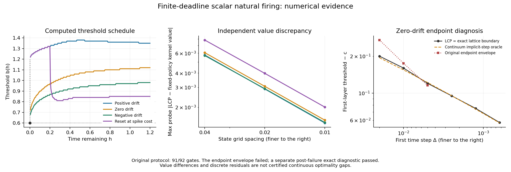

# Finite-deadline natural firing

This separate research extension computes a scalar optimal-stopping boundary
with absorption, fixed reset, mandatory refractory time and an actual remaining
deadline. It does not change the frozen `first_passage_cell` or
`first_passage_operator` studies, train another network, or reuse their
confirmation data.

**The original numerical protocol passed 91 of 92 checks.** Its zero-drift
expiry-boundary envelope failed. A separately recorded, post-failure analytic
diagnostic passed 30 of 30 checks and explains the discrepancy. It does not
replace or relabel that original result.

## Model and implementations

An active voltage follows Brownian motion with constant drift and positive
diffusion. Firing pays `voltage - cost`, resets to `r <= cost` and starts a
strictly positive refractory period. At the deadline an active state receives
one positive-part liquidation payoff; a refractory state receives zero.
The refractory clock is part of the state. Boundary changes during a hold do
not create events, and lowering a boundary below an active state creates an
immediate event with its actual voltage as the reward argument.

- `qvi.py` solves the delayed obstacle problem by monotone implicit finite
  differences and tridiagonal policy iteration. It verifies that the computed
  stopping set is an upper ray instead of imposing that shape.
- `policy.py` independently evaluates the extracted threshold schedule with
  the frozen analytic first-hit moments and killed transition density. It
  retains the raw probability mass and handles arbitrary refractory release
  times with the declared state/time interpolation.
- `expiry.py` supplies independent continuum and lattice formulas for the
  first implicit time layer at zero drift. The lattice stopping indices match
  the LCP at all six diagnostic resolutions.

Read [NUMERICAL_CONTRACT.md](NUMERICAL_CONTRACT.md) for the terminal convention,
delayed QVI, boundary arguments, truncation bound and numerical scope.

## Recorded evidence

[results/SUMMARY.json](results/SUMMARY.json) contains the four-case comparison,
exact protocol/result hashes, reproducible commands and all scope limits.
[results/checkpoint_paths.json](results/checkpoint_paths.json) binds the
original 43-file delivery; this README and later CI wiring are additional
documentation, not changes to those recorded bytes.

Across the registered finest grids, the largest probed discrepancy between the
LCP and independent fixed-policy evaluator is `0.0020058009101365237`.
The largest LCP complementarity residual is `2.6645352591003757e-15`, and the
largest raw killed-mass defect is `3.097522238704187e-14`. These are distinct
quantities. None certifies the total continuous optimality gap.

The failed endpoint envelope assumed a fixed multiple of `sqrt(dt)`. For the
first implicit layer, smooth fit instead gives
`z = 1 + W(1 / (e * q * dt))` and
`boundary - cost = z * sigma * sqrt(dt / (2 * (1 + q * dt)))`.
The extra logarithmic factor explains why that fixed envelope eventually fails.
This formula concerns the implicit-layer resolvent, not the true continuous
finite-horizon boundary at that positive time.



## Reproduction

Install `requirements.txt` in a separate environment. Use single-threaded BLAS
and run from the repository root:

```sh
OPENBLAS_NUM_THREADS=1 OMP_NUM_THREADS=1 MKL_NUM_THREADS=1 \
  python3 -m unittest discover -s experiments/first_passage_deadline/tests -v

OPENBLAS_NUM_THREADS=1 OMP_NUM_THREADS=1 MKL_NUM_THREADS=1 \
  python3 -m experiments.first_passage_deadline.validate \
  --output /tmp/hepta-deadline-new-attempt

OPENBLAS_NUM_THREADS=1 OMP_NUM_THREADS=1 MKL_NUM_THREADS=1 \
  python3 -m experiments.first_passage_deadline.validate_expiry \
  --output /tmp/hepta-expiry-new-attempt
```

Use new output directories. The original validator is expected to exit **1**
because its failed gate is deliberately retained; the supplementary diagnostic
is expected to exit **0**. The eight unit tests and numerical experiments are
separate checks. CI runs the unit tests without rerunning or selecting a
confirmation result.

This module does not establish a differentiable finite-deadline boundary layer,
a globally optimal coupled neural network, or cross-task predictive superiority.
