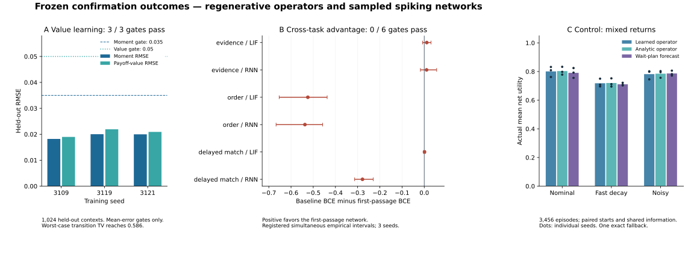

# Regenerative value operators: frozen confirmation results

## What the evidence establishes

This study implements and trains a value-operator layer on an active/refractory
state, a sampled two-hidden-layer spiking network, and a verified scalar natural
firing boundary. The results support the regenerative propagator and a useful
finite-domain value approximation. They **do not establish cross-task spiking
network superiority**. All six registered advantage gates failed. Actual control
returns are mixed relative to the previous wait-plan forecast.

The scientific source/model freeze was published as
[`a06e545d1c248d879c6e85d36b8bb4a375269ad3`](https://github.com/TrillionniumFoundation/hepta-private-ci/commit/a06e545d1c248d879c6e85d36b8bb4a375269ad3)
before confirmation. Its manifest SHA256 is
`901f5e7e315e6786897af21da45370f290aa9e287d1055e40d8dde765190b685`.
The previous package remains anchored at
`2abafe82a99d6def2132e605e57af183e3080194`.

[POST_CONFIRMATION_AUDIT.json](POST_CONFIRMATION_AUDIT.json) independently checks
64 frozen files, eight external dependencies, all retained numerical metrics,
17,280 native calls and 48,179 candidate utility paths. It also replays all
13,824 executed state transitions in 3,456 episodes. The maximum actual-return
Q32 discrepancy is 4.6409087683940697e-10. Replay verifies reproducibility of the
unchanged simulator; the independent integral and QVI checks provide the separate
numerical-law evidence.



## 1. Absorption, reset and refractory propagation

An active state is a distance x>=0 from a lower absorbing boundary. Before a
hit, its generator is mu*d/dx + sigma^2/2*d^2/dx^2. A hit emits an event, resets
the distance to r and starts mandatory refractory time a. The refractory state
carries remaining duration eta>0 and has generator -d/deta. Release at eta=t
occurs at the active reset state exactly. An initial x=0 atom is processed before
the t=0 branch: it is an immediate event followed by the full refractory hold.

The exact propagation layer retains F, S, f, H_q and the killed transition K_t.
For positive d and r, the strong Markov identity

\[
\int_0^t f_d(s)K_{t-s}(r,dy)\,ds
=K_t(d+r,dy)-\mathbf{1}_{y>r}K_t(d,d(y-r))
\]

reduces regenerative terminal moments and bin transitions to finite analytic
renewal sums. Positive refractory time bounds the number of resets in a finite
horizon. Counts and discounted occupation use the first-passage transform and
its discount derivative; q=0 occupation has its own non-singular limit.

This construction was needed because ordinary time quadrature missed narrow
first-hit peaks near the boundary. The original maximum discrepancy of about
0.00945, the later saturated-tail failure and failed reference refinements remain
in the evidence directories. They were repaired before confirmation without
loosening acceptance gates. Stable exponential tilting avoids subtraction of
saturated first-passage transforms; underflow omissions have an explicit
representability bound.

The retained numerical checks include 24 original contexts, four augmented-state
semigroup checks, 64 expanded near-boundary/high-decay contexts, 24 boundary
cases, and independent QVI policy iteration at three refinements for six cases.
Across the reported checks, maximum mass error is 2.22e-16, semigroup error is
5.44e-15, occupancy error is 8.40e-13, and implicit boundary derivative error is
4.90e-10. The independent QVI reset-value discrepancy is at most 4.59e-4 relative,
with the boundary within 0.463 grid steps. These are finite validation sets, not
uniform error bounds over every admissible parameter.

The observation contract is unchanged: no observation does not imply survival.
The control confirmation uses known public states and laws. It does not establish
a learned posterior filter or identification of hidden physical dynamics.

## 2. Learned value operator

A 3-by-64 SiLU trunk with 10,716 trainable parameters learns 20 positive
active/refractory transition bins and ten moment features. The terminal-bin
basis includes an infinite active tail. The branch in supplied payoff
coefficients is linear; transition probabilities are nonnegative with unit
mass. Initial atoms, deterministic hold and exact release have explicit branches.

Each of three fits used 4,096 training contexts, 512 development contexts and
2,600 optimizer steps. The independently held-out confirmation contains 1,024
contexts. Input dynamics are supplied context values in this model; learning its
trunk is distinct from identifying physical dynamics from observations. The
separate multilayer cell does train physical dynamics jointly with its weights.

| Seed | Moment RMSE | Unit-L2 payoff-value RMSE | Mean transition TV | Maximum TV | Maximum absolute value error |
| --- | ---: | ---: | ---: | ---: | ---: |
| 3109 | 0.0182120 | 0.0189722 | 0.0455026 | 0.5101404 | 0.3123508 |
| 3119 | 0.0200274 | 0.0219172 | 0.0517029 | 0.5864147 | 0.3950929 |
| 3121 | 0.0199871 | 0.0209141 | 0.0466296 | 0.5365728 | 0.3259848 |

All three fits pass the declared gates: moment RMSE<=0.035, payoff-value
RMSE<=0.05, mean TV<=0.15, finite outputs and discounted mass defect<=1e-12.
The largest observed mass defect is 2.22e-16. The large worst-case errors in the
table are retained: passing an average-error gate is not a uniform certificate.
See [value_evidence/CONFIRMATION.json](value_evidence/CONFIRMATION.json) and the
retained context, prediction and payoff arrays.

There is one protocol-label discrepancy. The already-published executable
selects checkpoints by moment MSE plus 0.03 times transition cross-entropy. An
older prose selection field and the historical `development_mse` report label
say moment MSE only. The discrepancy was recorded after confirmation started
but before reading its outputs, without changing source, checkpoints, data,
seeds or acceptance gates. [VALUE_PROTOCOL_CLARIFICATION.json](VALUE_PROTOCOL_CLARIFICATION.json)
is a transparent clarification, not a replacement preregistration. The
historical field must not be interpreted as pure MSE.

A positive transition head makes a fixed discrete Bellman backup monotone and
nonexpansive in bounded continuation values. A fixed positive discount and time
step add a contraction factor exp(-q*dt). Those structural statements do not
prove learned semigroup consistency, a uniform approximation rate, or optimality
of the deployed continuous-state policy. The registered maintenance task uses
q=0 and finite backward induction. The learned trunk is not constrained to
approach the exact reset delta as t approaches eta from above; global context
continuity or Holder regularity at that junction is not claimed. Hard transition
bins also need not vary continuously at their edges as time tends to zero.

## 3. Multilayer spiking network and its negative result

The network has two hidden layers of three units, eight physical segments of
length 0.25, and one-segment communication delay. Actual within-segment first
hits, surviving endpoints, repeated resets and refractory carry are sampled
from the continuous law. Only emitted counts enter learned synaptic traces; the
readout receives the second layer's trace. There is no analog input-to-readout
bypass. This is exact conditional forward propagation for the declared segmented
system; it is not a fully asynchronous synaptic event simulator.

Backward propagation uses biased straight-through derivatives of conditional
moments. Input weights, drift, diffusion, threshold, reset and refractory
parameters all participate in optimization. All 55 active parameters changed in
all 27 fits. This verifies actual joint training, not physical identifiability
or an unbiased gradient of expected classification loss.

The comparison includes first-passage, LIF and leaky-tanh recurrent models,
three temporal tasks and three training seeds. Each model has 55 active
parameters, 80 epochs, 256 training and 128 development examples. Confirmation
uses 256 examples and eight stochastic rollouts. Update counts are matched;
wall-clock and stochastic simulation cost are recorded, not equalized by a
separate time-budget experiment. The final 27 fits used 8,640 optimizer updates
and 623.270076 aggregate fit seconds. Completed aborted fits and partial-run
records are retained separately. The delayed query was moved from slot seven to
six before confirmation to satisfy the one-segment causal communication contract.

The following improvement is baseline BCE minus first-passage BCE, so positive
values favor the first-passage model.

| Task | Baseline | Mean improvement | Registered simultaneous empirical interval | Advantage gate |
| --- | --- | ---: | --- | --- |
| Evidence | LIF | +0.0112849 | [-0.0073920, 0.0303428] | Failed |
| Evidence | RNN | +0.0104247 | [-0.0171657, 0.0557739] | Failed |
| Order | LIF | -0.5243092 | [-0.6532761, -0.4372860] | Failed |
| Order | RNN | -0.5374816 | [-0.6673180, -0.4576493] | Failed |
| Delayed match | LIF | +0.0011872 | [-0.0034926, 0.0054669] | Failed |
| Delayed match | RNN | -0.2781918 | [-0.3136596, -0.2297651] | Failed |

These intervals use the registered hierarchical bootstrap and six-comparison
adjustment, with only three training seeds. They are empirical intervals, not a
general population-coverage theorem. The evidence task has positive mean
improvements but a negative seed in both comparisons. The order task is clearly
worse. The delayed-match network remains close to chance and trails the RNN.
See [network_evidence/CONFIRMATION_SUMMARY.json](network_evidence/CONFIRMATION_SUMMARY.json).

Train/development diagnostics checked 180,000 sampled trajectories and twelve
moments; all moment comparisons were within 1.59 standard errors. Finite
perturbation checks of sampled loss mostly remain inconclusive because of
Monte Carlo uncertainty. Linear probes fitted to averaged traces improve order
decoding, but the same probes worsen single hard-rollout losses. This supports
investigating stochastic dispersion and training, but does not isolate a pure
readout-optimization defect. No diagnosis here is a new confirmation success.

## 4. Bellman continuation, actual cost and native NDU

The control comparison uses a positive 20-bin finite-horizon continuation
recursion with four decisions, each 0.5 time units apart. All arms share the
same initial scenarios, public law, information, price and legal action
contract. Their later states may differ because they execute different actions.
Actual utility is

\[
U=0.6\,T_{\rm active}-0.5\,N_{\rm failures}-C_{\rm actual\ repairs}.
\]

The learned and analytic Bellman arms both replan using the same declared
continuation recursion. The wait-plan comparator retains its original
wait-after-current forecast and replans at the next decision. The finite state
projection and learned transition error are explicit approximations; the
analytic Bellman arm is not the globally optimal continuous-state controller.

| Law | Learned operator | Analytic operator | Wait-plan forecast | Learned minus analytic | Learned minus wait |
| --- | ---: | ---: | ---: | ---: | ---: |
| Nominal | 0.8008439 | 0.8030586 | 0.7907038 | -0.0022148 | +0.0101401 |
| Fast decay | 0.7181538 | 0.7198207 | 0.7108145 | -0.0016669 | +0.0073393 |
| Noisy | 0.7818468 | 0.7849057 | 0.7864421 | -0.0030589 | -0.0045953 |

Each cell averages three seeds and 128 paired scenarios per seed. These are
actual net returns with paid repair costs, not forecast values treated as
realized reward. There is no registered universal-superiority gate for this
control study. One learned-state query fell outside the declared distance
domain and used the explicit exact fallback; the policy is therefore a measured
hybrid, not a claim of uniformly accurate neural extrapolation.

The adapter invokes the unchanged original native binary, SHA256
`83326cf07a435ab3bb5b72075feedf38237d90bcaac80a60d44337c7a9fdf5bf`,
using `hepta.ndu.recursive-utility.scalar.q32.v1`. It binds the new objective and
continuation plan without changing the recurrence, rounding, receipt checking,
resource bounds or authority. The task chooses the maximum scalar native value,
with STOP then WAIT tie preference. The native Pareto advisory is separately
retained; it happened to agree with the scalar choices in this confirmation.
This is an inference/control interface, not end-to-end differentiation through
native NDU. Authority remains `DENY_ALL`, with no production safety certificate.

Full trajectories and forecasts are retained in 216 compressed parts listed in
[control_evidence/CONTROL_CONFIRMATION.json](control_evidence/CONTROL_CONFIRMATION.json).

## 5. Precisely scoped optimal natural firing boundary

This is a separate, explicitly declared scalar objective. Active voltage follows
Brownian dynamics with drift mu and diffusion sigma. A spike at voltage x earns
x-c, resets to r, and imposes refractory a>0. Discount q is positive, c>=r, and
there is no running reward. Parameters are stationary and fully known.

Let

\[
\lambda=\frac{\sqrt{\mu^2+2q\sigma^2}-\mu}{\sigma^2},\qquad
\beta=e^{-qa}.
\]

The unique optimal threshold b>r solves

\[
\lambda(b-c)-1+\beta e^{-\lambda(b-r)}=0.
\]

With C=exp(-lambda*(b-r))/lambda, the active-state value is

\[
V(x)=\begin{cases}
C e^{\lambda(x-r)},&x<b,\\
x-c+\beta C,&x\ge b.
\end{cases}
\]

The refractory value is exp(-q*eta)*C. Value matching and smooth fit hold at b.
The continuation equation is (L-q)V=0. The stopping-region generator is at most
-sigma^2*lambda/2<0, and the obstacle inequality follows from the exponential's
convex tangent bound. Mandatory refractory time excludes event accumulation.
For every admissible reset policy, the voltage has at most linear drift plus a
Brownian running-supremum growth bound; positive discount gives the required
transversality. Together these verify global optimality for this scalar model,
not merely stationarity of a threshold parameter.

The result does not prove the optimal boundary for a finite deadline, arbitrary
running/task reward, input-driven dynamics, hidden state, or a coupled multilayer
network. It also does not prove that NDU's overall objective is optimized by this
stationary scalar threshold. Those broader claims remain unproved.

## 6. Relation to the motivating papers

[He and Xiong](https://www.princeton.edu/~wxiong/papers/rollover.pdf) provide the
useful modeling structure: diffusion killed at an endogenous boundary,
Feynman-Kac valuation, continuation incentives and smooth-fit boundary
verification. The adaptation is mathematical; a reset/refractory neuron is not
a corporate credit model, and these ingredients alone do not establish a wholly
new neural architecture relative to the complete SNN literature.

[Qi, Deep Q-Learning on Holder Spaces](https://proceedings.mlr.press/v336/qi26a.html) motivates
learning value functions through a Bellman operator with an explicit function
space and regularity conditions. The present hybrid system has deterministic
refractory evolution and nonlocal reset conditions. Uniform ellipticity on the
whole augmented state and compatible junction regularity are absent. Positive
finite-bin backups and bounded-value contraction are valid structural facts;
the paper's regularity and operator-approximation results cannot be transferred
without proving their hypotheses for this hybrid system. The paper itself
explicitly does not claim convergence of practical sampled deep Q-learning.

The training estimator also belongs in the context of
[surrogate-gradient SNN learning](https://arxiv.org/abs/1901.09948). Exact forward
first-passage propagation does not make its straight-through learning gradient
exact. A local derivative check cannot bridge that distinction.

## 7. Closure status and reproducibility

| Question | Evidence-backed status |
| --- | --- |
| Active/refractory/reset/time propagation | Implemented; independent finite validation checks passed |
| Value-operator fitting | Implemented; 3/3 registered mean-error gates passed |
| Joint multilayer training | Executed; all 55 parameters changed in all 27 fits |
| Cross-task advantage | Not established; 0/6 gates passed |
| Actual control/NDU contract | All 3,456 trajectories audited; mixed empirical returns |
| Stationary scalar natural boundary | Globally verified for the stated objective |
| General finite-horizon or coupled-network optimum | Not proved by this study |
| Whole-domain learned semigroup/Holder guarantees | Not established |
| Production activation | Not requested by these receipts; `DENY_ALL` retained |
| Repository/native CI | Tracked separately in `ci_evidence`; source repairs are not native runtime passes |

Run the post-confirmation audit from repository root:

```bash
python -m experiments.first_passage_operator.audit_confirmation
python -m experiments.first_passage_operator.plot_confirmation
```

The audit is read-only by default. Pass `--output /absolute/new-receipt.json`
to retain an independent receipt; an existing output path is never overwritten.
`AUDIT_HISTORY.json` preserves the original auditor and receipt before this CLI
improvement. Do not overwrite or reuse this confirmation set to select a new
model. Any subsequent mechanism study needs
its own disclosed protocol, source/model freeze and new confirmation identities.
