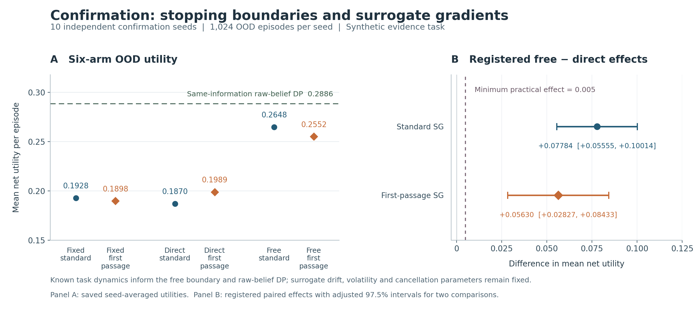

# Free-boundary neuron study: sealed results

## Findings and scope

The registered confirmation supports **model-informed stopping boundaries over directly learned context thresholds** on this synthetic sequential-evidence task. Both prespecified out-of-distribution (OOD) comparisons exceed the minimum practical effect of 0.005. The results **do not establish an advantage for the first-passage surrogate gradient**: all three within-boundary comparisons with the standard surrogate have descriptive confidence intervals containing zero. The same-information raw-belief dynamic program also exceeds the best neural arm. These distinctions determine the research priorities below. [Confirmation summary](results/learning/confirmation_summary.json)

A separate engineering experiment successfully applied a versioned stopping readout through the original native owner, avoided subsequent work after stopping, and passed durable replay and independent audits. It uses a Gaussian finite-state task; it does not deploy the learning experiment's trained SNN. Mathematical correctness, synthetic learning efficacy, and owner execution are separate evidence categories throughout this report. [Registered scope](PROTOCOL.json), [owner audit](results/owner/run001/AUDIT.json)

## Registration, implementation, and audit integrity

The scientific source was committed and frozen before outcomes:

- Source commit: `95b0d6668892868a4a19268a2fb707f2dca586ba`.
- Source-seal SHA-256: `5876ab602e03e4c1f324342f8e046246c2162d4e9a07d1016d7d2edfcffa162c`.
- The seal inventories 105 executable, protocol, and native dependency inputs. Original native sources are unchanged; existing studies retain their baseline semantics. [Source seal](results/SOURCE_SEAL.json), [published source receipts](results/preflight/publication_commits.json)

Preflight passed **46 behavioral tests**: 17 mathematical, 10 learning, 14 owner/audit, and five provenance tests. Pre-freeze source Ruff, spelling, and required formatting checks passed with no change to the frozen executable/protocol inventory. These checks include independent derivatives, tampering rejection, missing/duplicate episode admission, and rejection of apparent parity produced entirely by native fallback. [Test receipts](results/preflight/), [pre-freeze quality gates](results/preflight/final_quality_gates.json)

The later display-only renderer passed its explicit Ruff checks. A subsequent repository-wide `just fmt` invocation failed while resolving unrelated temporary/sparse-checkout Rust paths to a workspace manifest. Its failed receipt is preserved; it is not reported as a passing global check. Scientific inputs and figure values remained unchanged. [Figure quality receipt](results/figures/QUALITY_GATES.json)

There were **90 trained fits**: five screening seeds and ten independent confirmation seeds, each with six arms. All arms used eight bipolar integrate-and-fire cells, subtractive reset, cumulative signed-spike readout, shared initial neural parameters and minibatch schedules, and 160 Adam updates. The base model has 57 trainable scalars; the direct context head adds 12. Each seed has 1,024 training, 512 validation, and 1,024 episodes in each test split. Known reliability, observation cost, deadline, available actions, and causal observations are shared; truth and future evidence are excluded from runtime inputs. Episode-local random streams prevent stopping from shifting later episodes' exogenous draws. [Learning protocol](learning/PROTOCOL.json)

Checkpoints were written before test scoring. Independent audits regenerated validation and test streams, repeated the declared fixed-threshold grid and tie rule, and rescored saved parameters without training. Screening verified 60 checkpoint/dataset scores and confirmation verified 120; both reproduced validation selection. Screening was not pooled into confirmation or used to revise the registered method. [Screening audit](results/learning/screening_audit.json), [confirmation audit](results/learning/confirmation_audit.json)

## Mathematical operators and numerical verification

The implementation provides stable characteristic roots, finite-window killed hitting probabilities and derivatives, one-shot and repeated-reset stopping solutions, complete-solution parameter sensitivities, moving-boundary references, and the finite owner MDP. These operators retain distinct meanings: hitting probability is not a terminal Gaussian tail, stationary occupation density, or general transition kernel. Pure utility discount and independent killing are separate inputs. [Derivations and assumptions](math/THEORY.md)

For arithmetic Brownian motion, positive volatility, affine reward \(x-c\), and total discount/killing rate \(r>0\), the verified one-shot example has

\[
\kappa=\frac{\sqrt{\mu^2+2r\sigma^2}-\mu}{\sigma^2},
\qquad b^*=c+\kappa^{-1}.
\]

Value matching, smooth fit, the obstacle inequality, and the stopping-region generator inequality establish the eligible continuous solution. Constant spike amplitude alone does not supply this affine decision reward. For repeated reset to \(a\), discount \(\rho>0\), and refractory time \(\tau\), the threshold-family value is

\[
J_b(a)=\frac{q(b-c)}{1-\delta q},\qquad
q=e^{-\kappa(b-a)},\quad\delta=e^{-\rho\tau},
\]

with interior optimality condition \(\kappa(b-c)=1-\delta q\); here \(\kappa\) uses \(r=\rho\). Lambert-W and independent bracket solutions agree. Sensitivities differentiate this optimality condition or the coupled value/smooth-fit system. Dividing by the spatial derivative of the value gap at a smooth-fit boundary would divide by zero. Constrained and opt-out cases are explicitly threshold-family/reset-start results. [Mathematical implementation](math/)

All **20 registered numerical gates passed**. Selected measurements are:

| Independent check | Recorded error or violation |
| --- | ---: |
| Characteristic-root relative residual | 7.37e-17 |
| Finite-window probability versus quadrature | 2.78e-17 |
| Hitting-gradient scaled error | 5.64e-11 |
| Renewal Lambert-W versus bracket boundary | 4.44e-16 |
| Renewal boundary/value sensitivity scaled errors | 1.41e-9 / 2.74e-9 |
| Checked obstacle/generator violations | 0 |
| Owner transition-mass/Bellman errors | 2.22e-16 / 2.22e-16 |

These are engineering correctness measurements, not neural efficacy tests. [Sealed numerical audit](results/math/run001/numerical_audit_20261028T041441736488Z.json)

Stability has explicit limits. Without refractory time, reward at reset can create unbounded rapid-intervention incentives or an unattained chattering supremum. Near degeneracy, the measured sensitivity condition index reached **1,053,694.8** despite accurate solver agreement. Derivatives are local to an active regime. A linear deterministic moving barrier has an exact relative-drift solution; the curved-barrier reference is numerical. Its final mesh change, 3.34e-7, is not a certified absolute error. Neither establishes a theorem for arbitrary adaptive/random barriers or global SNN training convergence. Smooth fit concerns an optimal value function, not the derivative of a hard spike. [Theory](math/THEORY.md), [audit](results/math/run001/numerical_audit_20261028T041441736488Z.json)

The strong learning reference received an additional independent check: exact reachable Bernoulli-state recursion versus the actual deployed threshold-table policy across all 16 registered contexts and 332,800 complete evidence streams. Maximum expected-utility regret was **8.7890625e-5**, below the preregistered numerical tolerance 0.001 and primary effect threshold 0.005. This validates the reference at those contexts; it is not a uniform bound on neural belief estimates. [Exact-lattice check](results/math/run001/belief_reference_check.json)

## Confirmation learning results

The following are means across ten confirmation seeds. Coverage is the fraction making a positive or negative choice; abstention remains in utility and observation denominators. Utility includes the first observation and every additional observation charge. ID denotes the training-context distribution; OOD changes reliability, cost, and deadline. [Complete confirmation summary](results/learning/confirmation_summary.json)

| Method | ID utility | ID coverage | ID observations | OOD utility | OOD coverage | OOD observations |
| --- | ---: | ---: | ---: | ---: | ---: | ---: |
| Fixed / standard | 0.511240 | 97.26% | 5.830 | 0.192762 | 96.14% | 6.782 |
| Fixed / first passage | 0.509659 | 98.01% | 6.009 | 0.189752 | 97.88% | 7.004 |
| Direct / standard | 0.510868 | 99.64% | 5.942 | 0.186990 | 99.61% | 7.121 |
| Direct / first passage | 0.506220 | 99.57% | 5.206 | 0.198852 | 99.40% | 6.298 |
| Free / standard | 0.518104 | 99.49% | 5.397 | **0.264834** | 89.16% | 3.533 |
| Free / first passage | 0.520635 | 99.66% | 4.725 | 0.255155 | 95.99% | 3.297 |
| Raw-belief DP | 0.545712 | 96.88% | 5.892 | **0.288624** | 99.42% | 3.653 |
| Raw-belief myopic value of computation | 0.430665 | 99.19% | 2.222 | 0.182305 | 100.00% | 1.000 |

The registered inference unit is the independent training/environment seed, not each episode. Bonferroni-adjusted 97.5% paired Student-t intervals cover the two primary comparisons:

| OOD contrast | Mean gain | Adjusted 97.5% CI | Lower limit > 0.005 |
| --- | ---: | --- | --- |
| Free minus direct, standard | +0.07784375 | [0.05554642, 0.10014108] | Yes |
| Free minus direct, first passage | +0.05630322 | [0.02827160, 0.08433484] | Yes |

Both registered tests pass. The supported claim is specific to the boundary comparison, task family, and known-model information. The raw-belief DP's higher utility prevents attributing the benefit uniquely to spiking computation or claiming superiority over the strong model-informed reference. The free/standard arm's lower coverage also matters: its utility gain includes selective abstention. [Primary and secondary analyses](results/learning/confirmation_summary.json)

First-passage minus standard OOD utility gives these **descriptive**, nonconfirmatory 95% intervals:

| Boundary | Mean difference | 95% CI |
| --- | ---: | --- |
| Fixed | -0.003010 | [-0.024172, 0.018153] |
| Direct | +0.011861 | [-0.001940, 0.025662] |
| Free | -0.009679 | [-0.023165, 0.003806] |

All include zero. This is inconclusive evidence for surrogate superiority, not proof of equivalence. The best neural OOD mean uses the standard surrogate. [Factorial contrasts](results/learning/confirmation_summary.json)

### Computation and interpretation

Mean confirmation training times were:

| Boundary | Standard seconds | First-passage seconds | Ratio |
| --- | ---: | ---: | ---: |
| Fixed | 0.3273 | 2.1506 | 6.57x |
| Direct | 0.3491 | 2.2966 | 6.58x |
| Free | 0.2979 | 2.0755 | 6.97x |

These are environment-specific measurements. Each fit recorded 1,343,488 forward cell updates, with validation selection charged separately. Hard inference skips surrogate calculations. Nevertheless, the implementation evaluates complete prefixes densely: every OOD arm executes 131,072 cell updates per 1,024-episode dataset. Reduced observations and active-prefix counters therefore do **not** demonstrate actual cancellation or energy savings in this learning implementation. DP construction is separately charged before warm queries. [Training and work records](results/learning/confirmation.json)

The surrogate's \(\mu=0.25,\sigma=1,\lambda=0.1\), and horizon 1 were fixed. Its Brownian hitting derivative is a local surrogate for discrete neural activations. This experiment does not jointly learn those parameters, execute inner/outer meta-learning, or validate a Brownian law for Bernoulli task evidence. [Learning protocol](learning/PROTOCOL.json)

## Actual native-owner execution

The source-composed host uses the original `AgentdNeuronOwner`, runtime, journal, witness, and receipt types. A versioned research sidecar supplies the readout through the inference-control port without changing native schemas. Original native authority remains **DENY_ALL**; an explicit permit allows only the local synthetic experiment. Native abstention retains precedence. [Owner design](owner/README.md), [research permit](results/owner/run001/RESEARCH_PERMIT.json)

The engineering task has 101 states on [-2,2], time step 0.05, 32 remaining steps, drift 0.15, volatility 0.65, discount 0.15, killing 0.05, payoff cost 0.25, and running cost 0.02. Gaussian tails saturate endpoints; exported transition rows already contain survival probability. This is an explicit finite-state Bermudan MDP. Exact DP recomputes a Bellman row; the candidate reads the frozen table. A fixed-threshold comparator was selected over 154 pairs, yielding [-1.2,1.4]. [Profile](math/PROFILE.json), [threshold tuning](results/owner/run001/THRESHOLD_TUNING.json)

All 168 episodes across 56 paired contexts passed audit; candidate and exact-DP paths matched in all 56. Every arm applied its readout with zero native fallback. Each arm ended with 27 stops, 23 voluntary abstentions, and six exogenous kills. [Owner audit](results/owner/run001/AUDIT.json)

| Arm | Native ticks | Mean realized utility | Runtime kernel executions |
| --- | ---: | ---: | ---: |
| Fixed threshold | 1,262 | 0.39063464 | 1,374 |
| Free boundary | 1,135 | 0.39420249 | 1,247 |
| Exact DP | 1,135 | 0.39420249 | 1,247 |

Candidate/fixed paths differed in 32 pairs: 20 realized-return wins and 12 losses; 29 used fewer ticks, three more, and 24 the same. The aggregate reduction is 127 ticks, about 10.1%. The utility difference, +0.00356785, is descriptive. Parity with the same-model DP establishes implementation consistency, not algorithmic superiority. [Episode evidence and audit](results/owner/run001/)

Runtime accounting includes **3,868 original-kernel executions** and 150 intentionally rejected post-stop/abstain requests. Cold recovery contributes replay and event-validation work. Final independent auditing adds **7,064 kernels**, for **10,932 total**. Owner execution consumed 49.165746 CPU seconds and 57.653579 wall seconds; final audit added 21.452694 CPU and 20.995941 wall seconds. These include substantial validation/replay overhead. Threshold-tuning time is already included in execution. Whole-profile validation alone accounts for 164,521,728 Bellman terms across runtime and audit. [Run receipt](results/owner/run001/INDEX.json), [audit costs](results/owner/run001/AUDIT.json)

Execution plus final audit totals 70.618441 CPU seconds and 78.649521 wall seconds. Five separately recorded Cargo invocations, including the final build once, total 35.090618 wall seconds. Build CPU, dependency acquisition, toolchain setup, and workspace preparation were not measured; total project cost is unknown. [Build history and timing scope](results/owner/build/history/README.md)

The math audit's 0.255590 seconds includes table generation and all numerical checks; no isolated table-build timer exists. The recorded 221-byte bounded transient allocation peak is not process RSS. None of these measurements establishes hardware Joules, full-daemon performance, or production admission.

## Evidence preservation and remaining research

The initial screening launch failed before Python started because the filesystem could not create a sandbox mount marker. No scientific outcomes existed for that attempt. Recovery retained all 105 sealed inputs and used approved execution without altering source, permissions, statistical gates, or protocol. [Incident](results/preflight/infrastructure_incident001.json), [recovery](results/preflight/infrastructure_recovery001.json)

Committed evidence preserves raw checkpoints, scores, journals, witnesses, event ledgers, and receipts in natural per-arm and per-episode partitions. Historical exact native replay requires binary SHA-256 `ff36b5458253f2a85acad7ace8bf9a05b430d53e2553f4659d8ebed6ffb6d8ff`. That local binary exceeds the 512 KB publication limit and is not committed; cross-machine byte-identical rebuilding is unproven. A rebuild is a new reproduction unless its hash matches. [Native identity](results/owner/run001/START.json), [reproduction instructions](README.md)

The next studies should address three gaps:

1. **Connect a task-trained SNN readout to actual owner stopping.** Preserve causal inputs, strong same-information baselines, and complete runtime/replay costs; test whether learned decisions retain utility while avoiding real work.
2. **Separate cancellation hazard from resource price.** Killing can make action urgent, whereas waiting/execution prices have their own incentives. Resource credit should enter an explicit constrained objective or priced cost, rather than silently reinterpreting \(\lambda\).
3. **Register joint parameter/meta-training as a new experiment.** Use the verified sensitivities with positive-parameter constraints, active-regime checks, and conditioning controls, then test unseen contexts and cost-adjusted benefit. The present inconclusive SG result and measured overhead require an efficiency comparison, not an assumption of improvement.

These are proposed follow-up studies. They are not implemented results of this sealed experiment.
