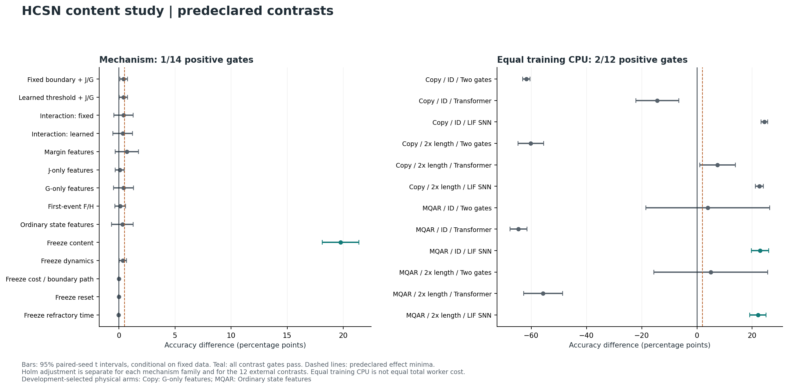
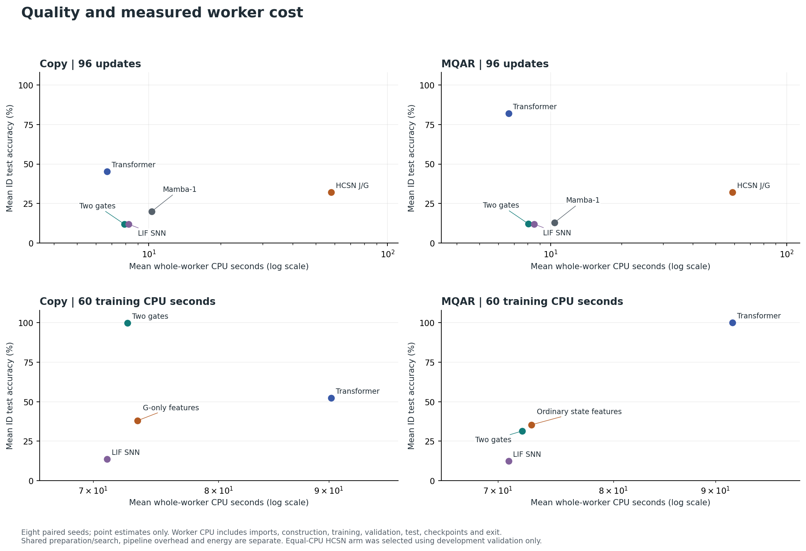

# Hepta Continuous Spiking Network：六阶段研究的最终判定

**本轮判定：NO_GO。** 可以借鉴 He–Xiong 的生成元、首达变换、值匹配和自由边界方法，建立包含发放、复位与不应期的可训练连续神经模型。本轮已经实现并核验了这样的数学与软件系统，也完成了真实训练权重到 native owner 的执行绑定。但现有证据不支持“六阶段验收全部通过”“相对强基线存在稳定完整净收益”或“可以据此规模化为有优势的全模态大模型”这三个结论。[数学规范](RESEARCH_MODEL_ZH.md)、[真实音视频结果](av/RESULTS_ZH.md)、[执行绑定](execution_binding/RESULTS_ZH.md)

决定性证据是：核心内容研究的 444 个任务有效，14 项机制比较通过 1 项、12 项外部比较通过 2 项；AV 的 90 个任务有效，八项主要收益比较仅一项通过。原始预测与独立统计复算均通过完整性核验；这些核验确认了结果，也确认了本轮优势门槛未通过。当前 CPU 实现没有速度优势，优化 GPU、能耗和基础模型规模未验证。NO_GO 限于本轮优势与规模化主张，不是对未来实现的不可能性证明。[AV 合同](av/AV_DESIGN.json)、[硬件结果](hardware/RESULTS_ZH.md)

## 1. 六阶段验收：运行完成与要求满足分别记录

| 阶段 | 已完成的交付与证据 | 对原验收要求的判定 |
|---|---|---|
| **1. 固定数学与事件合同** | 明确条件信息、模型时间、发放、复位、不应期；区分价值、次数、概率、首达与终点事件 | **在声明模型内满足。** 内容状态的物理概率不能直接称为类别后验；金融吸收违约不能直接替代再生发放 |
| **2. 低维自由边界 oracle** | 新增含发放后延续的有限 Bellman/QVI；策略迭代、独立 LP、收缩迭代及标签展开模型相互核验；193/193 数学检查与 7/7 Torch 检查通过 | **有限问题的求解器缺口已关闭。** 当前内容网络仍是 Brownian 边界与有限策略价值的代理模型，尚未成为内容分类的最优 QVI |
| **3. 真正联合训练** | 五类参数参与优化，保留真实冻结、梯度／更新和验证选择记录 | **联合优化实现通过；物理组件收益未建立。** 五组均实际更新，冻结均生效，但五项冻结收益比较仅内容参数一项通过 |
| **4. 隔离边界与双通道贡献** | 19 arms，完整 3×2 因子设计及单通道／冻结对照，同信息与活动参数匹配 | **稳定净收益要求未通过。** 机制 1/14、外部 2/12；两项外部通过来自普通特征变体，不能归因于 J/G |
| **5. 内容能力** | Selective Copy、MQAR、长度外推的核心研究；另完成新演员真实音视频编码与配对诊断 | **总体要求未通过。** AV 的一般外部净收益门槛失败；有限合成任务的结果不能抵消这一事实或证明全模态能力 |
| **6. Hepta 执行与规模化** | 训练权重的完整状态恢复、7 个真实 native 进程、消息交换干预、STOP 后拒绝；30 个 CPU 硬件场景完整测量 | **工程执行部分通过，规模化优势部分未通过。** 30 个 CUDA 场景不可用；没有 Joules、优化 GPU 或基础模型规模证据，当前 CPU 实现较慢 |

该表分别采用[数学合同与 oracle 报告](oracle/MATH_AND_STATUS_ZH.md)、[内容预注册](content/DESIGN.json)、[AV 预注册与结果](av/RESULTS_ZH.md)、[native 结果](execution_binding/results/attempt001/RESULT.json)及[硬件协议](hardware/results/attempt001/PROTOCOL.json)。它没有把“实现一个可运行版本”“实验全部完成”和“科学收益门槛通过”合并成一个状态。

## 2. 金融模型提供方法，神经模型需要新的收益与复位合同

He、Xiong 的 *Rollover Risk and Credit Risk*，*The Journal of Finance* 67(2)，2012，将股权价值、债务滚动损失与内生违约边界联立。其式 (11)、Proposition 1 和附录给出了生成元价值方程、解析表示以及边界确定的方法。违约使股权吸收终止，所以原条件是

\[
E(V_B)=0,\qquad E_V(V_B)=0.
\]

这些条件来自具体金融合同，不能仅将资产价值改称膜电位便继续使用。原论文见[作者保存的 PDF](https://www.princeton.edu/~wxiong/papers/rollover.pdf)；本文的精确映射和符号区别见[模型规范第 1–4 节](RESEARCH_MODEL_ZH.md)。

当前标量模型明确声明活动状态 \(dX_t=\mu\,dt+\sigma\,dW_t\)，发放即时收益 \(x-K\)，固定复位点 \(r<K\)，折现率 \(\rho>0\)，以及独立不应期。记 \(D=\mathbb E[e^{-\rho T_{\rm ref}}]\)，干预价值为

\[
G(x)=x-K+D J(r).
\]

于是应使用再生边界条件

\[
J(b^-)=G(b),\qquad J_x(b^-)=G_x(b)=1.
\]

其中斜率 1 来自线性发放收益。确定不应期给出 \(D=e^{-\rho\tau}\)，均值为 \(\tau\) 的 \(m\) 阶段 Erlang 等待给出 \(D=(1+\rho\tau/m)^{-m}\)；匹配无限期折现因子不等于匹配有限时间事件分布。以 \(\beta=(-\mu+\sqrt{\mu^2+2\rho\sigma^2})/\sigma^2\) 表示正根，边界满足 \(\beta(b-K)-1+D e^{\beta(r-b)}=0\)，有 Lambert \(W_0\) 闭式。证明限于固定参数、无限时域与固定复位的标量问题，不能直接覆盖有限网格、输入驱动系数和内容损失。[推导与实现](RESEARCH_MODEL_ZH.md)

本轮的 \(J,G\) 是策略／最优价值与干预价值，不是字面的金融 Call/Put。恢复力或再生力还需要声明如何接入状态方程、符号和量纲；价值函数本身没有定义生物膜电位力学。[模型规范](RESEARCH_MODEL_ZH.md)

### 2.1 双通道的实际含义与边界梯度

在上述最优标量问题的阈下区域，令安全距离 \(m=b-x>0\)，则

\[
G=\beta^{-1}-m,\qquad
J=\beta^{-1}e^{-\beta m}
 =\beta^{-1}e^{\beta G-1}.
\]

给定 \(\beta\) 后，两通道是同一安全距离的确定变换，没有增加独立输入信息。它们可能提供不同的优化特征，但这一可能性必须通过同信息、同容量的普通非线性对照检验。阈下 \(J_x>0,G_x=1>0\)，也不能从名称推出相反的恢复／再生力。[模型规范 §4.4](RESEARCH_MODEL_ZH.md)

光滑贴合还有一个直接限制。最优价值差 \(A=J-G\) 满足

\[
A=\frac{e^{-\beta m}-1+\beta m}{\beta}
 =\frac{\beta m^2}{2}+O(m^3),
\qquad A_x=-\beta m+O(m^2).
\]

它在阈下为正，在干预区为零，并不自然成为穿过正负号的脉冲变量；靠近边界时，状态梯度反而趋于零。因此，“移除阶跃”不足以推出更强梯度或更容易训练。分布期望 \(\mathbb E[J(X)]\) 可以反映均值以外的分布信息，但当前普通物理门控对照同样得到完整状态质量和参数。上述标量恒等式不能直接套用到有限网格策略向量与分布期望上。[模型规范 §4.4–4.5](RESEARCH_MODEL_ZH.md)、[同信息合同](content/DESIGN.json)

## 3. 概率、首达、计数与反向传播的验收范围

设 \(N(h)\) 为当前之后模型时间 \(h\) 内的发放数，\(T_1\) 为首次发放。六符号合同如下；每个量均以当前已知信息和完整状态为条件。

| 符号 | 本轮固定含义 | 需要保留的区别 |
|---|---|---|
| \(C\) | \(\mathbb E[N(h)]\) | 可以大于 1，不能充当概率 |
| \(P\) | \(\Pr(N(h)\ge1)\) | 至少发生一次的概率 |
| \(F\) | 声明初态与事件的首达 CDF | 只有初态、事件和原子约定相同才与 \(P\) 一致 |
| \(f\) | 首达分布的连续密度部分 | 零时刻边界原子另计，不等于风险率 |
| \(H_\rho\) | \(\mathbb E[e^{-\rho T_1}\mathbf1\{T_1\le h\}]\) | 折现首次事件权重，不能冒充价值或次数 |
| \(K\) | 发放即时成本 | 与收益同单位，不是风险概率 |

首达 \(\Pr(\sup_{s\le h}X_s\ge b)\) 不等于终点越界 \(\Pr(X_h\ge b)\)。重复次数使用完整再生传播；F/H 使用“下一次发放即杀死”的生成元，允许已有不应期完成，不允许首次发放后再循环，也不把剩余质量归一化。[首事件算子](content/models.py)

本实现中的“自由边界流”是概率质量、首事件通量与再生状态随输入演化；阈值越过和复位并不自动构成已证明的动力系统分岔或相变，本轮也没有完成这类相图认证。完整状态保留内容、活动／不应期概率质量、边界和时间；局部参数在规定传播段内冻结。物理分布没有被证明是类别后验，单独传递边界也不自动解决内容寻址。输入时长、模型时间、CPU 秒和 native tick 分别记录。[状态合同](RESEARCH_MODEL_ZH.md)

BP 已实现**稳定活动集合、非退化根和声明插值区间内的一阶导数**。QVI 策略切换、插值结点与实际 STOP 仍可能不光滑；记录中确有两侧导数不同的例子，也没有认证高阶导数。[梯度说明](oracle/MATH_AND_STATUS_ZH.md)

## 4. 数学 oracle：实现缺口关闭，任务范围没有扩大

新 oracle 在固定有限状态空间中求解

\[
\max\{r_i+(Qu)_i-\rho u_i,\ \max_a[g_{a,i}+D w^\top u-u_i]\}=0.
\]

主求解器为策略迭代，独立参考包括线性规划和收缩 Bellman 迭代。另建的标签证据任务明确令状态为真实后验，发放奖励为正确分类收益减成本；通过标签条件生成元和展开 CTMC 核对观测、收益及复位后独立新任务。所有后续发放周期均纳入价值。[有限 QVI 与任务报告](oracle/MATH_AND_STATUS_ZH.md)

最终数学检查 **193/193**、Torch 一阶梯度与实际优化路径检查 **7/7** 通过。策略迭代相对独立 LP 的最大值误差为 \(3.713\times10^{-13}\)，12 个参数导数的最大缩放差分误差为 \(8.796\times10^{-9}\)。这些是有限模型的数值检查，没有使用定向舍入，也没有界定连续空间离散误差。结果产生于新的公开封存之前，属于本地开发验证，不能改称盲测内容实验。[数学原始结果](oracle/results/local003/RESULTS.json)、[Torch 原始结果](oracle/results/torch001/RESULTS.json)

33 节点标准标签任务中，含发放后延续的最优值为 **4.9404162131**；优化时遗漏后续周期、执行时仍再生的策略为 **3.0704411247**；每次激活立即发放为 **4.3024390244**。这证明在这个任务中遗漏 reset continuation 会实质改变策略。但普通双阈值规则同样得到 **4.9404162131**，并在全部 20 个任务／网格组合中复现最优动作和值。该任务提供可靠 oracle，同时没有显示价值边界相对普通阈值的净收益。[数值与强对照](oracle/MATH_AND_STATUS_ZH.md)

旧移动网格 CTMC 上，已有可行策略相对原解析 Brownian 阈值改善至少约 **4.6051%** 的反例；这给出该阈值次优性的下界，没有证明改进幅度的理论上限。这个反例被保留；新增一个能够最优求解自身问题的 oracle，不会抹去原模型的次优性。尤其要区分：当前内容网络使用 Brownian/Erlang 边界及有限网格固定策略价值特征，它没有在每个内容任务上求解以分类损失为目标的最优 Bellman/QVI。[旧反例说明](RESEARCH_MODEL_ZH.md)、[新 oracle 范围](oracle/MATH_AND_STATUS_ZH.md)

## 5. 联合训练、边界与通道：核心内容研究

核心合同包括两个任务、19 个 arms、76 个开发任务、304 个固定更新任务和 64 个等训练 CPU 任务，共 444 个任务。输入长度为 32，外推长度为 64；每个正式比较使用八个配对种子。学习率由开发验证锁定，正式检查点由验证选择并在打开 test/OOD 前保存，保留全部尝试与原始预测。[内容设计](content/DESIGN.json)

设计完成了三种边界——固定、普通可学习阈值、价值边界——与 J/G 或普通物理特征的完整 3×2 交叉；还包含单价值、margin、F/H、五组冻结及普通双门控、Transformer、LIF SNN、Mamba-1。物理 arms 获得相同完整状态及参数，使用活动参数匹配，不能依赖某个 arm 独占隐藏信息。“冻结 boundary 参数组”冻结的是原参数分组，其他动力学参数仍能改变边界；真正静态边界由 fixed arms 提供，二者不能混称。[冻结与信息合同](content/DESIGN.json)、[模型实现](content/models.py)

这里需要分别回答三件事：组件是否真的参与训练，冻结／替换是否产生登记方向的解释性变化，以及相同完整成本下是否有可重复净收益。三者不由一次非零梯度检查共同保证。下面给出已完成训练账本的独立复核结果。

### 5.1 联合优化确实发生，但机制收益仅一项通过

444/444 个任务完整有效。完整模型的五个参数组在全部 16 个任务×种子运行中均发生变化；每个对应冻结组在全部 16 个运行中保持原样。这关闭了“只接入前向、没有实际参与学习”的实现疑问。但在预注册收益检验中，14 项机制比较仅有完整模型相对冻结内容参数通过；其余组件贡献没有达到各自完整门槛。[内容完整结果](content/RESULTS_ZH.md)、[独立审计](audits/content_outcome_001.json)

机制主比较在每个种子内先平均两个任务的 ID 准确率差，再对八个种子作配对分析；表中单位为百分点。常规行是完整 J/G 减对照，交互行是已登记的差中之差。通过要求均值至少 .5 个百分点、95% 区间下界大于 0、对应族内 Holm 单侧 p<.05；非交互项另满足校准保护。

| 类别 | 对照／交互 | 准确率差 | 95% 区间 | Holm p | 全部门槛 |
|---|---|---:|---:|---:|---|
| 冻结 | 冻结内容参数 | +19.7510 | [+18.1168, +21.3851] | 0.019531 | 通过 |
| 冻结 | 冻结动力学参数 | +0.3662 | [+0.0433, +0.6891] | 0.046875 | 未通过 |
| 冻结 | 冻结成本／边界参数组 | -0.0061 | [-0.0205, +0.0083] | 1.000000 | 未通过 |
| 冻结 | 冻结复位参数 | -0.0061 | [-0.0205, +0.0083] | 1.000000 | 未通过 |
| 冻结 | 冻结不应期参数 | -0.0183 | [-0.0487, +0.0121] | 1.000000 | 未通过 |
| 边界 | 固定阈值＋J/G | +0.4211 | [+0.0769, +0.7654] | 0.039062 | 未通过 |
| 边界 | 普通可学阈值＋J/G | +0.4028 | [+0.0257, +0.7800] | 0.039062 | 未通过 |
| 通道 | 安全距离特征 | +0.7141 | [-0.3257, +1.7539] | 0.332031 | 未通过 |
| 通道 | 单 J 特征 | +0.0854 | [-0.3185, +0.4894] | 0.667969 | 未通过 |
| 通道 | 单 G 特征 | +0.4150 | [-0.4867, +1.3168] | 0.640625 | 未通过 |
| 通道 | 首事件 F/H | +0.1221 | [-0.3575, +0.6016] | 0.667969 | 未通过 |
| 通道 | 价值边界＋普通状态特征 | +0.3174 | [-0.6437, +1.2785] | 0.667969 | 未通过 |
| 交互 | 固定阈值交互 | +0.4089 | [-0.4482, +1.2660] | 0.289062 | 未通过 |
| 交互 | 可学阈值交互 | +0.3479 | [-0.5187, +1.2145] | 0.289062 | 未通过 |

价值边界相对固定／普通可学阈值的区间下界为正，校正 p 均为 .039063，但均值只有 .4211/.4028 个百分点，未达到 .5 的最小收益门槛。因此不能写成“没有统计差异”，也不能写成已达到有意义的稳定收益。边界参数组、复位、不应期冻结后的准确率变化接近零；只有内容参数冻结造成明显下降。[逐任务及完整对比](content/RESULTS_ZH.md)

### 5.2 固定更新与等训练 CPU 给出不同的比较

先列固定 96 次更新的描述性均值，八个种子；OOD 长度为 64。

| 模型 | Copy ID | Copy OOD | MQAR ID | MQAR OOD |
|---|---:|---:|---:|---:|
| HCSN J/G | 32.0801% | 29.3213% | 32.2388% | 30.5298% |
| 普通双门控 | 11.8408% | 12.3657% | 12.2070% | 11.5356% |
| Transformer | 45.2148% | 28.8818% | 81.9702% | 48.3032% |
| LIF SNN | 11.8286% | 12.3657% | 11.9995% | 11.9263% |
| Mamba-1 | 20.0073% | 14.4043% | 13.0005% | 12.4634% |

固定更新没有等化计算成本。HCSN J/G 的完整 worker CPU 在两任务约为 58.02/59.06 秒，Transformer 为 6.69/6.63 秒。普通双门控在固定 96 步时接近随机水平，增加到等 CPU 预算后其 Copy 表现明显提高；仅展示前一张表会遗漏这项重要成本差异。

等训练 CPU 比较的物理变体已经由开发集锁定：**Copy 选择 `value_g`，MQAR 选择 `value_ordinary`，均非 J/G 双通道。** 两者学习率均为 .003。下表报告目标 60 训练 CPU 秒组的实际均值；末次优化步可能使计时略超出目标。

| 任务 | 模型 | ID 准确率 | OOD 准确率 | 实际更新数 | 完整 worker CPU 秒 |
|---|---|---:|---:|---:|---:|
| Copy | 已选 HCSN：单 G 特征 | 38.0005% | 35.3027% | 125.750 | 73.393 |
| Copy | 普通双门控 | 99.7559% | 95.4834% | 2174.875 | 72.618 |
| Copy | Transformer | 52.3438% | 27.8564% | 3867.500 | 90.217 |
| Copy | LIF SNN | 13.5742% | 12.6831% | 1795.375 | 71.051 |
| MQAR | 已选 HCSN：价值边界＋普通状态特征 | 35.3882% | 34.1675% | 129.000 | 72.781 |
| MQAR | 普通双门控 | 31.4819% | 29.1870% | 1941.125 | 72.009 |
| MQAR | Transformer | 100.0000% | 89.8560% | 3900.500 | 91.810 |
| MQAR | LIF SNN | 12.5366% | 12.0972% | 1744.875 | 70.873 |

12 项外部比较仅 2 项通过：MQAR 上的价值边界＋普通状态特征，相对 LIF 的 ID/OOD 质量比较。它们不能归因于 J/G 双通道；其完整 worker CPU 仍为对照约 1.0269 倍，已登记的推理墙钟为约 13.8946 倍，也不是完整系统效率收益。

Copy 的单 G 变体对 Transformer 的 OOD 均值高 7.4463 个百分点，但 Holm p=.0625，未通过校正门槛；同时普通双门控在同一任务的 ID/OOD 分别达到 99.7559%/95.4834%，远高于该变体。MQAR 上 Transformer 达到 100%/89.8560%，选定物理变体为 35.3882%/34.1675%。这些结果支持本轮一般内容净收益验收失败。[全部 12 项区间、校准与成本比较](content/RESULTS_ZH.md)

### 5.3 可核对的完整成本范围

核心研究的三个外层阶段合计 23,292.648471 CPU 秒，另行打包 77.842687 秒，已测不重叠下界为 **23,370.491158 CPU 秒**。444 个 worker 的 23,263.357600 CPU 秒已包含在外层，不能重复相加。它包含数学／预检、数据登记、开发搜索、正式训练、验证选择、测试、分析及真实 native 执行；安装、未计量平台启动／传输／发布 CPU 与实际 Joules 不在该下界内。[成本补充](audits/core_cost001.json)

封存的独立摘要审计从 453 个输入文件重算完整矩阵、开发 argmin、选择锁、配对统计与成本，5,568 项检查全部通过，源码不导入原分析／指标／模型。该审计仅使用 worker RESULT 和账本；原始 logits 与标签复算是独立的后续检查。[摘要审计](audits/content_outcome_001.json)

完整 GitHub 运行成功结束后，原先封存且未经修改的原始预测审计读取了全部 **1,624 份 NPZ、444 个 worker、1,662,976 个预测位置**，逐文件核对登记标签、监督位置与顺序，零失败。预测位置数包含跨模型、种子与检查点的重复，并非同等数量的独立样本。独立重算的最大绝对误差为：交叉熵 \(4.44\times10^{-16}\)、准确率 0、Brier \(2.22\times10^{-16}\)、ECE \(2.22\times10^{-15}\)，均低于原登记容差 \(2\times10^{-12}\)。因此，本报告中的质量结论不仅与 worker 汇总一致，也经原始数组核对。[原始指标审计](audits/content_raw_metric001.json)

原始审计另耗完整子进程 CPU **3.837443 秒**、墙钟 **4.123706 秒**，协调进程 CPU **0.001561 秒**；这些属于后处理，未伪装为原训练预算。运行占用 runner 的训练／发布 job 墙钟合计 **6,128 秒**，不含排队时间；未知发布 CPU、安装与传输 CPU 以及能耗仍记为未知。[原始审计外层成本](audits/content_raw_metric_execution001/RUNNER_CONTENT_RAW_METRIC_RESULT.json)、[完成后成本回执](audits/core_cost002.json)

八种子只描述固定数据下的训练随机性；全枚举符号翻转仍依赖符号对称／可交换性条件。四个机制族分别作 Holm 校正，不能改写为所有对比的统一全局保证。任务平均必须同时列出 Copy/MQAR 的 ID/OOD 方向。[统计解释](audits/STATISTICAL_INTERPRETATION_ZH.md)

## 6. 真实音视频：90 个有效任务，八项主比较只有一项通过

研究使用 CREMA-D 新演员数据：训练／验证／测试为 16/6/8 个互斥演员、384/144/192 个片段，每模态为 32×128 低层特征。两个编码器及共享分类头共同训练；整段离线插值与后期平均 logits 融合界定了任务范围。它不是在线因果媒体解码器，也没有自然语言或基础模型规模。[数据与目标合同](av/AV_DESIGN.json)、[AV 完整报告](av/RESULTS_ZH.md)

90/90 任务有效，独立复算 5,412 项检查通过、核对 584 个输入文件且无错误。固定 256 更新和等 60 训练 CPU 秒各有 40 个正式任务，另有 10 个开发任务。五模型使用同一信息、开发学习率集合和种子计划；两种学习率与短开发训练提供相同调优预算，并不构成充分的 SOTA 调优。[独立 AV 审计](audits/av_outcome_001.json)

HCSN 两预算的平均融合准确率为 **29.6875%/30.9896%**，Transformer 为 **33.9193%/34.7005%**。[各模型完整均值](av/RESULTS_ZH.md)

下表差值为 HCSN 减对照，单位为百分点。95% 区间使用 20,000 次演员×配对种子交叉 bootstrap；校正下界为八项比较的单侧 Bonferroni 下界。通过还要求均值增益至少 2 个百分点，以及 Brier/ECE 的登记保护条件。[不可变 AV 分析](https://github.com/TrillionniumFoundation/hepta-private-ci/blob/7cf647fbcb99014bb85e9fa251d84d2b7afac35e/experiments/hcsn_blocker_closure_v1/av/results/hosted001/ANALYSIS.json)

| 预算 | 对照 | 准确率差 | 95% 区间 | 校正下界 | 校准保护 | 总体门槛 |
|---|---|---:|---:|---:|---|---|
| 固定更新 | 普通双门控 | +2.799 | [−2.018, +8.073] | −3.385 | 未通过 | 未通过 |
| 固定更新 | Transformer | −4.232 | [−9.180, +0.716] | −10.482 | 未通过 | 未通过 |
| 固定更新 | LIF SNN | +8.138 | [+3.516, +12.500] | +2.018 | 未通过 | 未通过 |
| 固定更新 | Mamba-1 | +7.943 | [+1.302, +15.169] | −0.456 | 未通过 | 未通过 |
| 等 CPU | 普通双门控 | +1.758 | [−1.758, +5.273] | −2.865 | 通过 | 未通过 |
| 等 CPU | Transformer | −3.711 | [−8.138, +0.911] | −9.245 | 通过 | 未通过 |
| 等 CPU | LIF SNN | +9.570 | [+4.622, +14.909] | +3.255 | 通过 | **通过** |
| 等 CPU | Mamba-1 | +5.859 | [+0.977, +11.003] | −0.456 | 通过 | 未通过 |

固定更新对 LIF 的准确率下界虽为正，ECE 恶化 .063744 超过 .02 容限，因此仍未通过。等 CPU 对 LIF 的单项通过保留为真实局部结果；它不满足预注册“一般外部净收益须八项全部通过”的条件。不能事后删除校准门槛或选择有利预算来改变该判定。[AV 结果与原门槛](av/RESULTS_ZH.md)

融合也未显示稳定协同：HCSN 两预算下音频单模态准确率为 32.2917%/32.9427%，均高于对应融合准确率；全池 audio→video R@1 只有 .1953%/.4557%，Transformer 为 9.1146%/7.8776%。错配敏感性本身不足以证明跨模态推理。只有八名测试演员，192 个片段和 20,000 次 bootstrap 都不会增加独立演员数；区间仍是小样本近似。[AV 检索与融合诊断](av/RESULTS_ZH.md)、[统计范围](audits/STATISTICAL_INTERPRETATION_ZH.md)

成本也限制优势主张：固定更新 HCSN 的完整 worker CPU 均值为 85.095 秒，Transformer 为 6.932 秒；双模态 B16×T32 驻留推理 CPU 均值为 92.085 ms 对 2.557 ms。AV 全流程已测不重叠 CPU 下界为 **4430.109678 秒**，包括协调训练分析、新数据获取解码与打包；worker 和训练子时钟已包含其中。缺失 FFmpeg 的前置尝试保留了 12 秒墙钟，但 CPU 未知；安装、部分传输与平台开销未测，不能按零补齐。[完整成本范围](audits/av_outcome_cost001.json)、[AV 报告](av/RESULTS_ZH.md)

## 7. 训练权重已进入真实执行链，任务最优停止仍未得到证明

事前固定的 `selective_copy/value_jg/seed881101` 由验证选择第 96 步。恢复后进行长度 128、切点 37 的新进程续跑，后缀 logits 与最终完整状态逐位一致。连续 native 执行与三步前缀后恢复同样得到一致语义事件和神经状态，真实执行五次 KEEP、随后 STOP；停止后新增神经调用为 0，owner 拒绝新 tick，重复事件满足幂等合同。[绑定来源](execution_binding/results/attempt001/BINDING.json)、[执行报告](execution_binding/RESULTS_ZH.md)

实际启动的 7 个 native 进程包含连续／前缀／恢复三个进程和四个消息交换进程。相同 owner 前缀下，低 \(J-G\) 消息产生 STOP，高消息产生 KEEP；在高状态发送低消息会转为 STOP，在低状态发送高消息会转为 KEEP。这证明真实训练网络的连续价值消息能因果地改变 owner 动作。校准只使用未标注训练输入，整个绑定没有访问正式 test/OOD。[原始干预记录](execution_binding/results/attempt001/RESULT.json)

停止采用工程目标，未证明分类最优性或效用增益；Python/PyTorch 执行神经内核，native owner 执行消息与终止合同。32/128/512 长度下的 **484 B** 仅为固定 batch/model 的持久 elapsed/content/probability/boundary 张量，排除 81,632 B 权重、输入输出、临时量、日志、Python 对象及 BPTT 图。[执行范围](execution_binding/RESULTS_ZH.md)

完整 worker `wait4` 为 **12.164039 CPU 秒、12.418240 墙钟秒**，包含导入、来源验证及全部子进程／IPC；内部成本不能再次相加。`ru_maxrss=256076 KiB` 是进程峰值统计，不是进程树同时内存之和。权重通信与恢复已验证，任务驱动停止和规模化收益尚未验证。[完整成本](execution_binding/results/attempt001/WHOLE_WORKER_COST.json)

## 8. CPU 参考实现：测量完整，性能优势未出现

硬件探针固定两个任务、五模型、种子 881101，使用验证输入及已经锁定的检查点。每个场景新建状态并执行完整 T32 前向，包括相应更新、复位和不应期。30 个 CPU 场景完成且参考输出差为 0；30 个 CUDA 场景因设备／运行时不可用而保留为不可用，没有用 CPU 数据代替。[硬件结果](hardware/RESULTS_ZH.md)

| B32、T32 输入驻留范围 | HCSN J/G 中位墙钟／批 | Transformer 中位墙钟／批 | 比值 |
|---|---:|---:|---:|
| Selective Copy | 120.747 ms | 1.931 ms | 62.52 倍 |
| MQAR | 116.860 ms | 1.833 ms | 63.75 倍 |

六组任务×batch 比值为 52.77–63.75 倍。每种范围预热三次、计时二十次，均来自同一检查点和主机，不是独立模型／机器复制。驻留、含复制、加载和完整进程范围分别记录，偶然较低的含复制中位数不意味着负复制成本。[完整硬件表](hardware/RESULTS_ZH.md)

注册、测量两个完整子进程加协调器登记范围内自身 CPU，共 **24.873810 秒**；与绑定执行先后进行，没有 Torch 重叠，内部推理计时已包含其中。当前未执行优化融合内核、CUDA 推理或能量计数，CPU/GPU/整机 Joules 均为 null。不能从这些结果推断未来优化的速度下限或未测 GPU 优势。[完整硬件成本](hardware/results/execution001/RUNNER_HARDWARE_RESULT.json)

## 9. 新颖性与相对 SNN、Transformer 的可支持表述

当前工作可以称为“采用再生价值边界、完整概率状态和可训练内容状态的研究架构”。“连续”“解析”“可反传”各自都有直接先例：LTC 学习连续时间常数，CfC 构造显式时间的解析近似网络，EventProp 对声明脉冲系统计算事件梯度，Mamba 系列提供选择性状态与硬件执行方法。神经群体概率通量、复位与自由边界也已有文献。当前未完成穷尽的优先权检索，不主张全球首次。[相关工作与原始文献](RELATED_WORK_ZH.md)

相对 SNN，连续期望可能改变梯度训练表现，却不保证事件稀疏执行；当前没有 EventProp、moment neural networks 或神经形态硬件强对照。相对 Transformer，固定持久状态可能适合长流恢复，但内容召回和完整成本仍需验证。CfC/LTC、Mamba-2 与现代融合内核没有进入本轮完整比较，串行 Mamba-1 不能代表其硬件上限。现有小型离线 AV 编码也不覆盖语言建模、开放域检索或长视频。[比较缺口](RELATED_WORK_ZH.md)

可直接核对的主要原始文献包括 [LTC](https://cdn.aaai.org/ojs/16936/16936-13-20430-1-2-20210518.pdf)、[CfC](https://www.nature.com/articles/s42256-022-00556-7)、[EventProp](https://pmc.ncbi.nlm.nih.gov/articles/PMC8213775/)、[Mamba](https://arxiv.org/abs/2312.00752)、[Mamba-2](https://proceedings.mlr.press/v235/dao24a.html)和 [FlashAttention-2](https://arxiv.org/abs/2307.08691)。这些文献不是本轮实测基线；它们说明仍需补齐的比较，而非为 HCSN 提供可转借的速度或质量数值。

## 10. 证据、复现与下一轮的决策条件

本轮保留了数学开发记录、源码审查修复、前置失败、预检、注册、数据身份、全部训练与验证选择、原始预测、native 状态和完整成本。恢复使用外部固定的提交、发布清单与 INDEX；选择性恢复验证整条归档及全部成员，却只保存明确选中的文件，不称为完整落盘。具体永久位置与字节校验如下。

| 证据 | 不可变提交／登记 | 完整性范围 |
|---|---|---|
| 核心内容训练与数学／native 执行 | 源码 `c9063043d088b6b469e740b9b6f341f3faea3928`；[永久证据 `65c7554c89d35023112e607f45c96e0f23551a06`](https://github.com/TrillionniumFoundation/hepta-private-ci/tree/65c7554c89d35023112e607f45c96e0f23551a06/experiments/hcsn_blocker_closure_v1) | 336 个发布文件的远端 Git blob 与字节数全部匹配；归档 8,567 个原始成员全部通过 SHA-256 核验 |
| 真实音视频 | 源码 `6469cc94a72aed214c5c9d2ff2fba14cdb146626`；[永久证据 `7cf647fbcb99014bb85e9fa251d84d2b7afac35e`](https://github.com/TrillionniumFoundation/hepta-private-ci/tree/7cf647fbcb99014bb85e9fa251d84d2b7afac35e/experiments/hcsn_blocker_closure_v1/av) | 266 个发布文件远端身份全部匹配；归档 1,140 个成员核验通过 |
| 独立后处理源 | `656d3fc218754717302672d7dd3790a1ac290834` | 摘要与原始指标审计在正式结果读取前封存；其科学逻辑、容差与访问条件未变 |
| 完成的 AV 审计、训练绑定与 CPU 场景 | `3aeb7c6ea6f07ed841edf9ea96e597e495e54fa4` | 247 个补充文件的远端 Git blob 与字节数全部核验；随后新增核心审计和最终报告 |

核心归档 SHA-256 为 `2da69e90f9fcf9c5558f26b10b64067c033184b70a8fe51ec40c6dd566e7aec5`，AV 归档为 `4114013bedd0207ffd0409c76a6f67ad4ea6b9d0220e3459588fd3fa2505b68a`。两条运行均成功完成，原始阈值和未通过的收益比较均保留。详细文件、来源、复现锚点和交付状态见 [SOURCE_AND_EVIDENCE.json](SOURCE_AND_EVIDENCE.json)、[BLOCKER_LEDGER.json](BLOCKER_LEDGER.json)、[核心远端核验](audits/CORE_PERMANENT_PUBLICATION_VERIFIED.json)与 [AV 远端核验](audits/AV_PERMANENT_PUBLICATION_VERIFIED.json)。

源码与流程检查的最终状态如下；工程 CI 的通过不能改变预注册科学收益门槛。

交付保持 [PR #4362](https://github.com/TrillionniumFoundation/hepta-private-ci/pull/4362) 为 draft，执行范围为 **SHADOW_ONLY / DENY_ALL / NO_GO**，未合并。最终交付提交的 CI 必须按其准确 head SHA 查询；较早提交的绿色状态不能转借给新提交。本地新增文件的拼写、JSON、Python 语法、禁止新增 future imports、文件大小及报告引用检查见 [FINAL_LOCAL_CHECKS.json](audits/FINAL_LOCAL_CHECKS.json)。这些检查不等于整个仓库 CI 全绿。

为避免“把 CI 回执写进提交后又改变被检查的提交”，最终 head 身份、原始 checks/runs 回执和逐项状态另存于独立证据分支 [research/hcsn-final-checks-20261031](https://github.com/TrillionniumFoundation/hepta-private-ci/tree/research/hcsn-final-checks-20261031/experiments/hcsn_blocker_closure_v1/audits/final_delivery)。PR 说明同时报告同一 head 的实际结果。历史 Rust／跨平台构建失败、当前排队与未测 GPU 项目均保留；没有更改门槛、伪造检查状态或用研究脚本成功替代合并要求。

复现入口见 [REPRODUCE_ZH.md](REPRODUCE_ZH.md)。恢复证据、重新计算统计量、重新执行推理和重新训练是不同操作。新的本地重训应有新预检、注册和输出目录，不伪造原 GitHub 执行身份；新的超参数、数据或硬件优化必须另立协议，不能利用本轮测试结果修改门槛后再声称同一实验通过。

下一轮首先需要任务一致的充分状态、损失与发放后延续，再与普通阈值／门控作同信息、参数和完整成本比较。当前约 63 倍 CPU 延迟差、AV 收益失败及缺失的 GPU／能耗／规模证据是继续决策的起点。达到新协议条件前，不把工程完成表述为全部 blocker 已关闭。
