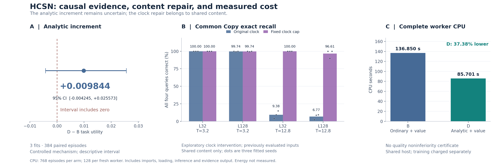

# HCSN causal execution v3

This research follow-up separates prediction effects, content addressing and actual execution costs. It adds new-world 2×2 mechanism runs, a length/time diagnostic and fixed clock intervention, ordinary AV feature probes, and a READ-before-payload runtime with real process recovery.

**The main analytic increment remains inconclusive.** The implementation and evidence contracts passed their checks; general AV recognition, same-quality sensing savings and production qualification did not.

## Main findings

| Question | Observed result | Interpretation |
|---|---|---|
| Does analytic forecasting affect decisions? | Current-only and hypothetical-READ interventions produce different action changes; the current-only prefix matches D before the first READ in 768/768 worlds. | Locates forecast effects; not an independent Put-channel proof. |
| Is there an extra D−B gain under the same controller? | Matched utility +0.009844, descriptive 95% interval [−0.004245, +0.025573]. | Three independently fitted groups; no established gain or preregistered noninferiority certificate. |
| Why does long Copy fail? | Common Copy at L128/T3.2 is 99.7396%, versus 6.7708% at T12.8; fixed clock caps raise the latter to 96.6146%. | Exploratory repair of shared content, with one fitted seed still at 89.8438%; not analytic-core attribution. |
| Is there a usable AV frontend and sensing saving? | Ordinary models fit training perfectly, but old-test emotion/binding are 41.67%/54.17%. Both quality-guarded stream selections choose READ-all. | Generalization remains insufficient; eligible encoding and payload saving is zero. |
| Is cost measured completely? | Mechanism B/D workers use 136.850036/85.700836 CPU seconds across 768 episodes each; D uses 37.3761% less. | Complete fresh-process measurement in this assay, without a quality noninferiority certificate. |

The ordinary mechanism core is a 23,712-parameter gated feedforward model, not an SSM. The analytic core has a known renewal prior and no fitted core parameters. The stream study uses a common ordinary encoder and does not borrow mechanism-arm attribution.

## Reports and implementation

- [Complete Chinese report](REPORT_ZH.md)
- [Mechanism results, all contrasts and complete-worker costs](MECHANISM_RESULTS.md) — [runner](mechanism_followup.py), [behavior tests](mechanism_followup_tests.py)
- [Memory diagnosis and exploratory clock repair](MEMORY_RESULTS_ZH.md) — [causal address memory](memory_probe.py), [clock intervention](memory_clock_repair.py)
- [AV fitting, selection and generalization](AV_RESULTS.md) — [feature probe and prefix interface](av_probe.py)
- [Causal reading, recovery and local execution costs](STREAM_RESULTS_ZH.md) — [runtime](stream_runtime.py), [study](stream_study.py), [independent audit](stream_audit.py)
- [Verified restoration and reproduction commands](REPRODUCE.md)
- [Plot source](plot_results.py), [exact values](figures/PLOT_DATA.csv), [input/output hashes](figures/PLOT_SOURCE.json), [editable figure](figures/hcsn_three_findings.svg)

Raw `results/` paths referenced by these reports are available after the verified evidence restore. The four bundle manifests cover 1,578 members, including protocols, checkpoints, unselected candidates, predictions, action traces, source/payload identities, process receipts, audits and preserved development failures:

| Bundle | Members | Manifest |
|---|---:|---|
| Memory and fixed clock intervention |188|[memory001](artifacts/memory001/memory001.json)|
| Ordinary AV probes |743|[av_probe001](artifacts/av_probe001/av_probe001.json)|
| Final mechanism run |335|[mechanism_final001](artifacts/mechanism_final001/mechanism_final001.json)|
| Stream execution and full AV cost replay |312|[stream001](artifacts/stream001/stream001.json)|

## Identity and execution scope

Exact inherited source baseline: `c5e159ec6c5ba174b36debacad166da635c57d48` (PR #4519). Research branch: `research/hcsn-causal-execution-v3-20261031`. The final stream sources and formal002 protocol were externally published **before execution** at `58734d86b5dd8436f56a210632fca1acf8f3ea6c`. Imported dependency identities are retained in [MATERIALIZED.json](provenance/MATERIALIZED.json). Publication records identify the final delivery commit; no local synthetic HEAD is substituted.

All 63 mechanism and 26 stream workers completed successfully; all 36 real child-process resumes matched uninterrupted execution. Mechanism workers total 399.623781 CPU seconds, with coordinator and later analysis separate. The stream outer process costs 13.263035 CPU seconds **including** its 13.064231 internal-worker total. A separate full AV replay costs 3.010586 CPU seconds and exactly matches model/prediction arrays in all 732 NPZ files; the earlier approximately 1.497-second AV body measurement is a separate run and scope.

Measurements use a shared CPU host. Stream requests read prepared feature payloads, with no original-media decoding, physical sensor/network or joule claim. Six repeated test executions reuse the same two old test actors; they do not create new independent quality samples. Production activation remains false.

## What remains open

Confirm the fixed clock treatment on untouched sequences and resolve the remaining Copy failures; obtain a common AV encoder that generalizes across more independent actors/sessions; compare analytic and strong ordinary predictors with the same controller; and preregister a quality tolerance plus a complete cost measure before a new economic confirmation. The new contracts make those studies executable, attributable and recoverable, while preserving the present negative and inconclusive outcomes.
