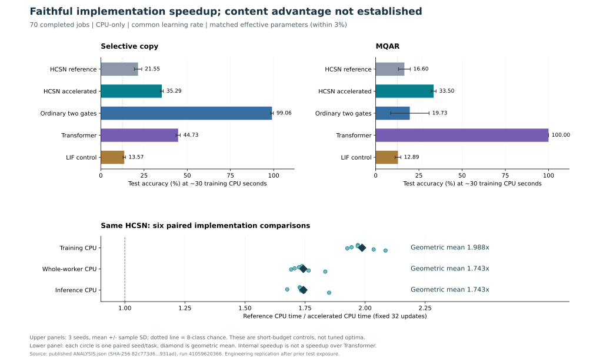

# Hepta Continuous Spiking Network：六阶段执行与验收报告

日期：2026-10-30。执行源封存于 `78b98ed8dd66294a3de6abce2fa0bbbd2c24f8d5`；70 项托管实验的原始证据提交为 `a0de582931981b3742433475ecf5565409854a5c`。本报告及独立审计是随后增加的解释和复核材料，不改变这两个历史版本。[运行记录][RUN] · [Draft PR #4362][PR] · [复现指南](REPRODUCE.md)

## 1. 结论与实际交付

**已实现可训练、可流式恢复、能驱动真实 Hepta KEEP/STOP 消息的有限分布神经元，并完成 70/70 项有效的托管比较。最清楚的正结果是同一 HCSN 实现的保真加速：训练 CPU 时间几何平均加速 1.9875×，完整 worker CPU 加速 1.7430×。目前没有通过自由边界、双价值通道或总体内容能力的净收益验收，也没有训练出全模态大模型。**

主任务在约 30 个训练 CPU 秒内，HCSN 加速版在 Copy 达到 35.29%，普通双门控达到 99.06%；HCSN 在 MQAR 达到 33.50%，Transformer 达到 100%。全部 18 项外部质量条件比较均未合格。内部加速是真实可复现的工程改进；现有内容结果不支持把它表述成超过 Transformer、普遍超过 SNN 或已获得更低能耗。[原分析][ANALYSIS] · [独立统计复算](reports/HOSTED_COMPARISON_AUDIT.md)

这张图直接读取已发布 `ANALYSIS.json`，并验证其 SHA256 后生成。[绘图脚本](reports/plot_hosted_results.py)。上图误差线是固定数据划分上的 3 个初始化 seed 的样本标准差，不是总体置信保证；下图每个点是一组任务/seed 配对。

## 2. 对用户六项验收逐项交账

| 阶段 | 已实际完成的工作 | 当前验收判定 |
| --- | --- | --- |
| 1．数学与事件合同 | 六符号、条件信息、物理时间、首达/重复事件、移动边界原子、复位和不应期均已定义；保留完整概率状态 | **合同完成**，明确保留有限网格和 Erlang 近似 |
| 2．自由边界 oracle | 含发放后价值的标量 QVI、闭式策略值、唯一边界根、隐式梯度、独立数值解；实际有限生成元的策略价值也可求解 | **标量 oracle 通过**；有限反射网格和分类任务的最优边界未成立，已记录反例 |
| 3．真正联合训练 | 内容、动力学、边界相关参数、复位、不应期均有真实有限梯度和选定 checkpoint 的实际更新；存在穿过概率传播的梯度路径 | **联合可训练通过**；完整逐组件冻结实验和组件必要性证明尚未完成 |
| 4．隔离边界与双通道 | 保留原 v1/v2 机制对照；执行新的同信息、近似等有效参数、带完整 worker 成本的外部控制 | **正向贡献验收未通过**：原机制门为 0/6、0/4；新外部质量门为 0/18 |
| 5．内容能力 | 已做 Copy、MQAR、不规则时间、原时序外推任务与真实 CREMA-D 音视频特征实验 | **内容优势未通过**；真实 AV 结果仍接近机会水平，不能外推到通用 encoder 或全模态基础模型 |
| 6．Hepta 执行与规模化 | 训练后神经状态驱动实际 Rust owner 消息；跨解释器恢复；连续值干预改变 KEEP/STOP；CPU 算子加速和分层成本已测 | **执行链路与 CPU 保真加速通过**；GPU 调优、原生神经核、直接能耗、大模型质量/成本联验尚无证据 |

上述判定区分“实验已执行”与“优势门槛通过”。未知项没有按零处理，失败项没有被后续成功覆盖。[数学阶段审计](reports/SIX_STAGE_AUDIT_1_3.json) · [此前内容与执行审计](reports/PRIOR_CONTENT_EXECUTION_AUDIT.md)

## 3. 与 He–Xiong 原论文的关系

He 与 Xiong 的 *Rollover Risk and Credit Risk*（*Journal of Finance*, 2012, 67(2):391–430）通过债务展期损失、股权价值和内生违约边界耦合来刻画信用风险。可迁移的是“给定生成元与收益，联合求价值和内生边界”的建模技术。本项目没有把完整金融债券/股权模型原封不动地移植为神经元，也没有把其风险中性违约概率当作神经发放概率。[作者发布的论文 PDF][PAPER]

目前的两个神经特征是 **当前策略价值 $J^\pi$** 与 **立即干预价值 $G^\pi$**。后者包含复位后的延续价值，既不是字面金融 Put，也不是 default probability。价值是一个期望回报；它本身没有“恢复力”或“恐慌力”的必然符号，作用方向由任务学习出的门控决定。$J^\pi$ 也不是单独的 continue-action Q 值：在次优固定策略下，不能默认 $J^\pi-G^\pi\ge0$。[事件与数学合同](CONTRACT.md)

### 3.1 六符号的准确含义

给定时刻 $t$ 的因果信息 $\mathcal I_t$、完整初始状态 $z$，以及此观察间隔内冻结的系数，定义：

| 符号 | 定义 | 类型 |
| --- | --- | --- |
| $C(s\mid z,\mathcal I_t)$ | $\mathbb E[N_s\mid z,\mathcal I_t]$，包含所有复位后的再次发放 | 非负期望计数，可大于 1 |
| $P(s\mid z,\mathcal I_t)$ | $\Pr(N_s\ge1\mid z,\mathcal I_t)$ | 概率 |
| $F(s\mid z,\mathcal I_t)$ | 指定活动初态和冻结算子下，下次首次发放的 CDF | 概率分布函数 |
| $f(s\mid z,\mathcal I_t)$ | 首达时间分布的绝对连续部分 | 密度，单位为时间的倒数；原子另计 |
| $H_\rho(s\mid z,\mathcal I_t)$ | $\mathbb E[e^{-\rho T_1}\mathbf1_{T_1\le s}\mid z,\mathcal I_t]$ | 折现后的首事件权重 |
| $K$ | 即时仿射发放收益 $x-K$ 中的成本 | 收益单位 |

这里 $C/P$ 是工程合同中的计数/概率符号，不能再同时用作 Call/Put。终点超阈概率 $\Pr(X_s\ge b)$、区间首达概率和重复发放次数是不同对象。已有重复发放算例中，首事件概率约 0.9641，而期望发放次数约 4.8117，直接说明用一个概率代替计数会失真。[六阶段数学审计](reports/SIX_STAGE_AUDIT_1_3.json)

移动边界下降时，已经被新边界覆盖的活动概率在时间零立即发放，收益依据复位前位置计算；它是概率原子，不应伪装成连续密度。已有不应期质量继续计时，不因新 observation 重新启动；区间内所有后续复位循环继续计数。模型物理时间是 $0.1\,dt$，与硬件秒数、owner 的 READ/tick 数分别记录。具体顺序见 [CONTRACT](CONTRACT.md)。

### 3.2 含发放后价值的标量 oracle

声明的标量问题为

$$
dX_t=\mu\,dt+\sigma\,dW_t,\qquad
\sigma>0,\quad\rho>0,\quad r<K,\quad\tau\ge0.
$$

发放获得 $x-K$，经过确定不应期 $\tau$ 后从 $r$ 再生。相应干预算子与 QVI 是

$$
\mathcal M U(x)=x-K+e^{-\rho\tau}U(r),\qquad
\max\{\mathcal L U-\rho U,\mathcal M U-U\}=0.
$$

令

$$
\kappa=\frac{\sqrt{\mu^2+2\rho\sigma^2}-\mu}{\sigma^2},\qquad
q=e^{-\rho\tau-\kappa(b-r)}.
$$

给定可行阈值 $b>K$，其继续区域的策略值是

$$
U_b(x)=e^{\kappa(x-b)}\frac{b-K}{1-q},\qquad x<b.
$$

价值匹配和光滑粘贴给出

$$
U(b)=\mathcal M U(b),\quad U'(b-)=1,\quad
\Psi(b)=\kappa(b-K)-1+q=0.
$$

在这个声明域内，

$$
\Psi_b=\kappa(1-q)>0,\qquad
\frac{\partial b}{\partial\theta}
=-\frac{\Psi_\theta}{\Psi_b}.
$$

这里 $\Psi_\theta$ 是固定 $b$ 取偏导；约束参数化及有效不应期需走完整链式法则，当前只认证一阶隐式梯度。因此边界可通过隐式梯度进入 BP。最优点的继续区值简化为 $U(x)=e^{\kappa(x-b)}/\kappa$。原数学文件还验证了全局 QVI 不等式和横截条件；仅有 matching/pasting 本身不足以证明最优性。此前 24 项、覆盖 6 个物理参数的边界有限差分核验，最大缩放误差约 $1.59\times10^{-9}$；独立数值 QVI 最细网格上的价值误差约 $4.43\times10^{-4}$，边界误差约 $1.34\times10^{-3}$。这些是对特定标量问题的证据。[数学详解](reports/MATHEMATICAL_STATUS_ZH.md) · [来源与原核验身份](reports/SIX_STAGE_AUDIT_1_3.json)

### 3.3 真正训练的有限模型与 oracle 的距离

神经网络使用 8 个活动格点加 2 个 Erlang 不应期阶段，保留全部活动/不应期概率；它没有把分布坍缩成均值。有限下边界反射、粗网格、移动边界的密度重映射，以及随机不应期，都属于显式模型定义。Erlang 的 $\tau$ 是平均持续时间，不是每次严格等待 $\tau$。

连续 Brownian/Erlang 的仿射收益边界不是有限反射网格上的已认证最优边界。已发布的 5 个参数组、3 个网格规模审计找到了可行替代阈值，其中最高使同一有限模型的策略值提高 **4.6050991%**。这是解析阈值次优程度的一个下界；找到的最佳采样阈值也没有被认证为全局最优。这个百分数不是分类准确率变化。[网格审计来源](reports/SIX_STAGE_AUDIT_1_3.json)

实际 $J^\pi,G^\pi$ 来自有限生成元的策略评估。交叉熵能调整其漂移、扩散、成本、折现、复位和边界，却不会自动把局部仿射收益变成分类任务的 Bellman 最优目标。因此，“能求解局部闭式/隐式边界”“可以端到端训练”和“此边界对内容任务最优”是三个不同命题。

## 4. 真正联合训练与机制归因

本次预检在 3 个任务各做 3 次训练更新。内容、动力学、边界相关参数、复位、不应期 5 组均有实际有限梯度及非零参数变化；reference/accelerated 的初态、批次顺序和目标相同。最大 logit 差 $2.3842\times10^{-7}$、梯度差 $8.9407\times10^{-8}$、参数差约 $2.4960\times10^{-6}$，均满足原始容差。全部 70 个正式 worker 保留组梯度、初始状态哈希、批次前缀、全部候选 checkpoint、验证选择和测试访问次序。[预检证据][PREFLIGHT] · [完整终态][COMPLETE]

此前源码路径测试切断物理参数直接馈入门控和解析特征的捷径后，任务梯度仍能穿过概率传播到物理组。此前独立复核还覆盖 112 个分布模型运行、224 个学习率候选，5 组的有限梯度和选定参数更新全部有效。这些证据排除了“物理参数只是挂在模型上的静态常数”的说法。[阶段 3 审计](reports/SIX_STAGE_AUDIT_1_3.json)

但是，非零梯度不等于组件有益。完整的逐组冻结训练 factorial 还没有完成；“margin-only / 单价值 / 双价值 / 显式首达风险”也还没有形成全部同信息、同参数、同成本的阶梯实验。不能把 $G$ 改称风险概率来冒充后一条已经完成。

此前 v2 的机制比较在两个固定任务上合计使用 8 个 seed/任务配对。相对于对照，已发布的平均准确率差如下；区间为原报告的名义 95% 区间，正向验收沿用原多重比较规则：

| 对照 | 自由边界双价值模型减对照 | 预先定义的正向门 |
| --- | ---: | --- |
| 条件边界对照 | +0.470 个百分点；区间 [−1.939, 2.879] | 未通过 |
| 同信息普通特征/门控 | +0.012 个百分点；区间 [−2.418, 2.443] | 未通过 |
| 活动状态均值坍缩 | +0.360 个百分点；区间 [−2.504, 3.224] | 未通过 |
| 普通双门控 | −48.398 个百分点；区间 [−51.039, −45.756] | 未通过，普通门控更优 |

前三项未通过不能解释成“已证明等价”。原 v1 正向机制门 0/6，v2 为 0/4。v2 原严格完整性为 175/176：一个 FSDD Transformer seed 未通过封存交叉熵重算容差 $2\times10^{-6}$；没有把容差放宽以改成 176/176。[此前内容审计](reports/PRIOR_CONTENT_EXECUTION_AUDIT.md)

## 5. 新的 70 项比较如何设计

主比较为 Copy/MQAR × 3 个 seed × 5 个模型 × 2 种预算，共 60 项。两种预算分别是固定 32 次更新、约 30 个训练 CPU 秒；再加入 irregular/CREMA-D × 5 个模型 × 1 个 seed、固定 16 次更新的 10 项描述性补充。主 seed 为 98031/98032/98033，补充 seed 为 98041。数据 episode、模型和预算规则均记录在协议中。[冻结协议][PROTOCOL]

主模型宽度 32、深度 1；合成任务 batch 32、音视频 batch 16。有效 backbone 参数量为 HCSN 17,936、普通双门控 17,770、Transformer 18,392、LIF 17,886，最大相对差 2.5424%，未用无效参数补齐。各模型共享前端/读出初始张量；HCSN 两后端的整个初始参数完全相同。固定 Adam 学习率 0.003、梯度裁剪 2，验证规则是双精度重算交叉熵最小、平局选较早 checkpoint。[预检证据][PREFLIGHT]

这次使用共同学习率和短预算来测实现效率，不能声称各架构已分别调到最优。LIF 是一个具体的 surrogate-gradient 控制实现，不代表全部 SNN。由于此前本地中断队列已有 7 个任务读过同一 heldout，本次被准确登记为**工程复跑**，全部 70 项重新执行，旧结果没有填入或混合；它不是一批从未观察过测试集的确认性研究。

## 6. 数值保真与约 2 倍加速

原算子用 uniformization 的 21 阶截断、归一化正系数 Poisson 多项式传播转移与重复事件计数。新后端对增广矩阵

$$
A=\begin{pmatrix}R&e\\0&1\end{pmatrix},\qquad R=I+Q/\Lambda,
$$

其中 $Q$ 为行生成元，$e=\lambda_{\rm event}/\Lambda$。计算同一个多项式，采用 5 项分块的 Paterson–Stockmeyer 求值，把 21 次 Python 稀疏递推换成 8 次小矩阵乘法。生成元、$\Lambda=8.1$、截断阶数 21、每 token 最大时间块 0.36、复位、事件计数和参数数目均保持不变。精确算术下二者是同一个有限算子。[CONTRACT](CONTRACT.md)

两后端均使用已声明的 stable 概率配置：只对标记为再生单位质量的 $pT$ 进行 $pT/\sum pT$ 修正，分母留在 autograd；不裁剪、不归一化事件数或收益，killed survival 不能这样处理。reset 插值节点和整数分块使整体只有分段可微性质；闭式表达式没有消灭所有数值条件或混合事件问题。

托管验证通过 17 个前向案例、9 个参数方向梯度、8 个无效输入保护和 4,096 步长流测试。对独立 dense exponential 的最大转移行 L1 误差约为 float32 $1.5143\times10^{-6}$、float64 $2.7495\times10^{-12}$；有限差分最大缩放梯度误差约 $5.7024\times10^{-10}$。这是有限案例的核验，不是任意网格、任意参数下的全局误差定理。[数学独立审计](reports/HOSTED_MATH_AUDIT.json)

| 主任务 | Seed | 训练 CPU 加速 | 完整 worker CPU 加速 |
| --- | ---: | ---: | ---: |
| Copy | 98031 | 1.9698× | 1.7379× |
| Copy | 98032 | 1.9694× | 1.7251× |
| Copy | 98033 | 1.9436× | 1.7068× |
| MQAR | 98031 | 1.9261× | 1.6923× |
| MQAR | 98032 | 2.0357× | 1.7654× |
| MQAR | 98033 | 2.0852× | 1.8344× |
| **配对几何平均** | **6 对** | **1.9875×** | **1.7430×** |

推理 CPU 配对几何平均加速为 1.7433×；该计时使用内存中的 batch 16、长度 32 输入，1 次预热后 3 次计时取中位数，不含模型加载、媒体 I/O 或服务请求延迟。六个主配对的选定准确率完全一致，整个损失轨迹最大绝对差 $2.3842\times10^{-7}$，最终参数最大绝对差 $2.9579\times10^{-6}$。这些数值通过了封存保真门与速度门。训练时间约减少 49.69%，但这仅相对同一个 HCSN reference。[完整比较报告][REPORT] · [独立复算](reports/HOSTED_COMPARISON_AUDIT.md)

## 7. 相同 CPU 预算下的内容能力

以下为约 30 个**训练** CPU 秒，3 个 seed 的均值 ± 样本标准差。训练时钟包含梯度、有限性和概率审计；它不是完整 worker 总 CPU，也不是端到端服务延迟。

| 模型 | Copy 准确率 | MQAR 准确率 | Copy 平均更新数 | MQAR 平均更新数 |
| --- | ---: | ---: | ---: | ---: |
| HCSN reference | 21.55% ± 2.15pp | 16.60% ± 3.41pp | 59.0 | 58.7 |
| **HCSN accelerated** | **35.29% ± 0.88pp** | **33.50% ± 1.45pp** | **112.0** | **112.0** |
| 普通双门控 | 99.06% ± 0.79pp | 19.73% ± 11.16pp | 2016.0 | 2043.0 |
| Transformer | 44.73% ± 1.22pp | 100.00% ± 0.00pp | 3368.0 | 3373.3 |
| LIF 控制 | 13.57% ± 0.70pp | 12.89% ± 1.67pp | 1812.0 | 1795.3 |

加速使同一 HCSN 在相同训练 CPU 下完成约 1.90 倍更新，Copy 比 reference 高 13.74pp，MQAR 高 16.89pp。固定 32 更新时两后端准确率相同，因此不能把等 CPU 下的改善解释成模型表征能力增加。全 worker 成本亦已保留；固定 32 更新时 HCSN 加速版仍比这里的普通控制花费更多 CPU。[原分析][ANALYSIS]

预定外部比较要求在 50%/75%/90% 三个质量目标上，三组配对 seed 的双方均达标且每对差异不超过 2pp，再报告相同质量的速度比较。HCSN 加速版在这两个主任务的所有 seed 上都未达 50%，所以 **0/18 合格**。没有合法的“同等质量下比 Transformer 快若干倍”结论。

这组结果表明小规模内容任务仍是实际短板。相比这一个 LIF 控制，HCSN 在 Copy/MQAR 得分较高；但这一观察不能泛化成超越全部传统 SNN。此前多任务结果还显示 LIF 在其他任务/时序 OOD 上领先 HCSN。[此前内容与 LIF 审计](reports/PRIOR_CONTENT_EXECUTION_AUDIT.md)

## 8. 真实音视频、时序外推与 encoder 的距离

补充实验使用真实 CREMA-D 数据的既有离线音频/视频特征：720 个 clip、30 个 actor，480/120/120 个 actor-disjoint train/validation/test 样本，32 个特征 token。当前模型使用共享线性读出与算术 late fusion；保留融合分类、单模态分类和 InfoNCE 目标。本轮按协议将 AV 输入时间间隔设为 1（dt_override=1），因此没有验证保留真实物理时间间隔的效果。每个模型仅 1 个 seed、16 次更新，且该划分曾被观察过。[协议][PROTOCOL] · [原分析][ANALYSIS]

| 补充任务 | HCSN 两后端 | 普通双门控 | Transformer | LIF |
| --- | ---: | ---: | ---: | ---: |
| 不规则时间分类 | 80.47% | 89.84% | 69.92% | 84.77% |
| CREMA-D 情绪分类 | 17.50% | 16.67% | 20.83% | 16.67% |

这是实际训练和 heldout 评估，不是空的模型接口。但 CREMA-D 是 6 类问题，当前 HCSN 结果仅略高于均匀猜测的 16.67%；它不足以证明跨模态对齐、迁移编码或基础模型能力。原来的长度加倍与时间步放大外推实验，也没有建立普遍优势。[此前内容审计](reports/PRIOR_CONTENT_EXECUTION_AUDIT.md)

已有父版本中的 21 项 AV 扩展、采样扩展和 72 项新规模/成本设计，不能因为存在计划、代码或 preflight 就视为完成的结果。本次 70 项确实增加了小型真实 AV 的结果，但不能填补这些尚未发布完整 outcome 的扩展。

当前网络还保留普通向量内容状态和学习门控，层间不是只传一个 $b$ 或 $V-V_b$。连续边界可调节更新，却不会自行提供文本 key/value 关联、视觉对象表示或跨模态内容寻址。把标量边界传递直接等同于通用内容通道，现有数学和实验均不支持。

## 9. 训练后模型驱动真实 Hepta 执行

执行核验的 checkpoint 在读取结果前固定为 `fixed/selective_copy/hcsn_accelerated/seed98031`，使用验证选定的第 32 步权重，SHA256 `8679b9aecfe237055c449c92e46510b9832f8ccae03833a38657073c17ce665c`。它不是从测试结果中挑选的成功展示。[runtime 独立审计](reports/HOSTED_RUNTIME_AUDIT.md)

### 9.1 状态与恢复

在 batch 2、长度 128、切点 37 的流中，保存神经概率、内容、边界和累计时间，并另外保存模型权重，再在新的 Python 解释器中恢复。续段 logits 与最终状态逐位一致；批处理与逐 token 流式执行的最大 logit 差约 $4.32\times10^{-7}$，argmax 无差异。持久数值状态为 **968 字节**，流长度增加时不增长；该数值不含模型/读出权重或 owner journal，也不是训练显存或整个 Python 进程的内存大小。owner 的单独恢复核验见下一节。

状态中观察到非零不应期阶段质量，生成元包含实际复位再入路径。不过，独立的 reset flux 计量、reset-off 任务收益和确定不应期等效性没有在本项执行审计中被证明。

### 9.2 消息及 STOP

完整、前缀和恢复后缀使用 3 个真实 pinned Rust owner 进程，产生 `KEEP × 5 → STOP`。checkpoint、事件、输入摘要、连续信号和读出均匹配。STOP 之后的额外 READ 被拒绝，且不会再执行神经读取。该面板使用预先定义的预算停止序列，所以还需另一个干预面板来判定连续值是否真实影响 owner。

### 9.3 连续价值消息的因果干预

另用 4 个真实 owner 进程：相同 owner 前缀、外部预算 0、read fee 0、其他信号固定，只替换连续价值消息。原始 $J-G$ 低/高值分别约 0.545350、0.946006，无标签校准面板采用二者中点 0.745678 为阈值。发送给 owner 的 continuation 经 $0.05+0.9\tanh((J-G)-0.745678\ldots)$ 映射，实际低/高消息约为 −0.127921、+0.227921；owner 不直接接收上述原始 $J-G$ 数值。

| 神经状态 | 发送给 owner 的 continuation | 实际动作 |
| --- | --- | --- |
| 低值状态 | 自身低消息 −0.127921 | STOP |
| 高值状态 | 自身高消息 +0.227921 | KEEP |
| 高值状态 | 换成低消息 −0.127921 | STOP |
| 低值状态 | 换成高消息 +0.227921 | KEEP |

这证明真实连续消息能改变 Hepta 决策。它没有证明这个阈值提升任务效用或达到最优停止，也不是通过降低测试标签误差来选阈值。7 个 native 进程均正常退出；日志中的 4 个错误是预期的 STOP 后拒绝探针。owner 权限为 `DENY_ALL`，神经计算仍在 Python/PyTorch；Rust 部分负责真实 owner 状态和消息，未声称神经核已经原生化。[runtime 证据][RUNTIME] · [独立审核](reports/HOSTED_RUNTIME_AUDIT.md)

此前另一组更大 native 实验也有真实执行证据，但其结果同样不能隐藏：价值头虽然超过小 MLP，事后固定前缀策略仍更高，36 个全 CPU 成本场景中的价值头净胜为 0/36。[此前执行审计](reports/PRIOR_CONTENT_EXECUTION_AUDIT.md)

## 10. 成本、硬件与未测范围

本次正式环境为 pinned Python 3.12.14、PyTorch 2.8.0+cpu、NumPy 2.3.5、SciPy 1.17.0，Debian 13 容器；限制为 8 GiB、无 swap、2 CPU quota。验证实际 cgroup 后训练，未观察到 OOM。独立核验 124 项冻结科学源码及 12 份登记 NPZ 的身份；没有在看到结果后更改源码、数据或门槛。[数学源身份审计](reports/HOSTED_MATH_AUDIT.json) · [Actions 收据](results/hosted_actions002/RECEIPT.json)

采用以下非重叠层级核算，避免把子时钟重复加进总成本。直接子进程 CPU 用整个子进程的 wait4 收据；每阶段协调进程自身 CPU 从 RunBook 创建时计量，不包括此前 launcher 导入：

| 成本范围 | CPU 秒 | 解释 |
| --- | ---: | --- |
| prepare 完整阶段 | 19.477374 | 直接子进程 wait4 + 本层协调进程自身 |
| train 完整阶段 | 1416.040972 | 包括全部 70 worker 及训练协调层 |
| finalize 完整阶段 | 15.111433 | 分析、训练后 stream/native/causal 核验 |
| **三个阶段合计** | **1450.629780** | 以上三项的和 |
| 证据打包函数 | 33.374690 | 单列已测函数体成本 |
| **阶段 + 打包测得合计** | **1484.004470** | 不是整个研究项目的完整总成本 |
| 事后本地原始档案恢复与分析重放 | 5.047765 | 新增复核成本，未混入原训练比较 |
| 此前本地中断队列的 9 worker | 128.032042 | 7 成功、2 失败；失败 worker 占 38.397553 秒 |
| 此前本地协调进程自身 | 1.544929 | 与上一行独立；该旧队列未混入 hosted |

70 个 worker 的完整 wait4 CPU 为 1408.708157 秒，其中训练时钟合计为 1089.402744 秒；它们均包含在上述 train 阶段内，不能再次相加。stream/native/native-causal 的完整子进程成本合计 11.156339 秒，包含在 finalize 中；7 个 native 子进程的 0.029175 秒也是嵌套子集。[成本独立复算](reports/HOSTED_COMPARISON_AUDIT.md)

70 项调度 wall time 为 **718.643 秒**，最大单 worker 峰值 RSS 为 **795.93 MiB**。整个 comparison Actions job 为 845 秒 wall time，publisher 为 13 秒；这些并非 CPU 时间。30 秒预算允许完成最后一次完整更新，最大过冲 0.383314 秒。共享宿主上的 wall time、CPU time、服务延迟和能耗不可混为一种指标。

安装、网络、publisher CPU、开发、报告制作和全部失败环境恢复的完整成本没有被全面计量，仍为未知；第一次 bootstrap 在 Git ownership 检查失败后终止，27 秒 job wall、CPU 未知、0 训练。它的原日志也已保留。此次没有 GPU 运行、功率采样或焦耳读数；不能用期望发放数推导能耗优势。[首次失败收据](results/hosted_bootstrap_attempt001/RECEIPT.json) · [本次完整 job 日志](results/hosted_actions002/JOBS.json)

## 11. 原始证据、失败保留与重放

正式 evidence archive 包含 **1,289 个成员、92,562,087 个原始字节**，以 145 个 Git blob 分块保存，压缩总大小 47,241,400 字节；整包 SHA256 为 `0a320b3d74ecb2db9081d6bba22e37a9f858a35e12d5cb39b72b9017a935cd49`。分块、成员文件与原始源码身份均已独立重哈希。[正式档案 manifest][ARCHIVE]

本地完整恢复后，冻结分析器再次读取所有 70 个运行的原始张量/预测/权重证据。原结果与重放结果只有两个字段不同：分析程序自身的 CPU 时间和 wall time。其他所有字段精确一致，`REPORT.md` 逐字节相同；未新训练、未重选 checkpoint、未重新定义门槛。这是**同一分析器的证据重放**；另外的独立统计复算没有导入原分析器。两项证据不可互相冒充。[重放回执](results/local_evidence_replay001/RUNNER_REPLAY_RESULT.json) · [最终独立重放审计](reports/FINAL_STATISTICAL_REPLAY_AUDIT.json)

此前本地中断队列的 134 个非数据文件亦已保存为 ASCII 运输档案，另外 22 个输入数据文件通过逐文件 SHA256 引用本次恢复的相同原始数据。独立审计和 round-trip 验证可恢复原来的 156 个文件。旧队列有 61 个任务未启动；两个失败日志不完整，不能编造精确异常。已观察到共享磁盘满，但这不能代替缺失 traceback。[旧尝试 manifest](artifacts/comparison001_aborted_text/MANIFEST.json) · [恢复验证](artifacts/comparison001_aborted_text/RESTORE_VALIDATION.json)

### 关键交付索引

| 文件 | 用途 |
| --- | --- |
| [CONTRACT.md](CONTRACT.md) | 精确定义、时间/事件合同、标量与有限模型区分 |
| [MATHEMATICAL_STATUS_ZH.md](reports/MATHEMATICAL_STATUS_ZH.md) | 首达闭式、QVI、隐式梯度、有限网格限制 |
| [HOSTED_PROTOCOL.json](HOSTED_PROTOCOL.json) | 运行前登记，源码/数据身份、预算和判据 |
| [ANALYSIS.json](results/comparison002_hosted_analysis/ANALYSIS.json) | 全部实际数值结果与审计字段 |
| [HOSTED_COMPARISON_AUDIT.md](reports/HOSTED_COMPARISON_AUDIT.md) | 独立算术、配对和成本复算 |
| [HOSTED_MATH_AUDIT.json](reports/HOSTED_MATH_AUDIT.json) | 公开源码、数值核与梯度核验 |
| [HOSTED_RUNTIME_AUDIT.md](reports/HOSTED_RUNTIME_AUDIT.md) | 实际神经状态、恢复、消息和干预范围 |
| [FINAL_STATISTICAL_REPLAY_AUDIT.json](reports/FINAL_STATISTICAL_REPLAY_AUDIT.json) | 全部 archive/hash/冻结分析重放核验 |
| [REPRODUCE.md](REPRODUCE.md) | 恢复原始文件、重放分析、可选执行核验的准确命令 |
| [PRIOR_CONTENT_EXECUTION_AUDIT.md](reports/PRIOR_CONTENT_EXECUTION_AUDIT.md) | 原机制/内容负结果及早期执行证据 |

## 12. 研究判断与尚未通过的门

当前得到的是一个可复现的研究系统，以及有数字支持的边界：自由边界方法能够定义可微神经动力学，重置后 continuation 必须进入价值方程，完整分布比只保存均值更忠实，真实 owner 可以接收连续价值消息。GPU、神经形态节能或基础模型优势不由这些结论自动推出。

可证实的工程成果是同一有限算子的计算重排：无新增拟合参数，损失轨迹保真，完整 worker 加速可重现。相同 CPU 多做更新确实提高当前 HCSN 分数，但最强控制仍大幅领先。以当前结果为依据，直接扩大规模并宣称“全新网络优于 Transformer”缺乏支持。

尚未通过的科学验收包括：任务奖励与自由边界的一致性；有限状态最优控制和实际事件流的统一；完整物理组件冻结训练与单/双/风险通道消融；分别充分调优后的强控制和完整成本；未观察过的真实跨模态泛化；GPU 原生核、服务延迟与直接焦耳测量。它们是明确待解决的问题，不能以改名、增加图示或更多接口 smoke test 充数。本次交付保存现有源码、完整正负结果和复现路径，为这些后续判断提供可检查的起点。

[PAPER]: https://www.princeton.edu/~wxiong/papers/rollover.pdf
[PR]: https://github.com/TrillionniumFoundation/hepta-private-ci/pull/4362
[RUN]: https://github.com/TrillionniumFoundation/hepta-private-ci/actions/runs/41059620366
[PROTOCOL]: https://github.com/TrillionniumFoundation/hepta-private-ci/blob/a0de582931981b3742433475ecf5565409854a5c/experiments/hcsn_conservative_acceleration_v1/HOSTED_PROTOCOL.json
[ANALYSIS]: https://github.com/TrillionniumFoundation/hepta-private-ci/blob/a0de582931981b3742433475ecf5565409854a5c/experiments/hcsn_conservative_acceleration_v1/results/comparison002_hosted_analysis/ANALYSIS.json
[REPORT]: https://github.com/TrillionniumFoundation/hepta-private-ci/blob/a0de582931981b3742433475ecf5565409854a5c/experiments/hcsn_conservative_acceleration_v1/results/comparison002_hosted_analysis/REPORT.md
[COMPLETE]: https://github.com/TrillionniumFoundation/hepta-private-ci/blob/a0de582931981b3742433475ecf5565409854a5c/experiments/hcsn_conservative_acceleration_v1/results/comparison002_hosted/COMPLETE.json
[PREFLIGHT]: https://github.com/TrillionniumFoundation/hepta-private-ci/blob/a0de582931981b3742433475ecf5565409854a5c/experiments/hcsn_conservative_acceleration_v1/results/hosted_preflight001/PREFLIGHT.json
[ARCHIVE]: https://github.com/TrillionniumFoundation/hepta-private-ci/blob/a0de582931981b3742433475ecf5565409854a5c/experiments/hcsn_conservative_acceleration_v1/artifacts/hosted002/hosted_attempt.json
[RUNTIME]: https://github.com/TrillionniumFoundation/hepta-private-ci/blob/a0de582931981b3742433475ecf5565409854a5c/experiments/hcsn_conservative_acceleration_v1/results/trained_native_causal001/RESULT.json
