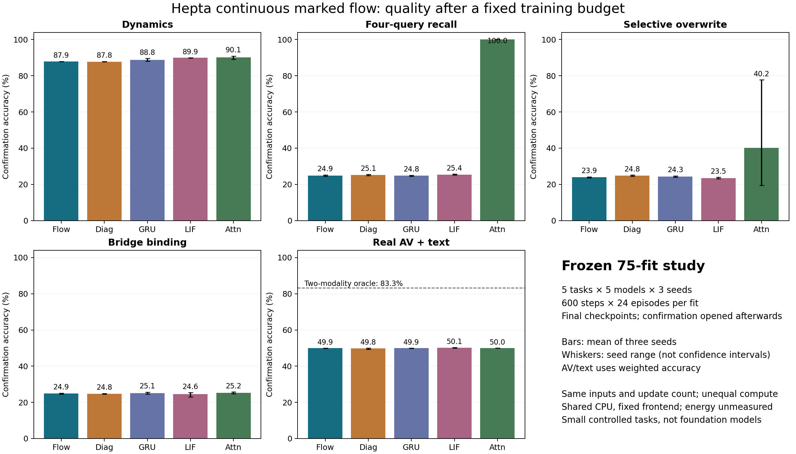
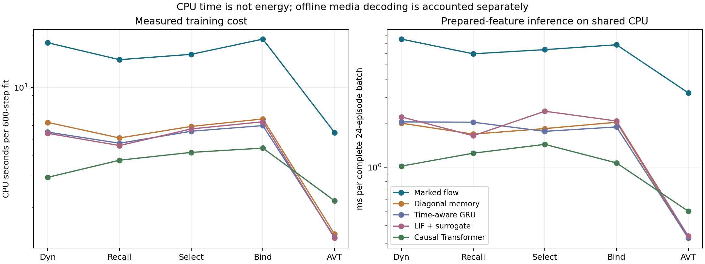

# Hepta Continuous Spiking Network：四阶段实际执行报告

## 结论

本轮完成了统一算子实现、独立数值核验、75 组固定预算训练与确认评估，以及 225 条长距离和查询交换扩展评估。**同一有限状态过程中的价值、首达、存活、复位与内容矩传播已经接通；当前候选尚未通过内容关联和真实音视频—文字绑定验收，也没有显示相对普通对照的成本优势。**

这是一份包含负结果的实际实验报告。75/75 的完整性通过表示训练、检查点、确认结果和身份链齐全，不表示 75 组都达成能力门槛。

| 用户要求的阶段 | 本轮实际交付 | 验收结果 |
|---|---|---|
| 算子与传播 | 同一 CTMC 的完整／killed 传播、重复事件、局部价值、复位、内容矩；独立数值与梯度参照 | 限定模型与测试域内 174/174 通过 |
| 连续动态任务 | 不规则间隔、无观察细分、缺测、突变后恢复；固定训练后确认 | Flow 数值细分通过；没有超越匹配普通核心的质量证据 |
| 内容任务 | 完整四查询回忆、选择性覆盖、随机模态地址桥接、64/128 长序列与查询交换 | Flow 三项基本内容任务 all-4 均为 0；关联记忆缺口明确 |
| 全模态模型 | 真实 CREMA-D 音视频与文字的演员隔离实验，前端及训练／评估成本记录 | 各模型加权正确率约 50%；全模态基础模型、GPU 与能耗验收尚未完成 |

正式训练源提交：`8044dbfc3c41356eaf3f8ac69c7537e2091eda80`。
算子冻结提交：`1349bb1bfec5c9fe5f165e1efcf2be4b479c945e`。
全部检查点和扩展协议在确认前公开冻结：`650ad8a8b64f2977915a83da5b4966b751d74116`。

## 1. 本轮真正实现的模型

He 与 Xiong 的 [Rollover Risk and Credit Risk](https://www.princeton.edu/~wxiong/papers/rollover.pdf) 提供了价值函数、违约边界及信用风险的建模启发。本轮没有把金融 equity value 当成普通欧式 call，也没有把违约概率直接称为 put 价格。

为了让复位后的续行与内容状态使用同一个过程，本轮选择已有有限体积 CTMC 与 Erlang 恢复阶段作为明确模型。设行概率为 \(p\)，完整生成元为 \(Q\)，放电标记矩阵为 \(R\)。即使一次放电复位回原状态，也保留对应的对角标记。

\[
Q_0=Q-R,\qquad P_t=e^{Qt},\qquad K_t=e^{Q_0t}.
\]

当前状态为 \(pP_t\)，无下一次事件的存活概率为 \(pK_t\mathbf1\)，首次事件概率为 \(1-pK_t\mathbf1\)。重复事件数使用 \(\int_0^t p e^{Qs}R\mathbf1\,ds\)，允许大于 1。当前活跃质量包括放电后已复位回来的轨迹，不能冒充未首次放电的存活概率。

同一 \(Q\) 的局部贴现价值为 \((\rho I-Q)^{-1}g\)；下一事件贴现变换为 \((\rho I-Q_0)^{-1}R\mathbf1\)。这些是固定策略、冻结系数下的量，不是任务最优 Bellman value。

内容不再只是一个另行更新的标量。保留状态条件一阶矩 \(M_i=\mathbb E[h\,1\{X=i\}]\)，令每次事件将内容乘以 \(\eta\)，并以 \(\gamma\) 连续衰减，则

\[
M(t)=\exp\!\left([Q-(1-\eta)R-\gamma I]^\top t\right)M(0).
\]

这使事件机制直接进入内容传播；\(\eta=0\) 对应 killed kernel，\(\eta=1,\gamma=0\) 对应完整传播。边界移动造成的即时事件，也同时进入概率重映射与带标记的内容重映射。

神经实现每步先用上一观测选定的生成元推进真实时间，再用当前 query 读取已有内容，最后在确实有观测时改变边界并写入。缺测不改策略、不写入；时间细分不重复观察。边界与漂移由输入控制，普通 BP 能通过内容传播路径更新边界参数。

**范围限制：**此处保留的是物理状态分布及内容一阶矩，不是完整联合内容分布。边界是受任务损失训练的控制阈值，尚未证明满足 He–Xiong 原问题的最优停止与 smooth-pasting 条件。J/G 两个量作为读出特征，未独立验证为恢复／再生双力。当前是一个小型递归核心，没有完成跨层传递边界的深层 Hepta 网络验证。

## 2. 算子和实现验证

[正式算子结果](results/operator_formal001/SUMMARY.json) 为 **174/174 通过**。独立参照包括 SciPy 矩阵指数、数值积分、线性求解、Frechet 导数和标记计数 uniformization。覆盖零事件、零噪声、零时间、恢复态起步、重复事件、自复位标记、移动边界即时事件，以及分段复合。

- 最大记录绝对数值误差约 \(1.288\times10^{-14}\)。
- 八参数梯度与独立参照的最大差约 \(1.54\times10^{-11}\)。
- 两份 active mean 同为约 \(-0.363125\) 的状态分布，下一事件概率分别约为 **0.029165** 和 **0.162551**。

最后一个见证证明：对这个过程，仅保留均值不能唯一决定事件风险。它不证明完整分布在任意学习任务中都会产生收益。

最新模型开发检查 **38/38** 通过；训练／冻结流程的独立 smoke 检查 **8/8** 通过。模型检查包含未来信息隔离、batch 独立性、缺测与真实零观察的区别、无观察时间细分及边界梯度。将直接进入读出的概率／价值／边界特征 detach 后，内容传播路径仍有有限、非零边界梯度。

## 3. 正式训练与确认设计

固定 **5 tasks × 5 arms × 3 seeds = 75 fits**。每 fit 600 步、batch 24，使用最终一步 checkpoint；没有早停、种子挑选或测试集选超参数。先完成全部训练并冻结所有权重，再开启确认评估。源码、权重、数据和结果均有哈希身份。

对照为 Flow、可学习多时间尺度 diagonal memory、time-aware GRU、使用替代梯度的 LIF、两层 causal SDPA Transformer。所有模型得到相同输入和逐步训练数据。相同训练步数不等于相同参数、状态或计算成本，实际数量另行报告。

合成任务每个 fit 使用相同的 512 条确认 episodes。MQAR 查询全部四个不同 key；Selective 对两个 key 真正覆盖，distractor 不写目标记忆；Binding 在每条 episode 中随机生成 A↔B 地址映射，以四个合法 bridge token 提供映射，query 只给 B 地址。原本可忽略模态的同地址捷径已在冻结前修复。

主结果的独立分析见 [SUMMARY.md](results/campaign002_analysis001/SUMMARY.md) 和 [SUMMARY.json](results/campaign002_analysis001/SUMMARY.json)。

### 确认正确率

下表为三个种子均值，单位为百分比；AVT 使用预定的类别平衡权重。

| 任务 | Flow | Diagonal | GRU | SNN | Transformer |
|---|---:|---:|---:|---:|---:|
| 连续动态 | 87.915 | 87.769 | 88.843 | 89.893 | 90.088 |
| 多查询关联回忆 | 24.870 | 25.098 | 24.756 | 25.358 | **100.000** |
| 选择性保留／覆盖 | 23.893 | 24.821 | 24.251 | 23.470 | 40.186 |
| 模态地址桥接 | 24.935 | 24.788 | 25.146 | 24.577 | 25.228 |
| 真实音视频—文字 | 49.942 | 49.769 | 49.942 | 50.116 | 50.000 |

Flow 的三项内容任务四问全对率均为 **0%**。Transformer 的 MQAR 三个种子均为 **100% 单查询正确、100% 四问全对**。Selective Transformer 的三个种子为 23.389%、19.385%、77.783%，均值不能被描述为稳定能力。Binding 的所有模型四问全对率均为 0，这个固定预算尚未得到完整桥接能力。

### 预定主对比 Flow − Diagonal

单位为百分点，区间为 2,000 次配对层级 bootstrap 的 95% 区间；先抽训练种子，再抽 episode 或 AV actor。

| 任务 | 差值 | 95% 区间 |
|---|---:|---:|
| 连续动态 | +0.146 | [−0.260, +0.562] |
| 关联回忆 | −0.228 | [−1.058, +0.586] |
| 选择性保留 | −0.928 | [−1.807, −0.114] |
| 地址桥接 | +0.146 | [−0.684, +1.009] |
| 真实 AVT | +0.174 | [−0.752, +1.563] |

没有出现主对比支持的 Flow 优势。只有三个训练种子，区间没有多重比较校正；结论限于当前实现、输入和预算。内容 all-4 为零产生的 `[0,0]` bootstrap 差值区间是零成功事件下的退化，不能当作总体精确等价证明。

## 4. 连续动态和内容失败的位置

Flow 的总体动态准确率高于只看当前 forcing 的简单规则（81.177%），但没有超过其他神经模型。跳变后首次 query，Flow 为 77.799%，Diagonal 为 78.646%，Transformer 为 83.854%；后续三个 query，Flow 为 92.535%，Diagonal 为 92.491%。没有由此建立独特的复位恢复收益。

60 条确认期 resampling 检查有 59 条通过 \(10^{-4}\) 门限。Flow 全部通过，最坏 logit 差为 \(3.8147\times10^{-6}\)；Diagonal、GRU、Transformer 也全部通过。唯一失败是 SNN/dynamics/seed43，差为 0.62722349，原始失败保留。

[该 SNN case 的后验数值诊断](results/posthoc_snn_resampling001/SNN_RESAMPLING_DIAGNOSIS.json) 逐元素复现正式 FP32 输出。首次分歧的阈值 margin 由 −1.788×10⁻⁷ 变为 +2.384×10⁻⁷，微小舍入跨过硬阈值，随后出现 33 处 spike 分歧。同一权重使用 FP64 时，最大 logit 差降至 2.665×10⁻¹⁵，spike 分歧为零。两种精度各自的 base/refined 分类 argmax 和正确率均没有变化。因此它是一次真实的数值容差失败，不是本任务分类准确率崩溃；原正式 59/60 统计不以 FP64 诊断替换。

训练后干预中，去除事件内容衰减或将内容矩分解成概率与均值乘积，对各任务准确率影响都很小。它们没有提供明确的机制收益证据，也不能代替重新训练的必要性对照。

[内容预测诊断](results/CONTENT_DIAGNOSIS.json) 进一步显示，MQAR Flow：

- 85.612% 的 episodes 对四个查询给出同一个答案；
- 98.844% 的预测仍属于那四个最终有效写入值的集合；
- 平均只输出约 1.146 个不同值，而应答四个不同查询需要正确输出四个不同值。

这些是冻结后描述性诊断，未用于选择模型。它们支持一个具体判断：当前候选保留了部分值集合信息，却没有可靠地保留键—值对应关系。存活概率、事件计数和物理分布本身不提供内容寻址。

长距离与查询交换的独立协议和全部 225 条结果在 [extended001](results/extended001/)，汇总见 [EXTENDED_SUMMARY.md](results/EXTENDED_SUMMARY.md)。64/128 表示完整序列长度；匹配静默条件经过同样的额外物理时间。查询交换以交换后的正确答案计分，输出变化不算成功。

MQAR 的扩展结果如下，单位为百分比：

| 条件 | Flow 单查询／all-4 | Transformer 单查询／all-4 |
|---|---:|---:|
| 64 个观测，加入干扰内容 | 20.622 / 0 | 64.893 / 17.253 |
| 128 个观测，加入干扰内容 | 16.260 / 0 | 31.641 / 0 |
| 与 64 观测相同的时长，静默等待 | 24.837 / 0 | 99.870 / 99.479 |
| 与 128 观测相同的时长，静默等待 | 24.333 / 0 | 98.535 / 94.141 |

这里连 Transformer 也出现长干扰序列的泛化退化；本轮不把它描述为已经解决任意长上下文。时间匹配对照显示，加入干扰观测的损失明显大于仅经过相同时长。Flow 尚未建立基础绑定，所以其延长等待表现也不能证明可靠长记忆。

交换前两个 query 后，MQAR Transformer 的正确率、all-4、正确双切换均为 100%；Flow 的无条件正确双切换为 0.586%，原查询和交换后查询都正确的联合比例为 0.326%。Flow 的条件切换比率仅来自 12 个原先前两问全对的 episodes，其中 5 个切换后仍全对，分母太小，不能用这个条件比例制造强绑定印象。

## 5. 真实 AVT 的范围和结果

使用 38 位 CREMA-D 演员、两句台词、六类情绪。24 位演员用于训练、6 位用于验证、8 位用于确认；模型不接收 actor、文件名或时长 metadata。确认集为 384 条组合 episodes。当前分割沿用已有研究 cohort，不声称这些演员此前从未被其他研究观察。

音频使用固定半秒窗口的 log-mel 均值／标准差；视频使用 cutoff 前最后一帧的低阶 DCT；文字由实际 transcript token 形成可学习投影。没有预训练 encoder。先按原采样率裁窗，再在窗内重采样，消除了跨窗重采样滤波造成的前视。完整 codec 解码仍是离线准备，不当作在线传感时延。

八种 A/V/T 句子组合按预定权重平衡标签：单一模态的准确率上界为 1/2，任意两模态为 5/6，完整三模态为 1。所有模型的加权结果都在 50% 左右，没有达到三模态绑定要求。未加权准确率可达到 58–73%，这是另一统计口径，不能拿来冒充超越上述信息上界。

本轮没有完成开放域语言、多模态生成、大模型规模或强预训练 encoder 比较。因此不从本实验推导全模态基础模型优势。

## 6. 成本

CPU 为共享环境中的 AMD EPYC，单 worker 使用一个计算线程；没有 GPU 或可归属的能耗读数。下表每个模型覆盖 15 fits，训练与评估相加一次。

| 模型 | 训练 CPU 秒 | 训练＋确认评估 CPU 秒 | 内容任务参数量 |
|---|---:|---:|---:|
| Flow | 219.190 | 232.962 | 11,592 |
| Diagonal | 75.627 | 80.129 | 11,667 |
| GRU | 69.319 | 73.918 | 24,760 |
| SNN | 70.047 | 74.864 | 17,272 |
| Transformer | 52.635 | 57.046 | 15,968 |

当前 Flow 的 fit CPU 约为 Diagonal 的 **2.91 倍**、Transformer 的 **4.08 倍**。这些数值对应短序列、CPU、dense matrix exponential 参考实现，不外推为优化内核或所有序列长度的固有规律。

MQAR 的 24-episode 完整 batch 推理时间，按每个种子九次重复的中位数再跨种子平均：Flow 6.202 ms，Diagonal 2.191 ms，GRU 2.149 ms，SNN 1.626 ms，Transformer 1.244 ms。它不是 batch-one 在线时延，也没有包含现场媒体采集。

完整外层口径：75 fits 的训练＋确认评估 CPU 为 522.319 秒；两次 AV 前端准备 CPU 为 112.326 秒；四个独立阶段合计 **634.645 CPU 秒**，阶段 wall 时间和为 641.168 秒。225 条扩展评估另计 **56.750 CPU 秒**、67.632 秒 wall。算子 formal audit 另计 3.123 CPU 秒。

以上不再叠加内部计时，不包括历史媒体获取、分析绘图或开发尝试。相关记录各自保留。能耗为未测，CPU 秒不换算成焦耳；当前证据尚不构成完整部署经济性验收。

## 7. 对下一版 Hepta 的直接约束

保留本轮同过程的算子合同和因果时间接口。下一项架构工作应集中在内容寻址：写入应保留可查询的对应关系，读出应按 query 选择对应记忆；物理放电／恢复状态与内容地址状态的职责需要明确。

后续普通对照应获得相同的寻址和 encoder 能力，再检验解析状态、风险、复位是否贡献增量。只有先通过完整多查询与真实前端质量门槛，才有依据扩大到跨层边界传递、优化执行内核、GPU 与能耗试验。当前结果不证明所有 HCSN 设计不可行，也不支持把这个候选作为 Transformer 或现有 encoder 的替代。
