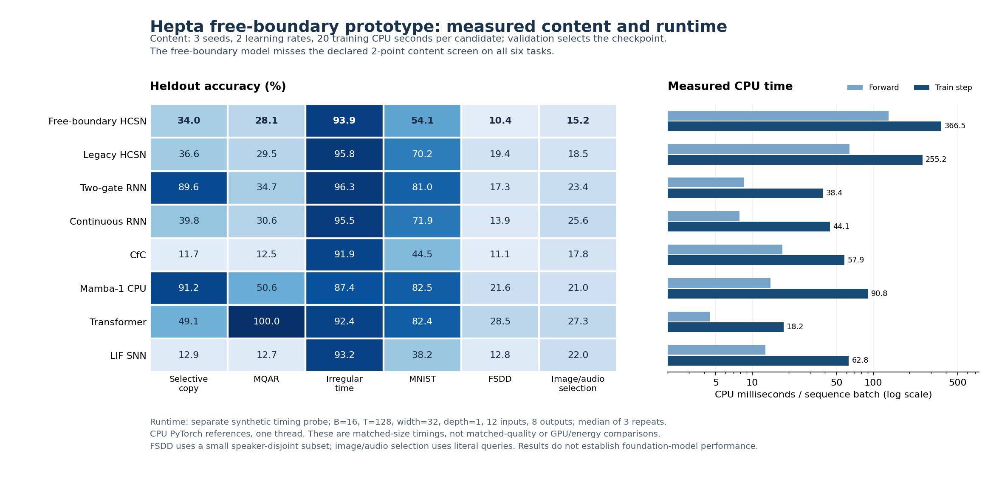

# Hepta Continuous Spiking Network：六项验收结果

## 结论

本轮已实现可微的再生自由边界单元、独立数值 oracle、联合训练、机制消融、内容矩阵和真实 Hepta owner 执行，并完成对应证据审计。**解析标量问题与训练连通性成立；本次实现的边界/双通道优势、达到强内容基线、完整成本下额外净收益均未通过。** 数学可行性、实际动作变化和预测优势是不同的验收条件。

主研究 `study001` 完成 **244 个搜索、488 个学习率候选，0 失败，244 个结果均通过完整性审计**。另有输入条件化普通阈值的 16 个搜索、32 个候选，全部成功。研究代码位于本目录；基线源固定在 `68eb16caa9c14c7b5729585c86d9c293018a987c`，主研究身份为 `caa1a503288d4986bf2f0bc3608bc211a12e221a45c822bfbd19fdacce953bc3`。生产 Rust 和 owner 权限未改变。

| 验收项 | 本轮结果 | 证据与边界 |
| --- | --- | --- |
| 1. Call/Put、流、发放、复位、不应期合同 | 已明确 | 使用再生策略价值 J 和立即干预价值 G；G 包含复位、不应期后的所有未来发放。原神经均值流的近似和零时间事件限制均明确列出。 |
| 2. 低维自由边界 oracle | 标量范围通过 | 值匹配、光滑贴合、QVI 两侧不等式、独立网格/积分/更新过程及梯度核对通过。不是整个输入相关网络的最优性定理。 |
| 3. 真正联合训练 | 训练连通性与实际更新通过 | 内容、动力学、边界、复位、不应期均被任务 CE 更新；全部 108 个要求审计的 HCSN 家族运行通过。有效梯度没有替代质量验收。 |
| 4. 边界与双通道贡献 | 优势验收未通过 | 原六项机制优势 0/6；对普通双门控存在显著负方向差异；条件化普通阈值追加对照没有显示自由边界优势。 |
| 5. 内容能力 | 本预算下未通过 | 六项距最强候选不超过 2 个百分点的筛查为 0/6；时序外推也没有普遍优势。 |
| 6. Hepta 执行与规模化 | 动作/恢复通过，净收益未通过 | 连续信号能改变真实动作，STOP 真正停止读取，状态可恢复；验证集选取读取长度的普通策略击败了新增价值策略，CPU 成本也不占优。 |

完整主结果见 [主分析报告](results/study001/analysis001/REPORT.md)、[机器可读分析](results/study001/analysis001/ANALYSIS.json) 和 [条件阈值报告](results/conditional001/REPORT.md)。

## 1. 从金融边界到可检验的神经合同

He 与 Xiong 的 [Rollover Risk and Credit Risk](https://www.princeton.edu/~wxiong/papers/rollover.pdf) 研究债券流动性、展期损失与股东的内生违约决定。原文的股权边界满足 `E(V_B)=0`、`E'(V_B)=0`；债券有到期支付与违约回收边界。该模型没有直接给出一个反复发放、复位和不应期的神经元。

本轮因此明确采用一个新的、可验证的再生控制问题，而不把两条神经通道宣称为原文的完整金融 Call/Put 定价：

\[
dX_t=\mu\,dt+\sigma\,dW_t,\qquad \rho>0,\ \sigma>0,\ r<K.
\]

活跃状态到达上边界 b 时发放，获取即时奖励 `x-K`，复位到 r，冻结不应期 tau，然后继续同样的过程。写

\[
\kappa=\frac{\sqrt{\mu^2+2\rho\sigma^2}-\mu}{\sigma^2},\qquad
q=\exp[-\rho\tau-\kappa(b-r)].
\]

阈值策略的总价值与立即干预价值为

\[
J_b(x)=e^{-\kappa(b-x)}\frac{b-K}{1-q},\quad x<b,
\qquad
G_b(x)=x-K+e^{-\rho\tau}J_b(r).
\]

上式中的未来项包括后续反复发放，不是第一次发放之后截断。自由边界满足

\[
\kappa(b-K)=1-q,\qquad K<b<K+1/\kappa.
\]

在该边界，J 与 G 的值相等，一阶空间导数均等于 1。上边界以外 J 等于 G，因此 J 是策略价值包络，不是处处代表“继续动作”的纯 Q 值。两通道不是互相独立求解的两个期权，也不自动具有固定的“恢复力/恐慌力”方向；实际作用方向由内容门控权重学习。

神经实现向门控提供 margin、同一变换下的 J 和 G，保留首达概率作为状态流/活动量。首达概率、终点超越概率、事件次数、通信和缺失观察没有混用。原单元在不应期抑制压力演化，但内容向量继续更新；标量 oracle 的状态则完全冻结。这一差别已写入 [CONTRACT.md](CONTRACT.md)。

这里的“可微”指已经验证的训练路径。值函数在自由边界具有光滑贴合，不代表含初始命中原子、复位、时间裁剪和真实离散 STOP 的整个系统处处光滑。自定义边界反向传播仅认证一阶梯度。

## 2. 数值 oracle 与已经完成的修复

[MATH.md](MATH.md) 给出值匹配、光滑贴合以及继续区和干预区的 QVI 验证；[oracle_validation.json](results/oracle_validation.json) 绑定实际源码和执行结果。

| 核对 | 结果 |
| --- | --- |
| 六个物理参数、24 次边界梯度核对 | 最大缩放有限差分误差约 `1.59e-9` |
| 独立单调 QVI，1201/2401/4801 网格 | 三个参数情形收敛；最细网格最大值误差约 `4.43e-4`，边界误差约 `0.001341` |
| 首达密度积分、贴现首达、killed 一阶矩 | 误差分别约 `2.22e-16`、`5.55e-17`、`6.94e-18` |
| 反复复位/不应期的独立 renewal 参考 | dt 从 `.1` 到 `.05`、`.025`，误差约 `2.54e-4`、`1.28e-4`、`6.41e-5` |
| Torch 边界、价值、首达、广播梯度 | 实际执行并通过 |

默认参数下，总再生价值约 **0.210128**，只计算首次发放的价值约 **0.176229**；两者没有混为同一输出。接近退化区域的边界参数导数可约为 7600，测试保留这一真实病态性，没有以梯度裁剪冒充解析稳定。

### 原神经均值流存在结构误差

原主单元只保存压力均值和冷却均值，用一次首达算子更新代表状态。独立审计证明，这种闭合不是完整随机过程的传播器。一个 T=4 的测试中，真实期望事件数约 **0.3922**；原均值闭合在 dt=1 时约 **0.1773**，进一步缩到 dt=0.03125 时反而趋近于零。减小时间步不能恢复已丢失的分布。这一问题的独立精确首达 Monte Carlo、renewal 参考和理论解释保存在 [CLOSURE.md](CLOSURE.md)。

本轮完成了两个独立参考修复：

- [分布流](FLOW_REPAIR.md)：保存活跃概率分布和不应期 phase，以保质量生成元传播并计入反复事件。质量误差约 `1.83e-12`，一次传播与 256 次细分的事件数差约 `3e-15`，五个参数的梯度核对最大相对误差约 `1.38e-9`。
- [移动边界流](MOVING_FLOW.md)：边界缩小时，覆盖的活跃质量立即发放，奖励使用实际状态；保留不应期 phase，不把已有冷却重新开始。补做的 1024 网格精化与同一批独立 Monte Carlo 参考一致，末态质量误差约 `2.09e-11`，中间段约 `2.92e-11`。reward 的置信区间一致性接近边缘，仍保留有限网格、有限域和 Erlang 不应期近似的限制。

这两个修复还没有替换主内容网络或证明新的任务性能，主实验保持原冻结版本。局部系数或边界随输入变化，也不把静态标量最优性升级为全网络或剩余期限下的最优性。

另完成 [快速边界求解器](FAST_SOLVER.md)：481 个跨尺度根全部通过高精度/残差认证，根前后向局部加速约 **2.17–3.03 倍**。整模型前向与反向代理计时的重复速度比范围跨过 1；该 probe 未执行 optimizer update，也不是实际任务训练，因此未建立稳定的整体训练加速。这一求解器也没有追改主实验。

## 3. 联合训练与公平比较

主实验共享 64 维输入前端、时间输入和任务读出；主干约 8800 个实际有效参数，七个外部/历史对照与之相差不超过 **2.19%**，没有用不参与计算的参数填充。每个 task/seed 的共享初始化和实际 minibatch 前缀均通过核对。

每个学习率 `.001/.003` 都获得 **20 training CPU 秒**。两候选完成后，根据共同 5/10/20 CPU 检查点的验证 CE 选点，写入锁定收据后才评估 test/OOD。只在第 128 步保存的快照不额外参与主选点。所有候选的完整搜索成本都被保留，较早选中的模型不会获得搜索费用减免。

任务 CE 确实更新内容、漂移、噪声、折现、隐含发放成本、复位和不应期。全部 108 个要求检查的 HCSN 家族运行通过有限/非零梯度和实际选中参数变化审计；其中 28 个 free_dual 运行的五组参数都发生变化。详见 [TRAINABILITY.json](results/study001/analysis001/TRAINABILITY.json)。

但这些参数形成的是任务训练的局部再生归纳偏置。J/G 的标量奖励仍是 `x-K`，尚未被证明等于分类正确率、真实读取费用和剩余期限下的任务 Bellman 价值。内部 `K*activity` 也不是实际 CPU 或 owner 账单。

## 4. 机制优势：原六项均未通过

统计单位为一个 seed 在选择性复制与图像/语音选择两任务上的等权平均差，共八个 seed。精确双侧 sign-flip 枚举 256 个符号组合；六个比较统一做 Holm 校正。验收还要求平均提升至少 1 个百分点以及名义配对 t 区间下界为正。

以下方向均为 **free_dual 减对照**；区间是名义 95% 区间，不是同时置信区间。

| 对照 | 平均差，百分点 | 95% 区间 | Holm p | 优势验收 |
| --- | ---: | --- | ---: | --- |
| 固定边界 + 双通道 | -2.182 | [-4.901, +0.537] | 0.234375 | 未通过 |
| 静态可学习边界 + 双通道 | -1.324 | [-3.374, +0.725] | 0.468750 | 未通过 |
| 自由边界 + margin | -0.836 | [-2.382, +0.709] | 0.484375 | 未通过 |
| 自由边界 + margin/J | +1.099 | [-0.333, +2.530] | 0.406250 | 未通过 |
| 自由边界 + 普通特征门控 | +0.082 | [-0.962, +1.127] | 0.859375 | 未通过 |
| 独立普通双门控 RNN | -35.010 | [-39.315, -30.704] | 0.046875 | 显著负方向 |

“普通特征门控”消融仍保留相同首达压力更新；最后一行才是不含该首达机制的独立普通网络。`margin/J` 也不是 J-only。不能把这两类对照混称。

原直接阈值是逐神经元静态参数，而自由边界依赖输入相关漂移。为补上这一公平性缺口，追加了

\[
b_t=K+\operatorname{softplus}(a+s\mu_t),
\]

其中 s 从零初始化，复用全部其他内容、动力学和 own-policy J/G。该控制比自由边界多 64 个有效参数，即 **0.7273%**。追加 16 搜索得到平均差 **-0.8301 个百分点**，名义 95% 区间 **[-2.1108, +0.4507]**，精确双侧 **p=0.171875**。没有自由边界优势证据，也不足以认定两者等价。追加研究的探索性身份和原六项家族保持分开。

## 5. 内容结果与时间外推

下表是本次候选、预算与数据下三 seed 的 test 均值，不代表各模型家族的最好配置或任务 SOTA。

| 任务 | Free-dual | 当前 Hepta HCSN | 本次最佳候选 | 最佳均值 |
| --- | ---: | ---: | --- | ---: |
| 选择性复制 | 34.02% | 36.59% | Mamba-1 CPU 参考 | 91.21% |
| MQAR | 28.14% | 29.48% | Transformer | 100.00% |
| 不规则时序 | 93.95% | 95.77% | 普通双门控 | 96.29% |
| MNIST | 54.10% | 70.25% | Mamba-1 CPU 参考 | 82.49% |
| FSDD 说话人隔离语音 | 10.42% | 19.40% | Transformer | 28.45% |
| 图像/语音查询选择 | 15.17% | 18.49% | Transformer | 27.28% |

六项的 2 个百分点筛查均未通过。不规则时序只比容许差额再低 0.34 个百分点，该点估计失败本身不是三 seed 的显著性证明。旧 Hepta HCSN 在六项中均有更高均值，这也是描述性发现。

三项合成 OOD 均将长度从 32 增加到 64；不规则时序还将时间间隔分布扩大三倍，是长度与采样时间的联合偏移。在长度 64 的复制/MQAR 上，自由边界模型分别为 **30.76%/27.65%**；在不规则时序的联合偏移下为 **53.58%**，同一测试的连续 RNN 为 **81.58%**。没有建立普遍的时序外推优势，也不能用该联合偏移隔离纯采样率变化的影响。封存主报告对不规则 OOD 的长度变化描述不完整，此处明确补充，原数值结果不变。

真实数据来自原始 MNIST 与固定的 600 条 FSDD 子集。FSDD 按说话人分离，训练/验证/测试分别 300/100/200 条独立录音；episode 内会复用录音，不能把所有 episode 视为新的独立说话样本。特征使用完整录音的固定离线 log-mel 前端。多模态任务使用有限的字面查询 token，未测试开放自然语言、视频、全模态生成或基础模型预训练。所有语音候选的绝对准确率都较低，不能把本次最佳 28.45% 描述为强语音识别能力。

### 原始 128 更新快照诊断

原主研究附带的严格 128 更新评估有 **202/244** 个可评估搜索，42 个因至少一个 LR 未达到 128 而缺失，0 invalid，未补训练。free_dual 只有 **3/28** 搜索同时具备两 LR 的 128 快照，因此不能据此组成完整的等更新对照。

在六任务 core 中，每个 LR 实际更新中位数为：free **124**、旧 Hepta **228.5**、普通双门控 **1055.5**、连续 RNN **1284**、CfC **854**、Mamba **596.5**、Transformer **2180.5**、LIF **917.5**。相同 CPU 预算没有带来相同优化步数。原缺失覆盖和限制保存在 [secondary128 报告](results/study001/secondary128/REPORT.md)。

### 独立固定 128 更新诊断

为解决完整等更新比较缺失的问题，另行冻结 `equal_updates_core002`，从完全相同的初始化重新训练 free 的六任务、三 seed、两 LR，**18/18 搜索成功，0 训练失败、0 重试**。七个对照的 126 个搜索显式复用原严格 128 步快照和预测，没有把它们记作新增训练。这是观察主结果后的诊断，不是新的未观察测试集确认；原 `secondary128` 的 202/42 覆盖状态不变。

新研究只在两个 LR 各自的终端第 128 步之间按验证 CE 选择。36 个初始化与原文件逐字节相同，36 个候选的全部 128 步 minibatch 前缀通过，11 个原先已存在的 free 第 128 步文件逐字节复现。126 个对照的 252 个候选前缀也重新核对，全部监督位置、预测与 CE 通过。

| 任务 | 新 Free，128 步 | 普通双门控，128 步 | Transformer，128 步 | Free 与该任务最佳均值之差 |
| --- | ---: | ---: | ---: | ---: |
| 选择性复制 | 35.16% | 12.19% | 45.85% | -10.69 pp |
| MQAR | 27.75% | 12.34% | 88.12% | -60.37 pp |
| 不规则时序 | 93.42% | 94.08% | 85.09% | -0.65 pp |
| MNIST | 56.71% | 23.89% | 67.12% | -10.42 pp |
| FSDD | 23.57% | 12.96% | 24.67% | -1.11 pp |
| 图像/语音选择 | 17.25% | 11.91% | 21.74% | -4.49 pp |

Free 在固定 128 更新下有 5/6 任务的均值高于普通双门控，但六项仍都低于各自最强候选。这为较低优化步数下的表现提供了一个可继续研究的结果，未建立统计上的普遍优势或等计算成本优势。两 LR 到 128 的训练前缀 CPU 中位数为 free **38.397 秒**、双门控 **5.002 秒**、Transformer **2.333 秒**。

这里还同时改变了检查点选择规则：主实验允许共同 CPU-gate 上的检查点，新诊断只允许终端 128。尤其不能把 FSDD 的改善全部归因于“再训练几步”。完整八模型的 ID/OOD、标准差和配对差异在 [新诊断报告](results/equal_updates_core002/analysis002/REPORT.md)，均为三 seed 描述结果，没有追加显著性检验或改动原 Holm 家族。

首次新诊断审计曾因清理收据标记已删除的中间 NPZ 仍存在，把 14 个搜索列为审计 invalid。原分析器、报告和输出均保留。第二次审计逐一确认 **33 个额外文件**全部与元数据 SHA 相同，必需文件零缺失、未知额外文件为零，而且这些文件均未参与终端 128 选点；随后将其单列为来源未明的存储保留异常。两 LR、选点、初始化、前缀、梯度和预测完整性门均未放宽，没有重训或改动结果。

新 wrapper 保留每 worker 前后的完整注册哈希核验，但缺少主 `run_search` 在 selection 与首次 heldout 读取之间的额外一次数据哈希操作。实际数据静态且全部哈希匹配，这一检查位置差异仍明确保留。共享文件系统一度报告 `f_bavail=0`，但仍有约 1.3–1.6 GB 的 `f_bfree`；没有观察到新训练 I/O 失败。最终事实与澄清见 [FINAL_AUDIT.md](results/equal_updates_core002/FINAL_AUDIT.md)。

## 6. 真实 Hepta 执行、恢复与净效用

使用固定原生 research owner 二进制，SHA-256 为 `1dc702aea6a448ad84407aeb71dc8f23066205fab79fe7c6859fc02c55e6f7a5`。宽度 5、top-k 1、20% 限额、DENY_ALL 权限保持原样。STOP 会退出实际 tensor step/read 循环，执行账本记录真实读取次数、拒绝与恢复。

工程 fixture 中，continuation、margin、risk、activity 四个连续输入均可从同一 durable prefix 独立改变真实后续动作，8/8 恢复分支与预期一致。该结果证明信号实际被消费，不证明训练出的策略有效。

第一批固定策略在 32 条 MNIST 流上暴露出 max-pool margin 长期支配、无法 STOP 的问题；该负结果被保留。随后训练了显式价格输入的 33 参数价值 head，对照同参数 MLP 和风险阈值，并在 head 选择锁定后使用 128 张此前未用过的图像测试。新数据与原全部拆分的图像 ID 零交集。

价格从 `.005` 升到 `.05`，在保持其他首状态特征相同的 128 个配对状态中，实际动作 **128/128 从 KEEP 改为 STOP**。新 head 的平均读取长度依价格为 **32 / 16.4375 / 1**。浮点到 Q24 的动作分歧为 0，1157 个原生进程全部正常退出；964 个拒绝均来自有意设计的 STOP 后继续操作探针。

但更强的普通策略在验证集上按价格选择固定读取长度，得到 **32 / 1 / 1**。该普通策略族是在观察初始结果后提出的追加对抗审计；具体选择仍只使用验证集，未据新测试标签调参。详见 [native003](results/native003/REPORT.md) 与 [对抗审计](results/native003_adversarial001/REPORT.md)。

下表净效用仅为 `correct - read_price * actual_reads`；完整 CPU 成本另外收费后结论没有改善。

| 每次读取价格 | 新价值策略 | 验证集选择的普通读取策略 |
| --- | ---: | ---: |
| 0.005 | 0.386875 | 0.386875 |
| 0.020 | -0.0553125 | 0.0815625 |
| 0.050 | 0.0515625 | 0.0515625 |
| 三档等权平均 | **0.1277083** | **0.1733333** |

价值策略相差 **-0.045625**；36 个完整 CPU 费用场景中胜出 **0/36**。因此，不能以它超过塌缩成首步停止的 MLP 为由，声称具有强普通策略之上的额外净收益。

native003 新工作完整 CPU 为 **154.282321 秒**，其中训练 worker **4.752781 秒**，评估 worker **148.798548 秒**，其余为数据生成/协调等。评估已含原生子进程的 **10.318937 秒**，不能再加一次。固定 backbone 的 **46.474767 秒**是既有成本，按使用寿命摊销而非伪装为本轮重训。新增普通策略对抗审计另付 **2.538695 秒**。成本参数与使用次数场景全部保留。

## 7. CPU 规模化与状态恢复



图中右侧为单线程 CPU、B=16/T=128/width=32/depth=1、12 个输入特征和 8 类输出的独立合成计时；每配置一次预热、三次实测。它是近等参数的计时，不是等质量的吞吐比较。

| 模型 | 前向 CPU ms | 训练步 CPU ms |
| --- | ---: | ---: |
| Free-dual HCSN | 134.21 | 366.46 |
| 旧 Hepta HCSN | 63.57 | 255.19 |
| 普通双门控 | 8.58 | 38.35 |
| 连续 RNN | 7.85 | 44.06 |
| CfC | 17.78 | 57.93 |
| Mamba-1 CPU 参考 | 14.23 | 90.76 |
| Transformer | 4.47 | 18.21 |
| LIF SNN | 12.90 | 62.81 |

当前 free 训练步约为普通双门控的 **9.55 倍**、Transformer 的 **20.13 倍**。边界根求解约占其训练 CPU 的 **11.87%**，所以只消除求根仍不足以消除差距。这是根据实际占比得出的限制，不是对剩余每个 kernel 的完整归因。

正面工程结果是固定推理状态：B=2/width=32/depth=2 时，512 步内始终为 **514 个 float32 元素、2056 字节**。这不包括权重、输出历史、BPTT 激活或 allocator 开销；也没有测量全部对照的 streaming cache，不能直接声称优于所有 RNN/SSM。

在 256 步序列的第 113 步保存有非零不应期的模型与状态后，**新 Python 进程**恢复剩余 143 步，logits 与最终状态逐位相同。native003 自身的恢复是同一 Python 进程中重建神经对象并重启原生子进程；两类恢复没有混称。

CPU 比较不代表优化 GPU Mamba/FlashAttention、神经形态硬件或实际能耗。[SCALING.md](SCALING.md) 保留 48 个序列计时配置和 6 个宽度/深度配置，以及恢复范围。

## 8. 成本口径与复现入口

| 研究 | 完整或指定 CPU 范围 | 结果入口 |
| --- | --- | --- |
| 主 244 搜索 | 10958.946598 秒 aggregate child CPU；实际训练更新 9781.257108 秒包含在内 | study001/COMPLETE 与逐 run EXECUTION |
| 主协调器 | 2.086670 秒，另计 | 同上 |
| 条件阈值 16 搜索 | 724.479540 秒 child CPU；实际训练更新 642.621482 秒包含在内 | conditional001/COMPLETE |
| 主分析 | 8.308143 秒 complete child CPU | analysis001_EXECUTION |
| 原严格 128 快照评估 | 83.157664 秒 complete child CPU，无新训练 | secondary128_EXECUTION |
| 独立固定 128 诊断 | 809.269501 秒新 worker CPU；新增训练、协调及两轮审计已测非重叠合计 814.063395 秒 | equal_updates_core002/FINAL_AUDIT |
| 原生价格 head 研究 | 154.282321 秒新增 CPU；原生调用包含在评估子进程内 | native003/SUMMARY |
| 追加普通读取策略 | 2.538695 秒新增 CPU | native003_adversarial001/SUMMARY |

这些范围不能把嵌套字段相加，墙时也不能与 CPU 秒混用。主矩阵墙时为 **3961.125580 秒**。总 child CPU 的 aggregate 和逐 wait4 求和差 247 微秒；244 条原记录逐项相等，保留两测量口径，没有手工调齐。数据准备、数值修复、规模化、归档等各有独立记录，未宣称它们已全部包含在主训练总额中。

数值权重和预测均使用 NPZ/JSON，不依赖 pickle。完整日志、初始/CPU-gate/128/选中检查点、真实执行 journal、原始 WAV/IDX、开发阶段及失败证据保存在带逐成员 SHA 的分片档案中。恢复器先验证分片和整体，再核验每个成员；拒绝危险路径和覆盖不同已有内容。分片大小与成员清单以 manifest 为准。

```bash
python -m experiments.hcsn_free_boundary_v1.archive restore --manifest experiments/hcsn_free_boundary_v1/artifacts/original_data.json --destination /tmp/hcsn-original-data
python -m experiments.hcsn_free_boundary_v1.archive restore --manifest experiments/hcsn_free_boundary_v1/artifacts/auxiliary_evidence.json --destination experiments/hcsn_free_boundary_v1
python -m experiments.hcsn_free_boundary_v1.archive restore --manifest experiments/hcsn_free_boundary_v1/artifacts/study001_evidence.json --destination experiments/hcsn_free_boundary_v1
python -m experiments.hcsn_free_boundary_v1.archive restore --manifest experiments/hcsn_free_boundary_v1/artifacts/conditional001_evidence.json --destination experiments/hcsn_free_boundary_v1
python -m experiments.hcsn_free_boundary_v1.archive restore --manifest experiments/hcsn_free_boundary_v1/artifacts/equal_updates_core002_evidence.json --destination experiments/hcsn_free_boundary_v1/results/equal_updates_core002
```

固定 128 新诊断的归档成员相对该研究目录，恢复目的地与另外三套结果档不同，如上所示。运行环境与数值/训练/分析命令见 [README.md](README.md)。本地局部源码环境没有执行完整仓库的 Rust 格式检查，也没有重建原生二进制。GitHub 自动 CI 的成功、跳过、在跑或失败状态应另看 PR 的具体提交；它们不替代本报告记录的 Python、数值、实际 owner 与恢复验证。

## 9. 仍未闭合的科学与工程问题

1. **主神经流的分布闭合。** 分布与移动边界参考已修好并验证，但尚未变成具备可接受成本的联合内容训练主干。需要保留跨步不确定性、真实命中时刻和剩余不应期，不能继续用缩小 dt 掩盖均值闭合错误。
2. **任务价值对齐。** 标量 `x-K` 再生值与分类/执行真实回报之间尚无 Bellman 等价关系。剩余期限、读取成本和 reset 后内容后果都应进入任务价值合同，再用同信息普通控制比较。
3. **计算效率。** 参数量小和固定状态并未带来当前实现的低耗时。快速根求解已完成局部优化，但内容递归、首达算子和自动微分总成本仍需要独立处理。
4. **内容与净效用优势。** 当前证据不支持替换既有内容主干或扩大为全模态基础模型训练。后续更改必须作为新身份重新训练、验证并收费，不能把参考修复、早停或局部加速直接记为质量/经济收益。

本轮成果是一套可重放、可否证的数学—训练—执行实验实现，以及已经定位的失败机制。保留所有不利结果，是继续改进这一结构的具体起点。
