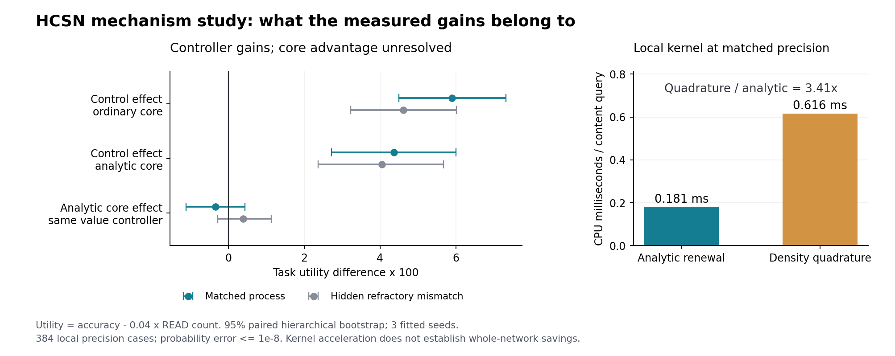
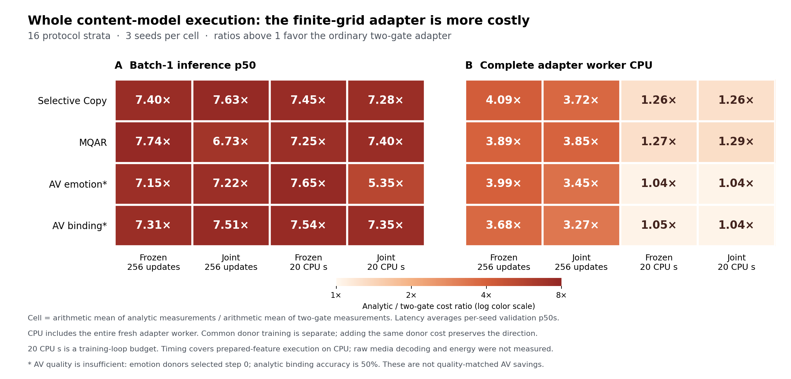

# Hepta 四轨全量验证：完成情况、证据与下一步主证明

## 结论

本轮已经完成冻结方案规定的 **12 个机制作业和 108 个内容作业，运行失败数为零**。主要科学结论是：解析首达／复位传播确实进入了内容预测和观察决策，局部解析核也有相同精度下的计算优势；但在同一任务价值控制器下，解析核心没有建立额外任务效用收益，在完整内容网络中也没有建立质量与执行成本的联合优势。

因此，下一轮应集中证明一个命题：**在内容能力已经达标、真实异步观察确有代价的任务上，共享 encoder、控制器、可见信息和预算后，解析核心能以非劣内容质量降低完整执行成本，或在同一完整成本下提高任务质量。** 当前证据支持继续研究这条路径，不支持宣布“全项验收通过”或直接进入全模态大模型扩展。

| 用户提出的验收 | 本轮结果 | 判定范围 |
| --- | --- | --- |
| 解析传播影响实际内容／动作 | 固定动作时 NLL、Brier 改善；真实 READ 决策出现分歧 | 受控过程上的机制消费已建立 |
| 2×2 分离控制与动力学 | B−A、D−C 为正；主比较 D−B 区间跨零 | 解析核心增量效用未建立 |
| 内容寻址、精确回忆、真实 AV | 长度 32 的 Copy/MQAR 全部 100%；长度外推不稳定，AV 能力未建立 | 共享寻址有效，强 AV 能力仍缺失 |
| 同质量完整执行经济性 | 局部核快；当前完整内容适配器更慢、CPU 更多 | 完整网络成本优势未建立 |

正式方案、候选代码和全部内容模板在执行前公开固定于
[1a5434f361d2df8a0505b6069fe6d48736f9ff30](https://github.com/TrillionniumFoundation/hepta-private-ci/commit/1a5434f361d2df8a0505b6069fe6d48736f9ff30)。
准备后的输入特征、原始实验记录、检查点、开发失败记录和验证日志均保留。导航见 [EVIDENCE.md](EVIDENCE.md)，完整内容表见 [CONTENT_RESULTS_ZH.md](CONTENT_RESULTS_ZH.md)，独立核查见 [INDEPENDENT_REVIEW.md](INDEPENDENT_REVIEW.md)。

## 1. 本轮到底验证了什么数学对象

本轮有两个互补的实验对象。机制实验使用固定边界、常系数扩散、固定复位与确定性不应期；解析公式在给定双方共享的校准参数、满足所声明局部模型假设时，精确传播事件数分布。设每次事件对内容施加列随机矩阵 \(M\)，则

\[
z_T=\sum_{n\ge0}\Pr(N_T=n)M^nz_0.
\]

内容预测和观察控制直接使用这个分布。独立真值采用 inverse-Gaussian 首达采样及逐事件 Markov 内容标签，READ 来自联合一致的首达桥路径。READ 不会重置外部世界，STOP 也不能取消四个必答输出。

内容实验则采用可训练的有限网格 `RewardFlowCell` 适配器：局部奖励边界、复位、Erlang 不应期和有限生成元价值求解，与共同因果注意力内容模块组合。这不是前述固定边界核的同一个模型，也不是原 He–Xiong 金融债务／股权系统的直接神经元等价物。

两者共同检验首达、边界与恢复思想的价值。局部概率公式的精度不能证明整网具有闭式解；有限网格上的价值求解不能证明全局任务最优；风险预测干预不能证明一个独立金融 Put 通道的必要性。详细假设、首达 CDF、更新分布、观测合同与限制见 [MECHANISM_CONTRACT.md](MECHANISM_CONTRACT.md)。

## 2. 机制主比较：控制收益明确，解析核心增量未建立

三次独立普通核拟合；每个 seed 在模型匹配和隐藏不应期不匹配条件各运行 256 个共同世界。每种条件共有 768 个配对 episodes，四个必答时点，最多三次 READ。任务效用为

\[
U=\text{四次输出的平均准确率}-0.04\times\text{READ 次数}.
\]

该效用计入观察收费，**没有把 CPU 成本货币化**。CPU、延迟、内存独立报告。

普通核心是 23,712 参数的 gated feedforward 传播器，不是强 SSM；解析核心使用已知更新结构、没有可训练核心参数。双方观察、校准参数估计、内容矩阵和动作权限相同，但结构先验和参数量不同。两条 task-value 臂使用相同的单次计划读取、滚动执行启发式；其余两臂共用轻量阈值控制。

### 模型匹配条件

| 臂 | 核心／控制 | 准确率 | 平均 READ | 效用 U |
| --- | --- | ---: | ---: | ---: |
| A | 普通／轻量 | 83.2357% | 2.845052 | 0.718555 |
| B | 普通／任务价值 | 88.7695% | 2.752604 | 0.777591 |
| C | 解析／轻量 | 84.4727% | 2.856771 | 0.730456 |
| D | 解析／任务价值 | 88.4440% | 2.756510 | 0.774180 |

| 对比 | 效用差 | 描述性 95% 区间 |
| --- | ---: | --- |
| B−A：普通核心上的控制收益 | +0.059036 | [+0.044961, +0.073256] |
| D−C：解析核心上的控制收益 | +0.043724 | [+0.027239, +0.060067] |
| **D−B：解析核心的主要增量** | **−0.003411** | **[−0.011146, +0.004376]** |
| C−A：轻量控制下的核心增量 | +0.011901 | [+0.002656, +0.020391] |
| 交互项 (D−C)−(B−A) | −0.015312 | [−0.026927, −0.004726] |

区间来自 10,000 次层级重采样，先重采样三个拟合 seed，再重采样配对 episodes。主区间跨零，不能宣称增益，也不能把它解释为等价或非劣证明。隐藏不应期不匹配时 D−B 为 +0.003919，区间 [−0.002787, +0.011380]，结论同样未达到增益验收。

### 解析量是否只是额外输出

它确实被任务消费。D 与 B 在 **172/768** 个 episodes 发生实际合法动作分歧；在 **768/768** 个 episodes 出现内容概率分歧。固定同一读取时序后，解析相对普通传播的 NLL 差为 **−0.006646**，区间 [−0.010801, −0.002266]；Brier 差为 **−0.002280**，区间 [−0.003917, −0.000621]。准确率差 +0.003255 的区间仍跨零。

抑制控制器的事件风险预测，会在 767/768 个 episodes 改变动作。但这个干预也作用于规划器假想的未来 READ，因此首次动作分歧可能发生在 tick 0。这证明指定预测影响了决策，不能独立归因给一个 Put 算子。

在 384 个预定诊断案例上，完整解析分布的内容准确率为 67.6381%，均值点压缩为 65.6647%，禁止重复事件为 66.9912%，去掉未来不应期为 67.3828%。这些干预揭示所研究过程对分布、重复事件与恢复时间的依赖，不能取代与强可学习基线的比较。部分消融为真标签分配零概率，有限 NLL 使用 1e−12 下限；严格对数损失在这些样本上为无穷。

相同均值和方差的不同初始后验也能产生不同未来内容分布。这说明上述两个矩在本过程里不充分，并不说明一般神经向量状态无法编码分布。

源数据与完整效应表见 [机制结果](results/mechanism001/analysis/MECHANISM_RESULTS_ZH.md) 和 [聚合 JSON](results/mechanism001/analysis/MECHANISM_RESULTS.json)。

## 3. 内容：共享寻址修好了 ID，外推与 AV 仍是主要缺口

108 作业为四任务 × 三 seed ×（一项共同内容预训练 + 两核心 × 两训练模式 × 两预算）。共同预训练后，两核心从完全相同的内容 checkpoint 开始；分别冻结共同内容模块或联合训练，分别运行 256 updates 和 20 CPU 秒的训练循环预算。

Copy/MQAR 的训练长度为 32，测试长度为 32、64、128。每序列有四个查询，exact recall 要求四个全部正确。复制任务提供给所有臂相同的、仅由过去标记推导的因果计数与顺序地址；共同 SDPA 保留了注意力内容寻址及其成本。

### 训练长度内的成功应归于共享内容能力

全部三 seed、全部核心、全部模式、全部预算，在长度 32 的 Copy 和 MQAR 上，query accuracy 与 exact recall 都为 **100%**。共享模块单独已经达到这个结果；关掉两类适配器后仍为 100%。内容打乱使 Copy exact 降为 0%、MQAR exact 降为 8.984%，而合法查询与答案同置换仍为 100%。

这些结果表明共享内容寻址确实处理了输入内容，也明确限制了解析核心的归因。预定 99% 的合成 ID 经验门槛已达到，但该证据没有建立解析适配器的额外贡献。

### 长度 128 的精确回忆仍明显不足

以下为同 256 updates 下的三 seed 均值；逐 seed 数字和另外一套 CPU 预算全部保留在内容报告中。

| 任务 | 内容训练模式 | 普通 exact recall | 解析 exact recall |
| --- | --- | ---: | ---: |
| Copy，长度 128 | 冻结共同模块 | 5.47% | 5.47% |
| Copy，长度 128 | 联合训练 | 8.85% | 16.41% |
| MQAR，长度 128 | 冻结共同模块 | 57.16% | 55.86% |
| MQAR，长度 128 | 联合训练 | 51.30% | 51.30% |

例如联合训练的解析 Copy 三 seed exact 为 **0.78%、10.55%、37.89%**。均值提高没有解决跨 seed 稳定性；所有长度 128 的配对 query accuracy 描述区间仍跨零。长度 64 的 Copy 也没有稳定达到 99% exact。不能用单个 seed 或单个均值声称长度外推已经通过。

### 真实音视频尚未形成可用的强内容前端

AV 使用既有 48 条 CREMA-D 单句片段，按 actor 分为训练 4 人、验证 2 人、测试 2 人，共 24/12/12 clips。测试 cohort 已在先前工作中观察过，因此不是新的盲测确认。输入为固定 log-mel／DCT 等因果特征，在其上训练宽度 32、深度 2 的共同网络，没有使用强基础模型 encoder。

情绪任务的三个共同 donor 都被最小验证 CE 规则选回 **step 0**。其三 seed 测试准确率为 25%、0%、16.67%，均值 13.89%；256 updates 后解析冻结组为 16.67%、解析联合组为 13.89%。这些结果没有形成可靠 AV 识别能力。将这种 donor 冻结并不能完成“保留一个强 encoder 再隔离 HCSN”的验证。

Binding 为同 actor 内的真实片段正负配对，完整单模态输入边缘逐字节平衡，并有 missing-audio、missing-video、metadata-only 等诊断。解析组所有主条件准确率仍为 **50%**。当前数据只有一个句子且不同片段伴随不同情绪；即便将来该任务提高，也要进一步区分语义绑定、情绪一致性和时间指纹。

### 可训练性与因果必要性分开报告

训练 trace 显示，48 个解析作业的五类参数都曾出现非零梯度；最终 checkpoint 与初始状态的比较另外确认了五类参数均有实际变化。验证选择的 checkpoint 中，35/48 个保留了五类更新，13 个选择了初始适配器。反向传播合同得到验证，但参数可以更新不等于每类机制对质量都必要。本轮 frozen_shared 指共同内容模块冻结，并不是逐项冻结五类物理参数的完整因果消融。

全部 717 份预测表、324 个逐 seed 配对和 108 个 bootstrap 分组均公开保留。详见 [CONTENT_RESULTS_ZH.md](CONTENT_RESULTS_ZH.md)。

## 4. 成本：局部核优势没有自动转化为整网优势

### 同精度局部计算

384/384 个案例达到预定 1e−8 精度要求，最大概率误差约 **4.40e−13**。解析核平均 CPU 为 **0.180856 ms/query**，独立数值积分为 **0.616495 ms/query**，本次约 **3.41 倍**成本比。这里比较的是同一个概率查询和同一精度；CDF 项数与密度积分调用数都不是网络更新次数。

### 机制任务的内部时延观察

模型匹配条件下，热运行的每 episode 平均墙钟为 B **168.400 ms**、D **103.237 ms**，每臂各含 768 个 episodes。这保留了相同任务价值控制器实现下 D 内部执行更快的观察；但 D−B 未建立增量效用，也没有同质量／非劣验收证据。该计时覆盖单臂 episode 内部的控制、预测与记录，不含进程启动、共有前处理或普通核拟合；六个测试 worker 混合执行七臂，其完整账单不能据此分摊为每臂完整成本。[原始内部计时](results/mechanism001/analysis/internal_timings.jsonl)

### 同 256 updates 的完整内容管线

下表为冻结共同模块时三 seed 均值。完整适配 worker 覆盖导入、数据准备、训练、验证选择、推理和保存；共同 donor 的成本在研究总账中另计一次，独立部署管线需要加回相应 donor。p50 来自验证集 batch=1 请求，包含张量批次准备、prepared-feature 整序列 forward、监督位置读出与样本 ID 提取；表中对各 seed 的 p50 取算术均值。该计时在共享 CPU 主机上完成，负载没有隔离。

| 任务 | 普通 worker CPU 秒 | 解析 worker CPU 秒 | 普通 p50 ms | 解析 p50 ms |
| --- | ---: | ---: | ---: | ---: |
| Copy | 7.50 | 30.69 | 2.87 | 21.20 |
| MQAR | 8.07 | 31.39 | 2.84 | 22.02 |
| AV 情绪 | 8.52 | 33.98 | 4.10 | 29.37 |
| AV binding | 5.72 | 21.02 | 2.90 | 21.23 |

全部 16 个任务／模式／预算分组中，**组均值之比**的解析／普通 p50 为 **5.345–7.743 倍**，完整适配 worker CPU 为 **1.040–4.092 倍**。内容报告另列逐 seed 比值的均值，定义不同，不能混写。AV 质量不足，所以 AV 行只记录实测成本，不构成高质量任务间的效率认证；Copy/MQAR 则在已达到相同 ID exact 的情况下仍没有成本优势。

20 CPU 秒限制训练循环而非整个程序，实际超时量保留。每组参数量也非完全相同：共同内容参数逐一相同，解析适配器比普通适配器多 1,479 个参数，总量约相差 5%。没有通过扩大解析内容容量隐藏这一差异。

| 正式实验／验证 worker | worker CPU 秒 | 该批次实际墙钟秒 | 最大单 worker RSS |
| --- | ---: | ---: | ---: |
| 12 个机制作业 | 516.317480 | 262.377894 | 387,636 KiB |
| 108 个内容作业 | 2,180.012330 | 1,102.704160 | 339,256 KiB |
| 正式验证的两个 worker | 5.317862 | 3.417498 | 286,924 KiB |

内容总 CPU 中，公共预训练为 92.167452 秒，只计一次；适配作业为 2,087.844878 秒。最大单 worker RSS 不等于并发进程总内存。内部计时相互包含，不能再相加。该表只含正式实验与验证 worker，不纳入后续审计、分析、压缩和发布；部分后处理另有计时记录，该表并非项目全部总成本。

执行为 PyTorch 2.8.0 CPU、每 worker 单数值线程、最多两个正式 worker 并行。传播、边界和恢复计算进入真实执行，但原始媒体解码、现场传感器、设备间网络通信没有纳入上述 prepared-feature 请求 profile。没有可读能量计，焦耳字段为空，没有由 FLOPs 推算能耗。完整硬件、依赖与测量范围见 [ENVIRONMENT.json](ENVIRONMENT.json)。

## 5. 下一步只设一个主结论，其他项目为其服务

建议把下一轮主验收写成可证伪的条件，而不是继续增加辅助风险输出：

\[
Q_D\ge Q_B-\varepsilon_Q,
\qquad
C_D\le(1-\delta_C)C_B,
\]

或者在同一完整成本预算下证明 \(Q_D>Q_B\)。其中 \(Q\) 必须预先指定为一个主任务质量指标；关键精确回忆、跨模态绑定等其余质量要求作为各自声明容忍度的护栏。\(C\) 必须预先选定实际端到端的主成本量及单位，例如 CPU 秒或请求延迟，其余成本轴独立报告。若组合多种成本，组合权重、覆盖环节及共同预训练等成本的摊销范围也须预先固定。

两条成功路径须在新测试前择一固定，或共同登记其联合判定与多重性处理规则；不得根据测试结果选择更有利的路径或成本口径。主质量指标、各质量护栏、质量容忍度、最小有意义的成本改进、主要统计单位和区间规则均须同时固定。准确率一百分点、成本十个百分点可作为下一轮设计讨论的起点，**不是本轮已通过的阈值或结论**。

为证明这个主结论，下一轮按以下依赖顺序推进：

1. **先让共同内容基线达标。** 使用确有泛化能力的共同 encoder，在新的 actor／session 划分验证单模态和多模态内容；只在基线通过后冻结它。保留 exact recall、长序列与绑定作为质量护栏。当前 step-0 AV donor 不足以完成这一条件。
2. **让观察有真实代价。** 把 READ 定义为获取尚未提供的片段／模态，计入实际 encoder 执行、等待和传输。禁止在“跳过观察”之前先编码全部帧，再把下游跳步记作传感器节约。本轮内容窗口压缩尚未满足这一要求。
3. **继续主 2×2，同时加强核心对照。** 保持同一控制器，纳入有足够容量与训练预算的可学习分布核心／SSM；对可见信息、校准、不确定性输入和结构先验做明确记录。主要判断仍是 D−B，控制收益与交互项单独报告。
4. **用机制干预解释已出现的增量。** 对风险预测、分布压缩、重复事件、恢复和边界作匹配干预；保持可见输入和内容容量。五组参数可训练仅是前提，需另外证明干预改变内容或决策以及由此产生的任务结果。
5. **把算子实现和完整成本一起收敛。** 在完整质量过关的工作负载上检查逐时点边界／概率流开销，实施有明确瓶颈依据的批处理或融合，再计入全流程重测。只有实际减少的工作才计作节省；更换数学写法本身不构成系统优势。

若在合理容量、预算和异步任务范围内，D−B 仍无法建立增量，应把成果限定为解析事件预测或任务价值调度组件。当前数据不支持声称优于强 Transformer、强 SSM、传统 SNN，亦不支持推断全模态基础大模型的扩展规律、能耗或 GPU 吞吐优势。

## 6. 证据质量与复现

独立审计从原始 logits、动作、参数和进程记录重算，没有依赖候选聚合器的评分。核查覆盖全部 108 内容运行、717 预测表、1,080 个必需输出、共同 donor、最小验证 CE 选点、RNG 隔离、冻结参数、完整 worker 计费和所有登记源身份。候选内容汇总与独立重算的 239 组均值一致。

首次参数审计曾因把 named_parameters 与包含 fixed_boundary buffer 的 state_dict 混用而失败。原失败记录保留；审计器通过冻结源码、构造常数和独立标量边界求解修正验证口径，未更改候选或实验。复现检查也修复了后处理器使用原机器绝对根路径的问题；旧分析器原字节与哈希保留，重算后全部实质数值及逐例 JSONL 一致。

三个拟合 seed、两个既往 AV 测试 actor、受控更新过程和 prepared-feature CPU 基准限制了结论的外推范围。统计区间以这些实际单位描述不确定性；没有把帧数、输出数或重复 pair 数当作独立 actor 数。

归档包含初始／所选／最终检查点、原始预测、动作、失败开发探测、完整成本及逐成员哈希。复现命令与恢复路径见 [REPRODUCE.md](REPRODUCE.md)。
