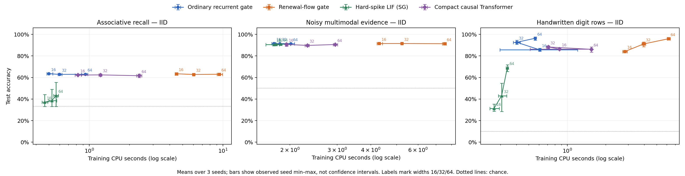

# Hepta 连续再生、原始内容与任务价值：完整实验报告

**结论：连续再生参照通过；当前解析门控原型没有形成统一的质量—成本优势。**
原始输入确实参与了端到端学习，但关联回忆主要停留在历史统计层面，尚未学出可靠的键值绑定；图像后的空白段使任务输出严重退化。内容骨干与控制器已分离：当前学得价值控制器平均比简单置信度策略更差。真实后继与费用的执行核对通过，同时暴露出 learned value 对实际部署续行的校准不足。

这些结果约束的是本报告中的固定协议、小型 CPU 原型。它们没有证明整个 Hepta 设想不可能，也没有支持已经获得优于 SNN、Transformer 或全模态基础模型的新架构。

## 1. 五个问题的实际答案

| 工作 | 实际完成的证据 | 本轮判断 |
|---|---|---|
| 连续再生参照 | 2,142 项固定域检查；48 次独立卷积；24 次存活／不应质量积分；12×50,000 条准确首达采样 | 固定漂移、扩散、reset、不应期合同下闭合；不是只允许每 tick 一次事件 |
| 原始内容输入 | 108 次真实 BPTT/SG 训练；原始 token、有限噪声波形、手写像素；完整历史消融；查询替换 | 使用历史及累积证据得到支持；可靠键值绑定和空白段输出保持没有得到支持 |
| 隔离骨干与控制器 | ordinary/analytic × lightweight/value 的冻结 2×2；完整四配置、三 seed | 骨干净回报差很小；value 控制器平均降低净回报约 0.0186–0.0187 |
| 校验自由边界 | 最优 Q* 与实际续行 Qπ 分开；真实 raw-world 执行；强制第一动作；完整费用；成本射线 | 实现合同一致；学得优势没有充分校准；任务价值零点不等于 smooth-pasting 已验证 |
| 扩展规模与模态 | 4 架构×3任务×3宽度×3seed；324 个留出条件结果；同机 CPU | 获得小型 encoder 的受控比较；解析门控更贵，未出现一致质价优势；不能外推大模型 |

完整子报告见 [数学结果](RENEWAL_RESULTS.md)、[模型结果](analysis/MODEL_RESULTS.md)、[策略结果](POLICY_RESULTS.md) 和 [查询绑定事后诊断](RECALL_BINDING_POSTHOC.md)。复现与证据恢复见 [REPRODUCE.md](REPRODUCE.md)。

## 2. 本轮实现的结构与原始设想的距离

本轮直接使用的是扩散首达和固定 reset renewal 算子。局部距离为正，参数在每次算子调用内固定：

\[
X_t=x+\mu t+\sigma W_t,\qquad x\ge0,\ \sigma>0.
\]

内容模型用一个可学习向量 `h` 保存状态：

\[
a_t=x_tG_x+h_{t-1}G_h+b_g,\quad
m_t=\operatorname{softplus}(-a_t)+0.05,
\]
\[
\nu_t=\mathbb E[N_{\Delta t}(m_t;\mu=-0.25,\sigma=1,r=0.8,d=0.15)],
\quad g_t=1-e^{-\nu_t},
\]
\[
u_t=\tanh(x_tW_x+h_{t-1}W_h+b),\qquad
h_t=(1-g_t)h_{t-1}+g_tu_t.
\]

ordinary 对照仅将门控换为 `1-exp(-dt*softplus(a))`，参数形状、初始化、原始批次和优化预算与 analytic 完全一致。时间为 1 时，ordinary 门控等于 sigmoid。两者均训练全部八个参数数组。

这里 `h` 是完整向量内容状态，`m` 是逐通道的局部门控坐标；没有将整层语义压成一个标量。`g=1-exp(-E[N])` 是定义出来的确定性连续门控，**既不等于至少一次发放概率，也不等于非线性 reset SNN 的精确状态期望**。每个 token 从新的 preactivation 构造距离，没有跨 token 输运完整存活密度或不应年龄。

因此，本轮尚未实现 He–Xiong equity/default 的两个耦合 Call/Put 动力通道，也没有建立其金融最优停止边界到生物膜阈值的严格等价。参考文献为 [He and Xiong, Rollover Risk and Credit Risk, Journal of Finance](https://www.princeton.edu/~wxiong/papers/rollover.pdf)；当前实验合同以仓库中的数学与代码为准。

普通 BPTT 可以训练本轮的连续内容模型，这点经过手写梯度与有限差分核验。外部 READ/SKIP/STOP 控制器采用离线优势回归和离散选择，并未证明已经实现对整个内生自由边界控制系统的端到端反向传播。

## 3. 连续再生：解析身份与独立验算

令 `F(t,a)` 为从距离 `a>=0` 首次到达零的 CDF，负时间延拓为零；零距离遵守即时事件合同：`F(t,0)=1` 对 `t>=0` 成立，正距离下 `F(0,a)=0`。另定义 `Pr(N_T>=0)=1`。每次发放后等待固定不应期 `d`，再从 `r>0` 重新开始，并保持相同漂移和扩散。独立首达等待的 Laplace 变换相乘对 `n>=1` 给出：

\[
\Pr(N_T\ge n)=F\bigl(T-(n-1)d,\ x+(n-1)r\bigr),
\]
\[
\mathbb E[N_T]=\sum_{n\ge1}\Pr(N_T\ge n),\qquad
\Pr(N_T=n)=\Pr(N_T\ge n)-\Pr(N_T\ge n+1).
\]

正不应期下，有限时间只有有限个非零项；零不应期使用受控无限和，并保存均值和绝对空间梯度的余项上界。正漂移下永不首达的概率质量保留，没有对有限首达部分重新归一化。

| 正式核验 | 最大绝对差异 |
|---|---:|
| 主格点 CDF 对 SciPy 参考 | 5.55e-16 |
| 极端参数 CDF | 4.44e-13 |
| 初始距离梯度中心差分 | 1.765e-7 |
| 零距离处右差分 | 1.519e-6 |
| 二次／三次等待独立卷积 | 3.052e-12 |
| active + refractory 质量与 1 | 3.322e-13 |
| killed 密度积分与存活概率 | 4.44e-16 |

全部满足事先固定的混合容限。不能将这些不同检查统一描述为“机器精度”：差分、积分、浮点实现和 Monte Carlo 是不同误差来源。600,000 条 count 原样保留，12 个样本均值与解析均值的最大偏差为 2.392 个样本标准误。

默认参数、`x=0.4, T=1` 时：至少一次发放概率为 0.755316259，至少两次为 0.256405905，至少三次为 0.027265283，期望次数为 1.039304124。重复发放贡献不能忽略。

这个结论依赖固定参数、固定 reset 和固定不应期。内容相关漂移、移动边界、状态相关 reset、层间相互作用，需要重新说明局部近似或求解新的联合问题；本轮结果没有自动扩展到这些情况。

## 4. 原始内容与真实训练

固定矩阵为 `4 families × 3 tasks × 3 widths × 3 seeds = 108 fits`。每 fit 为 300 个 Adam updates、batch 32、学习率 0.003、梯度范数裁剪 1、float64。宽度为 16/32/64，种子为 11/23/37。54 个 ordinary/analytic 模型之外，另有 27 个 hard-spike LIF 和 27 个单层单头 causal Transformer。

三项任务分别为：三组原始 key/value token 的延迟查询；原始类别位和含 nuisance 的有限波形观测；8×8 手写数字逐行像素。波形任务是受控合成数据，不能称为自然音频。Digits 固定拆分 1,074/355/368 个 train/dev/test 图像，像素只除以 16，没有预训练编码器或输入后验。

108 个 fit 的 32,400 条训练日志已逐项检查：相同 task/seed 下，四个 family、三个 width 的全部 300 个原始批次 SHA 相同。ordinary/analytic 的 27 组配对初始化逐数组相同。全部 108 个 checkpoint、日志、来源身份一致。

主模型的 432 个参数数组均真实改变。四类架构合计 999 个参数数组，997 个改变；LIF 的 `recall/w16/s23` 有两个数组没有变化，整个训练记录均保留，没有删除这个失败运行。LIF 使用声明的 surrogate，未把它包装为 hard-spike loss 的真实导数。Transformer 与连续模型使用精确链式反传，并经过独立有限差分检查。

全部 108 个模型各评估 IID、长序列／延迟、时钟变化三个条件，形成 324 行；从保存 logits 独立复算 accuracy/NLL 与原记录一致。三个 seed 的范围只是描述性范围，不是置信区间。合成数据来自独立随机流的有限支持分布，未声称所有 train/test 原始序列互不重复。

### 4.1 利用历史不等于学会查询绑定

对 54 个 ordinary/analytic 冻结模型仅保留最后一个输入时，回忆任务由完整历史的约 62–64% 降至约 33%；合成证据任务由约 91% 降至 71.48%；数字任务的最后一行消融约为 15–24%。这些结果支持模型使用了历史，但最后输入消融不是另行训练的强 last-input baseline。

回忆任务存在一个具体捷径：忽略查询键，只对三个独立均匀值取多数，理论准确率为

\[
\frac19\cdot1+\frac23\cdot\frac23+\frac29\cdot\frac13
=\frac{17}{27}\approx62.96\%.
\]

因为正式结果接近这个水平，之后单独注册并执行 **POSTHOC** 查询替换诊断。模型权重不变，使用原测试流前 512 个 history，其中 114 个 history 的三个值互不相同；每个 history 分别查询三个键。保存全部原始与替换 logits，原查询重新执行与原测试结果一致。

| Analytic 宽度 | 原测试子集准确率 | 三个值互异时，三个查询平均准确率 | 互异 history 三个查询全对比例 |
|---:|---:|---:|---:|
| 16 | 63.54% | 34.21% | 0.29% |
| 32 | 63.02% | 33.82% | 0.00% |
| 64 | 62.24% | 33.92% | 0.00% |

表格为三个 seed 的均值，仅属于这个事后诊断。majority 在同一 512 个原查询上为 63.67%。这些结果与利用值的历史分布相符，尚无可靠键值绑定的证据；不能把完整历史高于最后输入直接写成关联记忆成功。普通门控、这个小型 Transformer 和 LIF 也没有在该诊断中取得可靠绑定。

### 4.2 空白段后的输出保持失败

宽度 64、三个 seed 的平均数字识别准确率：

| 模型 | 正常 8 行 | 后接 8 行零输入 |
|---|---:|---:|
| Ordinary | 96.38% | 9.60% |
| Analytic | 95.92% | 13.77% |
| LIF | 69.02% | 29.26% |
| Compact Transformer | 86.14% | 10.05% |

这说明当前任务输出对空白延迟不稳健。它不等于证明所有内部信息已不可恢复：本轮没有训练独立的 state decoder；Transformer 仍保留原输入 token，读出位置和位置编码的分布变化也参与了退化。合成证据的“长条件”则是 8→16 个有信息观测，并非空等待，不能混成同一种记忆保持测试。

## 5. 内容骨干与动作策略的 2×2

冻结 width-16 内容模型，控制器只见 hidden、读出、时间、预算和公开任务参数。标签、未读观测、teacher posterior 都不进入部署输入。离线 teacher 可用已经观察到的完整历史构造条件价值标签。

动作是 STOP/READ/SKIP；预算、时钟、跳过观测后累计的时间、原始访问和收费按同一合同执行。净回报为最终分类正确性减 READ/SKIP/非法尝试费。以下为三个 seed、四个 heldout 配置等权的精确有限期望：

| 骨干 | Dev 选定轻量控制 | 学得价值控制 | 价值控制器净效应 |
|---|---:|---:|---:|
| Ordinary | 0.670931917 | 0.652221989 | -0.018709927 |
| Analytic | 0.671824000 | 0.653259226 | -0.018564774 |

解析骨干相对 ordinary 的差异，在轻量控制下为 +0.000892083，在价值控制下为 +0.001037237；交互项为 +0.000145153。它们不是稳定的大增益。六个 model-seed 中五个 value 策略平均不如原 dev 选择，analytic 的三个 seed 都下降。

预先包含、在 dev 选择次数的 fixed-read-3，在 heldout 上两种骨干均为 0.693830。它也优于当前 value 控制器；主比较仍保留原 dev 选出的 confidence 0.8，没有看过 test 后替换选择规则。

value 控制器平均每条轨迹多出约 2.7 次 SKIP，分类质量也下降。减少部分 READ fee 并未形成净收益。所有费用是固定抽象 tariff，实际 CPU 单独测量。

## 6. 边界价值是否对应真实后继与完整成本

最优教师与实际策略必须分开。下列递推只用于非终止 READ/SKIP 分支；`s` 表示估值所需的因果历史节点，而部署策略 π 只访问其公开 hidden/context 投影，并不假定该压缩向量已被证明为充分 Markov 状态：

\[
Q^*(s,a)=-c(s,a)+\mathbb E[\max_bQ^*(S',b)],
\]
\[
Q^\pi(s,a)=-c(s,a)+\mathbb E[V^\pi(S')],\quad
V^\pi(s)=Q^\pi(s,\pi(s)).
\]

STOP 的终止收益单独定义为
\(Q^*(s,\mathrm{STOP})=Q^\pi(s,\mathrm{STOP})
=\Pr(Y=\arg\max f(h_s)\mid\mathcal H_s)\)，即给定已经观察到的历史，当前冻结分类器预测正确的概率。

原 ridge 训练目标属于 Q*。补充审计固定相同 learned policy，在每个第一动作之后继续执行它，构造 Qπ；两种价值均包含全部后继费用。对六个模型的 heldout_a 根部分别执行 STOP/READ/SKIP 干预，每个模型、每个首动作独立枚举 1,024 个完整 raw worlds，合计 18,432 次实际执行。

| 核验 | 最大绝对误差 |
|---|---:|
| 主策略实际世界期望与 DP | 7.327e-15 |
| 强制第一动作真实期望与 Qπ | 2.998e-15 |
| Regret 望远镜恒等式 | 3.608e-16 |
| 实际公共状态后继 | 0 |

另有 15,360 次配对实际执行、30,720 次主完整枚举，原始账本重算无错误，guard fallback 为零。这证明声明的有限过程执行一致；执行器与 teacher 共享 canonical transition，独立性主要在原始世界概率求和和执行路径，不是两个完全独立的膜动力学实现。

**一致的执行并没有使价值预测自动正确。** 对实际到达状态加权，原 heldout 上：

| 骨干 | Q* 优势 RMSE | Qπ 优势 RMSE | Qπ 符号正确率 |
|---|---:|---:|---:|
| Ordinary | 0.109405 | 0.125258 | 44.86% |
| Analytic | 0.106057 | 0.123654 | 44.77% |

这些是逐 seed×配置统计的等权均值，不是 pooled RMSE。原 24 个 heldout 根状态中，learned policy 全部 READ；相对真实 Qπ 的最佳第一动作错 7/24。

96 条预定成本射线均得到最优 continuation-minus-STOP 的零点，最大残差 8.956e-12。但预测曲线在六条根射线中有四条非单调，真实 Qπ 曲线有两条非单调。根边界约为 READ fee 0.275，两侧 learned 动作共 12/12 错误。

**这组边界两侧结果属于扩展成本压力测试**：射线扫描 0–0.5，超出训练 tariff 0.015–0.06 和原 heldout 0.025–0.08。不能把全部外推错误冒称发生在原 heldout 域。原 heldout 的负净效用、Qπ 符号准确率和根动作错误是独立的直接证据。

这里检验的是有限任务价值面与数值 value matching。没有证明经典 smooth-pasting、唯一的电压自由边界，或完整 Call/Put 控制 PDE 已经求解。

## 7. 跨宽度、跨输入类型的质量与 CPU

以下展示宽度 64 的 IID 结果，每格是三个 seed 的均值；完整三宽度、三条件在 CSV 和图中。

| 模型 | Recall | 合成双模态证据 | 手写数字 | 数字任务训练 CPU 秒/fit |
|---|---:|---:|---:|---:|
| Ordinary | 62.97% | 91.36% | 96.38% | 0.560 |
| Analytic | 63.02% | 91.36% | 95.92% | 6.176 |
| LIF SG | 43.41% | 90.95% | 69.02% | 0.339 |
| Compact Transformer | 61.67% | 90.56% | 86.14% | 1.539 |

ordinary/analytic 严格同参数；其他架构仅同 nominal width。数字任务 width 64 的参数数分别为 9,994 / 9,994 / 5,322 / 34,442。相同 updates 不是相同训练计算量，也不代表各架构都已充分调优。Transformer 为 NumPy 单层单头 dense attention；LIF 为 dense CPU surrogate 训练，不能据此推论优化 GPU Transformer 或神经形态硬件的性能。

三任务各三宽度、三 seed 共 27 个 ordinary/analytic 配对：IID 为 analytic 10 胜、4 平、13 负；长条件 16 胜、2 平、9 负；时钟变化 16 胜、3 平、8 负。部分偏移条件有小幅正差异，但绝对质量和额外成本不支持统一优势。

排除数据构造与序列化，对缓存原始输入做 forward+readout 的重复计时，27 对模型的 analytic/ordinary 比值中位数为：batch 1 **20.18×**，batch 64 **21.86×**。每模型先取 7 组、每组 3 次 forward 的中位数，再作配对比。含数据构造的训练时间会稀释这个差异；首次数据集惰性加载也影响个别小 fit。两个时间口径都保留。

实际控制 actor 每条配对轨迹的平均 CPU 为：ordinary/light 0.232342 ms，ordinary/value 0.424228 ms，analytic/light 1.297821 ms，analytic/value 1.864584 ms。其计时包含控制、内容 step、guard、原始访问、读出和证据哈希，排除外层世界生成与 gzip 写出；不能称为纯部署内核延迟。

覆盖 108 次 fit 的两个完整训练阶段合计墙钟约 246.77 秒；全部 22 个不重叠测量进程阶段（含审计与事后诊断）合计 CPU 602.516 秒、墙钟 602.932 秒。发布、代码审阅、报告和归档时间不在这个和中。没有测量能耗。

## 8. 证据顺序与结论边界

GitHub 远端 commit 元数据与实际进程时间再次交叉核对，所有顺序检查通过：源码先于训练、108 个候选与六个控制器先于任何留出测试集评估、两个汇总脚本及 Qπ 审计先于测试。开发集 dev 评估先于候选冻结，并用于选择轻量策略，这是原定流程；这里的留出测试明确指最终 test。查询绑定诊断则明确在测试之后提出，并在其执行前单独保存版本。没有删除失败运行、没有根据 test 重选 checkpoint、没有把事后诊断称为预注册主结果。

来源与候选身份详见 [SOURCE_FREEZE.json](SOURCE_FREEZE.json)、[COMPARISON_FREEZE.json](COMPARISON_FREEZE.json)、[CANDIDATE_FREEZE.json](CANDIDATE_FREEZE.json)、[COMPARISON_CANDIDATE.json](COMPARISON_CANDIDATE.json)。原始日志、权重、优化器状态、raw batch、全部 predictions、状态/动作轨迹与空失败记录均在可校验的证据包中。

这轮可保留的研究结论是：固定再生解析算子与其梯度可实现并被独立验算；原始内容模型可实际训练；骨干和动作收益可分开审计；Q* 和 Qπ 的区别对边界解释很关键。当前 prototype 尚未实现可靠的查询绑定、空白段输出保持、已校准的部署价值边界或更好的统一质价曲线。

向全模态大模型推进前，仍需要新的证据：在无多数捷径的查询任务上学习绑定；区分持续时间、缺失观测与零值观测的状态合同；验证恢复与保持机制；让 learned advantage 对实际续行及完整成本校准；再在相同硬件、充分调优和更大模型/自然模态上比较。**本报告没有把这些尚未完成的证据写成已实现的优势。**
