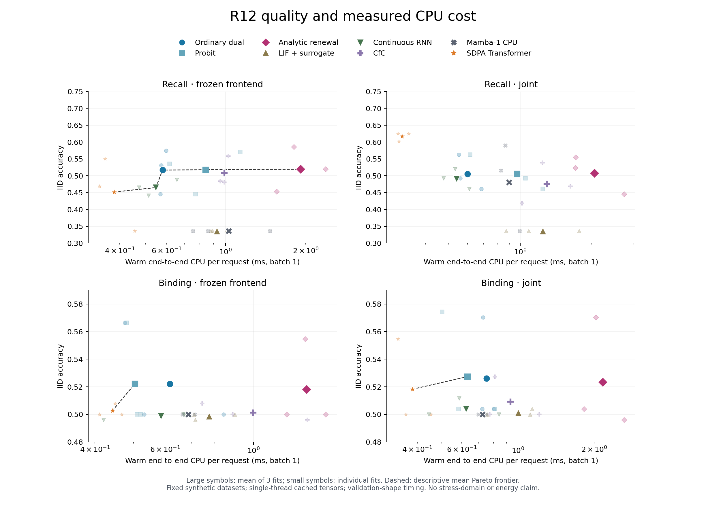

# R13：同信息、2×2、真实动作与完整费用的判别性验证

日期：2026-11-01 UTC。固定科学源码：`04436032a808a5a1bbda10a66e487a32b8c654ff`。
继承的 R12 远端基线：`1eb979ff62499abf82118b6a4196c44324c11242`。

## 结论先行

**本轮成功修复并验证了有限动作任务中的尾部 SKIP 浪费，也验证了完整恢复年龄状态的必要性；新确认配置没有支持解析动力学成为更好的基础网络核心。**

最关键的同控制比较为 **D−B = −0.067549517**。价值控制分别改善普通和解析核心，但在本轮冻结内容模型、三组既有训练种子、四个预先固定的新配置上，普通核心的任务净收益更高。解析版本的平均正确率更低，实测 actor CPU 约为普通版本的 5.11 倍。旧 R12 留出上的正增量没有延续到这组新配置。

这是对当前实现和本次有限任务范围的负面架构证据，不是对所有解析首达／复位模型的不可行性证明。三条证据线必须分别理解：

| 证据线 | 本轮实际做了什么 | 不能据此宣称什么 |
| --- | --- | --- |
| 完整概率状态 | 新写并执行固定系数、正不应期的独立年龄参考、前向 PDE、完整 checkpoint 与跨进程恢复验证 | 内容网络已经使用完整存活分布／恢复年龄，或任意移动边界已经准确 |
| 真实动作 | 固定既有内容模型和控制器，执行四个新配置；同前缀实际分支续跑，初始 STOP 开放 | 内容共同训练已通过同一 2×2，或自然多模态任务已验证 |
| 内容与成本 | 对 R12 的 96 个任务 fit、720 份原始预测、295 份完整流程收据独立重算 | 本轮新训了这些模型，或所有基线都经过充分的独立调参 |

## 1. 主判据：同一价值控制下的四格

以下是 `qpi_selected_tailstop` 对 `lightweight_tailstop` 的主四格。TailStop 对每个核心、每个控制器一视同仁。净收益为任务正确性收益减实际发生的动作 tariff；它不是焦耳，也不是把 CPU 时间任意折算成效用。

| 动力学核心 | 轻量控制 | 同一任务价值控制 |
| --- | ---: | ---: |
| 普通核心 | A = 0.457970269 | B = 0.677001434 |
| 解析核心 | C = 0.453641573 | D = 0.609451917 |

| 效应 | 平均值 | 本轮解释 |
| --- | ---: | --- |
| B−A | +0.219031165 | 价值控制明显改善普通核心的任务净收益 |
| D−C | +0.155810344 | 价值控制也改善解析核心 |
| C−A | −0.004328696 | 轻量控制下解析核心略低 |
| **D−B** | **−0.067549517** | **相同价值控制下，解析核心没有取得净优势** |
| (D−C)−(B−A) | −0.063220821 | 本轮两种机制的交互为负 |

三组 fit 种子的 D−B 分别为 `0`、`−0.055962749`、`−0.146685802`。四个配置是评估条件，不能当成四次独立训练；不能把 24 个“核心×种子×配置”案例当成 24 个独立 fit。这里报告描述性均值和逐种子结果，不报显著性或置信区间。

全部原控制器与所有改造版本均保留。未加 TailStop 的 selected-Qπ 已经有 `D−B = −0.065504320`，因此主结果的负号不是由这个修复人为产生。另一个 matched-Q* 对照加 TailStop 后为普通 `0.591627131`、解析 `0.599002271`，同控制差为 `+0.007375141`；但二者均低于保留的普通 selected-Qπ + TailStop 的 `0.677001434`，不能只选这一条较弱控制线宣称解析方案领先。

旧 R12 的 selected-Qπ 平均值为普通 `0.579495832`、解析 `0.599404227`，差约 `+0.019908395`。本轮旧数据回看明确标为历史分析，既不与新配置混合平均，也不被删除。新结果说明旧的有限正增量尚不稳健。

来源：[本轮完整控制器与四格表](value/evidence/confirmation_01/REPORT.md)、[机器汇总](value/evidence/confirmation_01/SUMMARY.json)、[历史回看](value/evidence/retrospective_01.json)。

## 2. 价值必须兑现为后续动作

### 2.1 可证明的 TailStop 修复

继承的有限任务中，READ 才会读取因果原始观测并更新内容状态；SKIP 保持内容状态不变，只推进公开时程与 pending_dt；STOP 用当前内容状态分类。控制器确定性执行，SKIP 费用非负。

如果控制器准备 SKIP，TailStop 只沿公开的 SKIP 后继向前检查：若第一次遇到的是 READ，仍执行原动作；若在任何 READ 前先遇到 STOP，则立即 STOP。检查过程中不读取未见原始观测、标签、后验或 oracle value，也不预演 READ 的结果。

因此，对每条实际世界轨迹，所有真实 READ、被读到的观测、相应内容后继和最终分类均保持不变，仅移除不再带来信息的尾部 SKIP。少付 k 次 SKIP 费，任务收益提升恰为 `k × c_skip ≥ 0`。额外的控制器调用有真实 CPU 费用，已计入计时。

这个保证不适用于等待期间内容、物理状态、恢复年龄或终端收益仍会改变的过程。尤其不能把它直接套在本报告的连续恢复 PDE 上。控制器原 critic 数值没有重新拟合；价值校准按改造策略的实际 Qπ 重新核验，不能把原分数说成新策略的精确价值。

### 2.2 新确认实际执行与独立检查

本轮共完成 24 个案例、8 个控制器版本，累计：

- 65,376 个可达历史，12,288 条实际配对执行轨迹；
- 6,144 对原策略／TailStop 的逐轨迹支配检查；
- 48 个固定前缀，其中 24 个非根前缀；1,152 组强制首动作续跑；
- 22,264 次条件完整世界执行，10,552 次动作分支展开。

所有案例正常完成，没有非法动作 fallback。完整历史支配误差最大 `3.33e−16`，逐轨迹收益恒等式误差最大 `1.38e−16`；Qπ 递推最大误差 `7.77e−16`，概率质量误差 `1.33e−15`，费用误差 `1.11e−15`，后继状态差为零，regret 核验 `1.33e−15`。

独立审阅先检查全部 24 份结果的身份、四组 factorial 与 16 组汇总算术；另对预先指定的 ordinary_s11／analytic_s11 × confirm13_a 原始 gzip 重新构造似然、后验、Q*、Qπ、占用、regret、费用和 TailStop 调用计数，不导入生产模型或执行器。两例共 1,024 条配对轨迹、2,660 条强制分支记录，各 2,547 个历史；64 个配对世界逐项相同。最大重算差异 `1.7763568394002505e−15`。**另外 22 个案例没有再独立解压重算全部轨迹，且没有重新训练权重。**

来源：[源码审阅](value/INDEPENDENT_SOURCE_REVIEW.json)、[结果独立审阅](value/INDEPENDENT_RESULT_REVIEW.json)、[可重放审阅程序](review/value_results.py)。

### 2.3 修复之后仍然存在的失败

| 指标 | B：普通 selected-Qπ + TailStop | D：解析 selected-Qπ + TailStop |
| --- | ---: | ---: |
| 任务净收益 | 0.677001434 | 0.609451917 |
| 最终正确率 | 0.756472375 | 0.733461651 |
| 平均 READ 次数 | 1.318570833 | 1.620466927 |
| 平均 SKIP 次数 | 0.033962500 | 0.295911979 |
| actor CPU，ms／轨迹 | 0.226026260 | 1.155163712 |
| 低于初始 STOP 的配置数 | 0/12 | 2/12 |
| 占用加权单步改进 regret | 0.011048832 | 0.046629113 |

初始 STOP 始终可选，收益为 0.5。解析 seed37 的 confirm13_c 仍返回 `0.4316`：根动作 SKIP 后确实还会 READ，平均一次 READ、两次 SKIP；该条件的全历史 oracle 也是 0.5。confirm13_d 根动作 READ，最终收益 `0.441695856`，低于初始 STOP，而 oracle 为 0.812。TailStop 正确保留了这两条实际决策失败，没有借规则覆盖成理想决策。

普通 selected-Qπ 的净收益因修复增加 `0.005628690`，测得 actor CPU 降约 8.58%；解析增加 `0.003583493`，CPU 升约 0.20%。matched-Q* 两核心的任务收益都提高，CPU 却分别增加约 14.26%／6.44%。因此只有任务费用支配是证明；CPU 收益需要测量。这些是共享 CPU 主机上的描述性计时。

## 3. 完整状态与目标连续过程分别验收

R12 的首达、存活后继、再生计数、部分移动边界和梯度审计继续原样保留。本轮新增完整恢复年龄状态与观察分段检查，使用两组固定漂移／噪声参数、三个空间网格。连续恢复年龄参考由首达时间密度和 renewal 恒等式独立积分；前向 PDE 的吸收流量自行形成恢复队列，不用解析事件数驱动复位。

正式 80 条原始记录中，**68/68 普通验收通过，12 条故意损坏状态的等价检查保留失败**；对应 12 次损坏检测均通过。不能改写为“80/80 等价通过”。

| 最细空间网格 0.01；x=.4，H=1.2，reset=.8，refractory=.2 | μ=−.6，σ=.7 | μ=.3，σ=1 |
| --- | ---: | ---: |
| 恢复年龄分箱 L1 误差 | 1.673036740e−6 | 8.761820987e−7 |
| 归一化一阶年龄矩误差 | 8.526070646e−7 | 4.554722641e−7 |
| 归一化二阶年龄矩误差 | 5.723472874e−7 | 3.097349144e−7 |
| 活跃位置分箱 L1 误差 | 2.454867263e−5 | 5.429250138e−6 |
| 累积事件数绝对误差 | 1.382721721e−5 | 4.309034239e−6 |

六次前向运行最大质量误差 `7.480682740e−13`；最大上壁流失 `3.696898301e−11`，始终入账。该离散流失值不是连续空间截断误差的严格上界。

完整 checkpoint 包含活跃概率、恢复年龄队列及游标、物理时间与步数、累计事件与上壁损失、模型／网格身份和 payload hash。24 次中途 JSON 往返、6 组一次推进／分段推进、2 次新 Python 进程恢复均得到逐位相同的完整末态；10 种损坏 checkpoint 被拒绝，6 个不对齐时间请求被明确拒绝。

**只守住总质量仍会错。** 把恢复质量全部移到最年轻年龄但保留总质量后，两组最细网格的最终事件数分别偏差 `0.016921463`、`0.004863650`。这直接证明恢复总质量不足以决定真实剩余时间和后续过程。

逐位一致仅限固定同一网格；连续准确性来自独立参考和网格细化，不能由实现自洽推出。零不应期、初始边界原子、任意重分格、随机／状态依赖／学习移动边界和金融自由边界／复位 QVI 等价不在本轮已通过范围。

来源：[数值完整报告](numerics/RESULTS_ZH.md)、[正式汇总](numerics/results/formal_01/SUMMARY.json)、[保留的负例](numerics/results/formal_01/FAILURES.json)。

## 4. 内容学习：保留正点，也保留更强对照

历史内容线为 8 个真实模型族 × 2 个任务 × 2 个训练模式 × 3 个种子，共 96 个任务 fit，另有 6 个共同 donor。独立重算 720 个原始 NPZ、184,320 个预测，全部与记录的分数和数据身份相符。模型族包括普通双头、中心斜率匹配 probit、解析 renewal、LIF＋替代梯度、连续时间 RNN、官方 ncps CfC、Mamba-1 selective SSM 和使用真实 SDPA 的 Transformer。

普通／probit／解析三者动态核心均 1,584 参数且初始化配对；其余动态核心参数量差约 0–5.81%。每 fit 固定 128 步、batch32、lr=.003，允许选择 step zero。没有逐模型族充分调参，Mamba 为 CPU serial scan，没有优化 GPU kernel。

共同训练模式的代表性结果：

| 任务 | 模型 | IID 准确率 | warm batch1，ms | batch32，ms／样本 | fit CPU，秒 |
| --- | --- | ---: | ---: | ---: | ---: |
| recall | 普通双头 | 0.505208 | 0.599238 | 0.024542 | 3.531896 |
| recall | 解析 | 0.507812 | 2.047759 | 0.166696 | 5.216159 |
| recall | Transformer | 0.617188 | 0.317815 | 0.019592 | 3.258083 |
| binding | 普通双头 | 0.526042 | 0.752069 | 0.028893 | 3.276405 |
| binding | 解析 | 0.523438 | 2.163582 | 0.146999 | 4.334027 |
| binding | probit | 0.527344 | 0.631526 | 0.027973 | 3.263552 |
| binding | Transformer | 0.518229 | 0.383134 | 0.022355 | 3.332388 |

冻结前端的 recall 长干扰条件中，解析相对普通有 `+0.035156`，三个种子均正；但 joint 的相同条件为 `−0.006510`，joint clock4x 为 `−0.019531`。binding 大多接近 0.5，不能把细小差异解读成可靠跨模态绑定能力。全部 stress 域分数保留，不仅展示最佳条件。

`frozen_frontend` 只冻结共同编码器，动态核心与 readout 仍训练；它不等于用户要求的完整内容后端冻结。value 线冻结完整既有后端，但没有与内容线拼成一个“控制方式 × 完整后端冻结／共同训练”的统一实验。当前任务是合成因果观测，不是自然图像／语音／语言的多模态基准。

内容 analytic 使用固定参数的 `1 − exp(−E[N])` renewal 活动特征与普通 write 头；不持有完整存活条件密度和恢复年龄，也没有求解任务最优自由边界。数值线已经通过的完整状态不能借给这个内容模型。

来源：[独立内容与成本报告](cost/results/historical_002/REPORT_ZH.md)、[逐种子全部域](cost/results/historical_002/per_seed_quality_cost.csv)、[均值与描述性 Pareto](cost/results/historical_002/aggregate_iid.json)。

## 5. 费用完整入账，但未测项目不填零

R12 内容实验完整流程总账如下。共同 donor 训练计一次；不能把内层训练 timer 再加到完整 worker 费用。

| 历史阶段 | 完整进程数 | CPU 秒 |
| --- | ---: | ---: |
| 训练／选择，含 6 个 donor | 102 | 361.400232 |
| 评估 | 96 | 176.235522 |
| profile | 96 | 152.375027 |
| 原审计 | 1 | 4.604500 |

本轮新增运行另行记录：

| 本轮工作 | CPU 秒 | wall 秒 | 口径 |
| --- | ---: | ---: | --- |
| 24 案例 value 确认：科学子进程 | 113.063528 | 115.069479 | 含该子进程启动、所有历史／分支、真实执行、额外 guard 调用、证据写入 |
| 同次 value 的完整外层启动 | 113.44 | 115.75 | Bash time 的两位小数读数，包含监督器及上一行，不与上一行相加 |
| 数值开发 + 正式 | 6.738380 | 分别 3.495946／3.366703 | 两次科学子进程含所等待的恢复进程；正式 CPU 为 3.329907，各次启动器自身未计入 |
| 历史成本重分析成功尝试 | 4.416525 | 4.488845 | 本轮完整重算子进程成本，不冒充历史训练 |
| 最小树复现检查三进程 | 4.396995 | 逐进程见收据 | 数值内部收据包含在外层，不能重复相加 |

价值确认峰值 RSS 为 93,792 KiB；数值正式 84,566,016 字节；成本重算 115,748,864 字节。它们是进程峰值，不是专项状态内存，也不是同时并发进程 RSS 之和。原 R12 的 `161.158359 CPU s` 只指控制器训练收据，不能写成整个内容模型训练成本。

成本初次重分析因为第 295 份原审计收据没有模型 `--job` 字段而失败，保留 `historical_001` 及其 `0.144892 CPU s`；修复后独立运行 `historical_002`。value 外层首次尝试因系统没有 `/usr/bin/time` 在启动科学计算前退出 127，失败记录保留，改用 Bash time 与 wait4 监督器后执行。没有因此修改科学配置或删除负结果。

模型 profile 已包含其实际特殊函数、encoder、core、readout 和输出拷贝，但输入是缓存张量；不包含远程数据获取。完整自由边界求解和完整分布存储没有在该内容模型中发生，不能记录为“测得零成本”。stress 域没有各自的 profile，其延迟单元格保留空值，不用 IID 延迟代替长度外推成本。

训练摊销采用 `(donor + fit)/N + warm request`，从 1 到 1,000,000 次复用，全部 1,248 个逐种子情景可检查。它是清楚的会计组合，不包含未测部署初始化、服务基础设施或在线查询，不能称完整生产费用。

物理能耗仍为 `null`。本轮只读探测在当前容器看不到 powercap／hwmon／nvidia-smi；这不是“宿主机没有传感器”的结论，也不能反推历史运行能耗。没有用 CPU 秒乘猜测功率伪造焦耳数。

来源：[295 份进程账](cost/results/historical_002/process_ledger.csv)、[训练摊销](cost/results/historical_002/training_amortization.csv)、[当前能耗可见性](cost/results/historical_002/ENERGY_VISIBILITY.json)、[value 完整进程](value/confirmation_01_PROCESS.json)。

## 6. 固定源码、原始证据与独立复现

正式执行前，从统一固定提交逐文件读取了 29 个 R13 源码／协议／来源文件，验证 UTF-8 字节、SHA256 与 Git blob；value 的 10 个科学源和 107 个继承输入由 `SOURCE_FREEZE.json` 固定。R12 父提交也读取并核验了 66 个所需文件，记录两项后来本地差异，未将这些差异伪装为父提交内容。

inputs 归档包含 1,934 个明确的既有源码／原始记录文件，展开后 41,569,249 字节；压缩 35,939,155 字节。每个归档分片和每个恢复文件都有 SHA256。results 归档保留本轮正式／开发输出、失败尝试、实际轨迹、独立审阅和复现原始日志，正文与主要表格亦直接可读。

最小重建树从 inputs 归档恢复，再追加 29 个已读回 R13 源、2 个所需 R12 源、2 份 publication receipt，总计 1,967 个初始运行文件。所有实验模块实际导入路径均在这个重建树内，未借用原仓库导入路径。7/7 value tests 通过，`verify(publication=True)` 通过；单次数值复现仍为 68 条普通通过、12 条保留负例，六个完整末态的 SHA256 与正式结果一致。它是依赖完整性与确定性检查，不是新增科学样本，也没有再次运行 24 个 value 配置。

完整复现命令见 [REPRODUCE.md](REPRODUCE.md)，身份与检查结果见 [SOURCE_PUBLICATION_READBACK.json](SOURCE_PUBLICATION_READBACK.json)、[RECONSTRUCTION_CHECK.json](RECONSTRUCTION_CHECK.json)。

## 7. 当前验收状态

| 用户要求 | 本轮状态 |
| --- | --- |
| 同信息 2×2，并以 D−B 为核心判据 | 已在冻结既有内容模型的实际有限动作任务中执行；D−B 为负 |
| 价值排序、尺度与选择后的 regret 对应真实续跑 | 已有完整历史／强制分支执行与独立抽样复核；保留 residual STOP 失败 |
| 初始 STOP 开放 | 已开放并报告低于它的案例 |
| 核／状态准确性独立于共同实现自洽 | 新增独立连续年龄参考、三网格和故意损坏状态负例；固定过程范围通过 |
| 内容完全冻结与共同训练的统一控制实验 | 尚未构成同一完整 2×2；不能用 frozen_frontend 充数 |
| 延迟检索、绑定、缺失、间隔及长度压力 | 已有合成任务历史数据与全部域分数；自然多模态和稳定绑定能力未证明 |
| 强基线 | 八个真实族、同信息与近似同容量已记录；充分独立调参和优化 GPU 未完成 |
| 完整成本与质量前沿 | 已重算训练／评估／profile／进程账与已测前沿；在线查询、stress 延迟、实际焦耳仍未测 |
| 成为新基础网络核心 | **当前证据不支持验收** |

后续若推进完整状态网络，应先明确把存活分布、恢复年龄和实际剩余时间接入哪一个可训练内容模型，再在该同一模型上重新冻结方案、执行内容冻结／共同训练两层 2×2。不能只增加局部核通过数，也不能在看到本轮失败后切换到较弱普通控制线作为主比较。
