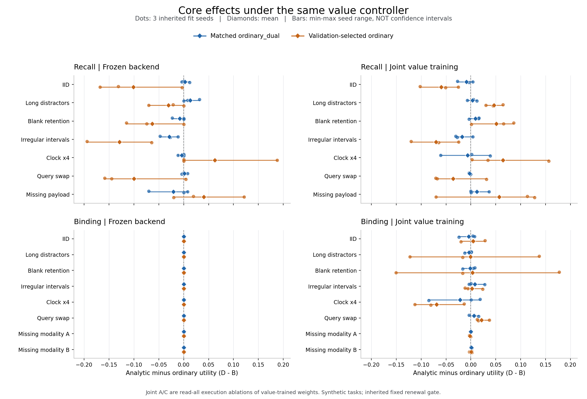
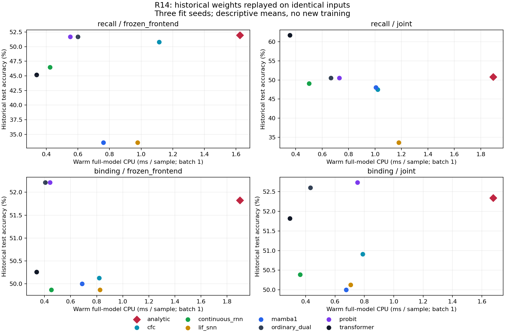

# R14：同信息、实际后续动作、完整后端冻结与成本的判别性验证

**本轮已完成所冻结的数值、动作、内容和成本实验。当前证据仍不足以接受解析动力学成为新的通用基础网络核心。** 数值传播的特定缺口得到修补；有限动作任务中的核心期望增量很小；新内容共同训练没有形成稳定的相对优势；当前内容实现的完整前向和实际控制执行成本较高。

这一判断保留有利结果：完整有限模型中的 D−B 为小正值，原解析 actor 在这个任务中的局部 CPU 较低；共同训练的解析内容模型在部分保持与长度压力域上也有优势。这些结果与负向或近零结果分别报告，没有跨模型线合并成一个总分。

## 1. 实际完成范围与来源

| 研究线 | 实际工作 | 当前证据范围 |
|---|---|---|
| 数值 | 70 个普通检查通过；2 个故意错误等价命题保留失败；独立连续积分与高精度梯度参照 | 固定系数、固定边界、正 reset、零不应期、完整分布与任意观测分段 |
| 动作 | 8,192 次新四臂执行、12,440 个到访前缀、57,107 个强制首动作；另 12,288 次六臂执行与全部 27 种时钟 | 八个继承 fit、20 状态、三步有限合成任务；真实环境仅供 evaluator |
| 内容 | 12 组、每组八核共享一个 critic；48 个完整冻结后端与 48 个共同训练后端；720 个模型/域结果 | 两个合成原始观测任务、三种继承 fit seed；新固定数据种子 |
| 成本 | 720 个新进程、1,440 个 batch/模型/域条件、184,320 个历史预测重放 | 八族历史内容模型的 CPU 完整前向；历史训练账另列；无物理焦耳 |

分支基线为 PR #4544 的 `9c97642cea5478cd9e7d078a192399bef9c9efc8`。动作支线明确引用 PR #4542 的 `b0802dc314251f5332bd026cb2984a0b5c75f768`。内容和旧成本模型来自基线内的 R12 内容实现。数值完整分布、有限 CTMC actor 与内容 renewal 门是三种不同对象，结果不能互相替代。[来源记录](SOURCE_BASELINE.json)

## 2. 核与完整状态传播

新增 ZeroDelayFlow 保留各事件计数层的完整活动位置分布、上壁流失与累计期望次数。触界后立即复位并继续消耗实际剩余时间；初始边界原子在 t=0 计数；溢出计数层继续复位，不把事件截为一次或四次。

| 检查与范围 | 观察到的最大误差 |
|---|---:|
| 最细网格：首达概率绝对误差 | 4.48829649e−6 |
| 最细网格：期望事件数绝对误差 | 8.19730034e−6 |
| 最细网格：计数 PMF（含溢出）L1 | 3.67648982e−5 |
| 最细网格：活动位置分箱 L1 | 2.37764414e−5 |
| 全部 12 组：分段与一次推进的完整状态 L1 | 1.00132769e−12 |
| 中间网格：五参数有限生成元切线与中心差商 | 2.45112042e−9 |

梯度对独立 70 位连续参照的误差随空间细化为 0.007262 → 0.003619 → 0.002241。有限模型的精确切线与连续过程近似误差是两种证据；后一项没有因为实现一致而消失。

两项负对照显示：只保留各层质量和均值会造成后续期望次数差 0.037419；整段至多一次事件并在末端复位会少记 0.460973 次。它们的失败保留为反证，不计入“全部等价通过”。本次证据不覆盖学习移动边界、随机恢复时间、插值结点普通导数或全参数域误差证明。[数值结果与限制](numerics/RESULTS_ZH.md)

## 3. D−B：真实动作与完整有限模型期望

四臂共享原始因果信息、公开时钟、预算、实际任务奖励与费用。任务效用包含声明的答题奖励、状态奖励及 READ/WAIT/RESET 费用，不能当作准确率百分点。初始 STOP 始终合法。以下主采样表来自第二批新的六臂实验，原四臂同时保留；完整时钟列则枚举每域全部 3³ 个公开时钟，在真实有限环境中积分全部后续随机性，并在每个后继重新调用实际策略。

| Arm | 新实际轨迹 IID | 新实际轨迹 OOD | 全 27 钟期望 IID | 全 27 钟期望 OOD |
|---|---:|---:|---:|---:|
| A | 0.721739490 | 0.713804755 | 0.716486957 | 0.704318618 |
| B | 0.756984422 | 0.761457244 | 0.747839511 | 0.742544414 |
| C | 0.715880115 | 0.720640692 | 0.717246755 | 0.709315799 |
| D | 0.760788174 | 0.750332111 | 0.748192929 | 0.744963319 |

| 对比 | 实际 IID | 实际 OOD | 全时钟 IID | 全时钟 OOD |
|---|---:|---:|---:|---:|
| B-A | +0.035244932 | +0.047652489 | +0.031352554 | +0.038225796 |
| D-C | +0.044908059 | +0.029691418 | +0.030946174 | +0.035647520 |
| C-A | -0.005859375 | +0.006835937 | +0.000759798 | +0.004997181 |
| D-B | +0.003803752 | -0.011125133 | +0.000353418 | +0.002418906 |
| interaction | +0.009663127 | -0.017961070 | -0.000406380 | -0.002578275 |

实际采样 D−B 的八 fit 描述性 95% t 区间：

- IID：+0.003803752，[-0.014287842, +0.021895346]。
- OOD：-0.011125133，[-0.029249530, +0.006999264]。

全时钟期望中的核心增量为 +0.000353／+0.002419，均低于继承研究声明的 +0.01 最小有意义效应；但这不是把原随机确认试验替换成新的接受检验。本轮候选与新评估预先固定为描述性分析，没有再宣布新的显著性、非劣或生产准入。有限期望也不是目标连续过程的真解。[六臂结果](value/rollout_repair/RESULTS_ZH.md) · [继承协议](value/upstream/PROTOCOL.json)

第一批新增四臂审计的 D−B 为 IID +0.003663、OOD +0.000100，两域区间跨零。旧 PR #4542 确认则为 −0.017034／−0.001982。旧 8,192 次轨迹已确定性重放，全部动作、终止状态与数值均为零差异，因此不能通过删掉旧结果来制造稳定正结论。三批结果共享八个继承 fit，不能扩增为二十四次独立拟合。[完整 Qπ 审计](value/RESULTS_ZH.md)

### 3.1 价值是否对应真实后续

每个到访前缀复制完整 recurrent hidden/current，强制各合法首动作，再执行该 actor 的真实后续。真实与拟合世界的条件分布分别维护，评估器后验、真实状态、未读取观测和隐藏费用都不进入 actor。380,584 个后续节点保留逐项奖励、费用和质量账；独立归集的 Qπ 与整树求和最大差为 2.22e−16。

误差分解分别定位估计状态、假想最优后续与实际 recurrent 后续、拟合世界与真实世界。它是价值误差的代数分解，不是核心收益的因果分解。B 与 D 的到访分布不同，不能把它们各自的平均到访 regret 差直接充当核心效应；核心效应仍取相同 tape 的 D−B。

全部初始 STOP 已开放，但 RESET 在实际策略中仍为零，第一批全部到访前缀中也没有 RESET 真实 Qπ 严格最优的案例。因此主动恢复通道的任务收益仍没有被激发或证明。[逐前缀证据](value/RESULTS_ZH.md)

### 3.2 沿实际 actor 后续评分的修复

新增 B′/D′ 在自身估计信念与拟合世界下，对强制首动作后的原策略真实 hidden-state 后续评分；实际执行时每个前缀重新选择。这个分数是原策略 tail 的值，并非修复后整条策略的 Qπ。修复后的真实期望由另一个完整时钟 evaluator 单独计算。

| 修复差值 | 实际 IID | 实际 OOD | 全时钟 IID | 全时钟 OOD |
|---|---:|---:|---:|---:|
| B_prime-B | +0.000065784 | +0.006742794 | -0.000006394 | +0.000696752 |
| D_prime-D | +0.000000000 | +0.000000000 | +0.000000000 | +0.000000000 |
| D_prime-B_prime | +0.003737968 | -0.017867927 | +0.000359812 | +0.001722154 |

D′ 与 D 在两域各 1,024 条完整实际轨迹中相同。B′/B 的 actor CPU 为 3.875／4.288 倍，D′/D 为 6.379／5.462 倍。当前修复不能认定为收益—成本改善。独立审计重建全部 12,288 条实际轨迹的环境与费用，并核对 2,592 条 clock-arm 记录及全部对比，162,036 项检查通过；它独立聚合保存的期望记录，没有再运行一次完整期望递归。[修复审计与成本](value/rollout_repair/RESULTS_ZH.md)

## 4. 内容学习：完整冻结与共同训练

两种模式从相同的 48 份继承 joint checkpoint 配对开始。冻结模式锁定 encoder/core/readout 全部权重；共同训练模式继续更新全部组件。每个 task/seed/mode 的八族模型使用同一份 314 参数 critic，输入只有当前类别预测与公开的时钟、预算和价格；未来原始帧只在选择 READ 后取得。完整时间表事先公开，所以不把本实验外推到未知未来到达时间。本线效用为 0/1 分类正确奖励减实际 READ 与时间费用（0.0025×读取次数＋0.0005×耗时）；第三节动作任务另有状态奖励，两线效用不能按数值高低直接比较。

12 组均完成 256 次更新预算并按验证集选组，所有候选在测试前冻结。独立审计确认 48/48 冻结后端 selected/final 都与初始字节一致，48/48 joint 后端 selected/final 均改变；joint 的 144 个 encoder/core/readout 组件均有 256 步非零梯度记录且最终张量改变。每组内部八个模型的 critic 哈希一致；不同 task/seed/mode 组使用各自的控制器权重。在线 READ 路径和终止预测与因果 prefix evaluator 的差异为零。24,479 项正式结果检查通过。[内容报告与全部域](content/RESULTS_ZH.md)

**估计量边界：** A/B、C/D 在每一模式内执行同一份内容权重。joint 中 A/C 是价值联训权重的 read-all 执行消融。因此 B−A、D−C 和交互是该训练制度下的执行控制效应，不是分别训练 light/value 网络的端到端总效应。D−B 仍比较相同价值训练目标、共同 critic 与执行规则下的核心。

| 任务 | 模式 | A（匹配双头） | B（匹配双头） | C | D | D−B 匹配双头 | D−B 验证集所选普通族 |
|---|---|---:|---:|---:|---:|---:|---:|
| recall | frozen_backend | 0.523896 | 0.524154 | 0.526500 | 0.526742 | +0.002589 | -0.101035 |
| recall | joint_backend | 0.583792 | 0.564345 | 0.566865 | 0.555285 | -0.009060 | -0.059319 |
| binding | frozen_backend | 0.500344 | 0.500000 | 0.504250 | 0.500000 | +0.000000 | +0.000000 |
| binding | joint_backend | 0.624042 | 0.644298 | 0.631854 | 0.640181 | -0.004117 | +0.004552 |

| IID 匹配双头对比 | B−A | D−C | C−A | D−B | 交互 |
|---|---:|---:|---:|---:|---:|
| recall/frozen_backend | +0.000258 | +0.000242 | +0.002604 | +0.002589 | -0.000016 |
| recall/joint_backend | -0.019447 | -0.011579 | -0.016927 | -0.009060 | +0.007867 |
| binding/frozen_backend | -0.000344 | -0.004250 | +0.003906 | +0.000000 | -0.003906 |
| binding/joint_backend | +0.020257 | +0.008327 | +0.007812 | -0.004117 | -0.011930 |

冻结 binding 的三个 seed 中，B/D 全部在初始 STOP，reads=0、actor model_calls=0，准确率为 50%。这里 D−B=0，较小的控制开销比不能归因于根本没有运行的动态核。初始 STOP 确实阻止了把这部分原本无须执行的计算写成核心收益。

### 4.1 全部共同训练压力域

普通族只按验证集选择一次，随后固定用于所有测试域。下表同时列出匹配双头、验证所选普通族，不在每个测试域另选赢家；每个均值只有三个继承 fit。

| 任务 | 数据域 | D−B 匹配双头 | D−B 验证所选普通族 | C−A 验证所选普通族 |
|---|---|---:|---:|---:|
| recall | blank_retention | +0.009251 | +0.050779 | +0.075521 |
| recall | clock4x | -0.006670 | +0.064142 | +0.009115 |
| recall | iid | -0.009060 | -0.059319 | -0.048177 |
| recall | irregular_dt | -0.017944 | -0.069933 | -0.059896 |
| recall | long_distractors | +0.003292 | +0.046309 | +0.139323 |
| recall | missing_payload | +0.012247 | +0.057005 | +0.053385 |
| recall | query_swap | -0.002549 | -0.035882 | -0.026042 |
| binding | blank_retention | -0.001494 | +0.003396 | +0.005208 |
| binding | clock4x | -0.021901 | -0.069147 | -0.031250 |
| binding | iid | -0.004117 | +0.004552 | +0.027344 |
| binding | irregular_dt | +0.008011 | +0.001857 | +0.033854 |
| binding | long_distractors | -0.003891 | -0.000721 | +0.003906 |
| binding | missing_a | -0.000234 | -0.002023 | +0.000000 |
| binding | missing_b | +0.000750 | +0.000180 | +0.000000 |
| binding | query_swap | +0.006299 | +0.021479 | +0.001302 |

共同训练 recall 的 blank_retention 与 long_distractors 对两种对照均为正，IID、irregular_dt、query_swap 对两种均为负。clock4x 对验证所选族为正，对匹配普通双头为负；missing_payload 的强对照种子符号混合。Binding 的 query_swap 有正结果，clock4x 则明显负向。必须把这些局部优势和退化一起保留，不能压成一个无来源总分。

内容模型仍是继承的固定 renewal 活动门。本次数值线上完整条件分布没有接入这个内容后端。因而这里既不能宣称“完整分布内容网络已失败”，也不能把独立数值正确性算成内容网络的学习收益。三种继承 seed 的继续训练和独立采样数据也不等于大规模从头训练或全新语义世界。[全部逐 seed 对比与范围](content/results/formal_01/RESULTS_COMPACT.json)

## 5. 完整成本与质量关系

强对照包含普通双头、匹配斜率 probit、LIF＋替代梯度、连续时间 RNN、官方 CfC、selective Mamba-1 CPU reference 与 SDPA Transformer。参数、输入、返回状态历史、特殊函数实际调用和进程峰值分别记录；返回历史不冒称全部内部状态或完整存活密度。

| 历史完整模型前向：解析／ordinary_dual | 配对数 | CPU 比中位数 | 观察范围 |
|---|---:|---:|---:|
| batch 1 | 90 | 2.704553× | 1.208982–7.660082× |
| batch 32 | 90 | 6.433376× | 2.969543–19.949728× |

180/180 个配对解析模型均更贵。历史 joint recall 准确率为解析 50.78125%、普通 50.52083%、Transformer 61.71875%；对应 batch-1 CPU 每样本为 1.893098、0.666191、0.356676 ms。该组 Transformer 同时具有更高质量和更低成本。这里是旧权重和原测试输入回放；184,320 个输出与原 logits 的最大差为零，没有把旧测试重新称为独立确认。[完整成本报告](cost/results/formal_02/FINAL_REPORT_ZH.md)

新内容动态 actor 已另测实际前缀重算开销。joint IID 的解析／匹配普通 CPU 比均值为 recall 7.717、binding 6.936。每个测量是整批 256 个因果停止轨迹，含已付费前缀的实际重算；它不是单请求延迟分位数，也不是优化增量缓存的下界。不能将旧固定前向数字直接填入新 actor。

有限动作模型的原 D/B actor CPU 比约为 0.853／0.837，是需要保留的局部有利证据。它只覆盖这个 20 状态任务的 actor/控制实现，不能替代训练、输入获取、完整服务或已登记非劣与完整费用验收。修复后的新 controller 则显著增加开销。两条成本结论对应不同模型，不作混用。

### 5.1 互不重叠的已计量科学子进程

| 范围 | 完整 CPU 秒 |
|---|---:|
| 新数值检查与独立连续参照 | 21.229662 |
| 第一批真实四臂与完整反事实树 | 84.879569 |
| 修复六臂实际执行 | 121.191730 |
| 全部 27 时钟的期望评估 | 42.119300 |
| 内容 12 组训练与选择 | 137.198712 |
| 内容 12 组留出评估 | 57.143774 |
| 历史成本 720 个 fresh workers | 1098.278577 |
| 上述互不重叠子项合计 | 1562.041324 |

这个合计不是整个项目的全部研发成本。开发失败/重跑、独立结果审计、作图、归档恢复、父进程及未计量活动在各子账分别列出；内层 forward/actor 计时已经属于完整进程，不能再加一次。旧内容的 102 个训练进程为 361.400232 CPU 秒，旧动作的 24 fits 与数据准备为 494.924698 CPU 秒，均单独保留。旧训练与新推理是跨时段账本，不能假定同一 CPU 硬件。一个八模型共同 critic 训练组的总账也不能简单除以八来冒充单候选独立训练成本。[动作账本](value/RESEARCH_COST_LEDGER.json) · [成本分账](cost/archives/PUBLICATION_SUMMARY.json)

物理能耗为 null；当前没有 GPU 或电能仪表。任务查询/时间价格与真实 CPU 都已计量，但合成任务价格不等于网络或传感器获取费用。自由边界求解、完整条件密度存储、原始媒体获取、线上服务初始化等当前实现未提供的项保留未建立，不能填零。

## 6. 判定与尚未闭合的要求

| 要求 | 本轮判定 |
|---|---|
| 固定零延迟过程的完整状态与连续参照一致性 | 在登记案例与误差阈值内通过 |
| 每个到访前缀的真实 Qπ、首 STOP 和真实费用 | 所测有限任务内通过；RESET 收益未激发 |
| 同控制下解析核心的稳定收益 | 当前未建立；新采样与内容主比较存在近零或负结果 |
| 保持、长度等局部内容优势 | 部分域有描述性正结果，伴随其他域退化 |
| 完整条件分布接入内容网络后的收益 | 未执行该整合，不能由独立数值核替代 |
| 训练/执行两层分别干预的完整四格总效应 | 当前 joint 是同权重执行消融；独立 light 训练未覆盖 |
| 通用移动/学习边界、真实多模态、大规模长度外推 | 没有统一验证；当前为小型固定合成任务 |
| CPU 全模型质量—成本前沿 | 已测当前实现；未见通用解析优势 |
| GPU、物理能耗及真实获取/服务成本 | 未测，保持 null / 未建立 |

**工程交付和科学准入分开记账。** 已交付冻结源码、真实执行、完整原始证据、独立复算及恢复方法；`foundation_core_acceptance=false`。下一次能够改变判断的证据，需要来自同一套已整合完整状态的内容网络、相同训练预算与真实动作收益，并在预定质量/非劣和完整费用门槛上复现，而不能继续累加彼此独立的局部正确性。

## 7. 复核入口

[数值](numerics/RESULTS_ZH.md) · [原实际 Qπ](value/RESULTS_ZH.md) · [六臂与完整时钟](value/rollout_repair/RESULTS_ZH.md) · [内容全部域](content/RESULTS_ZH.md) · [成本全部域](cost/results/formal_02/FINAL_REPORT_ZH.md) · [恢复与运行](REPRODUCE.md) · [机器可读判定](ACCEPTANCE.json)
