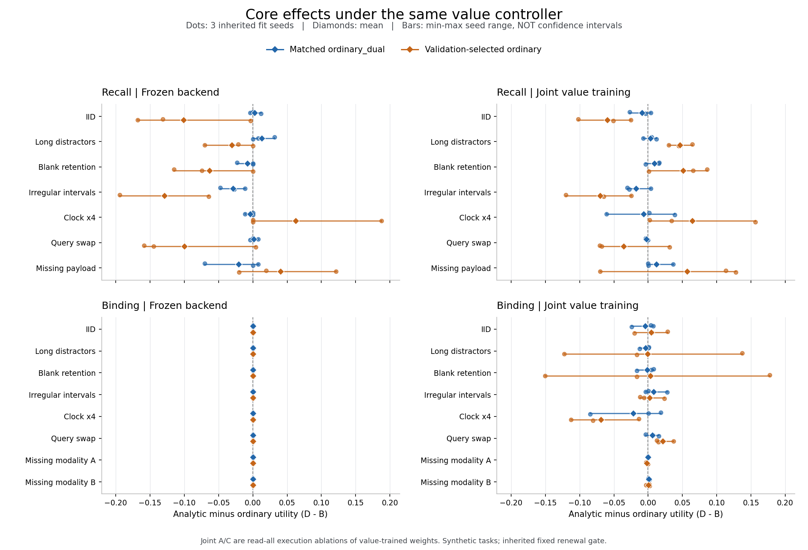

# R14 内容验证：完整后端冻结、联合价值训练与实际控制

## 结论与证据范围

本轮完成了实际 READ/STOP 执行下的同信息、同权重控制消融，并以三个继承拟合种子比较解析门与普通核心。结果同时包含正、负和零差值；没有形成跨任务、跨压力域的一致解析核心优势。最关键的 D−B 必须与具体对照和域一起报告。

正式结果含 720 条逐模型／域结果、180 个逐种子四格对比、60 个三种子均值，全部逐样本 NPZ 保留。独立审计从 NPZ 重算效应并核对权重和数据，24,479 项检查通过，0 失败。

[完整结果](results/formal_01/RESULTS.json) · [紧凑结果与八族全域聚合](results/formal_01/RESULTS_COMPACT.json) · [独立审计](results/formal_01/review/INDEPENDENT_RESULTS_AUDIT_01.json) · [开发与权重补核](results/formal_01/review/DEVELOPMENT_AND_WEIGHT_AUDIT.json)

## 四格与估计量

|核心|读取全部后提交|共同价值控制器实际 READ/STOP|
|---|---|---|
|普通对照|A|B|
|解析活动门|C|D|

A/B 使用同一份普通内容权重，C/D 使用同一份解析内容权重。每个 task/seed/mode 的八家使用完全相同的 critic 权重；matched 对照固定为 ordinary_dual，validation-selected 对照在七个普通家族中按验证效用选择，并固定用于该种子的全部测试域。

全后端冻结包括 encoder、core 和 readout。联合层中，A/C 是价值联合训练后相同权重的 read-all 执行消融，因此 B−A、D−C 与交互项是该训练制度下的执行控制效应，不是分别训练 light/value 网络的端到端总效应。D−B 比较相同价值训练目标、共同 critic 和控制规则下的核心。独立 light-policy 训练没有执行，也不计作已闭合验证。

完整时间表与观察预算在初始 STOP 前公开，实际载荷须先选择 READ 才传入后端；本实验不覆盖未来到达时刻未知的情形。

## IID 四格结果

数值为任务效用，三个拟合种子等权平均。差值保留方向；不据这三个继承种子作显著性或通用准入声明。

|任务|模式|普通对照|A|B|C|D|D−B|
|---|---|---|---:|---:|---:|---:|---:|
|延迟关联检索|全后端冻结|matched|0.523896|0.524154|0.526500|0.526742|+0.002589|
|延迟关联检索|全后端冻结|strong_selected|0.646292|0.627777|0.526500|0.526742|-0.101035|
|延迟关联检索|联合价值训练|matched|0.583792|0.564345|0.566865|0.555285|-0.009060|
|延迟关联检索|联合价值训练|strong_selected|0.615042|0.614604|0.566865|0.555285|-0.059319|
|跨模态绑定|全后端冻结|matched|0.500344|0.500000|0.504250|0.500000|+0.000000|
|跨模态绑定|全后端冻结|strong_selected|0.500344|0.500000|0.504250|0.500000|+0.000000|
|跨模态绑定|联合价值训练|matched|0.624042|0.644298|0.631854|0.640181|-0.004117|
|跨模态绑定|联合价值训练|strong_selected|0.604510|0.635629|0.631854|0.640181|+0.004552|

绑定任务的冻结层中，analytic 与 matched ordinary_dual 在三个种子上全部立即 STOP：每行 READ 数为 0、后端 forward 调用为 0，B=D=0.5。这里的 D−B=0 表示这一停止策略的相同结果；在线 actor 计时的差别不代表内容核心运算速度。

## 全部域的 D−B

下面每格为“均值 [三种子最小值, 最大值]”。范围与散点是三个实际拟合种子的描述，**不是置信区间**。所有域、两种对照均列出，没有按正负筛选。

[PNG](results/formal_01/core_effects.png) · [SVG](results/formal_01/core_effects.svg)

### 延迟关联检索 · 全后端冻结

|域|matched ordinary_dual|validation-selected ordinary|
|---|---:|---:|
|IID|+0.002589 [-0.003906, +0.011719]|-0.101035 [-0.167969, -0.003547]|
|长度／干扰外推|+0.013232 [+0.000000, +0.031883]|-0.030469 [-0.070312, +0.000000]|
|查询后空白保持|-0.007738 [-0.023215, +0.000000]|-0.063066 [-0.114980, +0.000000]|
|交替不规则间隔|-0.028781 [-0.047279, -0.011719]|-0.129192 [-0.193967, -0.064704]|
|整体时钟 ×4|-0.003906 [-0.011719, +0.000000]|+0.062500 [+0.000000, +0.187500]|
|更换查询|+0.001286 [-0.003906, +0.007812]|-0.099733 [-0.158934, +0.004266]|
|缺失数值载荷|-0.020833 [-0.070312, +0.007812]|+0.040156 [-0.020156, +0.121094]|

### 延迟关联检索 · 联合价值训练

|域|matched ordinary_dual|validation-selected ordinary|
|---|---:|---:|
|IID|-0.009060 [-0.027133, +0.003906]|-0.059319 [-0.101879, -0.025051]|
|长度／干扰外推|+0.003292 [-0.007051, +0.011988]|+0.046309 [+0.030242, +0.064164]|
|查询后空白保持|+0.009251 [-0.003766, +0.015824]|+0.050779 [+0.001188, +0.085832]|
|交替不规则间隔|-0.017944 [-0.030375, +0.003963]|-0.069933 [-0.119938, -0.024834]|
|整体时钟 ×4|-0.006670 [-0.060531, +0.039045]|+0.064142 [+0.001898, +0.156549]|
|更换查询|-0.002549 [-0.003906, -0.000047]|-0.035882 [-0.070629, +0.031004]|
|缺失数值载荷|+0.012247 [+0.000000, +0.036578]|+0.057005 [-0.070305, +0.128039]|

### 跨模态绑定 · 全后端冻结

|域|matched ordinary_dual|validation-selected ordinary|
|---|---:|---:|
|IID|+0.000000 [+0.000000, +0.000000]|+0.000000 [+0.000000, +0.000000]|
|长度／干扰外推|+0.000000 [+0.000000, +0.000000]|+0.000000 [+0.000000, +0.000000]|
|查询后空白保持|+0.000000 [+0.000000, +0.000000]|+0.000000 [+0.000000, +0.000000]|
|交替不规则间隔|+0.000000 [+0.000000, +0.000000]|+0.000000 [+0.000000, +0.000000]|
|整体时钟 ×4|+0.000000 [+0.000000, +0.000000]|+0.000000 [+0.000000, +0.000000]|
|更换查询|+0.000000 [+0.000000, +0.000000]|+0.000000 [+0.000000, +0.000000]|
|缺失模态 A|+0.000000 [+0.000000, +0.000000]|+0.000000 [+0.000000, +0.000000]|
|缺失模态 B|+0.000000 [+0.000000, +0.000000]|+0.000000 [+0.000000, +0.000000]|

### 跨模态绑定 · 联合价值训练

|域|matched ordinary_dual|validation-selected ordinary|
|---|---:|---:|
|IID|-0.004117 [-0.023824, +0.007426]|+0.004552 [-0.019976, +0.028117]|
|长度／干扰外推|-0.003891 [-0.012668, +0.000738]|-0.000721 [-0.122629, +0.137039]|
|查询后空白保持|-0.001494 [-0.016680, +0.007883]|+0.003396 [-0.150523, +0.177438]|
|交替不规则间隔|+0.008011 [-0.003669, +0.027505]|+0.001857 [-0.011859, +0.023458]|
|整体时钟 ×4|-0.021901 [-0.084443, +0.018652]|-0.069147 [-0.112789, -0.013902]|
|更换查询|+0.006299 [-0.003766, +0.015238]|+0.021479 [+0.012492, +0.036766]|
|缺失模态 A|-0.000234 [-0.000492, -0.000094]|-0.002023 [-0.002883, -0.000398]|
|缺失模态 B|+0.000750 [-0.000188, +0.002203]|+0.000180 [-0.002883, +0.002109]|

### 如何读这些压力结果

联合训练的检索任务中，空白保持和长度／干扰外推对两种普通对照均为正；IID、不规则间隔和更换查询对两种对照均为负。整体时钟 ×4 的结论依赖对照：相对 validation-selected 为 +0.064142，相对 matched 为 −0.006670。缺失载荷均值对两种对照为正，但相对 validation-selected 的三个种子并非同号。各正差值是对应任务／域的观察结果，不能扩展成全面核心优势；负差值也不能抹掉已保留的正压力结果。

绑定的缺失模态数据经过独立核对：当整段可见观察完全相同时，两标签计数严格平衡。这里用于检验缺失信息的行为边界，不能将不可恢复的标签信息作为本可获得的内容收益。

## 冻结、共同训练与选中步

48/48 个冻结后端的 selected 和 final 完整张量哈希均与继承初始权重完全相同。48/48 个联合后端在 selected 和 final 均改变；其 144/144 个 encoder/core/readout 组件均改变，每个组件记录的非零梯度步数为 256。审计核对梯度日志与实际张量变化，没有冒称重新执行了每一步反传。

|联合任务|seed 12031|seed 12032|seed 12033|
|---|---:|---:|---:|
|检索|256|192|256|
|绑定|256|256|192|

选中的是八家后端加共同 critic 的整组权重，按验证均值选择，step 0 允许入选，最早并列优先。冻结层有三组选中 step 0，因此并非每组所用 critic 都来自训练后的选中权重。全部选中验证路径及 heldout 路径通过在线／离线动作和预测一致性门限。

## 实际成本与失败保留

|工作|完整子进程 CPU 秒|
|---|---:|
|正式训练：12 个共享八后端组|137.198712|
|正式 heldout 科学评估：12 个组|57.143774|
|正式 freeze / candidates / summarize|4.042262|
|开发第一次：freeze 与失败 fit|3.931498|
|开发第二次：freeze、两种模式各 2 updates|7.357620|
|独立逐样本结果审计|3.869906|
|开发与权重补核|1.272319|

第一次开发在首次更新前因 Long/Bool 指标直接求 mean 失败。只把 validation 聚合改成 float 后求均值；目标、数据、选择规则不变。原始冻结、stderr、失败回执和全部成本保留。第二次开发的 freeze、frozen、joint 三个子进程均正常退出，未访问 heldout。

正式训练成本是八后端加共享 critic 的整组优化成本，不能除以八宣称单候选独立训练成本。评估的完整 CPU 已含在线阶段计时和离线诊断，不能再次相加。实际价值 actor 每次重算已付费前缀；read-all 轻量臂一次完整 forward，当前比较不是最优增量部署实现。主机共享，单次计时不是严格隔离微基准。历史 donor／初始拟合为既有共享成本，另列于总成本账；本轮不重复冒算为新训练。图表生成、打包及恢复有独立 publication 回执。物理能耗未测，值为 null。

## 仍未覆盖的科学问题

解析家族仍是继承的固定 renewal 活动门，独立数值线的完整条件分布求解器没有整合进内容网络；任意移动边界、正延迟恢复与全分布内容学习不由本实验验证。任务为合成检索／绑定，费用为声明的 READ／时间价格。只有一条实现未来的 Q 目标和 hindsight gap，不能称条件期望 regret。三个继承拟合种子、新数据域、八个家族和逐样本数均不构成八次全新拟合。

本次为明确限定范围的实验与审计完成；不据此宣布解析动力学已达到新基础网络核心的质量／成本准入。
