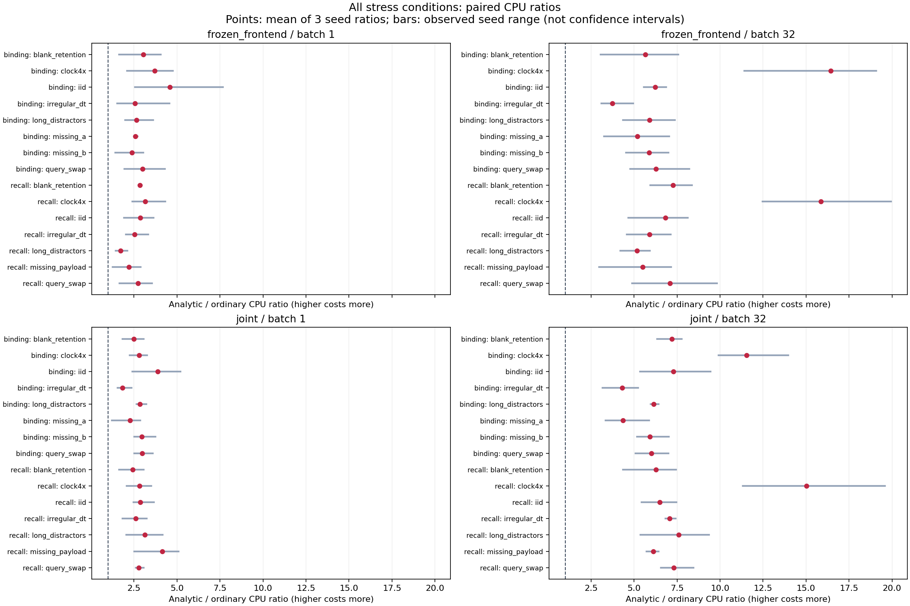
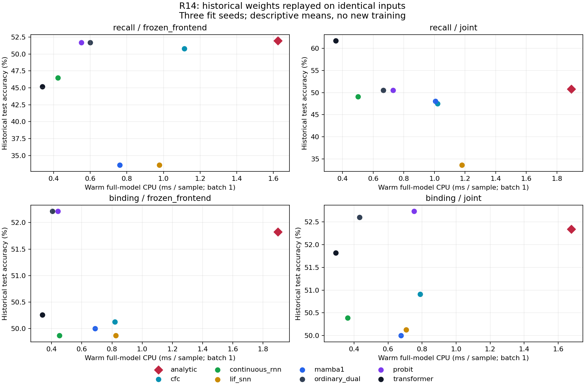

# R14：全部历史域的实际内容质量—成本重放

已完成 **720 个串行新进程**，覆盖 8 个模型族、2 个训练模式、3 个既有拟合种子、recall 的 7 个域和 binding 的 8 个域。每个模型/域均测 batch 1、32，共 **1440 个条件**；新执行 **184,320 个原始测试预测**，最大 logit 差为 `0`。

这是历史冻结权重与原始输入的硬件重放。没有新增训练，也没有把原测试集重新称为独立确认。`frozen_frontend` 的含义保持不变：只冻结共同 encoder；它不等于完整内容后端冻结。

## 1. 本轮补齐的实际成本

旧 profile 只使用验证集 IID 形状。本轮所有长干扰、空白保持、不规则时间、四倍时钟、改查询和缺失模态的质量均配上该域的实际完整模型时间，未用 IID 延迟代填。

batch 1 的 first call 是该新 worker 中的第一次完整模型前向；batch 32 的 first call 已经过 batch 1，只称首次形状调用。输入生成与权重加载在内层前向计时之外，计入完整 fresh worker。全部模型前向含 NumPy 输入转 tensor、encoder、全部序列步、readout 和 CPU 输出复制。

完整 worker 合计 CPU **1098.278577 秒**，串行 wall **1172.007986 秒**；最大单 worker 峰值 RSS 为 **228,237,312 字节**。这些完整账单已经包含 first/warm 调用、函数计数和质量重放，不能再与内层计时相加。

解析/普通的 180 个同 seed/域/batch 配对中，解析 warm CPU 更高的有 **180 个**。以下是三个 fit seed 的描述性均值与范围，不是显著性结论。

| 任务 | 模式 | 域 | batch | 解析−普通准确率 | 解析/普通CPU均值 | seed范围 |
|---|---|---|---:|---:|---:|---:|
| binding | frozen_frontend | blank_retention | 1 | +0.000000 | 3.037× | 1.635–4.055× |
| binding | frozen_frontend | blank_retention | 32 | +0.000000 | 5.664× | 3.066–7.565× |
| binding | frozen_frontend | clock4x | 1 | +0.000000 | 3.711× | 2.085–4.767× |
| binding | frozen_frontend | clock4x | 32 | +0.000000 | 16.429× | 11.399–19.079× |
| binding | frozen_frontend | iid | 1 | -0.003906 | 4.583× | 2.548–7.660× |
| binding | frozen_frontend | iid | 32 | -0.003906 | 6.225× | 5.567–6.865× |
| binding | frozen_frontend | irregular_dt | 1 | -0.003906 | 2.555× | 1.519–4.565× |
| binding | frozen_frontend | irregular_dt | 32 | -0.003906 | 3.742× | 3.093–4.955× |
| binding | frozen_frontend | long_distractors | 1 | +0.000000 | 2.642× | 1.976–3.616× |
| binding | frozen_frontend | long_distractors | 32 | +0.000000 | 5.902× | 4.351–7.369× |
| binding | frozen_frontend | missing_a | 1 | +0.000000 | 2.573× | 2.487–2.710× |
| binding | frozen_frontend | missing_a | 32 | +0.000000 | 5.196× | 3.257–7.039× |
| binding | frozen_frontend | missing_b | 1 | +0.000000 | 2.370× | 1.410–3.043× |
| binding | frozen_frontend | missing_b | 32 | +0.000000 | 5.881× | 4.533–7.004× |
| binding | frozen_frontend | query_swap | 1 | +0.005208 | 3.003× | 1.938–4.298× |
| binding | frozen_frontend | query_swap | 32 | +0.005208 | 6.283× | 4.779–8.215× |
| binding | joint | blank_retention | 1 | +0.000000 | 2.487× | 1.827–3.059× |
| binding | joint | blank_retention | 32 | +0.000000 | 7.197× | 6.340–7.773× |
| binding | joint | clock4x | 1 | +0.003906 | 2.808× | 2.245–3.260× |
| binding | joint | clock4x | 32 | +0.003906 | 11.543× | 9.916–13.976× |
| binding | joint | iid | 1 | -0.002604 | 3.876× | 2.406–5.197× |
| binding | joint | iid | 32 | -0.002604 | 7.281× | 5.342–9.459× |
| binding | joint | irregular_dt | 1 | +0.001302 | 1.821× | 1.532–2.360× |
| binding | joint | irregular_dt | 32 | +0.001302 | 4.317× | 3.173–5.238× |
| binding | joint | long_distractors | 1 | +0.000000 | 2.852× | 2.645–3.210× |
| binding | joint | long_distractors | 32 | +0.000000 | 6.139× | 5.961–6.429× |
| binding | joint | missing_a | 1 | +0.000000 | 2.263× | 1.209–2.870× |
| binding | joint | missing_a | 32 | +0.000000 | 4.365× | 3.333–5.867× |
| binding | joint | missing_b | 1 | +0.000000 | 2.959× | 2.510–3.744× |
| binding | joint | missing_b | 32 | +0.000000 | 5.922× | 5.173–7.015× |
| binding | joint | query_swap | 1 | +0.002604 | 2.969× | 2.510–3.600× |
| binding | joint | query_swap | 32 | +0.002604 | 6.006× | 5.075–7.011× |
| recall | frozen_frontend | blank_retention | 1 | +0.003906 | 2.835× | 2.747–2.959× |
| recall | frozen_frontend | blank_retention | 32 | +0.003906 | 7.275× | 5.933–8.373× |
| recall | frozen_frontend | clock4x | 1 | -0.009115 | 3.152× | 2.402–4.311× |
| recall | frozen_frontend | clock4x | 32 | -0.009115 | 15.872× | 12.474–19.950× |
| recall | frozen_frontend | iid | 1 | +0.002604 | 2.855× | 1.925–3.643× |
| recall | frozen_frontend | iid | 32 | +0.002604 | 6.835× | 4.671–8.117× |
| recall | frozen_frontend | irregular_dt | 1 | +0.002604 | 2.532× | 2.023–3.320× |
| recall | frozen_frontend | irregular_dt | 32 | +0.002604 | 5.889× | 4.565–7.124× |
| recall | frozen_frontend | long_distractors | 1 | +0.035156 | 1.713× | 1.431–2.105× |
| recall | frozen_frontend | long_distractors | 32 | +0.035156 | 5.171× | 4.206–5.914× |
| recall | frozen_frontend | missing_payload | 1 | +0.005208 | 2.193× | 1.259–2.894× |
| recall | frozen_frontend | missing_payload | 32 | +0.005208 | 5.494× | 2.970–7.156× |
| recall | frozen_frontend | query_swap | 1 | +0.006510 | 2.739× | 1.644–3.540× |
| recall | frozen_frontend | query_swap | 32 | +0.006510 | 7.079× | 4.875–9.834× |
| recall | joint | blank_retention | 1 | +0.001302 | 2.428× | 1.633–3.067× |
| recall | joint | blank_retention | 32 | +0.001302 | 6.268× | 4.353–7.440× |
| recall | joint | clock4x | 1 | -0.019531 | 2.815× | 2.074–3.494× |
| recall | joint | clock4x | 32 | -0.019531 | 15.024× | 11.328–19.588× |
| recall | joint | iid | 1 | +0.002604 | 2.868× | 2.462–3.660× |
| recall | joint | iid | 32 | +0.002604 | 6.493× | 5.440–7.465× |
| recall | joint | irregular_dt | 1 | +0.015625 | 2.607× | 1.819–3.232× |
| recall | joint | irregular_dt | 32 | +0.015625 | 7.072× | 6.825–7.430× |
| recall | joint | long_distractors | 1 | -0.006510 | 3.118× | 2.038–4.174× |
| recall | joint | long_distractors | 32 | -0.006510 | 7.601× | 5.380–9.371× |
| recall | joint | missing_payload | 1 | +0.018229 | 4.148× | 2.522–5.083× |
| recall | joint | missing_payload | 32 | +0.018229 | 6.130× | 5.730–6.438× |
| recall | joint | query_swap | 1 | -0.006510 | 2.783× | 2.602–3.060× |
| recall | joint | query_swap | 32 | -0.006510 | 7.305× | 6.564–8.465× |

## 2. 质量与最强可实施对照

所有八族结果均保留，含普通双头、中心斜率匹配 probit、解析 renewal、LIF+SG、连续时间 RNN、官方 CfC、Mamba-1 CPU reference 与 SDPA Transformer。描述性 Pareto 标记按每个 task/mode/domain/batch 的均值单独计算，不把低质量的快模型说成同质量优势，也不把 CPU reference 说成优化 GPU 实现。

全部 480 个三 seed 聚合单元见 `aggregate_quality_cost.json`；1,440 个逐 seed 条件见 `per_seed_quality_cost.csv`。模型预算与选择沿用原始冻结协议，并未充分逐族重新调参。

## 3. 特殊函数、状态和训练账

独立未计时前向实际统计 Python 调用路径中的 `log_ndtr`、`logaddexp`、`expm1` 和 `exp` 次数与元素数量；instrumented 与普通输出逐位相同。计数不是耗时替代指标；实际特殊函数执行已在完整模型前向计时内。张量方法形式的 exp 等其他调用不计入该专项计数，未宣称算子全覆盖。

精确记录参数/缓冲、原始输入、返回的序列状态历史及输出字节。返回历史字节不是总工作内存；RSS 不是状态分布专项内存。该历史内容实现没有完整存活密度、恢复年龄状态或任务自由边界求解，相应字段保留 null 并说明未实现，不能写成实测零成本。

训练摊销沿用原始外部 wait4 账，独立候选管线含一次共同 donor 与 candidate fit/selection。N 表示总样本请求，只报告 N≥batch 且 N 能整除 batch 的完整批量情景；batch 1 的范围从 1 到 1,000,000，batch 32 至少需要 32 个请求，不把满批成本分摊给 N=1 或 10。尾批费用尚未测量。新 forward 测量单独进入每请求项；不是重新执行历史训练，也不是把共享 donor 同时重复加入研究总账。

## 4. 明确的未测范围

物理能量为 null；没有用 CPU 秒乘猜测功率。GPU、原媒体获取、在线查询、网络、部署服务初始化及上游预训练成本未由这组历史合成输入重放建立。720 个完整科学 worker 包含核对/写证据的研究工作，其总耗时不是线上单请求冷启动。

三 fit seeds、各域和重复计时保留其依赖结构，不按 184,320 个重复预测虚增独立拟合数。内容任务收益与控制线的 D−B 分开报告，未把此成本覆盖修复当作解析网络核心准入。

## 5. 可核对入口

`PROTOCOL.json`、`SOURCE_FREEZE.json`、`INPUT_MANIFEST.json` 固定本轮方法与历史权重/输入/训练账；`SOURCE_SNAPSHOTS/` 保存对应源码字节；`workers/*/RESULT.json` 与 `predictions.npz` 是每个域的原始测量和重放预测；`receipts/` 和 `process_ledger.csv` 保留全部新进程执行成本。复现命令见父目录 `README.md`。

---

# 正式测量前的独立内部审阅与修正

本轮由负责数值线的另一代理只读审阅 `study.py` 与 `report.py`。
这属于团队内独立源码检查，不是外部论文审稿或外部预注册。

## 已在执行前修正的成本会计错误

原 `formal_01` 摊销表把 batch 32 的每样本满批时间用于总请求数
N=1、10，以及其他不能整除 32 的请求量。这不满足满批假设，会低估
小请求量下的推理费用。

该协议在任何正式 worker 启动前即废止，记录见
`results/formal_01/SUPERSEDED_BEFORE_EXECUTION.json`；原协议和源码快照
保留。修正后的 `formal_02` 只生成 `N>=batch` 且 `N % batch == 0` 的
完整批量情景，并记录 `complete_batches=N/batch`。尾批成本未测量，
没有估算成满批中的分数费用。加入的 32、320 等预设请求点使 batch 32
拥有明确合法的复用范围。模型、权重、数据、720-worker 测量矩阵未改变。

正式 `formal_02` 协议 SHA256：

`233bb4022b10c48352dd380472e5b48dc1cf178a68ba9ef7e1d0a1e1d010c95a`

## 计时样本范围

每个域反复测固定的首个样本或首 32 个样本。该域所有样本的 shape 和
dt 轨迹一致，模型没有输入依赖的提前停止，因此结果是完整模型的域形状
计时。它不是全部 256 个质量评估样本逐个计时后的平均线上延迟。
256 例实际预测重放是单独的质量与身份核对。

batch 1 的首次调用是新 worker 中第一次完整模型前向。batch 32 已经
发生在 batch 1 之后，明确只称首次形状调用。完整进程收据包括导入、
加载、校验、数据准备、所有调用、专项计数、预测重放和输出写入；
不能称为单请求冷启动，也不能再叠加其内部阶段费用。

## 开发尝试成本

| 尝试 | worker 数 | 完整 CPU 秒 |
|---|---:|---:|
| development_01 | 3 | 4.365532 |
| development_02 | 2 | 3.667284 |
| 合计 | 5 | 8.032816 |

这些费用保留在研究尝试账，独立于正式 720 个 worker 的合计；不混入
每请求部署推理费。审阅没有要求重复执行已经完成的开发冒烟。

## 跨时段训练摊销的范围

摊销表将历史 donor/fit 的 CPU 账与本轮新测 warm CPU 组合为明确的
会计情景。历史训练没有在本轮重新运行；旧训练 receipt 本身未固定可逐项
核对的同一 CPU 型号、宿主身份和执行条件。即使 Torch、NumPy、CfC 的
版本与代码一致，这个账本组合也不能宣称是同硬件从头训练到部署的完整
端到端测量。当前机器身份只由本轮 `EXECUTION_ENVIRONMENT.json` 记录。

独立比较同硬件完整训练—部署管线仍需在统一环境重跑完整训练和推理。
本轮实际补齐的是所有历史域在当前 CPU 环境中的完整模型前向计时，
以及明确不重叠的新科学 worker 费用。

## 正式结果复核与归档

`audit.py` 不导入模型或测量实现，独立读取原始预测、历史预测、进程收据、
逐条件 CSV 和聚合表，复算准确率、配对差值、CPU 比例、描述性 Pareto、
满批训练摊销和不重叠进程总账。其自身源码哈希记录在结果中。

`package_results.py` 将本成本子树保存为小于 500 KiB 的 gzip 分片，
另存压缩成员清单，并实际恢复到独立临时目录逐成员核对 SHA256。
原 R12 源码、权重与输入依赖仍由 `INPUT_MANIFEST.json` 标识，归档不冒称
已将这些父基线文件重复打入本成本子树。
