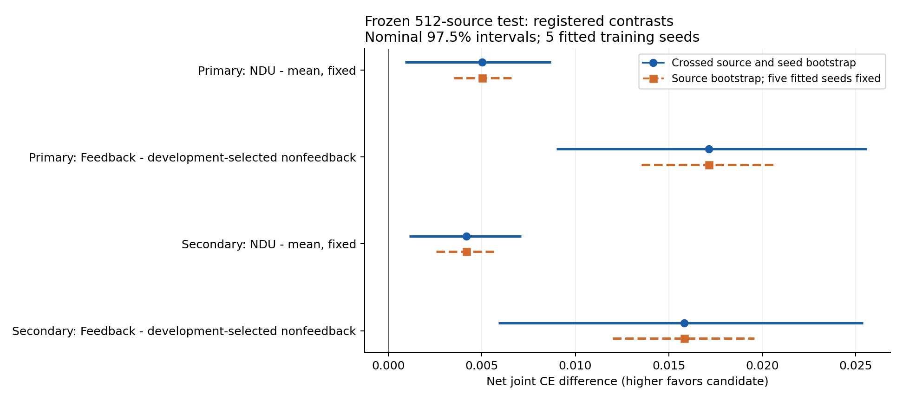

# 新冻结来源：风险训练、公开状态反馈与真实成本

**两个预先注册的 net joint CE 主对比均得到正的名义 97.5% 区间下界。** 正式评价已完成；这项结论限于本注册任务、训练处理、效用与模型，不能替代成功率、实际成本、全模态或全局最优性的证据。

完整数字、逐 seed 数据、逐视图分项、计划计数和输入校验在 [SUMMARY.json](SUMMARY.json)。原始媒体和大数组没有嵌入本报告。

## 1. 主要结果与成功率取舍

主要统计为每个已训练 seed 内对全部来源、视图和生成场景计算风险 CE，再对五个 seed 算术平均。Primary 两个预先注册对比构成本实验的主要检验家族；Secondary 使用相同区间形式检查评分器稳健性，不增加独立任务数量。

名义 97.5% 区间对应本实验两主比较的预注册家族处理。它不提供跨历史实验、开发选择、qualification、文字/语音、原生接入及其他追加分析的全项目 95% 家族错误率保证；本实验 bootstrap 本身的有限样本覆盖也仍是近似。

| 评分器 | 比较：candidate / reference | Net CE 差 | 交叉 seed×source 97.5% CI | 固定五 seed 来源 97.5% CI | 成功率差，百分点 | 成功率描述性 95% CI，百分点 |
| --- | --- | --- | --- | --- | --- | --- |
| primary | output_ndu/fixed / output_mean/fixed | +0.005026 | [+0.000899, +0.008687] | [+0.003513, +0.006572] | -0.627441 | [-0.897217, -0.369843] |
| primary | output_ndu/feedback / output_ndu/selected_nonfeedback | +0.017135 | [+0.008993, +0.025573] | [+0.013526, +0.020666] | +0.668945 | [+0.371063, +0.961914] |
| secondary | output_ndu/fixed / output_mean/fixed | +0.004183 | [+0.001119, +0.007096] | [+0.002563, +0.005820] | -0.418701 | [-0.646973, -0.183105] |
| secondary | output_ndu/feedback / output_ndu/selected_nonfeedback | +0.015811 | [+0.005883, +0.025377] | [+0.011994, +0.019573] | +0.718994 | [+0.439453, +0.994873] |

`output_ndu/fixed − output_mean/fixed`：任务成功率的描述性区间完全低于零，CE 改善与成功率下降并存。

`output_ndu/feedback − output_ndu/selected_nonfeedback`：任务成功率的描述性区间完全高于零。

图直接显示已封存分析中的区间，没有重新估计主要统计量。

## 2. 先冻结后开启：来源和估计对象

最终协议 SHA256 为 `e552230547779d3f92527d62272b115e7d940ff1b56400f5e9347dabfa16a834`，已在 [GitHub commit 595d6ea7d728](https://github.com/TrillionniumFoundation/hepta-private-ci/commit/595d6ea7d728c0d293077bdf19dde31095ab5373) 发布，之后才启动正式 test。十五个生成器和控制器、逐 seed/训练臂的开发选定非反馈引用（注册三类候选）以及源身份均在开启前固定。

正式数据是 **512 个来源对、1024 个不同 source IDs**，来自 MNIST 官方 test 分区中的冻结角色；开发/qualification 来源来自独立的官方 train 角色。五个训练 seed、八种视图和四个生成场景形成配对重复。每条件 81920 行、十五模型×五策略共 1228800 行策略结果，都不改变来源组数 512。没有可用 writer 聚类身份，不能额外宣称已控制手写者相关性。

4000 次交叉重采样同时重采来源对和训练 seed，所有同源视图、场景与策略保持配对。固定五 seed 的区间只重采来源，其解释条件于这五个已经训练好的模型；不能把它当成对训练 seed 母体的同一推断。五个 seed 下交叉 percentile bootstrap 的覆盖率仍是有限样本近似。

104 来源 qualification 在同一冻结后只执行一次，没有重新选架构、拟合策略或依据负结果压住 test；它与 512 来源的正式结果分开，不能合并成 616 个确认性来源。

| 用途 | 来源角色和区间 | 数量 | 是否可选择策略 |
| --- | --- | --- | --- |
| 共同历史有限律诊断 | forecast_fit[448,480) | 32 对 | 仅有限 H1 诊断，不进主 fit |
| 新 critic fit | forecast_fit[480,736) | 256 对 | 来源二折交叉拟合 |
| 架构/非反馈选择 | forecast_calibration[448,576) | 128 对 | 开发选择 |
| 一次 qualification | development[896,1000) | 104 对 | 否 |
| 正式 test | test[0,512) | 512 对 | 否 |

## 3. 训练处理与 raw/net 风险量

生成器权重沿用旧十五个冻结模型，本轮没有新增生成器训练；训练轴在新来源上复验既有操作性处理的泛化差异。本轮新训练的是 public sensor 与控制器。SFT continuation 的监督系数为 1；既有 mean 与 NDU 臂分别使用 gamma→0 与 gamma=2 的实际输出目标，均保留 0.05 辅助项：

\[F_\gamma(\theta)=\frac{E[e^{-\gamma U_\theta}]-1}{\gamma}+0.05 A_\theta,\qquad U=1-2L_{\rm joint}.\]

联合损失权重为文字事实 0.30、关系 0.15、图像事实 0.35、跨模态分歧 0.10、像素 MSE 0.10。两个图像识别评分器均离线冻结；它们是该领域不完美的评分器，不是人类认证的通用事实评价。

令 \(M_\gamma=E[e^{-\gamma U}]\)，相对于负 CE 梯度的有效辅助权重为 \(0.05/M_\gamma\)，还伴随整体梯度尺度变化。本轮识别的是该操作性目标变化，不是“纯 CE、相同有效 aux 权重”的完全分离。

raw joint CE 使用 \(C_2(U)\)，net joint CE 使用 \(C_2(U-0.002K)\)，其中 \(K\) 为实际后续非停止动作数。常数成本满足平移不变性；可变 \(K\) 与效用相关时，一般不能把二者差写成 \(0.002E[K]\)。本报告分别从 raw/net 统计直接计算差值。
### primary：全部训练 × 策略单元

| 训练臂 | 策略 | Raw CE | Net CE | 成功率 % | 完成率 % | 平均联合损失 | 跨模态分歧 | 平均后续步数 |
| --- | --- | --- | --- | --- | --- | --- | --- | --- |
| sft_continuation | fixed | 0.132200 | 0.128200 | 51.4514 | 100.0000 | 0.240490 | 0.286212 | 2.000000 |
| sft_continuation | static | 0.133232 | 0.129632 | 51.6614 | 99.9988 | 0.239828 | 0.284833 | 1.800000 |
| sft_continuation | one_shot | 0.140096 | 0.137065 | 52.0947 | 100.0000 | 0.236750 | 0.277142 | 1.577344 |
| sft_continuation | feedback | 0.151252 | 0.148841 | 52.6685 | 100.0000 | 0.232986 | 0.267065 | 1.138257 |
| sft_continuation | legacy | 0.139268 | 0.136569 | 51.8579 | 100.0000 | 0.238314 | 0.276477 | 1.462390 |
| sft_continuation | selected_nonfeedback | 0.134589 | 0.131338 | 51.7200 | 99.9988 | 0.239268 | 0.283759 | 1.697522 |
| output_mean | fixed | 0.153403 | 0.149403 | 54.3054 | 100.0000 | 0.229412 | 0.247498 | 2.000000 |
| output_mean | static | 0.154427 | 0.151627 | 54.4751 | 99.9988 | 0.229211 | 0.245917 | 1.400000 |
| output_mean | one_shot | 0.163380 | 0.160317 | 54.7632 | 99.9976 | 0.226468 | 0.235822 | 1.601892 |
| output_mean | feedback | 0.170573 | 0.168040 | 55.2563 | 100.0000 | 0.223373 | 0.225696 | 1.161499 |
| output_mean | legacy | 0.162556 | 0.159851 | 54.5898 | 99.9988 | 0.227127 | 0.235852 | 1.437000 |
| output_mean | selected_nonfeedback | 0.156048 | 0.153166 | 54.5239 | 99.9988 | 0.228648 | 0.244263 | 1.535242 |
| output_ndu | fixed | 0.158429 | 0.154429 | 53.6780 | 100.0000 | 0.230504 | 0.236285 | 2.000000 |
| output_ndu | static | 0.158938 | 0.155738 | 53.8586 | 100.0000 | 0.230443 | 0.234369 | 1.600000 |
| output_ndu | one_shot | 0.166913 | 0.163730 | 54.2493 | 99.9988 | 0.227241 | 0.223547 | 1.601160 |
| output_ndu | feedback | 0.177904 | 0.175657 | 54.7034 | 100.0000 | 0.223906 | 0.211133 | 1.144568 |
| output_ndu | legacy | 0.168523 | 0.165781 | 54.0576 | 99.9988 | 0.228001 | 0.218188 | 1.441858 |
| output_ndu | selected_nonfeedback | 0.162222 | 0.158521 | 54.0344 | 99.9988 | 0.228953 | 0.230139 | 1.821301 |

### secondary：全部训练 × 策略单元

| 训练臂 | 策略 | Raw CE | Net CE | 成功率 % | 完成率 % | 平均联合损失 | 跨模态分歧 | 平均后续步数 |
| --- | --- | --- | --- | --- | --- | --- | --- | --- |
| sft_continuation | fixed | 0.136093 | 0.132093 | 52.1973 | 100.0000 | 0.237838 | 0.281006 | 2.000000 |
| sft_continuation | static | 0.136378 | 0.132778 | 52.3767 | 99.9988 | 0.237424 | 0.280084 | 1.800000 |
| sft_continuation | one_shot | 0.143006 | 0.139979 | 52.7283 | 100.0000 | 0.234704 | 0.274036 | 1.577344 |
| sft_continuation | feedback | 0.153042 | 0.150634 | 53.2068 | 100.0000 | 0.231061 | 0.265375 | 1.138257 |
| sft_continuation | legacy | 0.141517 | 0.138817 | 52.3914 | 100.0000 | 0.236379 | 0.274768 | 1.462390 |
| sft_continuation | selected_nonfeedback | 0.138246 | 0.134998 | 52.3975 | 99.9988 | 0.236807 | 0.279083 | 1.697522 |
| output_mean | fixed | 0.152484 | 0.148484 | 54.1357 | 100.0000 | 0.229620 | 0.252246 | 2.000000 |
| output_mean | static | 0.152730 | 0.149930 | 54.2017 | 99.9988 | 0.229707 | 0.252368 | 1.400000 |
| output_mean | one_shot | 0.161049 | 0.157991 | 54.5569 | 99.9976 | 0.226911 | 0.243134 | 1.601892 |
| output_mean | feedback | 0.167709 | 0.165181 | 55.0012 | 100.0000 | 0.223922 | 0.234491 | 1.161499 |
| output_mean | legacy | 0.159633 | 0.156930 | 54.3652 | 99.9988 | 0.227843 | 0.244104 | 1.437000 |
| output_mean | selected_nonfeedback | 0.154476 | 0.151596 | 54.2566 | 99.9988 | 0.229129 | 0.250824 | 1.535242 |
| output_ndu | fixed | 0.156667 | 0.152667 | 53.7170 | 100.0000 | 0.230322 | 0.243378 | 2.000000 |
| output_ndu | static | 0.156276 | 0.153076 | 53.6975 | 100.0000 | 0.230854 | 0.242810 | 1.600000 |
| output_ndu | one_shot | 0.163766 | 0.160584 | 54.0491 | 99.9988 | 0.227833 | 0.234021 | 1.601160 |
| output_ndu | feedback | 0.173219 | 0.170976 | 54.5728 | 100.0000 | 0.224622 | 0.222668 | 1.144568 |
| output_ndu | legacy | 0.164565 | 0.161829 | 53.9490 | 99.9988 | 0.228653 | 0.230200 | 1.441858 |
| output_ndu | selected_nonfeedback | 0.158865 | 0.155165 | 53.8538 | 99.9988 | 0.229568 | 0.239728 | 1.821301 |

### Raw 与 net 差值完整并列

下面 raw 差值来自 raw CE 直接相减，只报点估计；其区间没有在本展示程序中重新估计。不能把 net 主区间复制给可变成本策略的 raw 差值。
#### primary

| Candidate | Reference | Raw CE 点差 | Net CE 差 | Net CI | 置信度 |
| --- | --- | --- | --- | --- | --- |
| output_ndu/fixed | output_mean/fixed | +0.005026 | +0.005026 | [+0.000899, +0.008687] | 0.975 |
| output_ndu/feedback | output_ndu/selected_nonfeedback | +0.015682 | +0.017135 | [+0.008993, +0.025573] | 0.975 |
| sft_continuation/feedback | sft_continuation/fixed | +0.019052 | +0.020641 | [+0.015434, +0.025609] | 0.950 |
| sft_continuation/feedback | sft_continuation/legacy | +0.011984 | +0.012272 | [+0.008177, +0.016355] | 0.950 |
| output_mean/feedback | output_mean/fixed | +0.017170 | +0.018637 | [+0.012970, +0.024445] | 0.950 |
| output_mean/feedback | output_mean/legacy | +0.008017 | +0.008189 | [+0.002684, +0.013517] | 0.950 |
| output_ndu/feedback | output_ndu/fixed | +0.019475 | +0.021228 | [+0.016363, +0.026265] | 0.950 |
| output_ndu/feedback | output_ndu/legacy | +0.009380 | +0.009875 | [+0.004508, +0.015683] | 0.950 |
| output_ndu/fixed | sft_continuation/fixed | +0.026229 | +0.026229 | [+0.021910, +0.031072] | 0.950 |
| output_ndu/feedback | sft_continuation/feedback | +0.026652 | +0.026815 | [+0.021333, +0.032532] | 0.950 |
| output_ndu/feedback | output_mean/feedback | +0.007331 | +0.007617 | [+0.002938, +0.012265] | 0.950 |
| output_ndu/feedback | output_ndu/one_shot | +0.010990 | +0.011926 | [+0.007069, +0.017043] | 0.950 |
| output_ndu/feedback | output_ndu/static | +0.018965 | +0.019918 | [+0.014408, +0.025597] | 0.950 |

#### secondary

| Candidate | Reference | Raw CE 点差 | Net CE 差 | Net CI | 置信度 |
| --- | --- | --- | --- | --- | --- |
| output_ndu/fixed | output_mean/fixed | +0.004183 | +0.004183 | [+0.001119, +0.007096] | 0.975 |
| output_ndu/feedback | output_ndu/selected_nonfeedback | +0.014353 | +0.015811 | [+0.005883, +0.025377] | 0.975 |
| sft_continuation/feedback | sft_continuation/fixed | +0.016949 | +0.018541 | [+0.013290, +0.023792] | 0.950 |
| sft_continuation/feedback | sft_continuation/legacy | +0.011525 | +0.011817 | [+0.007602, +0.016025] | 0.950 |
| output_mean/feedback | output_mean/fixed | +0.015225 | +0.016698 | [+0.010357, +0.023500] | 0.950 |
| output_mean/feedback | output_mean/legacy | +0.008076 | +0.008252 | [+0.002223, +0.013930] | 0.950 |
| output_ndu/feedback | output_ndu/fixed | +0.016552 | +0.018310 | [+0.012273, +0.024337] | 0.950 |
| output_ndu/feedback | output_ndu/legacy | +0.008653 | +0.009147 | [+0.003134, +0.015061] | 0.950 |
| output_ndu/fixed | sft_continuation/fixed | +0.020574 | +0.020574 | [+0.016238, +0.024802] | 0.950 |
| output_ndu/feedback | sft_continuation/feedback | +0.020177 | +0.020342 | [+0.013758, +0.026644] | 0.950 |
| output_ndu/feedback | output_mean/feedback | +0.005510 | +0.005795 | [+0.000513, +0.010970] | 0.950 |
| output_ndu/feedback | output_ndu/one_shot | +0.009453 | +0.010392 | [+0.004272, +0.016560] | 0.950 |
| output_ndu/feedback | output_ndu/static | +0.016942 | +0.017900 | [+0.011546, +0.024670] | 0.950 |

## 4. 交互、均值与尾部

交互是四格的描述性差中差；它与两个主比较不同，不以交互结果替换主门槛。

| 评分器 | 交互 | 差中差 | 描述性 95% CI |
| --- | --- | --- | --- |
| primary | risk_vs_mean_interaction | +0.002591 | [-0.002927, +0.007976] |
| primary | risk_vs_sft_interaction | +0.000587 | [-0.004660, +0.005859] |
| secondary | risk_vs_mean_interaction | +0.001612 | [-0.003748, +0.006952] |
| secondary | risk_vs_sft_interaction | -0.000232 | [-0.006975, +0.006048] |

逐输出尾部先在每个训练 seed 内计算，再平均五个 seed 的 P95/CVaR；来源平均损失尾部先合并同源视图和场景，是另一个估计对象。它们不能被笼统合称为同一尾部风险。CVaR 使用最坏 10% 的精确分数边界质量。

### primary 尾部

| 训练臂 | 策略 | 均值损失 | 逐输出 P95 | 逐输出 CVaR90 | 来源均值 P95 | 来源均值 CVaR90 | 平均 conditional net CE |
| --- | --- | --- | --- | --- | --- | --- | --- |
| sft_continuation | fixed | 0.240490 | 0.853743 | 0.834795 | 0.375078 | 0.402621 | 0.490225 |
| sft_continuation | static | 0.239828 | 0.861469 | 0.833998 | 0.373984 | 0.403853 | 0.492154 |
| sft_continuation | one_shot | 0.236750 | 0.861620 | 0.832075 | 0.368244 | 0.398360 | 0.500552 |
| sft_continuation | feedback | 0.232986 | 0.842656 | 0.826083 | 0.363487 | 0.395084 | 0.510902 |
| sft_continuation | legacy | 0.238314 | 0.852080 | 0.830489 | 0.368608 | 0.402309 | 0.496698 |
| sft_continuation | selected_nonfeedback | 0.239268 | 0.861465 | 0.833689 | 0.371388 | 0.401907 | 0.493615 |
| output_mean | fixed | 0.229412 | 0.842259 | 0.825946 | 0.350863 | 0.384791 | 0.514840 |
| output_mean | static | 0.229211 | 0.823897 | 0.824328 | 0.352559 | 0.385188 | 0.516684 |
| output_mean | one_shot | 0.226468 | 0.825635 | 0.820187 | 0.349772 | 0.383297 | 0.523568 |
| output_mean | feedback | 0.223373 | 0.833933 | 0.817874 | 0.347519 | 0.380001 | 0.532682 |
| output_mean | legacy | 0.227127 | 0.823869 | 0.819805 | 0.358094 | 0.384132 | 0.522072 |
| output_mean | selected_nonfeedback | 0.228648 | 0.823843 | 0.823579 | 0.350656 | 0.384612 | 0.517631 |
| output_ndu | fixed | 0.230504 | 0.825183 | 0.820592 | 0.362938 | 0.389574 | 0.511753 |
| output_ndu | static | 0.230443 | 0.823980 | 0.819480 | 0.363700 | 0.391654 | 0.513090 |
| output_ndu | one_shot | 0.227241 | 0.816784 | 0.816867 | 0.355440 | 0.387863 | 0.521201 |
| output_ndu | feedback | 0.223906 | 0.815891 | 0.811295 | 0.346155 | 0.382249 | 0.531157 |
| output_ndu | legacy | 0.228001 | 0.815581 | 0.814381 | 0.354194 | 0.388312 | 0.519700 |
| output_ndu | selected_nonfeedback | 0.228953 | 0.816333 | 0.818718 | 0.360939 | 0.390901 | 0.516480 |

### secondary 尾部

| 训练臂 | 策略 | 均值损失 | 逐输出 P95 | 逐输出 CVaR90 | 来源均值 P95 | 来源均值 CVaR90 | 平均 conditional net CE |
| --- | --- | --- | --- | --- | --- | --- | --- |
| sft_continuation | fixed | 0.237838 | 0.850640 | 0.833610 | 0.361079 | 0.391941 | 0.494661 |
| sft_continuation | static | 0.237424 | 0.861585 | 0.833590 | 0.362826 | 0.393299 | 0.496098 |
| sft_continuation | one_shot | 0.234704 | 0.852991 | 0.831357 | 0.356583 | 0.389608 | 0.503907 |
| sft_continuation | feedback | 0.231061 | 0.833733 | 0.826711 | 0.356118 | 0.385830 | 0.514077 |
| sft_continuation | legacy | 0.236379 | 0.843571 | 0.830596 | 0.359500 | 0.392323 | 0.499625 |
| sft_continuation | selected_nonfeedback | 0.236807 | 0.853286 | 0.832928 | 0.358939 | 0.390576 | 0.497654 |
| output_mean | fixed | 0.229620 | 0.851680 | 0.827068 | 0.354275 | 0.380820 | 0.512490 |
| output_mean | static | 0.229707 | 0.842723 | 0.826453 | 0.350007 | 0.381579 | 0.513793 |
| output_mean | one_shot | 0.226911 | 0.826114 | 0.822759 | 0.349028 | 0.379725 | 0.520707 |
| output_mean | feedback | 0.223922 | 0.826439 | 0.820725 | 0.344797 | 0.374597 | 0.529907 |
| output_mean | legacy | 0.227843 | 0.824787 | 0.822478 | 0.350847 | 0.380577 | 0.518817 |
| output_mean | selected_nonfeedback | 0.229129 | 0.842846 | 0.825771 | 0.349831 | 0.381027 | 0.514723 |
| output_ndu | fixed | 0.230322 | 0.825181 | 0.822651 | 0.354734 | 0.383095 | 0.510703 |
| output_ndu | static | 0.230854 | 0.824315 | 0.821944 | 0.357599 | 0.386748 | 0.510813 |
| output_ndu | one_shot | 0.227833 | 0.823838 | 0.819542 | 0.352432 | 0.383238 | 0.518463 |
| output_ndu | feedback | 0.224622 | 0.823906 | 0.815079 | 0.346623 | 0.377131 | 0.528284 |
| output_ndu | legacy | 0.228653 | 0.815683 | 0.817415 | 0.352936 | 0.383137 | 0.516658 |
| output_ndu | selected_nonfeedback | 0.229568 | 0.824879 | 0.821504 | 0.356446 | 0.386566 | 0.513796 |

## 5. 分视图和缺失信息

以下列出 NDU 的新反馈、固定、开发选定非反馈和旧反馈的全部视图，完整三训练臂×六策略×八视图数据保留在 SUMMARY.json。物理模态完成与任务事实正确分别评价；完全缺失输入不能通过 sensor 凭空恢复私有目标。
### primary

| 视图 | NDU 策略 | Net joint CE | 成功率 % | 完成率 % | 平均损失 |
| --- | --- | --- | --- | --- | --- |
| clean | fixed | 0.826549 | 88.0176 | 100.0000 | 0.044125 |
| clean | selected_nonfeedback | 0.832385 | 88.2129 | 100.0000 | 0.043466 |
| clean | feedback | 0.846635 | 89.0039 | 100.0000 | 0.040330 |
| clean | legacy | 0.833981 | 88.3008 | 100.0000 | 0.043181 |
| noise | fixed | 0.801153 | 85.7715 | 100.0000 | 0.051378 |
| noise | selected_nonfeedback | 0.806066 | 86.3672 | 100.0000 | 0.049898 |
| noise | feedback | 0.824612 | 87.4805 | 100.0000 | 0.045686 |
| noise | legacy | 0.815159 | 86.6992 | 100.0000 | 0.048382 |
| occlusion | fixed | 0.660594 | 74.3555 | 100.0000 | 0.092863 |
| occlusion | selected_nonfeedback | 0.666419 | 75.1660 | 100.0000 | 0.089852 |
| occlusion | feedback | 0.679658 | 76.1914 | 100.0000 | 0.086640 |
| occlusion | legacy | 0.660933 | 74.5703 | 100.0000 | 0.092456 |
| missing_trusted | fixed | 0.855392 | 87.9395 | 100.0000 | 0.042738 |
| missing_trusted | selected_nonfeedback | 0.859621 | 88.4570 | 100.0000 | 0.041585 |
| missing_trusted | feedback | 0.875427 | 89.1504 | 100.0000 | 0.038616 |
| missing_trusted | legacy | 0.861695 | 88.2910 | 99.9902 | 0.041622 |
| conflict_untrusted | fixed | 0.814314 | 86.9238 | 100.0000 | 0.047556 |
| conflict_untrusted | selected_nonfeedback | 0.813922 | 87.6074 | 99.9902 | 0.046653 |
| conflict_untrusted | feedback | 0.839447 | 88.5645 | 100.0000 | 0.042079 |
| conflict_untrusted | legacy | 0.818651 | 87.2461 | 100.0000 | 0.046846 |
| missing_untrusted | fixed | 0.127014 | 4.1992 | 100.0000 | 0.387751 |
| missing_untrusted | selected_nonfeedback | 0.133058 | 4.1699 | 100.0000 | 0.385827 |
| missing_untrusted | feedback | 0.144921 | 4.6191 | 100.0000 | 0.381229 |
| missing_untrusted | legacy | 0.129057 | 4.5312 | 100.0000 | 0.387368 |
| missing_unknown | fixed | 0.078343 | 2.1680 | 100.0000 | 0.421626 |
| missing_unknown | selected_nonfeedback | 0.080204 | 2.2363 | 100.0000 | 0.420237 |
| missing_unknown | feedback | 0.100129 | 2.5488 | 100.0000 | 0.411713 |
| missing_unknown | legacy | 0.088574 | 2.7637 | 100.0000 | 0.415833 |
| both_missing | fixed | -0.582581 | 0.0488 | 100.0000 | 0.755992 |
| both_missing | selected_nonfeedback | -0.578410 | 0.0586 | 100.0000 | 0.754105 |
| both_missing | feedback | -0.560726 | 0.0684 | 100.0000 | 0.744960 |
| both_missing | legacy | -0.566920 | 0.0586 | 100.0000 | 0.748321 |

### secondary

| 视图 | NDU 策略 | Net joint CE | 成功率 % | 完成率 % | 平均损失 |
| --- | --- | --- | --- | --- | --- |
| clean | fixed | 0.828603 | 87.8320 | 100.0000 | 0.044553 |
| clean | selected_nonfeedback | 0.833577 | 88.0273 | 100.0000 | 0.043757 |
| clean | feedback | 0.849097 | 89.0234 | 100.0000 | 0.040108 |
| clean | legacy | 0.835528 | 88.1445 | 100.0000 | 0.043352 |
| noise | fixed | 0.805168 | 85.7422 | 100.0000 | 0.051254 |
| noise | selected_nonfeedback | 0.808405 | 85.9863 | 100.0000 | 0.050508 |
| noise | feedback | 0.827284 | 86.9629 | 100.0000 | 0.046440 |
| noise | legacy | 0.812652 | 86.2598 | 100.0000 | 0.049659 |
| occlusion | fixed | 0.659101 | 73.5547 | 100.0000 | 0.094303 |
| occlusion | selected_nonfeedback | 0.664135 | 73.8770 | 100.0000 | 0.092874 |
| occlusion | feedback | 0.677204 | 74.8730 | 100.0000 | 0.089589 |
| occlusion | legacy | 0.657364 | 73.5352 | 100.0000 | 0.094898 |
| missing_trusted | fixed | 0.866688 | 88.8574 | 100.0000 | 0.040060 |
| missing_trusted | selected_nonfeedback | 0.868221 | 89.2676 | 100.0000 | 0.039307 |
| missing_trusted | feedback | 0.886698 | 90.2441 | 100.0000 | 0.035523 |
| missing_trusted | legacy | 0.871360 | 89.2969 | 99.9902 | 0.038832 |
| conflict_untrusted | fixed | 0.819067 | 86.6699 | 100.0000 | 0.047724 |
| conflict_untrusted | selected_nonfeedback | 0.814235 | 86.9336 | 99.9902 | 0.047747 |
| conflict_untrusted | feedback | 0.839581 | 87.9883 | 100.0000 | 0.042994 |
| conflict_untrusted | legacy | 0.822940 | 86.7383 | 100.0000 | 0.047359 |
| missing_untrusted | fixed | 0.132636 | 5.0977 | 100.0000 | 0.383415 |
| missing_untrusted | selected_nonfeedback | 0.137425 | 4.8242 | 100.0000 | 0.382509 |
| missing_untrusted | feedback | 0.149756 | 5.2441 | 100.0000 | 0.378189 |
| missing_untrusted | legacy | 0.133001 | 5.2441 | 100.0000 | 0.384345 |
| missing_unknown | fixed | 0.078026 | 1.9336 | 100.0000 | 0.422207 |
| missing_unknown | selected_nonfeedback | 0.077578 | 1.8750 | 100.0000 | 0.421683 |
| missing_unknown | feedback | 0.101482 | 2.1973 | 100.0000 | 0.412396 |
| missing_unknown | legacy | 0.089145 | 2.3047 | 100.0000 | 0.417191 |
| both_missing | fixed | -0.588227 | 0.0488 | 100.0000 | 0.759061 |
| both_missing | selected_nonfeedback | -0.585409 | 0.0391 | 100.0000 | 0.758157 |
| both_missing | feedback | -0.571488 | 0.0488 | 100.0000 | 0.751737 |
| both_missing | legacy | -0.575734 | 0.0684 | 100.0000 | 0.753592 |

## 6. 开发选择与旧/新比较的归因边界

只在 seed17 NDU 的新开发来源上选择四个匹配候选。四者共有新 fit 数据、来源二折 OOF target、相同步数与 H1 semantic 支配约束；673/763 维及 32/128 hidden 是显式轴。被选中的是 enriched-32。这是架构选择数据；独立最终 test 没有复验全部 sensor 开/关候选，因此下表不构成独立留出集上的 sensor 因果消融证明。

| 开发候选 | 反馈 Net CE | 反馈成功率 % | 平均后续步数 | 拟合及选择 wall 秒 |
| --- | --- | --- | --- | --- |
| base-32 | 0.165145 | 53.7109 | 1.170410 | 5.461 |
| base-128 | 0.171300 | 54.2969 | 1.276367 | 7.153 |
| enriched-32 | 0.180138 | 54.8340 | 1.159180 | 5.564 |
| enriched-128 | 0.171133 | 55.1270 | 1.261719 | 7.906 |

新反馈相对 legacy 的同源正式对比识别的是整个控制器更新包：新训练数据、来源 OOF、H1 支配约束和公开特征改变。不能把其全部差值归因于 90 个新公开特征。one-shot 与反馈匹配 sensor、输入维度、hidden=32、来源、风险目标口径和逐 head 训练配置；不匹配总参数量或总训练计算。排除共享 sensor 后，每个 5 输出 Q head 有 24613 个参数，Q1+Q2 共 49226，21 输出 route head 有 25141；Q1 还经历 OOF/refit。one-shot 使用独立 route head，其训练没有替代或共同训练反馈 head。正式收益识别整套反馈方法，尚未单独隔离持续观测信息或 head 容量的贡献。最终 test 只运行开发选定架构，未把四候选全部在 test 重选。

one_shot / initial-only controller 在初始公开历史一次决定完整后续路线；它检验控制器是否持续读取实际生成状态。生成器随后仍使用相同的 persistent encoder context，故这一对比不是生成器的 encoder-initial-only 与持续 Encoder 条件访问消融。本轮没有执行该生成器条件访问轴的独立消融或相应架构重训。

public sensor 是第三个独立训练 reader，使用 train role；原始公开输入、mask、提示可靠性和实际当前草稿进入其特征。Primary/Secondary 评分器不进入在线策略。温度选择只用了 train role 尾部，它给出预测语义概率，没有形成精确 Bayesian 后验或独立目标域校准证书。

H1 semantic 保留当前两模态输出而多支付 0.002，故新候选统一禁止该最后一步动作；H2 首步 semantic 可用于后续修正并保留。先 semantic 再 stop 仍可能是近似 Q2/Q1 联合选择的结果；其频率完整保留在 SUMMARY.json 和计划计数中。

| seed | 训练臂 | 开发选定非反馈 | 静态计划 index | 控制器 SHA256 |
| --- | --- | --- | --- | --- |
| 17 | sft_continuation | static | 18 | e4eefef84acc945582caac5129281df9cc961ae75534fc43f1706821585d79ca |
| 17 | output_mean | fixed | 11 | 89a6a4b4a8625ec2671892c5f1c5483fc005e3bc6e94ec9931c66f9f777ad1af |
| 17 | output_ndu | fixed | 11 | af83aa182ed037f8a0792093f69c19c8ddd51f0622f5851ef037277113a561ce |
| 29 | sft_continuation | static | 3 | 4e7c52b56286fe5ca5e778fd7747436f4dcd00390473a66ad63c09ef930be8f5 |
| 29 | output_mean | static | 3 | d49dd4f5481ae1b9c84cf12c49ee16e0bf12b091890cd769baf84e7a5c67cb79 |
| 29 | output_ndu | one_shot | 12 | b83c7ba135c869b10f275ff0007b467e129256a5c0772acbf38458eb1ac31bd7 |
| 43 | sft_continuation | static | 15 | 81dba684b7535d1b0ae30456e9bc4fb600d2ccf58d86cb23ba3cd0a38149f57f |
| 43 | output_mean | static | 15 | 8659a4381e59aeeff743395314029206bec27a49514757e9910e30f9cd8dd682 |
| 43 | output_ndu | static | 15 | 42650d9ed2f073623f2b3027be40daf32e510684a4ff7d19371a415d62e5cf5d |
| 59 | sft_continuation | one_shot | 15 | 21f0182a13a91ee3eee83c2fbb5d461ed44bfb2512ce4eef106e0b4aefd7c66a |
| 59 | output_mean | one_shot | 4 | 162cfabd78743b16250d79c19e5db34ca1c95f102dba7d014f99da0949fdad55 |
| 59 | output_ndu | static | 18 | 43d0f3734f121194302bd2e9a7c1847ce813da0a60d3140371c29ecbc01888ac |
| 71 | sft_continuation | static | 18 | 2ab57fd58c364f1bfb3e28b88a9cb2b5d2e1041af9f6fb125712620b34069fdf |
| 71 | output_mean | static | 4 | bce3942f648661706d579e3aed0222d5333e2d6e7ce8463c257c940b3b55e958 |
| 71 | output_ndu | one_shot | 0 | 58fa742bc804f367fe15ff4b903f33536bf3ba6599a9cbf35eea758474d02842 |

### 历史 128 来源与本次 512 来源

旧结果是已经看过的开发来源；本次是新冻结官方 test 角色，两者没有合并成新样本或做跨队列的配对差值。旧 feedback−fixed 主比较与本次 feedback−开发选定非反馈主比较的参照也不同。真正同源的旧/新控制器比较应读取本次 `feedback − legacy`。

| 历史主比较 | 旧128来源 Net CE差 | 旧 nominal 97.5% CI |
| --- | --- | --- |
| feedback_under_output_ndu | +0.009789 | [-0.000943, +0.019874] |
| risk_training_under_fixed | +0.004789 | [-0.000619, +0.010267] |

### 104 来源 qualification，保持单列

| 评分器 | 比较 | Net CE差 | 交叉 97.5% CI |
| --- | --- | --- | --- |
| primary | output_ndu/fixed − output_mean/fixed | +0.006831 | [+0.000217, +0.013668] |
| primary | output_ndu/feedback − output_ndu/selected_nonfeedback | +0.019838 | [+0.000741, +0.040166] |
| secondary | output_ndu/fixed − output_mean/fixed | +0.001871 | [-0.006983, +0.009810] |
| secondary | output_ndu/feedback − output_ndu/selected_nonfeedback | +0.021498 | [+0.001810, +0.042165] |

## 7. 真实计算、训练和延迟

每步 0.002 是声明的效用代理价格。真实时间、计算和训练成本分开记录；没有外部标定的毫秒效用价格，因此 CE 过门本身不证明收益覆盖全部现实成本。主评价采取配对 causal forks 并离线评分，其批量耗时不是某个策略的独立部署延迟。

| 本轮阶段 | 记录 wall 秒 | 记录 CPU 秒 | 计时范围 |
| --- | --- | --- | --- |
| new_public_sensor | 26.197 | 50.473 | fit, temperature choice, snapshot and identity checks; entry-scope timer |
| architecture_development | 110.084 | 213.171 | new fit/selection tree collection and all four matched candidates |
| all_controllers_development | 1184.911 | 2301.681 | selected architecture for fifteen frozen generators; seed17 selection model reused |
| once_only_qualification | 157.465 | 310.485 | 104 sources; generation, persistence, readback and both scorers |
| formal_test | 1753.966 | 3338.306 | 512 sources; batched paired causal forks, actual outputs and offline scorers |
| serial_timing_cohort | 197.768 | 379.884 | 19200 resident requests, archive writing/closing, readback/scoring, setup and aggregation; stage scopes remain explicit |

以下完整进程凭据覆盖 subprocess 启动、导入、退出与日志 flush，另列统计分析；不含最后 receipt 自身的写入。它们与上表入口阶段计时重叠，不能相加。CPU 分列已回收 child 的前后增量与 wrapper。RSS 字段来自 RUSAGE_CHILDREN 累计高水位，未保存前序 child 基线，保守解释为 wrapper 范围，不能声称是目标 child 独有的精确峰值。

| 完整进程 | Wall 秒 | Child CPU 秒 | Wrapper CPU 秒 | Wrapper children 高水位 RSS bytes |
| --- | --- | --- | --- | --- |
| public-sensor-001 | 28.028084 | 53.028566 | 0.002034 | 459915264 |
| architecture-001 | 111.807869 | 215.517474 | 0.000964 | 783126528 |
| controllers-001 | 1186.653010 | 2304.143449 | 0.002542 | 819585024 |
| qualification-001 | 159.124656 | 312.736661 | 0.002107 | 371560448 |
| qualification-analysis-001 | 4.124044 | 4.756228 | 0.000606 | 280494080 |
| evaluation-001 | 1755.522622 | 3340.412877 | 0.002141 | 1043656704 |
| evaluation-analysis-001 | 14.072438 | 14.893955 | 0.000729 | 618909696 |
| timing-001 | 199.262528 | 382.201685 | 0.001913 | 591233024 |

这 8 个已记录进程合计 wall 3458.595252 秒、child 加 wrapper CPU 6627.703930 秒；计入的流程以上表为准，不包括报告渲染、其他实验或未保留的历史尝试。

新增 sensor、架构开发和全控制器开发合计记录 wall **1321.192 秒**、CPU **2565.325 秒**。这些阶段包含其数据生成、离线评分、训练和选择；不能再次把嵌套 head 训练时间加上造成重复计数。

复用的旧十五生成器训练进程另有 wall 1423.444 秒、CPU 2634.414 秒的记录，本轮新增生成器更新为零。该旧 receipt 没有保留全部此前失败尝试成本，阶段计时范围也各自明确；上述数字不声称覆盖整个项目生命周期。

| 正式执行计数 | 数量 |
| --- | --- |
| 真正来源对 | 512 |
| 策略结果行 | 1228800 |
| 实际候选状态/终端节点行 | 5160960 |
| 按选择去重的终端行 | 1072868 |
| 实际 emission 样本 | 3932160 |

真实串行队列状态：**completed**，19200 次请求，失败或未评分 0 次。每次只执行自身策略路径，循环轮换策略顺序；base 无 sensor forward，enriched 计入原输入和实际草稿 sensor。

计时的真正事前绑定来自主 test 开启前发布的 `e552230547779d3f92527d62272b115e7d940ff1b56400f5e9347dabfa16a834` 协议及其中的 TIMING_PROFILE。timing runner 的 runtime registration 在主 512 来源正式评价完成后才写入；其 `test_outcomes_materialized_before_registration=False` 仅指本次 timing 调用在登记前尚未物化自己的队列/输出，不表示整个项目或主 test 的结果此前未被读取。队列、策略与计时流程仍遵循原预冻结协议，此处只是澄清记录的时间范围。

主请求从 owner RNG/initialize 开始，包含 encoder、实际生成、公开特征、决策及无损 NPZ 内存序列化和 SHA；模型加载、来源构造、磁盘 archive append/fsync、离线评分、聚合单独记账。主 P50/P95 不含磁盘持久化和离线评分，完整 SUMMARY 同时保留含 append 的成本及各阶段总账。

| 训练臂/策略 | Wall mean ms | Wall P50 ms | Wall P95 ms | CPU mean ms | 完成率 % |
| --- | --- | --- | --- | --- | --- |
| output_mean/feedback | 9.127244 | 9.305979 | 12.265761 | 18.027893 | 100.0000 |
| output_mean/fixed | 6.635136 | 6.405696 | 7.798772 | 13.256770 | 100.0000 |
| output_mean/legacy | 7.117339 | 7.708421 | 9.535084 | 14.194463 | 100.0000 |
| output_mean/one_shot | 8.799738 | 8.780168 | 10.865410 | 17.624036 | 100.0000 |
| output_mean/static | 5.797211 | 5.501162 | 7.285255 | 11.516227 | 100.0000 |
| output_ndu/feedback | 8.646325 | 9.148075 | 11.762076 | 17.286320 | 100.0000 |
| output_ndu/fixed | 6.499063 | 6.343424 | 7.405130 | 12.919072 | 100.0000 |
| output_ndu/legacy | 6.963046 | 7.087693 | 9.180842 | 13.723033 | 100.0000 |
| output_ndu/one_shot | 8.336310 | 8.545728 | 10.352569 | 16.712643 | 100.0000 |
| output_ndu/static | 5.846788 | 6.229706 | 7.468084 | 11.647256 | 100.0000 |
| sft_continuation/feedback | 8.817919 | 9.233923 | 12.381397 | 17.633605 | 100.0000 |
| sft_continuation/fixed | 6.587274 | 6.300107 | 8.114274 | 13.114593 | 100.0000 |
| sft_continuation/legacy | 7.331834 | 7.712973 | 9.669306 | 14.501657 | 100.0000 |
| sft_continuation/one_shot | 8.375554 | 8.457106 | 10.657589 | 16.708562 | 100.0000 |
| sft_continuation/static | 6.258888 | 6.226509 | 7.816585 | 12.559987 | 100.0000 |

完整配对来源×seed 描述性 95% 成本区间、各对照差值及同队列质量在 SUMMARY 的 timing 部分，另见[串行计时详报](TIMING_REPORT.md)与[原始聚合摘要](TIMING_SUMMARY.json)。16 来源为同一 512 来源主 test 的预注册子集，不构成额外独立确认，也不替换主统计；所有请求与慢请求均保留，失败时受影响条件的质量推断被阻止。

在该计时子队列，NDU 新反馈相对开发选定非反馈的平均 Wall 增量为 1.428072 ms，描述性 95% 区间 [+0.652012, +2.129240]；P95 增量为 2.088689 ms，区间 [+1.262314, +4.386506]。这是真实时间成本增加，不能用主 test CE 通过直接宣称其已获补偿。

计时子队列 primary：NDU 新反馈减开发选定非反馈的 raw CE 差 -0.009985，95% 区间 [-0.039804, +0.020097]；0.002 步代理 net CE 差 -0.008458，区间 [-0.038169, +0.021684]；成功率差 -0.234375 个百分点，区间 [-2.421875, +1.484375]。均为描述性子队列结果。

计时子队列 secondary：NDU 新反馈减开发选定非反馈的 raw CE 差 +0.004816，95% 区间 [-0.028500, +0.042077]；0.002 步代理 net CE 差 +0.006319，区间 [-0.026798, +0.043567]；成功率差 +0.937500 个百分点，区间 [-1.250000, +2.968750]。均为描述性子队列结果。

## 8. 范围、验证和仍未建立的结论

本轮独立 Python 验证共 30 个测试方法：observability 4、execute 1、共同历史/数值 9、value 边界 6、timing 边界 6、analysis 边界 4。原生 151 项验证另列在原生报告，本表不合并为统计样本。报告生成器不重训、不重选，也不重跑这些测试。

旧共同历史诊断区分了公开信息可实现选择与隐藏目标/未来 oracle 优势，并发现 H1 支配错误；它不是本次 512 来源的额外独立样本。[共同历史详报](../../design/COMMON_HISTORY_REVIEW.md) 保留其宽区间和未识别结论。

本报告不证明神经状态充分性、正确的全部条件动力学、均匀价值误差界、H2 全局最优性或端到端联合全局训练最优性。它也不单独识别纯风险目标、aux 有效尺度和旧 v6 gate/surrogate 的全部贡献。真实文字/语音及原生 admitted tick 证据应在各自报告中审查，不能由这项图文 task 推导一般全模态或生产接入结论。

Git 保存冻结协议、主要详细报告、聚合数据和可复核代码。原始实际媒体、source级数组和大 ledger 保留本地；大文件长期归档不是本轮 blocker。

## 附录 A：全部五 seed × 三训练臂 × 五策略及冻结非反馈引用

每个单元使用相同的 512 来源、八视图和四场景。尾部为该单一 seed 的逐输出联合损失，数值完整来源于已封存结果。selected_nonfeedback 是已运行策略的引用，不增加新生成或独立观察。
### primary / sft_continuation

| seed | 策略 | 引用 | Raw CE | Net CE | 成功率 % | 完成率 % | 平均损失 | 损失 P95 | 损失 CVaR90 | 平均步数 |
| --- | --- | --- | --- | --- | --- | --- | --- | --- | --- | --- |
| 17 | fixed | — | 0.134411 | 0.130411 | 51.7578 | 100.0000 | 0.239855 | 0.816164 | 0.832457 | 2.000000 |
| 17 | static | — | 0.132166 | 0.128166 | 51.6174 | 100.0000 | 0.240218 | 0.862237 | 0.834106 | 2.000000 |
| 17 | one_shot | — | 0.138629 | 0.134994 | 52.0691 | 100.0000 | 0.237121 | 0.863472 | 0.833881 | 1.680359 |
| 17 | feedback | — | 0.151811 | 0.148953 | 52.6428 | 100.0000 | 0.233200 | 0.862403 | 0.825438 | 1.230591 |
| 17 | legacy | — | 0.141388 | 0.138770 | 51.8066 | 100.0000 | 0.238470 | 0.860568 | 0.828297 | 1.429749 |
| 17 | selected_nonfeedback | static | 0.132166 | 0.128166 | 51.6174 | 100.0000 | 0.240218 | 0.862237 | 0.834106 | 2.000000 |
| 29 | fixed | — | 0.132609 | 0.128609 | 51.8799 | 100.0000 | 0.239103 | 0.862866 | 0.835233 | 2.000000 |
| 29 | static | — | 0.133413 | 0.131413 | 52.3071 | 99.9939 | 0.238230 | 0.862333 | 0.834428 | 1.000000 |
| 29 | one_shot | — | 0.141179 | 0.137923 | 52.9175 | 100.0000 | 0.234308 | 0.862745 | 0.832502 | 1.580994 |
| 29 | feedback | — | 0.152747 | 0.150244 | 53.1982 | 100.0000 | 0.231415 | 0.815543 | 0.825190 | 1.141235 |
| 29 | legacy | — | 0.139982 | 0.137092 | 52.5818 | 100.0000 | 0.236361 | 0.862804 | 0.831077 | 1.559570 |
| 29 | selected_nonfeedback | static | 0.133413 | 0.131413 | 52.3071 | 99.9939 | 0.238230 | 0.862333 | 0.834428 | 1.000000 |
| 43 | fixed | — | 0.134249 | 0.130249 | 51.8372 | 100.0000 | 0.238796 | 0.862659 | 0.834864 | 2.000000 |
| 43 | static | — | 0.135371 | 0.131371 | 51.7761 | 100.0000 | 0.238857 | 0.861910 | 0.834183 | 2.000000 |
| 43 | one_shot | — | 0.140559 | 0.137380 | 52.2644 | 100.0000 | 0.235825 | 0.863116 | 0.832548 | 1.617493 |
| 43 | feedback | — | 0.153450 | 0.151007 | 52.9358 | 100.0000 | 0.231188 | 0.862003 | 0.827184 | 1.057739 |
| 43 | legacy | — | 0.140086 | 0.137329 | 52.1851 | 100.0000 | 0.237090 | 0.863070 | 0.831776 | 1.424072 |
| 43 | selected_nonfeedback | static | 0.135371 | 0.131371 | 51.7761 | 100.0000 | 0.238857 | 0.861910 | 0.834183 | 2.000000 |
| 59 | fixed | — | 0.128628 | 0.124628 | 50.8728 | 100.0000 | 0.242897 | 0.863678 | 0.836142 | 2.000000 |
| 59 | static | — | 0.132362 | 0.128362 | 50.8057 | 100.0000 | 0.242412 | 0.857035 | 0.832047 | 2.000000 |
| 59 | one_shot | — | 0.139148 | 0.136895 | 51.0986 | 100.0000 | 0.239610 | 0.857016 | 0.830504 | 1.487610 |
| 59 | feedback | — | 0.150712 | 0.148627 | 51.6174 | 100.0000 | 0.235947 | 0.813712 | 0.824174 | 1.143860 |
| 59 | legacy | — | 0.136624 | 0.134106 | 50.9216 | 100.0000 | 0.241278 | 0.812644 | 0.830039 | 1.460205 |
| 59 | selected_nonfeedback | one_shot | 0.139148 | 0.136895 | 51.0986 | 100.0000 | 0.239610 | 0.857016 | 0.830504 | 1.487610 |
| 71 | fixed | — | 0.131102 | 0.127102 | 50.9094 | 100.0000 | 0.241801 | 0.863350 | 0.835281 | 2.000000 |
| 71 | static | — | 0.132848 | 0.128848 | 51.8005 | 100.0000 | 0.239423 | 0.863828 | 0.835225 | 2.000000 |
| 71 | one_shot | — | 0.140965 | 0.138132 | 52.1240 | 100.0000 | 0.236885 | 0.861753 | 0.830939 | 1.520264 |
| 71 | feedback | — | 0.147538 | 0.145375 | 52.9480 | 100.0000 | 0.233180 | 0.859620 | 0.828431 | 1.117859 |
| 71 | legacy | — | 0.138261 | 0.135549 | 51.7944 | 100.0000 | 0.238375 | 0.861315 | 0.831258 | 1.438354 |
| 71 | selected_nonfeedback | static | 0.132848 | 0.128848 | 51.8005 | 100.0000 | 0.239423 | 0.863828 | 0.835225 | 2.000000 |

### primary / output_mean

| seed | 策略 | 引用 | Raw CE | Net CE | 成功率 % | 完成率 % | 平均损失 | 损失 P95 | 损失 CVaR90 | 平均步数 |
| --- | --- | --- | --- | --- | --- | --- | --- | --- | --- | --- |
| 17 | fixed | — | 0.146896 | 0.142896 | 54.2053 | 100.0000 | 0.231301 | 0.853938 | 0.829257 | 2.000000 |
| 17 | static | — | 0.146896 | 0.142896 | 54.2053 | 100.0000 | 0.231301 | 0.853938 | 0.829257 | 2.000000 |
| 17 | one_shot | — | 0.156245 | 0.153195 | 54.4678 | 100.0000 | 0.228985 | 0.861548 | 0.823403 | 1.590942 |
| 17 | feedback | — | 0.170130 | 0.167346 | 54.8035 | 100.0000 | 0.225094 | 0.816768 | 0.816424 | 1.182678 |
| 17 | legacy | — | 0.158434 | 0.155829 | 54.6021 | 100.0000 | 0.228341 | 0.817454 | 0.822331 | 1.320984 |
| 17 | selected_nonfeedback | fixed | 0.146896 | 0.142896 | 54.2053 | 100.0000 | 0.231301 | 0.853938 | 0.829257 | 2.000000 |
| 29 | fixed | — | 0.159117 | 0.155117 | 55.0415 | 100.0000 | 0.226780 | 0.818889 | 0.822427 | 2.000000 |
| 29 | static | — | 0.159837 | 0.157837 | 55.2307 | 99.9939 | 0.226487 | 0.817254 | 0.821131 | 1.000000 |
| 29 | one_shot | — | 0.171031 | 0.167826 | 55.6213 | 99.9939 | 0.222992 | 0.816564 | 0.817053 | 1.555969 |
| 29 | feedback | — | 0.172839 | 0.170091 | 56.1646 | 100.0000 | 0.221006 | 0.815881 | 0.816893 | 1.124756 |
| 29 | legacy | — | 0.172048 | 0.169367 | 55.3772 | 99.9939 | 0.223413 | 0.815361 | 0.814749 | 1.530640 |
| 29 | selected_nonfeedback | static | 0.159837 | 0.157837 | 55.2307 | 99.9939 | 0.226487 | 0.817254 | 0.821131 | 1.000000 |
| 43 | fixed | — | 0.155214 | 0.151214 | 54.9011 | 100.0000 | 0.226302 | 0.860673 | 0.828398 | 2.000000 |
| 43 | static | — | 0.157197 | 0.153197 | 54.9622 | 100.0000 | 0.226105 | 0.815758 | 0.826069 | 2.000000 |
| 43 | one_shot | — | 0.166536 | 0.163260 | 55.1086 | 100.0000 | 0.223735 | 0.815094 | 0.820660 | 1.545288 |
| 43 | feedback | — | 0.166859 | 0.164375 | 55.9021 | 100.0000 | 0.221126 | 0.862364 | 0.823904 | 1.221130 |
| 43 | legacy | — | 0.161834 | 0.158993 | 55.2063 | 100.0000 | 0.224361 | 0.860516 | 0.824158 | 1.317139 |
| 43 | selected_nonfeedback | static | 0.157197 | 0.153197 | 54.9622 | 100.0000 | 0.226105 | 0.815758 | 0.826069 | 2.000000 |
| 59 | fixed | — | 0.149371 | 0.145371 | 53.8391 | 100.0000 | 0.231450 | 0.860343 | 0.827773 | 2.000000 |
| 59 | static | — | 0.149057 | 0.147057 | 54.0649 | 100.0000 | 0.231914 | 0.817127 | 0.826516 | 1.000000 |
| 59 | one_shot | — | 0.157159 | 0.154748 | 54.3091 | 100.0000 | 0.229096 | 0.816858 | 0.822767 | 1.676208 |
| 59 | feedback | — | 0.165295 | 0.163022 | 54.6814 | 100.0000 | 0.225964 | 0.859005 | 0.820444 | 1.166504 |
| 59 | legacy | — | 0.154952 | 0.152430 | 54.0100 | 100.0000 | 0.230280 | 0.810163 | 0.823227 | 1.498962 |
| 59 | selected_nonfeedback | one_shot | 0.157159 | 0.154748 | 54.3091 | 100.0000 | 0.229096 | 0.816858 | 0.822767 | 1.676208 |
| 71 | fixed | — | 0.156414 | 0.152414 | 53.5400 | 100.0000 | 0.231228 | 0.817453 | 0.821877 | 2.000000 |
| 71 | static | — | 0.159149 | 0.157149 | 53.9124 | 100.0000 | 0.230249 | 0.815407 | 0.818669 | 1.000000 |
| 71 | one_shot | — | 0.165931 | 0.162557 | 54.3091 | 99.9939 | 0.227533 | 0.818110 | 0.817051 | 1.641052 |
| 71 | feedback | — | 0.177739 | 0.175366 | 54.7302 | 100.0000 | 0.223675 | 0.815648 | 0.811704 | 1.112427 |
| 71 | legacy | — | 0.165510 | 0.162635 | 53.7537 | 100.0000 | 0.229239 | 0.815854 | 0.814562 | 1.517273 |
| 71 | selected_nonfeedback | static | 0.159149 | 0.157149 | 53.9124 | 100.0000 | 0.230249 | 0.815407 | 0.818669 | 1.000000 |

### primary / output_ndu

| seed | 策略 | 引用 | Raw CE | Net CE | 成功率 % | 完成率 % | 平均损失 | 损失 P95 | 损失 CVaR90 | 平均步数 |
| --- | --- | --- | --- | --- | --- | --- | --- | --- | --- | --- |
| 17 | fixed | — | 0.154816 | 0.150816 | 53.3386 | 100.0000 | 0.232163 | 0.815543 | 0.821852 | 2.000000 |
| 17 | static | — | 0.154816 | 0.150816 | 53.3386 | 100.0000 | 0.232163 | 0.815543 | 0.821852 | 2.000000 |
| 17 | one_shot | — | 0.159685 | 0.156395 | 53.7659 | 100.0000 | 0.229952 | 0.817857 | 0.820436 | 1.688599 |
| 17 | feedback | — | 0.176507 | 0.174071 | 53.8635 | 100.0000 | 0.226074 | 0.816079 | 0.811255 | 1.167603 |
| 17 | legacy | — | 0.166426 | 0.163785 | 53.8940 | 100.0000 | 0.229710 | 0.815994 | 0.813893 | 1.382202 |
| 17 | selected_nonfeedback | fixed | 0.154816 | 0.150816 | 53.3386 | 100.0000 | 0.232163 | 0.815543 | 0.821852 | 2.000000 |
| 29 | fixed | — | 0.158308 | 0.154308 | 54.1931 | 100.0000 | 0.229672 | 0.817467 | 0.820813 | 2.000000 |
| 29 | static | — | 0.159010 | 0.155010 | 54.6143 | 100.0000 | 0.228705 | 0.859607 | 0.820670 | 2.000000 |
| 29 | one_shot | — | 0.169335 | 0.165795 | 54.9072 | 99.9939 | 0.225282 | 0.817431 | 0.816239 | 1.616638 |
| 29 | feedback | — | 0.176052 | 0.173799 | 55.4932 | 100.0000 | 0.222684 | 0.815752 | 0.812675 | 1.161865 |
| 29 | legacy | — | 0.173128 | 0.170328 | 54.7180 | 99.9939 | 0.225218 | 0.815701 | 0.813572 | 1.552734 |
| 29 | selected_nonfeedback | one_shot | 0.169335 | 0.165795 | 54.9072 | 99.9939 | 0.225282 | 0.817431 | 0.816239 | 1.616638 |
| 43 | fixed | — | 0.160830 | 0.156830 | 54.4739 | 100.0000 | 0.227139 | 0.816298 | 0.822630 | 2.000000 |
| 43 | static | — | 0.165316 | 0.161316 | 54.4373 | 100.0000 | 0.226528 | 0.814299 | 0.818634 | 2.000000 |
| 43 | one_shot | — | 0.170392 | 0.167169 | 54.9561 | 100.0000 | 0.223943 | 0.815318 | 0.817490 | 1.619446 |
| 43 | feedback | — | 0.176565 | 0.174365 | 55.4016 | 100.0000 | 0.221256 | 0.816495 | 0.815915 | 1.146606 |
| 43 | legacy | — | 0.169913 | 0.167170 | 54.7058 | 100.0000 | 0.224984 | 0.815743 | 0.817070 | 1.466736 |
| 43 | selected_nonfeedback | static | 0.165316 | 0.161316 | 54.4373 | 100.0000 | 0.226528 | 0.814299 | 0.818634 | 2.000000 |
| 59 | fixed | — | 0.153829 | 0.149829 | 53.2227 | 100.0000 | 0.232450 | 0.860729 | 0.822893 | 2.000000 |
| 59 | static | — | 0.154434 | 0.150434 | 53.6987 | 100.0000 | 0.232272 | 0.814229 | 0.820630 | 2.000000 |
| 59 | one_shot | — | 0.167947 | 0.165047 | 53.8269 | 100.0000 | 0.228507 | 0.813153 | 0.813935 | 1.591248 |
| 59 | feedback | — | 0.178389 | 0.176085 | 54.2236 | 100.0000 | 0.224898 | 0.815201 | 0.809738 | 1.140869 |
| 59 | legacy | — | 0.160757 | 0.158202 | 53.3508 | 100.0000 | 0.230758 | 0.814778 | 0.818660 | 1.362183 |
| 59 | selected_nonfeedback | static | 0.154434 | 0.150434 | 53.6987 | 100.0000 | 0.232272 | 0.814229 | 0.820630 | 2.000000 |
| 71 | fixed | — | 0.164359 | 0.160359 | 53.1616 | 100.0000 | 0.231094 | 0.815877 | 0.814772 | 2.000000 |
| 71 | static | — | 0.161116 | 0.161116 | 53.2043 | 100.0000 | 0.232547 | 0.816220 | 0.815615 | 0.000000 |
| 71 | one_shot | — | 0.167208 | 0.164246 | 53.7903 | 100.0000 | 0.228519 | 0.820161 | 0.816234 | 1.489868 |
| 71 | feedback | — | 0.182005 | 0.179963 | 54.5349 | 100.0000 | 0.224620 | 0.815926 | 0.806894 | 1.105896 |
| 71 | legacy | — | 0.172393 | 0.169423 | 53.6194 | 100.0000 | 0.229336 | 0.815690 | 0.808708 | 1.445435 |
| 71 | selected_nonfeedback | one_shot | 0.167208 | 0.164246 | 53.7903 | 100.0000 | 0.228519 | 0.820161 | 0.816234 | 1.489868 |

### secondary / sft_continuation

| seed | 策略 | 引用 | Raw CE | Net CE | 成功率 % | 完成率 % | 平均损失 | 损失 P95 | 损失 CVaR90 | 平均步数 |
| --- | --- | --- | --- | --- | --- | --- | --- | --- | --- | --- |
| 17 | fixed | — | 0.138743 | 0.134743 | 52.2278 | 100.0000 | 0.237774 | 0.801493 | 0.830332 | 2.000000 |
| 17 | static | — | 0.133450 | 0.129450 | 52.4048 | 100.0000 | 0.237961 | 0.863164 | 0.835231 | 2.000000 |
| 17 | one_shot | — | 0.142506 | 0.138872 | 52.4536 | 100.0000 | 0.235641 | 0.862874 | 0.831598 | 1.680359 |
| 17 | feedback | — | 0.154188 | 0.151332 | 53.0884 | 100.0000 | 0.231165 | 0.862338 | 0.825877 | 1.230591 |
| 17 | legacy | — | 0.142477 | 0.139848 | 52.7100 | 100.0000 | 0.236005 | 0.861449 | 0.830016 | 1.429749 |
| 17 | selected_nonfeedback | static | 0.133450 | 0.129450 | 52.4048 | 100.0000 | 0.237961 | 0.863164 | 0.835231 | 2.000000 |
| 29 | fixed | — | 0.137915 | 0.133915 | 53.1677 | 100.0000 | 0.234904 | 0.862865 | 0.834178 | 2.000000 |
| 29 | static | — | 0.136709 | 0.134709 | 53.4607 | 99.9939 | 0.234759 | 0.862615 | 0.834579 | 1.000000 |
| 29 | one_shot | — | 0.144278 | 0.141024 | 53.9795 | 100.0000 | 0.231032 | 0.862158 | 0.832971 | 1.580994 |
| 29 | feedback | — | 0.155250 | 0.152745 | 54.4067 | 100.0000 | 0.227745 | 0.816410 | 0.826595 | 1.141235 |
| 29 | legacy | — | 0.142528 | 0.139642 | 53.6316 | 100.0000 | 0.233103 | 0.862731 | 0.831459 | 1.559570 |
| 29 | selected_nonfeedback | static | 0.136709 | 0.134709 | 53.4607 | 99.9939 | 0.234759 | 0.862615 | 0.834579 | 1.000000 |
| 43 | fixed | — | 0.137026 | 0.133026 | 52.3743 | 100.0000 | 0.236562 | 0.862995 | 0.835047 | 2.000000 |
| 43 | static | — | 0.139799 | 0.135799 | 52.4719 | 100.0000 | 0.235838 | 0.863120 | 0.833876 | 2.000000 |
| 43 | one_shot | — | 0.142204 | 0.139030 | 52.9846 | 100.0000 | 0.233743 | 0.863438 | 0.833097 | 1.617493 |
| 43 | feedback | — | 0.153165 | 0.150728 | 53.2654 | 100.0000 | 0.230002 | 0.861132 | 0.828792 | 1.057739 |
| 43 | legacy | — | 0.143205 | 0.140455 | 52.6245 | 100.0000 | 0.235228 | 0.861525 | 0.830699 | 1.424072 |
| 43 | selected_nonfeedback | static | 0.139799 | 0.135799 | 52.4719 | 100.0000 | 0.235838 | 0.863120 | 0.833876 | 2.000000 |
| 59 | fixed | — | 0.133493 | 0.129493 | 51.6296 | 100.0000 | 0.240082 | 0.862425 | 0.833657 | 2.000000 |
| 59 | static | — | 0.134014 | 0.130014 | 51.5869 | 100.0000 | 0.240439 | 0.856897 | 0.832095 | 2.000000 |
| 59 | one_shot | — | 0.143356 | 0.141115 | 51.6907 | 100.0000 | 0.237354 | 0.815398 | 0.828787 | 1.487610 |
| 59 | feedback | — | 0.153642 | 0.151566 | 52.1851 | 100.0000 | 0.233971 | 0.770305 | 0.823679 | 1.143860 |
| 59 | legacy | — | 0.139662 | 0.137146 | 51.1780 | 100.0000 | 0.239642 | 0.770833 | 0.829380 | 1.460205 |
| 59 | selected_nonfeedback | one_shot | 0.143356 | 0.141115 | 51.6907 | 100.0000 | 0.237354 | 0.815398 | 0.828787 | 1.487610 |
| 71 | fixed | — | 0.133288 | 0.129288 | 51.5869 | 100.0000 | 0.239867 | 0.863422 | 0.834836 | 2.000000 |
| 71 | static | — | 0.137919 | 0.133919 | 51.9592 | 100.0000 | 0.238125 | 0.862131 | 0.832167 | 2.000000 |
| 71 | one_shot | — | 0.142686 | 0.139854 | 52.5330 | 100.0000 | 0.235752 | 0.861086 | 0.830334 | 1.520264 |
| 71 | feedback | — | 0.148964 | 0.146800 | 53.0884 | 100.0000 | 0.232421 | 0.858481 | 0.828614 | 1.117859 |
| 71 | legacy | — | 0.139711 | 0.136995 | 51.8127 | 100.0000 | 0.237917 | 0.861315 | 0.831427 | 1.438354 |
| 71 | selected_nonfeedback | static | 0.137919 | 0.133919 | 51.9592 | 100.0000 | 0.238125 | 0.862131 | 0.832167 | 2.000000 |

### secondary / output_mean

| seed | 策略 | 引用 | Raw CE | Net CE | 成功率 % | 完成率 % | 平均损失 | 损失 P95 | 损失 CVaR90 | 平均步数 |
| --- | --- | --- | --- | --- | --- | --- | --- | --- | --- | --- |
| 17 | fixed | — | 0.146777 | 0.142777 | 53.9001 | 100.0000 | 0.231644 | 0.860750 | 0.829573 | 2.000000 |
| 17 | static | — | 0.146777 | 0.142777 | 53.9001 | 100.0000 | 0.231644 | 0.860750 | 0.829573 | 2.000000 |
| 17 | one_shot | — | 0.155755 | 0.152710 | 54.0527 | 100.0000 | 0.229070 | 0.861564 | 0.825074 | 1.590942 |
| 17 | feedback | — | 0.167507 | 0.164726 | 54.5837 | 100.0000 | 0.225305 | 0.817535 | 0.819646 | 1.182678 |
| 17 | legacy | — | 0.156503 | 0.153893 | 54.3762 | 100.0000 | 0.228569 | 0.860876 | 0.824844 | 1.320984 |
| 17 | selected_nonfeedback | fixed | 0.146777 | 0.142777 | 53.9001 | 100.0000 | 0.231644 | 0.860750 | 0.829573 | 2.000000 |
| 29 | fixed | — | 0.157747 | 0.153747 | 55.1025 | 100.0000 | 0.226090 | 0.859987 | 0.825450 | 2.000000 |
| 29 | static | — | 0.155623 | 0.153623 | 55.2368 | 99.9939 | 0.226634 | 0.860292 | 0.825880 | 1.000000 |
| 29 | one_shot | — | 0.164869 | 0.161667 | 55.6702 | 99.9939 | 0.223525 | 0.818559 | 0.821735 | 1.555969 |
| 29 | feedback | — | 0.166753 | 0.164010 | 56.1096 | 100.0000 | 0.221575 | 0.818309 | 0.822025 | 1.124756 |
| 29 | legacy | — | 0.166040 | 0.163370 | 55.3894 | 99.9939 | 0.224081 | 0.815876 | 0.819321 | 1.530640 |
| 29 | selected_nonfeedback | static | 0.155623 | 0.153623 | 55.2368 | 99.9939 | 0.226634 | 0.860292 | 0.825880 | 1.000000 |
| 43 | fixed | — | 0.153845 | 0.149845 | 54.7119 | 100.0000 | 0.226768 | 0.860977 | 0.829302 | 2.000000 |
| 43 | static | — | 0.155620 | 0.151620 | 54.6448 | 100.0000 | 0.226430 | 0.861211 | 0.828734 | 2.000000 |
| 43 | one_shot | — | 0.162846 | 0.159575 | 54.9988 | 100.0000 | 0.224240 | 0.816775 | 0.824293 | 1.545288 |
| 43 | feedback | — | 0.163842 | 0.161361 | 55.4443 | 100.0000 | 0.222100 | 0.862111 | 0.826742 | 1.221130 |
| 43 | legacy | — | 0.159281 | 0.156445 | 54.9255 | 100.0000 | 0.225090 | 0.861629 | 0.827074 | 1.317139 |
| 43 | selected_nonfeedback | static | 0.155620 | 0.151620 | 54.6448 | 100.0000 | 0.226430 | 0.861211 | 0.828734 | 2.000000 |
| 59 | fixed | — | 0.151040 | 0.147040 | 53.9429 | 100.0000 | 0.230775 | 0.857844 | 0.827269 | 2.000000 |
| 59 | static | — | 0.149731 | 0.147731 | 53.9001 | 100.0000 | 0.231990 | 0.815919 | 0.826371 | 1.000000 |
| 59 | one_shot | — | 0.158460 | 0.156057 | 54.1748 | 100.0000 | 0.229099 | 0.816532 | 0.822963 | 1.676208 |
| 59 | feedback | — | 0.164949 | 0.162680 | 54.5410 | 100.0000 | 0.226057 | 0.819034 | 0.821088 | 1.166504 |
| 59 | legacy | — | 0.154657 | 0.152136 | 53.8940 | 100.0000 | 0.230376 | 0.770707 | 0.823839 | 1.498962 |
| 59 | selected_nonfeedback | one_shot | 0.158460 | 0.156057 | 54.1748 | 100.0000 | 0.229099 | 0.816532 | 0.822963 | 1.676208 |
| 71 | fixed | — | 0.153010 | 0.149010 | 53.0212 | 100.0000 | 0.232822 | 0.818842 | 0.823745 | 2.000000 |
| 71 | static | — | 0.155901 | 0.153901 | 53.3264 | 100.0000 | 0.231836 | 0.815443 | 0.821707 | 1.000000 |
| 71 | one_shot | — | 0.163316 | 0.159943 | 53.8879 | 99.9939 | 0.228621 | 0.817141 | 0.819732 | 1.641052 |
| 71 | feedback | — | 0.175495 | 0.173130 | 54.3274 | 100.0000 | 0.224571 | 0.815205 | 0.814125 | 1.112427 |
| 71 | legacy | — | 0.161682 | 0.158804 | 53.2410 | 100.0000 | 0.231099 | 0.814848 | 0.817315 | 1.517273 |
| 71 | selected_nonfeedback | static | 0.155901 | 0.153901 | 53.3264 | 100.0000 | 0.231836 | 0.815443 | 0.821707 | 1.000000 |

### secondary / output_ndu

| seed | 策略 | 引用 | Raw CE | Net CE | 成功率 % | 完成率 % | 平均损失 | 损失 P95 | 损失 CVaR90 | 平均步数 |
| --- | --- | --- | --- | --- | --- | --- | --- | --- | --- | --- |
| 17 | fixed | — | 0.152474 | 0.148474 | 53.2532 | 100.0000 | 0.232515 | 0.816030 | 0.823607 | 2.000000 |
| 17 | static | — | 0.152474 | 0.148474 | 53.2532 | 100.0000 | 0.232515 | 0.816030 | 0.823607 | 2.000000 |
| 17 | one_shot | — | 0.157697 | 0.154412 | 53.6133 | 100.0000 | 0.230381 | 0.816757 | 0.821799 | 1.688599 |
| 17 | feedback | — | 0.172684 | 0.170251 | 53.7903 | 100.0000 | 0.226408 | 0.815873 | 0.814348 | 1.167603 |
| 17 | legacy | — | 0.162380 | 0.159748 | 53.7231 | 100.0000 | 0.230388 | 0.816392 | 0.817244 | 1.382202 |
| 17 | selected_nonfeedback | fixed | 0.152474 | 0.148474 | 53.2532 | 100.0000 | 0.232515 | 0.816030 | 0.823607 | 2.000000 |
| 29 | fixed | — | 0.158401 | 0.154401 | 54.9377 | 100.0000 | 0.227228 | 0.857688 | 0.823509 | 2.000000 |
| 29 | static | — | 0.155877 | 0.151877 | 55.1025 | 100.0000 | 0.227578 | 0.860427 | 0.824349 | 2.000000 |
| 29 | one_shot | — | 0.166107 | 0.162567 | 55.3284 | 99.9939 | 0.224342 | 0.818598 | 0.819839 | 1.616638 |
| 29 | feedback | — | 0.167366 | 0.165117 | 55.9998 | 100.0000 | 0.222701 | 0.861224 | 0.820280 | 1.161865 |
| 29 | legacy | — | 0.166678 | 0.163892 | 55.3162 | 99.9939 | 0.224495 | 0.816467 | 0.819335 | 1.552734 |
| 29 | selected_nonfeedback | one_shot | 0.166107 | 0.162567 | 55.3284 | 99.9939 | 0.224342 | 0.818598 | 0.819839 | 1.616638 |
| 43 | fixed | — | 0.159033 | 0.155033 | 54.1443 | 100.0000 | 0.227513 | 0.818598 | 0.825034 | 2.000000 |
| 43 | static | — | 0.162461 | 0.158461 | 54.0161 | 100.0000 | 0.227574 | 0.814625 | 0.821235 | 2.000000 |
| 43 | one_shot | — | 0.167051 | 0.163828 | 54.4495 | 100.0000 | 0.225256 | 0.814930 | 0.820103 | 1.619446 |
| 43 | feedback | — | 0.171718 | 0.169526 | 54.7546 | 100.0000 | 0.222947 | 0.816662 | 0.819492 | 1.146606 |
| 43 | legacy | — | 0.165804 | 0.163070 | 54.3396 | 100.0000 | 0.226287 | 0.816038 | 0.820069 | 1.466736 |
| 43 | selected_nonfeedback | static | 0.162461 | 0.158461 | 54.0161 | 100.0000 | 0.227574 | 0.814625 | 0.821235 | 2.000000 |
| 59 | fixed | — | 0.155235 | 0.151235 | 53.4973 | 100.0000 | 0.231543 | 0.816433 | 0.822326 | 2.000000 |
| 59 | static | — | 0.152307 | 0.148307 | 53.4424 | 100.0000 | 0.232870 | 0.813881 | 0.822264 | 2.000000 |
| 59 | one_shot | — | 0.166996 | 0.164097 | 53.6255 | 100.0000 | 0.228649 | 0.807644 | 0.815395 | 1.591248 |
| 59 | feedback | — | 0.177006 | 0.174706 | 54.2053 | 100.0000 | 0.225006 | 0.809641 | 0.811175 | 1.140869 |
| 59 | legacy | — | 0.161428 | 0.158874 | 53.3752 | 100.0000 | 0.230509 | 0.813904 | 0.818358 | 1.362183 |
| 59 | selected_nonfeedback | static | 0.152307 | 0.148307 | 53.4424 | 100.0000 | 0.232870 | 0.813881 | 0.822264 | 2.000000 |
| 71 | fixed | — | 0.158190 | 0.154190 | 52.7527 | 100.0000 | 0.232812 | 0.817158 | 0.818780 | 2.000000 |
| 71 | static | — | 0.158264 | 0.158264 | 52.6733 | 100.0000 | 0.233731 | 0.816614 | 0.818264 | 0.000000 |
| 71 | one_shot | — | 0.160979 | 0.158018 | 53.2288 | 100.0000 | 0.230538 | 0.861259 | 0.820575 | 1.489868 |
| 71 | feedback | — | 0.177319 | 0.175282 | 54.1138 | 100.0000 | 0.226048 | 0.816129 | 0.810103 | 1.105896 |
| 71 | legacy | — | 0.166536 | 0.163562 | 52.9907 | 100.0000 | 0.231588 | 0.815613 | 0.812068 | 1.445435 |
| 71 | selected_nonfeedback | one_shot | 0.160979 | 0.158018 | 53.2288 | 100.0000 | 0.230538 | 0.861259 | 0.820575 | 1.489868 |

## 附录 B：证据身份

报告生成器 SHA256：`0df94e4751acec0b913d5ad3ad73682fa1b3ecf82608a80237919fc191ea6fe2`。最终报告生成时间：`2026-10-25T07:29:55.106900+00:00`。

SUMMARY.json 包含每份输入报告的完整 SHA256 和原始本地路径，以及原封存 analysis 的全部聚合字段；没有把未执行的数据、缺失结果或晚选的 oracle 填入正式结果。
