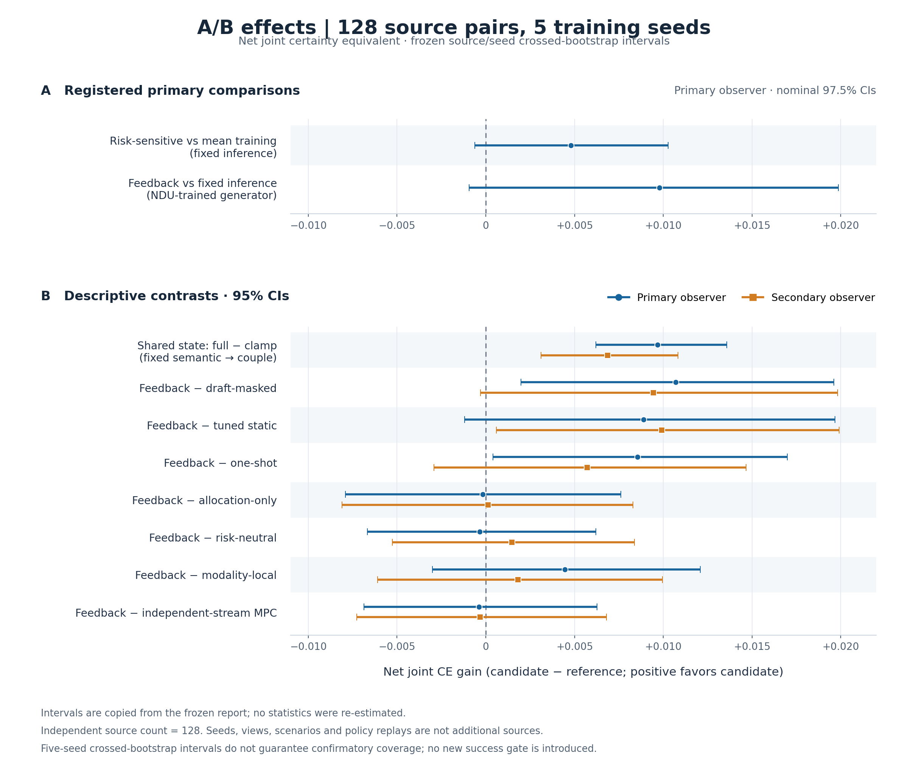

# A/B 效应与原置信区间

**图：128 个 source pairs、5 个训练 seed 的冻结 A/B 比较。** 上面板仅展示 Primary observer 的两个注册主比较及其原 nominal 97.5% CI：相同 fixed 推理下的风险敏感训练相对 mean 训练，以及 NDU 生成器上的 feedback 相对 fixed 推理。下面板展示指定的八个描述性 95% 对比；蓝色圆点为 Primary observer，橙色方点为 Secondary observer。shared-state 一行固定执行 semantic → couple 路径，比对完整共享状态更新与同路径 clamp；其余七行均为 feedback 减去对应对照。

横轴是 **net joint certainty equivalent 的差值**，正向有利于 candidate，虚线为零。图中使用原报告的 `net_ce` 点估计与区间，未重新抽样、重估、变更置信水平或添加成功门槛。`net_utility = U − 0.002 × continuation_actions` 的扣分是注册代理成本，不能直接解释为实际延迟或货币收益。

统计设计保留 source 与 seed 的交叉结构及来源内相关性；独立来源数为 **128**，不是 source × seed × view × scenario × replay 行数。五个 seed 的 crossed percentile bootstrap 没有保证的确认性覆盖率。原区间中，两个注册主比较均跨零；描述性区间不能升级为新的确认性结论。

数据来源：[冻结汇总](summary.json)；精确值、JSON 字段位置与输入 SHA：[effect-intervals-input.json](effect-intervals-input.json)；可复现脚本：[plot_intervals.py](plot_intervals.py)；渲染版本及输出 SHA：[effect-intervals.receipt.json](effect-intervals.receipt.json)。

重绘命令：在具备 matplotlib 的实验 Python 环境中运行 `python plot_intervals.py`。脚本默认验证既有输入 pins；`--initialize-pins` 仅用于首次创建且拒绝覆盖已有 pins。
