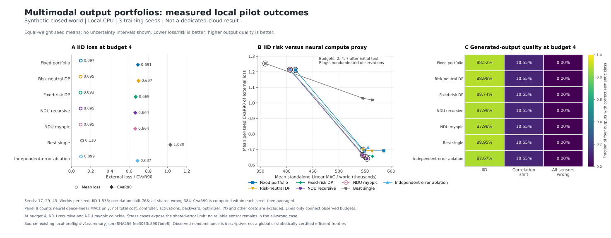

# First local pilot: conditional tail-risk benefit, important limits

> **Historical v1 report.** The independent new-heldout v1.1 evaluation did
> **not** confirm the primary effect. Read [RESULTS_V1_1.md](RESULTS_V1_1.md)
> for the current conclusion. The numbers and original status below document
> the first round; they are not the latest project-level claim.
>
> Post-run review found 11/4,608 budget-7 static-baseline worlds violated the
> registered support constraint when all positively weighted reports were
> missing. The primary budget-4 comparison had zero such exceptions. Amendment
> `f44540ab59a0a8f013437ccbe8579db607fac03e` fixed this issue before evaluating a
> disjoint heldout sample. Original evidence, exceptions, and the new negative
> result are all retained. The archive hash below refers to the original v1
> archive version; [bundle_manifest_v1_1.json](bundle_manifest_v1_1.json)
> identifies the expanded archive containing both rounds.

## Status

The complete preregistered three-seed **local CPU** run finished successfully.
All six non-cloud primary gates passed. The full primary claim remains **false**
because verified execution on the requested dedicated project environment has
not occurred. This distinction is recorded in the unmodified run summary.

The corrected dedicated workflow was accepted by GitHub and is queued:
[run 39588362257](https://github.com/TrillionniumFoundation/hepta-private-ci/actions/runs/39588362257),
[job 119182807783](https://github.com/TrillionniumFoundation/hepta-private-ci/actions/runs/39588362257/job/119182807783).
At the recorded check, `runner_id=0`, runner name/group were empty, and there
were no execution steps. A queued request is not an execution receipt.

## Evidence and protocol

- Preregistration: `0b3958f8b70a7de742ef2f2f1e61a2f1c20dc98f`.
- Frozen experiment implementation: `3a3e7ef2e3c0b73840d62ac5f816f9c4ec4d66db`.
- Seeds: 17, 29, 43; 400 optimizer updates per seed; 660,488 learned parameters.
- Per seed: 2,048 training, 8,192 calibration, 768 validation, 1,536 IID test,
  768 correlation-shift, 384 all-common-wrong worlds.
- 8,064 distinct heldout worlds; 169,344 policy/world evaluations; seven arms
  at three acquisition budgets. All registered outcomes are retained.
- 32 independent oracle audits, each checking 12,616 reachable augmented
  states. Maximum value error was `1.7819079545233762e-14`, below `1e-10`;
  no value, action, or stop-portfolio mismatches.
- All four encoder calibration accuracies were 1.0 in this eight-concept
  synthetic task. All encoder/refinement/decoder weight groups changed.
- Total measured protocol wall time was approximately 98.36 seconds on the
  current CPU runtime. This is not a target-cloud or production latency result.

The readable data are in [local_preflight_v1_summary.json](local_preflight_v1_summary.json).
The separately delivered `local_preflight_v1_evidence.tar.gz` contains every
checkpoint, calibration table, validation decision, audit, per-world score,
public trace, runtime receipt, and evidence hash from the full run and the
earlier development integration run. Archive SHA256:

```
1bdbd7b38a3e1e14d587c6f53444d65dd7747c996345dd06e44971b01a53f9c2
```

## Primary point: IID, acquisition budget 4 after initial text

Numbers below are equal-weight means of three seed-level statistics. Quality
is the fraction of four generated modalities whose nearest canonical class
matches truth. CVaR90 is the average loss in the worst 10%, computed within
each seed. The loss is normalized raw reconstruction error plus contradiction,
not a probability of hallucination or a general semantic-risk metric.

| Policy | Mean loss | CVaR90 | Quality | Mean dense Linear MAC |
| --- | ---: | ---: | ---: | ---: |
| Validation-selected fixed portfolio | 0.096723 | 0.691332 | 88.52% | 548,498 |
| Risk-neutral DP | 0.094601 | 0.697475 | 88.98% | 545,690 |
| Fixed-risk DP | 0.093420 | 0.669068 | 88.74% | 546,006 |
| NDU recursive DP | 0.095323 | 0.663847 | 87.98% | 545,934 |
| NDU myopic | 0.095323 | 0.663847 | 87.98% | 545,934 |
| Best single candidate | 0.110016 | 1.030443 | 88.95% | 545,690 |
| NDU independent-error ablation | 0.099099 | 0.686888 | 87.67% | 548,498 |

The registered NDU-minus-static CVaR90 contrast is **-0.027485**, approximately
**3.98% lower** than the static baseline. The paired hierarchical bootstrap
95% interval is **[-0.049106, -0.007334]**. It excludes zero; it does not prove
the true reduction is at least 0.02. Mean-quality difference is **-0.5371
percentage points**, inside the preregistered point-estimate tolerance of two
points. The standalone Linear-MAC ratio is **0.995325**.

Mean-loss difference is -0.001400, with 95% interval [-0.006617, 0.003346].
There is no clear mean-loss improvement. Three training seeds provide limited
information about training variability despite the number of paired worlds.

## What the controls establish and what they do not

1. **Real output mixing matters for this reconstruction task.** About 46.12%
   of NDU outputs use non-vertex portfolios. Relative to best-single output,
   the CVaR90 contrast is -0.366596. But mixture reconstruction is deliberately
   supervised; this is not discovered open-domain compositional understanding.
2. **Joint error modeling helps on the calibration-matched distribution.**
   Relative to the independent-error ablation, the NDU CVaR90 contrast is
   -0.023041, with 95% interval [-0.044183, -0.004811]. This is a secondary
   contrast, not an independently confirmed new primary endpoint.
3. **Incremental endogenous-preference value is not established.** Compared
   with fixed-risk DP, CVaR90 changes by -0.005221 with interval
   [-0.014889, 0.000000], while mean loss increases by 0.001903 and quality
   falls by 0.7541 percentage points. Fixed-risk DP is a strong alternative.
4. **The primary point does not identify a recursive-planning advantage.**
   NDU recursive and myopic produce identical scores and costs at budget 4.
   At budget 7 their observed CVaR90 values are 0.641018 and 0.653915,
   respectively, with different costs and ambiguity. That secondary numerical
   difference is not the preregistered primary finding or a global proof.
5. **Reduced reconstruction risk has an ambiguity tradeoff.** NDU ambiguity
   is 3.02%, versus 0.35% for the static portfolio. Correct-and-resolved output
   fractions are 86.61% and 88.50%, respectively. Reporting only lower raw loss
   would conceal this limitation.

## Stress tests are failures, not exclusions

At budget 4, changing the common-error coalition from text/audio/image to
text/audio/video makes every arm's quality **10.55%**, with CVaR90 **1.286320**.
The now-reliable image is not acquired by these calibrated policies. The
estimated risk model fails under this correlation shift.

When all four sensors give the same wrong report, every arm has **0%** quality,
zero cross-modal contradiction, and CVaR90 **1.280696**. Agreement cannot reveal
truth in this unidentifiable case. The experiment retains these failures and
does not repair them by reading hidden truth or changing test distributions.

## Cost and frontier qualification

The graph shows finite observed non-dominated points in **neural dense Linear
MAC versus CVaR90**, not total physical compute or a globally optimal frontier.
The per-seed policy-grid compilation took 7.73-7.94 seconds; validation
selection took 2.04-2.34 seconds. These and training, calibration, candidate
generation, auditing and external scoring costs are recorded separately.
They cannot be treated as free deployment work without an explicit amortization
horizon. Implementation wall times do not establish an optimized latency win.



## Execution issues and retained failures

Two initial workflow-validation failures are retained:
[39587736972](https://github.com/TrillionniumFoundation/hepta-private-ci/actions/runs/39587736972)
and [39587989207](https://github.com/TrillionniumFoundation/hepta-private-ci/actions/runs/39587989207).
The invalid use of `runner.temp` at job-level `env` was moved into allowed
step contexts. Corrected commit `321ec72bcfc5bff2f62b857c73953ffdf085fed3`
was accepted and produced the queued job above. Experiment source and protocol
were unchanged by this execution-only fix.

The old desktop availability probe
[39526325715](https://github.com/TrillionniumFoundation/hepta-private-ci/actions/runs/39526325715)
also remains unassigned. The remaining execution blocker is a verified,
available connection to the user's dedicated project environment. It cannot
be closed by relabeling the current container or a GitHub-hosted runner.

The local repository's requested `just fmt` command could not execute because
`just` is absent. No Rust files were changed. Python syntax, shell syntax,
the complete behavioral pilot, independent solver audit, model replay, and
evidence integrity checks were used to verify this Python-only change.

The earlier development integration run did **not** pass its effect conditions
and is included in the evidence archive. Its reduced data and separate seed
were not substituted for the registered three-seed result, and it did not
change the protocol's losses, parameters, or heldout samples.

## Scope of the resulting claim

The pilot supports a conditional benefit from calibrated risk-sensitive
allocation in a small learned multimodal reconstruction task. It does not
establish new NDU joint training, native Hepta integration, superior recursive
planning at the primary point, robustness to unknown shared bias, or an
advantage over diffusion LLMs. Those remain separate research questions.
