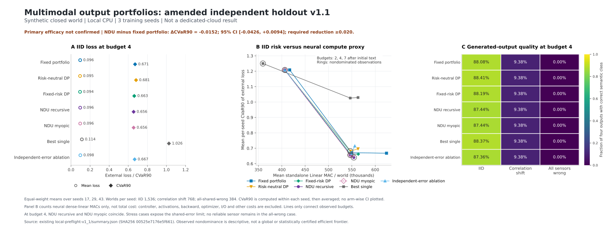

# Independent new-heldout v1.1: primary benefit not confirmed

## Current conclusion

The corrected experiment completed all three registered seeds and all seven
policy comparisons on new heldout worlds. **It did not meet either registered
CVaR90 efficacy condition.** The NDU controller's CVaR90 point estimate is
2.26% below the validation-selected static portfolio, but its absolute
reduction is below 0.020 and its 95% interval crosses zero. Implementation
correctness and evidence integrity passed independent review. Execution on
the requested dedicated project cloud remains unverified.

This is a valid negative confirmation result for this finite synthetic pilot.
It neither establishes a reliable NDU advantage nor proves that every possible
NDU architecture is ineffective. A second run on the same frozen test inputs
in a different runtime would verify execution, not supply new statistical
evidence or turn these failed efficacy gates into successful ones.

## Why there is an amendment

The first round, v1, passed all six local gates. Post-run review found a
support-constraint bug in 11 of 4,608 **budget-7 static-baseline** worlds:
when all positively weighted reports were missing, the fallback used all
classes despite other acquired reports being present. There were no such
exceptions in the primary budget-4 comparison.

The correction restricts the fallback to acquired nonmissing reports, using
the uniform all-class portfolio only when no report exists. Protocol v1.1
changes the heldout RNG namespace from 100000 to 200000 and preserves the
original evidence. It does not change the loss, endpoint, gamma grid, budgets,
training, calibration, validation data, or acceptance thresholds. Amendment
and corrected source commit
`f44540ab59a0a8f013437ccbe8579db607fac03e` was published at
2026-10-21 11:04:40 UTC, before the new runtime began at 11:04:44 UTC.

Independent review verified zero overlap between the two sets of 8,064 world
IDs and different hashes for all 36 corresponding raw test matrices. For each
seed, both rounds have identical training inputs, initial and final parameter
group hashes, calibration arrays and portfolio loss tables. All dynamic
validation selections and the primary static selection are identical; the
budget-7 static selection changes following the correction. These are two
independent heldout draws for the same three trained models, not six training
seeds or an independent-laboratory replication. The rounds were not pooled.

## Frozen implementation and evaluation

The 660,488-parameter model learns four raw encoders, a shared 64-dimensional
generation state, three applications of one residual refinement module and
four raw-output decoders. Inputs are token sequences, synthetic acoustic
tones, small RGB images and four-frame videos representing eight concepts.
The generator is explicitly trained on convex mixtures of canonical targets.
All comparisons use the same frozen model within a seed.

The finite NDU-inspired controller acquires evidence under a budget and then
chooses a quarter-grid portfolio over observed concepts. The portfolio enters
the neural generator, so mixing changes actual generated output. Calibration
estimates correlated encoder errors. Preference evolves with public conflict;
the controller optimizes a nested entropic objective. It cannot observe test
truth, corruption identities, or future encoder reports.

The primary external loss is normalized raw reconstruction error plus 0.25
times cross-modal contradiction. Quality is nearest-prototype correctness
averaged across generated modalities. CVaR90 is mean loss in the worst 10%,
calculated separately within each seed. These are closed-world reconstruction
metrics, not open-domain hallucination probabilities. Ambiguity and correct-
and-resolved output are reported separately because mixture MSE can improve
while the decoded message becomes less decisive.

Each of seeds 17, 29 and 43 uses 2,048 training worlds, 400 optimization steps,
8,192 calibration worlds, 768 validation worlds and 2,688 heldout worlds.
All seven policies are evaluated at budgets 2, 4 and 7, for 169,344 policy/world
rows and 189 summary groups. The measured local protocol time was about
113.12 seconds; this is not a target-cloud or production latency result.

## Primary result: IID, budget 4 after initial text

These are equal-weight means of the three seed-level statistics. The primary
contrast was fixed in the original preregistration: NDU recursive minus the
validation-selected fixed portfolio.

| Policy | Mean loss | CVaR90 | Quality | Mean dense Linear MAC |
| --- | ---: | ---: | ---: | ---: |
| Validation-selected fixed portfolio | 0.095809 | 0.671205 | 88.08% | 549,396 |
| Risk-neutral DP | 0.094562 | 0.681464 | 88.41% | 546,452 |
| Fixed-risk DP | 0.094462 | 0.662687 | 88.19% | 546,753 |
| NDU recursive DP | 0.096142 | 0.656039 | 87.44% | 546,696 |
| NDU myopic | 0.096142 | 0.656039 | 87.44% | 546,696 |
| Best single candidate | 0.113754 | 1.025907 | 88.37% | 546,452 |
| NDU independent-error ablation | 0.097773 | 0.666819 | 87.36% | 549,396 |

- **CVaR90 difference:** -0.015165960929; paired hierarchical-bootstrap 95% CI
  **[-0.042590096008, +0.009442706859]**, using 1,000 replicates, seeds then
  worlds within seed. Three seeds provide limited information on model
  training variability.
- **Per-seed CVaR90 differences:** -0.012904694, -0.041701847, +0.009108658.
  The third seed worsens.
- **Mean-loss difference:** +0.000332902; 95% CI [-0.002804017, +0.003828624].
- **Quality difference:** -0.6348 percentage points, inside the registered
  two-point tolerance. This is a point-estimate gate, not an established
  statistical noninferiority result.
- **Standalone dense Linear-MAC ratio:** 0.995086. This excludes CPU control,
  activations, transfers and offline work; it is not total measured compute.

| Registered condition | v1.1 outcome |
| --- | --- |
| Absolute CVaR90 reduction at least 0.020 | **Fail:** 0.015166 |
| CVaR90 95% interval strictly below zero | **Fail:** upper limit +0.009443 |
| Quality point-estimate drop at most 0.020 | Pass |
| Dense Linear-MAC ratio at most 1.05 | Pass |
| All three registered seeds complete | Pass |
| Independent same-objective oracle parity | Pass |
| Verified dedicated project cloud receipt | **Not satisfied** |

`primary_claim_passed` is **false** in the unmodified machine-readable summary.

## Interpreting the first and second rounds together

| Heldout round | NDU minus static CVaR90 | 95% interval | Local efficacy gates |
| --- | ---: | --- | --- |
| Original v1 | -0.027485 | [-0.049106, -0.007334] | Passed |
| Amended v1.1, new worlds | -0.015166 | [-0.042590, +0.009443] | **Failed** |

The appropriate current conclusion is that the original positive primary
finding **was not clearly confirmed by the new heldout sample**. The first
result remains part of the record. We do not select it instead of the second,
combine rounds after seeing their outcomes, change the threshold, or promote
a positive secondary contrast into a new primary endpoint.

## What the controls and stress tests show

**Endogenous preference has no established incremental benefit.** Relative to
fixed-risk DP, NDU changes CVaR90 by -0.006648, with interval [-0.013754, 0].
Its mean loss increases by 0.001680 and quality falls by 0.7541 points.

**The primary budget does not identify recursive planning value.** Recursive
and myopic NDU are identical in all 13 audited fields for all 4,608 paired
worlds, including complete acquisition traces and final portfolios. At budget
7, 947 traces and 301 final portfolios differ. This confirms that the code can
produce different recursive behavior, not that the primary endpoint succeeds.

**The joint-error ablation is inconclusive on the new worlds.** Its NDU CVaR90
contrast is -0.010780, with interval [-0.033564, +0.011225]. The corresponding
v1 secondary positive finding is not clearly confirmed either.

**Some secondary contrasts remain favorable.** NDU versus risk-neutral DP has
CVaR90 difference -0.025425, interval [-0.041179, -0.011715]; versus best-single
output it is -0.369869, interval [-0.383174, -0.347591]. The latter is strongly
shaped by deliberately supervised mixture reconstruction. Neither contrast
establishes the failed primary claim or isolates NDU's special contribution.

**Ambiguity is a material cost.** At the primary point, ambiguity/omission is
3.0599% for NDU and 0.3255% for the static portfolio. Correct-and-resolved
output falls from 88.0642% to 86.0243%, a 2.0399-point decrease. A lower
reconstruction-risk point estimate alone would obscure this tradeoff.

**Correlation shift breaks all calibrated policies.** When the commonly
wrong coalition changes, every arm's budget-4 quality is 9.375%, with CVaR90
1.284826. When all modalities share the same wrong report, quality is zero
and cross-modal contradiction is also zero; budget-4 CVaR90 is 1.281101.
Agreement does not detect an unidentifiable shared error. These outcomes
remain in the evidence; no hidden truth is used to repair the controller.

The plotted frontier consists of observed non-dominated points in dense
Linear MAC versus CVaR90. It is neither a global optimum proof nor a frontier
for total physical cost. Training, calibration, validation, candidate decoding
and policy compilation are recorded separately and require an explicit
amortization horizon before any deployment-efficiency claim.

## Independent checks and reproducibility

The [separate-agent review](independent_review_v1_1.json) independently
recomputed all summary groups and bootstrap contrasts, inspected every CSV
row, and replayed raw observations and checkpoint-generated outputs. It is
not an independent-laboratory replication. Checks found:

- Zero violations of budget, trace, preference transitions, portfolio support,
  encoder-call counts, MAC counts, or recorded per-world scores.
- All 32 bottom-up oracle audits agree with recursive values/actions on
  12,616 reachable states each: 403,712 state checks, maximum numerical
  discrepancy 1.7819e-14, no decision mismatches.
- All 27 manifest-listed evidence files pass their hashes. Regenerating the
  output loss table from each checkpoint reproduces the stored scores exactly.
- All nine frozen source files match amendment commit `f44540ab...`. The
  executed local worktree's Git HEAD was the original main baseline; this
  is a content-hash binding to published source, not a claim that the local
  process ran a clean checkout of the amendment commit.
- The old support violation has zero occurrences in v1.1. Original v1 review
  and every original result remain available for comparison.

The repository's requested `just fmt` command was unavailable because `just`
is not installed. No Rust files were modified. Python/shell syntax checks,
full execution, independent state-space auditing, replay and evidence checks
cover this isolated Python research prototype.

## Dedicated execution remains blocked

The corrected v1.1 cloud request is commit
`7cbe3b29842065fb7cedc33f8d9e5d3fa354752b`, with
[Actions run 39589317563](https://github.com/TrillionniumFoundation/hepta-private-ci/actions/runs/39589317563).
The final observed job/runner fields and time are recorded in
[cloud_execution_status_v1_1.json](cloud_execution_status_v1_1.json).
At 2026-10-21 11:12:14 UTC, job `119186004831` remained queued with
`runner_id=0`, empty runner name/group and no execution steps. The superseded
v1 run was confirmed completed/cancelled.
An accepted or queued request is not proof that the dedicated environment
has executed the experiment. The workflow retains partial failure evidence
and can execute when the configured self-hosted runner becomes available.

Two initial workflow validation failures are retained in the original report.
Moving `runner.temp` out of the disallowed job-level environment context
resolved that workflow error. The old queued v1 request is superseded by the
amended request. No source or results have been relabeled as cloud execution.
The remaining infrastructure need is the actual available dedicated runner
or a verified executable connection to the user's configured project cloud.

## Evidence index and remaining research questions

- [Current machine-readable summary](local_preflight_v1_1_summary.json)
- [Current independent review](independent_review_v1_1.json)
- [Historical v1 report](RESULTS.md) and [review](independent_review.json)
- [Expanded evidence archive manifest](bundle_manifest_v1_1.json)
- [Method and replay instructions](../README.md)

The separately delivered `local_preflight_v1_evidence.tar.gz` retains its
original filename and now contains development, v1 and v1.1 raw evidence,
including checkpoints, calibration tables, decisions, audits, all per-world
rows and runtime/source manifests. The expanded archive's exact hash is in
the linked manifest; the original archive version remains identified in
`bundle_manifest.json`.

This prototype controls evidence acquisition and terminal allocation. It
does not implement native Hepta/utility.ndu, continuous-time Merton/FBSDE,
NDU control at each internal refinement step, NDU joint generator training,
or a diffusion/flow-matching objective and baseline. A future protocol would
need a task that can distinguish multi-step control from myopic choice,
separate risk reduction from ambiguity, and challenge shared bias using
additional identifiable evidence. Those are new research questions requiring
new preregistration and untouched evaluation data, not fixes that make this
negative confirmation result disappear.
