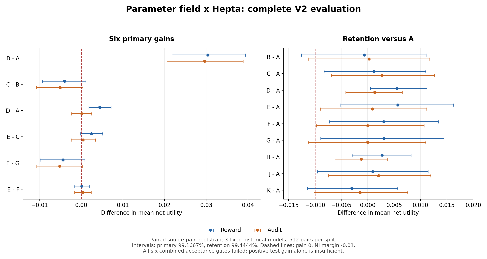

# 参数场 × Hepta neuron：V2 完整实验与结论

**V2 的训练、十一臂部署、实际媒体评分、原生状态重放和独立统计均已完成。六项预注册的“增益＋保留能力”联合验收仍为 0/6。** 其中普通局部训练相对强固定基线的测试收益已经得到两套观察器支持；未满足的是它的独立保留能力非劣性要求。参数场训练相对普通训练、Hepta 相对同信息历史控制，以及两层结合的额外收益，均尚未确立。

这轮解决了 V1 的一个核心识别问题：适配器现在会明显改变真实硬输出，H7 也通过了留出优化器轨迹上的短期预测与决策门槛。**局部八步决策有效，尚不意味着最终训练端点更优。** 这是本轮新得到的实证区分；不能把开发门槛通过改写成端到端收益通过。[完整结果](evidence/PRIMARY_RESULT.json)、[独立复核](../field_bridge_v2_20261027_review/PRIMARY_RESULTS_REVIEW.md)、[逐项 blocker 状态](../field_bridge_v2_20261027_review/BLOCKERS.json)。

## 1. 论文与 Hepta 的连接究竟是什么

本研究对应论文固定版本 `f8df0a6075f58f3ab9431a889b773cdf8d6e771d` / `revision_2026-09-26-r45`，没有把它称为后来所有修订的最新版本。Hepta 原生内核固定于 `63f198ad85cfa2aa579032256355f446cfe793a0`。此前的理论与实现对照见 [V1 报告](../field_bridge_20261027/README.md)；本轮增加的是可识别的训练响应、更严格的局部预测门槛、更强普通训练参照，以及扩大的新身份评估。论文依据为 [R45 主文](https://github.com/TrillionniumFoundation/ICLR-2027/blob/f8df0a6075f58f3ab9431a889b773cdf8d6e771d/revision_2026-09-26-r45/sections/r45_main.tex)及其 [递归控制细节](https://github.com/TrillionniumFoundation/ICLR-2027/blob/f8df0a6075f58f3ab9431a889b773cdf8d6e771d/revision_2026-09-26-r45/sections/r45_recursive_detail.tex)。

| 层次 | 本轮实际状态 | 可选控制 | 证据支持到哪里 |
|---|---|---|---|
| 完整学习系统 | 局部适配参数、完整 SGD 动量、样本与随机日程 | 下一段学习率倍率 | 全状态续训与独立重放可验证 |
| 经验参数场 | H7：当前硬价值、适配图像 BCE、文本 CE、干净联合损失、算子位移 RMS、动量 RMS、训练时间比例 | `0 / 0.25 / 1 / 2`，每个候选继续 8 个 SGD 微步 | 在规定探索轨迹与固定响应面板上有局部预测和选择能力 |
| Hepta 推理控制 | 原始与统一首轮 `couple` 后两次公开输出，经真实 `sparse_tick` 得到的状态 | `stop / refine_image / refine_text / refine_semantic / couple` | 状态参与动作选择；对同信息历史控制的额外效用未确立 |

学习层通过更新后的生成器及真实输出影响运行层。H7 参数摘要没有被直接当成 Hepta 神经元状态。这里的训练控制器是经验预测器上的八步贪心选择；并未求解论文的标量 FBSDE、HJB 或 Riccati 问题，也未验证其充分状态和闭合假设。原生内核在两个事件间有真实递归，每个样本重新开始；统一首轮动作固定，之后只有一个自适应延续选择。它不能代表跨任务、长期外部反馈的运行控制。[递归范围说明](../field_bridge_v2_20261027_review/RECURRENCE_SCOPE_REVIEW.md)。

本轮 comments 是：这条桥接路线可以检验，但“状态可测”“状态能预测”“状态指导控制有收益”“收益值得其成本”必须分别获得证据。当前第一、第二项有了实质进展；端到端增量价值仍不能确认。Hepta 状态是同一公开历史的确定性变换，可能具有有限模型族中的表示或拟合优势，却不因此获得历史参照无法访问的新信息。

## 2. 冻结身份与执行顺序

| 对象 | 固定提交或 SHA-256 |
|---|---|
| H7 拟合／审计科学源 | `2bbb8450b479828c8a32299d3177cda08e1d9657` |
| 九个 H7/generic7/rich25 预测器的审计前冻结提交 | `2bd2a2e04b581c26ef11adc1a7e9fead928f2f18` |
| 本轮主实验的 35 个科学源文件提交 | `c5233ce581e8fc6b45ab52b6d4653e01be8aa93f` |
| 最终模型、完整优化器状态及控制器的测试前冻结提交 | `2953686f0a137f23b77d1ae3e3c6d4c80daebe25` |
| 测试前冻结清单 SHA-256 | `d3c287b90f2832bc7b071fcbbca1054aa94f3d11a2283abf15c6bc61137a3035` |
| 仅修复临时目录的恢复注册提交 | `e302fadaec3427e6d4d027e684cbbcd8f6c8134f` |
| 完整主结果与三项独立审计提交 | `d109c90bb294a3a60bd49e6a6a3c87f80dfe3b5c` |
| 主结果文件 SHA-256 | `ae10b12185c64d366019f3b73c522e9d6b364523174864a9424a65ffafc547e2` |

[主协议](PRIMARY_PROTOCOL.json)、[测试前冻结清单](evidence/PRIMARY_PRETEST_FREEZE.json)、[恢复注册](evidence/PRIMARY_IO_RECOVERY_REGISTRATION.json)保留实际规则和对象身份。十二份最终 `.pt` 检查点已经保存在 `evidence/primary_checkpoints/`，包含局部参数与优化器状态。研究阶段始终保持 `DENY_ALL`、`requires_calibration=true`，未获得生产 owner 集成或启用资格。

首次主评估因重复使用的临时目录出现文件系统冲突而中断。恢复在同一冻结科学代码、模型、控制器和随机日程下，改为每批一个独立 `/tmp` 目录及独立输出目录。没有利用中断结果进行选择或调整。原尝试的 219 个文件完整保留；其中 11,808 条完整行、6,560 条完整原生回执在排除计时与时间戳衍生字节后全部复现。原 PNG/UTF-8 科学产物保持一致。恢复后的全量网格是唯一统计样本，重复执行计入成本。[恢复一致性审计](evidence/PRIMARY_RECOVERY_PARITY_AUDIT.json)。

## 3. 从 V1 到 V2：已解决的开发问题

试验预先比较六种局部适配配方，每个历史模型各执行六个，共十八个完整候选。选择出的 `upstream_r8_288_lr02` 在八个模块上使用秩 8 适配器，共 **18,144 个局部参数、16 个因子张量**；原始生成器冻结。八个模块为 `pixel_decoder.0`、`text_initial`、`text_projection`、`fuse.0`、`initial_image`、`initial_text`、`coupling_cell.0`、`digit_head`。基础学习率 0.2、动量 0.9、梯度裁剪 1、锚定系数 0.1、批量 64、288 个微步。配方选择的三模型开发收益分别为 +0.025929、+0.024511、+0.044185，硬决策变化约 16.2%–19.0%。这些属于开发资格证据，未用于声称主要效果。[试验协议](PILOT_PROTOCOL.json)、[试验结果](evidence/PILOT_SUMMARY.json)。

H7 的拟合和审计各包含每模型八条完整优化器轨迹，每条 36 个快照，每个快照克隆四份完整参数与动量并分别延续八步。两个阶段共 **1,728 个快照、6,912 个真实分支、3,538,944 个逐例硬价值**。零倍率保留参数及动量，但仍执行同样的梯度计算。分支共享下一批样本与噪声；状态及审计预测先于分支结果写出，最终闭环训练另在更新前提交所选动作。

H7、generic7 和 rich25 每个模型各从相同的 20 个候选中按完整轨迹交叉验证选择预测器。generic7 是相同丰富状态的固定随机七维投影；rich25 额外保留模块位移及输出边际等信息。总计 **1,440 次交叉验证拟合＋9 次最终拟合**。所有九个完整预测器均在审计前冻结。

| H7 审计指标 | 实测结果 | 原门槛结论 |
|---|---:|---|
| 每模型平均候选硬价值范围 | 0.009349 / 0.011518 / 0.010547 | 响应可识别，通过 |
| H7 预测 MSE | 0.0000300344 | 优于最佳预定基线 |
| 最佳预定常数基线 MSE | 0.0000464601 | H7/基线约 0.646 |
| H7 决策遗憾 / 拟合期选定固定动作遗憾 | 0.00249203 / 0.00404669 | 比值约 0.616，通过 |
| 相对固定动作的平均优势 | +0.00155466 | 超过预定 0.001 门槛 |
| 按完整轨迹配对的 95% 区间 | [0.00119183, 0.00194834] | 下界大于零；三模型方向均正 |

[完整 H7 门槛结果](evidence/H7_GATE_RESULT.json)和原始完整性审计保留了全部常数参照、单模型结果及轨迹重放。以上 H7 审计留出的是**优化器轨迹**，响应图像/标签面板与拟合阶段相同。它没有满足最初 B09 清单中“轨迹审计也采用不同像素身份”的更强表述；这项偏差在最终清单中保留，不能悄悄标成全闭合。

## 4. 十一臂与强参照

| 臂 | 学习方案 | 部署方案 | 作用 |
|---|---|---|---|
| A | 冻结模型 | 强固定动作 | 基线 |
| B | 最强合格固定倍率普通训练 | 同一固定动作 | 普通参数训练收益 |
| C | H7 参数场指导训练 | 同一固定动作 | 参数场的增量 |
| D | 冻结模型 | Hepta 状态控制 | 运行层收益 |
| E | H7 参数场指导训练 | Hepta 状态控制 | 两层组合 |
| F | 与 E 完全相同的模型 | 同信息历史控制 | 复杂表示的必要性 |
| G | 与 B 相同的普通训练模型 | Hepta 状态控制 | 组合中的学习方法参照 |
| H | 冻结模型 | 同信息历史控制 | 冻结模型上的轻量参照 |
| I | 与 E 相同的模型和读出头 | 第二次原生事件前重置状态 | 状态活跃性诊断 |
| J | generic7 指导训练 | 同一固定动作 | 特定七维摘要的参照 |
| K | rich25 指导训练 | 同一固定动作 | 丰富状态参照 |

普通训练从已经完成的四条固定倍率轨迹中，根据旧开发面板选择合格最优者，三模型倍率为 0.25、0.25、1。它复用经过完整状态校验的终点，而不是重新计费一遍共同探索。H7/generic7/rich25 各实际执行 36 次八步控制选择。主比较 C−B 使用字面相同的固定部署动作。

运行层在每个模型与训练方案上分别拟合，但 native/history 使用相同的公开观察、标签、合法动作、容量及选择预算：每侧 24 个候选、40 维输入、205 个线性系数。全部九组模型状态共保存 **432 个读出头、288 份特征矩阵**。native 可选纯状态或 `raw16＋native24`；history 可选原有历史表示或 `raw16＋24` 维固定随机 Fourier 特征。只用训练集归一化和拟合，在旧开发集选择。

E−G 比较相同原生校准程序下的最终系统，读出系数、变换甚至所选表示族可以因模型不同而不同。因此它包含学习变化经后续读出校准传递的作用，不是固定同一组读出权重后的纯训练效应。E−F 则使用同一参数场模型与同一信息集，比较各自等预算拟合后的表示族。[运行层独立重建](../field_bridge_v2_20261027_review/PRIMARY_RUNTIME_AUDIT_REVIEW.md)。

## 5. 主评估与推断边界

主测试为 **512 个源图像对 × 4 种条件 × 3 个固定模型 × 11 臂 = 67,584 条输出**；保留能力为另 **512 对 × 干净条件 × 3 模型 × 11 臂 = 16,896 条输出**。合计 **84,480 条**。两组各 1,024 张图像，互不重复，且全部位于原有 25,000 个已记录源像素身份之外。没有把新身份扩展称为新书写者、新模型种子总体或全局预训练不可见。

每例实际写出并重读原始与第一轮预览的 PNG/UTF-8，先提交决策，再执行唯一选中的延续动作并写出、重读最终产物。目标是硬输出效用减去每次真实 refinement 的 0.002 逻辑费用；统一首轮也计费，`stop` 仍需最终解码。独立 audit 观察器不参与控制目标拟合。

统计单位是源图像对。4,000 次配对 bootstrap 在所有条件、固定模型和臂之间使用相同的重采样索引。六项主要比较的单项区间名义置信度为 99.1667%，通过还要求三个模型方向分别为正、两个观察器均支持，以及候选通过独立保留能力门槛。九项保留能力比较使用 99.4444% 区间和固定 −0.01 非劣性界。区间条件化于这三个历史模型，bootstrap 覆盖率是近似的。

### 六项主要比较

| 比较 | Reward 平均差及校正区间 | Audit 平均差及校正区间 | 联合验收 |
|---|---|---|---|
| B−A | +0.030403 [+0.021802, +0.039391] | +0.029622 [+0.020574, +0.038863] | 未通过 |
| C−B | -0.004013 [-0.009351, +0.001096] | -0.005079 [-0.010761, +0.000344] | 未通过 |
| D−A | +0.004413 [+0.001821, +0.007153] | +0.000132 [-0.002326, +0.002502] | 未通过 |
| E−C | +0.002455 [-0.000183, +0.005132] | +0.000421 [-0.002413, +0.003395] | 未通过 |
| E−G | -0.004375 [-0.009904, +0.000866] | -0.005156 [-0.010691, +0.000311] | 未通过 |
| E−F | +0.000127 [-0.001726, +0.001990] | +0.000363 [-0.001625, +0.002377] | 未通过 |

**B−A：** 两个观察器的校正区间均明显大于零，三个模型均为正，普通学习确有本轮测试收益。它的保留能力点差仅 −0.000694 / +0.000250，但下界 −0.012566 / −0.011205 未越过 −0.01 门槛。结论是保留能力证据不足，不能说已经证明了超过 0.01 的遗忘或损害。

**C−B 与 E−G：** 两个观察器的合并点差为负，校正区间仍含零；未证实参数场增量，也未按这组预注册标准证实反向优越排序。局部审计只看八步之后的价值，最终端点还受控制诱导的状态分布、动作序列及长期累积影响；这些是后续机制假设，不是此次已完成的因果分解。

**D−A 与 E−C：** 冻结模型上的 native 改善通过了 reward 观察器，但没有通过 audit。参数场模型上 native 的正点差也未达到完整门槛。这要求将选择所用评分器的改善与独立评分器上的迁移分别报告。

**E−F：** 平均差接近零，校正区间含零，既没有证明 native 优于历史，也没有登记和通过等效性检验。E 比 F 平均少 0.131185 次 refinement，带来约 +0.000262 的逻辑费用优势；两者 reward 原始效用差约 −0.000136，所以 reward 净差仅 +0.000127。不能只报告省下的动作次数。

交互量 `(E−C)−(D−A)` 的 reward 均值为 −0.001958，描述性 95% 区间 [−0.004660, 0.000596]；audit 为 +0.000289，[−0.002286, 0.002782]。未见可确认协同。CE 为整个固定评估总体一次计算的风险敏感描述量，未用于验收。

### 保留能力明细

| 实验臂 | Reward 平均差 | Reward 校正下界 | Audit 平均差 | Audit 校正下界 | 双观察器非劣性 |
|---|---:|---:|---:|---:|---|
| B | -0.000694 | -0.012566 | +0.000250 | -0.011205 | 未确立 |
| C | +0.001186 | -0.008283 | +0.002651 | -0.006914 | 通过 |
| D | +0.005511 | +0.000511 | +0.001312 | -0.004169 | 通过 |
| E | +0.005702 | -0.005109 | +0.000917 | -0.009010 | 通过 |
| F | +0.003047 | -0.007238 | +0.000020 | -0.009721 | 通过 |
| G | +0.003079 | -0.008935 | -0.000013 | -0.011287 | 未确立 |
| H | +0.002714 | -0.002956 | -0.001258 | -0.006242 | 通过 |
| J | +0.000968 | -0.009546 | +0.002074 | -0.007455 | 通过 |
| K | -0.003037 | -0.011434 | -0.001442 | -0.010229 | 未确立 |

保留能力 C、D、E、F、H、J 通过；B、G、K 未确立。某一方法通过而另一方法未通过，不自动证明两者保留能力有显著差异。

### 十一臂实测均值

| 实验臂 | Reward 净效用 | Audit 净效用 | Reward CE | Audit CE | 平均 refinement | 决策 wall / μs |
|---|---:|---:|---:|---:|---:|---:|
| A | 0.802081 | 0.806297 | 0.623113 | 0.628371 | 1.333333 | 1.05 |
| B | 0.832484 | 0.835919 | 0.679946 | 0.683890 | 1.333333 | 1.08 |
| C | 0.828471 | 0.830839 | 0.673664 | 0.673997 | 1.333333 | 1.08 |
| D | 0.806494 | 0.806429 | 0.622835 | 0.628201 | 1.588704 | 242.68 |
| E | 0.830927 | 0.831260 | 0.672716 | 0.674735 | 1.616862 | 240.70 |
| F | 0.830800 | 0.830898 | 0.673601 | 0.673893 | 1.748047 | 30.39 |
| G | 0.835301 | 0.836416 | 0.680281 | 0.684131 | 1.795085 | 238.81 |
| H | 0.804947 | 0.806623 | 0.620968 | 0.627335 | 1.794759 | 28.72 |
| I | 0.824733 | 0.827760 | 0.665554 | 0.668732 | 1.999674 | 222.18 |
| J | 0.825814 | 0.832862 | 0.668156 | 0.677188 | 1.333333 | 0.94 |
| K | 0.822283 | 0.825107 | 0.662179 | 0.662072 | 1.333333 | 1.84 |

上表全部每臂 6,144 条测试行。绝对均值排序属于描述，不替代配对比较。J/K 没有获得主要增益主张：C−J 的 reward/audit 点差分别为 +0.002657/−0.002022，两个观察器方向不一致；C−K 的 +0.006188/+0.005732 也是未登记为主要家族的描述。

## 6. 原生工程收益、状态诊断与成本

独立 FFI 保留原始 20 单元、top-4 `sparse_tick` 语义，在随机、边缘、重置和并发契约下通过等价验证。24 个随机交错重复块中，完整记录路径从约 207.92 μs 降到 101.96 μs；紧凑路径从 169.84 μs 降到 40.67 μs。相同 40 维轻量历史读出约 1.40 μs，native 紧凑路径仍约慢 29.49 倍。这闭合的是传输开销问题，不是统计收益问题。[基准与边界](../field_bridge_v2_20261027_review/NATIVE_REPRESENTATION_REVIEW.md)。

本次部署中 E/F 记录的平均决策 wall 分别为 240.70/30.39 μs；这包括不同路径的实际调用与记录成本，种子并发运行，属于描述性计时，不能充当独立因果性能基准。论文价值中的 0.002 是逻辑动作费用，不能换称毫秒、能耗或货币收益。

I 与 E 在测试上有 **5,236/6,144（85.22%）** 的动作不同，说明状态确实被使用。E 在 seed17 选择纯 native40；seed29/43 选择 `raw16＋native24`，因此 I 保留了这两组的原始历史通道。重置输入也偏离读出头训练分布，I 不是重新拟合的最强无记忆参照，不能据此证明 Hepta 的信息优势。

[完整成本台账](../field_bridge_v2_20261027_review/STUDY_COST_LEDGER.md)保留共同探索、失败或未启用准备、拟合、最终训练、部署和独立验证的成本。列出的部署前准备与最终训练实际执行 68,364 次梯度计算 / 4,375,296 个样本，另有同等冻结教师计算；D1 另增加 2,592 次方向探针反向计算。普通终点复用共同 H7 工作，未重复计费；零学习率也没有被算成零计算成本。

## 7. 理论 comments 与明确的未确立事项

完整优化器状态不能只由权重位置替代。独立构造检查在同一参数、正负动量下得到完全相同的 H7/rich25 摘要，而非零控制的后续更新与输出不同。这说明若域包含这些构造状态，该摘要不构成全局确定性闭合。它没有证明这些碰撞状态都由真实训练可达，也没有证伪论文在指定可达律与误差界下的命题。[动量状态分析](../field_bridge_v2_20261027_review/DIRECTIONAL_DESIGN_REVIEW.md)。

为此准备的 D1 方向性摘要只完成了旧拟合轨迹重放、方向探针和契约验证。其启用条件是 H7 门槛失败；H7 已通过，所以 **D1 未进行真实预测器选择、未打开新审计轨迹、未加入主实验**。准备成本仍保留，不能把未启用方案描述成已经提供效果证据。

后续值得检验的具体机制有三项：第一，八步贪心目标与最终端点目标之间的差距，应以新的开发日程检验有限视野或终点价值校准；第二，H7 的方向信息与可达分布外误差，应在另行冻结的新轨迹和新响应面板上确认；第三，native 的表示诱导偏置需要在相同信息与完整成本预算下击败强历史参照。当前主测试与保留能力数据已被用于一次确认性判断，不能不断重用直到出现通过结果。这些是新的研究问题，未被当前结果解决。

数学充分性、LLM 规模迁移、长期外部反馈、生产 owner 集成都未确立。它们被保留为主张边界，不通过把工程审计成功扩写成理论证明来关闭。

## 8. 完整独立核验与可复现交付

- 媒体核验覆盖 84,480 行、2,640 批、84,480 份先于输出提交的决策、506,880 个逻辑媒体引用。去重后的实际媒体为 108,793 个条目、91,662,356 字节。
- 从实际媒体、已保留并校验哈希的公开 logits 及输入 mask 独立重建全部公开特征；从最终 PNG/UTF-8 独立重建两观察器的 168,960 行评分。特征与所有评分组件最大差异均为 0，验证器未调用生成器。
- 完整重放 61,440 次原生 tick；十二个最终模型及优化器状态、全部 432 个运行读出头和 288 份特征矩阵均经独立校验。
- 独立统计代码不导入主分析器，重建全部主要比较、保留能力、CE、交互及重置动作计数，最大差异 `3.24e−16`，所有验收判断一致。
- 原中断尝试的完整行与原生回执全部复现，219 个原文件哈希不变；重复计算保留在成本账中。

[媒体核验](evidence/PRIMARY_INDEPENDENT_MEDIA_AUDIT.json)、[统计核验](evidence/PRIMARY_INDEPENDENT_RESULTS_AUDIT.json)、[恢复核验](evidence/PRIMARY_RECOVERY_PARITY_AUDIT.json)分别记录范围和哈希。执行完整性与效果成立是不同判断。

完整归档 `hepta_field_bridge_v2_20261027_evidence.tar.gz` 已生成并通过全部成员哈希、外层 gzip CRC 和所有科学 gzip CRC 校验：**550,161,476 字节，2,181 个载荷文件，含清单共 2,182 个 tar 成员**。SHA-256 为 `7351ff2b694bb37bcd50e7d5be08e601f525516c9ba214a8d912d34f007a4607`。实际提取出全部三组正式结果行后，再次独立复算 84,480 行，最大差异仍为 `3.24e−16`，所有结论一致。[归档与恢复核验](evidence/ARCHIVE_AND_RESTORE_VERIFICATION.json)、[归档身份](evidence/EVIDENCE_ARCHIVE.json)。

归档包含一个精确登记的 125 字节故意截断的解析器测试夹具，其预期损坏及原字节另行保存；所有正式科学记录仍须通过完整 CRC，没有科学数据豁免。[窄范围修复契约](evidence/EVIDENCE_ARCHIVE_FIX_CONTRACT.json)。

**原始归档的持久保存尚未完成。** 自动审批系统拒绝将含私有模型及实验数据的归档、校验报告保存到连接的 ChatGPT Library，要求用户明确授权这两个具体文件及该目标。没有通过其他目标转存来绕过拦截。[授权 blocker](evidence/PERSISTENCE_AUTHORIZATION_BLOCKER.json)。因此 B10 的执行、校验、恢复部分完成，持久保存部分仍未闭合。

归档中的恢复说明固定源提交、依赖版本、最小原始数据/模型、原生二进制、逐行产物、所有开发候选、完整分支、最终模型与读出头。归档允许效果为负或未确立，但必须满足完整性和独立核验门槛。复核已有输出与重新生成实验是两个入口；已观察的 CPU 运行环境为 Python 3.12.14、NumPy 2.3.5、PyTorch 2.8.0+cpu，两个 Torch 线程。详见 [RESTORE_V2.txt](../field_bridge_v2_20261027_review/RESTORE_V2.txt)。

## 9. 最终 blocker 状态

| 条目 | 当前状态 | 仍需什么证据或动作 |
|---|---|---|
| B01 硬输出响应 | 在注册开发范围内闭合 | 不外推到任意任务 |
| B02 局部预测／决策 | 在注册轨迹范围内闭合 | 不替代端点收益 |
| B03 普通学习联合验收 | 未确立 | 测试增益已成立，保留非劣仍未成立 |
| B04 参数场增量 | 未确立 | C−B 与 E−G 均未通过 |
| B05 运行状态控制收益 | 未确立 | D−A、E−C 缺乏完整双观察器支持 |
| B06 Hepta 相对历史优势 | 未确立 | E−F 未通过 |
| B07 保留能力 | 部分闭合 | C/D/E/F/H/J 通过；B/G/K 未确立 |
| B08 原生桥接开销 | 工程范围内闭合 | 不据此主张效用优势 |
| B09 源身份和访问边界 | 部分闭合 | 新主测试／保留集和冻结边界通过；H7 同面板审计不满足原更强条款 |
| B10 完整证据复现 | 校验与恢复完成，持久保存待授权 | 自动审批要求对归档及报告保存目标明确授权 |

原始 closure criteria 均保留。L01 定理级闭合、L02 LLM／长期反馈／生产范围仍未确立，属于主张边界。没有将失败门槛改名为通过，也没有因本轮结果更改比较族、阈值或数据用途。
