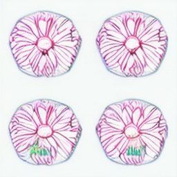
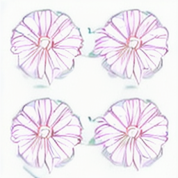

# Real dual generation: execution succeeds, semantic quality fails inspection

Executed source: `4e3b8c3c242d7d6d83086e7375a354a30647e040`.
[Dedicated run 41972148925](https://github.com/TrillionniumFoundation/hepta-private-ci/actions/runs/41972148925)
completed successfully on 2026-11-05. Its 41 focused tests passed and both
registered fixed schedules performed real neural generation and buffered delivery.
This is one public development source at one seed, not two independent examples
or a new four-arm training experiment.

## Original evidence

[original.zip](original.zip) preserves all 40 original uploaded files byte for byte,
including input/output images, every text, plans, manifests, action journals,
failure-capable reports, dependency versions, and logs. Its SHA-256 is
`e3607ef03ca027e1fc91fbe09e354e30c8521f8bf66062bfd153e75659ced050`.
[REVIEW.json](REVIEW.json) includes original member hashes, complete episode
reports, final backend identities and derived observations.
[WORKFLOW.json](WORKFLOW.json) preserves job/step timing and conclusion.
The model weights are not in the archive; pinned weight hashes were checked by
the executing runner and retained in its acquisition manifests.

## Measured execution

| Schedule | Actions | Inner CPU s | Inner wall s | Inclusive call CPU s | Inclusive call wall s |
| --- | ---: | ---: | ---: | ---: | ---: |
| Direct | 5 | 33.761466 | 19.222938 | 33.761833 | 19.223303 |
| Revision | 9 | 55.950287 | 30.040449 | 55.951963 | 30.041120 |

The direct sequence is perceive/text/draft/verify/STOP. Revision adds
revise/text/refine/verify before STOP. All 12 generated artifacts, including
superseded candidates, match their original hashes. Selected pairs belong to
plan versions 1 and 2. Drafts executed 12 denoising steps each; refinement
executed 7. Model loads were VLM/SD/VLM and VLM/SD/VLM/SD/VLM, charged within
the action intervals. OS caches and process imports may remain warm.

The process envelope covering setup and both calls is 90.206388 CPU s and
49.753738 wall s. Model/input acquisition separately used 25.673145 wall s.
The full workflow job lasted 126 s, including a roughly 30 s dependency install.
These are nested envelopes: do not add them to their enclosed action totals.
Energy, provider-wide infrastructure costs, future training and independent
semantic evaluation remain unmeasured; no net NDU gain is inferred.

## Negative semantic observations

All **nine** VLM text outputs are byte-identical, including critiques of different
images and the revised common plan. Each has 356 bytes, ends in an incomplete
sentence at the 80-token generation limit, and has SHA-256
`e868d31e1cdee549254b25203d775363f10b19ab97a01ba7f19e60873caf52d6`.
The diffusion log reports 115-token prompts truncated to its 77-token limit.
The retained prefix includes the bee/flower subject and spatial relation, so
the missing bee cannot simply be blamed on that subject being truncated.

Qualitative inspection finds four flower-like forms in both generated images,
with no clear bee. This is an unregistered inspection, not a validated semantic
score. The evidence supports successful execution and exposes a semantic
failure; it does not support revision benefit or a useful self-critic.

| Public input | Direct output | Revised output |
| --- | --- | --- |
|  |  |  |

Input-chain interventions with changed images, blank images and changed
instructions are the next diagnostic step. These original results remain
unchanged regardless of later repairs. New controller/generator training,
independent evaluation, strong validation-tuned controls and the audio/video
extension remain separate empirical gates.
