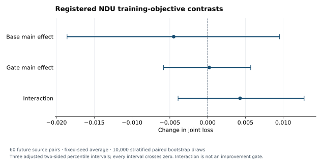

# Fresh NDU base × gate factorial: actual results

**Execution and review are complete for the stated scope.** The main host verified every member of the complete original raw archive. Independent local reviews verified the transported source/model/seal metadata, all registered row bindings and statistical arithmetic. Those local reviews did not execute a model, decode final targets or repeat the final evaluation.

The registered fresh 2×2 study completed all six stages in **982.225367281 seconds**, within its 1,800-second compute budget. Neither main effect met the predeclared improvement criterion, and all three registered contrast intervals include zero. The base-objective point estimate favors lower loss, but the present experiment does not distinguish that effect from zero. The gate-objective point estimate is close to zero; the interaction is also unresolved. These results do not establish equivalence or rule out effects outside this bounded design.

The original [summary](summary.json), [harness receipts](harness-summary.json) and [execution receipt](execution.json) are preserved byte-for-byte. Tables and the figure below are projections of those originals. The [metadata review](verification/metadata-review.json), [independent row/statistics review](verification/independent-statistics-review.json) and [descriptive-table review](verification/descriptive-review.json) identify their inputs and exact verification scope.

## Registered primary results

The outcome is emitted text/image **joint loss**, on a 0–1 scale where lower is better. The metric weights are 0.30 text-digit error, 0.15 relation error, 0.35 Audit B image-digit error, 0.10 cross-modal disagreement and 0.10 pixel MSE. It is not accuracy, and a change in loss should not be described as an equal change in accuracy percentage points.

| Contrast | Estimate | Registered interval | Interpretation |
| --- | ---: | --- | --- |
| Base main effect | −0.00448827534 | [−0.01860176111, +0.00952468958] | Unresolved; improvement criterion not met |
| Gate main effect | +0.00021129128 | [−0.00583400634, +0.00570008345] | Unresolved; improvement criterion not met |
| Interaction | +0.00429642030 | [−0.00390922357, +0.01277163641] | Unresolved; no improvement pass/fail rule was assigned |



The three fixed seeds, 17, 29 and 43, are averaged within each source pair first. The primary cohort contains **60 future pairs**, ten in each of six fixed corruption strata. The frozen analysis uses 10,000 paired source bootstrap draws within strata, seed431125, and linear percentile quantiles `0.05/6` and `1−0.05/6`. These are the three registered Bonferroni-adjusted two-sided intervals, with a nominal 95% family level subject to bootstrap validity. They are conditional on the fitted models and fixed seeds; they do not estimate training-seed population uncertainty or provide an exact finite-sample coverage guarantee.

Only a main-effect interval whose upper endpoint is strictly below zero counts as improvement. A zero-crossing interval is unresolved, not evidence of equivalence. There are **two main-effect improvement criteria and one signed interaction**, not three improvement gates. No best-cell test, new p-value, altered bootstrap or post-outcome source selection was added.

The main effects average over the other factor. With cells ordered `[b0g0,b0g1,b1g0,b1g1]`, their coefficient vectors are `[-½,−½,+½,+½]` and `[-½,+½,−½,+½]`; interaction is `[+1,−1,−1,+1]`. The base effect includes fitting the registered gate objectives on each resulting base. It does not hold one already fitted gate unchanged while replacing its base.

## Four cells and descriptive outcomes

| Cell | Base objective | Gate objective |
| --- | --- | --- |
| b0g0 | Supervised differentiable loss | Hard mean-best-plan imitation |
| b0g1 | Supervised differentiable loss | Direct finite entropic utility |
| b1g0 | Terminal-entropic differentiable loss | Hard mean-best-plan imitation |
| b1g1 | Terminal-entropic differentiable loss | Direct finite entropic utility |

The gate factor is an objective package, not a test of risk aversion in isolation. Base training uses the original differentiable surrogate; it is not the final emitted-output observer metric. Both gate objectives on a given base receive the same fixed-base reward table. Deployment selects a finite two-action plan and then executes the same three-action suffix. There is no dynamic forecast, search, online parameter update or adaptive stopping in this study.

### Fresh generation and matched controls

| Component | Fits | Optimizer updates per fit | Total updates |
| --- | ---: | ---: | ---: |
| Reward A and Audit B observers | 2 | 300 | 600 |
| Two base objectives × three fixed seeds | 6 | 2,000 | 12,000 |
| Two gate objectives on each base | 12 | 120 | 1,440 |
| Total | 20 fitting jobs | — | **14,040** |

Each base has 1,007,464 parameters; each gate has 3,236. The reviewed base reports contain all 12,000 sequential optimizer-step records, match the frozen recipe and independently generated initializer/batch-action controls, and show changed parameter hashes. Each paired gate receives identical training sources, scenario/update schedules and emitted-output utility tables from its same frozen base. All twelve gate reports contain 120 objective-history records, nonzero gradient evidence and changed gate parameter hashes. These are actual newly executed fits; the final effect need not be positive for the training provenance to be valid.

Each observer uses 4,000 fitting sources and a separate 1,000-source descriptive calibration tail. The two 5,000-source pools are disjoint, and Audit B is never supplied to base or gate fitting. Reported held-out tail accuracy is **95.7000% for Reward A and 94.8000% for Audit B**. No calibration-driven retry or observer/model selection occurred. These numbers describe the classifiers on their own source tails, not human certification of generated image semantics.

### Future cohort: 60 source pairs

| Cell | Mean joint loss | Joint factual accuracy | Descriptive CVaR90 loss |
| --- | ---: | ---: | ---: |
| b0g0 | 0.243742676 | 41.6667% | 0.539091243 |
| b0g1 | 0.241805757 | 42.2222% | 0.548828231 |
| b1g0 | 0.237106190 | 42.2222% | 0.510830268 |
| b1g1 | 0.239465692 | 41.6667% | 0.518795843 |

### Clean retention cohort: 30 source pairs

| Cell | Mean joint loss | Joint factual accuracy | Descriptive CVaR90 loss |
| --- | ---: | ---: | ---: |
| b0g0 | 0.052969478 | 86.6667% | 0.293836434 |
| b0g1 | 0.052974214 | 86.6667% | 0.293800312 |
| b1g0 | 0.042153749 | 88.8889% | 0.290834361 |
| b1g1 | 0.037156960 | 90.0000% | 0.265834766 |

These tables are descriptive, with no additional confidence intervals or confirmatory comparisons. Joint factual accuracy requires correct text digits, relation and image digits as recognized by the frozen Audit B classifier; it is not independently human-certified semantics. CVaR90 is the upper tail of the per-source fixed-seed mean loss: six future pairs or three retention pairs. Clean retention is a cross-sectional clean-source check, not a continual-learning forgetting experiment. Lower point estimates in these tables do not replace the registered primary decision.

The future base effects at seeds17/29/43 are respectively −0.00355921123, +0.00381807883 and −0.01372369363; the gate effects are +0.00312333906, −0.00249264335 and +0.00000317813. These fixed-seed values show that the effect directions are not uniform. They remain descriptive and are not three independent replications of a seed-population claim. Full values are retained in [per-seed effects](tables/per-seed-effects.csv), [cell summaries](tables/cell-summary.csv) and the original summary.

## Execution and measured cost

All six original process receipts report exit0, `failure:null` and zero automatic retries. The outer wrapper took 983.063001804 seconds; the harness itself reports 982.225367281 seconds. The summed child-stage CPU is **1,440.913166 CPU seconds**, which excludes the harness's own CPU. The run used CPU-only Torch with two intra-op and two inter-op threads.

| Stage | Wall seconds, including import/exit | Child CPU seconds, including import/exit |
| --- | ---: | ---: |
| Source preparation | 168.427354381 | 9.312718 |
| Fresh observers and bases | 652.200098003 | 1,246.875097 |
| Twelve gate fits | 24.797505710 | 32.931457 |
| Inference | 62.885134517 | 68.813870 |
| Separate-process replay | 63.279359482 | 70.796262 |
| Final evaluation | 10.631530386 | 12.183762 |
| Sum of stage receipts | 982.220982479 | 1,440.913166 |

The difference between the stage-wall sum and harness wall is 0.004384802 seconds. Preparation has a large wall/CPU gap; these receipts do not identify its cause, so no particular I/O explanation is inferred. The table does not sum nested fit, row or scoring timers into the outer total.

The largest sampled child RSS is **462,852,096 bytes (441.41015625 MiB)**. The separate cumulative completed-child peak measurement is **449,396,736 bytes (428.578125 MiB)**. These are different measurements, both below the registered 2-GiB bound; they are not added or assigned as fresh per-operation allocations. The guard samples child RSS/evidence size and checks the completed-child peak. It is not a kernel memory cap and does not measure joint process-tree peak memory.

The harness reports **96,318,100 evidence bytes** before writing its final summary, below the 1-GiB bound. The complete original owner has **4,409 files and 96,326,039 bytes**; the 7,939-byte difference is exactly the final harness summary. Its 20 model files occupy 73,881,328 bytes, including repeated serialized bases in the controlled checkpoints. The compressed full raw archive is 82,855,926 bytes and contains 4,417 regular members, comprising the owner plus eight execution/publication/protocol records. Archive identities and membership are in [RAW_CUSTODY.json](RAW_CUSTODY.json).

Electrical energy and unrecorded operator/network overhead are not measured. Setup costs are outside the 1,800-second experiment budget; the four [environment-installation step receipts](setup-installation.json) sum to **2,194.514881199 seconds**. The separately recorded cache copy/hash verification took **0.429517065 seconds**, with zero network downloads and no new cohort preparation by that setup step. The raw custody preparation/check interval before metadata construction was **14.281310587 seconds**. These are distinct recorded intervals, not an end-to-end measurement of the entire research session.

### Nested training and row costs

These inner timers help explain where recorded work was spent. They are subsets of the process table, not additional costs to add to it.

| Recorded subset | Wall seconds | CPU seconds | Counting rule |
| --- | ---: | ---: | --- |
| Two observer fit/calibration wrappers | 29.575620952 | 32.967518721 | Each observer once |
| Three paired base-training calls | 611.678888929 | 1,206.503593228 | The identical paired timer is stored in two reports; count once per seed |
| Twelve gate-fitting wrappers | 15.030748681 | 22.872037468 | All twelve separately executed fits |
| Inference row timers, 1,080 rows | 52.496243528 | 58.913487225 | Includes artifact writes/reads and integrity checks |
| Replay row timers, 1,080 rows | 52.133599472 | 59.928858610 | Required validation replay, reported separately |
| Final scoring row timers, 1,080 rows | 1.951520241 | 3.887479592 | Original observer/metric scoring, not a second review execution |

Within the gate fits, recorded candidate enumeration totals 12.542218490 wall seconds and optimization totals 1.810669948 wall seconds. The paired utility tables are equal, but this implementation actually enumerates them for both gate objectives. No unimplemented caching speedup is credited. All six individual base-profile elapsed times, twelve gate fits, nested stage/row timers and their original field paths are retained in [costs.csv](tables/costs.csv) and [cost-breakdown.json](verification/cost-breakdown.json).

Each inference row has one encoder, one gate, two initial transitions, three suffix transitions and one joint decoder that emits both modalities. Required replay repeats that work, and final evaluation adds two Audit B crop predictions per output. Structural work equality is not equality of latency, FLOPs or energy. Row timers include emitted-artifact writes/reads and integrity checks, so they are not pure model latency. The twelve controlled checkpoint files also contain repeated copies of their base weights; storage size must not be mistaken for the count of distinct trained base parameters.

No Codex execution path is exercised here. These measurements describe this scientific experiment and do not estimate the latency or overhead of separating an agent execution module.

The registered utility is `1−2×joint_loss`; it contains no computation, communication or maintenance penalty. Execution costs are reported separately, while communication/maintenance costs and system-wide net utility are not measured.

### Environment

The actual run reports Python3.12.3, NumPy2.3.5, Torch2.14.1+cpu and Pillow12.3.0, on Linux7.0.0-38-generic x86_64/glibc2.39. Deterministic algorithms are enabled and the CUDA build is absent. The registered policy allows the Python patch version to be recorded while requiring identical actual environments across stages; it does not claim cross-host bitwise identity with the unavailable old weights.

## Registration, custody and independent verification

The executed publication HEAD is `ee7609048da0c12d542765e29422c0d3c647e0a5`, following the separately fixed algorithm revision `689c45e1903a6b28dcff6d05c7b732a07511f512`. The resolved protocol file SHA256 is `a3531af321d47e82d98d31d2bb5db0cb9eb87809ac30a470468a7b7cde5c1e46`; its canonical object digest is `1bc83a267d06f88f62ce6913197f50f34b70ebef2241ad89a788dae16dcbc360`. These are distinct identities by design. The [preregistration PR](https://github.com/TrillionniumFoundation/hepta-private-ci/pull/3943) precedes this outcome report.

The unique source owner remains `/home/qian-qi/work/hepta-architecture-20261025/ndu-fresh-evidence-v1`. The execution receipt reports original-owner retention and zero retries. The harness reports a sealed model generation and consumed final cohort. The summary binds generation `168d58bf8e7395bbfe8008287851934863e099174399710c032f908ebf5a419d` and final-access ledger SHA256 `933ce81e5c408e4e4cd5ae95c8a38c11be80a1039695a9823c0f49f4791c0989`.

The original evaluator reports arithmetic checks on all 1,080 rows, maximum absolute difference **1.4901161193847656×10⁻⁸**, and 2,160 Audit B crop predictions. This check uses independent NumPy metric arithmetic on the same OCR predictions; it does not independently certify OCR truth. No outcome-dependent model selection is reported.

The complete reporting metadata archive contains 74 exact original JSON/log files. Its 3,761,485-byte compressed identity is bound by the transport receipt. The model/source reviewer verified each transferred member against that archive, mapped all 4,409 owner files to the main host's 4,417-member raw-archive manifest, checked the exact 20-model generation seal and complete required sets, verified the paired training controls, and reconciled every stage/environment/source/claim binding.

The separate row/statistics reviewer found exactly **1,080 distinct registered keys in each of inference, replay and scored rows**, including 720 future and 360 retention rows. All 90 case pairs, 180 distinct pixel identities, registered source/corruption/noise/action order and model bindings match. All 4,320 emitted-output references across inference and replay match their original seals and owner manifest. Replay rows match inference except measured cost, and scored rows preserve their original inference fields. The two `states.npz` files have the same original 2,773,641-byte identity, SHA256 `4f4f278b675d2004b02144adb631922ad74dc009eaf917742cf4a9ce6d0e23c1`.

From the original scored rows, the independent reviewer recomputed the registered seed averages, expanded contrasts and bootstrap intervals without importing the original analysis/evaluator code. Maximum discrepancy for the three point estimates and six interval endpoints is **1.3877787807814457×10⁻¹⁷**. A separate recomputation of the eight descriptive cell summaries and 24 per-seed arm summaries differs by at most **2.220446049250313×10⁻¹⁶**. Human tables retain the original sealed values rather than substituting the recomputation's final rounding digits.

Local analysis used Python3.12.14 and NumPy2.3.5. It opened JSON/log metadata and recomputed arithmetic; it did not load checkpoint tensors, open target/NPZ/PNG payloads, rerun OCR, reexecute neural inference or create another final-access claim. The main host's [raw-byte verification receipt](provenance/archive-verification.json) is the separately attributed evidence for the complete binary payloads. Matching state/output hashes are custody bindings to the original replay, not a claim of an independently implemented neural model.

The actual experiment has six successful stages and zero retries. Reviewer-code corrections are preserved separately: one initial metadata checker confused the detailed scope-prose field with the short scope enum; the independent row checker initially assumed retention used official-test sources rather than the original disjoint official-train pool. Both were corrected against the unchanged published protocol/source, with their local failure records retained. No scientific input, model, row, comparison rule or final access was changed or repeated.

The source-exposure boundary remains `audited_known_v6_sources_only`: 520 explicitly enumerated prior pixels, complete train/evaluator/validation exclusions, and reserved smoke ranges. It does not assert that 520 is the total number of historically loaded or trained pixels, or that unretained history everywhere was audited. Fresh ranges were fixed to future120–179 and retention60–89, with no fallback sampling on overlap.

The local review independently checked zero overlap with the 520 explicit exclusions and the prepared 10,000-source base-training and 10,000-source observer pools. Full validation-partition disjointness remains the pinned preparation check, which succeeded in the original run; reviewers did not reload the corpus. The preparation receipt retains 1,440 future and 720 retention reserved pixel identities without emitting their pixels or target labels as development data. Any future study must retain this source-use distinction and perform its own exposure review.

## Reproduction and raw evidence

The original [protocol](protocol.json), [model seal](provenance/model-seal.json), [final-access ledger](provenance/final-access.json), [replay receipt](provenance/replay.json), [owner manifest](provenance/owner-manifest.json) and [archive member manifest](provenance/raw-archive-members.json) accompany this report. The complete metadata and raw archives have their exact names, sizes and SHA256 values in [RAW_CUSTODY.json](RAW_CUSTODY.json); its publication status and any recorded attachment location must reflect the actual archive or lossless-part attachment, rather than treating a main-host path as durable availability.

After obtaining the verified metadata archive, place it as `reporting-metadata.tar.gz` in a new analysis directory, unpack its regular metadata members under `unpacked/`, and copy [verified-transfer.json](provenance/verified-transfer.json) beside it. Use Python3.12 with NumPy2.3.5. Then run the metadata verifier into a new derived directory:

```bash
PYTHONDONTWRITEBYTECODE=1 python3 verification/verify_metadata_packet.py \
  --packet /absolute/path/to/metadata-input \
  --output /absolute/path/to/new-metadata-review
```

The [independent statistics review package](verification/independent-statistics-review.tgz) includes its original verification script, log, receipt and reproduction command. It takes the `unpacked/` metadata directory and writes a new derived result directory. Neither verifier invokes the original harness or changes the published owner. The [pre-outcome reporting plan](verification/pre-outcome-reporting-plan.tgz) and all reporting scripts are retained for comparison with this outcome report.

The summary renderer takes this report directory as its original input and a new output directory. It uses NumPy2.3.5/Matplotlib3.10.8 in the recorded reporting environment. The four summary CSVs and both figure formats were regenerated and found byte-identical; see [renderer verification](verification/renderer-reproduction.json).

```bash
MPLCONFIGDIR=/tmp/ndu-report-matplotlib python3 verification/build_summary_tables.py \
  --originals /absolute/path/to/fresh-factorial-001 \
  --output /absolute/path/to/new-rendered-report
```

These commands reproduce artifact/metadata verification and analysis of the already scored evidence. They are not a second scientific run. A new training replication requires its own registration and source-use decision; changing this protocol's owner path or reusing consumed final sources does not create a new confirmatory sample.

## Scientific conclusion and limits

This run tests whether changing the base training objective, changing the gate objective package, or their interaction improves the registered emitted-output loss on the selected future sources. **It did not obtain confirmatory improvement for either main effect.** The point estimates and intervals are retained without choosing a favorable cell, seed or secondary metric after the result.

The complete execution demonstrates that the fresh matched training, fixed deployment and required audit process can run within this particular CPU/evidence budget. Its statistical result remains conditional on the constructed digit-pair domain, these fresh observers and models, the three original fixed seeds, and this source design. The old full-002 scientific archive is still unavailable; these new weights are not relabeled as recovered originals. Absolute scores are not pooled with old full-002 or the separate Cell V4 experiment.

No topology evolution, cell splitting, dynamic-controller advantage, general-purpose agent capability or production authorization is established here. A separate future study would need its own preregistration and source-use review. This completed cohort is retained as evidence rather than reused to select a preferred follow-up outcome.
