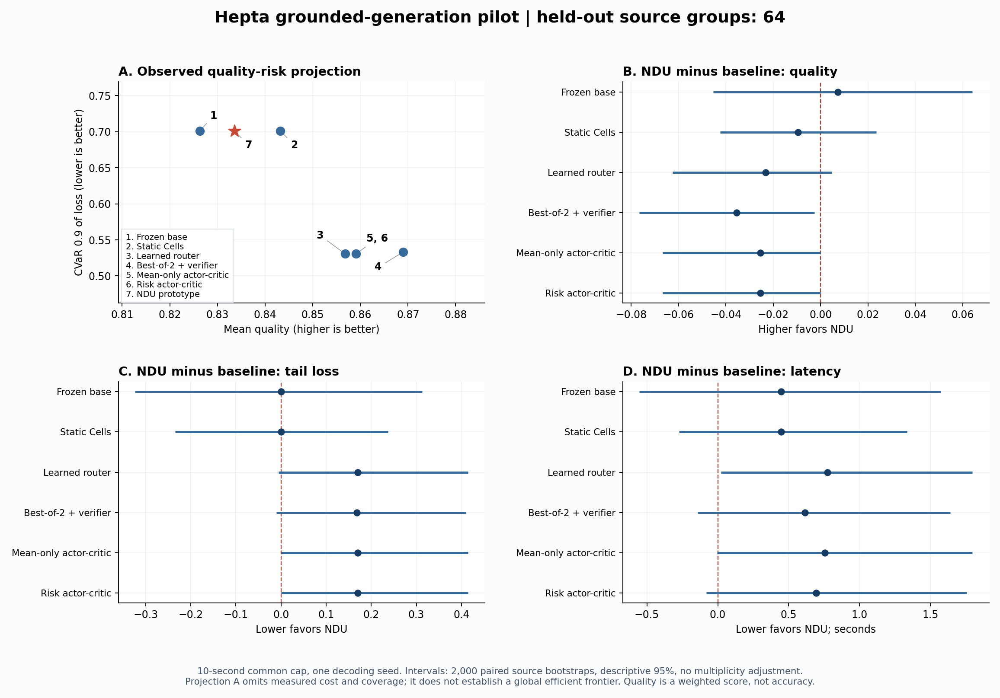

# Hepta grounded-generation pilot: final evidence

## Decision

**The bounded grounding, training, control and evaluation pipeline executed successfully. This run does not establish an NDU-specific quality, risk or cost advantage.** The primary NDU point is dominated by several core baselines. Its quality deficit against mean-only comes entirely from two encoder budget overruns; on the 62 sources where both completed, their quality scores are identical. That outcome-conditioned diagnostic does not replace the 64-source primary comparison.

The evidence-integrity audit passes. Capability acceptance remains unmet: this pilot does not demonstrate an improved efficient frontier, independent language and image generation, a useful terminal-loss covariance model, or continuous FBSDE/Merton optimality. The retained evaluator deliberately leaves `experiment_pass` and `production_pass` false; those flags are not statistical tests. The negative scientific conclusion follows from the measured results below.

## Frozen experiment

| Item | Executed configuration |
| --- | --- |
| Code | `6941ffd1dec86a71b8241c6c691e812ee1e8b64c` |
| Model | Frozen `florence-community/Florence-2-base`, 231,443,968 parameters, CPU float32 |
| Model revision | `00921df66db728a9ceb750f5eca43e5c203a2051` |
| Model weight SHA256 | `62f3e696da74f8869a68ddb529a9b3e14eb25b21c592cb3dea6179bf944df6a0` |
| Protocol | Revision 2; SHA256 `47888294da05a7e0faa4b912b58738fc245f9c6c42d0bd03354284e3a55733cf` |
| Cohort | 256 original images: 128 train, 32 dev, 32 calibration, 64 final test |
| Cohort manifest SHA256 | `71168c26fffdd913d71a69d8708cec957f55dc2bece112c9c50153fbf31de75d` |
| Cells | Four rank-16 decoder residual adapters; 84,763 trainable parameters total |
| Policies | Learned router, mean-only, risk actor-critic and discrete-BSDE NDU; 3,341 parameters each |
| Inference | Two resident workers, four Torch threads each; common 10-second episode cap |
| Control | Decision every four tokens, up to eight checkpoints, at most 48 generated tokens |
| Final comparison | Seven core arms plus five ablations; seed 23; 64 sources per arm, 768 episodes |
| Selected risk weight | `0.0`, from the fixed development grid and tie rule |

The task asks the model to locate a specified category, count its predicted boxes and identify the largest box's side. The native image-conditioned decoder produces a grounding sequence. Text is a deterministic explanation of those predictions; the output PNG overlays their boxes on the original image. The task adapter supplies the fixed grounding task and category to the model. Arbitrary instruction following, learned free-text explanation and free-form pixel generation are outside this experiment.

Original-image IDs, file/RGB hashes and near-duplicate fingerprints separate the four splits and exclude the earlier 384-image cohort. Inference task observations contain five public input fields. The actor consumes reference-free features derived from live generation. References are separate and parent-side scoring follows generation. Real-world entity independence and absence of foundation-model pretraining overlap are not established.

Protocol revision 2 was frozen before dev selection, calibration and final testing. The collect-phase v1 receipt retains its earlier generation implementation hash; it is not relabeled as having used the final code. Independent rescoring of all 256 collection episodes reproduced their complete scores and verifier training identity. Selection, calibration and test share the same nine frozen implementation hashes and unchanged Cell/policy checkpoints; final testing loads the separately probability-calibrated verifier.

## Actual training and phase completion

| Phase | Retained execution |
| --- | --- |
| Cell fitting | 1,175 teacher-forced train token samples, 15 epochs; loss 3.683335 to 2.790043 |
| Train exploration | 128 sources times two seeds; 256 episodes and 578 transitions |
| Policy fitting | 100 epochs; NDU total objective 1.588197 to 0.501563; path residual MSE 0.020766, terminal MSE 0.034819 |
| Development | 32 sources, five planned configurations, 160 episodes; no policy weight update |
| Calibration | 32 sources times 12 arms, 384 episodes; verifier probability calibration only |
| Final test | 64 sources times 12 arms, 768 episodes; no test refitting or regeneration |

The base tensor SHA256 before and after fitting is `3f9608404767fe85ef707e8788cd18994c93aac3233d5ab407918f18f840c02b`. Both final-test workers report that same frozen digest. Objective reduction establishes executed fitting, not out-of-sample control benefit or a solved stochastic control problem.

## Primary held-out results

All rows retain the same 64-source denominator. `Quality` is a weighted score, not accuracy. Higher quality and coverage are better; lower severe rate, CVaR and actual time are better.

| Method | Quality | Severe rate | CVaR 0.9 | Mean wall seconds | Coverage | Budget overruns |
| --- | ---: | ---: | ---: | ---: | ---: | ---: |
| Frozen base | 0.826302 | 0.406250 | 0.701042 | 2.732249 | 0.968750 | 2 |
| Static Cells | 0.843229 | 0.375000 | 0.701042 | 2.733154 | 0.968750 | 2 |
| Learned router | 0.856771 | 0.375000 | 0.530729 | 2.404371 | 1.000000 | 0 |
| Best-of-2 plus verifier | 0.869010 | 0.343750 | 0.533333 | 2.564518 | 1.000000 | 0 |
| Mean-only actor-critic | 0.859115 | 0.375000 | 0.530729 | 2.423561 | 1.000000 | 0 |
| Risk actor-critic | 0.859115 | 0.375000 | 0.530729 | 2.484443 | 1.000000 | 0 |
| NDU prototype | 0.833594 | 0.390625 | 0.701042 | 3.178649 | 0.968750 | 2 |
| Remove covariance penalty | 0.859115 | 0.375000 | 0.530729 | 2.504547 | 1.000000 | 0 |
| Fixed weights | 0.843229 | 0.375000 | 0.701042 | 2.854821 | 0.968750 | 2 |
| Remove geometry constraints | 0.859115 | 0.375000 | 0.530729 | 2.483744 | 1.000000 | 0 |
| Missing visual input | 0.452604 | 0.984375 | 0.825000 | 2.670673 | 0.984375 | 1 |
| Shuffled input pair | 0.403646 | 0.984375 | 0.831250 | 2.411763 | 0.984375 | 0 |

The shuffled-pair arm has one additional incomplete output at the 48-token limit. Across all arms, 758 episodes are valid, nine exceed the wall budget and one reaches that token limit. There are zero runtime-exception episodes. These are distinct checks; exception-free execution does not mean every deadline or output requirement was met.

Quality is `0.5 * box_F1 + 0.2 * count_correct + 0.1 * largest_side_correct + 0.1 * label_correct + 0.1 * text_consistent`. Matching uses maximum-cardinality one-to-one box matches at IoU at least 0.5. Label/text checks are structural under this adapter. Invalid, incomplete or over-budget outputs receive quality zero and remain in all primary aggregates. Severe errors include these invalidities, incorrect count/side/label/text, or box F1 below 0.5. CVaR uses fractional mass in the highest 10% of loss `1 - quality`; with 64 sources, that is six full observations and 0.4 of the seventh.

### Descriptive frontier and uncertainty

Under the observed quality, CVaR, wall-cost and coverage coordinates, the nondominated set is **best-of-2, learned router and mean-only**, whether considering the seven core arms or all twelve. NDU is absent. This finite policy menu is an empirical comparison, not an estimate of every reachable policy or a global efficient frontier.

All methods have the same budget cap. Their actual costs and coverage differ. A controlled equal-actual-cost and matched-coverage improvement has therefore not been demonstrated. Small measured latency differences can change descriptive dominance and should not be interpreted as population-level superiority.

| NDU minus comparator | Mean quality difference | Descriptive 95% interval |
| --- | ---: | ---: |
| Frozen base | +0.007292 | [-0.045313, +0.064063] |
| Static Cells | -0.009635 | [-0.042454, +0.023438] |
| Learned router | -0.023177 | [-0.062507, +0.004688] |
| Best-of-2 plus verifier | -0.035417 | [-0.076563, -0.002604] |
| Mean-only actor-critic | -0.025521 | [-0.066667, 0.000000] |
| Risk actor-critic | -0.025521 | [-0.066667, 0.000000] |

Intervals use 2,000 paired source-group bootstrap draws, seed 20261022, without multiplicity adjustment. They describe this one-seed pilot. A negative interval in one comparison does not establish universal inferiority of NDU, and intervals crossing zero do not establish equivalence. Full quality, CVaR, severe-rate, cost and coverage comparisons are retained in the JSON evidence.



Panel A omits cost and coverage. Its scatter therefore cannot by itself establish the four-coordinate frontier. Panels B-D show the descriptive paired intervals; no point was adjusted to remove a timeout.

## Timeout attribution and supplemental probe

The two NDU failures occurred before any decoder or controller execution:

| Source | Full episode seconds | Encoder seconds | Decoder forward calls | Tokens / controls |
| --- | ---: | ---: | ---: | ---: |
| COCO val2017 532901 | 23.004392 | 22.989070 | 0 | 0 / 0 |
| COCO val2017 393226 | 24.833125 | 24.795782 | 0 | 0 / 0 |

Encoder time accounts for at least 90.75% of each of the nine budget overruns; seven encoder calls exceed ten seconds on their own. The cap is enforced by checks around decoder steps, not by hard preemption of a running tensor operation. All observed excess time is charged and the resulting outputs fail the budget requirement.

For NDU versus mean-only, the 64-source quality comparison has zero NDU wins, 62 ties and two losses. On the 62 sources where both outputs are valid, quality, severe rate and CVaR are identical. NDU's average wall time in that subset is 2.5096 seconds versus 2.4259. This is an exploratory attribution conditioned on completion. It cannot replace the primary denominator or prove an improvement.

A separate bounded encoder-only probe used the two timeout inputs and the first two other fixed test inputs, three interleaved repetitions each. It used one resident worker, four Torch intra-op threads, no decoder, no policy changes, no discarded warmups and no retries. All twelve calls completed in 1.760945-2.268840 seconds. Model and primary journal/report hashes were unchanged. Changed concurrency and execution time prevent causal identification of the earlier delay. The probe does not remove or revise any main-test result.

## What control and ablations establish

The independent audit replays 1,128 actual learned-policy checkpoints with zero action or probability mismatch. NDU accounts for 139 decisions, 493 token steps with an applied modifier and 71 local argmax changes. Actions change during generation in 55 of 64 NDU episodes. Local argmax changes occur in 36 episodes. These changes combine residual corrections and structural constraints; they do not isolate each Cell's semantic contribution.

Actual NDU checkpoint counts are two episodes with zero, 47 with two and 15 with three. Eight checkpoints were supported, but no NDU episode exercised eight. One static-Cell episode attempted a controller action before a post-forward budget rejection; it has one trajectory action and zero emitted control entries. The cost record retains that attempted work.

The three development risk weights produced identical per-source quality scores and the fixed tie rule selected zero. At inference this disables the explicit risk and covariance penalties; risk-trained actor weights still contribute. Replaying all 139 NDU checkpoints with either no covariance or `1000 * identity` yields exactly the same probabilities and actions. NDU and the covariance ablation have identical raw text, boxes and quality on all 62 jointly completed sources. This run cannot identify the benefit of the explicit covariance penalty.

Missing-vision and shuffled-pair interventions are verified against actual input bytes. Each causes a severe-error rate of 98.4375%, establishing reliance on corresponding visual evidence for this task. The so-called crossmodal ablation removes prefix syntax and coordinate-order constraints. It does not test independent semantic agreement between generated language and images. Static Cells and fixed weights are intentionally equivalent controls and give identical text, boxes and quality on their 60 jointly completed sources.

The four-by-four covariance is local token-logit correction covariance, not terminal-output error covariance. The NDU fit uses a discrete centered-action martingale residual with value and action-coefficient heads. Finite offline fitting, a compressed state and six action portfolios do not establish Markov sufficiency, continuous FBSDE convergence or a Merton optimal policy.

## Cost accounting and risk calibration

Exclusive episode ledgers reconcile exactly to measured per-worker wall time. Encoder, decoder, Cells, controller, critic, verifier and rendering are charged. Local callback communication costs no separate measured transport; this is not a distributed communication benchmark.

Best-of-2 executes 64 encoders, 128 decoder candidate invocations and 128 verifier calls. Each second candidate reuses only its own episode's encoded state. All 64 discarded candidates remain charged. Three sources select the second candidate. The comparator is therefore a real candidate-generation and verification baseline under the same cap.

| Time quantity | Seconds |
| --- | ---: |
| Sum of 768 episode wall durations | 2,012.575595 |
| Sum of process CPU time across worker threads | 7,373.341511 |
| Two-worker test phase elapsed | 1,013.125929 |
| Sum of separately recorded base-model load durations | 4.527109 |

CPU time can exceed wall time. Concurrent episode durations do not sum to batch latency. The warm-worker cap excludes model loading, initial tensor hashing, worker setup, parent terminal scoring, persistence and offline training; phase and training receipts retain separate costs. These measurements do not justify a full-system equal-cost claim.

Calibration fits only verifier severe-error probability on the separate 32-source calibration split. The fitted scale is 1 and offset 0.323433. Policy weights, raw verifier weights and the quality ranking used for best-of-2 remain unchanged; NDU's internal risk heads are not calibrated by this procedure.

On the seven core arms, mean test Brier score changes from 0.249409 to 0.247357; its descriptive source-bootstrap improvement interval crosses zero. NDU changes from 0.240869 to 0.239449, while best-of-2 worsens from 0.254521 to 0.256001. For missing-vision and shuffled inputs, calibrated mean risk probabilities are approximately 0.267 and 0.409 despite observed severe rates of 0.984375. No uniform calibration benefit or out-of-distribution risk guarantee is established.

## Verification and evidence files

- Local unit run: 50 tests, `OK (skipped=1)`; real-model paths are opt-in for that run. A separate real-backend integration run passed five tests.
- Repository-required `just fmt` completed; no changed files required formatting. `git diff --check` and actionlint 1.7.12 passed.
- [Focused GitHub Actions run 39782320394](https://github.com/TrillionniumFoundation/hepta-private-ci/actions/runs/39782320394) passed on the code commit's exact tree: 50 tests, one expected real-model integration class skip. It does not rerun the full scientific experiment on a PR trigger.
- The final within-team independent audit recomputed all 768 complete score dictionaries, CVaR, aggregates, frontier and paired intervals with zero mismatch; all 768 PNG references pass digest and dimension checks. This is independent code/data checking within the collaborating team, not external third-party certification.
- No final-test episode was retried, replaced, dropped or used for fitting. The supplemental probe is separately labeled.

| File | Purpose |
| --- | --- |
| [summary-report.json](summary-report.json) | Original aggregate report, paired intervals and source report digest |
| [test-scores.jsonl](test-scores.jsonl) | All 768 compact per-source final scores and artifact digests |
| [run-provenance.json](run-provenance.json) | Runtime, frozen identities and original phase receipts |
| [selection.json](selection.json) | Fixed-grid development selection |
| [calibration.json](calibration.json) | Probability-only calibration fit |
| [pretest-independent-audit.json](pretest-independent-audit.json) | Train/dev/source/provenance audit before final testing |
| [final-independent-audit.json](final-independent-audit.json) | Final score, policy replay, cost, intervention and attribution audit |
| [supplemental-encoder-timing.json](supplemental-encoder-timing.json) | Twelve-call encoder probe, source code and unchanged primary hashes |
| [portable-replay.json](portable-replay.json) | Portable bundle integrity and model-free score reproduction receipt |
| [bundle.json](bundle.json) | Archive name, byte count, SHA256 and file-manifest identity |

The private evidence archive retains all original journals and run receipts, source manifests and attribution, training checkpoints, generated PNGs, frozen code, the plotting script and a model-free replay entrypoint. It excludes base-model weights and original input JPEGs; acquisition revisions and hashes remain pinned. The archive can reproduce the evaluator and intervals without re-running Florence. New generation requires reacquiring the pinned model and original inputs and following the code README.

After extracting the archive, install the replay dependencies and run:

```bash
python -m pip install numpy==2.2.6 Pillow==11.3.0
python /absolute/path/hepta-ndu-evidence-v1-20261022/replay_evidence.py \
  --bundle-root /absolute/path/hepta-ndu-evidence-v1-20261022 \
  --output /absolute/path/independent-replay.json
```

Keep the output outside the immutable bundle. Replay verifies exact file coverage, every byte digest, original test/cohort/checkpoint identities and all evaluator output fields. The companion replay and archive receipts bind the final archive after it is staged; they live beside this report and are not self-referential entries inside that archive.

## Capability gates for a new protocol

The next experiment must preserve this pilot as a completed negative result and use a newly frozen protocol with an untouched evaluation cohort. Required changes are driven by the measured limitations:

1. Use tasks long enough to exercise 8-16 actual decisions and measure the independent contribution of each Cell. Retain a capable frozen base and stronger direct-sampling controls.
2. Make language and visual outputs independently generated, with independent semantic and pixel/annotation verification. Separate structural agreement by construction from learned cross-modal agreement.
3. Estimate terminal-error dependence from independent outcomes and use development tasks with a measurable quality-risk trade-off. Validate nonzero risk-control interventions before opening the final test.
4. Predefine matched actual-cost and coverage comparisons, repeated decoding seeds, and a sample size based on a specified minimum useful effect. Retain failed attempts in all primary denominators.
5. Control and record the runtime environment for latency experiments. Distinguish decoder-step soft budgets from hard deadlines; use an explicit cancellation design if strict deadlines are required.
6. Demonstrate a reproducible quality-risk-cost improvement on an untouched cohort before extending the capability claim to audio/video, temporal alignment or irreversible streaming output. A continuous FBSDE/Merton claim additionally needs its own state, noise, admissible-control and convergence assumptions.

This pilot uses an autoregressive grounding decoder. It contains no diffusion-language-model baseline and supplies no empirical conclusion about diffusion LLMs. Applying the control interface to denoising or flow dynamics is a separate implementation and comparison.
