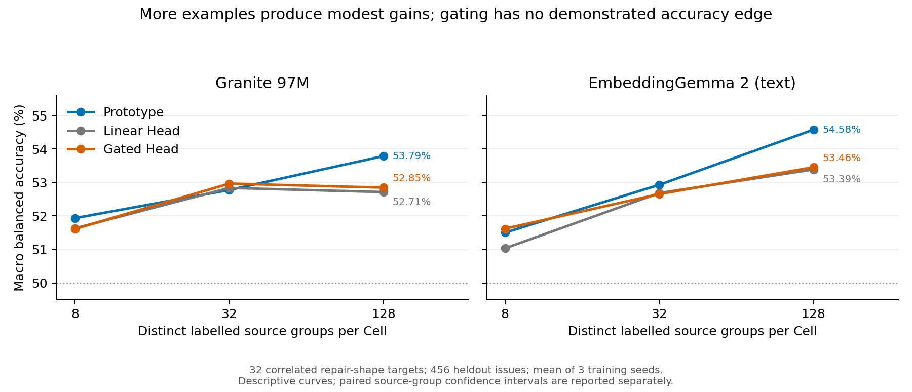
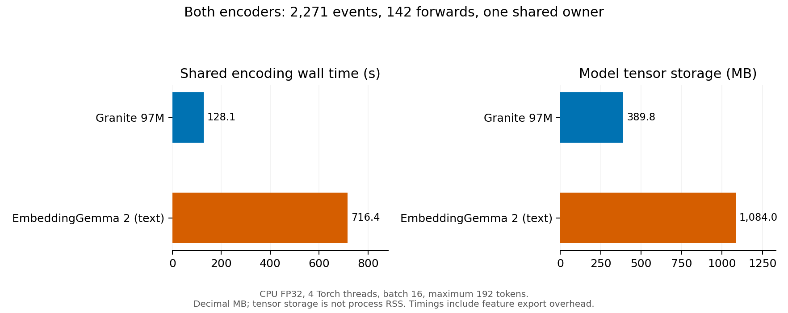

# Shared Encoder 与轻量 Cell：下一阶段实测报告

实验于 2026-10-23 开始，2026-10-24 完成分析。代码固定在
[`9b1f52cd8aa11de1ec447b116c1a0258ee5f861b`](https://github.com/TrillionniumFoundation/hepta-private-ci/commit/9b1f52cd8aa11de1ec447b116c1a0258ee5f861b)，
tree 为 `28b96d36381626d2be952f6f66950093b6a79db2`。
这是保持 `DENY_ALL` 的研究实现；没有提升为原生生产运行资格。

## 结论

**共享编码和小 Head 的资源收益已经测到；门控优于简单 Head、某个底座普遍最优，尚未得到证明。**
本轮支持把 Granite 97M 作为低成本文本学习基线，把 EmbeddingGemma 2 作为已有原生多模态能力的接口底座；
目前不支持因这组成绩就扩大门控参数、训练功能族 Adapter 或训练自有共享底座。

明确的服务优化是：对完全相同的已学习状态计算一次，再分发到物理 Cell。
在 1,024 个物理 Cell、32 份不同状态下，Granite 和 EG2 的完整分发中位耗时分别改善 16.89 倍和 24.54 倍，
完整输出逐位一致。这个结果不能解释为已经训练出 1,024 种独立能力。

代码、原始数值和完整复现步骤分别见 [阶段索引](publication-index.json)、[结果摘录](results.json)
和 [运行说明](../../CELL_NEXT_STAGE_RUN.md)。大体积原始实验数据通过独立证据包交付。

## 1. 已实现的统一接口

`SharedFeatureEncoder` 包装一个冻结的 `FrozenRealEncoder` owner，一次前向得到可复用特征。
保留已有共享 owner / 私有 Head 的边界与全局 `FeatureBundleV1` 接入方式。

| 接口内容 | 实际行为 |
|---|---|
| 全局表示 | Granite 384 维；EG2 768 维；可供多个 Cell 只读复用 |
| 可选局部表示 | 保留实际模型输出的 token 表示，不从全局向量伪造局部 token |
| 位置 | 文本可恢复的字符区间排除前缀、特殊 token 和 padding；没有原生空间/时间定位时明确缺失 |
| 来源与时间 | source ID、source revision、观察时间；原始事件时间留在语料元数据 |
| 版本绑定 | checkpoint inventory、Encoder、预处理、运行时和特征提取代码身份 |
| 缓存与私有参数 | 特征身份、generation 和来源绑定；不同身份不能静默混用 |
| 保留策略 | 默认只保留 global；需要细节时保留 native tokens，实际计量保留字节数 |

真实 checkpoint smoke 已运行：Granite 中英文本；EG2 文本、COCO 图像和公开列车汽笛音频。
EG2 每个模态分别执行 token/global 两种保留方式，总计六次模型前向；对应 tower 确实参与计算。
修复了 EG2 音频塔不支持统一 SDPA 的加载问题，音频使用官方实现支持的 eager backend。

| EG2 输入 | 局部表示形状 | 保留 token 的张量字节数 | 仅 global 的字节数 |
|---|---:|---:|---:|
| 文本 | 1 × 18 × 768 | 58,841 | 3,077 |
| 图像 | 1 × 279 × 768 | 862,676 | 3,077 |
| 音频 | 1 × 79 × 768 | 246,476 | 3,077 |

两种保留方式的 global 输出逐位相同。完整 EG2 profile 加载 744,371,488 个冻结参数，
张量存储 2,977,493,268 字节；该独立进程峰值 RSS 为 5,316,423,680 字节。
这验证了真实多模态特征接口和按需保留，不等于图像诊断、音频事件识别或跨模态任务已经学会。
本轮没有测视频、OCR 正确率、音频时间定位或跨模态任务学习曲线。

## 2. 真实来源上的学习曲线

使用固定 revision 的 SWE-bench 原始 2,294 条真实 issue/patch 记录。
在按时间切分前合并重复来源/问题/补丁/预测文本的连通组，排除跨边界重复组，最终保留 2,271 个不同来源组：
训练 1,361、校准 454、留出 456。输入仅为仓库名与 issue 正文；gold patch、测试补丁、hints 和测试结果不进入 Encoder。
原始全文另行保存；11 条预测文本在 UTF-8 16,384 字节边界显式截断。

60 个预先定义的补丁形态谓词中，59 个达到训练支持条件，按固定顺序选择前 32 个，
27 个因容量上限未选，1 个训练支持不足。训练选择不依据模型表现。
**这是一个任务族中的 32 个相关二分类目标**，例如是否增加 import、条件语句、调用、异常抛出或返回。
正则谓词可能命中注释和字符串；它们不是人工确认的根因、下一步诊断或修复成功标签。
基础模型预训练是否见过这些历史数据，无法由本次时间切分排除。

每个底座执行 32 个目标 × 3 个种子 × 3 个样本预算 × 3 种可训练 Head，共 864 个 Head；
两个底座合计 1,728 个，全部执行 fresh-process 重载对照。
每个训练集合按类别平衡，分别含 8、32、128 个不同来源组；种子为 7/17/29。
每个 Head 使用 200 步 Adam，学习率 0.02、L2 0.001；残差 rank 8；私有参数上限 100,000。

对照包含 exact、BM25、dense-nearest、prototype、linear、gated、residual，
保留参数关闭与打乱参数对照。置信阈值固定为 0.7。
平衡准确率、正类召回和 forced accuracy 对全部留出行评分；coverage 与包含拒答损失的 overall success 另外报告。

### 平衡准确率

数值为 32 个固定目标、三个训练种子的宏平均；单位为百分比。

| 底座 / 方法 | 8 个样本 | 32 个样本 | 128 个样本 |
|---|---:|---:|---:|
| Granite / Prototype | 51.94 | 52.78 | 53.79 |
| Granite / Linear | 51.63 | 52.84 | 52.71 |
| Granite / Gated | 51.61 | 52.97 | 52.85 |
| EG2 / Prototype | 51.50 | 52.93 | 54.58 |
| EG2 / Linear | 51.03 | 52.68 | 53.39 |
| EG2 / Gated | 51.62 | 52.66 | 53.46 |

采用 2,000 次配对来源组 bootstrap，联合重采样同一批 456 个来源，
保留所有目标、方法和底座之间的配对关系。种子和相关任务不作为独立试验。
以下区间条件于这些固定目标、训练集和拟合结果；不代表对所有未来任务的保证。

| 比较：128 样本 | 平衡准确率差值，百分点 | 95% 配对区间 |
|---|---:|---:|
| Granite Gated − Linear | +0.133 | [−0.079, +0.349] |
| EG2 Gated − Linear | +0.066 | [−0.168, +0.322] |
| EG2 Gated − Granite Gated | +0.608 | [−0.414, +1.640] |

三个区间都跨过零。Gated 从 8 到 128 样本的平衡准确率有小幅增长：
Granite +1.234 个百分点、EG2 +1.836 个百分点，配对区间均高于零；
但绝对区分能力仍弱，不能把这种增益解释为生产任务合格。

### 校准与拒答暴露的限制

128 样本时，Granite/EG2 Gated 的 NLL 为 0.7243/0.7104，差于等概率控制的 0.6931；
coverage 为 23.41%/13.23%，overall success 为 13.25%/7.50%。
Gated 的 NLL 略好于 Linear，但降低了覆盖率，不能宣称全面优于简单 Head。
Prototype 的 NLL 为 0.6858/0.6822，但固定阈值下 coverage 只有约 3%，同样不能只报选择性准确率。

另外运行了独立的事后先验诊断：冻结全部 576 个 n=128 已学习 Head，只用校准集拟合类别先验与温度，
原始任务 seal 和权重均未变化，零 Encoder 前向、零私有参数更新。
Gated NLL 改善至 0.6114/0.5923，平衡准确率却降至约 50.86%/51.00%。
仅输出校准类别先验的常量模型已有 70.55% forced accuracy，但平衡准确率恰为 50%。
所有 576 次温度选择落在预定网格上界 8，因此这里也没有证明已获得最优校准。

此外，原始 192-token 上限截断了 Granite 的 352/456（77.19%）留出输入，
EG2 的 386/456（84.65%）留出输入。这个差异来自真实 tokenizer 审计，未重新拟合模型。
目标质量、输入覆盖和类别先验都是具体混杂因素，当前证据不足以定位为共享 Encoder 的表示瓶颈。

## 3. 编码成本、私有学习和规模

两底座各用一个 owner，对 2,271 个来源执行 142 次前向；CPU FP32、batch 16、四个 Torch 线程、最大 192 tokens。
以下时间是同一机器上的实际单次流程计量，不是跨硬件基准或能耗估计。

| 成本项 | Granite 97M | EG2 文本 profile |
|---|---:|---:|
| 已加载模型张量，十进制 MB | 389.76 | 1,084.01 |
| 全部共享编码 wall time | 128.08 s | 716.40 s |
| 全部共享编码 CPU time | 457.81 s | 2,592.56 s |
| 全局特征矩阵字节数 | 3,488,256 | 6,976,512 |
| 单个 Linear 私有参数 | 770 | 1,538 |
| 单个 Gated 私有参数 | 1,538 | 3,074 |
| 单个 Residual 私有参数 | 7,682 | 15,362 |
| 完整曲线流程 wall time 之和 | 283.58 s | 313.58 s |
| 另行经队列实际训练 32 个 Head | 1.60 s | 2.19 s |

曲线时间包括检索、校准、评分和子进程验证，不能称为纯优化器时间。
私有 Head 本次使用 float64；Encoder 使用 FP32，不能用参数数直接当作统一字节成本。
队列真实训练每个 Head 200 步，额外合计 64 个 Head，全部在新进程中恢复并验证发布物。
记录参数、梯度、优化器状态、队列 payload/数据库、输入存储和恢复成本；
deadline 防止过期结果发布，不承诺强行中断已运行的 CPU 优化器，也没有做掉电恢复试验。

### 同一进程的全覆盖分发比较

固定原始 16 个留出输入和 32 个 n=128、seed=7 的已学习 Gated 状态。
每种模式一次 warmup、20 个计时样本；单位 ms / 16-input batch，含路由、执行及需要时的 scatter。

| 底座 | 物理 Cell | 全部物理 Head p50 / p95 | 全部不同状态 + 分发 p50 / p95 |
|---|---:|---:|---:|
| Granite | 64 | 3.399 / 3.750 | 2.032 / 2.152 |
| Granite | 256 | 12.547 / 13.075 | 2.398 / 2.871 |
| Granite | 1,024 | 56.588 / 80.494 | 3.351 / 3.638 |
| EG2 | 64 | 6.201 / 8.321 | 3.521 / 3.843 |
| EG2 | 256 | 24.437 / 36.431 | 3.848 / 4.179 |
| EG2 | 1,024 | 114.814 / 135.643 | 4.678 / 4.933 |

六组比较的全部物理输出逐位相同、路由覆盖率 100%；这里只测 Head 分发，Encoder 调用为零。
去重要求 task ID、完整参数 digest、feature identity 均相同；私有学习不同的状态不能合并。
发布新参数需要新 serving snapshot，不会把 Cell 未来的私有训练绑定起来。

原有按物理 Cell 选 top-16 的路由发生副本挤占：1,024 Cell 时正目标召回只有 5.99%/5.50%。
先按不同状态路由后，top-16 的召回保持在 56.91%/62.18%，但仍遗漏目标；默认采用全部不同状态后分发。
保留了原始失败路由报告，并未改写主实验或用留出标签训练路由。

1,024 Cell 时，Granite/EG2 只保留 393,728/786,944 字节私有参数张量，
路由原型 98,304/196,608 字节，映射各 8,192 字节，当前缓存张量 49,152/98,304 字节。
原来的物理参数副本分别为 12,599,296/25,182,208 字节。
完整成本账包含共享底座、模态模块、私有参数、缓存、路由、训练以及来源保存/恢复。
Python metadata 的精确归属、独占 RSS 和能耗没有完整测量，明确保留未知值，不能把张量小计冒充全进程总成本。

## 4. 来源恢复、完整性与验证

2,271/2,271 个完整来源在新进程中逐字节恢复，另有两个 stale/missing 请求正确拒绝。
原始 issue 正文字节数为 4,082,091；压缩来源库 1,393,711 字节；请求索引 295,617 字节。
含进程启动的恢复 wall time 为 113.72 ms。精确地址读取与语义泛化分开计量；没有把来源回读成绩算到 Head 学习上。

最终本地验证：**31 个模块、195 项测试全部通过，零失败、零错误、零跳过**。
前后 123 个源文件哈希一致，并与固定远端代码提交逐一匹配，见 [发布绑定收据](verification-source-binding.json)。
`just fmt` 报告没有需要格式化的变更；没有在格式化后重复运行测试。

原始研究产物曾出现额外的非 sealed 临时文件。严格检查拒绝了受影响目录；
后续按原始清单复制已封存文件，并逐项验证全部原始 hash 与 64 个 task seal，没有重写原 seal 或放宽验证规则。
第一次验证因稀疏工作区缺少原有 manifest 报错；补齐未经修改的原文件后通过，失败记录也保留。
这些事件、成功快照和最终发布绑定均进入完整证据，而不是只保留成功截图。

### 交付与远端门禁

完整数据包 `cell-next-stage-evidence.tar.gz`：207,805,002 字节，恢复为 5,795 个逻辑文件、5,342 个不同内容对象。
SHA-256：`2192ca18b201dbe94ff523a4bf1534fcd4537314eca4c2222029357c6233ded4`。

配套 [校验索引](cell-next-stage-evidence.index.json) 和 [实际完整恢复收据](cell-next-stage-evidence.verification.json)
保存在本目录。完整数据包作为本次交付附件提供；代码、公开 checkpoint 权重和本目录生成图不重复放入数据包。
索引中的代码 pin 必须与本报告一致；可按运行说明验证或恢复全部原始目录。

远端 CI 需要读取固定提交的实际运行结果。本报告生成时，GitHub 已创建检查但尚未分配 runner；
排队不计为通过，也没有把本地 195 项通过当作远端门禁的替代。状态快照单独保留于 `remote-ci-status.json`。
所有阶段 PR 保持 draft、未合并；没有修改 gate 的通过条件。

## 投入判断

1. 继续共享编码、只读特征缓存和可训练小 Head；本轮有实际复用与成本证据。
2. 文本路线以 Granite 的低成本基线继续推进；EG2 保留原生图像/音频接口价值，本轮文本差异不足以确定普遍赢家。
3. 在增加模型容量前，优先解决可测的输入覆盖、任务标签质量、概率校准与真实反馈问题。
4. 只有多个真实任务在控制这些因素后仍呈现共同的表示瓶颈，才有依据投入功能族 Adapter 或 Hepta 自有共享底座。

这里没有宣称任何底座是最优“干细胞”。目前已经建立的是一条能固定输入、独立学习、测量增益、
恢复证据并按需接入多模态的实验路径；对于更强任务能力，负结果与限制也是必须保留的结果。
