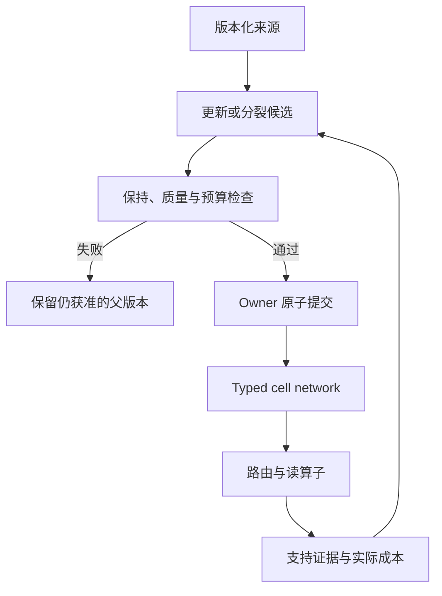

# Completed three-seed results

| Claim | Registered result |
| --- | --- |
| bounded_heterogeneous_retention | false |
| bounded_heterogeneous_transfer | false |
| bounded_learned_router_vs_random | false |
| general_memory | false |
| int8_checkpoint_storage_and_quality | true |
| learned_router_advantage_over_metadata | false |
| matched_budget_fission_advantage | false |
| net_memory_compression_advantage | false |

All registered seeds and failed hypotheses are retained. A passed independent audit establishes artifact consistency and reconstruction, not remote execution attestation or proof that the research hypotheses succeeded.

## Seed 1907

```json
{
  "engineering_gates": {
    "both_precommitted_codecs_measured": true,
    "exact_typed_baseline": true,
    "final_owner_admission": true,
    "matched_adapter_budget": true,
    "matched_candidate_updates": true,
    "parent_unchanged": true,
    "router_overhead_within_one_percent": true,
    "selection_bytes_unchanged_after_codecs": true,
    "selection_preceded_final_reads": true,
    "selection_unchanged": true,
    "source_groups_preserved": true,
    "source_identity_unchanged": true
  },
  "research_gates": {
    "int8_storage_and_quality": true,
    "net_compression_advantage": false,
    "parent_final_quality": true,
    "parent_source_quality": true,
    "router_beats_expected_uniform_random": false,
    "router_beats_metadata_capability": false,
    "router_eligible_oracle_quality": true,
    "router_eligible_oracle_regret": false,
    "router_raw_ood_rejection": false,
    "router_supported_coverage": false,
    "selected_heterogeneous_retention": false,
    "selected_heterogeneous_transfer": false,
    "split_preserves_parent_correct_final_semantic": false,
    "split_preserves_parent_correct_semantic": false,
    "split_retention_nonnegative": false
  },
  "summary": {
    "chosen_arm": "single",
    "expected_uniform_random_retention": 0.5234375,
    "metadata_retention": 0.953125,
    "oracle_representation_gain": 0.25,
    "oracle_retention": 0.953125,
    "raw_ood_reject_rate": 0.5,
    "retention_by_family": {
      "episode": 0.375,
      "procedure": 0.8333333333333334,
      "semantic": 1.0
    },
    "router_gain_over_metadata": -0.921875,
    "router_gain_over_random": -0.4921875,
    "router_regret": 0.921875,
    "single_retention": 0.703125,
    "split_retention": 0.03125,
    "split_retention_gain": -0.671875,
    "supported_retention_coverage": 0.03125,
    "transfer_by_family": {
      "event_interpolation": 0.5,
      "procedure_extrapolation": 0.1875
    }
  }
}
```

## Seed 2719

```json
{
  "engineering_gates": {
    "both_precommitted_codecs_measured": true,
    "exact_typed_baseline": true,
    "final_owner_admission": true,
    "matched_adapter_budget": true,
    "matched_candidate_updates": true,
    "parent_unchanged": true,
    "router_overhead_within_one_percent": true,
    "selection_bytes_unchanged_after_codecs": true,
    "selection_preceded_final_reads": true,
    "selection_unchanged": true,
    "source_groups_preserved": true,
    "source_identity_unchanged": true
  },
  "research_gates": {
    "int8_storage_and_quality": true,
    "net_compression_advantage": false,
    "parent_final_quality": true,
    "parent_source_quality": true,
    "router_beats_expected_uniform_random": false,
    "router_beats_metadata_capability": false,
    "router_eligible_oracle_quality": false,
    "router_eligible_oracle_regret": false,
    "router_raw_ood_rejection": false,
    "router_supported_coverage": false,
    "selected_heterogeneous_retention": false,
    "selected_heterogeneous_transfer": false,
    "split_preserves_parent_correct_final_semantic": false,
    "split_preserves_parent_correct_semantic": false,
    "split_retention_nonnegative": false
  },
  "summary": {
    "chosen_arm": "parent",
    "expected_uniform_random_retention": 0.421875,
    "metadata_retention": 0.65625,
    "oracle_representation_gain": 0.0625,
    "oracle_retention": 0.734375,
    "raw_ood_reject_rate": 0.6666666666666666,
    "retention_by_family": {
      "episode": 0.0,
      "procedure": 0.0,
      "semantic": 1.0
    },
    "router_gain_over_metadata": -0.65625,
    "router_gain_over_random": -0.421875,
    "router_regret": 0.734375,
    "single_retention": 0.671875,
    "split_retention": 0.0,
    "split_retention_gain": -0.671875,
    "supported_retention_coverage": 0.0,
    "transfer_by_family": {
      "event_interpolation": 0.0,
      "procedure_extrapolation": 0.0
    }
  }
}
```

## Seed 4051

```json
{
  "engineering_gates": {
    "both_precommitted_codecs_measured": true,
    "exact_typed_baseline": true,
    "final_owner_admission": true,
    "matched_adapter_budget": true,
    "matched_candidate_updates": true,
    "parent_unchanged": true,
    "router_overhead_within_one_percent": true,
    "selection_bytes_unchanged_after_codecs": true,
    "selection_preceded_final_reads": true,
    "selection_unchanged": true,
    "source_groups_preserved": true,
    "source_identity_unchanged": true
  },
  "research_gates": {
    "int8_storage_and_quality": true,
    "net_compression_advantage": false,
    "parent_final_quality": true,
    "parent_source_quality": true,
    "router_beats_expected_uniform_random": false,
    "router_beats_metadata_capability": false,
    "router_eligible_oracle_quality": false,
    "router_eligible_oracle_regret": false,
    "router_raw_ood_rejection": false,
    "router_supported_coverage": false,
    "selected_heterogeneous_retention": false,
    "selected_heterogeneous_transfer": false,
    "split_preserves_parent_correct_final_semantic": false,
    "split_preserves_parent_correct_semantic": false,
    "split_retention_nonnegative": false
  },
  "summary": {
    "chosen_arm": "single",
    "expected_uniform_random_retention": 0.4375,
    "metadata_retention": 0.703125,
    "oracle_representation_gain": 0.078125,
    "oracle_retention": 0.703125,
    "raw_ood_reject_rate": 0.6666666666666666,
    "retention_by_family": {
      "episode": 0.3333333333333333,
      "procedure": 0.6666666666666666,
      "semantic": 1.0
    },
    "router_gain_over_metadata": -0.703125,
    "router_gain_over_random": -0.4375,
    "router_regret": 0.703125,
    "single_retention": 0.625,
    "split_retention": 0.0,
    "split_retention_gain": -0.625,
    "supported_retention_coverage": 0.0,
    "transfer_by_family": {
      "event_interpolation": 0.125,
      "procedure_extrapolation": 0.0
    }
  }
}
```


---

# Hepta memory population：三组冻结实证与设计决策

## 结论

本轮完成了实际预训练模型的三 seed 实验、独立原始结果重构与分项成本记录。固定源码为 `07df4a9cc385375cddded5b5e3b99632ce0652ec`，研究 gate 保留原协议；所有负结果均保留。工程一致性检查通过，不代表全部研究命题通过。

| 注册命题 | 实际 gate |
| --- | --- |
| 等预算分裂的实测收益 | 未通过 / 未建立 |
| 学习路由相对随机的完整门槛 | 未通过 / 未建立 |
| 学习路由相对元数据路由的优势 | 未通过 / 未建立 |
| int8 checkpoint 存储与质量 | 通过 |
| 三类记忆逐类保持 | 未通过 / 未建立 |
| 时间与程序迁移 | 未通过 / 未建立 |
| 整个记忆系统的净压缩优势 | 未通过 / 未建立 |
| 通用 memory | 未通过 / 未建立 |

通过与未通过均来自冻结聚合文件，不能用文献、oracle、单个 seed 或后验阈值代替。`production_accepted=false`。本报告是原证据的解释，不修改训练或评估结果。CI 状态另见本次发布的带时间戳 CI 更新；历史队列与失败快照均保留。

## 实际执行的比较

模型是 `HuggingFaceTB/SmolLM2-135M-Instruct`，revision `12fd25f77366fa6b3b4b768ec3050bf629380bac`。每组来源为 16 个语义事实、24 个时间事件和 4 个程序规则，共 44 条完整来源，展开为 64 个来源训练样本。最终评估为 64 个保持问题、32 个迁移问题及 24 个未知问题。

每组先训练 rank-4 parent 512 步。single 通过保持原函数的 rank-4 到 rank-8 扩展初始化，训练 1,024 步；split 从父体实际复制出两个 rank-4 child，各训练 512 步。两种候选均有 1,843,200 字节私有 adapter 张量，每条来源样本访问 16 次，总训练输入 token 相同。每组另有 64 次真实来源梯度探测，用于按不可拆的事件历史/程序依赖组划分孩子；分区不用 family 标签作特征。

三组 cell 优化器更新合计 7,680 步，另有 192 次梯度探测和每组 400 步小型路由器优化。匹配的是候选更新数、输入 token、样本访问和 adapter 字节，不是完整 FLOP、wall time、全部持久化存储或总运行内存。梯度探测、路由器、全专家诊断读取、owner 和来源元数据均另行计费。

来源训练、来源选择与最终评估问题分开。拓扑选择在最终读取前冻结，最终答案没有用来选择 parent/single/split。int8 为预先注册主格式，int4 为辅助格式；两者固定压缩 full-source single，不随拓扑选择而挑选有利样本。

## 分裂收益与路由

| seed | 来源侧选择 | single 保持 | 学习路由 split 保持 | eligible oracle | 元数据路由 | 预期均匀随机 | 有资格路由覆盖 | raw OOD 拒答 |
| --- | --- | --- | --- | --- | --- | --- | --- | --- |
| 1907 | single | 70.31% | 3.12% | 95.31% | 95.31% | 52.34% | 3.12% | 50.00% |
| 2719 | parent | 67.19% | 0.00% | 73.44% | 65.62% | 42.19% | 0.00% | 66.67% |
| 4051 | single | 62.50% | 0.00% | 70.31% | 70.31% | 43.75% | 0.00% | 66.67% |

保持列的共同分母为 64。eligible oracle 事后查看评估正确性，在有资格的两个孩子中选择正确输出，是该固定输出矩阵的上限。它不是可执行的线上路由。预期均匀随机列对固定输出矩阵求期望，不是从一次随机抽样挑出的成绩。元数据路由使用提供的结构化操作与来源元数据，不能称为学会了自然语言解析。

实际学习路由 split 相对 single 的三组平均保持差为 **-65.6250 个百分点**。原注册分裂门槛要求平均至少 +5pp、每组不下降并逐项保持父体原本正确的旧语义事实；实际 gate 按此原规则计算。

必须分别分析 `oracle - single`、`oracle - 最佳单个 child`、`oracle - metadata` 和 `oracle - learned`。第一项是固定子专家输出集合相对单体的上限差，不能单独证明两个孩子互补。独立互补诊断将完整 64 题和双方都有来源资格的交集分开：

| seed | 两个 child 全集正确数 | 全集 oracle | oracle − 最佳 child | 双方有资格交集上的 child 正确数 | 交集 oracle − 最佳 child |
| --- | --- | --- | --- | --- | --- |
| 1907 | 32、35 / 64 | 61 / 64 | 40.625 pp | 16、6 / 16 | 0 / 16，0.000 pp |
| 2719 | 25、29 / 64 | 47 / 64 | 28.125 pp | 11、12 / 16 | 4 / 16，25.000 pp |
| 4051 | 34、22 / 64 | 45 / 64 | 17.188 pp | 16、11 / 16 | 0 / 16，0.000 pp |

三组交集均只有 16 道语义题；事件和程序的双方资格交集为空。完整分母上的增益包含来源资格覆盖的互补，不能全归因于相同可回答问题上的神经表示互补。4051 的 oracle 相对最佳 child 补救的 11 题，全部是该 child 原本没有来源资格的问题。2719 在共同资格的 16 道语义题上可补救 4 题，但没有因此通过实际学习路由或稳定分裂收益门槛。

只读路由诊断保留在 `memory-population-source-selection-review-20261023`。来源训练的正例措辞与 reject 例措辞覆盖不平衡，来源选择的另一种措辞发生大量误拒答。这是可见关联与下一轮设计依据，不构成已识别的因果证明。对三组冻结概率，保留原 dominant-reject 规则时，降低置信度和 margin 阈值也无法恢复 75% 有资格覆盖；降低接受阈值还不能提高原本不达标的 raw OOD 拒答率。进一步事后取消该硬规则、穷举更宽的双阈值接受矩形，三组仍均不能同时达到 75% 覆盖和 90% OOD 拒答。这个诊断没有应用新阈值、重新训练路由器或产生替代研究成绩。

## 异质记忆与迁移

| seed | 活动方案 | 语义 16 题 | 事件 24 题 | 程序 24 题 | 时间插值 16 题 | 程序外推 16 题 |
| --- | --- | --- | --- | --- | --- | --- |
| 1907 | single | 100.00% | 37.50% | 83.33% | 50.00% | 18.75% |
| 2719 | parent | 100.00% | 0.00% | 0.00% | 0.00% | 0.00% |
| 4051 | single | 100.00% | 33.33% | 66.67% | 12.50% | 0.00% |

这里统计 source selection 选出的活动方案。保留 parent 时，对未获新来源资格的事件和程序问题不会因为偶然答对而获得记忆信用。2719 的 single 在来源选择上丢失了一个父体原本正确的语义事实，因此严格保持门槛保留 parent；这没有利用最终集反向选择。

本轮三类操作全部使用同一模型族与 LoRA/completion loss。它测量跨操作保持和迁移，并没有实现自动涌现的三种异构神经 cell。真正的异质类型应有不同表示、读写算子、学习目标和保持契约；不能只增加 `type_id` 标签。

## 压缩：格式缩小与系统优势的分母不同

| seed | 格式 | 原完整 checkpoint B | 完整 packed B | packed / 原始 | 保持损失 | 迁移损失 |
| --- | --- | --- | --- | --- | --- | --- |
| 1907 | int8 | 1943545 | 562434 | 28.94% | +0.0000 pp | +0.0000 pp |
| 1907 | int4 | 1943545 | 331829 | 17.07% | +1.5625 pp | -3.1250 pp |
| 2719 | int8 | 1943391 | 562276 | 28.93% | +0.0000 pp | +0.0000 pp |
| 2719 | int4 | 1943391 | 331688 | 17.07% | -1.5625 pp | +0.0000 pp |
| 4051 | int8 | 1943273 | 562164 | 28.93% | +0.0000 pp | +0.0000 pp |
| 4051 | int4 | 1943273 | 331559 | 17.06% | +0.0000 pp | +0.0000 pp |

损失定义为原 single 准确率减去解码后的准确率，负数表示该有限集合上有所提高。int8 和 int4 都是有损权重编码；有限保持与迁移题集的准确率相等，不等于权重逐位无损，也不等于每个问题的完整输出均相同。通过相对质量门槛不代表原 single 的绝对质量足够。原 checkpoint 和完整 packed 均包含所需配置、lineage 与格式元数据。

| seed | 完整 JSON B | LZMA B | zlib B | SQLite B | int8 / LZMA |
| --- | --- | --- | --- | --- | --- |
| 1907 | 6976 | 2144 | 2226 | 16384 | 262.33x |
| 2719 | 6978 | 2152 | 2223 | 16384 | 261.28x |
| 4051 | 6965 | 2140 | 2223 | 16384 | 262.69x |

上述 baseline 保存完整来源，精确 typed operator 在三组各 120 个问题上均有正确的执行或拒答语义。它接受已提供的结构化操作，不是一个免费自然语言理解系统。数据字节比较不包含各方案全部运行库和算子代码，因此不能把这一表直接冒充等价完整服务成本。尽管如此，仅 int8 表示已比本实验完整来源的 LZMA 文件大得多，本轮没有建立净压缩优势。

本实验是公开 seed 与保留生成器可重建的合成来源，不能用它证明不可约随机信息的存储容量。生成器与 seed 的完整字节及压缩表示也已保存并计量。

codec 先解码成 float32 adapter，再用新进程读取。它没有运行 int8/int4 矩阵推理，不能声称推理 RAM 或算力降低。原文件、packed 文件和 materialized 文件全部保留，因此也不能说整个实验目录因编码而变小。

## 完整成本边界

| seed | 全部训练 checkpoint B | 全部 packed B | 全部 float32 materialization B | router B | owner DB B | 进程峰值 B | trial wall s |
| --- | --- | --- | --- | --- | --- | --- | --- |
| 1907 | 6809463 | 894263 | 3930621 | 7192 | 65536 | 1745227776 | 1959.311 |
| 2719 | 6808842 | 893964 | 3930314 | 7193 | 61440 | 1743396864 | 2005.575 |
| 4051 | 6808765 | 893723 | 3930078 | 7194 | 65536 | 1762516992 | 1756.935 |

共享 base 六文件共 271,170,520 字节，实际 float32 base 张量为 538,060,032 字节。组合三组时，共享 base 只计一次，已测来源与模型持久化下界为 306,323,518 字节。该下界明确不包含完整运行库、执行代码和所有审计文本，不是一个已完成的等价在线系统成本。完整系统净压缩 gate 因此保持未建立。

进程峰值来自 Linux `getrusage`；child 最大值不是全部进程并发 RAM 的总和。共享 cgroup 资源观察也不是单个模型的内存测量。多个 adapter 共用磁盘 base 文件，不自动意味着跨进程运行内存只占一份。

## 实现选择

现有 Hepta 的 `CellHeadV1` 是固定的 action/value/uncertainty/abstain 头；`CellEvidenceV1` 的绑定函数接受具体头和 runtime 类型，`NeuronPosition` 仅提供受限 shadow proposal。当前研究流水线没有把通用 memory operator、模型安装权限或分布式拓扑权限加入这些生产接口。

建议的 cell 契约为 `type_id + artifact + operator + learning_objective + retention_contract + cost_contract`。小模型是表示之一。语义可用共享底座加小 adapter，事件适合日志与时间索引，程序适合可执行 DSL，统计记忆适合充分统计量或 sketch。应在相同操作质量与完整资源约束下比较这些表示。

下图是后续接入目标；本轮已经执行了候选训练、选择、owner 准入和读取，但没有实现图中的分布式 typed network。



候选写入/分裂在影子版本中完成，先检查来源闭包、旧能力、新能力和预算，再由 owner 以预期 generation 原子切换。孩子复制父参数时继承完整父来源依赖，不能只登记新训练分片。lineage 是可能影响版本的依赖集合，不是神经答案级的因果来源证明。撤回读资格与证明权重已遗忘来源也应分开。

下一轮路由应将 support/reject 校准与条件专家 utility 分开，正负例覆盖相同措辞族，并按实体、模板、操作和时间持出。最终评估集不能用于阈值选择。只有固定专家集合的可达上限足够，才值得优化更复杂路由；元数据已达到 oracle 的问题集合上，单纯选专家不可能再取得 +5pp。

自适应 meta network 还需独立验证多轮 split/merge、迁移、跨节点 frontier、一致性、最大扇出、回路深度、通信和资源预算。当前一次两孩子实验没有测量这些机制。有限实验可以支持有边界的能力结论，无法认证任意任务的通用 memory。

网络中的 split 应把孩子版本集合与新路由版本作为一个提交单元：要么整组满足预期 parent generation、依赖 frontier 和资源额度后生效，要么保留旧图，避免只激活一半孩子造成来源覆盖缺口。合并应对合并前后完整任务集合验证，不能只比较权重平均后的文件大小。这些是下一阶段需要实现并测量的契约。

评价有损语义压缩时，应先声明失真与服务约束，再比较 `共享底座摊销 + cell 私有表示 + router + 来源与残差 + replay/rollback + owner/索引`。已存在的共享底座可在另一个明确的增量成本视角下摊销，但不能从完整系统成本中无说明地消失。若仍保留全部精确来源，神经 cell 更可能改善热读取、上下文 token 或泛化能力；这些收益要另外与训练及维护成本比较，不能由 checkpoint 字节自动推出。

完整架构说明与文献依据见原始证据中的 `architecture-decision-record.zh-CN.md`。TTT、Titans、MIRAS 和 MemoryLLM 提供可学习状态/关联记忆的研究机制，LongMemEval 提供长期记忆能力维度；这些论文不替代本项目自己的成本、来源与运行证据。

主要研究来源：[TTT](https://arxiv.org/abs/2407.04620)、[Titans](https://arxiv.org/abs/2501.00663)、[MIRAS](https://arxiv.org/abs/2504.13173)、[MemoryLLM](https://arxiv.org/abs/2402.04624)、[LongMemEval](https://arxiv.org/abs/2410.10813)、[Language Modeling Is Compression](https://arxiv.org/abs/2309.10668)。上述 typed cells 与 owner/network 提交设计是基于仓库约束的工程建议，并非这些论文已验证的 Hepta 实现。

## 复核与恢复

独立 cohort audit 对三组各自的原始文件、真实权重/配置、训练 exposure、路由参数、选择、最终原始输出、baseline、量化字节和成本进行重构，并核对所有成功及失败 gate。它证明所保留 artifact 与计算结果一致，不是远端执行的密码学证明。

下载包保留所有候选，包括未选中的孩子和负结果，共 21 个 float32 checkpoint、6 份 packed artifact、3 个学习路由器及6个 owner DB。共享 base 不重复放入下载包，按固定 revision 与六文件 SHA 恢复。恢复使用新定位、新 owner 与新 receipts，原绝对路径和原始 JSON/DB 不重写。额外单问异路径 replay 的结果与成本单列，不并入三组研究指标，也不外推为所有 checkpoint 的功能重放。

实际恢复固定使用 seed 1907 / single 原 final journal 的第一问。新进程生成与原记录同为 `yellow`，raw text、token、prompt、base 与 adapter state 等 15 项非耗时字段一致；同问 serialized router decision 也与原冻结计划一致。实际 worker 导入日志中 11 个研究模块全部来自恢复 bundle，SHA 与冻结源码一致。累计新增模型 worker 恰好 1 个、实际问题 1 个，65 input tokens、2 generated tokens，generation 约 0.242 秒，fresh-process wall 约 8.136 秒；新 owner DB 为 20,480 字节。这是本环境新路径加载与读取证据，不是跨机器的逐 token 一致性证明。

默认恢复入口 `restore_population.py replay/router` 已实际成功。原 ZIP 内可选包装器 `run_isolated_replay.py` 在模型成功后遇到 CPython 裸路径日志解析错误，失败及成功原始记录均保留。补充恢复工具包提供修正的解析器和实际使用的无模型后处理；修正函数已针对原真实 stderr 核验，没有为此重跑模型，也没有声称完整修正版包装器的模型路径已再次执行。第一次准备 base 的跨目录硬链接失败发生在任何模型启动前，随后在新的 `/tmp` 路径通过六个实际硬链接完成定位，没有复制或重新下载 base。原模型 launcher 的父进程来源检查返回行未持久化这一限制，也在最终恢复 receipt 中明确区分于完整保留的 worker 导入日志。

Checkpoint ZIP SHA-256：`30237f8fb96bd70d56404532b075eb76e2fb50c2494d72276dfa3e8d1ac783b2`；最终异路径恢复 receipt SHA-256：`810f7c0565c7c92dbbba53363b7d525314512db4fc57244a1244ac514ff522b4`。

输入绑定如下；最终发布还需配合独立发布的 ZIP 哈希、raw archive manifest 和 CI 结果。

```json
{
  "memory-population-20261023/aggregate.json": "a475372a8c55278523750cc9abef52ca129e3ce0655650fbc1e7a4ce498026b4",
  "memory-population-independent-launch-review-20261023/independent-cohort-audit.json": "4565f6f1849e2572fb8475a9e437b840739ed1aeaa1a86f1ef3db081d0cca58c",
  "memory-population-20261023/execution-receipt.json": "647db3cefb47e23cbb4a2b60ba13814e2d45241479ff1fe80192d93351fcaa00",
  "memory-population-20261023/seed-1907/result.json": "1dedbe3c65ee44ad7b40fd0463f3f26eb64d89436a8624d1542101237c989fb5",
  "memory-population-20261023/seed-2719/result.json": "56e4110ad08e4e2645f3892bbeb912d797bb052f06cd06b41f646c630cba3a7e",
  "memory-population-20261023/seed-4051/result.json": "5fbb4248cbe429f5e7896c8015d972f83474f806218787ea1bcc6427b7a7b976",
  "memory-population-source-selection-review-20261023/source-selection-diagnostic-3seed.json": "9a5a138612c129662e817d8f5d96a59483fff5230e8135f9e0ee88dae1cedbef",
  "memory-population-source-selection-review-20261023/final-route-threshold-separability-3seed.json": "31de46fdf6c5515ec1d8d600a505691c43aea175a333bb4d5bc2c5f9dbcfd834",
  "memory-population-independent-launch-review-20261023/complementarity/three-seed-complementarity.json": "f1cebc6cfd2b0ed5e5bb4b729b4640b2a18a228bd7d0d9dc29a8a13b306ec2e1",
  "memory-population-relocated-replay-20261023/isolated-replay-receipt.json": "810f7c0565c7c92dbbba53363b7d525314512db4fc57244a1244ac514ff522b4",
  "hepta-memory-population-checkpoints-20261023.zip.receipt.json": "28b1aab8da7561face732c9e1f4a54a9eed64d688ee27cc2ae1f2ad0e150a48c"
}
```
