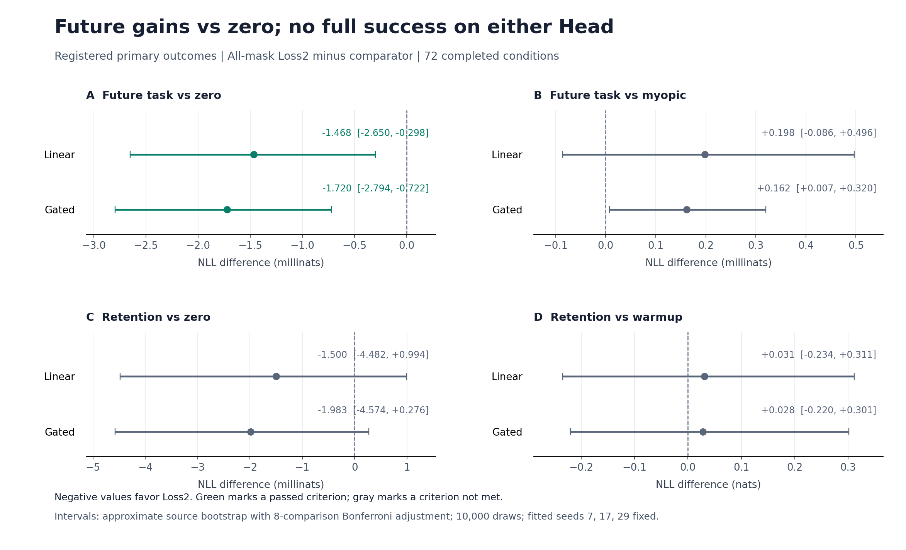

# Cell × Parameter Field V2：单侧保留目标与完整状态重放

**结论：72/72 条件完成，完整状态重放和独立证据审计通过；两类 Head 均只通过 1/4 项主要科学判据，整体成功判据未通过。** 相对普通 Adam 的零额外干预，Loss2 在历史未来留出上的 NLL 小幅改善；相对 myopic，没有证实递归优势；旧任务保留也未达到预先冻结的零余量标准。[完整评价](evaluation.json)、[独立评分审计](final-audit.json)

这是在 [V1 完整证据](https://github.com/TrillionniumFoundation/hepta-private-ci/tree/ff5baef731f36420370c5bcc049c50a567cda06a/qa/stem-bakeoff/evidence/20261024-cell-parameter-field) 之后执行的新一轮研究。V1 的代码、结果与负面比较全部保留。V2 更换为完全不重叠的来源组件，并加入同一新 cohort 上的原对称目标对照。不能把两轮原始均值之差直接归因于目标修改。

## 1. 六个环节的实际完成情况

| 环节 | 已完成内容 | 证据 |
|---|---|---|
| 固定环境 | 固定真实 Granite97M Encoder、预处理、来源图、四类任务、8 维投影、两种 Head、初始化与动作单位 | [协议](protocol.json)、[真实特征报告](features/report.json) |
| 完整训练状态 | 参数、Adam moments、step、采样与 RNG 状态、协议和 context bindings；12 次冷进程续训逐位一致 | [数学与重放审计](math-analysis.json) |
| 观测对照 | 两项损失；再加入两项 probe 梯度与 Adam 一阶矩内积；同动作全状态参照 | [运行汇总](runs.json)、[补充分析](math-supplement.json) |
| 动作对照 | `bias` 的 4 个参数方向，嵌套于 Linear 36 / Gated 52 个参数的 `all` 动作空间 | [独立运行审计](run-audit.json) |
| 控制对照 | zero、myopic、loss2、extended、full、同 cohort 的 symmetric_loss2；3 seeds × 2 Heads × 2 masks × 6 policies = 72 | [全部结果摘要](results.json) |
| 独立评价 | 全部路径、checkpoint、预测和 917 个文件封存后才打开最终评分标签；全部 216 条 condition-role 与 8 项主要判据均报告 | [标签访问顺序](label-access.json)、[最终审计](final-audit.json) |

`zero` 仍执行当前任务的普通 Adam 更新，只是不施加额外控制。72 条路径来自六个 warmup Head，不能作为 72 个独立任务或独立训练总体样本。所有结果均保留 `DENY_ALL`、`production_authority=false` 的研究身份。

## 2. 冻结身份、来源与样本隔离

论文固定为 [ICLR-2027@f8df0a6075f58f3ab9431a889b773cdf8d6e771d](https://github.com/TrillionniumFoundation/ICLR-2027/tree/f8df0a6075f58f3ab9431a889b773cdf8d6e771d)，`revision_2026-09-26-r45`。本轮完整执行源码固定为 [21d285b2e8c52662e1e7bb24ced930ccf0144a14](https://github.com/TrillionniumFoundation/hepta-private-ci/commit/21d285b2e8c52662e1e7bb24ced930ccf0144a14)，34 个本地相关源码／配置文件与远端 blob 逐项一致。[源码冻结记录](source-freeze.json)

协议 SHA256 为 `74219a854515b10e8098e2365f325b29bc73aa09d9d0311976b0afa2f9c2ee20`，在新模型结果产生之前发布到 [996f7486cf74527fddc0def3144dd87ccdcbe76d](https://github.com/TrillionniumFoundation/hepta-private-ci/commit/996f7486cf74527fddc0def3144dd87ccdcbe76d)。恢复后的本地冻结记录时间为 2026-10-24 23:42:09 UTC；正式分类器运行开始于 23:48:20 UTC。这是本地冻结加提前发布的 Git 身份，不是独立第三方预注册。[冻结收据](protocol-freeze.json)

| 来源角色 | 月份 | 独立组件数 | 用途 |
|---|---|---:|---|
| old_train | 2014-03 | 48 | 旧环境 warmup |
| old_probe | 2014-03 | 32 | 保留观测和控制目标 |
| old_test | 2014-03 | 48 | 最终独立保留评价 |
| current_train | 2014-04 | 64 | 当前环境训练 |
| current_probe | 2014-04 | 32 | 当前任务控制观测 |
| future_may | 2014-05 | 128 | 历史时间留出 |
| future_june | 2014-06 | 128 | 历史时间留出 |
| 合计 | | **480** | 每个角色四类平衡 |

在全部 422,935 条有效记录上，按 story ID 与归一化标题建立联合连通组件。原 ZIP 有 422,937 行，既有解析器丢弃两条缺 publisher 的记录。排除跨月、类别冲突、既有五 cohort 触及的全部组件以及 V1 全部 512 个组件，再按固定 salt `hepta-cell-retention-v2-20261024` 选取。每个组件取一行，角色间不重叠；独立 BFS 重新构造全部 3,172 个组件，复现抽样和训练标签。V2 与 V1 的来源 ID／组件交集均为零。[输入审计](input-audit.json)、[数据收据](data/data_receipt.json)、[来源清单](data/sources.json)

March 配额是在新模型结果前依据剩余组件可行性冻结的：health 剩 37 个组件，本轮 March 三个角色合计需要每类 32 个。没有依据模型表现调整样本。本轮只覆盖已登记来源图关系；不保证排除全部语义重复、其他未登记历史实验或 Encoder 预训练暴露。

数据引用：Gasparetti, F. (2017), [News Aggregator, UCI Machine Learning Repository](https://doi.org/10.24432/C5F61C)，许可 [CC BY 4.0](https://creativecommons.org/licenses/by/4.0/)。本实验对原数据做了分组、排除、抽样、角色分配和特征提取。该许可说明仅针对数据，不代表仓库代码或 Encoder 权重许可。源 ZIP SHA256：`1f5f08691f0ce576cb0b5cfdbcb8c55e0ec14dda8f3e07933da72c500338845a`。

## 3. V2 改了什么，哪些限制仍然存在

Encoder 为 `ibm-granite/granite-embedding-97m-multilingual-r2`，revision `835ad14087e140460703cf0fae09f97d469d65c2`。六个模型文件与原固定 inventory 一致，加载 97,441,152 个参数，全部冻结；480×384 真实特征由全部策略共享。与标签无关的 Gaussian QR 投影固定为 384→8、seed 20261024。两种 Head 复用已有 `NumpyCellHead` 和保存／加载接口。结果限定于这一小 Head 控制实验，不能外推为完整 Encoder 参数学习或 Hepta 多 Cell 网络的生产性能。

三组 seed 为 7、17、29；旧任务 warmup 64 步，保留完整 Adam 状态，当前任务控制 24 步。学习率和离散步长均为 0.02，effort 权重 0.1。额外动作在每次 Adam 更新后施加 `h B u`，仅直接修改允许的参数坐标；moments 不被该加法直接改写，后续影响由真实训练过程产生。无动作裁剪。全批次确定训练，`Q=0`。

设零额外干预参考的当前 probe 损失为 $L_c^0(k)$，旧任务 warmup probe 损失为 $L_o^{warmup}$。共同实际评分目标为：

$$
J(\pi)=\frac12\sum_{k=0}^{24} w_k\left[
\left(L_c^\pi(k)-L_c^0(k)+0.03\right)^2+
\left[L_o^\pi(k)-L_o^{warmup}\right]_+^2\right]
+\frac{h\rho}{2}\sum_{k=0}^{23}\|u_k\|^2,
$$

其中 $w_0,\ldots,w_{23}=h=0.02$、$w_{24}=1$、$\rho=0.1$，$[z]_+=\max(0,z)$。V1 的旧任务双侧平方被单侧平方替代，旧任务改善不再付费。**这是软惩罚，不是硬保留约束。当前任务仍采用双侧 −0.03 目标跟踪；超过目标的进一步改善仍可能受罚。因此不能说 V2 已消除所有目标失配。**

| 策略 | 在线观测 | 规划 |
|---|---|---|
| zero | 共同诊断观测 | 固定零额外动作 |
| myopic | 当前／旧任务两项损失 | 单步 hinge 控制 |
| loss2 | 同样两项损失 | 剩余时域递归 hinge MPC |
| extended | 两项损失，加两项 probe 梯度与一阶矩内积 | 对自己的投影动态做剩余时域 MPC |
| full | 全部参数与 Adam moments | 相同动作、目标、参考切线系统上的全状态参照 |
| symmetric_loss2 | 两项损失 | 同 cohort 上的 V1 对称目标 affine Riccati |

Linear 的连续状态为 36 个参数加 72 个 moments，共 108 维；Gated 为 52+104=156 维。完整 checkpoint 还包含 step、采样／RNG、协议、context 与输入绑定。两维 observable 不表示控制器总共只保存两个数：冻结参考、时变模型和规划矩阵仍有存储成本。

新的 condensed squared-hinge MPC 使用 semismooth Newton、Armijo 和 Woodbury 计算。每次从零控制序列开始，不跨步保存隐藏 warm start；最大 100 次迭代，gap 容限为 $10^{-10}$。证书采用 $\|\nabla J\|^2/(2h\rho)$，针对声明的浮点凸切线问题；不是舍入区间形式证明，也不是实际非线性系统全局最优性保证。`symmetric_loss2` 的证书对应它自己的对称目标。二次 condensed MPC 与 Riccati 的 first-action 等价性，以及独立 active-set hinge 最优解，在测试中核对。[控制器源码](../../cell_field_retention_control.py)、[测试日志](logs/cell-retention-v2-final-tests.log)

## 4. 主要独立任务结果：每个 Head 仅 1/4 通过

以下为 `all` 掩码下 **Loss2 − comparator** 的 NLL 差，负值有利于 Loss2。未来任务取 May 与 June 等权均值，共 256 个来源组件；旧任务为 48 个组件。NLL 单位为 nat。

| Head | 终点 / comparator | NLL 差 | 调整后区间 | 判据 |
|---|---|---:|---|---|
| Linear | Future / zero | −0.00146784 | [−0.00265026, −0.00029836] | **通过** |
| Linear | Future / myopic | +0.00019841 | [−0.00008555, +0.00049648] | 未通过 |
| Linear | Old / zero | −0.00150012 | [−0.00448238, +0.00099428] | 未通过 |
| Linear | Old / warmup | +0.03120396 | [−0.23428196, +0.31147877] | 未通过 |
| Gated | Future / zero | −0.00172042 | [−0.00279424, −0.00072196] | **通过** |
| Gated | Future / myopic | +0.00016156 | [+0.00000737, +0.00032001] | 未通过 |
| Gated | Old / zero | −0.00198320 | [−0.00457431, +0.00027550] | 未通过 |
| Gated | Old / warmup | +0.02826675 | [−0.22025081, +0.30141728] | 未通过 |

主要成功标准是在每个 Head 上同时满足：两项 future 差值上界严格小于零，两项 old-test 差值上界不大于零。八个比较组成固定 family，alpha=0.05；以来源组件为单位、按四类分层配对 bootstrap 10,000 次，seed 820241，分位点 `[0.003125, 0.996875]`。这是 **Bonferroni 调整的近似 percentile bootstrap 区间**，条件于固定已拟合的三个 seeds 和所选历史 cohort，不声称有限样本分布无关覆盖或随机 seed 总体保证。同一来源先在固定 seed 上平均，再重采样，不能把 256 个 future 来源当作 768 个独立样本。

两类 Head 相对 zero 的未来 NLL 都有小幅改善。Linear 相对 myopic 的点估计略差，区间跨零；Gated 的整个调整区间为正，在本次分析中支持 myopic 更好。Old-test 相对 zero 的点估计都改善，但上界仍为正；相对 warmup 的点估计上升，区间很宽。后两项既不能证明零余量保留，也不能仅凭宽且跨零的区间宣称确定的退化。[完整评价](evaluation.json)、[独立评分审计](final-audit.json)



### 全部策略的实际任务水平

以下为 `all` 掩码的三个固定 seed 均值；Future 是 May／June 等权平均。Accuracy 为描述性结果，没有替换预先指定的 NLL 主要判据。

| Head | 策略 | Future NLL | Future accuracy | Old-test NLL | Old-test accuracy |
|---|---|---:|---:|---:|---:|
| Linear | zero | 1.363088 | 45.1823% | 1.246385 | 45.8333% |
| Linear | myopic | 1.361422 | 45.1823% | 1.244830 | 45.8333% |
| Linear | loss2 | 1.361621 | 45.1823% | 1.244885 | 45.8333% |
| Linear | extended | 1.361866 | 45.1823% | 1.245447 | 45.1389% |
| Linear | full | 1.361055 | 45.0521% | 1.244588 | 46.5278% |
| Linear | symmetric_loss2 | 1.362161 | 44.6615% | 1.244208 | 45.1389% |
| Gated | zero | 1.360714 | 43.6198% | 1.237052 | 43.7500% |
| Gated | myopic | 1.358832 | 44.0104% | 1.234955 | 43.7500% |
| Gated | loss2 | 1.358993 | 44.0104% | 1.235068 | 43.7500% |
| Gated | extended | 1.360750 | 43.8802% | 1.236621 | 43.7500% |
| Gated | full | 1.358305 | 43.8802% | 1.234042 | 43.7500% |
| Gated | symmetric_loss2 | 1.358989 | 44.0104% | 1.235062 | 43.7500% |

全部 bias 条件、每个 seed、每个月、balanced accuracy、Brier 和 warmup 变化均保存在 [evaluation.json](evaluation.json) 与 [results.json](results.json)。Full 的描述性 NLL 更低不改变预先指定的 Loss2 主要成功判据，也不是对真实非线性系统的最优性认证。

## 5. 内部目标与外部任务没有同步改善

共同 hinge $J$ 的三 seed 均值如下，越低越好。表中乘以 1,000 便于阅读。

| Head / mask | zero | myopic | loss2 | extended | full | symmetric_loss2 |
|---|---:|---:|---:|---:|---:|---:|
| Linear / bias | 0.666000 | 0.675037 | 0.669179 | 0.734245 | 0.659113 | 0.685465 |
| Linear / all | 0.666000 | 0.598157 | 0.551472 | 0.672445 | 0.504837 | 0.846151 |
| Gated / bias | 1.043299 | 1.050087 | 1.052397 | 1.271347 | 1.027459 | 1.052220 |
| Gated / all | 1.043299 | 0.946393 | 0.943567 | 1.133906 | 0.838256 | 0.942847 |

开放全部参数时，Loss2 相对 zero 的 $J$ 分别下降 **17.20% / 9.56%**；相对 myopic 分别下降 **7.80% / 0.30%**。但其 future NLL 相对 myopic 的点估计都更差。逐 seed／Head／mask，Loss2 的 $J$ 胜过 myopic 为 9/12，胜过 zero 为 6/12，后者全部来自 all mask。不能沿用 V1 中“所有条件递归目标都优于 myopic”的说法。[数学分析](math-analysis.json)、[配对补充](math-supplement.json)

### 同 cohort 的目标消融应如何解释

Linear/all 的 hinge Loss2 相对 symmetric_loss2，共同 hinge $J$ 降低约 34.83%，future NLL 描述性均值降低约 0.000541；Gated/all 则几乎一致，hinge Loss2 的共同 $J$ 略高约 0.076%，future NLL 略高约 0.00000478。两种 Head 上，loss2−symmetric_loss2 的 old-test、May、June 六个 NLL 次要点态 95% 区间均跨零。本轮确认了旧目标的语义修正及其控制后果，尚不能声称这种修改已经证明外部任务收益。[次要对照](evaluation.json)

### Probe 保留与独立保留仍有差距

Linear/all/loss2 的终点 old-probe NLL 比 warmup 改善约 **0.06200**，其 old-test NLL 点估计却上升 **0.03120**。Gated/all/loss2 的 old-probe excess 仍为 **+0.02497**，full 也仍为 **+0.02297**。后两者直接表明软惩罚没有强制 probe 可行性；前者表明 probe 改善不能充当独立保留证据。Old-test 的宽区间必须与这些点估计同时报告。

### 观测和动作的贡献

Extended 的共同 $J$ 在全部 12 个配对中都差于 Loss2；Full 在全部 12 个配对中都更好。这不证明“更多信息有害”：重新投影得到的 extended 控制器不是包含旧最优策略的嵌套最优策略类。Full−Loss2 的差是信息、投影闭合和策略实现的合并差距，不能直接命名为不可约信息损失。

嵌套动作的同目标、同切线 full oracle 在六个模型上均满足 `all ≤ bias`，扩大动作空间使最优 $J$ 在 Linear 降低 **23.43%–23.53%**，Gated 降低 **18.41%–18.67%**。这是局部可达能力的证据；不保证任意压缩控制器或实际非线性路径都兑现该空间。对每个条件分别执行非线性反馈 rollout 与切线反馈 rollout，两者所得共同 $J$ 的最大绝对差约为 $9.37\times10^{-7}$。两条闭环路径及动作可以不同；这是本轮对应条件的经验成本差，不是固定动作下的线性化误差界或全局余项界。[运行审计](run-audit.json)、[数学补充](math-supplement.json)

## 6. 完整重放、数值证书与独立审计

最终六模块测试共 **29 项通过**：数据 9、输入审计 3、控制 7、运行 2、评价 5、运行／评分审计 3。随后 `just fmt` 退出 0。第一次格式命令因恢复环境中的工具路径／缓存与部分仓库状态失败，该日志也保留；它不是科学运行失败。[最终测试](logs/cell-retention-v2-final-tests.log)、[格式日志](logs/cell-retention-v2-format.log)、[第一次环境失败](logs/cell-retention-v2-format-attempt-1.log)

正式 V2 只执行了一轮：72 完成，0 失败。72 个终态 Head 经已有 serving 保存／加载 roundtrip，预测一致。六个 `all/loss2` 条件分别做整段 24 步与中点剩余 12 步冷进程反馈重算，共 12 次；参数、moments、观测、动作、transition receipts、完整终态 manifest 全部逐位一致，去除计时字段的求解记录也一致。全段从 step 64、中点从 step 76 开始，均到 step 88。本轮 full-batch sampler draw count 为零，不声称已验证随机未来路径或生产进程断电恢复。

| 独立核验 | 实际覆盖 |
|---|---|
| 输入 | 独立 BFS，480 新组件与 V1/legacy 零重叠；评分前 `final_labels.json` 打开尝试 0 |
| 封存 | 917 文件，41,184,091 bytes，不含 seal 自身；全部哈希一致 |
| 动态／控制 | 不导入主求解器或训练状态实现；20,101,086 个标量等式，Adam／动作／概率／主要成本差为 0 |
| 规划证书 | 1,440 个实际在线与 1,440 个切线诊断非零策略证书，全部满足各自目标的 $10^{-10}$ gap 容限 |
| 冷进程 | 12/12 完整反馈重放一致；72/72 终态 checkpoint 与轨迹一致 |
| 最终评分 | 不导入 evaluator；216 条 condition-role、18 条 warmup、144 个次要区间和 8 个主要区间独立复算；2,074 个数值比较最大误差 0 |

2,880 个规划证书包括 2,304 个 hinge 和 576 个 symmetric Riccati 证书；576 条 zero 记录不计为最优性证书。另有 12 个初始 full oracle 证书及重放重复记录。全部规划证书最大重算 gap 约 $8.22\times10^{-11}$，最大 plan-field 浮点差约 $3.47\times10^{-17}$。求解正确、状态可重放与主要科学判据通过，是三个分别核验的命题。

封存时间为 2026-10-24 23:48:44 UTC，最终评分标签读取记录为 23:50:11 UTC。封存 SHA256：`f958695955604da2ef98cb908ac403c593f8f5f28f67a0f245403f596353bebe`；评价 SHA256：`3b7e7cccf33f9a4ac63a59665a1f9ec5df3f2f93d08e049bafd46ca03ca6961b`。本地访问 hook 和时间记录不是宿主机级远程证明。[seal](pre-evaluation-seal.json)、[标签顺序](label-access.json)

## 7. 实际资源成本

| 阶段 | 本轮记录的 wall time |
|---|---:|
| Encoder 加载 | 5.954 s |
| Encoder 编码：30 forwards、6,975 tokens | 4.032 s |
| 六组 warmup 合计 | 0.323 s |
| 六组参考轨迹／导数构造 | 14.191 s |
| 72 个控制器构造 | 0.137 s |
| 72 条实际 24 步 rollout | 4.107 s |
| 其中在线规划 | 2.189 s |
| 切线诊断 | 0.556 s |
| 12 次冷进程重放 | 2.049 s |
| 运行器 parent wall | 23.683 s |

Encoder 无输入截断、无参数更新，编码 CPU 15.857 s，峰值 RSS 约 1.363 GB。控制运行器 parent CPU 21.637 s，峰值 RSS 约 92.4 MB。它们是不同进程的峰值，不能相加作为并发峰值；机器环境经历重置，不用本轮与 V1 的计时之差声称性能提升。

| Head / all | Loss2 每条 24 步 rollout | Full 每条 rollout | Full / Loss2 |
|---|---:|---:|---:|
| Linear | 33.54 ms | 149.46 ms | 4.46× |
| Gated | 40.45 ms | 352.51 ms | 8.71× |

仅在线规划部分，Full / Loss2 为 Linear 12.06×、Gated 26.84×。这些时间包含研究诊断，不能作为优化过的生产基准。阶段存在嵌套，运行器 parent timer 在写最终 seal 前结束；不能把各行相加当作严格端到端总账。Energy 与重放子进程 CPU 未独立计量。[特征报告](features/report.json)、[资源分析](math-analysis.json)

## 8. 对论文与 Hepta 的 comments

**参数场方法目前最明确的贡献，是为 Hepta 的学习过程提供可检验的观测、动作和目标诊断。** 这里已经把真实 Head 的完整训练状态、低维损失观测、固定参数掩码、闭合误差和同动作全状态参照连起来。它可以放在 Cell 学习接口之上做控制研究；本轮没有验证 Hepta 多 Cell 拓扑、路由、生长或完整 LLM 参数演化。

**局部控制最优性不能代替独立任务收益。** V2 同时给出正确的数值实现和未通过的主要科学判据。在 `all` 掩码下，两类 Head 的 Loss2 相比 myopic 都降低内部 $J$，但 future NLL 点估计都略差；全部 seed／Head／mask 条件中，内部 $J$ 胜出为 9/12。这是评价代理目标的证据，既不能包装为 Hepta 已获得递归学习优势，也不构成对论文局部条件定理的反证。

**应先验证目标与保留语义，再增加观测复杂度。** 单侧旧任务项修复了“改善也受罚”的具体问题，但当前目标仍是参考轨迹附近的双侧跟踪，32 个 old probe 也不能保证 48 个独立旧任务组件上的保留。Extended 的全部内部配对回退进一步说明，增加 optimizer summary 本身不足以保证更好的闭合动态与策略。

**动作能力、信息压缩与策略实现应分开报告。** 嵌套掩码的 full oracle 给出了局部动作能力差距；loss2、extended、full 的实现比较仍混合了投影和策略。确定性的 `Q=0` 点轨迹没有识别不可约随机信息损失，不能由本轮宣称两维状态已足够，也不能由 Full−Loss2 差值推出必需的最小状态维数。

**当前工程决策是保留研究接口与全部负面结果，尚无依据把 Loss2 提升为默认学习策略。** Myopic 应继续作为关键对照；Full 有诊断价值但成本更高，其描述性外部优势不是生产资格。完整 checkpoint、来源隔离、封存与独立审计接口可以继续复用。

### 下一项优先联合实验

建议做一个有界的“同完整状态下的动作排序与保留可行性实验”：在相同 checkpoint、相同动作预算上，让 myopic、remaining-horizon Loss2 和 Full 分别提出候选动作；固定候选动作的共同评分目标与共同评估时域，用真实训练分支检查切线目标排序与实际排序是否一致。先用新的控制开发数据比较直接当前风险目标、现有双侧跟踪目标以及显式保留约束，每次只改变一个因素，给不可行条件保留失败记录。使用额外的独立验证角色检查 probe 约束能否泛化，再在新来源队列上冻结最终评价。

这个设计为区分目标语义、预测模型与规划时域三类原因提供诊断。当前已解封的 V1/V2 final labels 只用于报告和机制描述，不再用于选新超参数、阈值或最终赢家；下一轮外部有效性需要新的冻结评价来源。即使采用 probe 硬约束，也只能先声称对该 probe／模型的可行性，不能直接升级为任务总体保留保证。

## 9. 环境重置与恢复的透明说明

在 V2 任何分类器结果产生之前，一次长时间中断后临时工作区被重置。已发布 V1 源码与证据、V2 协议可从 GitHub 恢复；尚未发布的控制／审计代码根据完整工具历史恢复。Evaluator 的元数据尾部经过重建，因此不声称新文件与重置前每个字节都相同。恢复后重新冻结完整源码、通过全部 29 项测试、核对远端身份，之后才进行了唯一一次正式 V2 分类器运行。

当时连接器不能取回大二进制归档。V1 的 `sources.json` 改由原固定 ZIP 和原选择算法重建，再用已发布 V1 pre-evaluation seal 认证：315,623 bytes，SHA256 `d3d8c203c2fd88966fa937d0e0b5cf2826399f558a26dc1e256e47ab479a0482`，与原文件逐字相同。原始带运行时间的 V1 `data_receipt.json` 没有恢复，也没有伪造；其原 SHA／大小仅作为 seal 中的身份记录保留。存在但无效的 receipt 不允许退回恢复路径。[恢复验证](source-recovery-validation.json)、[原 seal](previous-v1/pre_evaluation_seal.json)、[重建收据](previous-v1/reconstruction.json)

这一恢复只认证 V1 来源身份及 V2 排除集合，没有改写 V1 研究或取消来源隔离。V2 的原始 receipt、sources、predictors、标签、协议和全部关键审计现在直接以可读 Git 文件保存，同时收入完整归档，减少再次恢复时对大文件连接器的依赖。

## 10. 复现、归档与评审

完整归档包含 V2 数据、真实 384 维特征、全部 checkpoint／Head／预测、参考与控制器矩阵、实际／切线轨迹、逐步规划和证书、冷进程重放、源代码副本、评价和审计／执行日志；不包含可按固定身份重新获取的完整公共 ZIP 或 Encoder 权重。所有原始 run 文件保持封存字节不变。

在本目录解包：

```bash
cat archive/raw-evidence.tar.xz.part-* > raw-evidence.tar.xz
sha256sum -c archive.sha256
tar -xf raw-evidence.tar.xz
```

[archive-parts.json](archive-parts.json) 列出分片顺序、大小、SHA256 与 Git blob SHA1；[archive-members.json](archive-members.json) 列出全部成员 SHA256；[archive-verification.json](archive-verification.json) 记录重新读取归档并逐项核对封存文件的结果。分片原始大小上限为 512 KiB。解析得到的 `cell-retention-v2-raw` 是下列 `EVIDENCE` 所指的目录。

在固定源码版本的仓库根目录复核运行与评分；两条命令分别产生独立报告：

```bash
PYTHONDONTWRITEBYTECODE=1 OPENBLAS_NUM_THREADS=1 python qa/stem-bakeoff/cell_field_retention_audit.py \
  --runs "$EVIDENCE/run" --data "$EVIDENCE/data" \
  --protocol "$EVIDENCE/run/inputs/protocol.json" --output /tmp/cell-v2-run-reaudit.json

PYTHONDONTWRITEBYTECODE=1 OPENBLAS_NUM_THREADS=1 python qa/stem-bakeoff/cell_field_retention_audit.py \
  --runs "$EVIDENCE/run" --data "$EVIDENCE/data" \
  --protocol "$EVIDENCE/run/inputs/protocol.json" \
  --evaluation "$EVIDENCE/evaluation/evaluation.json" --output /tmp/cell-v2-score-reaudit.json
```

从保存的真实特征重新执行时使用新的输出目录，保留本次证据：

```bash
PYTHONDONTWRITEBYTECODE=1 OPENBLAS_NUM_THREADS=1 OMP_NUM_THREADS=1 MKL_NUM_THREADS=1 \
python qa/stem-bakeoff/cell_field_retention_run.py \
  --data "$EVIDENCE/data" --features "$EVIDENCE/features" \
  --protocol "$EVIDENCE/run/inputs/protocol.json" --output /tmp/cell-v2-rerun

PYTHONDONTWRITEBYTECODE=1 OPENBLAS_NUM_THREADS=1 python qa/stem-bakeoff/cell_field_retention_evaluate.py \
  --run-directory /tmp/cell-v2-rerun --data "$EVIDENCE/data" \
  --protocol "$EVIDENCE/run/inputs/protocol.json" --output /tmp/cell-v2-reevaluation
```

运行环境为 Python 3.12.14、NumPy 2.3.5、SciPy 1.17.0；Encoder 环境为 PyTorch 2.10.0+cpu、Transformers 5.20.2、NumPy 2.2.6。精确跨机器逐位等同性取决于数值运行时；已证明的是记录环境中的冷进程重放。`math-analysis.py` 保留当时实际分析脚本及绝对路径；上面的 auditor 是通用入口。`analyze-results.py` 可在本目录重建描述性汇总和主要结果图。

### 依赖评审顺序

| Draft PR | 内容 | 代码变更行数 |
|---|---|---:|
| [#3791](https://github.com/TrillionniumFoundation/hepta-private-ci/pull/3791) | 冻结协议与新来源数据 | 525 |
| [#3792](https://github.com/TrillionniumFoundation/hepta-private-ci/pull/3792) | 单侧 MPC 与同 cohort 对称目标对照 | 534 |
| [#3793](https://github.com/TrillionniumFoundation/hepta-private-ci/pull/3793) | 最终评价与固定主要判据 | 391 |
| [#3794](https://github.com/TrillionniumFoundation/hepta-private-ci/pull/3794) | 独立输入／运行／评分审计 | 744 |
| [#3795](https://github.com/TrillionniumFoundation/hepta-private-ci/pull/3795) | V1 来源身份恢复及严格拒绝检查 | 295 |
| [#3796](https://github.com/TrillionniumFoundation/hepta-private-ci/pull/3796) | 72 条件运行器、封存与冷进程重放 | 585 |

本目录作为第七段 evidence PR，base 为第六段运行器分支。最终论文与 Hepta 的关系判断建立在上述限定实验上，没有合并、部署或生产策略升级。远端 CI 不属于本轮本地验证结论。[完整分支与提交记录](publication-source-stages.json)
