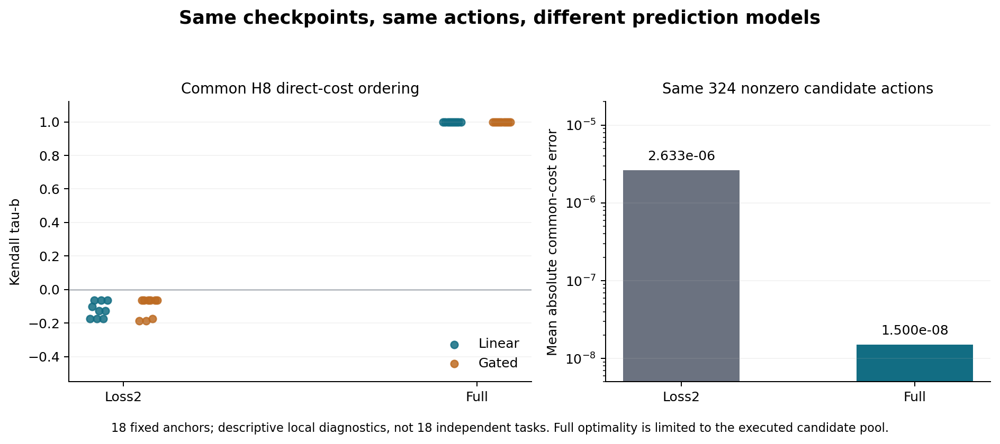
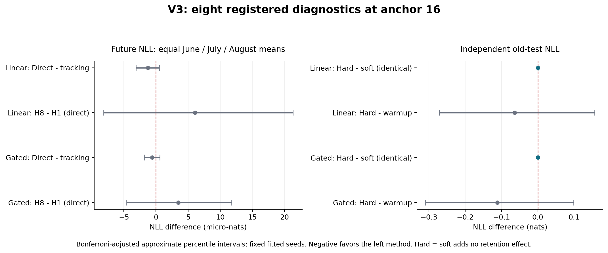

# Cell × Parameter Field V3：同完整状态下的动作排序与保留可行性

**本轮已完整执行：342/342 登记条件完成，12/12 冷进程重放通过，独立运行与最终评分审计通过。最明确的新发现是，当前 Loss2 无记忆投影模型的多步动作排序失真，而 Full 对同一候选动作的排序准确、预测误差较小。保留约束没有被激活，因此本轮不能识别硬约束的增量作用。八项预先登记的科学判据仅两项通过，且都是 hard 与 soft 完全相等的弱非劣判据。** [运行审计](run-audit.json) · [最终评分](evaluation.json) · [独立评分审计](final-audit.json)

这轮将 V2 的“内部规划目标改善，却没有证实胜过 myopic 的外部表现”拆成可核验的局部问题。我们识别出一个具体的多步预测问题，但尚未证明修复它就能带来独立任务收益，也没有完成总体保留的证明。

## 1. 实际完成的三步

| 用户要求 | 本轮实际执行 | 结果边界 |
|---|---|---|
| 同完整状态、动作预算、评分目标和时域，真实分支检验动作排序 | 3 seeds × 2 Heads × 3 anchors；每个 anchor 的 19 个候选全部先冻结，再逐一执行；两模型评价完全相同的动作 | 342 个登记条件对应 198 个不同的 anchor-action 对，不是 342 个独立干预样本 |
| 新控制开发数据，一次改变一个因素，保留不可行和失败条件 | Loss2/Full × H1/H4/H8 × tracking/direct/hard，加 zero；同预算、同 H8 实际路径；可行证书与不可行证据分开记录 | 324 个优化候选全获资格，本轮没有实际不可行或数值失败；硬约束与动作边界都未激活 |
| 独立保留验证，再冻结最终评价，旧 V1/V2 标签不再用于确认 | 624 个全新来源组件；old/current validation 与 old-test/三个未来月分离；所有预测封存后依次评分 validation、封存 validation、评分 final | 不在两阶段之间选择策略；V3 已解封标签从此也只能用于报告和后续开发，不能再次充当新策略的独立确认 |

全部证据保持 `DENY_ALL`、`production_authority=false`。这里的 Full 指小型 Head 的完整参数与 Adam 状态，不是训练整个 Encoder 或完整 LLM。

## 2. 固定身份与新数据

论文身份沿用 [ICLR-2027@f8df0a6075f58f3ab9431a889b773cdf8d6e771d](https://github.com/TrillionniumFoundation/ICLR-2027/tree/f8df0a6075f58f3ab9431a889b773cdf8d6e771d)，`revision_2026-09-26-r45`。V3 基于 [V2 完整证据提交](https://github.com/TrillionniumFoundation/hepta-private-ci/commit/3372a726affb287b97e531645ccbcc3afc91013f)，V1/V2 文件未改动。

V3 协议先发布于 [1f982fa986b3afac83e3ee29e402b9008119ecc3](https://github.com/TrillionniumFoundation/hepta-private-ci/commit/1f982fa986b3afac83e3ee29e402b9008119ecc3)，SHA256 为 `b24f22c9f4bd4a106ee4311d6a47cc31781de808f01fd6fa9e4a60853cf4afb3`。完整执行源码固定于 [c69e4e7ab55456e75476be4ca9a3bcaeaea1934c](https://github.com/TrillionniumFoundation/hepta-private-ci/commit/c69e4e7ab55456e75476be4ca9a3bcaeaea1934c)：39 项冻结源码／配置、连同新增测试与协议共 51 个本地文件，均与远端 Git blob 一致。正式运行前新增 24 个文件、修改既有文件 0 个。[协议](protocol.json) · [协议冻结](protocol-freeze.json) · [源码冻结](source-freeze.json)

| 角色 | 月份 | 来源组件数 | 作用 |
|---|---|---:|---|
| old_train / old_probe | 2014-04 | 64 / 32 | warmup 与控制保留观测 |
| old_validation / old_test | 2014-04 | 64 / 64 | 独立保留验证与最终保留评价 |
| current_train / current_probe | 2014-05 | 64 / 32 | 当前训练与控制观测 |
| current_validation | 2014-05 | 64 | 独立当前任务验证 |
| future_june | 2014-06 | 48 | 历史未来留出 |
| future_july | 2014-07 | 128 | 历史未来留出 |
| future_august | 2014-08 | 64 | 历史未来留出 |
| 合计 | | **624** | 每个角色四类平衡 |

沿用 UCI News Aggregator 的完整 story/title 联合来源组件，排除类别冲突、跨月组件、既有五 cohort，以及 V1 全部 512 和 V2 全部 480 个来源组件。固定 salt 为 `hepta-cell-action-v3-20261024`；月份与数量在新模型结果产生前按来源可行性冻结。独立 BFS 重建、抽样与身份检查通过。未来端点按三个**月份均值等权**，不按 48/128/64 行数加权。[输入审计](input-audit.json) · [数据收据](data/data_receipt.json) · [全部来源](data/sources.json)

固定真实 Granite97M Encoder：`ibm-granite/granite-embedding-97m-multilingual-r2`，revision `835ad14087e140460703cf0fae09f97d469d65c2`。624×384 的真实特征经固定、与标签无关的 QR 投影到 8 维；39 次 forward、8,853 tokens、0 截断、0 Encoder 更新。Linear/Gated Head 分别 36/52 参数，连续参数及 moments 状态为 108/156 维。完整 checkpoint 另外保存 step、采样/RNG、协议、context 和输入/源码绑定。[真实特征报告](features/report.json) · [模型文件清单](model-inventory.json)

来源隔离仅覆盖登记的来源图和历史实验。它不是对全部语义重复、预训练语料污染或宿主机访问历史的证明。

## 3. 共同动作与目标的精确定义

每个 seed/Head 先在 old_train 上 warmup 64 步，再沿普通当前任务 Adam 路径取得 offset 0、8、16 三个完整 anchor。每个候选只施加**一个首步参数干预**，后七步共同执行零额外干预，实际评价始终 H8。`zero` 仍执行八步普通 Adam。

动作在 Adam 更新后施加：`theta += h*u`，`h=0.02`，不直接更改 moments。每坐标满足 `abs(u_j) <= 1/sqrt(p)`，因此物理干预范数不超过 0.02；执行阶段没有裁剪。改变 H1/H4/H8 只改变候选目标的预测时域，不改变真实执行时长或后续动作预算。这轮是单动作反事实诊断，不是 V2 全闭环 MPC 的重复试验。

设零干预参考损失为 $L_c^0(k)$、$L_o^0(k)$，$\eta_c(k)=L_c(k)-L_c^0(k)$，旧损失锚定为 warmup 的 $L_o^w$。共同 H8 direct 目标为：

$$
J_D=\sum_{k=0}^{8}w_k\left(0.03\eta_c(k)+\frac12[L_o(k)-L_o^w]_+^2\right)
+\frac{h\rho}{2}\|u\|^2,
\qquad w_{0:7}=h=0.02,\quad w_8=1,\quad\rho=0.1.
$$

Tracking 将当前项替换成 $\frac12(\eta_c+0.03)^2$，其他项不变。Direct 的系数 0.03 匹配 tracking 在零位移处的导数，因此没有同时改变当前项的一阶尺度。Hard 保留 direct 的整个成本，只增加预测的 $L_o(k)\le L_o^w+10^{-9}$，对未来 **1–8 步**均约束；H1 hard 也使用固定 H8 约束预测。初始继承的超额单独报告，不重置旧任务锚点。

SLSQP 只产生数值候选；资格由独立的强凸性乘子下界与可行性检查决定，gap 容限 $10^{-9}$，强凸参数 $h\rho=0.002$。不可行须有对同一容差扩展 box 系统的 Farkas 分离证据，否则保留为 unresolved。它们是声明的浮点切线问题的算术证书，不是实际非线性系统、舍入区间或总体保留证明。本轮 324 个优化候选全部可行，最大独立重算 gap 为 $5.7957\times10^{-14}$；18 个固定 zero 不计为最优性证书。[运行审计](run-audit.json)

## 4. 最明确的新发现：Loss2 的多步闭合失真

所有候选均由 Loss2 与 Full 两模型对**同一动作序列**预测，然后用真实 Adam 分支评价。下面的排序保持每个 anchor 的 19 个登记候选，不事后去重；每个 anchor 实际有 11 个不同动作，ties 均按冻结的 $10^{-10}$ 容限处理。

| 共同 H8 指标 | Loss2 | Full |
|---|---:|---:|
| Direct 成本预测 MAE，324 个非 zero 候选 | 2.633302×10⁻⁶ | 1.500316×10⁻⁸ |
| Direct 平均 Kendall τ_b，18 anchors | −0.110487 | 1.000000 |
| Direct 严格候选对排序一致率 | 44.4715% | 100% |
| 预测最佳动作达到实际候选池最低成本 | 0/18 | 18/18 |
| Direct 预测最佳动作的平均实际遗憾 | 3.606676×10⁻⁶ | 0 |
| Tracking 平均 Kendall τ_b | −0.062500 | 1.000000 |

Full 在两个共同目标的 36 组排序均 τ_b=1、最佳动作实际遗憾为零；非零候选 direct 成本 MAE 比 Loss2 小约 175.5 倍。Direct 的候选池最佳为 `full_h8_direct_soft`，对应 hard 完全相同；Tracking 的候选池最佳为 `full_h8_tracking_soft`。候选池由本轮两模型生成，这不是任意动作的排序外推检验。18 anchors 来自六条 seed/Head 轨迹，不能作为 18 个独立任务；36 组排序也不是 36 次独立实验。[全部排序](ranking.json) · [机制摘要](math-summary.json)



### 误差从第二步开始分离

18/18 anchors 的第一步 `loss_maps` 逐位相同，54/54 组 H1 Full/Loss2 动作逐位相同。这与共同首步 impulse 映射的代数结构一致，是对照检查，不是额外的独立统计证据。

| 同动作损失预测 MAE | 第 1 步 | 第 2 步 | 第 8 步 |
|---|---:|---:|---:|
| Loss2 current | 4.113228×10⁻⁷ | 1.388722×10⁻⁵ | 8.138145×10⁻⁵ |
| Full current | 4.113228×10⁻⁷ | 2.786160×10⁻⁷ | 4.742482×10⁻⁷ |
| Loss2 old | 3.576333×10⁻⁷ | 5.422855×10⁻⁶ | 6.967027×10⁻⁵ |
| Full old | 3.576333×10⁻⁷ | 5.011081×10⁻⁷ | 1.613478×10⁻⁶ |

两模型都先利用完整 checkpoint 构造参考及导数。Loss2 再用 $C_{k+1}A_kC_k^+$ 做两损失的无记忆投影传播。这个对照把主要差异定位到了**当前投影与多步闭合近似**；不能推论所有二维观测、带历史摘要或学习滤波器都不可能有效，也不能宣称控制器只读取两个标量且不需完整状态校准。Full 的小误差只是本轮小幅、固定动作下的局部证据。

### 规划改善内部目标的现象仍然存在

| 共同 H8 direct 实际成本差 | 18 anchors 均值 | 改善 anchors |
|---|---:|---:|
| Loss2 H8 − H1 | −4.741844×10⁻⁷ | 18/18 |
| Full H8 − H1 | −4.080995×10⁻⁶ | 18/18 |
| Loss2 H8 − H4 | −8.274802×10⁻⁸ | 12/18 |
| Full H8 − H4 | −9.605646×10⁻⁷ | 18/18 |
| Full H8 − Loss2 H8 | −3.606811×10⁻⁶ | 18/18 |

不能把 Loss2 排序失真写成“H8 内部表现全部变坏”。H8 相对 H1 的共同实际成本确实改善，但最终未来 NLL 相对 H1 的点估计仍更差，且区间跨零。目标向外部任务转化的问题仍未解决。

同 H8 下，Direct−Tracking 的共同 direct 实际成本差在 Loss2 平均为 **+2.26455×10⁻⁸**，仅 3/18 改善；Full 为 **−2.98157×10⁻⁹**，18/18 改善。尺度很小，换目标不能独立解释本轮主要模型间差距。[机制摘要](math-summary.json)

## 5. 硬保留约束没有被激活

**108/108 hard 与对应 direct_soft 的动作逐位相同，108/108 完整终态 digest 相同，全部 hard 保留约束乘子为零。** 最小预测原始 slack 为 0.0012439177；没有一个动作碰到 box 边界。最大实际干预范数为 0.0022865875，仅范数上限的 11.43%。这轮没有触及保留可行性边界，也没有测出小 Head 的动作能力上限。[机制摘要](math-summary.json) · [外部分析](external-analysis.json)

独立保留采用每一步的**数据集平均 NLL**相对同一 warmup 的变化，再对未来 1–8 步取最大；不是先对每个样本取时间最大再平均。

| 全部 342 分支的有限样本检查 | 通过 | 所有分支中最差的未来最大平均超额 |
|---|---:|---:|
| 控制 old_probe | 342/342 | −0.0011892228 |
| 独立 old_validation | 342/342 | −0.0000968170 |
| 最终 old_test | 342/342 | −0.0016320720 |

108 个 hard 分支在三层全部通过，18 个 zero 分支也全部通过。**本轮的已测独立保留成立于这些固定来源的路径均值，但不能归因于硬约束；也不能由此宣称任务总体保留。** 旧测试相对 warmup 的抽样区间仍很宽并跨零，与有限样本均值改善不矛盾。

本轮预先保留了不可行和失败的输出路径，实际不可行数为 0。不能把“所有条件可行”解释成已经验证了不可行区间、遗忘修复效果或 Farkas 在真实压力数据上的覆盖；后者目前只有针对性合成测试。

## 6. 八项主要判据：两项通过，但没有新收益确认

全部比较固定在 anchor 16，先在三个固定 seeds 上平均，再按来源组件和类别分层配对 bootstrap 10,000 次，seed 830241。八项 family 使用 Bonferroni 调整的近似 percentile 区间，分位点 `[0.003125,0.996875]`。未来端点为三个历史月份等权均值，共 240 个来源；old-test 为 64 个来源。区间条件于这些固定拟合模型与来源，不是 seed 总体保证或有限样本分布无关覆盖。

| Head | 左−右 / 端点 | NLL 差（nat） | 调整后区间 | 预定判据 |
|---|---|---:|---|---|
| Linear | H8 direct−tracking / future | −1.258851×10⁻⁶ | [−3.105856×10⁻⁶, +4.927747×10⁻⁷] | 未通过 |
| Linear | H8−H1 direct / future | +6.085120×10⁻⁶ | [−8.136791×10⁻⁶, +2.131028×10⁻⁵] | 未通过 |
| Linear | H8 hard−soft / old-test | 0 | [0, 0] | 通过，动作完全相同 |
| Linear | H8 hard−warmup / old-test | −0.06399188 | [−0.27089460, +0.15638020] | 未通过 |
| Gated | H8 direct−tracking / future | −5.954511×10⁻⁷ | [−1.839541×10⁻⁶, +6.070390×10⁻⁷] | 未通过 |
| Gated | H8−H1 direct / future | +3.467542×10⁻⁶ | [−4.566224×10⁻⁶, +1.175669×10⁻⁵] | 未通过 |
| Gated | H8 hard−soft / old-test | 0 | [0, 0] | 通过，动作完全相同 |
| Gated | H8 hard−warmup / old-test | −0.11174616 | [−0.30935874, +0.09923240] | 未通过 |

所有表内策略均为 Loss2。前两项要求上界严格小于零，后两项要求上界不大于零。每个 Head 1/4 通过，`all_registered_diagnostics_met=false`。四项检查的是不同假设，其中前两项使用 soft、后两项使用 hard，不能把它们称为同一策略的联合效用保证。[完整评价](evaluation.json) · [独立复算](final-audit.json)



### 实际未来任务水平

以下是 anchor16 的三个固定 seeds、三个未来月份等权均值，NLL 越低越好。

| 方法 | Linear future NLL | Gated future NLL |
|---|---:|---:|
| zero | 1.301901043 | 1.291442097 |
| Loss2 H1 direct | 1.301817316 | 1.291393101 |
| Loss2 H8 tracking | 1.301824660 | 1.291397164 |
| Loss2 H8 direct / hard | 1.301823401 | 1.291396568 |
| Full H8 direct / hard | 1.301735083 | 1.291307068 |

Full 的描述性未来 NLL 更低，是值得继续核验的信号。Full−Loss2 仅属于预登记的次要比较，不能替换主要判据，也不能选显著月份充当新的确认。96 项次要比较全部报告、全部可计算；只有 8 个点态 95% 区间不含零，均为 NLL 改善且包含 hard/soft 重复，未做这 96 项的 family 校正。[外部分析](external-analysis.json)

anchor16 下每个 seed/Head/role 的 19 种方法 accuracy 均相同，48 项 accuracy 次比较差均为零。Loss2 H8 direct 相对 zero 的 current_validation NLL 点估计反而上升 **4.446785×10⁻⁵ / 2.629581×10⁻⁵**，未来等月 NLL 则下降 **7.764213×10⁻⁵ / 4.552908×10⁻⁵**；Full H8 direct 对两者均小幅改善。这些量没有新增确认区间，说明内部 probe、同月验证和未来月份不能相互代替。

## 7. 完整状态与独立审计

正式实验只执行了一轮。全部候选在 **2026-10-25 00:35:02 UTC** 冻结，此后才执行候选分支；运行及预测在 **00:35:19 UTC** 封存。验证标签打开于 **00:36:18.581 UTC**，验证报告于 **00:36:18.663 UTC** 封存，最终标签随后于 **00:36:18.664 UTC** 打开。期间没有策略选择或修改。[执行记录](formal-execution.json) · [候选冻结](candidate-freeze.json) · [路径封存](pre-evaluation-seal.json) · [验证访问](validation-label-access.json) · [最终访问](final-label-access.json)

| 核验 | 实际覆盖 |
|---|---|
| 定向测试 | 53/53 通过，8.501 s；覆盖动作预算、凸证书、Farkas、非有限结果、失败保留、重放、评分/源码篡改与标签门禁 |
| 封存 | 3,023 文件、61,710,742 bytes；候选冻结清单 859 文件；全哈希一致 |
| 独立运行审计 | 14,176,014 个标量等式，最大绝对误差 2.1684×10⁻¹⁹；不导入主 planner 或训练状态实现 |
| 数值资格 | 324 优化候选全部通过；最大重算 gap 5.7957×10⁻¹⁴；18 zero 不冒充最优解 |
| 冷进程重放 | 固定六个 anchor16/Loss2 H8 direct：整段八步和中点后四步，共 12/12；逐位动作、states、moments、观测、receipts、完整终态 manifest 一致 |
| 服务 Head | 342/342 保存／加载后的预测 roundtrip 一致 |
| 独立评分 | validation 684、final 1,368 个 condition-role，72 组排序、8 主区间与 96 次区间全部重算；26,408 个数值比较最大差 9.7145×10⁻¹⁷ |

Whole replay 从完整 checkpoint 重新求解首步动作及证书；midpoint 恢复 step4 并执行固定零后缀，不冒称重新选择了反馈策略。Full-batch 的 RNG/采样状态被保存和验证，但本轮不含随机 minibatch，也不证明任意宿主机断电恢复。时间和 open-hook 是本地证据，不是远程宿主机证明。[运行审计](run-audit.json) · [评分审计](final-audit.json) · [测试日志](logs/cell-action-v3-final-tests.log)

源码解封门禁会逐项核对整个冻结源码清单，包括旧有指标与序列化辅助模块。开发中的合成全链校验与正式 V3 明确分开，没有使用真实最终标签调试算法或选择策略。`just fmt` 退出 0；本地为部分校验 checkout，格式工具报告无待格式化文件，不将其描述为完整仓库测试。

## 8. 实际成本与证据恢复

| 记录阶段 | wall time / 内存 |
|---|---:|
| Encoder 模型加载 | 7.306 s |
| 真实 624 行特征编码 | 5.617 s；CPU 21.518 s；RSS 峰值约 1.321 GB |
| 18 个共同 reference 构造之和 | 15.798 s |
| 正式运行器，包括候选、342 分支与冷重放 | 36.360 s；parent CPU 26.472 s；RSS 峰值约 238.5 MB |
| validation/final 主评分 | 0.888 s |

Reference、planning、branch 时间属于运行器内部，不能再次与总时间相加。冷进程 CPU 未单独计量；前置数据准备、后续审计、写报告与发布不计入 36.360 s。两维观测并不代表整个控制器只存两个数：参考、导数、动作映射、求解与证据都有成本。[特征报告](features/report.json) · [资源字段](math-summary.json)

全部来源、标签、特征张量、候选参数、证书、真实路径、checkpoint、Head、冷重放子进程产物、源码快照、评分、测试及执行日志都在完整 raw archive。512 KiB 分片便于通过 GitHub 内容接口逐片恢复；[清单](raw-evidence-manifest.json) 给出每片 SHA256/Git blob SHA1、整包 SHA256 和每个归档成员的身份。[恢复核对](archive-recovery.json) 逐成员验证归档内容，并确认所有分片拼接与整包一致。

可直接阅读 [分 anchor 的运行索引](runs-index.json)、[完整评价](evaluation.json)、[验证报告](validation.json)、[机制摘要](math-summary.json)、[外部分析](external-analysis.json)。11 MB 的完整机制分析含 72 组全部候选对及 342 个原始动作/响应，位于 archive 的 `raw/support/cell-action-v3-math-analysis.json`；它不替换封存原始轨迹。

在此目录拼接与展开：

```bash
cat raw/part-*.bin > cell-action-v3-complete-evidence.tar.xz
sha256sum cell-action-v3-complete-evidence.tar.xz
tar -xJf cell-action-v3-complete-evidence.tar.xz
```

在展开后的 `raw` 所在目录，用冻结的源码运行只读审计：

```bash
PYTHONDONTWRITEBYTECODE=1 OPENBLAS_NUM_THREADS=1 OMP_NUM_THREADS=1 MKL_NUM_THREADS=1 \
python raw/run/source/cell_field_action_audit.py \
  --runs raw/run --data raw/data --protocol raw/run/inputs/protocol.json \
  --output reproduced-run-audit.json

PYTHONDONTWRITEBYTECODE=1 OPENBLAS_NUM_THREADS=1 OMP_NUM_THREADS=1 MKL_NUM_THREADS=1 \
python raw/run/source/cell_field_action_audit.py \
  --runs raw/run --data raw/data --protocol raw/run/inputs/protocol.json \
  --evaluation raw/evaluation --output reproduced-score-audit.json
```

主运行使用 Python 3.12.14、NumPy 2.3.5、SciPy 1.17.0。Encoder 的独立环境为 Torch 2.10.0+cpu、Transformers 5.20.2、NumPy 2.2.6；模型权重由 revision 和文件 inventory 固定，未重复塞入 archive。旧 replay job 中的绝对路径记录原执行现场；只读审计使用展开后的相对证据，不要求再次创建原现场目录。实际运行完整环境信息见运行索引与特征报告。

源码按八个可审阅 draft PR 分段，每段不超过 800 行；protocol-first 提交保持独立历史。PR [3814](https://github.com/TrillionniumFoundation/hepta-private-ci/pull/3814)–[3821](https://github.com/TrillionniumFoundation/hepta-private-ci/pull/3821) 分别覆盖协议/数据、输入审计、控制、IO/重放、运行器、评分、数学/评分审计和状态/重放审计。[源码 PR 清单](source-prs.json)；完整 evidence 单独提交，生成数据与二进制属于机械证据附件。

## 9. 对论文与 Hepta 的 comments，以及下一项优先工作

**参数场方法与 Hepta 的有效接点，是把完整训练状态、观测、动作响应、目标和证据检查放进一个可重放的局部控制问题。V3 进一步表明，控制意义上的观测压缩必须用同动作多步响应检验，不能仅由低维指标看起来合理来认定闭合。**

本轮支持以下有边界的判断：完整状态和 Full 切线模型在这些小型 Cell、固定候选动作上提供了有效的局部诊断；当前两损失无记忆投影在多步传播中丢失了对动作排序重要的内容；单纯把当前目标改成 direct 未确认外部收益；硬约束在本轮无增量，因为约束全程松弛。它没有证明 LLM 参数场理论整体成立/不成立，没有证明任何两维控制都不可能，也没有证明完整 Hepta 多 Cell 系统具备全局规划收益。

**下一项优先做“固定动作库的多步闭合与记忆对照”。** 保持 Encoder、Head、共同状态、预算、目标和 H8 固定，用独立于两模型优化器生成的预登记 bounded directions 补充动作库；对照当前 memoryless Loss2、Loss2 加固定短历史／优化器摘要、Full。先在开发来源验证逐步响应、排序与遗憾，再冻结方法和新的最终来源。这样可直接检查第二步开始的误差能否修复，并检验排序能否扩展到模型未生成的动作。

保留可行性需要另一个有识别力的开发压力区间：预先登记一组任务/训练时长/预算条件，完整报告 soft 违规、hard 可行且激活、hard 不可行及数值 unresolved 各区间；不能在最终测试结果上挑出“有效”的条件。完成开发和方法冻结后，再使用新的独立保留验证及最终来源。V1/V2/V3 已打开的最终标签只保留为报告与机制证据。

当前没有依据优先扩大 Head 或多 Cell：本轮动作只用了范数上限的一小部分，没有触到模块能力边界；已有证据首先要求改进多步模型，并继续验证内部成本是否真正转化为独立任务收益。
