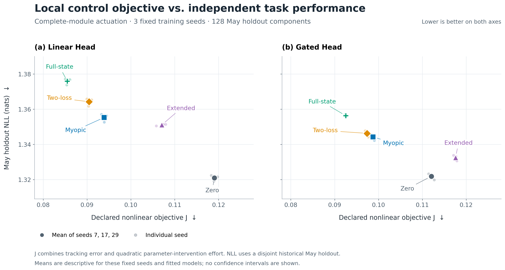

# Cell × Parameter Field：完整状态可重放的联合实验

日期：2026-10-24。状态：**60/60 条件完成；独立审计通过；外部任务收益未成立；仅研究证据，`DENY_ALL`。**

## 结论先行

本轮把《A Parameter Field Theory of LLMs》的局部状态压缩、递归控制、同动作全状态参照和动作空间限制，接到了 Hepta 已有的真实共享 Encoder、可训练 Cell Head 与证据接口上。它已经成为可执行、可重放、可检查的实验，而不是架构类比。

结果支持的是**工程闭环与数值分析接口成立**。它没有支持“当前参数场控制器给 Hepta 带来了独立任务收益”。开放全部 Head 参数时，两损失递归控制 `loss2` 相对 `myopic` 降低预设目标约 3.66%（Linear）和 1.38%（Gated），但五月历史留出 NLL 均变差。增加优化器摘要的 `extended` 在全部 12 个配对模型／动作条件中都没有改善目标。

本轮还定位到一个具体目标问题：旧任务项采用双侧平方跟踪，**旧任务损失下降也会被惩罚**。控制器通过撤回一部分 old-probe 改善来降低目标。这个现象必须保留为结果，不能把它包装成“保留能力提升”，也不能在看到留出结果后换目标覆盖本轮。

主要原始证据见 [运行记录](run-summary.json)、[最终评价](evaluation.json)、[独立数学分析](math-audit.json) 和 [全部均值及主要对照](results.json)。

## 一、六个环节实际做了什么

| 环节 | 本轮执行 | 证据 |
|---|---|---|
| 固定环境 | 同一真实 Granite 97M Encoder、预处理、来源组件、任务、Head 拓扑、初始化、协议；Encoder 冻结 | [协议](protocol.json)、[特征报告](feature-report.json) |
| 完整训练状态 | 保存参数、Adam 一／二阶矩、step、RNG、sampler、训练上下文和身份绑定；冷进程重新计算控制动作与续训 | [状态审计](state-audit.json) |
| 观测对照 | `loss2` 使用当前／旧任务两项 probe loss；`extended` 再加两项 probe gradient 与 Adam 一阶矩的内积 | [控制实现](../../cell_field_control.py) |
| 动作对照 | `bias` 只允许输出偏置，`all` 允许整个小 Head；同一物理动作单位与 effort 价格 | [运行审计](run-audit.json) |
| 控制对照 | `zero`、单步 `myopic`、两损失 Riccati 递归、扩展观测 Riccati、同动作全状态切线参照 | [完整运行记录](run-summary.json) |
| 独立评价 | 全部 60 条轨迹、checkpoint 和预测封存后才读取最终标签；独立复算任务指标、保留指标、成本和区间 | [标签访问顺序](label-access.json)、[评分审计](final-audit.json) |

### 源码与模型身份

- Hepta 基线：[`4b3081c25af86f707a5c0d50c688c959a04af446`](https://github.com/TrillionniumFoundation/hepta-private-ci/commit/4b3081c25af86f707a5c0d50c688c959a04af446)，已有 stage25 共享 Encoder／Cell 接口。
- 本轮六段源码：[`87641f069a7830b46fdeaaf34d417635c5f5d463`](https://github.com/TrillionniumFoundation/hepta-private-ci/commit/87641f069a7830b46fdeaaf34d417635c5f5d463)。基线代码没有被替换，新增研究模块独立放在 `qa/stem-bakeoff`。
- 论文：[`ICLR-2027@f8df0a6075f58f3ab9431a889b773cdf8d6e771d`](https://github.com/TrillionniumFoundation/ICLR-2027/tree/f8df0a6075f58f3ab9431a889b773cdf8d6e771d)，`revision_2026-09-26-r45`。
- Encoder：`ibm-granite/granite-embedding-97m-multilingual-r2`，revision `835ad14087e140460703cf0fae09f97d469d65c2`；加载前后检查完整模型清单，Encoder 更新次数为 0。
- 精确文件哈希见 [source-pins.json](source-pins.json)。协议 SHA256：`d0f3f8bc92a47bfac4afbb6595b93772b68aa248bf09d6b71fb90be6c64a64f1`。

## 二、任务与样本隔离

使用 UCI News Aggregator 的四类新闻标题：business、entertainment、health、science/technology。同一个分类任务跨历史月份迁移，不是不同任务族，也不是面向未来部署的前瞻实验。

| 来源角色 | 月份 | 样本／独立组件数 | 用途 |
|---|---|---:|---|
| `old_train` | 2014-03 | 64 | 旧环境 warmup |
| `old_probe` | 2014-03 | 32 | 控制观测与目标 |
| `old_test` | 2014-03 | 64 | 最终保留评价 |
| `current_train` | 2014-04 | 64 | 当前环境 Adam 更新 |
| `current_probe` | 2014-04 | 32 | 控制观测与目标 |
| `future_may` | 2014-05 | 128 | 最终历史时间留出 |
| `future_june` | 2014-06 | 128 | 最终历史时间留出 |
| 合计 | | **512** | 每个角色四类平衡 |

先在全部 422,935 条有效记录上，按 story ID 与归一化标题建立联合连通组件，再做分割。原 ZIP 有 422,937 行；既有解析规则丢弃了两条缺 publisher 的记录。排除跨月组件、标签冲突组件，以及触及已有五组新闻 cohort 的全部组件。每个选中组件只取一行，所有角色之间没有组件重叠。独立审计用邻接表遍历重新构造组件，没有调用准备器的 union-find，复现了 3,172 个组件及全部固定抽样结果。[输入审计](input-audit.json)

初始计划的 March 配额需要每类 80 个组件，但严格排除后 health 只剩 77 个。因此在 Encoder 提取与任何模型结果产生之前，下调训练／probe／旧任务测试样本数，保留全部隔离条件。初始提案、失败的可行性尝试、[修订说明](source-feasibility.json) 和 [本地冻结收据](protocol-freeze.json) 均保留。这是本地预冻结，不是独立外部预注册。

数据出处：Gasparetti, F. (2017), [News Aggregator, UCI Machine Learning Repository](https://doi.org/10.24432/C5F61C)，CC BY 4.0。源 ZIP SHA256：`1f5f08691f0ce576cb0b5cfdbcb8c55e0ec14dda8f3e07933da72c500338845a`。本轮做了分组、排除、抽样和特征提取；没有声称这些标题从未进入 Encoder 预训练。

## 三、被控制的系统与目标

真实 Encoder 生成 512×384 特征。为让完整状态参照在普通 CPU 上可计算，使用预先固定、与标签无关的 Gaussian QR 正交投影，384→8，seed=20261024。这个实验结论限定于该八维输入小 Head，不能直接外推到完整 384 维 Head 或 97M Encoder 参数控制。

两种 Head 复用已有 `NumpyCellHead` 的实际实现：Linear 有 36 个参数，Gated 有 52 个参数。完整动态状态为参数及 Adam 一／二阶矩，分别为 108 和 156 维，step 是明确记录的时间索引。三组初始化 seed 为 7、17、29。旧环境先 warmup 64 步，然后保留全部状态切换至当前环境，控制 24 步。全批次确定训练，`Q=0`。

每个 seed／Head／动作空间比较五个策略，共 `3×2×2×5=60` 条路径。它们对应六个 warm-start Head，不能当作 60 个独立任务。`zero` 仍执行普通当前任务 Adam 更新，只是不加额外控制干预。

设无干预参考轨迹为 `x̄_k`，两损失场为：

\[
\eta_k=\begin{bmatrix}L_c(x_k)-L_c(\bar x_k)\\L_o(x_k)-L_o(\bar x_k)\end{bmatrix},\qquad
r_k=\begin{bmatrix}-0.03\\L_o(x_0)-L_o(\bar x_k)\end{bmatrix}.
\]

全部策略采用同一个实际评分目标：

\[
J=\frac12\|\eta_T-r_T\|^2+
\frac h2\sum_{k=0}^{T-1}\left(\|\eta_k-r_k\|^2+0.1\|u_k\|^2\right),\qquad h=0.02.
\]

每步先执行真实 Adam，再向允许的参数坐标加 `h B u_k`。这一额外干预不直接修改 optimizer moments；其后续影响由真实训练动态产生。运行没有动作裁剪。`bias` 有 4 个动作维度，`all` 分别有 36／52 个。参数坐标二次 effort 是声明的控制代价，不是能耗或 wall time。

`loss2` 和 `extended` 分别从自己的投影动态构造有限时域 Riccati 策略。扩展观测包含两项 `gradient(probe loss) · Adam first moment`，需要直接读取优化器摘要。所有策略仍只为两项 loss 支付状态成本。没有增加第三个目标来偏袒扩展观测。

`full` 是**同动作、同目标、同参考切线数组**上的全状态最优控制参照。它不是原始非线性训练过程的全局最优策略。有限差分与半步长检查、moment 的解析导数、完整递推数组都已保存。

## 四、完整状态与独立复核

初始 35 个定向测试全部通过。其后 auditor 新增了最终标签边界、完整 census 与初始身份的拒绝检查，相应测试 fixture 增加一个标记；数值算法未改。最终两个 auditor 测试另行通过，并在其后执行 `just fmt`，退出 0，报告没有需要处理的变更文件。旧 35-test 日志不被当作这两份最后变更文件的最终版本测试证明；所有训练／控制／评价源码保持不变。科学执行和证据复核另行记录。[初始测试日志](test-results.log)、[最终审计测试](audit-tests-final.log)、[格式日志](format-results.log)

所有 60 条正式路径完成，失败数 0。终态模型经已有 serving 保存／加载接口 roundtrip，预测一致。对六个 `all/loss2` 模型各做两种冷进程反馈重放：从 step 64 重做完整 24 步；在 step 76 中断，恢复后重做剩余 12 步。12 条路径的参数、moments、动作、观测、transition receipts、完整状态 metadata 与最终 digest 全部逐位一致，终态均为 step 88。额外逐一核对了全部 60 个终态 checkpoint 与保存轨迹。[状态审计](state-audit.json)

全部预测和 652 个文件在读取最终标签前封存，文件合计 87,725,052 bytes，不含 seal。封存 SHA256：`68c5b247fa399901fea32076e11ed0a4a5149cbd52ba3690ff1bdc09adf66549`。独立运行审计不导入主控制求解器，重算 5,233,464 个标量；最终评价审计不导入评价器，复算 180 条 condition-role 记录、18 条初始记录以及 96 个区间，1,638 个标量比较完全一致。[运行审计](run-audit.json)、[最终审计](final-audit.json)

Bellman advantage 恒等式的独立误差约 `7e-17`，参数方向半步长相对差异最大约 `1.16e-9`。这些证据验证有限数组与实现一致性，不是对任意非线性轨迹的余项证明。本轮 full-batch 的 sampler draw count 为零；恢复接口对随机采样有单元测试，但本轮没有随机训练路径证书。

## 五、内部控制目标结果

下表为三组固定 seed 的算术均值，越低越好。

| Head／动作 | Zero | Myopic | Loss2 | Extended | Full |
|---|---:|---:|---:|---:|---:|
| Linear／bias | 0.119031 | 0.118829 | 0.118781 | 0.125149 | 0.118335 |
| Linear／all | 0.119031 | 0.093894 | **0.090458** | 0.107048 | 0.085494 |
| Gated／bias | 0.112053 | 0.112201 | 0.112122 | 0.121495 | 0.111756 |
| Gated／all | 0.112053 | 0.098735 | **0.097374** | 0.117561 | 0.092541 |

`loss2` 在 12/12 个 seed／Head／mask 配对中比 `myopic` 的 J 低；但 bias 动作下差异很小，单模型相对改善约 0.028%–0.095%。`extended` 在同样 12/12 配对中都比 `loss2` 差。不能把这个结果解释为“更多信息有害”：我们没有求解更大信息策略类中的真正最优策略，重新投影并求 Riccati 得到的控制器并不构成性能单调的嵌套最优类。[数学审计](math-audit.json)

六个模型的同动作全状态 oracle 满足 `V_all ≤ V_bias`。放开动作相对 bias oracle 的 J 改善约为 Linear 24.98%–25.27%、Gated 15.68%–16.36%，说明在这个局部目标下，actuation restriction 确实可测。本轮实际部署也观察到相同动作排序，但不能把观察提升为一般非线性单调性。

### 为什么降低 J 不能叫“保留提升”

将定义代入，旧任务误差实际是 `L_old(x_k) − L_old(x_0)`。平方后，改善和遗忘都要付费。例如 seed7 Linear：warmup old-probe NLL=1.87156，普通无干预继续训练后降到 1.42502。这一改善在冻结目标中却形成较大的 tracking error。

`all/loss2` 相对 `zero` 的三 seed 均值为：

| 量 | Linear | Gated |
|---|---:|---:|
| Current probe 终点 NLL 变化 | −0.02102 | −0.01573 |
| Old probe 终点 NLL 变化 | **+0.10609** | **+0.05577** |
| Current tracking 成本变化 | −0.000536 | −0.000469 |
| Old tracking 成本变化 | −0.049900 | −0.027163 |
| Effort 成本增加 | +0.021863 | +0.012954 |
| 总 J 变化 | −0.028573 | −0.014679 |

Tracking 的减幅有 Linear 98.94%、Gated 98.30% 来自旧任务双侧跟踪项。控制器确实优化了目标，却部分撤回了旧 probe 的改善。目标失配清晰可见；外部退化仍不能全部因果归于这一因素，因为 probe 大小、投影与时间分布没有独立消融。

## 六、最终独立任务与保留结果

以下是开放全部参数时的三 seed 均值。NLL 单位为 nat，越低越好；括号为 accuracy，越高越好。

| Head | 策略 | Old test NLL（acc） | May NLL（acc） | June NLL（acc） |
|---|---|---:|---:|---:|
| Linear | Zero | 1.41394（43.75%） | 1.32101（45.57%） | 1.27103（46.61%） |
| Linear | Myopic | 1.42445（43.75%） | 1.35531（42.45%） | 1.28632（48.96%） |
| Linear | Loss2 | 1.42651（42.19%） | 1.36426（42.45%） | 1.29259（49.22%） |
| Linear | Extended | 1.43014（43.75%） | 1.35108（43.23%） | 1.28546（48.70%） |
| Linear | Full | 1.43956（42.71%） | 1.37588（43.23%） | 1.29984（48.96%） |
| Gated | Zero | 1.40369（45.31%） | 1.32190（40.89%） | 1.26535（43.23%） |
| Gated | Myopic | 1.40970（45.31%） | 1.34429（39.84%） | 1.27530（45.05%） |
| Gated | Loss2 | 1.40913（45.31%） | 1.34629（39.84%） | 1.27630（45.05%） |
| Gated | Extended | 1.41403（45.31%） | 1.33251（41.15%） | 1.26988（42.45%） |
| Gated | Full | 1.41458（45.31%） | 1.35630（39.32%） | 1.28179（44.53%） |

全部 bias 条件、各 seed、balanced accuracy、Brier score 以及相对 warmup 的变化都保存在 [evaluation.json](evaluation.json) 和 [results.json](results.json)，没有按表现筛选条件。

预先指定的主要外部对照 `all/loss2 − all/myopic`：

| Head | 历史时间留出 | NLL 差 | 点态条件 95% bootstrap 区间 |
|---|---|---:|---:|
| Linear | May | **+0.008947** | [+0.004752, +0.013815] |
| Linear | June | **+0.006273** | [+0.001174, +0.011765] |
| Gated | May | **+0.002000** | [+0.000124, +0.003916] |
| Gated | June | +0.000998 | [−0.001053, +0.003160] |

正值表示 Loss2 的 NLL 更差。Bias 条件的主要 NLL 对照区间都跨零。Accuracy 有的相同、有的改善，不能把 NLL 的结论改写成“所有任务指标全部下降”；同样，不能挑出 accuracy 的改善来宣称整体获胜。

区间以来源组件为单位，按四类分层做 2,000 次配对 bootstrap；同一来源在方法与 seed 间配对，先对固定三个 seed 的逐样本差取平均，再重采样。每个 future cohort 的有效来源数为 128，不是 384。它们是条件于当前已拟合模型和选定历史 cohort 的点态区间，没有多重比较、seed 总体或前瞻分布保证。[评价实现](../../cell_field_evaluate.py)



## 七、资源与可计算性

| 阶段 | 本次记录的 wall time |
|---|---:|
| Encoder 加载 | 10.399 s |
| Encoder 编码，32 次 forward／7,257 tokens | 15.534 s |
| 六组 warmup 合计 | 0.382 s |
| 六组参考轨迹／导数构建合计 | 17.949 s |
| 60 个策略构造合计 | 0.564 s |
| 60 条实际 24 步控制路径合计 | 2.405 s |
| Tangent 诊断合计 | 1.258 s |
| 12 次冷进程重放合计 | 3.281 s |
| 运行器记录的 parent wall | 31.091 s |

编码没有截断输入；512×384 特征被全部策略复用。Encoder 编码 CPU 为 41.159 s；训练／控制运行器 parent CPU 为 23.443 s。Encoder 进程峰值 RSS 约 1.37 GB，训练／控制进程约 96.7 MB。这两个峰值来自不同进程，不能相加称为并发峰值。

阶段计时并不穷尽、部分嵌套；运行器 wall 在最终 seal 写入之前记录，不能作严格全流程耗时。各策略运行中都计算了共同诊断所需 probe 梯度，所以在线时间不是专门优化的生产推理基准。能耗和 recovery 子进程 CPU 未独立测量。八维投影使全状态参照便宜，但也限定了科学外推范围。[状态／资源审计](state-audit.json)、[特征报告](feature-report.json)

## 八、对论文和 Hepta 的 comments

1. **论文可以给 Hepta 提供可测的控制分析层。** 完整 optimizer state、投影闭合误差、同动作 oracle 和嵌套 mask 现在都有实际对象与可审计数值。其当前价值首先是分辨问题出在哪里。
2. **不能把理论局部最优或内部 J 改善直接作为任务收益证据。** 本轮已经给出一个可复现的反例式工程现象：full 的 J 更好，外部 NLL 也未随之改善。目标正确性必须先于生产策略选择。
3. **动作受限与信息／策略误差应分别报告。** 同动作 tangent oracle 的差可测，但这里仍是 combined information/policy gap。`Q=0`、固定初态与点轨迹没有识别不可约信息损失，也没有随机未来路径证书。
4. **更丰富的观测需要更好的动态建模与策略验证。** Extended 在 tangent 完整系统中已回退，并不是只在非线性部署时突然失稳。沿各自策略路径、按共同两项 loss 单位测量时，extended 的 closure forcing 更大；这不是控制 occupancy 后的因果消融。
5. **完整状态恢复应成为研究接口的基础合同。** 本轮解决了续训状态缺失这一混淆因素，但还没有验证生产进程崩溃、断电原子性或部署授权。

### 下一轮优先级

首先修正保留目标语义，再扩大控制器。一个候选是最小化当前任务风险与真实资源预算，同时约束：

\[
L_o^{\mathrm{probe}}(x_k)\le L_o^{\mathrm{probe}}(x_0)+\delta.
\]

也可以用单侧 `max(0, L_old − anchor − δ)^2` 惩罚。这样，旧任务改善不会被当作错误。带不等式／hinge 的控制问题不再直接等同本轮无约束 LQ，需重新声明求解器和适用保证。

新一轮应在新的来源组件上预冻结，保持相同真实 Encoder、完整状态、动作单位与最终标签封存流程。先比较普通 Adam／myopic／loss2 与独立任务结果，再研究历史观测或 optimizer summary 的增益；同时加入“同一真实状态路径上的观测消融”，将闭合建模误差与策略诱导的轨迹差异分开。本轮结果和所有负面比较保留，不用已解封的 May／June 标签选新参数。

## 九、复现与归档

### 解包已执行证据

在本目录运行：

```bash
cat archive/raw-evidence.tar.xz.part-* > raw-evidence.tar.xz
sha256sum -c archive.sha256
tar -xf raw-evidence.tar.xz
```

分片顺序、大小、SHA256 和 Git blob SHA1 见 [archive-parts.json](archive-parts.json)。[archive-members.json](archive-members.json) 记录每个归档成员的 SHA256；归档生成后已重新读取并逐项验证全部 652 个 pre-evaluation 文件。归档包含数据预测字段与标签、真实 384 维特征、全部模型与完整 checkpoint、参考／控制器／轨迹／切线数组、预测、source copies、评价、初版审计及执行日志。不包含可公开按固定 revision 获取的 Encoder 权重或完整源 ZIP。当前目录的最终输入审计与数学补充报告也一并保留；归档内早期输入审计是历史收据，不替代本目录最终源码绑定的输入审计。

从仓库根目录独立复核（`EVIDENCE` 指向上面解包后的绝对路径）：

```bash
PYTHONDONTWRITEBYTECODE=1 OPENBLAS_NUM_THREADS=1 python qa/stem-bakeoff/cell_field_audit.py \
  --data "$EVIDENCE/data" --runs "$EVIDENCE/run" \
  --protocol "$EVIDENCE/run/inputs/protocol.json" \
  --evaluation "$EVIDENCE/evaluation/evaluation.json" \
  --output /tmp/cell-field-reaudit.json
```

重新执行训练／控制时，使用新输出目录，以保存的真实特征作为输入：

```bash
PYTHONDONTWRITEBYTECODE=1 OPENBLAS_NUM_THREADS=1 OMP_NUM_THREADS=1 MKL_NUM_THREADS=1 \
python qa/stem-bakeoff/cell_field_run.py \
  --data "$EVIDENCE/data" --features "$EVIDENCE/features" \
  --protocol "$EVIDENCE/run/inputs/protocol.json" --output /tmp/cell-field-rerun

PYTHONDONTWRITEBYTECODE=1 OPENBLAS_NUM_THREADS=1 python qa/stem-bakeoff/cell_field_evaluate.py \
  --run-directory /tmp/cell-field-rerun --data "$EVIDENCE/data" \
  --protocol "$EVIDENCE/run/inputs/protocol.json" --output /tmp/cell-field-reevaluation
```

训练／控制环境为 Python 3.12.14、NumPy 2.3.5、SciPy 1.17.0；特征提取环境为 PyTorch 2.10.0+cpu、Transformers 5.20.2、NumPy 2.2.6。精确跨机器逐位等同性还取决于数值运行时；本轮证明的是所记录环境中的冷进程重放。`math-analysis.py` 保留实际分析脚本与哈希，其中有本次执行的绝对路径；通用复核入口是上面的 `cell_field_audit.py`。

所有变更通过依赖顺序的研究分支／draft PR 提供评审。没有合并或启用生产策略；远端 CI 不是本次本地验证结论的一部分。

### 评审顺序

| PR | 内容 |
|---|---|
| [#3655](https://github.com/TrillionniumFoundation/hepta-private-ci/pull/3655) | 完整学习状态 |
| [#3656](https://github.com/TrillionniumFoundation/hepta-private-ci/pull/3656) | 参数场控制与 oracle |
| [#3657](https://github.com/TrillionniumFoundation/hepta-private-ci/pull/3657) | 冻结协议、来源分组与真实特征 |
| [#3658](https://github.com/TrillionniumFoundation/hepta-private-ci/pull/3658) | 运行器、封存与冷进程重放 |
| [#3659](https://github.com/TrillionniumFoundation/hepta-private-ci/pull/3659) | 独立最终任务评价 |
| [#3660](https://github.com/TrillionniumFoundation/hepta-private-ci/pull/3660) | 独立证据审计 |

本目录作为第七段 evidence PR，以上一段审计分支为 base。源文件已逐一通过 [远端内容一致性校验](remote-source-verification.json)。
