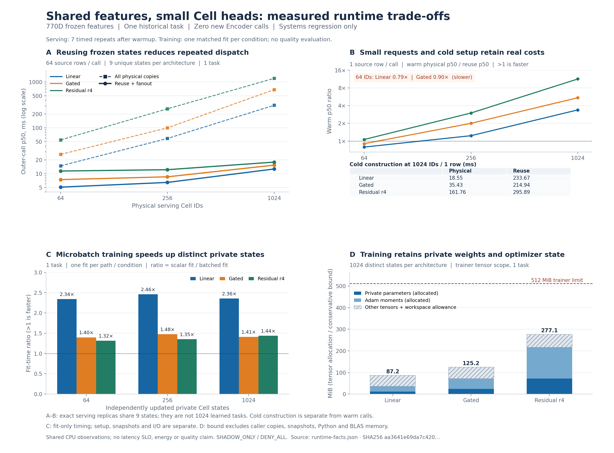

# 770D 共享特征与轻量 Cell：本地运行、私有训练和恢复

本轮补齐了一个实际接口缺口：上一阶段训练出的 Head 使用 bounded prior-mixture 校准，原有批量运行器不能直接安全地消费这份校准状态。新增适配层把真实预测器、外部特征身份、独立提供的校准上下文和完整校准记录绑定为不可变状态，并接通批量执行、缓存、路由和恢复。

主实验已经完成全部 **27 个服务条件、9 个私有训练条件和 3 个真实队列任务**。服务的 physical/logical 输出逐位一致；独立私有训练符合预先固定的数值误差界限。共享表示加轻量 Head 的实际运行成本由本地测量支撑，但本轮没有取得新的任务质量资格，也没有接入原生生产执行。所有产物保持 **`SHADOW_ONLY / DENY_ALL`**。

这是上一份[前瞻诊断动作研究](../20261024-prospective-action/README.md)的增量工程阶段。没有访问或等待远端 CI。数值协议、来源和完整验收边界见 [CELL_RUNTIME_770_PROTOCOL.md](../../CELL_RUNTIME_770_PROTOCOL.md)；本报告的数值直接来自固定原始观察，由 [derive_runtime_facts.py](source/derive_runtime_facts.py) 提取到 [runtime-facts.json](runtime-facts.json)。恢复验收和源码、归档定位见 [CLOSURE.md](CLOSURE.md) 与 [REPRODUCE.md](REPRODUCE.md)。

## 1. 本轮解决的具体问题

| 缺口 | 实际改动和验证 | 边界 |
|---|---|---|
| 旧批量接口与真实校准不兼容 | 新增 `BoundedCalibratedCellRuntime`，保留原有校准公式 | 未重新拟合校准 |
| 同一维度容易被误当作同一特征空间 | 外部 feature/context digest、实际 Head digest、task 和完整校准一起参与绑定 | 不允许仅修改自描述 manifest 来跨空间复用 |
| 分类接受与正向动作接受混淆 | 分开返回 `classification_accepted_mask`、`positive_action_mask` | 高置信度负类不构成执行动作许可 |
| 副本数被误当作任务数 | 服务精确状态复用与独立私有训练分成两套实验 | 两套实验各自只有一个任务 |
| 训练后的 Head 继续沿用旧校准 | 发布新预测器时明确使旧校准失效 | 新 Head 处于未校准状态 |
| 保存参数不足以证明可恢复 | 保存全部批量训练参数、校验所有 Cell 摘要，并执行异路径 fresh-process 恢复 | 不恢复未保存的 Adam 中间状态 |
| 包装和运行成本容易漏算 | 外层进程树成本、嵌套分解、未知项分别保存 | 已知成本小计不等于完整项目成本 |

这些实现使用已有 `LogicalCellRouter`、`BatchedCellRuntime`、`FrozenTrainingBank`、`MicrobatchCellTrainer` 和 `TrainingQueue`。没有改写以前冻结的数值算法。44 个相关独立测试覆盖校准绑定、输入上限、NPZ 头部和解压尺寸校验、快照隔离、缓存、私有训练一致性、队列接管和发布字段校验；历史重复运行另计成本，不被累计为额外独立测试。

## 2. 输入、来源与“一个任务”的含义

本轮使用上一阶段 Granite clean-field770 的冻结特征。两个真实字段分别经过共享 Granite 编码；其两个 384 维表示通过逐项乘积、绝对差、cosine 和 Jaccard 构成 770 维任务输入。770 维不是另一个 770 参数或 770M 模型，也不是新训练出的 Encoder。

可搬移输入 bundle 共 **5,898,085 B**，保留 27 份已训练 Head 与其完整校准、96 条原始完整来源记录及绑定。三种结构各有 9 个 seed/budget 状态。服务使用按 SHA256(source_id) 排序的前 64 个历史输入，不按结果标签选择；完整文件清单验证会散列训练文件，但服务加载器不解码或使用训练目标标签。训练使用原封存 seed-7/n32 bank：32 个不同训练 bug，每类 16 行。

| 维度 | 本轮实际含义 |
|---|---|
| 64 / 256 / 1024 Cell IDs | 服务端分发规模，循环引用每结构 9 个精确冻结状态 |
| 9 个服务状态 | 不同参数及校准组合，不是 9 个新任务 |
| 每结构最多 1024 个私有训练状态 | 不同初始化、独立参数和优化器状态，共用同一训练 bank |
| 4032 个已保存训练状态槽位 | 三结构乘以 64+256+1024；跨规模重复使用 seed 前缀 |
| 3072 个不同初始/最终批量状态摘要 | 三结构各 1024 个不同状态；不代表 3072 种技能 |
| 任务数 | `action_usefulness`，始终为 1 |

本轮新增 Encoder 调用和更新均为 **0**。已有编码成本没有消失：上一阶段真实执行过 351 次 Granite 前向，完整编码阶段约 371.841 秒墙钟、1,268.196 秒 CPU；这些历史工作没有再次计入本轮新增开销。

## 3. 真实服务规模：暖调用收益与首次构造代价

单线程 BLAS；每路径一次 warmup、七次计时，交替执行顺序。Physical 路径实际分配全部 Cell 的权重；logical 路径按参数、任务和完整校准状态精确归并，再分发输出。两条路径都允许对完全相同的校准记录分组，避免人为放慢对照。

下表为完整调用 p50，单位毫秒，**physical → logical**。计时包括实际守卫、计算、校准和输出工作；logical 路径也承担缓存和其实际校准解码开销。它不是纯矩阵内核的速度比较。

| Head / Cell 数 | 1 行输入 | 16 行输入 | 64 行输入 |
|---|---:|---:|---:|
| Linear / 64 | 0.822 → 1.042 | 4.131 → 2.017 | 14.835 → 5.100 |
| Linear / 256 | 1.404 → 1.141 | 14.082 → 2.399 | 58.585 → 6.458 |
| Linear / 1024 | 4.475 → 1.324 | 67.804 → 4.572 | 309.860 → 12.676 |
| Gated / 64 | 1.078 → 1.197 | 7.557 → 2.687 | 26.329 → 7.439 |
| Gated / 256 | 2.640 → 1.320 | 27.079 → 3.297 | 99.898 → 8.557 |
| Gated / 1024 | 9.570 → 1.758 | 118.943 → 4.706 | 679.190 → 15.394 |
| Residual / 64 | 1.349 → 1.271 | 14.323 → 3.933 | 54.504 → 11.431 |
| Residual / 256 | 4.974 → 1.661 | 64.632 → 4.342 | 259.035 → 12.233 |
| Residual / 1024 | 20.087 → 1.770 | 310.326 → 5.831 | 1197.946 → 17.910 |

1024 Cells、64 行输入时，三种结构的暖调用 p50 比值为 **24.445× / 44.120× / 66.887×**。该收益来自 9 个精确状态被重复分发，不能外推为 1024 个各不相同的模型或任务也有同样倍数。

小规模代价同样明确：64 Cells、单输入时，linear 的共享路径慢约 **26.7%**，gated 慢约 **11.1%**，residual 的 physical/logical 比值仅 **1.061×（约节省 5.8% 调用时间）**。七个样本用于描述本机观察，不支持显著性、容量或生产延迟 SLO 声明。

不可变快照的构造也有代价。下表使用 1024 Cells、64 行条件的实际 setup：

| Head | Physical 构造 ms | Logical 构造 ms | Physical / logical 暖调用 p95 ms |
|---|---:|---:|---:|
| Linear | 18.764 | 200.969 | 316.835 / 15.905 |
| Gated | 32.964 | 210.153 | 750.122 / 20.380 |
| Residual | 105.364 | 292.544 | 1246.525 / 18.546 |

因此，运行器应持久复用已经验证的快照。如果每个请求都重新构造快照，不能直接拿暖调用倍数说明用户体验。当前协议没有测生产混合负载或跨设备扩展。

### 数值与路由

全部 physical/logical 输出逐位相同；最大 scalar logits 绝对差为 **3.109e−15**，概率差为 **5.551e−16**，分类、分类接受、正向动作接受 mask 均完全相同。预设上限分别为 1e−9 和 1e−12，没有事后放宽。

固定 top-3 分数测试验证计算数量和分发 mask，不评价任务相关性。主运行包含 warmup、缓存与 top-3 时，physical Head evaluations 为 2,612,736，logical 为 61,236；另有 scalar reference 计算，不能将这些数说成只含七轮计时的工作。明确的缓存读取 729 次，miss 为 0。

### 参数和内存

1024 Cells、64 行条件下，单位字节：

| Head | Physical 参数 | Logical 参数 | Logical 参数+mapping+cache | 校准记录序列化 |
|---|---:|---:|---:|---:|
| Linear | 12,632,064 | 111,024 | 513,456 | 168,150 |
| Gated | 25,247,744 | 221,904 | 624,336 | 168,157 |
| Residual | 75,710,464 | 665,424 | 1,067,856 | 168,146 |

每行 logical 张量总计已含 8,192 B mapping 和 394,240 B cache。校准序列化字节不能当作完整 Python heap；caller 持有的 Head、输出及临时数组也不包含在这个张量小计里。整个服务探针进程的寿命峰值 RSS 为 **179,826,688 B**。

## 4. 真实私有训练：独立状态可以共享批处理

每个 Cell 使用 seed `1000000+i`，两种实现从完全相同的初始参数出发。每 Cell 20 步 Adam，microbatch 为 8；没有调参、校准或 heldout 质量评分。三种结构乘以三个规模，两种实现共执行 **161,280 次私有优化器更新、5,160,960 次 example updates**。

| Head | Cells | Scalar fit 秒 | Batched fit 秒 | Fit 比值 | 含 setup/fit/snapshot 比值 |
|---|---:|---:|---:|---:|---:|
| Linear | 64 | 0.139 | 0.059 | 2.340× | 2.081× |
| Linear | 256 | 0.530 | 0.216 | 2.459× | 2.290× |
| Linear | 1024 | 2.223 | 0.944 | 2.355× | 2.198× |
| Gated | 64 | 0.444 | 0.318 | 1.398× | 1.382× |
| Gated | 256 | 1.802 | 1.221 | 1.476× | 1.460× |
| Gated | 1024 | 7.237 | 5.125 | 1.412× | 1.391× |
| Residual | 64 | 0.661 | 0.502 | 1.316× | 1.300× |
| Residual | 256 | 2.669 | 1.972 | 1.354× | 1.336× |
| Residual | 1024 | 10.638 | 7.399 | 1.438× | 1.411× |

这些是每条件一次配对执行的描述性观察。最后一列仍不包括全部比较、摘要和 checkpoint 压缩，不能当作整个研究端到端加速倍数。Linear 和 residual 先跑 scalar，gated 先跑 batched；并未执行随机顺序多轮吞吐实验。

Linear 三个规模的最终参数逐位一致；gated 最大参数差 **4.163e−16**；residual 最大差 **1.338e−12**，最大 loss 差 **4.556e−13**。全部满足预先固定的 `atol=rtol=1e−10`。1024 residual 条件中有 **1 个 Cell 的最终训练 loss 高于初始值**，所以这里也不能声称每个 Cell 都学得更好。

1024 个独立状态的训练张量预算如下；包含两份 Adam moments、394,496 B 共享 bank 和保守 workspace bound：

| Head | 参数 B | Adam moments B | Workspace bound B | 总张量 bound B |
|---|---:|---:|---:|---:|
| Linear | 12,632,064 | 25,264,128 | 52,575,744 | 91,431,680 |
| Gated | 25,247,744 | 50,495,488 | 54,546,944 | 131,249,920 |
| Residual | 75,710,464 | 151,420,928 | 62,431,744 | 290,522,880 |

均小于预设 512 MiB trainer 张量上限。该上限不是整个进程 RSS 上限；实际进程寿命峰值 RSS 为 **444,760,064 B（424.16 MiB）**，还受 scalar 参数池、快照和其他对象影响。批量 trainer 同时持有全部状态的 moments，而 scalar 逐个释放，因此该实验不能用来声称两种方法峰值内存相同。

全部 9 份最终批量参数以 NPZ 保存，压缩字节 **142,655,199 B**，未压缩参数张量 **149,087,232 B**。每个 Cell 的参数摘要均校验；恢复预测只对每条件首尾两个 Cell 的固定三行训练特征执行。没有保存 Adam moments，不能从某个中间优化步骤接着训练。

## 5. 真实队列与恢复语义

队列实际训练并发布 linear/gated/residual 各一份 Head，共 **3 fits、60 updates、1,920 example updates**，并发为 1。Linear 的第一个 fresh worker 使用真实时钟领取 1 ns lease 后退出，尚未加载训练输入或优化；另一个 fresh worker 领取同一 job 的 **attempt 2**，从持久输入和初始参数完成唯一一次 20-step 训练并发布。旧 token 被拒绝，gated/residual 各完成一次尝试。

独立的 generation fence 对照使用注入的逻辑时钟，验证旧 generation 不能重新发布。这里没有 kill、掉电、生产租约延迟或 mid-Adam resume 试验。最终发布物的参数和固定预测也已在 fresh process 中逐位核验。

训练改变了 predictor digest，所以三份新 Head 都明确标记 **未校准**。队列成功完成不授予动作权限，旧校准不能被重新贴到新参数上。若将新参数投入服务，必须先用独立校准数据重新拟合并绑定新的 digest。

## 6. 成本：按完整外层工作计一次

| 主步骤 | Wall 秒 | Parent + child CPU 秒 |
|---|---:|---:|
| 可搬移输入准备 | 0.735 | 0.722 |
| 完整私有训练比较、保存和检查 | 52.346 | 52.333 |
| 完整服务比较 | 33.093 | 33.086 |
| 完整真实队列探针 | 0.845 | 0.821 |
| 四个主步骤合计 | **87.020** | **86.963** |

纳入封存 cutoff 的开发验证、44-test 最终 focused gate、数据审计、1–12 阶段源码保存与对齐后，主成本账的已知累计为 **152.302512343 秒 wall、95.007446163 秒 CPU**。仍有 2 项 wall、10 项 CPU 未测成分，含早期工具/源码保存/编排等；未知值保持未知，不按零计入。墙钟小计表示已记录工作的总和，不是并行协作期间的总经历时间。

成本账保存 registry、原 receipt 绑定、算术展开、独立重算和范围说明。通用旧 ledger 的 task 计数字段不识别本阶段 schema，显示 0；本轮应使用原始报告和 `notes-v1.json` 中明确的 **actual_logical_task_count=1**，不把该兼容性字段误解成没有任务。

后续图表、打包、异路径恢复、源码保存和最终格式化在独立 closing cutoff 中记录，不回写已封存主账，也不把子调用时间再加到其外层观察。能耗、价格、整机峰值内存、完整 Python 元数据和网络流量没有被测量。

已完成的封存和恢复 cutoff 另有 **22.957438274 秒 wall、13.471155452 秒 CPU** 已知工作；与主账相加为 **175.259950617 秒 wall、108.478601615 秒 CPU**。这仍不包含未测工作和随后报告提交、最终格式化等 terminal 工作。完整原始关闭收据、输入摘要和该成本分解保存在 [closing-evidence.json](closing-evidence.json)，terminal 工作另列，避免无止境地重打包自身。

## 7. 对“干细胞”和下一步投入的影响

本轮增强的是成本和接口证据：可共享的 Encoder 特征、不可变服务状态和独立可训练的小 Head，已经能在真实 770D 输入上分别测量和恢复。精确状态归并对重复服务有效；私有参数发生分化后，就应按新的状态承担计算和重新校准，不能为了节省开销错误合并。

从当前证据出发，Granite 97M 仍适合做便宜的文本/代码字段基线；线性 Head 应继续保留为强制对照。上一阶段 Granite linear 的平衡准确率在 n8/n32/n64 为 59.80%/61.30%/60.94%，gated 为 52.40%/53.90%/57.25%，尚没有稳定门控优势。固定高置信正向动作阈值下，选择出的策略仍是 0/48 正向动作覆盖。本轮没有重新选择阈值，也没有改变这项质量结论。

多模态分化应继续沿“传感前端/模态模块 → 版本化特征 → 功能族 Adapter → 私有 Head”推进。Head 能重新组合已经进入表示的信息，不能凭空得到缺失的图像、音频、OCR 或时间通道。已有多模态研究可作为模态可读性对照；本轮没有新增多模态质量实验，也没有证明某个底座普遍最优。

下一项科学投入应先获得新的、未被本轮和前轮选择过程暴露的任务与 outcome，再预注册表示和 Head 对照。只读审计找到了 pandas/keras/spacy 共 224 条候选元数据，但本轮新增 prepared rows、outcomes 和 features 均为 0；这些候选不能直接算成 224 条有效标签或宣称 n128 已补齐。共同表示瓶颈、跨任务迁移和门控收益都需要这类新证据。

本地系统资格、任务质量资格和原生生产集成分别验收。详细关闭记录保留在 [CLOSURE.md](CLOSURE.md)，不以一个笼统的“全部通过”替代这三个不同问题。
