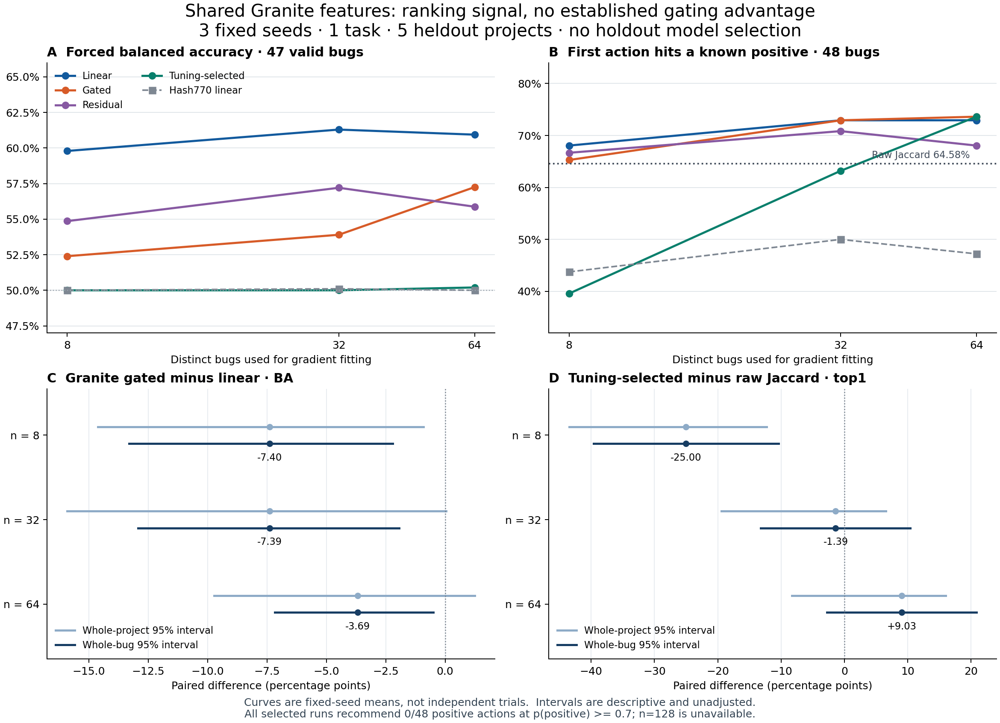

# 共享 Encoder 与 Cell：预先固定动作的本地验证

日期：2026-10-24。按用户要求推进本地工作，未查询或等待远端 CI。
本轮数值实现固定为 [`3674fe9bce6634def78b24606e4cd74ad9bd2269`](https://github.com/TrillionniumFoundation/hepta-private-ci/commit/3674fe9bce6634def78b24606e4cd74ad9bd2269)。
此前实验、预测与报告保留原样；本报告对应新的 prospective action-usefulness 协议。
完整数值、135 组方法均值与 63 项固定对照见 [research-facts.json](research-facts.json)，
其来源摘要和提取脚本一并保存。工程交付状态与恢复证明另见 [CLOSURE.md](CLOSURE.md)。

## 1. 投资判断

**继续建设共享、可回读来源的表示，以及每 Cell 独立的小 Head；把线性 Head 作为首个学习基线。**
本轮 Granite 字段特征上，线性 Head 的平衡准确率为 59.80%／61.30%／60.94%，
门控为 52.40%／53.90%／57.25%。门控增加了参数，但没有形成稳定优势。
调优选出的策略具有一定排序信号，高置信正类行动建议仍为零，当前完整方案保持 `SHADOW_ONLY / DENY_ALL`。

这次结果把三个问题分开了：共享是否节省重复编码、私有参数是否学到了信息、完整策略是否值得采用。
一个 Encoder owner 的冻结特征支持 9 个 Granite 条件运行，另 18 个来源基线运行使用各自的免 Encoder 特征；关掉或打乱私有参数会改变表现；
但 tuning-selected 策略没有通过有用正类决策的要求。这些结论分别对应工程复用、参数学习和任务资格。

“干细胞”宜理解为一个有版本、包含任务所需信息、可共享读取的表示基础。
目前不存在由本实验支持的通用最优底座。应在真实任务族、总标注预算、完整系统成本和质量约束下选择。
Granite 97M 适合作为低成本文本对照；本轮没有新增 EG2 对照，不能据此宣布跨模型最优。
已有多模态结果与来源边界见[上一阶段报告](../20261024-cell-local-next/README.md)。

图中曲线是同一批留出数据上的三个固定种子均值；区间直接来自封存分析，没有重新抽样或选择最优种子。
本轮所有候选动作在执行结果产生前固定，全部准备在首次留出推理前封存。

## 2. 新任务及可用信息

输入为提供的实现差异、一个预先给定的真实测试命令及其源代码／fixture 上下文。
目标是该测试在两份提供的实现上，**正常的 pass/fail 结果是否不同**。
pass/pass 与正常 fail/fail 为负类；正常结果不同为正类。
导入、收集、初始化失败、无有效测试、超时和缺失观察均保留为未知。

使用每个上游声明命令，再增加至多三个确定性的同文件比较动作；执行前按精确 runner/argv 去重并固定顺序。
未依据观察结果选择成功案例、主测试或负例。所有候选分别在两份实现上执行，测试树保持一致。
这个任务评估提供改动和候选测试后的验证选择能力，能力边界不包含任意测试发现或自主故障定位。

协议见 [CELL_PROSPECTIVE_ACTION_PROTOCOL.md](../../CELL_PROSPECTIVE_ACTION_PROTOCOL.md)。
固定 BugsInPy metadata revision 为 `11c5f1eea954a42132cfd06bf257766a7963e0fd`。
全项目角色划分在本轮执行前冻结，并核对历史实验的项目曝光。

| 角色 | 项目 | 原始 bug 组 | 候选动作 | 最终有效动作 / 组 |
|---|---|---:|---:|---:|
| TRAIN | youtube-dl、scrapy | 83 | 345 | 313 / 77 |
| TUNING | luigi | 33 | 134 | 130 / 32 |
| CALIBRATION | thefuck、tqdm、PySnooper | 44 | 158 | 152 / 44 |
| HOLDOUT | ansible、fastapi、httpie、sanic、cookiecutter | 48 | 168 | 160 / 47 |
| 合计 | 11 个项目 | 208 | 805 | 755 / 200 |

755 个有效动作中有 248 个正类、507 个负类；其余 50 个未知。
留出有效动作包含 66 个正类、94 个负类；8 个未知动作涉及 4 个 bug。
ansible/11 的四个动作全部未知，因此分类指标覆盖 47 个组，排序始终保留全部 48 个组。
“新留出”指相对已经审计的本项目实验历史；没有证明基础模型预训练从未见过这些公开来源。

最终采用的 1,610 份命令观察全部存在；所有尝试的实际启动共 **1,912 次**：
原始条件 1,610 次、Luigi 全项目依赖补充 268 次、Sanic 超时诊断 34 次。
Luigi 按声明依赖补充 pyparsing 2.4.7 和 SQLAlchemy 1.3.17，对整个项目统一重跑，
选择计划在替代执行前封存；原始结果和所有失败构建仍保存。没有按样本选择较好结果。
Sanic 诊断复现了局部服务器启动后的等待超时，没有证明某个具体依赖错误，诊断不替换标签。
源代码自身接口、抽象测试选择器等异常保留其不可用状态，未通过修改测试来制造有效标签。

## 3. 表示接口和真实学习预算

所有预测文本保留完整字节；最大输入为 111,993 UTF-8 字节，低于预先规定的 131,072 上限。
每行绑定 source ID、精确字段跨度、内容摘要、预处理和特征身份。来源修订与结果元数据不进入数值特征。
改动字段只取真实变更内容，测试字段只取实际测试主体；文件路径标头／元数据、diff 标头和观察结果不用于字段特征，代码正文中的路径字符串仍属于真实内容。

| 条件 | 实际输入表示 | 宽度 | 有效特征行 |
|---|---|---:|---:|
| Identifier overlap3 | Jaccard 与两种方向覆盖率 | 3 | 801 / 805 |
| Identifier hash770 | 两个 384 维 signed identifier hash 的乘积、绝对差、cosine、Jaccard | 770 | 801 / 805 |
| Granite clean fields | 两个真实 384 维 Granite 字段向量的相同交互形式 | 770 | 805 / 805 |

两个来源基线有四个 TRAIN 动作的标识符集合为空；它们保持不可用，没有用零向量代填。
因此来源基线训练池为 309 个动作／76 个组，Granite 为 313／77。
同预算与种子下，9 对跨特征抽样中有 8 对不完全相同；这是已声明完整条件的比较，不能解释为逐条同样本的纯表示消融。

Granite 对两个字段独立分窗编码，192-token 窗口、32-token 重叠，batch 16、四个 Torch 线程。
1,610 个逻辑字段对应 994 个不同原始字段；6,512 个逻辑窗口在字段去重后实际编码 5,612 个窗口，执行 **351 次前向**。
窗口复用比例为 13.82%；重复字段引用比例不等于实际计算节省比例。
一个 owner 完成后释放，Granite 的共享特征及来源绑定被其 9 个预算／种子运行重复读取；两个来源基线使用另外两份特征矩阵。
全局池化可由已保存片段逐位重建；分窗池化不包含跨窗全局注意力。

沿用 `SharedEncoderOwnerV1` / `CellHeadV1` 的所有权边界；原生 Rust Head 仍是确定性 Q24 仿射基线。
本轮训练在 `qa/stem-bakeoff` 中，没有把离线结果直接替换为生产 Head。
不同 checkpoint、tokenizer、预处理、字段拼接或维度均属于新的特征身份，不能直接交换私有参数。

每个条件运行保留 prior、exact、BM25、dense-nearest、prototype、linear、gated、rank-4 residual；
tuning selector 只在预先声明的 prior、prototype、linear、gated、residual 中按固定规则选择。
每个学习 Head 都有参数关闭、参数打乱和新进程重载对照。
三个特征 × 三个预算 × 三个种子为 **27 个重复条件运行、81 份最终学习 Head、162 条搜索路径**。
这是一个逻辑任务，不能用运行数或参数文件数充当学会的任务数。

**n=8／32／64 表示来自同样数量独立 bug 的梯度拟合动作；全部标注成本更大。**
完整训练池用于平衡抽样，另外使用 130 个 tuning 标签和 152 个 calibration 标签。
开发阶段跨条件去重共 595 个动作标签、153 个 bug；来源基线为 591／152。
n=128 超出预先冻结的最大梯度预算 64，九个条件格均明确不可用；实际可用训练组也只有 77／76，未执行 n128 拟合，没有改名为另一个有效预算。

## 4. 学习曲线与全部方法

下表每格为 **BA% / NLL / 首选命中已知正类%**，先对三个固定种子求均值。
BA 与 NLL 按每个有效 bug 总权重一计算；首选命中以完整 48 个候选组为分母。
NLL 越低越好；对实际调优策略的判断必须使用 selected 行。

| Granite 方法 | n=8 | n=32 | n=64 |
|---|---|---|---|
| Prior | 50.00 / 0.6975 / 39.58 | 50.00 / 0.6975 / 39.58 | 50.00 / 0.6975 / 39.58 |
| Exact | 50.00 / 0.6975 / 0.00 | 50.00 / 0.6975 / 0.00 | 50.00 / 0.6975 / 0.00 |
| BM25 | 50.00 / 0.6975 / 39.58 | 50.00 / 0.6975 / 39.58 | 50.00 / 0.6975 / 39.58 |
| Dense nearest | 50.00 / 0.6815 / 61.81 | 50.40 / 0.6783 / 64.58 | 50.20 / 0.6780 / 63.89 |
| Prototype | 52.20 / 0.6718 / 67.36 | 50.00 / 0.6806 / 74.31 | 50.00 / 0.6841 / 73.61 |
| Linear | 59.80 / 0.6648 / 68.06 | 61.30 / 0.6731 / 72.92 | 60.94 / 0.6754 / 72.92 |
| Gated | 52.40 / 0.6970 / 65.28 | 53.90 / 0.6826 / 72.92 | 57.25 / 0.6706 / 73.61 |
| Residual | 54.86 / 0.6726 / 66.67 | 57.21 / 0.6857 / 70.83 | 55.88 / 0.6735 / 68.06 |
| Tuning-selected | 50.00 / 0.6975 / 39.58 | 50.00 / 0.6859 / 63.19 | 50.20 / 0.6834 / 73.61 |

Exact 没有匹配到任何可推荐的留出动作：其零排序命中和零覆盖真实保留；强制 BA 的先验兜底值不代表检索成功。
BM25 在这套校准规则下回到先验；不能把这个结果概括为词法信息无用，直接源码 Jaccard 是更强的对照。
Prototype 排序点估计较好，在预设 0.7 阈值下没有正类行动建议；没有根据这些留出分数重选部署方法。

| 来源基线 / 方法 | n=8 | n=32 | n=64 |
|---|---|---|---|
| Hash770 linear | 50.00 / 0.6983 / 43.75 | 50.11 / 0.6939 / 50.00 | 50.00 / 0.6948 / 47.22 |
| Hash770 gated | 50.00 / 0.6977 / 44.44 | 51.48 / 0.6923 / 47.22 | 50.80 / 0.6915 / 49.31 |
| Hash770 residual | 50.00 / 0.6988 / 44.44 | 51.48 / 0.6923 / 46.53 | 50.80 / 0.6916 / 44.44 |
| Hash770 selected | 50.00 / 0.6975 / 39.58 | 50.00 / 0.6976 / 41.67 | 50.00 / 0.6975 / 39.58 |
| Overlap3 linear | 50.00 / 0.6931 / 45.83 | 50.00 / 0.6965 / 45.83 | 50.00 / 0.6958 / 44.44 |
| Overlap3 gated | 50.00 / 0.6965 / 49.31 | 50.00 / 0.6973 / 50.00 | 50.00 / 0.6976 / 46.53 |
| Overlap3 residual | 50.00 / 0.6967 / 49.31 | 50.00 / 0.6975 / 50.00 | 50.00 / 0.6978 / 45.83 |
| Overlap3 selected | 50.00 / 0.6975 / 39.58 | 50.00 / 0.6975 / 39.58 | 50.00 / 0.6975 / 39.58 |

全部 27 次选择为 prior 19 次、prototype 6 次、gated 2 次；没有选中 linear 或 residual。
Granite n8 全选 prior；n32 为 prototype 两次、prior 一次；n64 为 prototype 两次、gated 一次。
这揭示 tuning 目标、概率输出与候选排序存在差异，当前方案没有解决该差异。

### 关键配对区间

下表差值为百分点。每个区间直接保留原分析的 2,000 次配对抽样结果。
whole-bug 保留同一 bug 的所有候选；whole-project 保留所抽项目的全部 bug。

| 预先声明的比较 | n | 差值 | Whole-bug 95% CI | Whole-project 95% CI |
|---|---:|---:|---|---|
| Granite linear − hash linear，BA | 8 | +9.80 | [+3.50, +16.52] | [+0.67, +20.35] |
| 同上 | 32 | +11.19 | [+4.15, +19.01] | [−1.21, +25.03] |
| 同上 | 64 | +10.94 | [+4.44, +18.27] | [−0.47, +24.46] |
| Granite gated − linear，BA | 8 | −7.40 | [−13.30, −2.21] | [−14.62, −0.92] |
| 同上 | 32 | −7.39 | [−12.93, −1.93] | [−15.91, +0.05] |
| 同上 | 64 | −3.69 | [−7.18, −0.50] | [−9.72, +1.24] |
| Granite selected − raw Jaccard，top1 | 8 | −25.00 | [−39.58, −10.42] | [−43.48, −12.28] |
| 同上 | 32 | −1.39 | [−13.19, +10.42] | [−19.44, +6.55] |
| 同上 | 64 | +9.03 | [−2.78, +20.83] | [−8.33, +15.96] |

Granite linear 相对 hash linear 的 top1 差为 +24.31／+22.92／+25.69 个百分点，三个预算的两类区间均为正。
这是共享表示中存在可利用排序信息的证据。NLL 与跨项目 BA 的区间更不稳定，应保留这些不同结果。
63 项对照都是描述性且未作多重比较校正；其中 18 项仅比较排序，BA/NLL 有意不可用。
只有五个留出项目，三个拟合 seed 也没有增加独立项目或样本数。

直接 raw Jaccard 无需 Encoder 或拟合，top1／top2／top3 为 **64.58%／79.17%／85.42%**。
command-hash 顺序对应 39.58%／60.42%／72.92%。已知正类 oracle 为 44/48=91.67%，
这个上界只描述已观察到的正类；其余四组不因此被判定为本质上不可诊断。
selected n64 比 Jaccard 的点估计高，但两类区间均跨零，尚未建立相对廉价来源启发式的明确优势。

关闭 Granite 私有参数后，各学习 Head 回到 BA=50%、top1=39.58%；
打乱线性参数后 top1 为 45.83%／43.75%／44.44%。参数影响真实存在，但不自动产生部署资格或门控优势。

## 5. 概率质量、拒答和正类行动

本轮先审计了旧校准器：252 个拟合的数值最优性最大差约 2.93e−14，问题不能归为优化器未收敛。
旧条件的小校准组可能产生极端外推。新方案固定非锐化尺度及先验混合，
先验由 44 个 calibration bug、152 个动作按组等权和平滑计算，正类先验为 0.375724638。
混合权重为 44/(44+16)=0.733333333；逐行 NLL 相对先验的最坏增加受确定性界约束。
这些界约束了概率风险，不是统计置信区间，也不保证识别能力。

| Granite 条件 | n=8 | n=32 | n=64 |
|---|---:|---:|---:|
| Linear 正类召回 | 31.77% | 40.47% | 33.02% |
| Linear 分类覆盖率 | 7.17% | 28.74% | 33.92% |
| Linear ECE | 0.0725 | 0.0855 | 0.0999 |
| Selected 正类召回 | 0.00% | 0.00% | 0.40% |
| Selected 分类覆盖率 | 0.00% | 0.53% | 3.95% |
| Selected 正类行动建议 | 0 / 48 | 0 / 48 | 0 / 48 |

分类覆盖率使用 max(p0,p1) ≥ 0.7，包含高置信负类；正类行动建议要求 p1 ≥ 0.7。
无阈值 top1 排序还使用第三种规则。不能把这三者混为可行动覆盖率。
全部 27 个 selected 运行均为零正类建议，不能利用大量拒答获得成功。
prior 全预测负类，按 bug 等权的普通准确率仍有 55.43%，但 BA=50%、正类召回=0。

留出集按 bug 等权的正类质量为 20.95/47=44.57%，高于校准先验 37.57%。
这是一项描述性的角色分布差异；本轮没有利用留出标签重调先验、阈值或训练选择器。
prior 的 ECE 为 0.0700，Granite linear 的 ECE 并非全面更好。
Brier、AUROC、选择性风险和八个风险／覆盖率点均在完整封存结果中保留。
某个 seed 没有覆盖时，其选择性风险是不可用，均值也保持不可用，不填成零。

## 6. 真实资源形状

共享 Granite 实测有 97,441,152 个冻结参数，FP32 参数张量为 389,764,608 B；owner 常驻张量含 buffer 共 389,764,864 B。
本轮原生字段抽取的完整阶段为 371.841 s wall、1,268.196 s CPU，峰值进程 RSS 1,508,515,840 B。
嵌套模型加载和编码计时已经包含在内；351 次实际前向只计一次。
标签别名、私有训练、推理及分析均没有再调用 Encoder。

| 私有 Head | 3D 参数 / FP64 字节 | 770D 参数 / FP64 字节 |
|---|---:|---:|
| Linear | 8 / 64 | 1,542 / 12,336 |
| Gated | 14 / 112 | 3,082 / 24,656 |
| Residual rank 4 | 38 / 304 | 9,242 / 73,936 |

81 份保存 Head 共 250,128 个参数、2,001,024 B 原始 FP64 张量。
归一化是逐行 L2×sqrt(width)，不保存学习均值或尺度向量。
校准预测运算使用四个数值，但完整身份验证和诊断记录更大，不能把完整 artifact 记成额外 32 B。
完整 preparation 228 个文件、13,878,474 B，其中共享来源 JSON 5,597,418 B，
含校准的 frozen reports 4,768,790 B；其余包括压缩参数、manifest、基线库及 seals。
每个 run 的 baseline bank 由多种基线共享，未按三个学习 Head 重复乘算。

全局准备实测 **13.746 s wall／13.665 s CPU**，包含全部 162 条路径、10,620 次优化器更新。
按实际矩阵形状记录的乘加计算为 5,095,625,616 FLOPs；它不含 Encoder、I/O、词法、校准等所有系统操作。
唯一一次全局留出推理调用耗时 17.971 s wall，含 81 次新进程重载对照；
父进程 CPU 8.546 s、回收子进程 CPU 9.400 s 是可加的不同部分。
固定分析为 4.783 s wall／4.760 s CPU，无额外模型预测或参数更新。

若只做权重字节算术，1,024 个 770D linear Head 的 FP64 张量共 12,632,064 B；
加一份上述共享 FP32 底座参数为 402,396,672 B，另有 256 B 模型 buffer。
用户所设想的 1,024 份 421M 模型，按每参数 4 B 计算则为 1,724,416,000,000 B。
后者是参数规模算术，没有实际训练这些副本，不能据此宣称实测吞吐、学习质量或总系统成本比值。
缓存、模态模块、路由、优化器、来源保存和恢复仍须单列。

完整成本以 `costs/registry-v3.json` / `ledger-v3.json` 的明确截止点计入，最终交付开销另见关闭收据。
原始执行、被替代条件、失败构建与诊断都计费；wall 工作量不是并发环境的端到端延迟，RSS 峰值不相加。
未知 CPU、网络传输字节、能耗和价格保持未知，未填为零。

## 7. 对共享底座和多模态路线的影响

本轮支持保留完整字段表示、局部片段和来源回读，再让小 Head 读取任务相关信息。
当前任务不需要先增加每 Cell 的模型体积。模型选择应比较完整成本下的任务收益，
包括 raw Jaccard、精确来源读取、prototype 与 linear；门控或残差增加的成本应由独立任务结果证明。

已有图像／音频阶段在同一个 EG2 owner 上实际执行原生模态塔；图像和环境音频的学习读出有效。
上一阶段 n128 端点，图像四个二分类目标的宏平均 BA 为线性 97.38%、门控 97.43%；音频五个二分类目标的宏平均 BA 为线性 83.62%、门控 82.25%。
媒体关闭对照回到 BA=50%，说明读出依赖真实模态表示。
这些是上一阶段的独立条件，不能混入本轮 Granite 文本任务均值，也没有建立 EG2 相对所有小型模态 Encoder 的成本最优性。

在纯文本基础上新增视觉或音频能力，需要输入前端、位置／时间结构、投影或对齐及成对数据；
私有轻量 Head 只能读取已存在的信息。可优先共享图像或音频功能族模块，
在多个任务共同出现表示瓶颈后再投入功能族 Adapter，并以新 feature identity 保存版本。
识别迁移的成功不自动涵盖 OCR、ASR、视频定位、跨模态推理或生成。

当前数据尚不能区分底座容量、表示组织、标签目标和跨项目分布各自的贡献。
新旧阶段同时改变了输入、任务、划分与执行证据，因此不能仅凭结果宣称旧失败由全局池化稀释造成。
下一次算法改变需要新的预先冻结方案和独立留出；本轮留出此后应登记为已观察数据。
本轮质量门槛的明确结论为未通过，继续保持影子状态；不通过更名任务、改阈值或重复看同一留出来变成通过。
