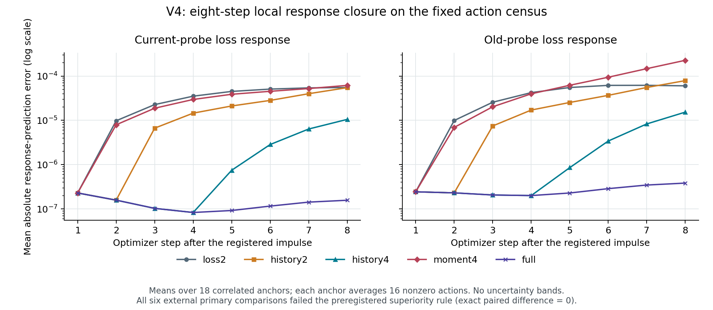

# V4 cell state closure: executed results

Research authority: **`DENY_ALL`; `production_authority=false`.** This report describes one executed, frozen experiment. It grants no deployment, provider, tool, or topology-change authority.

**None of the six preregistered external superiority comparisons passed.** At the primary anchor, all five controllers selected the zero action, so their paired July NLL differences were exactly zero. Separately, the four-step history improved eight-step local response prediction and action ranking within the registered action census. These are different findings: better local prediction did not produce a demonstrated external advantage under this experiment's fixed objective and action choices. [Evaluation](evaluation.json), [pre-unseal audit](pre-unseal-audit.json).

## Evidence and scope

The [preregistration](source-snapshot/preregistration.md) and [protocol](source-snapshot/protocol.json) fixed the methods, source exclusions, action pool, objective, primary comparisons, and final-access order. The executed source commit recorded in the evaluation is [`fa2a8f928dc41f8f3c48ea9bd0d45adf1e27ee09`](https://github.com/TrillionniumFoundation/hepta-private-ci/commit/fa2a8f928dc41f8f3c48ea9bd0d45adf1e27ee09). Both audit and evaluation refer to run seal `a7dfa11a64deef982d0ebdc36dc746b2b3e31c3a0b7def28920d4ab070177346`.

The experiment reconstructed six existing V3 fitted trajectories: linear and gated small heads, each with fixed seeds 7, 17, and 29. Each trajectory had 64 old-context warmup updates and current-context anchor offsets 0, 8, and 16. This gives **18 correlated anchors**, not 18 independent training tasks. A frozen Granite 97M feature encoder and the original label-independent eight-dimensional QR projection were reused. The required eight-source feature bridge passed with maximum absolute feature difference `1.1920928955078125e-7`, below the registered `1e-6` threshold. The additional original cost receipts account for this bridge and the new-source forwards. [Cost summary](cost-summary.json).

Each anchor used 17 actions: zero and eight fixed antipodal Rademacher pairs. Directions were independent of either optimizer's preferred direction. The registered radius was 0.1 and step factor 0.02, giving a physical impulse norm of 0.002. An action was applied once after the first Adam step; seven later actions were zero. **A zero action still includes all eight optimizer updates.** It does not mean that training stopped. There were 306 real action branches and 2,448 branch optimizer steps.

The five arms were:

| Arm | State available to the local response model |
| --- | --- |
| `loss2` | Memoryless current and old probe losses |
| `history2` | Two-step causal loss window with known past inputs |
| `history4` | Four-step causal loss window with known past inputs |
| `moment4` | Current loss, old loss, current-gradient/momentum product, and old-gradient/momentum product |
| `full` | Complete small-head Adam tangent state |

`full` refers to the optimizer state of the small head, not a full language model. All arms shared the complete-state/Jacobian calibration. A lower output dimension therefore does not by itself establish a lower end-to-end implementation cost.

The new external cohort contained 32 April sources and 64 July sources, balanced over four classes. The byte-pinned official UCI archive and full story/title union components determined exclusions. The protocol excluded legacy cohorts and all V1/V2/V3 components, including aliases, conflicting classes, cross-month components, and the existing out-of-distribution publisher partition. The evaluation reports 969 reserved components. The April/July scope was declared in advance because earlier studies had exhausted eligible June health components and nearly exhausted August health components. Foundation-model pretraining exposure remains unknown. [Protocol](source-snapshot/protocol.json), [evaluation](evaluation.json).

## Primary external result: 0 of 6 passed

All primary comparisons used July NLL at anchor offset 16. The table reports the candidate-minus-`loss2` difference; a negative value favors the candidate. Per-source differences were first averaged equally over the three fixed fitted seeds. The preregistered procedure used 10,000 paired, class-stratified source bootstrap replicates with seed 431026 and Bonferroni percentile endpoints for six comparisons. The passing rule required an adjusted upper endpoint **strictly below zero**. [Evaluation](evaluation.json), `primary`.

| Head | Candidate versus `loss2` | July sources | Mean NLL difference | Adjusted interval | Passed |
| --- | --- | ---: | ---: | --- | --- |
| Linear | `history2` | 64 | 0 | [0, 0] | No |
| Linear | `history4` | 64 | 0 | [0, 0] | No |
| Linear | `moment4` | 64 | 0 | [0, 0] | No |
| Gated | `history2` | 64 | 0 | [0, 0] | No |
| Gated | `history4` | 64 | 0 | [0, 0] | No |
| Gated | `moment4` | 64 | 0 | [0, 0] | No |

The endpoint quantiles were 0.004166666666666667 and 0.9958333333333333. The intervals describe source-sampling uncertainty conditional on these three fitted seeds. They are not training-seed or task-population intervals, and no finite-sample coverage guarantee is asserted.

All arms chose action 0 at all six primary anchors. Consequently, their final predictions followed the same selected trajectories and their observed paired differences were identical. The collapsed intervals reflect that identical paired data. **They do not prove equivalence on untested trajectories, larger impulses, new objectives, or other tasks.** Conversely, 0/6 means that six specific superiority conditions failed; it does not mean that six training executions failed or that the entire Hepta project was falsified. All five recorded execution stages exited successfully.

The action concentration also limits discrimination: even materially different predicted response maps can select the same action. The experiment used the unchanged V3 `direct_soft_total` objective and first exact minimum in frozen action order. It did not ablate objective terms, change effort price, or measure a counterfactual selection rule. No particular term should be declared the cause of zero-action selection from these receipts alone. The registered directional ranking tie tolerance of `1e-10` was not an action-selection tolerance.

## Eight-step closure and finite-action decisions



The plotted quantity is **loss-response prediction error**: the current or old probe loss change relative to the zero-action reference at the same step. It is not absolute external NLL. Every audit row averages over the 16 nonzero actions; the report then takes an unweighted mean over the 18 fixed anchors. Step 0 is identically zero and is omitted from the logarithmic figure. No uncertainty bands or independent-task significance claims are attached to this descriptive census. Exact values are in [per-step-response-mae.csv](per-step-response-mae.csv) and [mechanism-summary.csv](mechanism-summary.csv), derived from the audit's `ranking_rows`.

| Arm | H8 current-response MAE | H8 old-response MAE | Nonzero-action cost MAE | Mean directional Kendall tau-b | Selected zero / 18 |
| --- | ---: | ---: | ---: | ---: | ---: |
| `loss2` | 5.51994e-5 | 6.01611e-5 | 1.77888e-6 | 0.555556 | 18 |
| `history2` | 5.47392e-5 | 7.88168e-5 | 1.69794e-6 | 0.475000 | 18 |
| `history4` | 1.05106e-5 | 1.53313e-5 | 3.21261e-7 | 0.935185 | 17 |
| `moment4` | 6.16220e-5 | 2.26798e-4 | 1.93269e-6 | 0.310185 | 18 |
| `full` | 1.57070e-7 | 3.83305e-7 | 5.05932e-9 | 0.998148 | 15 |

Four-step history preserved the tangent response while the known impulse remained inside its window; later error became visible after that window. Two-step history showed the corresponding earlier loss of accuracy. This short-window tangent property is part of the representation's construction. The nonzero errors against actual nonlinear Adam branches remain measured evidence, so the result is not exact nonlinear closure. `history4` retained substantially better late-horizon response and ranking accuracy than `loss2` within this census. `history2` and `moment4` did not improve every metric, and `moment4` was particularly weak for old-probe response prediction here.

Regret compares the cost of each method's selected action with the lowest **actual** cost across the full 17-action pool. It therefore includes zero, unlike the MAE and directional-ranking columns above.

| Arm | Mean selected-action regret | Maximum regret | Anchors with positive regret |
| --- | ---: | ---: | ---: |
| `loss2` | 9.12978e-8 | 5.88736e-7 | 3 / 18 |
| `history2` | 9.12978e-8 | 5.88736e-7 | 3 / 18 |
| `history4` | 6.13728e-8 | 5.88736e-7 | 2 / 18 |
| `moment4` | 9.12978e-8 | 5.88736e-7 | 3 / 18 |
| `full` | 0 | 0 | 0 / 18 |

`full` selected the realized finite-pool minimum at all 18 anchors. This says nothing about actions outside this pool or globally optimal control. `history4` selected action 6 once and `full` selected action 6 three times; all other selections were zero. Their nonzero selections occurred away from the primary offset-16 anchors. These mechanism and decision diagnostics cannot replace the failed external primary comparisons or justify selecting a new method against the now-exposed final sources.

## Secondary external point estimates

At offset 16, all five arms and the zero-action reference have the same NLL and accuracy within each head/source role. The following table shows that common selected trajectory once. Values are means across the three fixed fitted seeds. Changes are relative to the original warmup reference. [Evaluation](evaluation.json), `secondary_point_estimates`.

| Head | Source role | NLL | NLL change | Accuracy | Accuracy change |
| --- | --- | ---: | ---: | ---: | ---: |
| Linear | July, 64 sources | 1.236888 | -0.010804 | 0.489583 | -0.041667 |
| Linear | April, 32 sources | 1.279135 | +0.036959 | 0.468750 | -0.062500 |
| Gated | July, 64 sources | 1.208342 | -0.065545 | 0.505208 | -0.010417 |
| Gated | April, 32 sources | 1.239703 | +0.003433 | 0.437500 | -0.031250 |

The July NLL change cannot be attributed to a history controller: the zero-action trajectory was identical and ordinary Adam updates continued. The April NLL point estimates worsened for both heads, so these observations do not demonstrate retained old-source performance. They are terminal point estimates, with no claimed confidence interval or pathwise retention guarantee. Different movement in NLL and accuracy is reported as observed rather than combined into a new success criterion.

## Integrity checks

The pre-unseal audit reports `passed` while `final_labels_opened=false`. It reconstructed 480 warmup/current-anchor training steps, replayed all 2,448 branch optimizer steps, checked the registered 306 branches, and performed 396 arithmetic comparisons. Maximum actual-cost and forecast-cost reconstruction errors were both `3.3881317890172014e-21`. The later evaluation reports `final_labels_opened=true`. Source/protocol preparation, the complete pre-execution census, branch sealing, audit, and final-access controls are described by the frozen protocol. Replay uses the original optimizer implementation; common-cost arithmetic is separate. This is an internal reproducibility and integrity check, not third-party attestation. [Pre-unseal audit](pre-unseal-audit.json), [evaluation](evaluation.json).

## Measured cost

### Five-stage execution

The execution wrapper recorded the following five sequential stages. All exit codes were 0. [Execution receipt](execution.json).

| Stage | Wall seconds | Child CPU seconds | Recorded child peak RSS, KiB |
| --- | ---: | ---: | ---: |
| Data | 7.664579 | 7.580283 | 578,480 |
| Features | 51.220979 | 20.765733 | 1,226,080 |
| Run | 44.906238 | 46.669676 | 1,226,080 |
| Audit | 7.777246 | 8.944188 | 1,226,080 |
| Evaluate | 1.293485 | 1.403821 | 1,226,080 |
| **Five-stage sum** | **112.862527** | **85.363701** | **Not additive** |

The recorded RSS is the wrapper's cumulative child-process high-water mark, not an isolated peak for each stage. The maximum recorded value was **1,226,080 KiB, about 1.169281 GiB**. Repeated values do not show that every later stage independently used that amount. RSS values must not be summed or subtracted to invent per-stage increments.

These measurements cover the five recorded stages, including feature work, common calibration, real branch execution, audit, and evaluation. They are not controller-only inference latency or the total cost of the research project. They exclude any unreported preparation, package installation, model download, earlier V3 studies, and engineering effort. Energy was not measured.

### Shared reference, maps, and real branches

A read-only pass over the original sealed run and feature receipts recovered the following internal costs. It recorded SHA-256 and byte lengths for 25 JSON inputs, verified the original run-seal and feature-report bindings plus bridge content equality, and checked 18 reference constructions, 90 map builds and all 306 unique completed branches. The collector ran successfully without new training or label access. [Original cost summary](cost-summary.json), [collection result](cost-collection-result.json), [run components CSV](cost-run-components.csv).

| Internal run component | Count | Wall seconds | Process CPU seconds |
| --- | ---: | ---: | ---: |
| Shared complete-state reference | 18 | 35.068712 | Not separately instrumented |
| All five arms' map builds | 90 | 0.514440 | 0.881753 |
| All real action branches | 306 | 5.679942 | 5.719542 |
| Other unallocated runner work | — | 2.148354 | Not separately instrumented |
| **Containing inner-run interval** | **1** | **43.411448** | **45.481694** |

The inner-run interval sits inside the 44.906238-second wrapper Run stage; it must not be added again to the five-stage total. The 38.880399 seconds of remaining process CPU jointly cover reference construction and other unallocated work. The original reference builder recorded wall time only, so that CPU residual cannot be reported as measured reference CPU. [Per-anchor reference CSV](cost-reference-by-anchor.csv).

The shared reference was constructed **once per anchor for this five-arm benchmark**. It is required by every arm. The following map-build costs exclude that shared work and the later scoring/branch phases; they are not standalone controller deployment costs.

| Arm | Builds | Total map wall seconds | Total map CPU seconds | Median map wall milliseconds |
| --- | ---: | ---: | ---: | ---: |
| `loss2` | 18 | 0.082025 | 0.029237 | 1.573299 |
| `history2` | 18 | 0.150916 | 0.289034 | 8.195585 |
| `history4` | 18 | 0.209384 | 0.416349 | 11.580738 |
| `moment4` | 18 | 0.022438 | 0.047451 | 1.278591 |
| `full` | 18 | 0.049676 | 0.099682 | 2.694109 |

These are recorded subintervals in one execution. For example, the largest `loss2` wall observation was 54.957343 ms, whereas its median was 1.573299 ms. No cause for that observation or stable speed ranking is inferred. CPU and wall can differ because the workload permits two numerical threads. Exact totals, minima, maxima, and medians are in [cost-map-summary.csv](cost-map-summary.csv); head-specific data are in [cost-map-state-by-head.csv](cost-map-state-by-head.csv).

### State-size accounting

Metadata counts the declared retained output/history scalars and past input scalars. The linear head has 36 parameters and the gated head 52, giving complete Adam-state dimensions of 108 and 156. These algebraic scalar counts exclude the shared reference, saved response maps, temporary arrays, and runtime overhead.

| Arm | Retained output scalars, linear / gated | Past input scalar upper bound, linear / gated | Combined scalar upper bound, linear / gated |
| --- | --- | --- | --- |
| `loss2` | 2 / 2 | 0 / 0 | 2 / 2 |
| `history2` | 4 / 4 | 36 / 52 | 40 / 56 |
| `history4` | 8 / 8 | 108 / 156 | 116 / 164 |
| `moment4` | 4 / 4 | 0 / 0 | 4 / 4 |
| `full` | 108 / 156 | 0 / 0 | 108 / 156 |

Thus the four-step history's declared combined bound exceeds the full small-head state count in both architectures. Every arm also produced the same logical response-map size: **5,184 bytes per linear-head map and 7,488 bytes per gated-head map**, or 114,048 bytes across its 18 maps. Logical NumPy `nbytes` is not peak RSS or compressed artifact size. The measured calibration requirement and these retained inputs prevent a claim that eight projected output scalars make the whole controller lighter.

### Frozen feature encoder and bridge

The original feature report records **97,441,152 loaded parameters, zero trainable parameters and zero encoder updates**. Distinct parameter/buffer tensor storage totals 389,764,864 bytes across 78 storages; this excludes other process memory. The feature process's own high-water RSS was 1,255,505,920 bytes. That equals the wrapper's maximum observed child RSS after conversion, but the two measurements have different scopes. [Cost summary](cost-summary.json), [feature stage CSV](cost-feature-stages.csv).

| Feature subinterval | Wall seconds | Process CPU seconds |
| --- | ---: | ---: |
| Encoder owner loading | 32.812261 | 12.603881 |
| Encoding interval, including bridge and new sources | 3.581925 | 3.706597 |

Both subintervals are contained in the 51.220979-second wrapper Features stage; they do not account separately for all its other work. Within encoding, the bridge used one forward on eight sources and the 96 new sources used six batches of 16. The receipts recorded:

| Scope | Sources | Model forward calls | Non-padding tokens | Summed forward wall ms | Summed receipt-encoding wall ms |
| --- | ---: | ---: | ---: | ---: | ---: |
| Original-source bridge | 8 | 1 | 107 | 1,088.901927 | 1,338.349827 |
| New sources | 96 | 6 | 1,386 | 1,292.462327 | 1,317.898051 |
| Total | 104 | 7 | 1,493 | 2,381.364254 | 2,656.247878 |

Forward time is nested inside each receipt's encoding time, which is itself inside the broader encoding interval. They must not be summed as separate costs. Bridge CPU was not measured separately. The 96 new inputs had token lengths 6–24 before truncation; zero exceeded the 192-token cap. Model-forward counts are not hardware-kernel counts. [Feature forward CSV](cost-feature-forwards.csv).

### Retained artifacts and accounting limits

The original run seal inventories **812 files totaling 15,267,230 bytes**:

| Sealed run category | Files | Stored bytes |
| --- | ---: | ---: |
| Complete-state reference NPZ | 18 | 7,045,463 |
| Forecast NPZ | 90 | 647,782 |
| Forecast JSON | 18 | 994,221 |
| Real action NPZ | 306 | 4,040,463 |
| Real action receipts | 306 | 1,738,676 |
| Other sealed run files | 74 | 800,625 |

These are original seal inventory sizes, excluding the run-seal file itself and the data/features/evaluation directories. The helper rehashed its 25 JSON inputs; it did not independently rehash every payload in that inventory. Forecast NPZ files include saved maps and predicted response fields, so their stored sizes have a different scope from logical map-array `nbytes`. [Artifact inventory CSV](cost-artifact-inventory.csv).

The complete raw-evidence archive separately contains **13,267,684 compressed bytes**, and the successful collector verified archive SHA-256 `c462a550e18baa63ba230c9dd6c076d676b5fcc0f281589c023b82251b0aa579`. The archive and run-only inventory cover different file sets and representations; their byte totals are not a compression-ratio experiment.

Available calibration, map, branch, feature-bridge, and retained-artifact accounting is now included. Separate reference CPU, separate bridge CPU, isolated RSS for the other stages, energy, and an independently deployed controller's total cost remain unmeasured. No end-to-end lightweightness, energy-efficiency, or broad performance advantage follows from these records.

## Interpretation and use of the result

V4 supports a narrow mechanism finding: in the fixed small-head trajectories, causal history can retain information that a memoryless two-loss projection loses over multiple optimizer steps. Four-step history improved late response forecasts and nonzero-action rankings, while the complete small-head tangent state was still the most accurate reference. It did not establish a primary new-source NLL benefit under the registered objective.

The experiment tested neither cell division nor autonomous network growth, distributed credit assignment, general tool use, long-lived memory consolidation, or general intelligence. It cannot establish that a meta-network of cells will spontaneously become a general agent. Any next comparison must have its own preregistered question, source exclusions, action/objective choices, and still-unexposed evaluation data. The present final sources are now consumed and must not be reused for later model or topology selection. A later result must not be substituted into this frozen experiment.

## Reproducing this report without rerunning the experiment

[derive_summary.py](derive_summary.py) reads the three already-produced result receipts and the successful cost-summary receipt, checks their exact hashes and shared run identity, and writes only descriptive derivatives to a fresh directory. It does not load a model, reconstruct training, open raw labels, or request another final evaluation. [derived-summary.json](derived-summary.json) preserves full-precision aggregates; the tables above are rounded for reading. The figure is also available as [SVG](eight-step-response-mae.svg).

```bash
python qa/stem-bakeoff/evidence/20261025-cell-state-closure-v4/derive_summary.py \
  --results /path/to/original/result-receipts \
  --cost-summary /path/to/original/cost-summary.json \
  --out /path/to/new-empty/report-directory
```

The report's exact input hashes are:

| File | SHA-256 |
| --- | --- |
| `evaluation.json` | `512104e3709b7c4916e621d7b8a46447785ad1fbf9733d6296e0fdee41473456` |
| `pre-unseal-audit.json` | `1f99364a998fe6e33be55b9f04974bb3134396ab67aa65be3eb3ab0735cb9991` |
| `execution.json` | `6824be16670c536fe72e2c39bbedfd789b1ad9add03b258e756f4e9ffe6a7fc9` |
| `cost-summary.json` | `accf5e39b045b7d1be627e5f68f3bdb5ab875d33ae1b1b675831b8271f748e38` |
| Protocol | `fe0057c499c1a77ca7f5781a05425d83d59693b4250fb1560cab978afb4cd5b2` |
| Preregistration | `ae4be0a7c2c8807f286f8d96581c6efa51e3a9f935cec7c1e515dd18d146866b` |

### Protocol identity correction from the earlier report candidate

The earlier report candidate cited hashes from the pre-hardening local protocol/preregistration copies. Those were not the exact files executed at the recorded commit. The published and executed protocol added `source_owner_directory` and `source_owner_policy`, and the preregistration explained the fixed source owner and create-only final-access ledger. No existing statistical, action, objective, or primary-comparison field changed. The actual GitHub files, original source-freeze record, and original feature report agree on the corrected protocol SHA above. [Identity review](protocol-identity-review.json).

The first cost helper rejected the stale pin and produced no aggregate. Its failed attempt is retained, with the original collector and the owner-recorded failure metadata in [prior-attempts](prior-attempts/README.md). The corrected [collector](collect_v4_costs.py) accepts only the actual executed protocol and also verifies its complete semantic digest and six instrumentation source hashes. Its successful result produced the exact cost-summary receipt cited above. This correction changes the report's provenance citations; it does not change the frozen experiment, any primary result, or the mechanism figure.

The raw receipts, executed source, original bundle, and seals remain the authoritative evidence. This Markdown report and its descriptive derivatives do not replace them.
