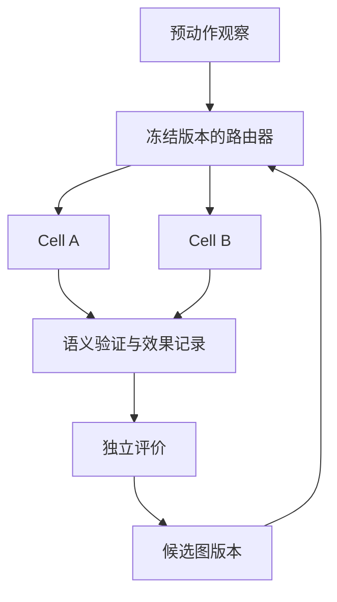

# 从 Agent 经验到 Cell、Circuit 与可验证有用学习

> 研究架构发布版；原稿状态截点：2026-11-17 UTC（美国东部标准时间 EST 为 2026-11-16）的已保留原件与本轮交接。
> 本文区分已实现代码、限定环境工程实测、尚待实验的科学假设。
> 本文不启动模型、训练、测试或生产采用，不读取新的 C 任务，不改变现有协议。
> 旧源码以固定提交引用；拟议 ABI 和实验方案均明确标为设计，不宣称已经实现。

## 1. 对最终目标的判断

用户设想的系统可以分阶段研究：经授权的其他 Agent 可见轨迹，转成可验证经验；小规模 Cell 在隔离版本上学习；经过选择的 Cell 组成稀疏 Circuit；再验证多来源贡献与完整成本。
从这些局部能力走向更统一的模型，需要另做知识整合、表示对齐、遗忘控制和广泛迁移评估。
现有证据支持继续建设这条路线，但不能证明用户数增长会自动带来更好的组织结构，更不能证明最终能保留所有现存大模型的长处。
“去中心化”至少要分清数据所在地、训练执行者、模型版本所有者、独立评估者和奖励结算者；其中一层分散，并不意味着所有层已经无中心运行。

建议先让 Cell 成为有明确输入、目标、参数范围和语义验证器的能力单元。
Circuit 的连接价值通过反事实对照确认；图的变化作为新候选版本，经过独立选择后再服务。
把有用性与运行真实性分开验收，才有可能把普通训练成本逐步转化为可核查的 useful work。
以下建议是研究与工程设计，不是对未来 GPU 速度、用户增长或模型能力曲线的预测。

## 2. 当前证据到底支持什么

| 层次 | 已有证据 | 目前不能推出的结论 |
| --- | --- | --- |
| Cell 生命周期 | 身份、预算、状态、候选版本、owner 与收据接口已存在。[S1] [S2] | 名为 MEM、PRED 或 VERIFY 的 Cell 已学会对应职责。 |
| 真实学习组件 | 有语义 head、GRU 等组件及参数更新实验。[S2] [S7] | 每个逻辑 Cell 都是独立大模型，或私有 head 能直接生成内容。 |
| HIA 桥接 | native begin、实际 Cell.step、native resume 与保留结果恢复已实现。[S3] | HIA 自己提供学习收益、知识融合或生产 effect 权限。 |
| Circuit | 有界反馈、条件路由、子图、Join、显式 schema 与固定版本。[S4] [S5] | 图结构已经自主学习或自动长出组织。 |
| Microbatch | 兼容请求可合批，状态提交仍按 scope 隔离。[S6] | 真实多 GPU 加速、任意异构模型合批或线性扩展。 |
| 资格报告 | 原 HIA campaign 完成两次 NoUpdate；普通 daemon、FinalUse、真实独立收益均未合格。[S8] | 执行成功等于采用成功，或链上收据等于净业务收益。 |

原 HIA 实测的 Cell source 是 `12cd0514c7936955e090af88a35ee1237def2b7c`，runtime 是 `5f7f03a1f22905789371ce0e181a1a0f013beca9`。
候选 SHA256 是 `2a8e8759c7e1941f184fde2463a13a9d39dfa9edcf00c8a5ae475ad81dd3b469`；报告发布在 f8，不表示执行闭包就是 f8。[S8] [S9]
原件记录 3 个原作业、3 次 fresh-controller 观察、0 次第二 process_start、722 次 HIA continuation、208 次 compile 与 32 次 Adam 更新。
这些是限定候选的工程实测；A/B/C 同属四种生成语法模板，成功仅指 compile，不能提升为独立真实任务语义收益。[S8] [S9]
MEM 的 B 从 2/8 到 6/8，而规则控制为 8/8；严格超过控制的门槛在该 fixture 上无法晋级。保留 NoUpdate 是正确结果。[S8]

历史 stem 实验源为 `bb34e07389ad75d3b4629b63b0af0ee46f9b9594`：真共享可塑因子在 6/6 情况改变其他任务预测，但变化包含改善与损害；18 个学习结构配置未胜过强控制。[S11]
该报告只覆盖 32 份历史 CORD 文档，fresh confirmation 为 0；它证明有参数耦合，未证明跨来源共享学习净收益。[S11]

## 3. 从其他 Agent 取得什么经验

接入层应使用用户明确授权的日志导出、工具事件、开发环境扩展或服务接口，记录实际可见事件。
可见轨迹包括任务输入、可见消息、实际工具调用、工具返回、文件或数据状态差异、用户修正及可观察结果。
不可见的内部推理、未提供的 logits、无法确认的模型版本都不能补写；生成的解释不能冒充原始思考过程。
主线 H7 journal 是已有本地轨迹结构，不能据此声称任意其他 Agent 的通用接入器已经完成。[S10]

| 经验类型 | 最低原件 | 可进入的研究用途 |
| --- | --- | --- |
| 教师示范 | 教师身份、可见输入输出、实际调用回执、工具与结果证据 | 示范学习；教师表现仍须验证。 |
| 学生影子预测 | 当时可见输入、学生模型版本、原始预测 | 比较决策；未应用的动作不能记为学生执行。 |
| 学生受控执行 | 原始动作、授权策略、状态前后、实际 effect、语义验证 | 学生访问状态上的纠正学习。 |
| 人工或规则参考 | 明确 authored/deterministic 来源、规则或作者版本 | A 集监督；不能改名外部模型教师。 |
| 不完整或失败事件 | 原始错误、超时、未知尾部、已测成本 | 诊断、拒绝学习或负例；不能静默删除。 |

DAgger 的直接启发是：学生会访问示范者未访问的状态，应在学生实际访问的状态上取得专家标签并聚合数据；只反复播放教师轨迹不会自动完成这个步骤。[P1]
在本系统中，专家纠正只能使用允许训练的 A 数据；B/C 的执行反馈遵循预先固定协议，不向学习器泄露参考答案。
即使是 pass/fail，也是一种反馈信息；次数、粒度和后续是否可用于训练必须在评价前固定。
训练时教师可修正学生失败，评价时仍必须由学生真实执行，不能把教师最后补好的结果计入学生成功。

## 4. 可验证经验的版本化契约（设计）

每个经验记录应同时具有事件身份、学习身份和评价身份，而不是只有一段聊天文本。
建议以 `experience.v1` 保存如下字段；字段缺失应显式为 unknown/null，并由准入规则判断是否可训练。

| 字段组 | 建议字段 | 必须保持的语义 |
| --- | --- | --- |
| 来源 | source_id、repository、revision、path、source_sha256、capture_adapter_digest | 原件可定位；复制和重排不产生新来源。 |
| 任务 | task_id、task_digest、project_id、family_id、lineage_id、duplicate_cluster_id | 同源、同模板与派生修正保持同一分组。 |
| 时间 | observed_at、available_at、capture_clock、time_evidence_digest | 当时可见性与事后可得性分开；不伪造时间切分。 |
| 授权 | principal_scope、consent_receipt、allowed_training_uses、retention_policy、revocation_ref | 采集、训练、共享和发布各自可核查。 |
| 主体 | actor_kind、teacher_id、teacher_model_digest、student_model_digest | 教师未知则 null；seed 不等于教师身份。 |
| 观察 | input_bytes_sha256、visible_history_digest、preaction_state_digest、feature_binding | 只能包含决策时已可见的信息。 |
| 行动 | raw_output、parsed_action、action_schema、policy_digest、request_id | 保留格式失败与拒绝；解析器版本固定。 |
| 执行 | applied、effect_id、before_digest、after_digest、execution_receipt | proposed、attempted、applied、observed outcome 分开。 |
| 结果 | verifier_id、verifier_version、semantic_result、outcome_receipt、unknown_reason | compile、JSON parse、语义、最终业务结果分别记录。 |
| 学习 | trainable、supervision_origin、target_digest、loss_mask_digest、parent_record_ids | 教师输出和学生失败状态不能混写。 |
| 曝光 | split、origin_kind、exposure_history、split_manifest_digest | 开发集保持开发集；看过 B 后的调整是探索性。 |
| 成本 | model_calls、tokens、train_steps、wall_time、cpu_time、device_memory、unknown_fields | 全部尝试入账；未知不计零。 |

准入流程建议依次完成：授权验证、原件完整性、重复家族归组、预动作可见性、语义验证、用途限定。
训练样本由固定 builder 从原件派生；final-answer SFT 和 trajectory SFT 分别保留输入、目标、mask、截断策略和 tokenizer 身份。
轨迹较长时，不能为了凑同预算静默截去决定失败状态或答案的部分；不满足序列协议的样本应显式拒绝或进入另行冻结的协议。
来源、项目、家族、时间的独立性需要各自证据；给不同 source_id 或不同随机数不建立独立性。

A 用于训练，B 用于候选和超参数选择，C 用于在选择冻结后的独立确认。
先把所有派生样本按 provenance 连通分组，再分配 split；同一任务不同教师或不同修正版本不得跨 split。
“C”只是字段名；旧曝光、同模板派生或事后构造的任务必须继续标 development。
本轮原 A/B 已曝光，新增真实用户、认证外部教师与新 C 都是 0，不能通过重命名产生新的确认资格。[L1] [L2]

## 5. Cell ABI：把可学习部分与执行契约分开（设计）

现有 ComponentIdentity/预算/状态契约可作为基础，但以下 `cell.abi.v2` 是拟议扩展，不是当前源码字段清单。[S1]
每个调用携带模型与表示版本，返回模型输出、状态转移和成本原件；调用者不能仅凭 Cell 名称判断兼容性。

| ABI 部分 | 建议字段 | 拒绝条件或用途 |
| --- | --- | --- |
| 版本 | abi_version、cell_id、cell_version、definition_digest | 未知 ABI 或定义不匹配时拒绝。 |
| 所有者 | principal_id、agent_id、run_id、owner_id、epoch | 隔离状态与采用权；防止旧运行覆盖新版本。 |
| 模型 | model_family、base_revision、base_sha256、architecture_digest、weights_sha256 | 精确基础模型、结构和实际权重身份。 |
| Tokenizer | tokenizer_digest、vocab_digest、chat_template_digest、special_tokens_digest | 相同文本必须按声明方式编码。 |
| Adapter | adapter_kind、adapter_sha256、target_modules、rank、alpha、composition_order | 不以“都是 LoRA”推断可叠加。 |
| 表示 | encoder_digest、layer、pooling、shape、dtype、normalizer_digest、representation_semantics_digest | 维度相等仍可能语义不兼容。 |
| 接口 | input_schema_digest、output_schema_digest、state_schema_digest、action_schema_digest | schema 需精确匹配，转换必须显式。 |
| 数值 | numeric_profile、quantization_digest、kernel_digest、determinism_policy | 精度与算子差异进入复核范围。 |
| 状态 | episode_id、cursor、state_before_digest、state_after_digest、checkpoint_ref | 禁止把其他会话的隐状态或 KV cache 直接复用。 |
| 训练 | trainable_scope、objective_digest、optimizer_profile、parent_model_digest、training_receipt | 参数更新范围可审；不由摘要代替真实训练证据。 |
| 预算 | max_calls、max_tokens、max_work、max_bytes、max_elapsed、max_state_bytes | 调用前准入，运行中计量；越界失败有原件。 |
| 能力 | requested_effect、capability_ref、policy_digest、effect_owner | 预测不能自己授予工具或业务修改权限。 |
| 路由 | circuit_digest、route_policy_digest、edge_id、selection_reason_ref | 绑定具体图版本；仅使用允许的预动作特征。 |
| 返回 | raw_output_ref、parsed_output、confidence_profile、abstained、error_kind | 保留拒绝和不确定性；confidence 需校准来源。 |
| 收据 | request_digest、loaded_model_digest、execution_digest、cost_scope、receipt_digest | 证明本次实际加载、调用及观察范围。 |

最小调用结构可表达为以下示意，尖括号为占位符，不是实验数据或有效哈希：

```json
{
  "schema": "cell.call.v2",
  "definition_digest": "<sha256>",
  "model_manifest_digest": "<sha256>",
  "scope": {"principal_id": "<id>", "cell_id": "<id>", "run_id": "<id>", "epoch": 1},
  "request_id": "<unique-id>",
  "input": {"schema_digest": "<sha256>", "artifact_digest": "<sha256>"},
  "state_before_digest": "<sha256>",
  "route_policy_digest": "<sha256>",
  "budget_manifest_digest": "<sha256>",
  "capability_ref": null
}
```

兼容性必须分为三层：结构可解码、表示语义可对齐、在任务分布上效果可接受。
第一层可由 schema 和形状检查决定；后两层需要明确转换契约、训练来源与独立任务评估，不能由哈希或相同维度代替。
当前 Circuit binding 让每个 Cell 的 bundle digest 等于整图 parameter_bundle_digest；接异构 Cell 需要新版本的每节点 manifest 和显式转换，不能悄悄删除旧检查。[S5]

## 6. 同底座与跨底座应走两条不同路径

同一精确底座、tokenizer、模块布局和数值协议下，可以研究共享冻结主干、独立私有 adapter/head、请求级路由。
默认先只激活一个专家；需要多个专家时显式固定 top-k、串并行顺序、融合函数和活动参数上限。
各专家的训练、加载、驻留内存与选择成本都计入；“参数量只增加一点”不能替代实测成本。

Adapter 组合也是候选模型变更。以 LoRA 为例，需定义在同一权重坐标下的有效增量 ΔW = B A，再决定是否合并。
分别平均 A 与 B 通常不等于平均 B A；rank、缩放、模块、顺序或坐标不同，都需要明确转换和复核。
TIES 提供同初始化任务增量之间处理符号冲突的研究办法，并不证明任意模型、任意底座可以做权重并集。[P3]

跨底座优先交换结构化消息：任务摘要、候选动作、检索证据、工具结果、已验证答案与可检查的不确定性。
消息必须携带 schema、证据和来源；接受方自行编码，不能假定别的模型 hidden state、KV cache 或 tokenizer logits 可直接使用。
若要传 latent 表示，桥接器应作为独立可训练组件，绑定两端表示版本、配对数据、损失、成本与退化评估。
没有经验证的配对桥接时，保留文本/结构化中间表示；它增加序列化和推理成本，但语义边界可检查。

跨底座整合可以研究输出蒸馏；教师提供可见答案时属于序列监督，不能冒称拿到了 soft-logit 蒸馏材料。
原始蒸馏论文研究在 transfer set 上学习教师分布，并结合真实标签；它提供知识转移方法，不保证把教师全部能力保存在更小学生中。[P5]
来源许可、访问授权与训练用途必须随经验保留；本轮未取得的教师输出不能用人工参考替代后宣称多教师收益。

## 7. HIA 的职责与能力边界

现有 HIA 桥接在调用 Cell 前保存原请求与 pending 状态，随后保存真实结果并完成 native continuation。[S3]
readback 不重复推理；原结果缺失时保持 unknown。这适合承载幂等请求、状态机、预算与恢复规则。
HIA 可把“哪个版本、哪份输入、允许什么 effect、剩余多少预算、等待哪份结果”编译为可核查的执行契约。

HIA 不应决定教师是否真实、答案是否有业务价值、模型是否优于基线，也不代替独立 evaluator。
编译通过只说明特定程序满足相应编译要求；typed 接口和状态一致性不能推出结果语义正确。
恢复需要区分计算结果恢复、模型版本恢复、隐状态恢复和外部 effect reconciliation；四者不能由同一“冷启动成功”代称。
当前报告没有覆盖任意外部业务 effect、跨 owner custody 或普通 daemon FinalUse 资格。[S8]

对新的组合 ABI，可让 HIA 检查 schema/version、预算、effect capability 引用和状态迁移前置条件。
学习器只提交候选版本；解释器、编译器、路由器与权限 owner 的版本分别固定。
对不兼容状态，默认新 episode 或显式迁移；迁移函数也要有原件、范围和可回滚结果。
因此，HIA 的价值在于让实验和服务的执行更可复核；学习算法与科学验收仍需要单独建设。

控制面与张量数据面应分开：HIA 绑定版本、路由、状态、预算和 effect；模型 provider 负责实际权重加载、前后向计算、设备内存与数值合批。
大张量通过带生命周期的 handle 或内容寻址 artifact 传递，声明 shape、layout、dtype、device、owner、checksum 与释放条件；不把逐层 activation 默认编码为 JSON。
跨进程或跨设备搬运须记录复制次数、字节量、等待和同步；元数据接口通过不代表张量语义或数值结果通过。
这一划分是拟议集成边界，现有 HIA continuation 实测没有覆盖跨设备可微张量图。

## 8. 从固定工作流到可学习稀疏连接（设计）

当前图有 Compute、Decide、Subcircuit、Join、Exit，以及显式 schema、有界反馈与资源约束。[S4]
应保留这些约束，先在固定候选边集合上学习路由，再单独研究新增或删除边。
Switch 的稀疏路由发生在共同训练与兼容表示的模型内部；它启发容量控制和负载均衡，不直接证明异构 Agent 网络可获得同样结果。[P4]



图中 E→P 是离线选择流程，不能把评价答案在线回流到当前任务路由器。
路由器输入限定为预动作特征；不能使用任务参考答案、最终验证结果或事后才出现的教师评分。
训练目标建议分开报告成功率、活动参数、调用数、端到端成本与遗忘；若使用加权标量，其权重和单位必须事先冻结。
可采用 contextual routing 或受约束策略学习作为候选；首轮不必同时改变专家参数、图结构与奖励定义。

| 对照 | 必须控制的内容 | 用于回答的问题 |
| --- | --- | --- |
| 最佳单 Cell | 同训练数据、总调用与评价预算 | 图是否超过单个专家，而非只增加尝试？ |
| 固定规则路由 | 同专家池、同允许边与 top-k | 学习路由是否提供额外价值？ |
| 随机路由 | 相同活动参数与调用数，多固定 seed | 是否只因多试几次获得收益？ |
| 无连接或独立并行 | 固定总预算、融合规则与验证器 | Cell 间消息是否真正有用？ |
| 打乱边与打乱消息 | 固定图度数、时序和消息尺寸 | 是否存在可归因的连接语义？ |
| 逐 Cell 移除 | 保持或明确补偿剩余预算 | 哪些 Cell 提供边际贡献？ |
| 逐边移除 | 固定其余版本和输入 | 哪条连接在相同成本下必要？ |
| 显式重训练消融 | 与不重训练的即时移除分开 | 图能否适应缺失，而非只依赖一次固定组合？ |

报告每任务/每家族配对结果和不确定性，不能把重复生成当成独立任务增加显著性。
还应固定总训练 tokens/steps、训练可塑参数、推理活动参数、检索量、验证调用与超参数搜索机会；无法同时匹配的维度单独展示。
信用分配可先定义同任务配对的移除差异：完整图的效用减去移除某 Cell 或某边后的效用，并同时列出成本变化。
这种差异依赖其他组件与替代策略；互补、冗余和串行依赖会使各贡献不能直接相加，路由概率或梯度大小也不能充当奖励份额。
小图可增加成对移除或预注册的组合消融；较大图的采样贡献估计应报告采样预算与不确定性，不宣称得到唯一公平价值。
观察日志只反映已选择动作；缺少实际对照执行或有效反事实条件时，保留为相关性证据，不给出已证明的因果贡献。
只有保留的边在新任务中稳定带来净收益，才有理由把它固化为常用子图或“组织”。
自动 split/merge 应成为后续新假设：先预注册触发条件、候选数、总代价与淘汰规则，再作独立确认，不根据已经看过的 C 修改。

## 9. 异步学习与服务版本

用户继续使用原 Agent 时，经验采集、候选训练和服务执行可以异步，但同一请求使用的版本必须固定。
服务读不可变的已采用快照；训练只写候选目录或参数副本；训练成功不得原地覆盖服务权重。
对共享底座，缓存键至少包含底座、adapter 组合、tokenizer、表示与数值协议；仅凭逻辑 Cell ID 复用缓存会混淆版本。

建议保存以下不可跳过的版本链：

1. experience manifest 固定来源、授权、曝光、目标和派生关系。
2. training plan 固定 parent、参数范围、数据摘要、预算、seed、optimizer 与损失 mask。
3. training receipt 保存实际 steps、实际损失、前后参数身份、失败尝试和已测成本。
4. candidate manifest 固定 base、adapter、decoder、router、verifier 与编译产物。
5. B evaluator 在训练者不能改写的协议下评价候选及强控制。
6. selection artifact 固定候选集合、B 原件摘要、选择规则、胜者或 NoUpdate。
7. C 在选择冻结后由固定模型真实消费；缺独立 C 就保持未确认。
8. adoption owner 单独提交新 epoch；当前运行保留已固定版本，新运行按协议加载新版本。
9. 独立冷进程核对实际 loaded digest、状态、语义表现和 effect 原件；恢复失败回滚并留账。

训练 checkpoint 还需 optimizer、scheduler、随机状态与数据 cursor；服务 checkpoint 则应包含运行版本、episode 状态、pending 请求及 effect 状态。
只重载权重不足以声称恢复训练；只读回旧结果不足以声称新任务能力保留。
过期候选不得覆盖更新后的 parent；并发训练应在选定 parent 身份和 epoch 上进行比较并拒绝 stale 提交。
A→B→A 回滚也应递增逻辑 epoch，防止旧运行被误认为当前版本。[S2]

当前 Population 的 7–128 是逻辑 Cell 数量，默认两处塑性、显式最多三处，不代表 128 套独立权重或全网并发训练。[S2]
Microbatch 当前要求 runtime、bundle 和 state schema 兼容，队列最多 1,024、单 batch 最多 64，每 scope 一个准备转移。[S6]
这些接口可以支持研究兼容请求合批；真实设备吞吐、排队、内存和服务延迟必须另测，不能外推速度曲线。
资源 admission 被拒绝是未进入训练的状态，应保留原件与成本；不得作为零成本成功或完成 NoUpdate 评价。

### 训练通信与推理通信

训练通道交换经验引用、参数增量、梯度或外层优化状态，适合在兼容参数组内批量处理；每条更新必须绑定 parent 和训练数据版本。
推理通道承载当前请求的结构化消息或显式表示，受端到端延迟、状态顺序和 effect 依赖约束；不能直接套用训练的低频同步策略。
允许训练陈旧度时应预注册最大版本差、重基策略与丢弃条件；当前服务请求仍读取其固定版本，不能混入正在更新的局部权重。
建议同一 token 的频繁数值交互保持在可测的设备域内，跨设备/跨主机优先采用较粗任务边界；这是待测设计，不是吞吐承诺。
分别报告训练与推理的网络字节、轮次、同步等待、丢弃更新和通信引起的质量变化；DiLoCo 的低频训练通信不证明 Circuit 在线推理成本低。[P2]

## 10. 三种证据与 PoUW

| 证据 | 要证明什么 | 所需原件 | 单独不能证明什么 |
| --- | --- | --- | --- |
| 真实性 | 谁在何版本、何输入上实际做了什么 | 授权、输入摘要、加载身份、调用/更新/effect 回执、完整性清单 | 结果有用、计量可信的全部前提、独立新经验。 |
| 有用性 | 对固定任务与对照是否存在可复现增益 | 独立语义 verifier、配对基线、B 选择、未曝光 C、保留能力 | 增益超过全部成本、可推广到所有用户。 |
| 成本 | 为增益付出了什么 | 全部尝试、教师、采集、训练、推理、验证、通信、编译、切换与恢复计量 | 答案正确或分配奖励公平。 |

PoUW 应基于三者的交集，而非参数变化、生成 tokens、设备忙碌时间或哈希数量。
公共收据、签名与链哈希能支持承诺、身份和顺序核查；摘要本身不能证明其业务结果、因果增益或净效用。
即使将来增加可信执行或计算证明，也仍需解释评价数据的代表性、独立性及效用归属。

可预注册任务效用 U、成本预算向量 C 和风险限制，比较候选相对可部署强控制的配对差异。
先检验真实性与语义有效性，再要求收益下界达到预定阈值、成本和遗忘不越界；不满足即拒绝或 NoUpdate。
若将效用和成本货币化，必须公开任务价值、计费口径和假设；不把微秒、tokens、字节与焦耳直接相加。
净收益奖励需要明确重复经验去重、教师成本归属、验证者独立性与争议处理；本稿不声称这些经济机制已经完成。

成本账本按不重叠 scope 聚合；coordinator 已包含的 child 开销不能再次加总。
GPU allocated/reserved、单进程 RSS 和全机同时峰值分别报告；缺能耗、队列或未知失败尾部时保持 unknown。
失败尝试与资源拒绝、被淘汰候选、教师纠正、恢复及版本切换都应进入完整成本比较。
回执更多只增加已测工作量；没有新增独立用户、任务或来源时，不增加样本独立性。

## 11. 多来源学习与规模实验应如何设置

FedAvg 在共同模型和参数坐标上聚合客户端更新，原方法仍由服务器协调；数据留在客户端不等于已经获得无中心治理或自动隐私保证。[P6]
DiLoCo 研究同一模型副本上的本地多步优化与低频外层同步；设备岛可以不同，但这不是把不同底座的权重直接混合。[P2]
对 Hepta 的近程选择，应先做独立局部 Cell 与可验证路由；仅在共享模型契约明确时再比较联邦或低通信更新。
这也使局部失败可以隔离，不必把每个新用户的更新立即传播到共享主干。

E5 的来源规模 1/4/16/64 只是设计水平，不能解释为已经取得相应数量的用户、已执行 cohort 或能力曲线。[L2]
应并行设计“固定总训练预算”和“固定每来源预算”两个实验，分别衡量数据多样性价值与增加算力后的系统效应。
每档同时报告来源/项目/任务家族数、实际执行经验数、语义成功经验数、重复簇数和真实用户数。
统计有效样本量无法从去重数直接推得；同用户、同项目和同模板相关性应保留在分析中。
缺少 16/64 个满足条件的独立来源时，该档 BLOCKED；不能复制记录或换 source_id 补齐。

多教师比较应固定单教师、混合教师、路由教师、验证后筛选教师等候选策略及各自实际成本。
需要真实教师身份、模型版本和原始调用；单个模型的不同 seed 或 authored reference 不构成新增外部教师。
在相同 A 和总预算下，分别检查互补能力、教师共同错误、来源偏差与旧能力遗忘。
即使多个教师各有强项，学生也可能受容量、表示和学习目标限制；多来源有机会增加覆盖，不保证所有长处都能保留。

## 12. 从能力网络走向更统一的模型

有三种不同研究终点：可路由的专家网络、共享底座的多 adapter 系统、经过再训练或蒸馏的统一模型。
前两者可以在系统层面提供多种能力，但不能仅因有统一 API 就改称新 foundation model。
第三种需要更广泛的数据、共同表示或明确的输出监督，以及跨任务、跨领域、时间外推和遗忘评估。
可先将经独立验证的 Circuit 输出蒸馏给统一学生，再比较其与原专家网络在质量、成本和覆盖上的差距。[P5]
蒸馏可能只保留 transfer set 覆盖到的能力；合并可能引入参数干扰；路由可能增加延迟与管理成本。[P3] [P4] [P5]

建议用可证伪的里程碑推进：先有一个真实学生在新任务上的局部增益，再有相同预算下的连接增益，再有多来源增益及冷恢复保留。
达到这些条件后，才能有根据扩大来源、Cell 池或训练对象；在任何一级，完整 NoUpdate 或未完成都应允许成为最终结果。
“用户越多→Cell 越多→自动组织→模型并集”的每个箭头都需要独立证据，不能由生物比喻或系统命名代替。

## 13. 本轮实验状态与不可越过的边界

研究01已经闭合归档，状态是 `RESEARCH_PARTIAL_UNQUALIFIED`；六个 primary arm 在未改变的首次 4 GiB 资源 admission 处失败。[L1] [L3]
已保留 6 份 shadow 生成输出回执、36 份 authored-reference 回执；进入 4 个 fit worker，完成 fit 为 0，已记录 optimizer step 为 0。
账本 `global_totals_unknown=true`；6/36 是保留回执小计，不能替换未知总调用、总 tokens 或总成本。
固定专家槽不可用，未做有效 Circuit 路由实验；E3/E4/E5/E6 与 PoUW、native adoption、scientific confirmation 资格仍不成立。[L1] [L2]
训练计划冻结、进程结束和归档闭合不代表发生参数更新或取得训练收益。

研究02是另行编号的资源重排；四个训练模块原字节、参数、预算、门槛与先冻结计划规则保持不变。[L3]
编写期间已收到其真实启动的交接；本稿不跟踪活动计数，不将启动提升为训练完成或能力证据，实测状态由最终运行报告统一给出。
它不是首轮、隐式继续或自动重试；01 原件保留，后续成本应与 01 联合报告且避免重叠 scope 双算。
新影子预测、重复参考和重跑评价可以增加成本，但新增独立样本、用户、外部教师、新 C 仍为 0。
本稿不写研究02的未来运行结果；只有其自己的已观察原件可以更新状态，且不能替代独立确认。

原审计 main 提交是 `732e934ba496d90fbe042b8d41d479ef901643e5`；9,843 项是目录树枚举，含 8,665 blobs 和 1,178 trees。
实读约 20 份核心源码或关键实现段落及相关报告，另有 36 份 hepta_cells 对象与 f8 blob 一致性检查；不称逐行全量审计。
本架构稿复用上述证据，并只读核对当前研究结果/诊断/补充协议与六篇学术原始文献；没有重新运行模型或测试。

## 14. 固定源码与工程原件

以下 S1–S9 中的 f8 是 `f8e54c63700c8ffc40c9ddaec4e3fd44817da0fb`，是可复核的引用提交，不承诺当前默认分支状态。

- [S1: Cell 类型契约](https://github.com/TrillionniumFoundation/hepta-private-ci/blob/f8e54c63700c8ffc40c9ddaec4e3fd44817da0fb/scripts/hepta_cells/component_types.py)
- [S2: Population、可塑范围、版本与评价权边界](https://github.com/TrillionniumFoundation/hepta-private-ci/blob/f8e54c63700c8ffc40c9ddaec4e3fd44817da0fb/scripts/hepta_cells/POPULATION.md)
- [S3: HIA 实际 Cell 执行与 readback](https://github.com/TrillionniumFoundation/hepta-private-ci/blob/f8e54c63700c8ffc40c9ddaec4e3fd44817da0fb/scripts/hepta_cells/hia_component.py)
- [S4: 有界 Circuit 定义与 schema](https://github.com/TrillionniumFoundation/hepta-private-ci/blob/f8e54c63700c8ffc40c9ddaec4e3fd44817da0fb/codex-rs/hepta-automation/src/circuit_profile.rs)
- [S5: 固定 Circuit/Cell 路由及 bundle 兼容](https://github.com/TrillionniumFoundation/hepta-private-ci/blob/f8e54c63700c8ffc40c9ddaec4e3fd44817da0fb/codex-rs/hepta-agentd/src/circuit_cell_binding.rs)
- [S6: Microbatch 与每 scope 状态边界](https://github.com/TrillionniumFoundation/hepta-private-ci/blob/f8e54c63700c8ffc40c9ddaec4e3fd44817da0fb/codex-rs/hepta-neuron/src/cell_batch.rs)
- [S7: 受控维护学习实验实现](https://github.com/TrillionniumFoundation/hepta-private-ci/blob/f8e54c63700c8ffc40c9ddaec4e3fd44817da0fb/scripts/hepta_cells/maintenance_cycle.py)
- [S8: 候选身份、gate、适用范围与负结果](https://github.com/TrillionniumFoundation/hepta-private-ci/blob/f8e54c63700c8ffc40c9ddaec4e3fd44817da0fb/qualification/cell-hia-joint-20261116/GATES.json)
- [S9: 原 Mac→Linux runtime 运行原件](https://github.com/TrillionniumFoundation/hepta-private-ci/blob/f8e54c63700c8ffc40c9ddaec4e3fd44817da0fb/qualification/cell-hia-joint-20261116/ACTUAL_RUNTIME_RESULT.json)
- [S10: main H7 轨迹 journal](https://github.com/TrillionniumFoundation/hepta-private-ci/blob/732e934ba496d90fbe042b8d41d479ef901643e5/codex-rs/hepta-memory/migrations/0008_h7_trajectory_events.sql)
- [S11: 历史共享可塑性与强控制结果](https://github.com/TrillionniumFoundation/hepta-private-ci/blob/33476ae8288d5901e2c1a4d0c1934a848478627f/qualification/stem-selection-20261112/RESULTS.md)

L1–L3 固定到发布提交 296eed0d85795d102d1bb27a84b86f8f4ed26e4b；L1、L2 指向完整封存归档目录，RESULT 与 DIAGNOSTIC 是归档内成员，需按 manifest 恢复；L3 指向该提交下的补充协议：

- [L1: 研究01封存归档](https://github.com/TrillionniumFoundation/hepta-private-ci/tree/296eed0d85795d102d1bb27a84b86f8f4ed26e4b/qualification/cell-experiments-v3-20261116/operations/research-run01-and-run02-preparation/run01/export/)，归档内成员 `research-sft-01/RESULT.json`，成员 SHA256 `bbb77cb25b2f7e28caa3a71f7112d549734b3ff8bbdd32b562fc2bbbf5bc0e33`。
- [L2: 研究01封存归档](https://github.com/TrillionniumFoundation/hepta-private-ci/tree/296eed0d85795d102d1bb27a84b86f8f4ed26e4b/qualification/cell-experiments-v3-20261116/operations/research-run01-and-run02-preparation/run01/export/)，归档内成员 `research-diagnostic-01/DIAGNOSTIC.json`，成员 SHA256 `b623702d5611bd24bd3f9736300938c6e02f2ec75bed838962d33b05e6b7af37`。
- [L3: 研究02补充协议](https://github.com/TrillionniumFoundation/hepta-private-ci/blob/296eed0d85795d102d1bb27a84b86f8f4ed26e4b/qualification/cell-experiments-v3-20261116/operations/research-run01-and-run02-preparation/run02/source/PROTOCOL_ADDENDUM_02.md)，SHA256 `8f9ae4acd63ae3eebce183cf68b0791fb0bbeec1cee9d9b337ac85fbb76335b9`。

## 15. 学术原始文献与迁移限度

以下已阅读原始 arXiv 页面及相关方法段落；这里只使用其方法启发，不把论文实验数字移植为本系统性能。

- [P1: Ross、Gordon、Bagnell，DAgger，1011.0686v3](https://arxiv.org/html/1011.0686v3)：学生访问状态上的专家标注与数据聚合；理论条件不能直接当作本系统保证。
- [P2: Douillard 等，DiLoCo，2311.08105v3](https://arxiv.org/html/2311.08105v3)：同模型副本的本地优化与低频外层同步；不处理任意异构底座的直接权重融合。
- [P3: Yadav 等，TIES-Merging，2306.01708v2](https://arxiv.org/html/2306.01708v2)：修剪任务增量、处理符号冲突再合并；兼容初始化和参数坐标仍是关键前提。
- [P4: Fedus、Zoph、Shazeer，Switch Transformers，2101.03961v3](https://arxiv.org/html/2101.03961v3)：top-1 稀疏专家路由、容量与负载均衡；不是任意 Agent 互连的实验证明。
- [P5: Hinton、Vinyals、Dean，Distillation，1503.02531v1](https://arxiv.org/html/1503.02531v1)：在 transfer set 上从教师分布学习；能力覆盖和学生容量仍需另测。
- [P6: McMahan 等，FedAvg，1602.05629v4](https://arxiv.org/html/1602.05629v4)：共享模型的客户端本地更新与加权聚合；分布式数据、隐私保护和去中心化治理需要分别论证。

[S1]: https://github.com/TrillionniumFoundation/hepta-private-ci/blob/f8e54c63700c8ffc40c9ddaec4e3fd44817da0fb/scripts/hepta_cells/component_types.py
[S2]: https://github.com/TrillionniumFoundation/hepta-private-ci/blob/f8e54c63700c8ffc40c9ddaec4e3fd44817da0fb/scripts/hepta_cells/POPULATION.md
[S3]: https://github.com/TrillionniumFoundation/hepta-private-ci/blob/f8e54c63700c8ffc40c9ddaec4e3fd44817da0fb/scripts/hepta_cells/hia_component.py
[S4]: https://github.com/TrillionniumFoundation/hepta-private-ci/blob/f8e54c63700c8ffc40c9ddaec4e3fd44817da0fb/codex-rs/hepta-automation/src/circuit_profile.rs
[S5]: https://github.com/TrillionniumFoundation/hepta-private-ci/blob/f8e54c63700c8ffc40c9ddaec4e3fd44817da0fb/codex-rs/hepta-agentd/src/circuit_cell_binding.rs
[S6]: https://github.com/TrillionniumFoundation/hepta-private-ci/blob/f8e54c63700c8ffc40c9ddaec4e3fd44817da0fb/codex-rs/hepta-neuron/src/cell_batch.rs
[S7]: https://github.com/TrillionniumFoundation/hepta-private-ci/blob/f8e54c63700c8ffc40c9ddaec4e3fd44817da0fb/scripts/hepta_cells/maintenance_cycle.py
[S8]: https://github.com/TrillionniumFoundation/hepta-private-ci/blob/f8e54c63700c8ffc40c9ddaec4e3fd44817da0fb/qualification/cell-hia-joint-20261116/GATES.json
[S9]: https://github.com/TrillionniumFoundation/hepta-private-ci/blob/f8e54c63700c8ffc40c9ddaec4e3fd44817da0fb/qualification/cell-hia-joint-20261116/ACTUAL_RUNTIME_RESULT.json
[S10]: https://github.com/TrillionniumFoundation/hepta-private-ci/blob/732e934ba496d90fbe042b8d41d479ef901643e5/codex-rs/hepta-memory/migrations/0008_h7_trajectory_events.sql
[S11]: https://github.com/TrillionniumFoundation/hepta-private-ci/blob/33476ae8288d5901e2c1a4d0c1934a848478627f/qualification/stem-selection-20261112/RESULTS.md
[L1]: https://github.com/TrillionniumFoundation/hepta-private-ci/tree/296eed0d85795d102d1bb27a84b86f8f4ed26e4b/qualification/cell-experiments-v3-20261116/operations/research-run01-and-run02-preparation/run01/export/
[L2]: https://github.com/TrillionniumFoundation/hepta-private-ci/tree/296eed0d85795d102d1bb27a84b86f8f4ed26e4b/qualification/cell-experiments-v3-20261116/operations/research-run01-and-run02-preparation/run01/export/
[L3]: https://github.com/TrillionniumFoundation/hepta-private-ci/blob/296eed0d85795d102d1bb27a84b86f8f4ed26e4b/qualification/cell-experiments-v3-20261116/operations/research-run01-and-run02-preparation/run02/source/PROTOCOL_ADDENDUM_02.md
[P1]: https://arxiv.org/html/1011.0686v3
[P2]: https://arxiv.org/html/2311.08105v3
[P3]: https://arxiv.org/html/2306.01708v2
[P4]: https://arxiv.org/html/2101.03961v3
[P5]: https://arxiv.org/html/1503.02531v1
[P6]: https://arxiv.org/html/1602.05629v4
