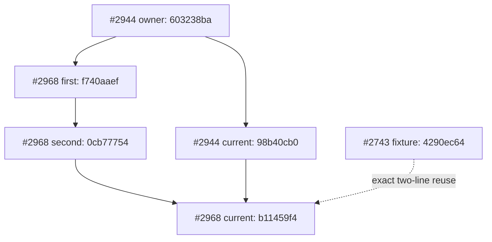

# 分支、PR 与 owner 收敛图

## 完整分页的范围

主库初始完整 metadata 快照有 **2,864 个唯一 branch、2,967 个 PR**，PR 编号
1–2967 无缺号。1,637 open，其中 1,602 draft、35 non-draft；1,330 closed，
323 merged。branch 29 个非空页后有空终页；PR 60 个非空页后有空终页。
分页时间、压缩原始页摘要和全部紧凑分片见 [inventory/README.md](inventory/README.md)。

这不是所有 2,967 个 PR 的逐文件语义、review、完整 CI 或权限资格审查。
新 #2968/#2969 和后续 HEAD 变化记录为 [delta](inventory/POST_SNAPSHOT_DELTA.json)，
没有直接把初始计数加二当作重新完成的全库 census。

## 已执行的本轮 owner 链

实线为保留的 Git 祖先关系；虚线为明确溯源的源码复用，不声称 cherry-pick 祖先。
最终 #2968 两个 ordered parents 是 `0cb777545966333a96be265a69d03c9982231bc7`
与 `98b40cb04a23a36a07212ef7d826024f37536057`。父 owner 的 18 个路径原样保留。
Reader #2969 是独立 research child：`f191cd081ba16fed8827a18093b5a5b39e9a36cd`
→ `ca2768978429a2c9a98641fa2d58a8f587b88874`，保持 Draft 与 DENY_ALL。

## 已核实的历史 owner 关系及决策

| owner / 候选 | 实际 ancestry 证据 | 当前处理 |
| --- | --- | --- |
| #1504 与 #1500/#1501 | 分别 diverged 1/2、1/1；两旧 PR 已 closed/unmerged | 没有证据证明所有必要语义已吸收，不删除旧分支 |
| #1468 → #1508 → #1509 | #1508 相对 #1468 diverged 1/568；#1509 包含当前 #1508，ahead 2 | Cell Split 历史不能只按 PR 编号折回；先比较缺失的实际改动 |
| #1504 与 #2937 | diverged，当前 #2937 ahead 317 / behind 126 | 两条深度分叉，不宣布旧 PON 根已过时 |
| #2695 → #2937 / #2959 | 当前 #2695 分别为祖先，ahead 217 /75 | 只证明 ancestry；不证明语义未被 revert，也不授权研究 promotion |
| #2688 与 #2937 | diverged，#2937 缺当前 #2688 的 1 commit | 保留 Memory contract owner，尚未证明完整整合 |
| #2924 与 #2937 | diverged，#2937 缺 3 commits | fixture 等必要修复逐项追踪；本轮复用的是已验证 #2743 两行 |
| #2815/#2883/#2879 → #2937 | 已验证 ancestry，分别 ahead 306/310/234 | 保留 original Objective/安全 owner，不把 ancestry 当效应资格 |
| #2961/#2964 与 #2937 | 分叉，二者都缺 #2937 当前 3 commits | 现有 basic-toml 等修复作为候选；未直接覆盖整合根 |
| #2917 与当前 keyring | 历史 keyring 3 / zbus 4 修复；当前失败路径为 keyring 4 / zbus 5 | 不能无语义比较直接套用旧后端切换 |
| #2962 | 多次观察 HEAD 变化，最后 bounded refresh 为 f6748b35... | OBSERVED_RACE；旧 head 的 25 checks 未移到新 head |

全部 14 次实际 compare 的 exact SHA、merge-base、ahead/behind 在
[inventory/BRANCH_PR_DAG.md](inventory/BRANCH_PR_DAG.md) 与对应 JSON 中。

## 35 个非草稿的完整门禁筛查

01:12:31–01:18:17 UTC 取回全部 35 metadata、35 次 bounded head recheck、
42 页 check-runs，共 2,448 条 latest-filter 检查记录；超过 100 条的集合继续分页。
34 个 head 在 recheck 不变，#2962 再次变化。

在各自观察 head 上：`CI required` **33 failure / 2 missing**；
`Architecture required` **21 success / 13 failure / 1 queued**。
mergeable state 为 dirty 9、behind 5、blocked 15、unstable 6。
**没有一个候选取得完整合并资格。** `mergeable=true` 仅表示 Git 可生成合并树。
所有状态与 app ID 绑定见 [inventory/NONDRAFT_GATES.json](inventory/NONDRAFT_GATES.json)。

当前 main `f8c9419df6ddeb36ff8b522a50219981fb8d9345` 的分支响应公开两项 required
contexts，app 15368；完整 protection endpoint 返回 403，review/管理规则并未全部可见。
另外四个 stack base 的分支响应显示 protection disabled，仍不能据此把失败门禁绕过。

因此本轮 **merge 0、删除 branch 0、关闭 PR 0、force push 0**。完成了实际修复、
owner 保留和候选筛查，尚未完成所有重复/临时 PR 的语义淘汰与完整审查。

## OS/Organ 独立仓库

`trillionnium-os-desktop` 初始 metadata 全分页有 196 branches、215 PRs，29 open、
130 merged；最新编号 225 并不等于 PR 数。#210/#218 是 broker source owner，
#224/#225 是独立并行 kernel/inode/storage 集成，不能混同为 Hepta 主库编号。
01:35:51 复查 #224 已到 `49e5582db15493eed60d62fb16b4c85fc7408307`，#225 已到
`9476f50e9c18745369300b3f2b7d5cf2ad09a713`；每个新 head 有六项 queued checks。
早先六项 success 属于旧 head，不转移到新 head。见 [os/README.md](os/README.md)。
