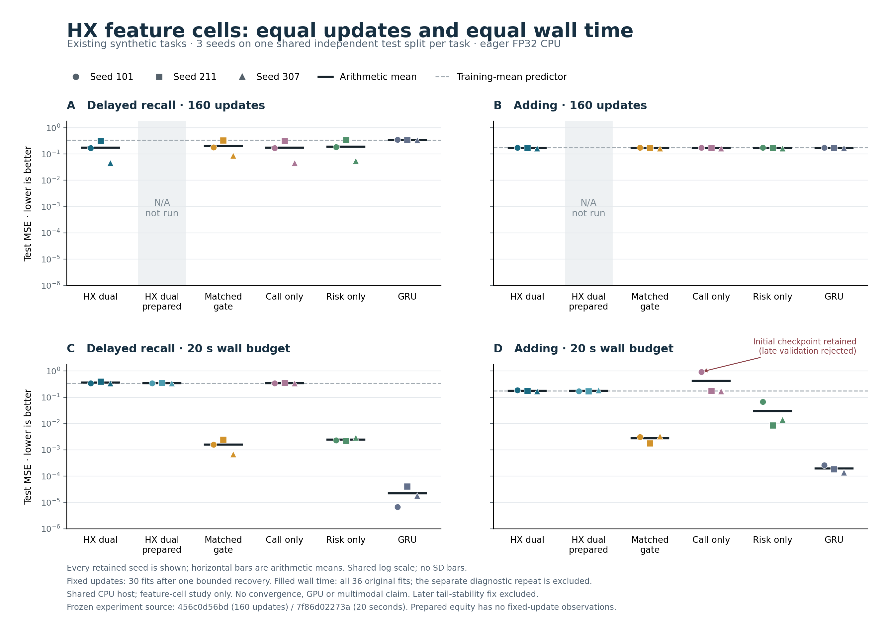

# Parameter-matched HX feature study: filled 20-second budgets

The prespecified matrix completed **36/36 fits** in 890.854 controller seconds. Each fit has a new process. All original samples remain in the main statistics. One separately identified repeat of the first fit diagnoses a documented concurrent review process; it is excluded from the 36-fit statistics.

The existing delayed-recall and adding generators use data seed 271828 and independent 512/128/256 train/validation/test examples. Initialization/minibatch seeds are 101, 211 and 307. Length is 16, width 8, batch 32, dt 0.1, eager FP32, Adam learning rate 0.003, and one PyTorch/BLAS CPU thread. The parameter-matched gate shares the HX memory/recovery maps and common initial tensor values; its sigmoid features replace the finance functions. Equal initial tensors do not imply equal initial outputs.

## Deadline and selection rule

The 20-second interval starts before initial validation and includes training, gradient/parameter checks, periodic validation and in-memory checkpoint copies. Validation is scheduled every four elapsed seconds. Both validation and the candidate copy must finish by 20 seconds to select weights. An in-flight operation may overrun: its entire time and actual optimizer update are retained, but a late checkpoint is ineligible. The selected checkpoint is tested once. Final torch.save, test and latency measurements, imports, model/data construction and the persistent-state probe lie outside this interval and inside the measured child process. The process timeout is 90 seconds, campaign cap 1,500 seconds, and 100,000 steps is only a nonbinding guard.

## Main results

MSE is lower-is-better; uncertainty is sample standard deviation over three initialization/minibatch seeds on one shared independent test set, not a confidence interval over new datasets. Update ranges include the final in-flight update. The JSON separately records in-budget updates and checkpoint selection.

| Task | Model | Fits | Test MSE mean ± sample SD | Actual updates, min–max | Selected step 0 |
| --- | --- | ---: | ---: | ---: | ---: |
| delayed_recall | hx_dual | 3/3 | 0.362838 ± 0.0323086 | 15–30 | 0 |
| delayed_recall | hx_dual_prepared | 3/3 | 0.345257 ± 0.00461852 | 38–45 | 0 |
| delayed_recall | matched_gate | 3/3 | 0.00157511 ± 0.000871818 | 706–1327 | 0 |
| delayed_recall | hx_call | 3/3 | 0.346256 ± 0.00531903 | 30–31 | 0 |
| delayed_recall | hx_risk | 3/3 | 0.00248298 ± 0.000361058 | 740–779 | 0 |
| delayed_recall | gru | 3/3 | 2.1893e-05 ± 1.73438e-05 | 5309–5315 | 0 |
| adding | hx_dual | 3/3 | 0.177412 ± 0.00791846 | 30–31 | 0 |
| adding | hx_dual_prepared | 3/3 | 0.177195 ± 0.00756329 | 35–46 | 0 |
| adding | matched_gate | 3/3 | 0.00276613 ± 0.000830965 | 1240–1405 | 0 |
| adding | hx_call | 3/3 | 0.426393 ± 0.439096 | 2–31 | 1 |
| adding | hx_risk | 3/3 | 0.0298515 ± 0.0322815 | 590–798 | 0 |
| adding | gru | 3/3 | 0.000193898 ± 6.14104e-05 | 5000–5492 | 0 |

A completed fit means execution completed; a selected initial checkpoint or failure to beat the constant predictor is not evidence of successful learning. Raw per-seed validation curves, test MSE, actual and in-budget updates, gradients, selected parameter changes and all cost records are retained.

## Cost and state

| Model | Parameters | Persistent bytes/example | Process RSS range, MiB | Training CPU/wall range |
| --- | ---: | ---: | ---: | ---: |
| hx_dual | 257 | 64 | 343.98–344.34 | 0.939–0.998 |
| hx_dual_prepared | 257 | 64 | 332.35–332.82 | 0.992–1.000 |
| matched_gate | 257 | 64 | 274.82–275.17 | 0.947–1.000 |
| hx_call | 257 | 64 | 341.60–343.45 | 0.809–1.000 |
| hx_risk | 257 | 64 | 276.66–276.83 | 0.989–0.999 |
| gru | 297 | 32 | 273.57–274.12 | 0.994–1.000 |

HX/gate retained state is the actual memory and recovery tensor payload. GRU retains its hidden tensor. Parameter and optimizer bytes are separate. These feature cells have no density or refractory queue. RSS is a child-process lifetime high-water mark including Python, libraries, datasets, test and inference; it is not training-only allocator memory. Energy is unavailable (`null` with a reason), not inferred from runtime.

## First observed time to half the constant-predictor validation error

These are validation observations, not exact crossing times. All three seeds remain in each denominator; not reaching the target by the budget is censored. Full 0.9/0.75/0.5 target records are in the JSON.

| Task | Model | Reached within budget | Observed seconds, reached seeds |
| --- | --- | ---: | --- |
| delayed_recall | hx_dual | 0/3 | not reached |
| delayed_recall | hx_dual_prepared | 0/3 | not reached |
| delayed_recall | matched_gate | 3/3 | 101: 4.013, 211: 4.015, 307: 4.028 |
| delayed_recall | hx_call | 0/3 | not reached |
| delayed_recall | hx_risk | 3/3 | 101: 4.047, 211: 8.039, 307: 8.037 |
| delayed_recall | gru | 3/3 | 101: 4.004, 211: 4.003, 307: 4.004 |
| adding | hx_dual | 0/3 | not reached |
| adding | hx_dual_prepared | 0/3 | not reached |
| adding | matched_gate | 3/3 | 101: 8.022, 211: 8.021, 307: 8.024 |
| adding | hx_call | 0/3 | not reached |
| adding | hx_risk | 3/3 | 101: 16.043, 211: 12.109, 307: 12.042 |
| adding | gru | 3/3 | 101: 4.004, 211: 4.004, 307: 4.034 |

## Environment and the separate first-fit repeat

This is a shared managed CPU host, not an exclusive reservation. An independent eight-scalar tail review had a script/result timestamp window 05:39:42.608–05:39:44.556 UTC, within original fit 000’s process interval 05:39:32.506–05:39:58.268 UTC. Its 0.0823 CPU seconds cover the scalar calculation only, excluding Python/Torch imports. The concurrent window is retained as a known environment limitation. Later fits began after that review completed. Other observed timing variation remains part of the evidence; there is no post-hoc outlier deletion.

After all 36 fits, only original fit 000 was repeated once with the exact source, configuration, seed and data in a new output directory. The repeat is diagnostic and does not replace the original.

| First-fit observation | Actual / in-budget updates | Selected step | Validation MSE | Test MSE | Training wall / CPU seconds |
| --- | ---: | ---: | ---: | ---: | ---: |
| original | 30 / 29 | 6 | 0.299036 | 0.345577 | 20.212 / 20.166 |
| repeat | 32 / 31 | 7 | 0.299146 | 0.34379 | 20.455 / 20.396 |

The largest retained overrun is 8.117 seconds in `adding/hx_call/101`. The deadline eligibility rule is unchanged.

## Scope and reproducibility

This study addresses the cost and usefulness of **HX equity/V and first-passage probability features**. The second feature is a probability, not a put price or a self-exciting run process. This cell does not implement hitting/reset/refractory population flow. Its financial boundary is not a solved neural-task intervention objective. Results do not replace original170, localization/original42 or Cell E07, and do not establish convergence, an advantage over SNN/Transformer, GPU scaling or multimodal suitability.

The paired prepared evaluator retains the complete HX expression and gradients, and its scientific source remains frozen at `7f86d02273ab665b9789c3058613ca350f9919d7`. The default direct arm remains direct. No later far-tail fix is included in these runs. Four targeted tests passed, including actual optimizer updates followed by rejected late validation and rejected late checkpoint copies. A static cross-review found no late selection or held-out-test leakage. The earlier canonical 112-test suite applies to the fixed-update source; the prepared evaluator has its separately retained equivalence evidence.

`WALL_BUDGET.json` supplies complete per-seed measurements and paired differences. `wall-budget-originals.tar.gz` retains all 36 original fits, the separate diagnostic, checkpoints, immutable attempts, logs, exact frozen Python source/config and the archive script. Its internal `MANIFEST.json` binds every archived file. Verification checked complete identities, source/split hashes, checkpoint SHA256, eligible deadlines, process return codes and reaped children without rerunning models.

## Reusable comparison figure

`budget-comparison.svg` is the vector version. `budget-comparison-data.json` retains all 66 plotted observations, arithmetic means, source hashes and explicit missing prepared-arm cells in the fixed-update protocol. The initial-checkpoint Call-only observation is retained and annotated; the separate diagnostic is excluded. Shared log axes and per-seed markers avoid hiding the three-seed variation behind a mean or invalid negative error bar.

Regenerate with `python qualification/hcsn/campaign_audits/hx-wall-20261119/plot_budget_comparison.py`. This reporting script was added after the experiments; it reads the two archived result JSON files and does not import model code, rerun a fit or alter frozen experiment sources.
