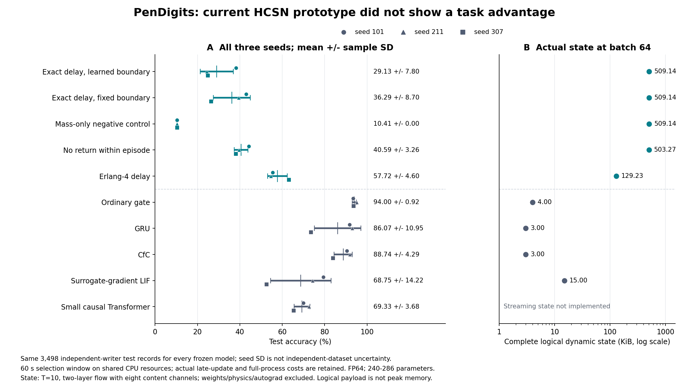

# HCSN：完整算子、N256、C2 与 Cell 的证据总表

日期：2026-11-19。本文汇总已执行结果与各自适用范围；所有来源保持独立冻结身份。

**当前决定：继续研发可微再生算子；现有证据不支持升级为全模态主干。**
完整有限状态神经元已进入真实网络并完成训练与独立测试，变化参数、冷续算、内容余额和梯度也有独立参考。与此同时，同时间预算下的轻量 HX 与完整 HCSN 都没有击败普通门控；确定性延迟的历史状态成本仍明显偏高。旧 N256 bitwise 失败和 C2 历史缺口没有因新实验通过而消失。

本文是各项研究的入口，不是把不同模型、不同冻结源码或不同测试集拼成一次共同通过的实验。`all_closed = false`。

## 1. 按四阶段目标检查

| 用户目标 | 已有实证 | 仍不能宣称 |
| --- | --- | --- |
| 一个完整、可继续、可求导的神经元 | 有限 CTMC、确定性延迟、重置、signed content、累计奖励/折扣、完整 pending state；独立延迟 ODE、解析再生和、真实进程冷续算与梯度核验 | 任意连续扩散参数域的证明；逻辑事件时刻/延迟的全局可微性；过去 autograd graph 的冷恢复 |
| 区分 HX Cell 与再生流 HCSN | 两条路线均比较普通门控；HX 有通道对照，HCSN 有边界、观测窗内无返回、内容对照与 Erlang 近似；均有实际训练 | 金融特征有益、脉冲动力学有益或可替代主干 |
| 由任务目标产生自由边界 | 标量保持收益、维持成本、释放成本、固定重置和不应期的 QVI；独立 Bellman 网格、隐式梯度、学习验证 | 已求解分类任务中依赖内容的 Bellman/干预价值面 |
| 同预算与同效果比较 | 20 秒 HX 选模窗口、60 秒网络选模窗口、真实更新数、独立 test、成本/状态/多 seed；预设质量目标未达标按右删失保留 | 所有模型充分收敛；相同 FLOPs/CPU 秒；GPU/能耗收益；未达到质量目标的 HCSN 更便宜 |

## 2. 完整算子：变化参数与精度修复

### 2.1 变化参数、内容与真实冷续算

[Draft #6760](https://github.com/TrillionniumFoundation/hepta-private-ci/pull/6760) 的源码和原件位于
[`b113f0b36fdbda4c40160148c7cba2dc5f9275e0`](https://github.com/TrillionniumFoundation/hepta-private-ci/tree/b113f0b36fdbda4c40160148c7cba2dc5f9275e0/qualification/hcsn_currentstate/evidence/timevarying-20261119-2f215)。

独立 DOP853 method-of-steps 参考保留每个发放时刻的 delay、lower 和 reset law，并累加重叠的返回窗口；折扣按各段积分连续累积。它比较三个总通道（一通道概率、两通道 signed content）的 active、上界吸收、触界累计量、occupation、value、discount factor 与 waiting mass。

| 检查 | 原冻结算子实测最大误差 | 原阈值 |
| --- | ---: | ---: |
| 变化 law 的完整状态对独立延迟 ODE | 3.658531810835086e-13 | 3e-9 |
| 概率/内容余额 | 7.971401316808624e-14 | 2e-11 |
| 12 参数 AD 对独立 ODE 有限差分 | 3.313580763941726e-10 | 3e-7 |
| 新进程从 .29 续算到 .81 | 1.4999113062685865e-13 | 3e-11 |

一次真实运行：17.498232410 秒 full-child wall、17.194301 CPU 秒、255,816 KiB 峰值 RSS；63 个逻辑指数动作，最大矩阵阶数 29，完整逻辑 tensor payload 16,992 bytes。逻辑时间和 delay 为固定有理数，不包含事件排序的梯度。两个 ODE tolerance 设置恰好产生相同网格和结果，因此没有把它们称作两个独立求解器或收敛阶证明。

### 2.2 零年龄恒等优化

[Draft #6761](https://github.com/TrillionniumFoundation/hepta-private-ci/pull/6761)，冻结 head
[`390b644beec80dc057b2603cc2a0bdf69af7c3de`](https://github.com/TrillionniumFoundation/hepta-private-ci/tree/390b644beec80dc057b2603cc2a0bdf69af7c3de)。

在两个逻辑年龄为零的位置使用原 tensor，省去 `alpha @ exp(0 * G)`，保留 alpha 已有梯度路径，零年龄对 G 的导数仍为零。四种形状、八个新进程检查 260 个 tensor、186,036 个坐标，保存的输出、完整状态与梯度数值完全相等，最大绝对差为零；这里没有额外断言位模式一致。T80 的指数动作从 472 降至 320，saved-AD payload 从 141,889,465 降至 129,486,265 bytes。

四种形状的 baseline/candidate wall 比为 1.124、0.789、1.343、0.993，包含一次变慢和一次近乎不变。它证明删除了无效动作，不能证明普遍加速。专用 CI [44527571491](https://github.com/TrillionniumFoundation/hepta-private-ci/actions/runs/44527571491) 两项 jobs 通过，包含新 network 和 changing-law 检查。

完整动态状态字节没有因零年龄优化减少；saved-AD payload 包含重复保存的 tensor 负载，不是峰值 live 或 allocator 内存。

### 2.3 原生矩阵指数的严格反例

优化审查保留了原 T=.61 解析再生案例的失败。原/优化实现都在相同阈值失败，排除了把该失败归因于零年龄优化的解释。替换为独立 MP80 矩阵指数后，该次 forward 的 T=.61 终点九个观测量（active/hits/waiting × 三个总通道）的最大误差从约 6.69e-12 降至约 1.07e-16；问题矩阵的原生指数误差约 1.14e-11。这不是整个连续轨迹的 sup 范数检验。

对 [PyTorch v2.8.0 官方 `LinearAlgebra.cpp`](https://github.com/pytorch/pytorch/blob/v2.8.0/aten/src/ATen/native/LinearAlgebra.cpp) 的 T8 公式做精确符号展开，第 5–8 阶系数不等于 Taylor 系数。证据只针对记录的版本、构建和路径，不外推所有 PyTorch 版本或所有 GPU 后端。

后继修复以 tensor 内 degree-12 Horner 计算覆盖 FP64 norm1≤.1 和 FP32 norm1≤.6，其余范围保留原生路径。截断余项上界分别小于 1.78e-23、3.83e-13；这些界不包含浮点舍入误差，后者通过独立数值比较检查。FP32 norm=.5 原反例误差 2.062320709e-5；修复后的对角反例对逐元素 `torch.exp` 的 FP32 参考最大绝对差为零。非对易矩阵另有独立 MP80 值、Fréchet 一阶导和混合二阶导比较。

最终修复已发布为 [Draft #6763](https://github.com/TrillionniumFoundation/hepta-private-ci/pull/6763)，head
[`1aabc1f81ffa23a8b1589647c4f952e90b0c8a66`](https://github.com/TrillionniumFoundation/hepta-private-ci/tree/1aabc1f81ffa23a8b1589647c4f952e90b0c8a66/qualification/hcsn_currentstate/small_norm_exponential_20261119)，kernel SHA256 `e1731b349de811177dc402ee0ee70f08a25289bb844837b679cabef2d63bdfb6`。35 项最终源码 core/network 检查全部通过，原严格案例源码保持逐字节相同。

| 本地最终源码检查 | 最大绝对误差 |
| --- | ---: |
| 原 T=.61 active/hits/waiting 值 | 4.440892098500626e-16 |
| 原 T=.61 加权 rate 一阶导 | 0 |
| 原 T=.61 content 一阶导 | 5.828670879282072e-16 |
| 原 T=.61 加权 rate 二阶导 | 4.163336342344337e-17 |
| 变化 law 对独立延迟 ODE 的完整状态 | 3.3306690738754696e-16 |
| 变化 law 的概率/内容余额 | 4.440892098500626e-16 |
| AD 对独立 ODE 有限差分 | 3.312292141954831e-10 |
| 新进程冷续算 | 1.1102230246251565e-16 |

两个最终检查子进程合计 22.591225 wall 秒、22.409696 CPU 秒，峰值 RSS 295,076 KiB。独立非对易 MP80 审查分别记录：FP64 前序快照的最大值/一阶/二阶误差 3.33067e-16 / 1.38778e-17 / 1.30104e-18；最终 FP32 源码为 9.40981e-8 / 1.30780e-8 / 7.92871e-10。FP64 算术在两快照间未变，仍保留各自源身份。

同一 head 的专用 CI [44531647366](https://github.com/TrillionniumFoundation/hepta-private-ci/actions/runs/44531647366) 两个 jobs 均 completed/success，包含保留证据算术、完整 state/gradient、network/cold continuation 和 changing-law 检查。此处不主张全仓所有工作流通过；CPU 数值资格不外推 GPU/TF32 或 FP32 全网络训练。

CI artifact 的 SOURCE_HEAD 与上述提交完全一致，日志分三组记录 2+6+27=35 项通过。CI 自身的 changing-law field/balance/ODE-FD/cold 误差分别为 3.885780586188048e-16 / 5.551115123125783e-16 / 2.2921659362240554e-10 / 1.1102230246251565e-16；保留这些实测值，不替换成本地结果。原 ZIP、17 个解压件与 API receipts 共 26 件文件已无改动保存在 [evidence/precision-ci-44531647366](evidence/precision-ci-44531647366)，ZIP SHA256 `cfdfd65de0cc2adef26886f3ce36c0f759ed347d86b29e592bc1e7320b792fb5`。

尚无证据表明这个 FP64 指数误差解释了网络与普通门控之间的任务质量差距。后继源码还没有新的真实任务训练结果。

## 3. N256：独立有界参考已给出确定答案

[Draft #6758](https://github.com/TrillionniumFoundation/hepta-private-ci/pull/6758)，结果冻结于
[`332ce9af040518ba6aac4955fcafc2b9c82e34ed`](https://github.com/TrillionniumFoundation/hepta-private-ci/tree/332ce9af040518ba6aac4955fcafc2b9c82e34ed/qualification/hcsn_n256_bounded_reference_20261119)。

新的纯标准库 Fraction/dyadic interval uniformization 参考不调用 NumPy、SciPy、Torch 或原生产求解器。它独立解码冻结输入，绑定 FP64 generator 构造和时间缩放的舍入语义。本次证明针对原 N256 warm 0→.001 的完整状态；四个动作完成冻结停止规则，69,728 个坐标全部获得唯一 binary64 舍入值，最大区间宽度 7.458340731200207e-155。它不是所有参数、时间或多步状态的正确舍入证明。

| 原候选 | 对有界参考的最大绝对误差上界（十进制约值） | 非正确舍入坐标数 |
| --- | ---: | ---: |
| dense | 4.663891480381385e-16 | 1,286 |
| sparse | 5.416216990118433e-16 | 1,285 |

精确有理数上界见原件，表中十进制仅为显示。原 dense/sparse 之间 1,291/69,728 坐标逐位不同的 RED 保留。新的参考解释了数值大小，也提供完整正确舍入 capsule；它没有把旧 bitwise gate 改为容差 gate。主矩阵动作目标是声明的有限矩阵 `alpha_fp exp(RN(A_fp * dt_fp))`，完整状态参考还处理独立的 initial-upper occupation 标量项（rho>0）和不变状态字段；这不是连续扩散的无离散化真值。

原执行 full child：40.988992 wall 秒、40.385997 CPU 秒、72,888 KiB RSS；独立只读 reader 的 body 另用 1.771691 wall 秒、1.756585 CPU 秒，不包含解释器导入和最后输出。所有输入前后 hash 一致。

此外 [Draft #6753](https://github.com/TrillionniumFoundation/hepta-private-ci/pull/6753) 的强化 reader 已在 #6752 真实原件执行，检查 14 个完整 capsule、18,279,371 个坐标与三个冷状态逐字节一致。该 reader 未重跑 BDF、phase integral 或模型；结果冻结于
[`541f880b9ab102f28e01626cc2ea0639a529080c`](https://github.com/TrillionniumFoundation/hepta-private-ci/tree/541f880b9ab102f28e01626cc2ea0639a529080c/qualification/hcsn_n256_multistep/evidence/bound-reader-20261119-2f215)。

## 4. C2：D 选择/校准、原环境与历史缺口

C2 训练链使用原 v8 QPR/remaining-time-phase 模型、单层 width 16 和原 trainable adapters；它不是本报告的新完整再生流网络。已有 [#6747](https://github.com/TrillionniumFoundation/hepta-private-ci/pull/6747) 两项续训共完成 353 次实际 AdamW 更新，随后 [#6751](https://github.com/TrillionniumFoundation/hepta-private-ci/pull/6751) 从 seed211 的真实 epoch147 部分游标继续完成 19 次更新并达到原 plateau 规则，没有重新洗牌或重复前五个 batch。

| 已识别续训 | 最后完整 epoch | strict-best epoch | D macro-F1 | 记录的终态 |
| --- | ---: | ---: | ---: | --- |
| seed211、LR .001 | 148 | 144 | 0.388353751030186 | COMPLETED_PLATEAU |
| seed307、LR .001 | 136 | 126 | 0.33231907785802234 | COMPLETED_PLATEAU |

独立 reader 对 partial-resume 首个保存梯度的 AdamW 更新进行 NumPy 算术重算，11 个 tensor / 17,356 坐标最大差 5.551115123125783e-17；这不是重新生成训练梯度。plateau 指原停止规则和继承的 memorization 条件满足，不是全局最优。

[#6757](https://github.com/TrillionniumFoundation/hepta-private-ci/pull/6757) 固定了七 family × 三 seed 的 21 个 D-only winners，保留全部 42 个 LR/seed 机会。七 family 都选择 common LR .003；HCSN 的平均 D macro-F1 为 0.3762526948891313，LR .001 为 0.3548966088884725。全部 21 winners 满足记录的训练停止条件。这些是开发集选择，不能当成 E 确认结果。

[Draft #6759](https://github.com/TrillionniumFoundation/hepta-private-ci/pull/6759) 在固定 D-only selection 上完成 21 个温度校准。21/21 都是区间内部根，独立 longdouble 导数括号通过，NLL 全部下降、argmax 全部不变；1,064 次目标/导数/Hessian 评估、980 次二分、126 次独立检查。最大 float64/longdouble 差 1.4210854715202004e-14。整个阶段 33.858319262 秒，低于原 600 秒上限。

这一步没有神经网络 forward/backward/optimizer，也没有读取 E。结果冻结于
[`922b9ea10a3aa68bacec714948badb4c8ff2d3b1`](https://github.com/TrillionniumFoundation/hepta-private-ci/tree/922b9ea10a3aa68bacec714948badb4c8ff2d3b1/qualification/hcsn_c2_d_temperature_20261119)。

从原缓存 wheel 建立隔离环境，恢复 Python 3.12.3、Torch 2.8.0+cu128 及原科学依赖，核对 12,672 个非生成 payload 文件。恢复真实 native job 成功退出；120.945 秒。原损坏环境保留。新路径和安装 metadata 并非旧路径和旧 receipt，因此包内容一致不意味着原 auditor 的身份入口自动通过。

### 当前六个 best 的完整 D replay

六个不同的当前 strict-best 检查点均已完成首次 full-D forward；每项为完整 31,952 个事件、11 类 logits、128 个 episode，未构建 optimizer 或执行 backward。全部 fresh/saved logits 最大绝对差为零，保持原 2e-12 数值门；这里先按实际比较定义为数值完全相等。

| Seed | LR | strict-best epoch | D macro-F1 |
| --- | ---: | ---: | ---: |
| 101 | .001 | 106 | 0.3440169977772091 |
| 101 | .003 | 74 | 0.38783425965779494 |
| 211 | .001 | 144 | 0.388353751030186 |
| 211 | .003 | 40 | 0.3910932361454862 |
| 307 | .001 | 126 | 0.33231907785802234 |
| 307 | .003 | 62 | 0.3498305888641129 |

执行先得到三个成功项；另三项在模型前因 initial 旧路径缺失失败。恢复使用同 SHA 的存活原件，只改路径。随后一项成功，另两个 continuation 因候选索引的 expected configuration 为 null 失败，仍未构建模型。第二次适配沿母 report → 原 plan SHA → 独立 construction → 原 initial 的证据链补全期望配置，原 `replay.py` 及 epoch/config/data/logit 门未改，才执行剩余两个首次 forward。已成功模型没有重跑，五个模型前失败及全部费用保留。

原 1,800 秒总时钟和每 fit 210 秒额度均未重置；先前失败的 full-child wall 按项扣除。从首次 native 创建到最终科学归档共 1,617.823915 秒，到最后 native 的真实 terminal 为 1,617.896 秒，仍余 182.104 秒。两份独立入口审查见 [C2_ALIAS_REVIEW.md](C2_ALIAS_REVIEW.md) 与 [C2_CONFIGURATION_REVIEW.md](C2_CONFIGURATION_REVIEW.md)，最终配置源码冻结为 [`6665a66ebdae1224d8a6bac4f22c0878136b33f7`](https://github.com/TrillionniumFoundation/hepta-private-ci/commit/6665a66ebdae1224d8a6bac4f22c0878136b33f7)。完整结果已发布为 [Draft #6764](https://github.com/TrillionniumFoundation/hepta-private-ci/pull/6764)，永久证据入口为 [`f6d86a585b35040320c1097d443f22fcea9935d8/qualification/hcsn_c2_E_admission_20261119`](https://github.com/TrillionniumFoundation/hepta-private-ci/tree/f6d86a585b35040320c1097d443f22fcea9935d8/qualification/hcsn_c2_E_admission_20261119)；README、两份最终结果 JSON、E gate review 与 seal 共五件关键文件已另行核对远端 Git SHA 和字节数。

14 个有完整 `wait4` 记录的 child 合计 wall 852.250126877 秒、CPU 838.057776 秒，峰值 RSS 888,328 KiB。另一次只读语义诊断按 native creation-to-terminal 6.838 秒扣入 metadata 池；metadata 共收费 41.192880014 wall 秒。child wall 之和、全局 elapsed、reader body 与原环境恢复成本分别列账，未将未知的历史费用填零。

三个原 ZIP 共 17,124,424 bytes、161 个成员全部通过读取与 hash 校验。独立 reader 从六组完整保存数组用 NumPy 重算指标，最大差 2.220446049250313e-16；上表使用这次重算的实际 F1，保留与旧记录末位的差异。reader 为零模型/forward/backward/optimizer，其 body 为 2.940407098 wall 秒、2.917649829 CPU 秒、228,560 KiB 进程峰值 RSS；body 含随后 Torch/NumPy 导入，不含解释器启动、前置模块导入和最终报告写出。结果 `FINAL_READBACK.json` SHA256 为 `2d7657124c366eff56d2afc8cbc0f3289d054c4de4dbd779558f681323bc53d7`。

21 个 D-selected 模型与 21 个温度参数已经统一封存；`SEALED_SELECTION.json` SHA256 为 `6c20a236747ec5733643a68e1761fdcdb31e186643d89b2ab4ae8e615d3531b6`。E 未读取。原 chain 缺口与 E 准入状态保存在 `E_GATE_REVIEW.json`，SHA256 `caa91ff64767f062b57aaadd79a3e6d154ba3446ec6dbd117871e8b33393fbeb`。

只读历史链审计验证了 289 份完整 epoch commit，未发现 commit 校验错误，并核对六份原始保存的 model/AdamW/RNG 恢复状态。两个旧 producer 的结果与旧 controller 结果仍缺失，旧尾日志的损坏/unfinished 情况保留。此处六个 best 的 D forward 复现与原完整训练 replay=0/6 是不同检查；原完整 chain auditor 和 E 准入仍为 HOLD。

新 D replay 的 `model_state_dict_tensor_bytes` 只计模型保存 tensor；完整 recurrent density/content/delay 状态字节未测，保持 null，不能拿权重字节替代它。

## 5. 轻量 HX Cell：同参数与同时间的实测

来源：[Draft #6744](https://github.com/TrillionniumFoundation/hepta-private-ci/pull/6744)，冻结 head
[`4939bf7cbefaae9f9f71533b36580c6b81327e45`](https://github.com/TrillionniumFoundation/hepta-private-ci/tree/4939bf7cbefaae9f9f71533b36580c6b81327e45/qualification/hcsn/campaign_audits/hx-wall-20261119)。

36/36 个 fit 完成；每个 20 秒训练/验证选模窗口，两项 synthetic tasks、三种子。每项任务的三个 seed 共享同一独立 test split，并非三份独立测试集。HX dual 与 matched gate 都有 257 个可训练参数。以下是独立 test 的三 seed 平均 MSE，越低越好。

| 模型 | Delayed recall | Adding |
| --- | ---: | ---: |
| HX dual | 0.362838 | 0.177412 |
| Prepared HX dual | 0.345257 | 0.177195 |
| 参数匹配普通 gate | 0.00157511 | 0.00276613 |
| HX call / equity 单通道 | 0.346256 | 0.426393 |
| HX risk 单通道 | 0.00248298 | 0.0298515 |
| GRU | 0.000021893 | 0.000193898 |

完整 HX 没有显示预算内优势。两项任务的预设 validation 质量目标，full HX 为 0/3，matched gate 和 GRU 为 3/3。HX 每样本保留 state 为 64 bytes，GRU 为 32 bytes；这不是过程 RSS 或反向图大小。完整 equity/V 与首次触界概率是两种特征；risk 通道不是 put value，这个 Cell 也不是自激再生流。

固定 160 updates 的先前比较、未完成首批/有限恢复、全部晚完成验证和初始 checkpoint 被选中的离群案例都保留。固定 update 下的相近误差不能覆盖上述同时间负结果。

另有独立数值修复 [#6745](https://github.com/TrillionniumFoundation/hepta-private-ci/pull/6745)，解决 FP32 远尾有限值但 NaN 梯度的问题；121 项同源 CI 通过，并保留 80-digit 值/梯度与切换点外侧误差。它保持完整 equity 方程，没有以 clipping 或替代导数绕过原式。上述 36-fit 训练仍绑定修复前的原冻结源码。

## 6. 再生流网络：真实训练和独立测试

完整结果和 831 份原件来自 [Draft #6754](https://github.com/TrillionniumFoundation/hepta-private-ci/pull/6754)，报告永久链接：
[`298fae004356f4adb5b58f2bc4d61fdde5bdab75/qualification/hcsn_network/RESULTS.md`](https://github.com/TrillionniumFoundation/hepta-private-ci/blob/298fae004356f4adb5b58f2bc4d61fdde5bdab75/qualification/hcsn_network/RESULTS.md)。

10 arms × seeds 101/211/307，全部 30 train 与 30 evaluation 子进程退出 0；先封存全部选模身份再读 test。PenDigits 原 writer 划分保留 3,498 条独立 test；在原 7,494 条 train 内抽取 750 条 validation，余下 6,744 条训练，三 seed 共享同一个测试集。参数量 240–286，FP64 CPU、每 fit 60 秒选模窗口；没有主张充分训练或相同 FLOPs。

| 模型 | Test accuracy：mean ± sample SD | 完成 updates mean | B64 完整动态状态 |
| --- | ---: | ---: | ---: |
| 确定性延迟＋学习边界 | 29.13 ± 7.80% | 250.0 | 521,360 B |
| 确定性延迟＋固定边界 | 36.29 ± 8.70% | 478.7 | 521,360 B |
| 只传质量负控制 | 10.41 ± 0.00% | 528.0 | 521,360 B |
| 观测窗内不返回 | 40.59 ± 3.26% | 489.3 | 515,344 B |
| Erlang-4 | 57.72 ± 4.60% | 1,607.3 | 132,336 B |
| 普通 gate | 94.00 ± 0.92% | 10,867.3 | 4,096 B |
| GRU | 86.07 ± 10.95% | 9,501.3 | 3,072 B |
| CfC | 88.74 ± 4.29% | 8,393.3 | 3,072 B |
| Surrogate-gradient LIF | 68.75 ± 14.22% | 7,951.3 | 15,360 B |
| 小型 causal Transformer | 69.33 ± 3.68% | 12,421.3 | streaming 未实现 |

状态列统计所有必要动态 tensor 的逻辑负载，包含 pending packet 的历史表示、内容、消息缓存与写入账本；它不等于峰值 RSS，也不包含共享模型权重、独立静态 physics 载荷或 autograd/allocator 开销。Transformer 的流式状态未实现，保持未测而不是填零。

普通 gate 三 seed 都在首次 10.007–20.164 秒的合格检查达到 validation 80%；两个主要 flow 版本都为 0/3，保持右删失。由此不能给出 HCSN 达到相同效果更便宜的结论。每个 fit 都有一次已开始但晚完成的 update，全部计费且不能选模；实际最大训练时长 66.937155 秒，不能把总成本写成严格 30×60 秒。

全部 train/eval full-child CPU 为 2,044.665142 秒，child wall 之和 2,240.985622230 秒，campaign elapsed 1,143.690149883 秒，峰值 RSS 290,968 KiB。共享 CPU 波动与少量验证次数限制了架构因果解释。831 份原件共 48,542,680 bytes；无损 archive 为 28,626,312 bytes，SHA256 `b6f4969ccc5f75b526223b9f83ff0c6348a324ad3bc93342558a13f72b5fe35c`。

这些训练使用原先冻结源码。后继零年龄优化或指数精度修复的数值、成本结果，不被计作这些已保存模型的重新训练结果。

### 长历史成本与压缩的代价

B1、T10/20/40/80 的 exact 动态状态为 20,384 / 57,984 / 193,984 / 705,984 bytes；Erlang-4 一直为 2,304 bytes。exact 虽只保留八个 pending packets，内部 generator 最大 order 从 15 升至 100，说明 packet 数固定不能保证状态成本固定。

Erlang-4 改变确定性等待分布，mean=.2、variance=.01。当前单初始化前缀族上 logits relative L2 deviation 为 0.143–0.203%，参数梯度为 0.288–0.390%，输入梯度为 0.782–2.993%；它不是无损状态压缩。该 profile 不是长序列分类泛化或 dt refinement 测试。

## 7. 自由边界已经做到哪一步

[Draft #6739](https://github.com/TrillionniumFoundation/hepta-private-ci/pull/6739) 将 active reward `gain*Y-maintenance`、释放成本 K、固定 absolute reset、确定性不应期与正 discount 写入再生价值匹配和 smooth-pasting 残差。在声明的 interior domain 验证 QVI 最优性。

三项任务、各三套独立有限差分 Bellman 网格、Lambert-W 对照、八参数有限差分与九次 LBFGS 阈值拟合完成。隐式梯度最大差 2.53e-10、学习边界差 5.32e-9、最细网格 reset-value 相对误差 1.24e-5。初始 SciPy 构造失败也保留。

网络实际通过学习 `K=.15+.02*tanh(raw_cost)` 改变 boundary、reset law、flow 和 readout；但边界每 episode 固定，且来自标量控制问题。当前 shared probability law 不随各样本输入变化；样本信息由 signed content 传递。因此 mass-only 是该模型中人为切断信息的负控制，不能推论所有 margin-only 或所有 SNN 无法传信息。四个 interior nodes 的有限投影也没有自动继承连续控制问题的全部最优性。

## 8. 下一步准入条件

当前证据足以支持继续做有独立参考的可微再生算子。扩大前，应在新的 train/development 协议和新的保留测试上处理三个具体问题：

1. 限制历史内部表示的增长，或者明示接受 phase-delay 分布近似，并同时测量值与梯度误差。
2. 让输入影响触界时间分布，或建立真正依赖任务内容的延续/干预价值；避免只改变标量 cost 却扩大最优性主张。
3. 让更便宜的实现有充分的训练进度，再同时检查同预算质量与达到预设质量的成本。当前 test 不作为继续调参的 validation。

新证据不能修复不可追回的历史终止身份，也不能授予 HPCA 外部 custody/retention 或多模态收益资格。保持已有负结果和科学边界，是继续研发时可复核的基础。
