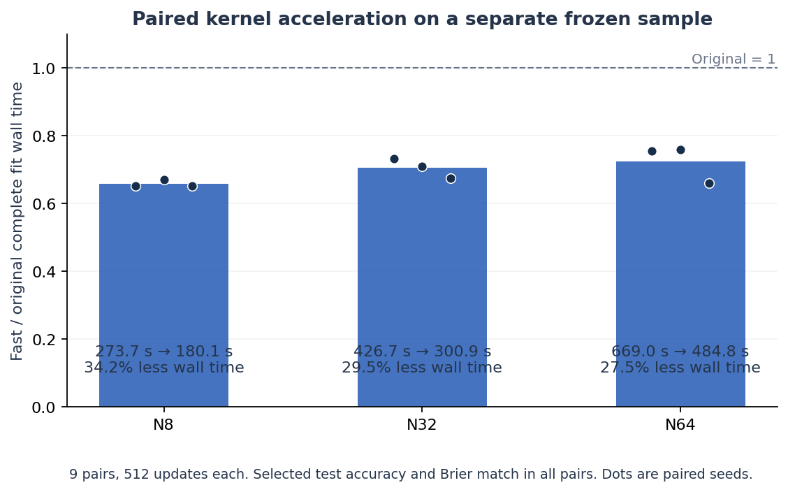
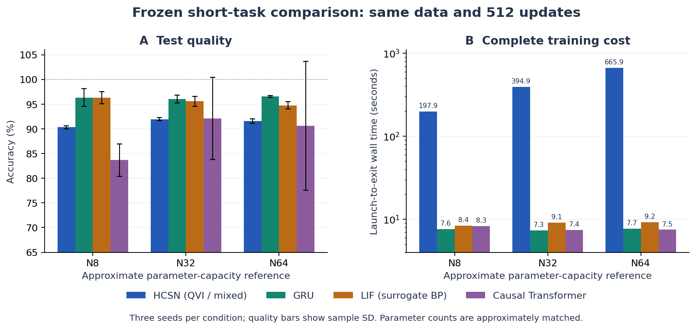

# HCSN 全量推进：模型、训练、编辑与工程证据

本报告对应 PR [#7067](https://github.com/TrillionniumFoundation/hepta-private-ci/pull/7067) 的独立群体研究闭环。历史失败、冻结协议、全部候选和测试预测均保留。局部数值正确、任务能力通过、相对方法优势、仓库集成通过是四个不同判断；完成实验并不把失败的验收门改成成功。

本轮可执行源码固定于 [`c4ae70d44613434aaf165529a6076fa3400ca431`](https://github.com/TrillionniumFoundation/hepta-private-ci/commit/c4ae70d44613434aaf165529a6076fa3400ca431)。三批完整原始证据均已进入独立 evidence 分支，最后一批提交为 [`84d554300002f802e98d30ef0552ab008c2b0241`](https://github.com/TrillionniumFoundation/hepta-private-ci/commit/84d554300002f802e98d30ef0552ab008c2b0241)；后续报告和校验记录不改变受检源码。恢复入口见 [README](README.md) 与 [证据目录](evidence/EVIDENCE_CATALOG.json)。

逐槽元数据名册确认九个正式训练 campaign 共 **177 槽：177 completed、0 censored、0 failed；177 test evaluated**。其中 168 槽各实际执行 512 次更新，AV 的九槽各 256 次。45 个权重程序候选、15 次冷进程成本重放、72 个长延迟测试面板单列，不计为额外训练模型。`completed/evaluated` 只表示执行终态，不表示能力门通过；上一轮的 72/9 槽没有混入本轮分母。[完整终态名册及审计来源](evidence/EXPERIMENT_ROSTER_ZH.md)

## 1. 已经得到的结论

**这条路线可以形成真正可训练的连续神经网络，但目前不能宣称它优于传统 SNN、GRU 或 Transformer，也不能用权重编辑取代通用表征学习。** 新的 8/32/64 单元网络已经支持多初态、可学习耦合、动态内容、内生边界、完整 BP 和独立来源测试。旧实现的通信和数值问题有了可定位的原因及明确的对照。

可以采用的是：signed 内容通量；在已确认 N32 任务上的“因果积累＋固定名义中心化”纯边界通信；慢策略、快内容的分段 law；同一生成元上的概率、内容、risk/value；带隐式导数的合格 mixed 加速内核；已知代数规则的有限权重程序。不能直接采用的是：把金融 equity/default 两个量当成具有相同边界条件的神经双力；只传绝对边界即可普遍学习；纯 FP32 已完全合格；固定状态大小等于长记忆；局部矩阵编辑的耗时等于全网训练成本。

各训练试验的任务指标均由保存的预测进行独立 NumPy 重算；成本来自原进程回执，数值 VJP 与因果诊断分别有原数组/运行记录。重算确认数值和判定没有被摘要误写，但不等于重新训练或独立重放全部物理轨迹。三个种子仅支持描述性均值、样本标准差与预定工程门，不能包装成统计非劣性证明。

## 2. 金融论文能迁移什么

He 与 Xiong 的 [Rollover Risk and Credit Risk](https://www.princeton.edu/~wxiong/papers/rollover.pdf)，*Journal of Finance* 67(2), 391–430 (2012)，给出以微分方程、Laplace 变换、内生停止边界、value matching 和 smooth pasting 为核心的求解方法。神经模型可以借鉴这套方法，但不能把原来终止企业的 default 直接改名为可重复神经放电而不补充 reset/refractory 规律。

对一个固定片段，若安全裕度服从

\[
dX_t=\mu\,dt+\sigma\,dW_t,\qquad \tau=\inf\{t:X_t\le0\},
\]

对 x>0、σ>0、s>0，首次命中时间分布的 Laplace–Stieltjes 变换为

\[
H_x(s)=\mathbb E_x[e^{-s\tau};\tau<\infty]
=\exp\left[-x\frac{\mu+\sqrt{\mu^2+2s\sigma^2}}{\sigma^2}\right].
\]

边界条件为 \(H_0(s)=1\)；累计首次事件概率 \(F(t)\) 的普通 Laplace 变换另有因子 1/s。金融 equity 的 value matching/smooth pasting 则是 \(E(V_b)=E'(V_b)=0\)。两者不是同一套零值、零斜率条件下的 Call/Put 双通道。这里的风险也不是一个可以不加定义就称为金融 put price 的量。

增加固定绝对 reset \(a\)、独立 refractory delay \(D\)，才得到再生事件核

\[
\widehat j_x(s)=\frac{H_x(s)}{1-\mathbb E[e^{-sD}]H_{a-b}(s)}.
\]

完整初始分布应积分该核，不能用均值代入：\(F(T;\mathbb E[X])\ne\mathbb E[F(T;X)]\)。动态输入改变 law 后，应继续传播存活分布、refractory 占用和 signed 内容；当前片段的闭式解不会自动成为整个受控网络的全局闭式解。

完整推导、可微条件、边界移动、概率与计数区别见 [theory.md](theory.md)。数学合同同时指出：解析式不等于稳定的浮点算法；固定网格的重映射仍有分段导数；一阶 custom backward 不自动提供二阶导数；分布敏感性也不等于某条 Brownian 样本路径命中时间的路径导数。

连续人口密度、阈值通量、吸收边界与 reset 再注入本身已有明确先行工作：[Nykamp 与 Tranchina（2000）](https://sites.stat.columbia.edu/liam/teaching/neurostat-spr11/papers/Fokker-Planck/nykamp-tranchina.pdf) 的 §3.2、式 (11)–(13)，以及 [Brunel（2000）](https://web.njit.edu/~horacio/AdvancedCompNeuro/downloads/Brunel_JCompNeurosci-2000.pdf) 的式 (8)–(12)。因此，本项目值得研究的组合是可学习再生 QVI 策略、守恒内容人口与跨层消息接口、结构化权重程序及其统一验证；不能仅凭连续放电流就宣称全新的神经元理论或已经完成原创性证明。有限维片段半群也不自动构成函数空间神经算子的逼近理论。

## 3. 当前真正实现的神经元

每个单元保存完整概率人口 \(p\) 与 signed 内容人口 \(q\)，满足 \(p\ge0\)、\(\sum p=1\)、\(|q|\le p\)。每个冻结片段使用同一行生成元 \(G\)：

\[
p^+=p e^{\Delta G},\qquad q^+=q e^{\Delta G},
\qquad J_q=q\int_0^\Delta e^{sG}e\,ds.
\]

\(J_q\) 是携带正负内容的跨层通量。另一个 \(J_p\) 记录所有代的期望放电数，可以大于 1；删去事件回流后的 killed generator 给出“至少一次事件”的概率 \(F\)，必须满足 \(0\le F\le1\)、\(F\le J_p\)。value、risk、reset 和传输不各用一套互不相干的动力学。

边界来自再生参考 QVI 的一个单调标量残量 \(R(b;\theta)=0\)。在 α,ρ,k>0、η∈(0,1) 与合法域 \(b<a\) 内，

\[
R_b=\frac{\alpha}{\rho}\{1-\eta e^{-k(a-b)}\}>0,
\qquad \frac{\partial b}{\partial\theta}=-\frac{R_\theta}{R_b}.
\]

因而不需要对离散 0/1 step 求导，就可以把损失梯度通过边界、生成元、人口传输和连接权重传回。这个结论要求合法根、稳定残量和正确的隐式导数；不是整个网络处处光滑的保证。

参考 QVI 甚至具有特殊函数显式边界。为避免与 Laplace 变量混淆，记 \(u=\alpha/\rho\)、\(i=\alpha\mu/\rho^2-\ell/\rho\)、\(C=(1-\eta)i+u/k+K-\eta u a\)。当前片段的系数与固定绝对 reset \(a\) 不随待求 \(b\) 改变时，

\[
R(b)=ub+C-\eta\frac{u}{k}e^{k(b-a)}=0,
\qquad
\boxed{b=-\frac1k W_0\!\left(-\eta e^{-ka-kC/u}\right)-\frac Cu}.
\]

这里 \(W_0\) 为 Lambert \(W\) 主分支。在 \(u,k>0\)、\(0<\eta<1\) 下，\(R(a)>0\) 当且仅当存在唯一 \(b<a\) 根。令 \(Q=ka+kC/u\)、\(z=kb+kC/u\)，则 \(z e^{-z}=\eta e^{-Q}\)；\(Q>\eta\) 使主分支满足 \(0<z<\eta<Q\)，而另一实分支 \(W_{-1}\) 必给出 \(b>a\)。半直线合法根仍未必落在代码的有限 bracket 或网格 reset 范围内，域检查不能省略。

这是当前参考 QVI 的解析表达，并非金融原模型方程、有限链最优性的证明或输入驱动整网的闭式解。本轮实测仍采用已验证的 safeguarded Newton 与隐式反向，未实现或测量 Lambert \(W\) 求值器，不能据此追加加速主张。给定合法目标边界也可条件反解 \(K=\eta[ua+i+(u/k)e^{-k(a-b)}]-[ub+i+u/k]\)，但仍须满足成本与可行域约束；这类局部结构反解不会自动学习内容表示或证明旧能力保持。

实际程序采用有限空间网格、上缘反射和 Erlang refractory 相位。它是对参考扩散与等待规律的明确离散模型；参考半直线 QVI 的策略不等于该有限链或未来任意神经输入下的全局最优策略。矩阵作用包含片段内的多代再生；Poisson 展开截断有单独数值误差，不能把未记录的尾部当作精确为零。

时间契约是：内容每步写入；策略按固定慢时钟更新；新策略移动边界时先做守恒重映射并记即时 crossing；连接读取旧消息，避免在同一步偷偷形成代数自洽解。边界、drift、cost、人口和待发送消息都属于完整流式状态。这个原型计算连续人口量，尚未证明能直接获得神经形态硬件上的稀疏事件节能。

## 4. 63 槽主实验：可训练，但内生边界没有普遍胜出

设计为 N=8/32/64 × fixed/learned/QVI × value-risk/tanh × 三种子，共 54 个 mixed 候选，加 9 个 native32 候选。每个候选最多 512 次 Adam 更新；900 attempted-update CPU 秒为安全限；保存独立的 180 CPU 前缀检查点。完整训练时间另列，不能把 180 秒训练片段当端到端成本。

任务先给 A，等待后才给 B，标签依赖 A+B；等待前 Bayes 准确率上限为 75%，完整信息后可达 100%。新 train/dev/test 来源分别为 10000/11000/12000 段的独立身份。测试有 16 来源、1024 样本；所有 63 槽终态和选中检查点封存后才构造测试。独立指标重算最大误差 2.22e−16。

下表是 mixed、value-risk 的测试准确率均值：

| 边界策略 | N8 | N32 | N64 |
|---|---:|---:|---:|
| 固定 | 90.365% | 91.504% | 91.829% |
| 自由学习 | 91.276% | 92.057% | 91.146% |
| 参考 QVI 内生 | 90.299% | 91.960% | 91.536% |

全部 21 条件在各自绝对学习/数值门上为 3/3，但“学会任务”不等于“优于对照”。QVI 对固定边界在 N32 平均多约 0.456 个百分点，在 N8/N64 分别少约 0.065/0.293 个百分点；对自由边界也没有一致优势。value-risk 相对等维 tanh 的效果随宽度与边界策略变化。自由边界增加可训练参数，等维特征也不等于相同有效容量。

原 native32 的 N64 相对 mixed 只有 1/3 种子同时满足准确率与 Brier 容差，未达到 2/3 门；这个质量失败独立于守恒误差，不会被后续数值修正覆盖。[全部 21 组和配对记录](evidence/companion_results/MAIN_COMPACT_SUMMARY.json)

## 5. 跨层通信：signed 有效，绝对边界叠加遭到直接反例

独立 21 槽实验固定 N32，在新来源上比较七种消息合同，每臂三种子：

| 消息/控制方式 | 测试准确率均值 | 学习与数值联合门 |
|---|---:|---:|
| 仅 signed | 91.960% | 3/3 |
| unsigned + signed，原始 unsigned | 86.751% | 2/3 |
| unsigned + signed，固定名义中心化 | 93.717% | 3/3 |
| 上一臂再加固定有界变换 | 93.490% | 3/3 |
| 仅边界，原慢时钟 | 50.293% | 0/3 |
| 仅边界，积累跨时钟输入 | 50.293% | 0/3 |
| 仅边界，保持已观察 cue | 65.169% | 1/3 |

慢时钟只读偶数步时，奇数步的瞬时 cue 在纯边界路径上完全不可达。accumulate/hold 的因果探针修正了这个问题，且前缀不受未来输入影响；训练结果说明“存在信息路径”仍不等于“能稳定学会”。hold 明确增加观察记忆，不能把其全部收益归到物理神经元。

unsigned 的原始均值/RMS 为 .379/.411，名义中心化后为 .0373/.100；下次控制 tanh 饱和率由 42.95% 降至 6.15%，signed-only 为 6.19%。这是可测偏置/饱和关联，三种子方差和活跃参数差使它不能升级为普遍因果定理。[完整通信结果](evidence/communication_training/summary/RESULTS_COMMUNICATION.md)

随后在全新 33000/34000/35000 来源上做了严格三臂 × 三种子的 joint 对照，所有 unsigned 硬禁用，统一合格 FastMixed：

| 消息 | 测试准确率均值 ± SD | Brier | 联合学习门 |
|---|---:|---:|---:|
| boundary only | 51.172% ± 0 | .50109 | 0/3 |
| signed only | 91.341% ± 1.297% | .12738 | 3/3 |
| boundary + signed | 73.763% ± .314% | .40205 | 0/3 |

联合消息相对 signed 的三个种子分别下降约 18.457、18.555、15.723 个百分点。数值门全部通过，失败属于任务学习。joint 的活动 recurrent 参数为 1536，单通道为 768；额外容量没有自动带来收益。此结果否定了这份实现中“直接叠加绝对边界便更好”的假设。源、协议、全部九检查点、预测及独立审计单独保留。

最后一轮在全新 39000/40000/41000 来源上做了固定的四臂 × 三种子确认，全部 12 槽真实执行 512 更新。物理边界和原始动力学方程不变；只在交付上一 tick 的跨层边界消息时计算 \(b_t-b_0\)，其中 \(b_0\) 为无数据的固定名义边界，第零步保留零消息。没有额外 gain 搜索、数据拟合均值或测试驱动重选。

| 最后确认臂 | 测试准确率均值 ± SD | Brier | 学习/数值门 |
|---|---:|---:|---:|
| signed，原控制时钟 | 92.1224% ± .5378 pp | .112325 | 3/3；3/3 |
| 纯 boundary，积累输入，原始消息 | 51.8555% ± 0 pp | .499677 | 0/3；3/3 |
| 纯 boundary，积累输入，固定中心化 | **96.6146% ± .6647 pp** | **.055566** | **3/3；3/3** |
| boundary + signed，积累输入，固定中心化 | 92.9036% ± .9074 pp | .095797 | 3/3；3/3 |

同样采用 accumulate 的两个纯 boundary 臂，仅中心化消息就带来平均 **+44.7591 个百分点**，三个种子同向；再开放 signed 通道反而平均减少 **3.71094 个百分点**，三个种子的 Brier 也都变差。因而纯边界连续通信的可训练性有了受限的直接正证据，双通道协同仍未成立。与 signed_raw 的比较同时改变了输入积累方式，不能把差值单独归因为边界通道，更不能拿不同测试来源上的数字直接宣称胜过传统基线。

交付边界消息 RMS 从 .617739 降至 .017554，drive 饱和率均值从 24.6939% 降至 .0346%；原始臂有一个种子选中了零饱和的初始 checkpoint，因此不能把饱和说成失败的唯一中介。中心化纯边界的自动停止准确率为 81.8359%，低于 signed 的 83.5286%，也不能宣称所有推理预算均受益。

新包装没有增加可训练参数；增加固定名义 buffer 与显式待消费控制状态，batch16 持久张量为 107,264 bytes。单通道/联合通道活动 recurrent 参数仍为 768/1536。完整 fit wall 均值依次为 258.117/257.166/261.910/259.946 秒；没有训练加速。全部测试、四项契约测试、四次 smoke、原始失败和独立消息恒等式复核均封存。[最后确认的完整解释与成本](evidence/boundary_centering/INTERPRETATION_ZH.md)

## 6. Call/Panic 已真正进入动力学，但收益没有出现

双力实验不再把两个 readout 特征叫作两个力。使用参考 QVI 梯度的准确 cell-average 构造 lagged 恢复项，使用上一片段 first-hit probability 构造 panic 项，把它们加入下一片段的真实 drift，再按这个 drift 重算边界和生成元。新增上一片段 risk 状态，两个系数为零时严格回到原 signed 内核。

在独立来源、N8、三种子、同样 512 更新下，zero/call/panic/both 四臂的准确率均值分别为 **88.704%、88.411%、88.346%、88.314%**。每臂绝对学习/数值门均 3/3，三个有力候选各 2/3 通过相对工程容差，但平均值都没有超过零力基线。

这给出可执行的双力建模，而没有给出双力更优的证据。若进一步让 drift 直接依赖当前位置上的 C′/P′，通常就离开恒定 drift 的闭式家族；此时必须重新求同一 law 下的 coupled generator/free boundary，或明确声明它们只是冻结参考势。

## 7. 效率：同一内核有真实加速，纯 FP32 仍须独立验收

合格 mixed 内核改进包括：有 bracket 的 Newton 求根及原隐式反向；同一 forward 内的固定片段缓存；批量 TorchScript uniformization。缓存保存当前 autograd 图，只在这次 forward 生命周期内复用，优化器更新后不会复用旧图。

单次 root solve 或 F+B 微基准不是主结果。独立 18 槽完整训练给出下表，9 对的 selected 测试 accuracy/Brier 及逐来源差均为 0：

| 宽度 | 原完整 fit wall | 加速完整 fit wall | 平均 wall 减少 |
|---|---:|---:|---:|
| N8 | 273.687 s | 180.071 s | 34.2% |
| N32 | 426.711 s | 300.862 s | 29.5% |
| N64 | 668.960 s | 484.796 s | 27.5% |

这些数字包含 fit 子进程启动到退出，test 另计；CPU 配额、宿主机、线程数与峰 RSS 留有回执。它们是该 CPU 实现的 paired 结果，不是 GPU、大模型或神经形态能耗结论。[加速逐种子审计](evidence/companion_results/FAST_SUMMARY.json)

纯 FP32 的失败没有隐藏。原 21 例全状态/一阶 VJP 数值检查中，原内核 19/21、新内核 20/21；N32/T12 的输入 VJP 相对误差约 .00244，超过冻结 .002 门。归一化 Poisson 系列改善守恒，但 T2048 仍有三个宽度失败。显式联合质量投影将 raw local defect 限在 2e−6 内，并同时缩放 p/q、count、value、risk 与 margin；超限直接拒绝，累计修正单独记录。投影后七例为 5/7，N32/T12 与 N32/T2048 的输入 VJP 仍失败。

该投影在单位质量流形上是恒等映射；环境坐标 Jacobian 不是恒等。它是明确改变数值算子的候选，不能称原始 CTMC 的无修改精确解，也不能由小局部 defect 推断全部误差来自舍入。[投影独立原数组审计](evidence/projection/INDEPENDENT_AUDIT.json)

固定新 36000/37000/38000 来源的 N64 六槽质量确认已完成。FastMixed 与 projected native32 各自绝对学习/数值门为 3/3；包含 accuracy、Brier、学习、数值四项 AND 的配对门为 **2/3**，达到预声明门。一个种子虽然准确率只下降 .879 个百分点，Brier 却增加 .02929，超过 .02 门，明确保留为失败。两臂平均准确率为 92.546%/93.066%，Brier 为 .10353/.10655，不能称全面改善。完整 fit wall 为 426.751/425.072 秒，逐种子比值 1.0045/.9903/.9934，没有实质 CPU 训练提速；batch16 持久状态由 212,992 减至 106,496 bytes。这只是新样本、T12、N64、显式改动数值算子的质量确认，不覆盖旧 native32 质量、输入 VJP 或长时失败。[完整独立复核](evidence/precision_followup/SUMMARY_ZH.md)

## 8. BP、条件解析解与严格 WSP：安装规则成立，整体替代不成立

九个独立训练父模型之上，五方法共享同一 15 标量关系头。KEEP 保持起点；BP 与解析岭解优化同一监督目标；严格 WSP 仅读当前权重和已知规则；HYBRID 先编译再监督微调。共同字典为 \((x,y,|x-y|,|x+y|)\)，其中 x/y 是两段序列的父模型 margin。

编译器把 AND/OR/XOR 写成 min/max/绝对值代数关系。规则和字典是明确先验，严格程序没有读取标签、激活、梯度或测试集。父表示本身仍由 BP 获得。

| XOR 真标签准确率 | N8 | N32 | N64 |
|---|---:|---:|---:|
| KEEP | 53.39% | 53.12% | 53.52% |
| BP / 条件解析 / HYBRID | 81.64% | 85.16% | 85.68% |
| STRICT_WSP | 81.77% | 85.03% | 85.29% |

严格编译 9/9 改善 KEEP；45/45 方法保留显式旧查询路径的原 logits 完全一致。合法单元置换和读出符号重参数化上，重新生成程序的 18/18 控制等价；直接复制旧数值程序的 18/18 负控不等价。旧能力保持来自预声明的 query routing，不是对所有未知任务和任意权重修改的全局保持定理。

为消除首次加载优化器带来的顺序偏差，另做 15 个全新进程成本重放，所有候选/特征/dev 分数与原件一致。完整适配 wall 均值：KEEP 10.394 s、BP 12.467 s、解析 10.528 s、严格程序 10.230 s、混合 13.387 s。加入已有父训练后，BP/严格程序为 210.360/208.123 s；最终 test/迁移费用及未知规则发现成本仍须另列。不能用某个矩阵写入的微秒数推导全模型训练数量级提速。

截至本次检索，2026 年 11 月的 [WeightCode](https://arxiv.org/abs/2611.25476)、[iWSP](https://arxiv.org/abs/2611.18114) 与 [非 Transformer 权重空间程序](https://arxiv.org/abs/2611.22055) 说明这是一条值得验证的新能力安装方向；其严格实验协议、程序发现、候选尝试、验证与重生成成本都必须纳入解释。它们未证明可以免去普遍的多模态基础模型预训练。[本轮完整 WSP/基线/成本报告](RESULTS_COMPANIONS_ZH.md)、[研究来源与范围](RESEARCH_BASIS_ZH.md)

## 9. 对传统模型和大模型的判断

传统模型与主 HCSN 使用相同 train/dev/test、三个种子、512 更新和选模规则，参数规模近似匹配。GRU 与 surrogate LIF 在这份短任务上约 95%–97%，完整 fit wall 约 7.3–9.2 秒；HCSN QVI/mixed 为约 90.3%–92.0%、197.9–665.9 秒。Transformer 约 83.7%–92.1%，种子波动较大。当前不能宣称 HCSN 已取得总体训练质量或训练时间优势。

固定状态规模是结构性质，长内容记忆需要另证。在训练长度 T12 的固定模型上，独立 T76/delay64 与 T140/delay128 压力测试没有重训或重选：HCSN 0/18 能力门，GRU/LIF 各 0/18，Transformer 2/18；总体 2/72。这个结果约束的是从短时训练到长延迟分布的直接外推，不是所有架构长任务训练的不可能性证明。

batch16 时，mixed HCSN N8/N32/N64 持久状态为 26,624/106,496/212,992 bytes，随测试长度不变。但 N64/T76 Transformer KV 为 204,288 bytes，略小于同档 HCSN；渐近 O(1) 序列状态不保证每个实际规模都更省字节。BPTT 的保存图、模型权重、临时矩阵及进程 RSS 另算。

真实音视频九槽确认已完成全部 256 次更新与 test：16 train actors/384 clips、6 dev actors/144 clips、新 8 test actors/192 clips。所有模型使用相同低层 32 步特征和 130→8 frontend，结构活动参数 HCSN/Transformer/LIF 为 3894/4070/3142。真实片长没有进入模型，只留在审计 metadata；统一时钟为 t/31、1/32，避免通过共享片长直接匹配音视频记录。

| 新演员指标（均值） | HCSN | Transformer | LIF |
|---|---:|---:|---:|
| fused emotion accuracy | 31.424% | 30.208% | 32.465% |
| audio→video 同 clip R@1 | .868% | 1.042% | 1.215% |
| audio→video 跨 actor 同 emotion R@1 | 23.958% | 22.396% | 20.486% |
| audio→video 跨 actor emotion mAP | 22.670% | 23.297% | 20.654% |

分类 SD 分别为 1.591/2.387/1.084 个百分点；跨 actor R@1 的 SD 分别为 10.838/.521/7.298 个百分点，种子波动不可忽略。同一录制匹配与跨演员情绪语义关联是不同任务，不能互换。独立重算 18 份 initial/selected 预测组，最大误差 2.78e−17；这些是九个模型的两个 checkpoint 视图，不是 18 个独立模型。

完整 fit launch→exit wall 均值分别为 **484.701/7.712/13.241 秒**，HCSN 约为 Transformer 的 62.85 倍、LIF 的 36.60 倍。只计算 update CPU 的约 161/60 倍是另一局部口径，不能替代完整流程。duration-only 同记录匹配负控在全 192 gallery 上 R@1 为 31.771%，同 actor gallery 为 78.646%；它只读 metadata、全九槽封存后计算，不是模型能力或语义检索指标。这说明冻结前去掉共享真实时长是必要的捷径排查。

结果支持可训练性，不支持 HCSN 明确的质量、检索或训练时间优势。该 offline encoder 也不能代替文本、图像、音频、视频联合基础模型的规模验证。正式协议见 [AV 包说明](../hcsn_closure_av_20261125/README.md)，全部双向指标、时长负控、演员分层和成本见 [AV 终局解释](../hcsn_closure_av_20261125/evidence/summary/INTERPRETATION_ZH.md) 与 [原始摘要](../hcsn_closure_av_20261125/evidence/summary/SUMMARY.json)。

## 10. 证据和工程交付

全部训练包保存冻结源、runtime、协议、roster、初始/selected/last/CPU-prefix 检查点（AV 按自己的合同）、raw predictions、history、逐阶段 CPU/wall、峰 RSS、错误和封存收据。独立后处理不得改变冻结测试定义、增采择优样本或重选模型；允许按原种子确定性重建同批测试作哈希和标签完整性核验。额外 trace 和费用作为嵌套统计，不把父/子/函数 body 重复相加；未测 joules 和人工发现成本记为未知。

原超过 blob 大小门的证据改为每个单独合法 gzip member，逐段压缩前后 SHA、完整对象 SHA/Git blob SHA、tar 逐成员清单共同校验。没有给仓库 blob gate 加 allowlist，没有伪造 binary magic。第一版任意 raw gzip 分片触发 codespell 的历史失败仍保留。

Rust 修补只引入五个已审来源文件：Bellman 示例的错误传播、CNS 路由摘要的既有编码委托，以及 publication payload 的具名参数封装。完整 9,311 tracked Rust 文件检索定位到两个构造器调用，全部迁移；public Rust 构造器由八参变七参，外部源码使用者需要迁移，不能称源码兼容。wire 编码、摘要与授权校验保持原行为。两个相关 crate 的 226 个测试已真实通过，0 skipped；`just fmt` 与 diff 检查通过；两 crate 的 `just clippy --all-targets -- -D warnings` 也真实 exit 0，未增加 lint 豁免。最终源码 SHA 的 GitHub 全仓检查仍是独立的集成门。

原全仓审计登记中其他分支的 Windows 生产隔离、不可变源、依赖安全和 runtime 原生资格不能因本研究成功就被关闭。尤其原阳性 isolation fixture 与新的拒绝路径不是同义用例，不能改测试名字或缩减分母冒充通过。本报告的交付和研究结论不能替代那些原始生产验收。

## 11. 采用边界

当前可交付的是一个可复核的 HCSN 研究实现和有限能力安装体系。mixed signed 通量已在 8/32/64 单元上验证；名义中心化的纯 boundary 通信在 N32 的独立确认中成立。两条接口使用合格加速核并保留完整 BP；条件解析求解接管已定义可解的内层，严格权重程序接管有明确结构先验和保持合同的局部能力。尚不能从 N32 的边界正例推导该接口在其他宽度、长延迟或真实多模态任务上的效果。

扩展到全模态骨干的条件包括：真实跨模态检索与语义关联、内容寻址、长距离信息保留、规模扩展、校准与保持、同质量完整时间和实测能耗。本轮将每项已经提出的证据缺口变成可运行的实验与明确判断，而不会把未支持的优势写入产品承诺。
