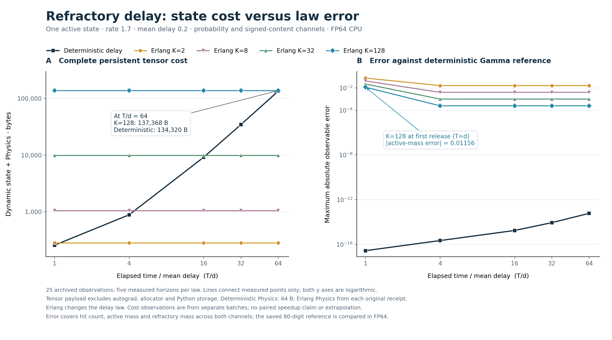

# Fixed Erlang phases: actual state-cost and delay-law ablation

**The finite phase representation bounds dynamic state size, but changes the
refractory law.** All 20 frozen cases completed in 37.7085 wall / 37.5468 CPU
seconds. No case was rerun, clipped, normalized, or given a larger budget.
The original kernel and all old qualification gates remain unchanged.

Execution source was committed before execution at
`5034f0d1be4d694b5777e3d8ced788209c72b4d6`, based on
`15a4abb9e377e0b8e3811caae8f876c7cb79f60a`. `ERLANG_FREEZE.json` binds the
model, study, configuration, and existing independent Gamma reference source.
All before/after hashes match. `review_erlang.py` uses only the standard
library to check actual hashes, state sizes, matrix bytes, reference-error
arithmetic, and conservation; it makes zero model/exponential calls.

## Compared laws and exact scope

Both models start active with two FP64 channels `[1, -0.3]`, lower-hit rate
lambda=1.7, reset to the single active state, mean delay d=1/5, discount .15,
zero active/escape rewards, unit spike reward, and zero terminal payoff.

The archived full state retains a deterministic delay. The new model enters
phase 1 **at each hit**, traverses K exponential stages of rate K/d, and
returns from the last stage to active. Independent pre-exponential checks
verify the actual row generator, row sums, hit/occupation selectors, and
probability/signed-content flow directions. The actual sparse entries and
full-matrix FP64 hash are retained for every case.

The Erlang delay has mean d and variance d^2/K. Its Laplace transform
`(1+s*d/K)^(-K)` tends to `exp(-s*d)` for fixed s>=0. This does not imply
uniform delay-CDF accuracy: the deterministic law has an atom at d. The
experiment measures specified observables and lambda derivatives, including
the difficult first-release time T=d. It does not repair an old QPR result.

For arbitrary release-source inputs, a fixed finite-dimensional linear
time-invariant phase subsystem has rational transfer function
`H(s)=C(sI-A)^(-1)B+D`: the matrix inverse is an adjugate divided by a
polynomial determinant. Pure deterministic delay has transfer function
`exp(-s*d)`, which is not rational for d>0. Therefore this specific fixed-order
linear subsystem class cannot implement an exact deterministic delay for
arbitrary histories. This is not an impossibility claim about every neural
representation, a restricted known input family, nonlinear compression, or
history-dependent representations.

The reference is the unchanged 80-digit finite Gamma renewal sum, with exact
Fraction T/d and the original binary FP64 rate/marks. New semigroups use
`float(T)`; stage rate K/d is exactly representable for this configuration.
No complete-state kernel was imported or executed. There is no varying-input,
event-time reset metadata, continuum-diffusion, encoder-task, or full-network
qualification here.

## Actual accuracy relative to deterministic delay

Each table entry is **maximum absolute value error / maximum absolute lambda
gradient error**, across hit count, active mass, refractory mass, and both
channels. These are measured differences between different laws, not a
replacement admission tolerance.

| T | K=2 | K=8 | K=32 | K=128 |
|---:|---:|---:|---:|---:|
| 0.2 | 7.605797e-2 / 3.634770e-2 | 4.199150e-2 / 2.171389e-2 | 2.234545e-2 / 1.225878e-2 | 1.156038e-2 / 6.558170e-3 |
| 0.8 | 1.610266e-2 / 1.413524e-2 | 4.023171e-3 / 3.530185e-3 | 1.005347e-3 / 8.821362e-4 | 2.514383e-4 / 2.209013e-4 |
| 3.2 | 1.609490e-2 / 1.413073e-2 | 4.023725e-3 / 3.532682e-3 | 1.005931e-3 / 8.831705e-4 | 2.514828e-4 / 2.207926e-4 |
| 6.4 | 1.609490e-2 / 1.413073e-2 | 4.023725e-3 / 3.532682e-3 | 1.005931e-3 / 8.831705e-4 | 2.514828e-4 / 2.207926e-4 |
| 12.8 | 1.609490e-2 / 1.413073e-2 | 4.023725e-3 / 3.532682e-3 | 1.005931e-3 / 8.831705e-4 | 2.514828e-4 / 2.207926e-4 |

At T=d and K=128, the probability-channel errors are +0.0002088495 in
hit count, +0.0115603840 in active mass, and -0.0115603840 in refractory
mass. The corresponding derivative errors are +0.0002420556,
+0.0065581703, and -0.0065581703. Early return changes the first-release
region even though release before d/2 is extremely unlikely at this K.
The discrepancy at T=d depends on delay mass near d, which the much earlier
tail probability `P(delay<d/2)` does not control. No unmeasured convergence
rate near the discontinuity is claimed.

At T=12.8, active/refractory errors are at the floating-point conservation
scale, while cumulative hit and hit-gradient biases persist. Their long-time
limits can be derived independently from the renewal transform

```
Laplace(E[N(T)]) = lambda / (s * (s + lambda - lambda*L_delay(s))).
Erlang-minus-deterministic count offset -> lambda^2*d^2 / (2*K*(1+lambda*d)^2)
lambda derivative of that offset       -> lambda*d^2 / (K*(1+lambda*d)^3)
```

The observed late-time errors are consistent with these offsets. Equal mean
delay gives the same limiting mean firing rate, not the same transient law or
cumulative count. This asymptotic explanation is not a finite-time oracle or
an additional accuracy gate.

## Full state and physical matrix costs

The dynamic state retains active plus all phase channels, upper (zero), hit,
discounted hit, active occupation, value, and discount factor. All tensor
fields, including repeated references, are counted. Logical time is a Fraction;
Python objects, allocator overhead, and autograd tape are covered by process
RSS rather than counted as tensor payload. Discounted/occupation/value fields
are retained but were not independently compared to an analytic oracle here.

| K | Dynamic state bytes | Physics tensor bytes | Combined persistent tensor bytes | Each augmented input matrix bytes | P(delay < d/2) |
|---:|---:|---:|---:|---:|---:|
| 2 | 136 | 144 | 280 | 200 | 0.2642411 |
| 8 | 232 | 816 | 1,048 | 968 | 0.05113362 |
| 32 | 616 | 9,264 | 9,880 | 9,800 | 0.0002761998 |
| 128 | 2,152 | 135,216 | 137,368 | 137,288 | 1.272367e-12 |

Dynamic payload is `16*K+104` bytes, independent of T in this fixed-law
representation. Physics includes the dense `(K+1)^2` generator, two selector
vectors, and three scalars. Two augmented input matrices are evaluated per
case; these columns do not include their outputs or autograd storage.

The archived deterministic T=12.8 result has 134,256 dynamic bytes; its
one-state Physics has eight FP64 entries (64 bytes from the archived source).
Thus K=128 does **not** reduce combined persistent tensor payload at this T.
K=32 uses much less payload at long T, with the measured law bias above.

## Timing, resource bounds, and interpretation

At T=12.8, observed new forward / six-scalar-backward times were:

| K | Forward seconds | Backward seconds |
|---:|---:|---:|
| 2 | 0.002359 | 0.003749 |
| 8 | 0.001867 | 0.003539 |
| 32 | 0.003352 | 0.006385 |
| 128 | 0.007453 | 0.100271 |

The archived deterministic run recorded 0.132786 seconds for advance,
0.001588 seconds for refractory querying, and 2.332774 seconds for six scalar
backward calls at that T. **These are separate execution batches**, not a
paired speed benchmark. No speedup estimate or selection from repeated runs
is used. The new batch's maximum fresh-process RSS was 236,300 KiB, including
imports, reference calculations, forward, and backward. All per-case CPU,
wall, RSS, complete state values, gradients, signed errors, and source hashes
are in the originals.

All twenty cases used one thread and a 4 GiB address-space limit set before
numerical imports; each stayed below 20 wall seconds. Campaign limits were
100 CPU / 150 wall seconds. Every value and gradient was finite. Maximum
independently recomputed probability/signed conservation error was
2.254419e-12, retained without normalization. No probability clipping,
rare-phase pruning, or precision threshold was introduced.

`attempt001/` contains the exact controller and twenty child JSON originals;
`REVIEW.json` contains the independent hash/arithmetic review. The small
dynamic state and observed costs are useful engineering evidence, while the
first-release bias and dense physical matrix cost constrain where this
approximation can replace a deterministic-delay representation.

## Archived state-cost and precision figure



The [vector figure](state-cost-error-comparison.svg) and
[all 25 points with source/receipt hashes](state-cost-error-comparison-data.json)
retain the deterministic observations and all four Erlang stage counts.
Both costs include Physics tensors; the plotted error uses the same saved
Gamma reference. Lines only connect measured points, and the two experiment
batches remain distinct. Regenerate with `python
qualification/hcsn_currentstate/evidence/erlang-compression-20261119/plot_state_cost_error.py`.
This reporting script imports no model and performs no new reference or
training calculation.
