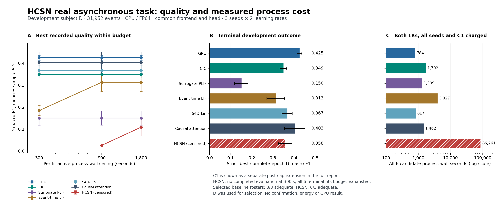

# Recorded training resources and development quality

This is a post-terminal descriptive analysis of the original 42 attempts, with a separately identified view that adds seven C1 continuations. HCSN remains budget-censored; this is not a sufficiently trained seven-core benefit claim. Subject D was used for tuning. Subject E was not scored.

The analysis binds all 49 report hashes to archived evidence, independently recomputes all 2,969 confusion matrices, and checks all 351 original C1 clock intervals. Accuracy is identical; the largest macro-F1 discrepancy is 1.11e-16. The producer performed no model execution.

## Quality at the three originally declared resource cutoffs

Each cell is the mean best recorded D macro-F1 over all three seeds at one common learning rate, selected among .001 and .003 at that cutoff. Explicitly timed before-training evaluations are eligible. Missing observations remain missing; no interpolation or zero filling is used. Diagnostics and startup consume the same budget.

### Original 42 attempts only

| Core | 300 s | 900 s | 1,800 s |
| --- | ---: | ---: | ---: |
| GRU | 0.4250 | 0.4250 | 0.4250 |
| CfC | 0.3490 | 0.3490 | 0.3490 |
| Surrogate PLIF | 0.1500 | 0.1500 | 0.1500 |
| Event-time LIF | 0.1841 | 0.3130 | 0.3130 |
| S4D-Lin | 0.3597 | 0.3597 | 0.3597 |
| Causal attention | 0.4026 | 0.4026 | 0.4026 |
| HCSN (censored) | Missing | 0.0256 | 0.1086 |

### Original 42 plus separate C1

| Core | 300 s | 900 s | 1,800 s |
| --- | ---: | ---: | ---: |
| GRU | 0.4250 | 0.4250 | 0.4250 |
| CfC | 0.3490 | 0.3490 | 0.3490 |
| Surrogate PLIF | 0.1500 | 0.1500 | 0.1500 |
| Event-time LIF | 0.1841 | 0.3130 | 0.3130 |
| S4D-Lin | 0.3669 | 0.3669 | 0.3669 |
| Causal attention | 0.4026 | 0.4026 | 0.4026 |
| HCSN (censored) | Missing | 0.0256 | 0.1086 |

HCSN has no completed evaluation for any of its six candidates by 300 s. At 900 s, the selected .003 roster includes two complete-epoch evaluations and one explicitly timed before-training evaluation. Those details remain visible in RESULT.json. All defined cells select LR .003.

The cutoff is an at-most per-fit process-wall ceiling. Early-stopped fits consume less than the ceiling. C1 adds calendar time and is not retrospectively made part of the original 100-epoch protocol. These views do not claim matched physical energy, identical CPU grants, or simultaneous calendar completion.

## Terminal quality, target crossing and complete candidate cost

The table below uses the separate-C1 view. Quality is the first strict-best complete-epoch result; error bars are sample SD across three seeds, not confidence intervals. All common selected learning rates are .003.

| Core | D macro-F1 mean ± SD | Selected adequate | Median first observed F1 ≥ .30 (s) | All 6 candidates + C1 wall (s) | Max complete-attempt RSS (GiB) |
| --- | ---: | ---: | ---: | ---: | ---: |
| GRU | 0.4250 ± 0.0112 | 3/3 | 55.594 | 784.263 | 0.762 |
| CfC | 0.3490 ± 0.0161 | 3/3 | 155.453 | 1,701.857 | 0.771 |
| Surrogate PLIF | 0.1500 ± 0.0323 | 3/3 | Censored (0/3 crossed) | 1,308.998 | 0.767 |
| Event-time LIF | 0.3130 ± 0.0419 | 3/3 | Censored (1/3 crossed) | 3,926.968 | 0.791 |
| S4D-Lin | 0.3669 ± 0.0243 | 3/3 | 48.694 | 817.098 | 0.758 |
| Causal attention | 0.4026 ± 0.0487 | 3/3 | 66.284 | 1,461.600 | 0.823 |
| HCSN (censored) | 0.3576 ± 0.0318 | 0/3 | 9,586.993 | 86,261.115 | 3.795 |

Target times use the first observed complete-epoch crossing and a uniform epoch-clock convention. They do not locate the crossing between evaluations. A median is reported only if all three selected seeds crossed. The earlier baseline table used some separate later report-clock samples; both versions and their differences are retained in RESULT.json.

The wall-cost column charges both original LRs, every seed, failed memorization, partial interrupted work and C1. It sums overlapping processes and is not campaign calendar time. It excludes separately logged historical tuning, controller/preflight, independent audits, archiving and transfer costs; those remain separate in the evidence cost ledgers. Peak RSS is the maximum complete-attempt process RSS across all six candidates and C1. It is an upper bound for a prefix, not measured target-time memory or GPU VRAM.

Original per-epoch CPU prefixes are measured. C1 cumulative CPU has only a lower bound because the complete original parent exit CPU was not captured. CPU is not substituted for the wall-budget axis. Energy is unmeasured.

## Reproduction and retained scope

[RESULT.json](RESULT.json) preserves both LR rosters, every seed, chosen evaluation, missing observation, censoring, report identities, validation and all costs used in each table. [POINTS.json](POINTS.json) preserves all 2,969 compact recorded points. [PLAN.json](../PLAN.json) was frozen after terminal scores were known and before this calculation; only the three resource cuts and target were prospective in the original campaign.

The full original confusion matrices and clock fields are retained in the authenticated curves archive. The byte-split archive parts reconstruct the original ZIP without recompression. The independent resource review uses a separate implementation and exact rational confusion-matrix arithmetic. Whole-trajectory numerical qualification and independent scientific confirmation remain HOLD.

